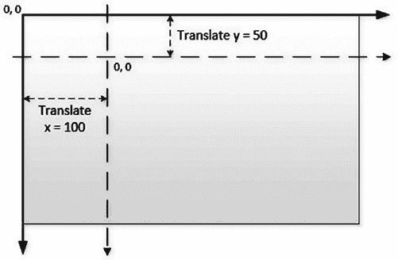
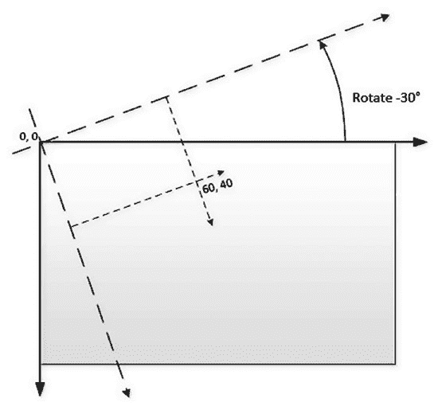
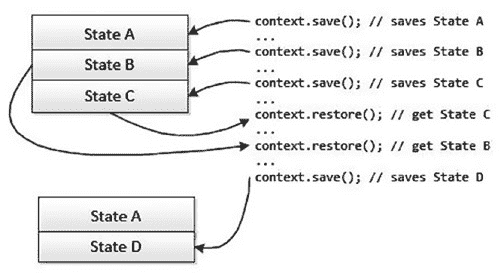
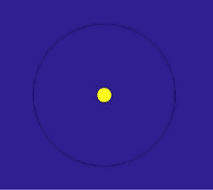
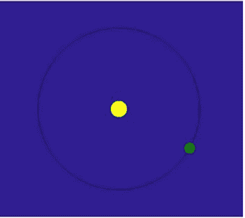
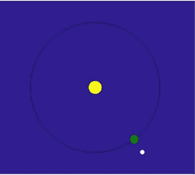
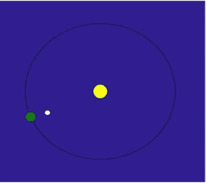
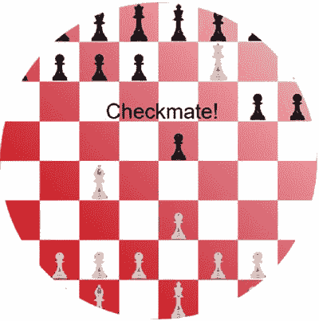
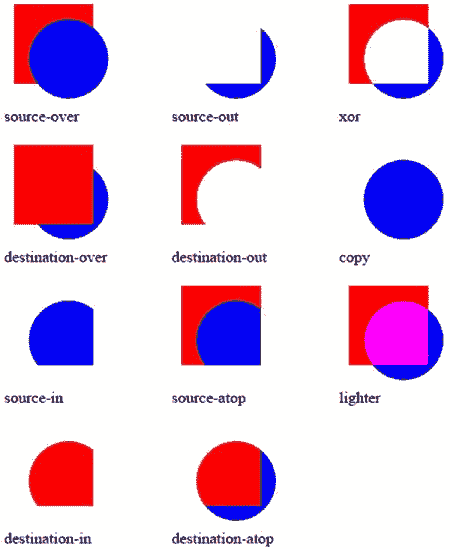
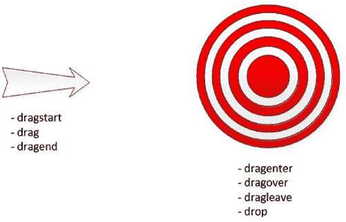

# 实现自动化

要实现自动化，你将创建一个 `makeNextMove()` 函数。该函数将调整棋子的 `x` 和 `y` 位置，然后重新绘制棋盘和所有棋子。你将使用 `setInterval()` 函数重复调用此函数，使棋子依次移动。

## 第 23 章 ■ 画布

### 练习 23-3. 动画化国际象棋棋子

1. 在 `Chess.js` 文件开头附近添加以下以粗体显示的变量：

```javascript
// 定义一个数组来存储 32 个棋子
var pieces = new Array(32);
var moveNumber = -1;
var timer;
```

2. 使用以下代码在 `Chess.js` 文件中实现 `makeNextMove()` 函数。这段代码通过调整棋子的 `x` 和 `y` 属性来“移动”棋子。它跟踪移动编号，并使用该编号调整相应的棋子。第七步会捕获一个棋子并设置其 `killed` 属性。由于这结束了动画，第七步还会使用 `clearInterval()` 函数，以便不再发生计时器事件。每次移动后，棋盘和所有棋子都会被重绘。在第七步之后，该函数还会使用 `fillText()` 方法，该方法用于向画布写入文本。

```javascript
function makeNextMove() {
    function inner() {
        if (moveNumber === 1) {
            pieces[20].y--;
        }
        if (moveNumber === 2) {
            pieces[4].y += 2;
        }
        if (moveNumber === 3) {
            pieces[29].y = 4;
            pieces[29].x = 2;
        }
        if (moveNumber === 4) {
            pieces[6].y++;
        }
        if (moveNumber === 5) {
            pieces[30].x = 5;
            pieces[30].y = 5;
        }
        if (moveNumber === 6) {
            pieces[7].y++;
        }
        if (moveNumber === 7) {
            pieces[30].x = 5;
            pieces[30].y = 1;
            pieces[5].killed = true;
            clearInterval(timer);
        }
        moveNumber++;
        drawBoard();
        drawAllPieces();
        if (moveNumber > 7) {
            chessContext.font = "30pt Arial";
            chessContext.fillStyle = "black";
            chessContext.fillText("Checkmate!", 200, 220);
        }
    }
    return inner;
}
```

3. 将以下代码添加到 `Chess.js` 文件中。这将每 2 秒调用一次 `makeNextMove()` 函数。

```javascript
timer = setInterval(makeNextMove(), 2000);
```

4. 保存更改并刷新浏览器。经过一系列移动后，页面应如图 23-4 所示。

**图 23-4.** 完成的国际象棋棋盘

> **注意：** `makeNextMove()` 函数使用了 JavaScript 中一个经常被误解的特性——闭包，该特性在第 3 章中已经介绍过。此函数定义了另一个名为 `inner()` 的函数，它执行实际工作。然后返回 `inner()` 函数。当计时器到期时，`window` 对象将调用 `makeNextMove()` 函数。然而，它使用的所有变量（例如棋子数组）都将超出作用域。`inner()` 函数将能够访问这些变量，因此这解决了作用域问题。

## 模拟太阳系

对于下一个画布，你将绘制一个移动的太阳系模型。为节省时间，你只需显示地球、太阳和月亮。此实现将利用画布的两个重要特性：

- `路径`

- `变换`

### 使用路径

如前所述，画布支持的唯一简单图形是矩形，你在前面的示例中已经使用过。对于所有其他图形，你必须定义路径。在画布中定义路径的基本方法与 SVG 类似。你使用移动命令设置起点，然后使用线条和曲线命令的组合来绘制图形。

在画布中，你总是从 `beginPath()` 命令开始。调用所需的绘制命令后，通过调用 `stroke()`（绘制图形轮廓）或 `fill()`（填充图形）来完成路径。只有在调用 `stroke()` 或 `fill()` 之后，图形才会实际绘制到画布上。如果在完成当前图形（通过调用 `stroke()` 或 `fill()`）之前再次调用 `beginPath()`，画布将忽略之前的未完成命令。与矩形一起使用的 `strokeStyle` 和 `fillStyle` 属性同样定义了路径的颜色。

实际的绘制命令如下：

- `moveTo()`

- `lineTo()`

- `arcTo()`

- `bezierCurveTo()`

- `quadraticCurveTo()`

此外，还可以使用以下函数进行绘图：

- `closePath()`：执行从当前位置到起始位置的 `lineTo()` 命令，以闭合形状。如果使用 `fill()` 命令且当前不在起始位置，则会自动调用 `closePath()`。

- `arc()`：在指定位置绘制圆弧；无需先移动到该位置。但仍需按路径处理：需先调用 `beginPath()`，且圆弧直到调用 `stroke()` 或 `fill()` 时才真正绘制。

### 绘制圆弧

`arc()` 命令是常用且重要的命令。它接受以下参数：

`arc(x, y, radius, startAngle, endAngle, counterclockwise)`

前两个参数指定圆心的 `x` 和 `y` 坐标。第三个参数指定半径。第四和第五个参数确定圆弧的起始和结束角度。

这些角度基于 x 轴测量：0° 对应圆的最右侧，90° 对应圆的最底部。角度以弧度为单位指定，而非度数。

除非绘制完整圆形，否则圆弧的方向很重要。例如，若从 0° 绘制到 90°，则得到从右侧到底部的四分之一圆弧。但若使用相同端点以逆时针方向绘制，则会得到四分之三圆弧。最后一个参数若为 `true`，则表示以逆时针方向绘制圆弧；该参数可选，省略时默认顺时针方向绘制。

### 使用变换

初次接触 Canvas 变换时可能觉得有些费解，但理解后会发现它们非常有用。首先，变换对已绘制的图形没有影响；相反，它修改后续绘制所使用的网格系统。本章将演示三种变换：

- 平移

- 旋转

- 缩放

如前所述，Canvas 元素使用原点位于左上角的网格系统。因此，点 (100, 50) 表示距离左上角向右 100 像素、向下 50 像素的位置。

变换仅调整网格系统。例如，以下命令将原点向右平移 100 像素、向下平移 50 像素：

`context.translate(100, 50);`

如图 23-5 所示。



**图 23-5.** 平移上下文原点

此时移动至 (10, 20)，因相对于新原点，实际位置（相对于 Canvas）为 (110, 70)。你可能疑惑为何需要这样做。假设要绘制美国国旗（上有 50 颗星），五角星是较复杂的图形，需要多条绘图命令。绘制完第一颗星后，还需用不同坐标重复 49 次。

通过简单向右平移上下文，可用相同坐标值重复相同命令，但星形位于不同位置。当然，也可创建接受 `x`、`y` 参数的 `drawStar()` 函数，然后调用 50 次并传入不同值。但习惯变换后，尤其结合旋转等其他类型，会觉得更方便。

旋转变换不移动原点，而是将 x 轴和 y 轴旋转指定角度。正值为顺时针旋转，负值为逆时针旋转。图 23-6 演示了旋转变换的工作原理。



**图 23-6.** 旋转绘图上下文的网格

> **注意**：此处为了便于理解，角度以度数表示。但 `rotate()` 命令期望弧度值。若几何知识生疏，可记住完整圆为 360° 或 2π 弧度。JavaScript 中可使用 `Math.PI` 属性获取 π 值。例如，30° 是完整圆的 1/12，可表示为 `Math.PI * 2 / 12`。通常弧度计算方法为：`度数 * (Math.PI / 180)`。

可组合使用多个变换。例如，先平移原点再旋转坐标轴；也可再次旋转并平移。每次变换均相对于当前的位置和方向。

#### 保存上下文状态

绘图上下文的状态包括已使用的 `fillStyle`、`strokeStyle` 等属性，以及所有已应用的变换累积结果。若使用多个变换，恢复原始状态可能较困难。幸运的是，绘图上下文提供了保存和恢复状态的功能。

通过调用 `save()` 保存当前状态，该操作将当前状态压入栈中。调用 `restore()` 则弹出最近保存的状态并使其成为当前状态。如图 23-7 所示。



**图 23-7.** 保存和恢复绘图上下文状态

通常应在执行任何变换（尤其是复杂变换）前保存状态。完成需要变换的绘图元素后，可恢复状态。注意，通过设置 `fillStyle` 或执行变换来改变状态，不会影响已绘制的图形。

### 绘制太阳系

掌握这些特性后，让我们绘制一个简单的太阳系模型。

#### 练习 23-4：太阳系建模

1. 创建新网页 `Solar.html`，使用基本标记：

```html
<!DOCTYPE html>
<html lang="en">
<head>
    <meta charset="utf-8" />
    <title>Chapter 23 - Solar System</title>
    <script src="Solar.js" defer></script>
</head>
<body>
</body>
</html>
```

2. 在 `body` 元素内添加 `canvas` 元素：

```html
<canvas id="solarSystem" width="450" height="400">
    Not supported
</canvas>
```

3. 添加新的 `Solar.js` 脚本，使用以下代码。该代码获取 `canvas` 元素并获取 2D 绘图上下文，与前面的示例相同：

```javascript
"use strict";

// Get the canvas context
var solarCanvas = document.getElementById("solarSystem");
var solarContext = solarCanvas.getContext("2d");
```

4. 在 `Solar.js` 文件中添加 `animateSS()` 函数，使用以下代码：

```javascript
function animateSS() {
    var ss = document.getElementById('solarSystem')
    var ssContext = ss.getContext('2d');

    // Clear the canvas and draw the background
    ssContext.clearRect(0, 0, 450, 400);
    ssContext.fillStyle = "#2F1D92";
    ssContext.fillRect(0, 0, 450, 400);
    ssContext.save();

    // Draw the sun
    ssContext.translate(220, 200);
    ssContext.fillStyle = "yellow";
    ssContext.beginPath();
    ssContext.arc(0, 0, 15, 0, Math.PI * 2, true);
    ssContext.fill();

    // Draw the earth orbit
    ssContext.strokeStyle = "black";
    ssContext.beginPath();
    ssContext.arc(0, 0, 150, 0, Math.PI * 2);
    ssContext.stroke();

    ssContext.restore()
}
```

`animateSS()` 函数执行实际工作：清除整个区域并用深蓝色填充。其余代码依赖变换，因此先保存绘图上下文，完成后恢复。

该 `animateSS()` 函数使用 `translate()` 将原点移动到近似位置。

画布的中央。太阳和地球轨道是使用 `arc()` 函数绘制的。请注意，两者的中心点都是 `0, 0`，因为上下文的原点现在位于画布中央。此外，起始角度为 `0`，终止角度为 `Math.PI * 2`。以弧度表示，这是一个完整的圆周，即 360°。

太阳的弧线是填充的，而轨道不是。



第 23 章 ■ Canvas

5. 调用 `setInterval()` 函数，每 100 毫秒调用一次 `animateSS()` 函数。

```javascript
setInterval(animateSS, 100);
```

6. 在浏览器中显示页面。到目前为止，这个绘图还不太有趣；它只是一个带有环绕轨道的太阳，如图 23-8 所示。

***图 23-8.** 初始的太阳系绘图*

现在你将绘制地球并让它沿轨道动画运行。通常，地球每 365.24 天绕太阳公转一周，但我们会加快速度，在 60 秒内完成一周。要确定每次重绘画布时地球的位置，你必须计算经过的秒数。每秒的旋转量计算为 `Math.PI * 2 / 60`。将此值乘以秒数，即可确定地球应该所处的角度。

7. 添加以下以粗体显示的代码。这段代码使用 `rotate()` 函数将绘图上下文旋转到适当的角度。由于地球轨道的弧线半径为 `150px`，这段代码随后使用 `translate()` 函数将上下文向右移动 150 像素，以便在调整后的 `0,0` 坐标处绘制地球。请注意，这是结合了两个独立的变换：一个根据地球在轨道上的位置进行旋转，另一个从太阳平移适当的距离。然后，使用以 `0,0`（上下文的新原点）为中心的填充弧线来绘制地球。

```javascript
// Draw the earth orbit
ssContext.strokeStyle = "black";
ssContext.beginPath();
ssContext.arc(0, 0, 150, 0, Math.PI * 2);
ssContext.stroke();

// Compute the current time in seconds (use the milliseconds
// to allow for fractional parts).
var now = new Date();
var seconds = ((now.getSeconds() * 1000) + now.getMilliseconds()) / 1000;
```



第 23 章 ■ Canvas

```javascript
//---------------------------------------------
// Earth
//---------------------------------------------
// Rotate the context once every 60 seconds
var anglePerSecond = ((Math.PI * 2) / 60);
ssContext.rotate(anglePerSecond * seconds);
ssContext.translate(150, 0);

// Draw the earth
ssContext.fillStyle = "green";
ssContext.beginPath();
ssContext.arc(0, 0, 10, 0, Math.PI * 2, true);
ssContext.fill();

ssContext.restore()
```

8. 保存更改并刷新浏览器。现在你应该能看到地球绕太阳运行，如图 23-9 所示。

***图 23-9.** 将地球添加到绘图中*

现在你将展示月球绕地球运行，这将展示使用变换的真正威力。月球的具体位置基于两个移动的物体。虽然可以使用一些复杂公式（科学家们已经这样做了几个世纪）来计算，但使用变换则无需如此。绘图上下文已根据当前时间（秒数）旋转到适当的角度，然后按轨道半径进行了平移，因此地球现在位于上下文的原点。地球在哪里并不重要；你只需相对于当前原点绘制月球即可。

第 23 章 ■ Canvas

9. 你现在将像绘制地球一样绘制月球。不同的是，原点位于地球上，你将让月球绕地球旋转，而不是原点在太阳上并让地球绕太阳旋转。月球大约每个月绕地球旋转一次；换句话说，地球每绕太阳公转一周，月球会完成大约 12 次公转。因此，你需要将旋转速度提高 12 倍。`anglePerSecond` 现在计算为 `12 * ((Math.PI * 2) / 60)`。添加

# 第 23 章 Canvas

## 绘制月亮

```javascript
// Draw the earth
ssContext.fillStyle = "green";
ssContext.beginPath();
ssContext.arc(0, -0, 10, 0, Math.PI * 2, true);
ssContext.fill();

//---------------------------------------------
// Moon
//---------------------------------------------
// Rotate the context 12 times for every earth revolution
anglePerSecond = 12 * ((Math.PI * 2) / 60);
ssContext.rotate(anglePerSecond * seconds);
ssContext.translate(0, 35);

// draw the moon
ssContext.fillStyle = "white";
ssContext.beginPath();
ssContext.arc(0, 0, 5, 0, Math.PI * 2, true);
ssContext.fill();
ssContext.restore()
```

> **注意** 每个太阳年大约有 12.368 个太阴月。你可以在上述代码中使用这个数值代替 12，使模型更加精确。

10. 保存更改并刷新浏览器。此时你应该可以看到月亮围绕地球旋转，如图 23-10 所示。



**图 23-10.** 包含月亮

## 应用缩放

在完成这个模型之前，还需要做一个小的修正。地球的轨道实际上并非完美的圆形，这个属性被称为离心率。（如果你对轨道离心率感到好奇，可以查阅 [`en.wikipedia.org/wiki/Orbital_eccentricity`](http://en.wikipedia.org/wiki/Orbital_eccentricity) 上的文章。）为了在绘图中模拟这一点，你需要将轨道拉伸，使其宽度略大于高度。为此，你将使用缩放功能。

`scale()` 函数执行第三种变换。此函数接受两个参数，用于指定沿 x 轴和 y 轴的缩放比例。缩放因子为 1 表示正常比例；小于 1 的因子会压缩图形；大于 1 的因子则会拉伸图形。尽管地球轨道的这种不完美特性极其微小，但这里我们会进行夸张处理，对 x 轴使用 1.1 的缩放因子。

在绘制地球轨道之前，添加以下以粗体显示的代码：

```javascript
// Draw the earth orbit
ssContext.scale(1.1, 1);
ssContext.strokeStyle = "black";
```

刷新浏览器；页面应如图 23-11 所示。



**图 23-11.** 添加缩放效果

现在你得到了一个略微变形的轨道。通过简单地更改缩放因子，各种绘图元素都按比例进行了调整。此外，在恢复上下文后，缩放比例也恢复正常，因此后续元素能正确绘制。

> **注意** 图 23-11 中的对齐展示了一次日食，即月球运行到地球和太阳之间，在地球上投下阴影。

## 裁剪画布

我想再介绍一个与路径相关的特性。之前我说过，在调用 `beginPath()` 以及所需的绘图函数后，可以调用 `stroke()` 或 `fill()`。其实还有一个可以调用的函数：`clip()`。`clip()` 函数会使用你刚刚定义的路径，并禁止在该路径之外绘制任何内容。这不会影响已经绘制的内容，但后续所有形状都将被限制在此路径定义的裁剪区域内。

为了演示这一点，我们将回到国际象棋棋盘的示例中，并使用一个圆弧来定义裁剪路径。

转到 `chess.js` 脚本，并在 `drawBoard()` 函数中添加以粗体显示的代码。

```javascript
var gradient = chessContext.createLinearGradient(0, 600, 600, 0);
gradient.addColorStop(0, "#D50005");
gradient.addColorStop(0.5, "#E27883");
gradient.addColorStop(1, "#FFDDDD");

// 裁剪路径
chessContext.beginPath();
chessContext.arc(300, 300, 300, 0, (Math.PI * 2), true);
chessContext.clip();

chessContext.fillStyle = gradient;
chessContext.strokeStyle = "red";

// 绘制交替的方格
```



这会在画板上定义一个圆形区域，任何超出该圆形范围的内容都将不可见。在浏览器中打开 `Chess.html` 文件，效果应如图 23-12 所示。

**图 23-12.** 应用了裁剪路径的国际象棋棋盘

**注意：** 如果在绘制棋盘之后再定义裁剪路径，整个棋盘都会被绘制，但棋子会被裁切，因此任何超出裁剪区域的部分都会被隐藏。

## 理解合成

到目前为止，你绘制的所有图形中，后绘制的图形都会覆盖或隐藏先绘制的图形。这种行为被称为合成。默认行为是 `source-over`，即像你之前看到的那样，将当前图形绘制在画布上已有的图形之上。合成术语中，*source* 指代正在绘制的图形，*destination* 指代已绘制的结果。除了 `source-over` 之外，你还可以使用 `globalCompositeOperation` 属性配置其他 10 种行为。通过观察每种行为的示例，可以更好地理解它们。

在本练习中，你将用一个红色方块与一个蓝色圆形进行重叠。这个操作将重复 11 次，每次为 `globalCompositeOperation` 属性设置不同的值。为了实现这个效果，你需要创建 11 个 canvas 元素，并在每个元素上绘制相同的图形。

### 练习 23-5. 探索合成效果

1.  使用基本标记创建一个新的网页 `Compositing.html`：

```html
<!DOCTYPE html>
<html lang="en">
<head>
<meta charset="utf-8" />
<title>第 23 章 - 合成</title>
<script src="Compositing.js" defer></script>
<link rel="stylesheet" href="Compositing.css" />
</head>
<body>
</body>
</html>
```

2.  在 `body` 元素中，使用以下标记创建 11 个新的 canvas 元素：

```markdown
## 第 23 章 ■ Canvas

```html
<div>
<canvas id="composting1" width="120" height="120"></canvas>
<br />source-over
</div>
<div>
<canvas id="composting2" width="120" height="120"></canvas>
<br />destination-over
</div>
<div>
<canvas id="composting3" width="120" height="120"></canvas>
<br />source-in
</div>
<div>
<canvas id="composting4" width="120" height="120"></canvas>
<br />destination-in
</div>
<div>
<canvas id="composting5" width="120" height="120"></canvas>
<br />source-out
</div>
<div>
<canvas id="composting6" width="120" height="120"></canvas>
<br />destination-out
</div>
<div>
<canvas id="composting7" width="120" height="120"></canvas>
<br />source-atop
</div>
<div>
<canvas id="composting8" width="120" height="120"></canvas>
<br />destination-atop
</div>
<div>
<canvas id="composting9" width="120" height="120"></canvas>
<br />xor
</div>
<div>
<canvas id="composting10" width="120" height="120"></canvas>
<br />copy
</div>
<div>
<canvas id="composting11" width="120" height="120"></canvas>
<br />lighter
</div>
```

3. 创建一个 `Compositing.css` 文件，并包含以下样式规则。这将把 `canvas` 元素格式化为三列，以便你在一个屏幕上看到全部 11 个示例。

```css
body div {
-webkit-column-count: 3;
-moz-column-count: 3;
column-count: 3;
}
```

4. 添加包含以下代码的 `Compositing.js` 文件。

```javascript
"use strict";
for (var i = 1; i <= 11; i++) {
var c = document.getElementById("composting" + i);
var cContext = c.getContext("2d");
cContext.fillStyle = "red";
cContext.fillRect(10, 20, 80, 80);
switch (i) {
case 1: cContext.globalCompositeOperation = "source-over"; break;
case 2: cContext.globalCompositeOperation = "destination-over"; break;
case 3: cContext.globalCompositeOperation = "source-in"; break;
case 4: cContext.globalCompositeOperation = "destination-in"; break;
case 5: cContext.globalCompositeOperation = "source-out"; break;
case 6: cContext.globalCompositeOperation = "destination-out"; break;
case 7: cContext.globalCompositeOperation = "source-atop"; break;
case 8: cContext.globalCompositeOperation = "destination-atop"; break;
case 9: cContext.globalCompositeOperation = "xor"; break;
case 10: cContext.globalCompositeOperation = "copy"; break;
case 11: cContext.globalCompositeOperation = "lighter"; break;
}
cContext.fillStyle = "blue";
```

```javascript
cContext.beginPath();
cContext.arc(65, 75, 40, 0, (Math.PI * 2), true);
cContext.fill();
```



此代码使用了一个 `for` 循环来处理所有 11 个 `canvas` 元素。它先获取对应的元素，再获得其绘图上下文，添加一个红色正方形，然后设置 `globalCompositeOperation` 属性，最后添加一个蓝色圆形，其位置与正方形略微错开。

5. 保存更改，并在浏览器中打开 `Compositing.html` 文件。网页应如图 23-13 所示。

***图 23-13.** 演示合成选项*

合成选项如下：

- `source-over`：这是默认操作。源元素（正在添加的元素）绘制在目标（该位置已有的内容）之上。
- `destination-over`：这是 `source-over` 的反向操作，源元素添加在已有元素之下。
- `source-in`：仅显示源对象中与目标元素重叠的部分。请注意，目标元素完全不显示，它仅作为裁剪形状使用。
- `destination-in`：仅显示目标对象中与源元素重叠的部分。
- `source-out`：仅显示源元素中不与目标元素重叠的部分。
- `destination-out`：仅显示目标元素中不与源元素重叠的部分。
- `source-atop`：源元素显示在目标元素之上，但整个形状被目标元素裁剪。
- `destination-atop`：源元素显示在目标元素之下，但整个形状被源元素裁剪。
- `xor`：仅显示源元素和目标元素中不重叠的部分。
- `copy`：这个名称可能具有误导性。它会绘制源元素并清除其他所有内容。
- `lighter`：绘制源元素和目标元素，重叠区域以更浅的颜色显示。实际颜色由源元素和目标元素的颜色值相加决定。

> **提示** 这些合成选项的名称可能不太直观。建议你保留此图，以便日后在忘记 `copy` 等选项的作用时查阅。

### 本章小结

在本章中，你使用 `canvas` 元素创建了一些图形化网页。你使用矩形和路径在画布上绘制形状，还在画布上添加了图像。画布一个非常强大的功能是应用变换。恰当地使用变换可以显著简化某些复杂的绘图应用程序。

Canvas 与 SVG 有着本质区别。在 SVG 中，每个形状都是一个独立的 DOM 节点。这提供了两个 Canvas 无法实现的重要特性：

- 为单个形状附加事件处理程序。
- 单个形状可以被操作。一个很好的例子是定义 `:hover` 伪规则，当鼠标悬停在形状上时，可以更改该形状的属性。

与 SVG 相反，Canvas 基于像素，这意味着它依赖于分辨率。注意，所有绘图命令都使用了像素位置或大小。当你在 `canvas` 元素上绘制形状时，该画布的像素会被相应调整，最终只保留像素内容的结果。

Canvas 由于其原始像素操作，效率通常会更高。而另一方面，SVG 必须执行大量的渲染（和重新渲染）。然而，对于内容密度较低的大型图像（如地图），SVG 通常性能更好。

在下一章中，你将使用拖放功能来实现一个跳棋游戏。

## 第 24 章 ■ 拖放

选择元素并将其拖动到其他位置的能力，是自然用户体验的一个绝佳范例。我至今还记得早期的苹果电脑，你可以通过将文件拖到垃圾桶图标上来删除它。这个操作，以及成百上千类似的操作，是桌面应用程序用户体验的关键组成部分。然而，Web 应用程序在这一领域远远落后。借助 HTML5 中的拖放（DnD）API，你会发现 Web 应用程序正在快速追赶。

在本章中，你将构建一个实现跳棋游戏的 Web 应用程序，使用 DnD API 在棋盘上移动棋子。我将首先解释概念以及 DnD 应用程序的结构。然后深入代码，演示各个方面。最后，我将介绍一些高级功能，包括在浏览器窗口之间拖放。

### 理解拖放
```

## 第 24 章 ■ 拖放

在开始构建应用程序之前，我想先解释一下 DnD API 的基本概念。这将帮助你在开始编写代码时更好地理解上下文。我首先会解释被触发的事件；了解每个事件在何时、在哪个对象上触发非常重要。然后你将了解`dataTransfer`对象，你可以用它来将信息从被拖动的对象传递给每个事件，并最终传递给放置操作。你还可以使用它来配置拖动操作的各个方面。最后，我将向你展示如何使对象可拖动。

### 处理事件

与桌面端的拖放一样，DnD 是一个基于事件的 API。当用户选择、移动并放下一个项目时，会触发事件，允许应用程序控制和响应这些操作。要有效使用此 API，你需要知道这些事件何时触发以及在哪个元素上触发。起初这可能看起来令人困惑，但一旦你理解了它，就会觉得很直接。

> **提示** 我在第 [20](http://dx.doi.org/10.1007/978-1-4842-2463-2_20) 章中解释了使用事件的基础知识。

在 DnD 操作中，涉及两个元素：

-   正在被拖动的元素，有时称为`源`。
-   被放下的元素，通常称为`目标`。

© Mark J. Collins 2017

M. J. Collins, *Pro HTML5 with CSS, JavaScript, and Multimedia*, DOI 10.1007/978-1-4842-2463-2_24



你可以将此理解为`源`是一个正在被放置在`目标`上的箭头，如图 24-1 所示。

***图 24-1.** `源`元素和`目标`元素*

在 DnD 操作期间，两个元素上都会触发事件，我指出了每个元素上触发的事件。在`源`元素上，`dragstart`、`drag`和`dragend`事件分别对应于 Windows 应用程序中的`mousedown`、`mousemove`和`mouseup`事件。当你单击一个元素并开始移动鼠标时，会触发`dragstart`事件，紧接着是`drag`事件，并且每次鼠标移动都会重复触发`drag`事件。最后，当释放鼠标按钮时，会触发`dragend`事件。

`目标`元素上的事件则更有趣一些。当鼠标在页面上移动时，一旦进入某个元素定义的区域，就会在该元素上触发`dragenter`事件。随着鼠标继续移动，会在`目标`元素上触发`dragover`事件。如果鼠标移出该元素，则会触发`dragleave`事件。此时，鼠标可能位于另一个元素上，那么该元素上就会触发`dragenter`事件。然而，如果在`目标`元素上释放鼠标按钮，则不会触发`dragleave`事件，而是触发`drop`事件。

现在让我们演练一个典型场景，看看这些事件的顺序。如表 24-1 所示。

***表 24-1.** 事件序列*

| 元素 | 事件 | 说明 |
| --- | --- | --- |
| `源` | `dragstart` | 当鼠标被单击并开始移动时触发 |
| `源` | `drag` | |