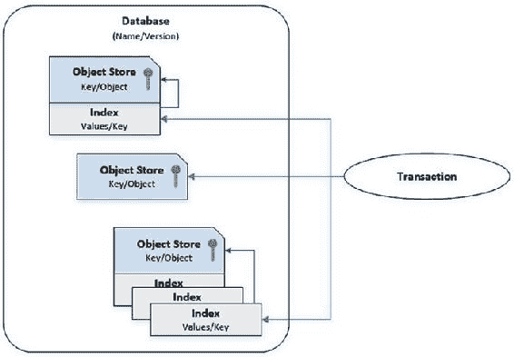

# IndexedDB 实体介绍

我将详细解释这些实体，但首先介绍它们及其关系。

一个数据库由多个*对象存储*（object stores）组成。每个对象存储是一个对象的集合，每个对象通过唯一键（key）标识。一个对象存储可以有一个或多个索引。每个*索引*提供了另一种识别对象存储键的方法。如图 25-1 所示。

© Mark J. Collins 2017

M. J. Collins, *Pro HTML5 with CSS, JavaScript, and Multimedia*, DOI 10.1007/978-1-4842-2463-2_25



**图 25-1.** 数据库实体

对象存储通过*事务*（transaction）对象访问。创建事务时，必须定义其作用域（scope）。这指明了它将引用哪些对象存储，以及是读取还是写入数据库。

### 使用对象存储

主要的存储单元称为对象存储（object store）。这个名称很贴切，因为它们只是通过键引用的对象集合。可以将其视为一组键值对，其中值为具有一组属性的对象。可以使用内联键（inline key），即对象的某个属性作为键。例如，如果对象具有唯一值的`id`属性，可以将其用作内联键。如果使用外联键（out-of-line keys），则在向存储添加对象时需要指定键。或者，可以使用键生成器（key generator），对象存储会自动分配递增的键值。以下代码演示了这些选项：

```javascript
// 使用内联键
var typeStore = db.createObjectStore("pieceType", { keyPath: "id" });
typeStore.add(pieceType);

// 使用外联键
var sampleStore = db.createObjectStore("sample", { });
sampleStore.add(sample, 5);

// 使用键生成器
var pieceStore = db.createObjectStore("piece", { autoIncrement: true });
pieceStore.add(piece);
```

顾名思义，还可以在对象存储上创建索引；实际上，可以创建任意数量的索引。索引可以快速找到特定对象或对象集合。索引是一组键值对，其中值是对应对象存储的键。例如，如果有客户对象存储，并希望按姓氏搜索，可以在对象的`lastName`属性上创建索引。数据库会自动为存储中的每个对象在索引中创建一个条目。该条目包含姓氏和对应对象的键。以下代码演示了如何使用索引：

```javascript
// 在 lastName 属性上创建索引
customerStore.createIndex("lastName", "id", { unique: true });

// 获取索引
var index = customerStore.index("lastName");
index.get(lastName).onsuccess = function(); // 获取对象
index.getKey(lastName).onsuccess = function(); // 获取键
```

`createIndex()`函数的第二个参数（本例中为`id`）指定了键路径（key path）。这告诉数据库引擎如何从对象中提取键。对于内联键，这是用于定义唯一键的属性名。

IndexedDB 不支持对象存储之间的关系。例如，无法强制实施外键关系。当然可以使用外键，即一个对象存储中的属性是另一个对象存储中的键，我将在后面演示。但数据库不会强制实施此约束。此外，也无法在对象存储之间执行连接（join）操作。

### 定义数据库

打开数据库时，需要实现三个事件处理器：

* `onsuccess`：数据库已打开；进行相关操作。
* `onerror`：发生了错误，通常是访问问题。
* `onupgradeneeded`：需要创建或升级数据库。

打开数据库时，如果数据库不存在，会自动创建；但会触发`onupgradeneeded`事件。必须为此事件实现事件处理器，该处理器将创建对象存储并用默认数据填充它们。这是唯一允许更改数据库结构的地方。需要记住的重要一点是：`onupgradeneeded`事件在`onsuccess`事件之前触发。

`open()`调用还指定了版本号。如果不是当前版本，在这种情况下也会触发`onupgradeneeded`事件。事件处理器需要处理结构更改，以匹配调用者请求的版本。可以像这样查询数据库的当前版本：

```javascript
var request = dbEng.open("Sample", 2); // 获取版本 2
request.onupgradeneeded = function (event) {
    alert("Configuring database - current version is " + e.oldVersion +
          ", requested version is " + e.newVersion);
}
```

根据当前版本，代码可能需要执行不同的操作。

### 异步处理

IndexedDB 的一个关键方面可能需要适应，即其异步处理；几乎所有数据库操作都是异步执行的。一般模式是调用一个方法执行数据库操作，如打开数据库或检索一组记录（对象）。这会返回一个请求对象。然后必须为该请求对象实现`onsuccess`和`onerror`事件处理器。如果请求成功，则调用`onsuccess`处理器，并通过事件对象传递方法调用的结果。

对于需要多次数据库调用的复杂处理，需要小心地嵌套事件处理器，并考虑它们的执行时机。例如，如果需要发起三个数据库请求，代码可能如下所示：

```javascript
var request = dbCall1()
request.onsuccess = function (e1) {
    f1(e1.target.result);
    dbCall2().onsuccess = function (e2) {
        f3(e2.target.result, e1.target.result);
        dbCall3().onsuccess = function (e3) {
            f5(e3.target.result, e2.target.result, e1.target.result);
        }
        f4(e2.target.result);
    }
    f2(e1.target.result);
}
request.onerror = function(e) {
    alert("The call failed");
}
```

这段代码依次调用`dbCall1()`、`dbCall2()`和`dbCall3()`，它们将按顺序处理。换句话说，`dbCall2()`不会启动，直到`dbCall1()`完成且成功。每个调用都提供了`onsuccess`事件处理器，该处理器发起下一次调用。如果第一次调用失败，则会弹出警报。可能出乎意料的是非数据库调用的执行顺序。数据库调用立即返回，事件处理器稍后在操作完成时调用。一旦调用`dbCall2()`，函数就返回，然后执行`f2()`。稍后`dbCall2()`完成，其事件处理器被调用，并执行`f3()`。

> **提示：** `onerror`事件会冒泡到层级结构。例如，发生在请求对象上的错误，如果未被处理，将冒泡到事务对象。如果仍未处理，将冒泡到数据库对象。在许多情况下，可以仅在数据库级别使用一个事件处理器来处理所有错误。

由于嵌套方式，事件处理器可以访问先前调用的事件对象。因此，应该为事件参数使用唯一的名称。这样可以避免歧义。另外，注意使用闭包来访问这些事件对象。如前所述，`f2()`在`f3()`之前调用，因此`dbCall1()`的事件处理器（定义了`e1`参数）在`dbCall2()`的事件处理器执行时已完成且不再作用域内。JavaScript 的闭包特性允许后续的事件处理器访问该对象。这一点很重要，因为如果需要访问所有三个对象存储来完成操作，必须等待所有三个都完成，然后访问所有三个结果。


