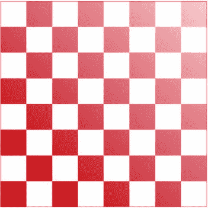

# 排版后的内容

为避免闭包问题，**提示**：你可以从前两次数据库调用中提取所需属性，并将其存储在局部变量中（在 `dbCall1()` 调用之前声明）。然后在 `f5()` 调用中，使用这些变量代替 `e1` 和 `e2` 事件对象。这仅仅是个人偏好问题，因为两种方法都能正常工作。

### 使用事务

所有数据访问（包括读取和写入）都在事务内完成，因此你必须首先创建一个事务对象。创建事务时，需要指定其作用域（由其将要访问的对象存储定义），同时指定模式（只读或读写）。然后，你可以从事务中获取对象存储，并像这样从存储中获取或放入数据：

```
var xact = db.transaction(["piece", "pieceType"], "readwrite");
var pieceStore = xact.objectStore("piece");
```

对于读写事务，数据更改在事务完成前不会提交。

一个值得思考的问题是：“事务何时完成？”当没有未完成的请求时，事务即告完成。请记住，一切都是基于请求的。你发出一个请求，然后实现一个事件处理程序，在请求完成时执行操作。如果该事件处理程序对该事务发出另一个请求，则事务保持活跃状态。这是嵌套事件处理程序的另一个重要原因。如果你在未发出其他请求的情况下结束事件处理程序，事务将完成，所有更改都将提交。如果之后尝试使用该事务，你将收到 `TRANSACTION_INACTIVE_ERR` 错误。

另一点需要记住的是，读写事务的作用域不能重叠。如果你创建了一个读写事务，只要第二个事务不包含与第一个事务相同的对象存储，就可以创建第二个事务。如果它们的作用域重叠，则必须等待第一个事务完成，再创建第二个。而只读事务的作用域可以重叠。

### 创建应用程序

首先，你将使用 Canvas 创建一个棋盘，并为棋子配置图像，就像在[第 23 章](http://dx.doi.org/10.1007/978-1-4842-2463-2_23)中那样。

#### 创建 Web 项目

首先，创建一个 HTML 文档和一个脚本文件。你还需要棋子的图像文件。

#### 第 25 章 ■ Indexed DB

**练习 25-1. 创建 Web 项目**

1. 使用基本标记创建一个名为 `Chess.html` 的新网页：

```
<!DOCTYPE html>
<html lang="en">
<head>
<meta charset="utf-8" />
<title>第 25 章 - 国际象棋</title>
<script src="Data.js" defer></script>
<script src="Chess.js" defer></script>
</head>
<body>
</body>
</html>
```

2. 然后使用以下代码创建一个 `Chess.js` 脚本文件：

```
"use strict";
```

3. 在 `Chess.html` 文件的空 body 元素中添加一个 `div` 元素，使用以下标记：

```
<div>
<canvas id="board" width ="600" height ="600">
不支持
</canvas>
</div>
```

4. 在 Web 项目中添加一个 `Images` 文件夹。

5. 棋子的图像包含在源代码下载文件中。这些与[第 23 章](http://dx.doi.org/10.1007/978-1-4842-2463-2_23)中使用的图像相同。你可以在 `Chapter23\Images` 文件夹中找到它们。将所有 12 个文件拖放到 Web 项目的 `Images` 文件夹中。

#### 绘制 Canvas

现在，你将使用 JavaScript 设计 Canvas 元素。初始设计仅绘制一个空棋盘，稍后你将添加棋子。有关 Canvas 元素的更多说明，请参阅[第 23 章](http://dx.doi.org/10.1007/978-1-4842-2463-2_23)。将清单 25-1 中的代码添加到 `Chess.js` 脚本中。

***清单 25-1.*** 设计初始 Canvas

```
// 获取 Canvas 上下文
var chessCanvas = document.getElementById("board");
var chessContext = chessCanvas.getContext("2d");
```



#### 第 25 章 ■ Indexed DB

```
drawBoard();
function drawBoard() {
chessContext.clearRect(0, 0, 600, 600);
```


`var gradient = chessContext.createLinearGradient(0, 600, 600, 0);`

```
gradient.addColorStop(0, "#D50005");
gradient.addColorStop(0.5, "#E27883");
gradient.addColorStop(1, "#FFDDDD");
chessContext.fillStyle = gradient;
chessContext.strokeStyle = "red";
```

```
// 绘制交替的方格
for (var x = 0; x < 8; x++) {
  for (var y = 0; y < 8; y++) {
    if ((x + y) % 2) {
      chessContext.fillRect(75 * x, 75 * y, 75, 75);
    }
  }
}
```

```
// 为整个棋盘添加边框
chessContext.strokeRect(0, 0, 600, 600);
```

在浏览器中显示 `Chess.html` 文件，其效果应如图 25-2 所示。

**图 25-2.** 初始（空白）棋盘

