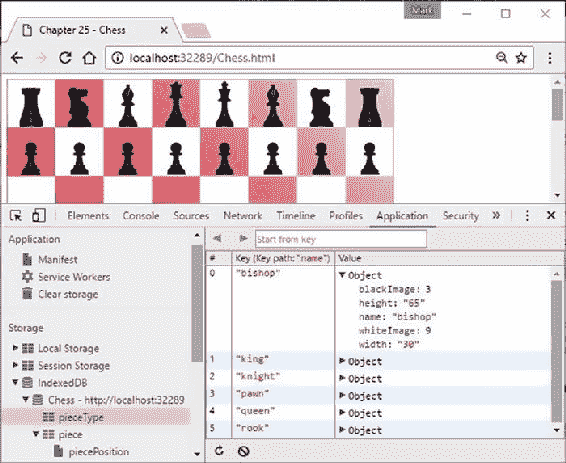
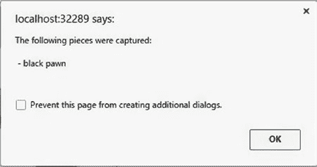
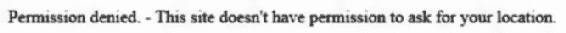
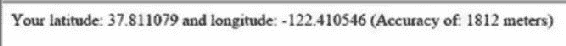
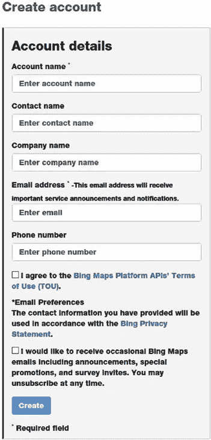
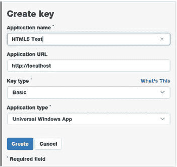
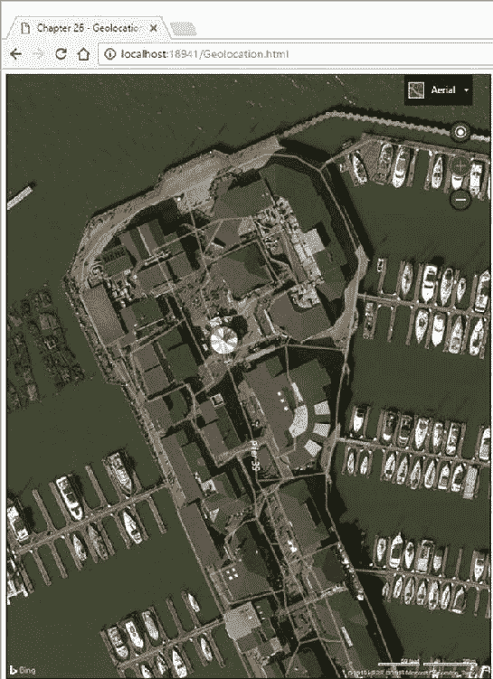

# 第 25 章 ■ Indexed DB

#### 创建数据库

现在你已经准备好创建并使用本地 Indexed DB 数据库来配置和显示棋盘上的棋子了。初始阶段，数据将从静态数据加载，你只需简单地显示开局阵型。稍后，你将通过更新对象存储中的棋子位置来实现动画效果。

你需要向数据库中填充一些数据。在本应用程序中，你只需使用 `Data.js` 脚本中声明的数据，并将其复制到对象存储中。对于其他应用，这些数据可能从服务器下载或由用户输入获得。

#### 打开数据库

将清单 25-3 所示的代码添加到 `Chess.js` 脚本中，紧跟在 `drawBoard()` 调用之后（并在 `drawBoard()` 函数实现之前）。

**清单 25-3.** 打开数据库

```
var dbEng = window.indexedDB ||
  window.webkitIndexedDB || // Chrome
  window.mozIndexedDB || // Firefox
  window.msIndexedDB; // IE
var db; // 这是数据库的句柄
if (!dbEng)
  alert("此浏览器不支持 IndexedDB");
else {
  var request = dbEng.open("Chess", 1);
  request.onsuccess = function (event) {
    db = event.target.result;
  }
  request.onerror = function (event) {
    alert("请允许浏览器打开数据库");
  }
  request.onupgradeneeded = function (event) {
    configureDatabase(event);
  }
}
```

如果无法访问 `indexedDB` 对象，则说明浏览器不支持它。在本演示中，你可以简单地使用 `alert()` 来通知用户并停止后续处理。

然后，此代码使用 `indexedDB` 对象打开 Chess 数据库，并指定使用的版本号。`open()` 方法返回一个 `IDBOpenDBRequest` 对象，正如我之前所述。你将为此请求附加三个事件处理程序。

- `onsuccess`：此事件处理程序仅保存对数据库的引用。稍后你将在此处添加更多逻辑。请注意，数据库是从 `event.target.result` 属性中获取的，所有结果都通过该属性返回。
- `onerror`：浏览器无法打开数据库的主要原因在于浏览器已阻止 IndexedDB 功能。出于安全原因，该功能可能被禁用。在这种情况下，系统会提示用户允许访问。或者，你也可以
```


# 排版后的内容

请选择显示错误信息。

- `onupgradeneeded`：如果数据库不存在或指定的版本不是当前版本，则会触发此事件。这会调用`configureDatabase()`函数，接下来你将实现该函数。

#### 定义数据库结构

将列表 25-4 中显示的代码添加到`Chess.js`脚本中，以实现`configureDatabase()`函数。

**列表 25-4.** 定义数据库结构

```
function configureDatabase(e) {
    alert("Configuring database - current version is " + e.oldVersion +
        ", requested version is " + e.newVersion);
    db = e.currentTarget.result;
    // Remove all existing data stores
    var storeList = db.objectStoreNames;
    for (var i = 0; i < storeList.length; i++) {
        db.deleteObjectStore(storeList[i]);
    }
    // Store the piece types
    var typeStore = db.createObjectStore
        ("pieceType", { keyPath: "name" });
    for (var i in pieceTypes){
        typeStore.add(pieceTypes[i]);
    }
    // Create the piece data store (you'll add
    // the data later)
    var pieceStore = db.createObjectStore
        ("piece", { autoIncrement: true });
    pieceStore.createIndex
        ("piecePosition", "pos", { unique: true });
}
```

第 25 章 ■ IndexedDB

**■ 注意** 如果数据库不存在或不是当前版本，则会调用`configureDatabase()`函数。对于版本变更，你可以使用`db.version`属性获取当前版本，然后进行必要的调整。另外，传递给`onupgradeneeded`事件处理器的事件对象将包含`e.oldVersion`和`e.newVersion`属性。为了简化本项目中的操作，你将简单地删除所有对象存储并从头重建数据库。这将清除所有现有数据。对于这个例子来说没问题，但在大多数情况下，你需要尽可能保留数据。

数据库对象的`objectStoreNames`属性包含所有已创建对象存储的名称列表。要移除所有现有对象存储，列表中的每个名称都会被传递给`deleteObjectStore()`方法。

最初，你将使用`createObjectStore()`方法创建两个数据存储。

- `pieceType`：包含每种棋子类型的对象，例如兵、车或王。
- `piece`：包含每个棋子的对象，黑方 16 个，白方 16 个。

#### 指定对象键

创建对象存储时，你必须在调用`createObjectStore()`方法时指定存储的名称。你还可以指定一个或多个可选参数。只支持两个参数。

- `keypath`：指定为属性名称的集合。如果使用单个属性，你可以将其指定为字符串而不是字符串集合。这定义了将用作键的对象属性（或多个属性）。如果未指定`keypath`，则必须使用键生成器或提供键值来定义键，稍后将在本节中解释。
- `autoIncrement`：如果为`true`，表示键由对象存储按顺序分配。

存储中的每个对象都必须具有唯一的键。有三种指定键的方法。

- 使用`keypath`参数指定一个或多个定义唯一键的属性。当添加对象时，`keypath`用于根据对象的属性生成键。
- 使用键生成器。如果指定了`autoIncrement`，对象存储将基于内部计数器分配键。
- 添加对象时提供键值。如果你没有指定键路径或使用键生成器，则在将对象添加到存储时必须提供键。

对于`pieceType`存储，你将使用`keypath`。`name`属性将指定类型，例如兵或马。这将是每个对象的唯一值。这也是将用于检索对象的值，因此这非常适合作为键路径。创建对象存储后，来自`pieceTypes[]`数组的数据将被复制到`pieceType`存储中。

**■ 注意** 在`onupgradeneeded`事件处理程序中，无需显式创建事务即可将数据添加到对象存储。存在一个隐式事务，该事务是在响应`onupgradeneeded`事件时创建的。

第 25 章 ■ IndexedDB

#### 创建索引

对于`piece`存储，棋子数据中没有自然可用的键，因此你将使用键生成器。它会生成唯一的键，但这些键没有实际意义；它们只是为了满足唯一约束而创建的合成键。最初在绘制棋盘时，你将检索所有对象，因此不需要知道键是什么。

稍后，你将需要检索一个棋子以便移动它。你将根据棋子在其棋盘上的位置来找到它。为此，你将基于`pos`属性向存储添加一个索引。由于没有两个棋子可以占据同一个格子，`pos`属性可以用作唯一索引。通过将其指定为唯一索引，如果你尝试插入一个位置与现有对象相同的新对象，将会收到错误。

**■ 注意** 由于`pos`属性是唯一的，你可能会想将其用作键。但是，因为你会移动棋子，它们的位置会发生变化，使用经常变化的键被认为是一种糟糕的设计模式。对于 IndexedDB 来说，这尤其有问题，因为你实际上无法更改键；你必须删除当前对象，然后使用新键重新添加它。

创建索引时，你必须像这样指定一个`keypath`：

```
pieceStore.createIndex
    ("piecePosition", "pos", { unique: true });
```

在这种情况下，`pos`属性是这个索引的键路径。`keypath`可能包含多个属性，在这种情况下，索引将基于所选属性的组合。当对象存储具有索引时，当对象被添加到存储中时，索引会自动填充。

#### 重置棋盘

你已经创建了`piece`对象存储，但尚未填充数据。你将在单独的函数中执行此操作。

为了理解原因，让我解释一下数据库生命周期。第一次显示网页时，数据库会被打开，由于它不存在，将创建一个新数据库。这是因为会触发`onupgradeneeded`事件，并且你实现了这个事件处理器来创建对象存储。当再次显示页面（或简单刷新）时，由于数据库已存在，将跳过此步骤。

稍后，当你开始移动棋子以及删除它们时，你希望在重新加载页面时将它们移回初始位置。你可以使用此方法来实现。现在，你将使用以下代码向`Chess.js`脚本添加一个`resetBoard()`函数。此函数不是在数据库创建时调用，而是在页面加载时调用。

```
function resetBoard() {
    var xact = db.transaction(["piece"], "readwrite");
    var pieceStore = xact.objectStore("piece");
    var request = pieceStore.clear();
    request.onsuccess = function(event) {
        for (var i in pieces) {
            pieceStore.put(pieces[i]);
        }
    }
}
```

第 25 章 ■ IndexedDB

此代码使用读写模式创建一个事务，并仅指定`piece`对象存储，因为这是你唯一需要访问的。然后从事务中获取`piece`存储。`clear()`方法用于从存储中删除所有对象。最后，`pieces[]`数组中的所有对象都被复制到对象存储中。

现在，将下面以粗体显示的代码添加到`onsuccess`事件处理器中。这将在数据库打开后调用`resetBoard()`函数。

**■ 注意** `onupgradeneeded`事件被触发，其事件处理器必须在`onsuccess`事件被触发之前完成。这确保了数据库在使用前已被正确配置。

```
var request = dbEng.open("Chess", 1);
request.onsuccess = function (event) {
    db = event.target.result;
    **// Add the pieces to the board**
    **resetBoard();**
}
```


# 提示
- **提示**：在`resetBoard()`函数中，你调用了`put()`方法（重复了 32 次）。然而，你没有获取任何响应对象或实现任何事件处理器。这段代码看起来是同步执行的。

实际上，这些调用是异步处理的，并且在两种情况下都会返回响应对象，但返回值被忽略了。你可以为这些请求实现`onsuccess`和`onerror`事件处理器。

在这个例子中，你取了一点巧。由于不像检索数据时需要结果值，你不需要处理`onsuccess`事件。因为这些调用位于一个事务内，其他事务对这些对象存储的后续使用将被阻塞，直到更新完成。

#### 绘制棋子

到目前为止，你已经打开了数据库，并在必要时配置了对象存储。你还用初始位置填充了棋子存储。现在你可以绘制棋子了。为此，你将实现一个`drawAllPieces()`函数来遍历所有棋子，以及一个`drawPiece()`函数来显示单个图像。这些函数类似于你在[第 23 章](http://dx.doi.org/10.1007/978-1-4842-2463-2_23)中创建的同名函数。

然而，这些函数的数据将从新数据库中检索。

`drawAllPieces()`函数将使用一个游标来处理`piece`对象存储中的所有对象。

对于每个棋子，它将提取必要的属性并将它们传递给`drawPiece()`函数。然后`drawPiece()`函数必须访问`pieceType`存储以获取类型属性（如高度和宽度），并在适当的位置显示图像。

# 第 25 章 ■ IndexedDB

#### 使用游标

从对象存储中检索数据时，如果你想使用键检索单个记录，请使用`get()`方法（我将在后面描述）。你也可以使用索引选择一个或多个对象，我将在本章后面解释这一点。要获取所有棋子，你需要访问整个对象存储，这将通过使用游标来完成。

创建事务并获取对象存储后，你将调用它的`openCursor()`方法。这将返回一个`IDBRequest`对象，你需要为其提供一个`onsuccess`事件处理器。当事件触发时，它只提供第一个对象。你可以通过调用`continue()`方法获取下一个对象。为了演示这一点，将清单 25-5 中所示的函数添加到`Chess.js`脚本中。

***清单 25-5.*** 绘制棋子

```
function drawAllPieces() {

var xact = db.transaction(["piece", "pieceType"]);

var pieceStore = xact.objectStore("piece");

var cursor = pieceStore.openCursor();

cursor.onsuccess = function (event) {

var item = event.target.result;

if (item) {

if (!item.value.killed) {

drawPiece(item.value.type,

item.value.color,

item.value.row,

item.value.column,

xact);

}

item.continue();

}

}

}
```

这段代码创建了一个将同时使用`piece`和`pieceType`对象存储的事务。模式未指定，默认值为`readonly`。然后它获取`piece`对象存储并调用其`openCursor()`方法。`onsuccess`事件处理器从事件对象（使用`event.target.result`）获取第一个对象。如果棋子未被吃掉，则调用`drawPiece()`函数显示它（你将在下一步实现该函数）。我稍后会解释`killed`属性。你传入它所需的所有属性，如`type`、`color`、`row`和`column`。你还需要传入事务对象，以便`drawPiece()`函数可以使用同一事务访问`pieceType`存储。

调用`continue()`方法将导致同一事件再次触发，这次在`event.target.result`属性中提供下一个对象。如果没有更多对象，则`result`属性将为`null`。这就是你获知所有对象已处理完毕的方式。

# 第 25 章 ■ IndexedDB

`openCursor()`方法提供了一些基本功能来过滤返回的对象。如果未提供参数，它将返回存储中的所有对象。你可以使用以下方式之一指定键范围：

- `IDBKeyRange.only()`：指定单个值，仅返回匹配的记录。
- `IDBKeyRange.lowerBound()`：仅返回大于指定值的键值。默认情况下这是包含性的，因此它也会返回键值完全匹配的对象，但你可以更改此设置，使其仅返回更大的值。
- `IDBKeyRange.upperBound()`：工作方式与`lowerBound()`类似，不同之处在于它返回小于或等于指定值的值。我将在本章后面演示这一点。
- `IDBKeyRange.bound()`：允许你同时指定下限和上限。你还可以指示这些值中的任一个是否为包含性的。这些值的默认值为`false`，表示不包含。

你还可以向`openCursor()`函数传递第二个参数，以指定返回记录的方向。支持的值定义在`IDBCursorDirection`枚举中。可能的值如下：

- `next`：按递增键顺序返回下一条记录（这是默认值）。
- `prev`：返回前一条记录。
- `nextunique`：返回具有不同键的下一条记录；这忽略重复的键。
- `prevunique`：返回前一条记录，忽略重复的键。

以下示例将返回键大于 3 且小于等于 7 的对象，并按降序返回它们。创建键范围时的最后两个参数表示下限不包含，而上限包含。打开游标时，第二个参数指定应使用反向方向。

```
var keyRange = IDBKeyRange.bound(3, 7, false, true);

store.openCursor(keyRange, IDBCursorDirection.prev);
```

#### 检索单个对象

现在你将实现`drawPiece()`函数，该函数将在棋盘上绘制单个棋子。它必须首先访问`pieceType`对象存储以获取图像细节。在这种情况下，你将使用其键检索单个对象。`pieceType`对象存储的键是`type`属性。将清单 25-6 中所示的函数添加到`Chess.js`脚本中。

***清单 25-6.*** 绘制单个棋子

```
function drawPiece(type, color, row, column, xact) {

var typeStore = xact.objectStore("pieceType");

var request = typeStore.get(type);

request.onsuccess = function (event) {

var img;

if (color === "black") {

img = images[event.target.result.blackImage];

}

else {

img = images[event.target.result.whiteImage];

}

chessContext.drawImage(img,

(75 - event.target.result.width) / 2 + (75 * column),

73 - event.target.result.height + (75 * row),

event.target.result.width,

event.target.result.height);

}

}
```

此代码使用传入的同一个事务对象。它获取`pieceType`对象存储，然后调用其`get()`方法。`onsuccess`事件处理器获取必要的属性并调用画布的`drawImage()`方法。有关在画布上绘制图像的更多信息，请参阅[第 23 章](http://dx.doi.org/10.1007/978-1-4842-2463-2_23)。

现在，通过添加如下所示以粗体显示的代码，在`open()`调用的`onsuccess`事件处理器中添加对`drawAllPieces()`的调用。

```
request.onsuccess = function (event) {

db = event.target.result;

// 将棋子添加到棋盘上

resetBoard();

// 在初始位置绘制棋子

drawAllPieces();

}
```

#### 测试应用程序

现在你可以测试应用程序了，它将显示初始起始位置。刷新浏览器，你应该会看到一个警告，告知正在配置数据库，如图 25-3 所示。

***图 25-3.*** 显示正在配置数据库的警告


# 再次运行此应用程序时，无需再进行此配置。棋盘应如图 25-4 所示。

**图 25-4.** 已完成静态棋子布局的棋盘

---

**提示**：若要从计算机中删除数据库，可找到其存储文件夹并删除对应的子文件夹。以我的机器上的 Firefox 为例，路径为 `C:\Users\Mark\AppData\Roaming\Mozilla\Firefox\Profiles\p1i1rsab.default\storage\default`。此文件夹中每个数据库都有一个子文件夹，子文件夹名称包含协议（`http`）、域名和端口（如有）。对于我的应用程序，该子文件夹名为 `http+++localhost+25519`。删除此文件夹并重启浏览器。由于必须新建数据库，页面将重新配置。对于 Chrome，文件路径为：`C:\Users\Mark\AppData\Local\Google\Chrome\User Data\Default\IndexedDB`。

如果在 Chrome 中打开 `Chess.html` 文件，可通过开发者工具访问此数据库。选择“Application”链接，然后展开“Storage”部分的 `IndexedDB` 项，如图 25-5 所示。



**图 25-5.** 在 Chrome 中查看数据库

---

#### 移动棋子

现在你可以通过移动棋子来让棋盘动态起来了。这里将使用第 23 章中用过的相同预设走法。只需更新棋子的位置并重新绘制棋盘即可移动一个棋子。

不过有一个复杂情况：如果某次移动吃掉了棋子，你需要将其从棋盘上移除。目前，你只需从存储中删除该对象即可，但本章末尾会介绍更好的方法。

### 定义走法

既然你现在对数据库已经相当熟悉了，就把走法也存储在数据库中吧。一次走法由起始位置和终止位置定义。例如，“将 `e2` 处的棋子移动到 `e3`”。你将对这些走法从 1 到 7 编号，以便按正确顺序执行。你需要一个新的对象存储来保存走法详情。为此，需要指定一个新版本，这将触发 `onupgradeneeded` 事件。然后，在 `configureDatabase()` 函数中添加逻辑来创建新存储。

---

**练习 25-2. 添加走法存储**

1. 在调用 `drawBoard()` 函数之前，将以下代码添加到 `Chess.js` 脚本的开头。

```javascript
var moves = [
  { id: 1, start: "e2", end: "e3" },
  { id: 2, start: "e7", end: "e5" },
  { id: 3, start: "f1", end: "c4" },
  { id: 4, start: "h7", end: "h6" },
  { id: 5, start: "d1", end: "f3" },
  { id: 6, start: "g7", end: "g6" },
  { id: 7, start: "f3", end: "f7" }
];
```

2. 将以下以粗体显示的代码添加到 `configureDatabase()` 函数的末尾。这将在配置数据库时创建并填充走法存储。

```javascript
pieceStore.createIndex
("piecePosition", "pos", { unique: true });

// 存储走法
var moveStore = db.createObjectStore
("move", { keyPath: "id" });
for (var i in moves) {
  moveStore.add(moves[i]);
}
```

3. 在 `open()` 调用中，将版本号改为 2（如粗体所示）。这将导致下次加载页面时触发 `onupgradeneeded` 事件。

```javascript
if (!dbEng)
  alert("此浏览器不支持 IndexedDB");
else {
  var request = dbEng.open("Chess", 2);
```

**注意**：在此示例中，`configureDatabase()` 函数会直接删除所有现有数据存储，然后重新创建它们。之所以可以这样做，是因为你无需操心维护任何现有数据；这些数据都是用预设值重新加载的。在许多场景中，你不能这样做，而需要根据当前版本进行具体更改。例如，如果请求版本 5 而当前版本是 2，则需要先添加版本 3 的更改，再添加版本 4 的更改，最后添加版本 5 的更改。在规划结构变更时务必牢记这一点。

---

### 转换位置


# 排版后的内容

棋子存储区中的对象具有 `row`、`column` 和 `pos` 属性。`row` 和 `column` 属性遵循第 23 章中使用的相同约定，即左上角方格位于 `0,0`。这与 canvas 的工作方式一致，并简化了 `drawPiece()` 的实现。相比之下，`pos` 属性使用国际象棋中广泛使用的记谱法，从左到右移动时，列（棋盘纵线）依次为 `a` 到 `h`。从棋盘底部移动到顶部时，行（棋盘横线）依次为 `1` 到 `8`。因此，`a1` 表示左下角的方格。

在开始移动棋子的繁重工作之前，你将创建一个函数，用于将 `pos` 属性转换为 `row` 和 `column` 属性。例如，当一个棋子被移动到 `e3` 时，你需要将 `e3` 转换为对应的 `row` 和 `column` 坐标，即 `5`（行）和 `4`（列）。将清单 25-7 所示的函数添加到 `Chess.js` 脚本中。

***清单 25-7.*** 实现 `computeRowColumn()` 函数

```
function computeRowColumn(oStart, end) {
  oStart.pos = end;
  switch (end.substring(0, 1)) {
    case "a": oStart.column = 0; break;
    case "b": oStart.column = 1; break;
    case "c": oStart.column = 2; break;
    case "d": oStart.column = 3; break;
    case "e": oStart.column = 4; break;
    case "f": oStart.column = 5; break;
    case "g": oStart.column = 6; break;
    case "h": oStart.column = 7; break;
  }
  oStart.row = 8 - parseInt(end.substr(1, 1));
}
```

`oStart` 参数是在起始位置（在我们的示例中为 `e2`）找到的棋子存储区对象。`end` 参数是结束位置 `e3`，该值会被复制到 `pos` 属性，因为这将变为棋子的新位置。

然后，这段代码使用一个 `switch` 语句将 `a`–`h` 的棋盘纵线记法转换为 `0`–`7` 的坐标。该坐标随后存储在 `column` 属性中。`row` 属性的计算方式是取位置字符串的最后一位数字，然后用 `8` 减去该数字。

#### 执行移动

就像你在第 23 章中所做的那样，你将使用一个计时器每隔两秒执行下一步移动。你需要一个计时器变量，以便在动画完成时清除该计时器。你还需要跟踪当前的移动步数。在调用 `drawBoard()` 方法之前，将以下两个以粗体显示的变量添加到 `Chess.js` 脚本中。

```
var moveNumber = 1;
var timer;
drawBoard();
```

**第 25 章 ■ Indexed DB**

移动一个棋子最多需要进行五次数据库调用：

1.  从移动存储区获取下一个对象（该对象定义了起始和结束位置）。
2.  获取起始位置的对象。
3.  获取结束位置的对象（如果该移动是吃子，则只会有一个对象）。
4.  移除结束位置的对象（此步骤仅在某些移动时需要）。
5.  更新起始位置的对象（将其移动到结束位置）。

这些调用都将使用同一个事务进行。正如我在本章开头演示的那样，你需要为每一个调用嵌套 `onsuccess` 事件处理程序。将清单 25-8 所示的 `makeNextMove()` 函数添加到 `Chess.js` 脚本中。

***清单 25-8.*** 实现 `makeNextMove()` 函数

```
function makeNextMove() {
  var xact = db.transaction(["move", "piece"], "readwrite");
  var moveStore = xact.objectStore("move");

  moveStore.get(moveNumber).onsuccess = function (e1) {
    var startPos = e1.target.result.start;
    var endPos = e1.target.result.end;
    var startKey = null;
    var oStart = null;
    var pieceStore = xact.objectStore("piece");
    var index = pieceStore.index("piecePosition");

    index.getKey(startPos).onsuccess = function (e2) {
      startKey = e2.target.result;
      index.get(startPos).onsuccess = function (e3) {
        oStart = e3.target.result;
        // 如果结束位置存在棋子，我们需要更新它以防止出现重复的 pos 索引
        removePiece(endPos, oStart, startKey, pieceStore);
      }
    }
  }
}
```


# 此函数会创建一条事务，同时访问移动存储和棋子存储。模式设置为`readwrite`，因为棋子存储中的对象将被修改。接着它获取移动存储，并调用其`get()`方法，传入当前棋步（即表格的键）。这将返回一个对象，并在`onsuccess`事件处理程序中从结果中提取起始位置和结束位置。

## 第 25 章 ■ IndexedDB

**提示**：请注意，这段代码并未显式定义`request`变量。相反，`onsuccess`事件处理程序直接附加在数据库调用上。在前面的示例中，我声明了一个`request`变量，然后将事件处理程序附加到该变量上，以帮助你理解操作过程。然而，将事件处理程序直接附加到方法上也能达到相同效果，并且让代码更简洁一些。

# 获取对象键

对于棋子存储，你使用了键生成器，因此键并非对象的一部分。`makeNextMove()`函数中的代码将使用基于`pos`属性建立的索引，来检索起始位置处的对象（如果终点位置有棋子，也会检索该位置的对象）。要更新或删除对象，你需要获取其键。

在检索起始位置的棋子对象时，这段代码首先从事务中获取棋子存储。然后从中获取`piecePosition`索引。要获取键值，你需要调用`index.getKey()`方法，该方法会返回所请求起始位置的键。该键值存储在`startKey`变量中。

要获取所需的对象，你需要调用`index.get()`方法，并传入要搜索的位置。这会返回所请求起始位置处的对象，并将其存储在`oStart`变量中。

在这两种情况下，数据都会通过`result`属性返回。同时，处理结果的事件处理程序采用了嵌套形式。

获取到必要的数据后，会调用`removePiece()`方法，并传入以下参数：

* `end`：被移动棋子的终点位置
* `oStart`：表示被移动棋子的对象
* `startID`：`oStart`对象的键
* `pieceStore`：将用于执行更新的棋子存储

# 执行更新

现在你将实现`removePiece()`函数。这个函数的名字可能有些误导，因为它只在必要时才会移除棋子。将清单 25-9 中的代码添加到 Chess.js 脚本中，以实现`removePiece()`函数：

**清单 25-9.** `removePiece()`的实现

```javascript
function removePiece(endPos, oStart, startKey, pieceStore) {
    var index = pieceStore.index("piecePosition");
    index.getKey(endPos).onsuccess = function(e4) {
        var endKey = e4.target.result;
        if (endKey) {
            pieceStore.delete(endKey).onsuccess = function(e5) {
                movePiece(oStart, startKey, endPos, pieceStore)
            }
        } else
            movePiece(oStart, startKey, endPos, pieceStore);
    }
}
```

这段代码获取终点位置的键。如果那里有棋子，它会调用`delete()`方法将其移除，然后在`delete()`方法的`onsuccess`处理程序中调用`movePiece()`函数。

请注意，它并没有检索对象；执行删除操作只需要键。如果那里没有棋子，则直接调用`movePiece()`函数。调用`movePiece()`函数时，它会传入所需的全部数据，包括对象、对象键、终点位置以及将要使用的对象存储。

现在你将实现`movePiece()`函数，该函数将最终执行实际的更新操作。要更新对象，你需要调用`put()`方法。与之前添加棋子时使用的`add()`方法不同，`put()`方法同时需要对象和键。如果不存在具有指定键的对象，则会添加该对象。将清单 25-10 所示的`movePiece()`方法添加到 Chess.js 脚本的末尾。

**清单 25-10.** 实现`movePiece()`函数

```javascript
function movePiece(oStart, startID, end, pieceStore) {
    computeRowColumn(oStart, end);
```


```javascript
var startUpdateReq = pieceStore.put(oStart, startID);

startUpdateReq.onsuccess = function (event) {

moveNumber++;

drawBoard();

drawAllPieces();

if (moveNumber > 7) {

clearInterval(timer);

chessContext.font = "30pt Arial";

chessContext.fillStyle = "black";

chessContext.fillText("Checkmate!", 200, 220);

}

}

}
```

此代码首先使用之前创建的 `computeRowColumn()` 函数计算行和列属性。然后更新对象。在 `onsuccess` 事件处理程序中，它递增 `moveNumber` 变量，并使用现有函数绘制棋盘和所有棋子。最后，如果是最后一步，则清除计时器，并在画布上绘制“将死！”文本。

#### 启动动画

最后一步是启动计时器，以调用 `makeNextMove()` 函数。你将在 `open()` 调用的 `onsuccess` 事件处理程序中执行此操作。添加以粗体显示的代码：

```javascript
var request = dbEng.open("Chess", 2);

request.onsuccess = function (event) {

db = event.target.result;

// 添加棋子到棋盘

resetBoard();

// 在初始位置绘制棋子

drawAllPieces();

// 启动动画

timer = setInterval(makeNextMove, 2000);

}
```

保存更改并刷新浏览器。由于你更改了数据库版本，你应该会看到提示数据库正在配置的警报。经过一系列移动后，你应该会看到如图 25-6 所示的完整棋盘。

**图 25-6.** 完整的棋盘

#### 追踪被吃掉的棋子

当吃掉一个棋子时，你直接删除了该对象，这在棋子不需要显示时是有效的。但是，如果你希望应用程序追踪被吃掉的棋子，你可能希望将该对象保留在存储中。现在，我将展示如何更改代码，使其更新对象而不是删除它。我还将展示如何查询此存储以列出已被吃掉的棋子。

第一步是更改 `removePiece()` 函数。与其删除目标位置的棋子对象，不如更新它并设置 `killed` 属性。由于存在唯一索引，你还需要更改 `pos` 属性。因为棋子不显示，所以位置可以是任意值。为了确保其唯一性，你可以在其唯一 ID 前加上前缀 `X`。此外，通过在前面加上 `X`，你将能够查询到它们，稍后我会解释。

注释掉 `delete()` 调用，并添加以粗体显示的代码：

```javascript
function removePiece(end, oStart, startID, pieceStore) {

var index = pieceStore.index("piecePosition");

index.getKey(end).onsuccess = function (e4) {

var endKey = e4.target.result;

if (endKey) {

// pieceStore.delete (endKey).onsuccess = function (e5) {

// movePiece(oStart, startID, pieceStore);

//}

index.get(endPos).onsuccess = function (e5) {

var oEnd = e5.target.result;

oEnd.pos = 'x' + endKey;

oEnd.killed = true;

pieceStore.put(oEnd, endKey).onsuccess = function (e6) {

movePiece(oStart, startKey, endPos, pieceStore);

}

}

}

else

movePiece(oStart, startID, end, pieceStore);

}

}
```

现在，将清单 25-11 中所示的代码添加到 Chess.js 脚本中，以实现 `displayCapturedPieces()` 函数：

**清单 25-11.** `displayCapturedPieces()` 的实现

```javascript
function displayCapturedPieces() {

var xact = db.transaction(["piece"]);

var textOut = "";

var pieceStore = xact.objectStore("piece");

var index = pieceStore.index("piecePosition");

var keyRange = IDBKeyRange.lowerBound("x");

var cursor = index.openCursor(keyRange);

cursor.onsuccess = function (event) {

var item = event.target.result;

if (item) {

textOut += " - " + item.value.color + " " +

item.value.type + "\r\n";

item.continue();

}

else if (textOut.length > 0)

alert("以下棋子已被吃掉:\r\n" + textOut);

}

}
```


此代码使用单一的 piece 存储创建了一个只读事务。然后获取该存储及其`piecePosition`索引。它使用`x`作为下界定义了一个键范围。这将只返回以`x`或更大字符开头的对象。由于棋盘上的棋子位置以`a`到`h`开头，这些棋子将被排除在外。代码随后遍历游标，将棋子详情拼接成一个文本字符串。结果通过`alert()`函数显示。



## 第 25 章 ■ IndexedDB

**注意** 请注意，键范围中的字符串比较是区分大小写的。如果你使用了大写的`x`，这将无法生效，因为小写的`a`位于大写的`x`之后。W3C 规范提供了关于比较规则如何运作的详细信息。详情请参阅文章 [www.w3.org/TR/IndexedDB/#key-construct](http://www.w3.org/TR/IndexedDB/#key-construct)。

现在，你需要在动画完成后调用此函数。在`movePiece()`函数中显示“将杀！”文本后，添加以下代码行：

```
displayCapturedPieces();
```

保存修改并刷新浏览器。动画结束后，你应该会看到如图 25-7 所示的警告框。

***图 25-7.** 列出已捕获的棋子*

#### 总结

在本章中，你速成学习了 IndexedDB。IndexedDB 能做的事情非常多。由于数据存储在客户端，你避免了与服务器的往返通信。通过一个相当简单的应用程序，你利用了这项新技术的大部分功能。最大的挑战可能是习惯异步处理。示例应用程序通过`onsuccess`事件处理器提供了大量嵌套连续调用的示例。以下是需要记住的一些关键概念：

- 创建数据库，并在数据库打开时通过响应`onupgradeneeded`事件处理器来创建其结构。如有必要，使用版本号来强制升级。
- 存储中的对象必须有一个唯一的键，可以通过内联键的键路径或外联键的键生成器来定义。你也可以在添加对象时手动提供键。
- 所有数据访问（读取和写入）都必须通过事务对象完成。创建事务时，必须指定作用域，即它将使用的对象存储列表，以及所需的访问类型。
- 你可以向一个对象存储添加一个或多个索引。每个索引将对象中的键路径映射到该对象的键。
- 使用游标来处理对象存储中的多个对象。可以通过指定键范围来过滤选中的对象。
- 向对象存储添加对象，并在之后更新它。
- 从对象存储中检索对象。
- 通过指定对象的键，从对象存储中删除对象。
- 使用索引的`getKey()`方法获取对象的键。
- 使用对象存储的`put()`方法来添加或更新对象。`put()`方法需要对象和键。如果指定的键不存在，则会添加该对象。

下一章将演示如何在网页中使用地理定位和地图功能。

---

## 第 26 章 ■ 地理定位与地图

本章将演示两项技术，它们提供了强大的功能，使你能够轻松创建一些有用的网站。地理定位提供了一个标准化的 API，用于确定客户端的位置。地图技术增加了在地图上显示该位置以及其他兴趣点的能力。这两者共同构成了一个有许多实用应用的平台。

在本章中，你将使用地理定位 API 来查找你当前的位置。该位置的精度会因可用硬件和环境的不同而有很大差异。然而，HTML5 定义了一个在所有设备上使用的标准 API，因此你可以提供与设备无关的解决方案。

仅知道经纬度坐标并不实用。为了利用这些数据，你将使用 Bing Maps API 在地图上显示该位置。然后，你可以标记更多的兴趣点，并查看它们与你当前位置的相对关系。

### 理解地理定位

虽然严格来说并非 HTML5 规范的一部分，但 W3C 已定义了一个用于访问地理定位信息的标准 API，该 API 得到了所有主流浏览器当前版本的支持。然而，确定位置的技术因设备能力和客户端环境的不同而有很大差异。

#### 概览地理定位技术

有几种技术可用于确定当前位置，包括以下内容：

- **全球定位系统（GPS）：** GPS 与卫星通信，以极高的精度确定当前位置，尤其是在农村地区。城市中的高楼大厦会影响精度，但在大多数情况下，GPS 能提供良好的结果。最大的限制是它在室内效果不佳。使用 GPS，设备必须配备特定的 GPS 硬件，但这在移动设备上已越来越常见。
- **Wi-Fi 定位：** Wi-Fi 网络覆盖范围相对较短，像 Skyhook Wireless 这样的系统维护着一个庞大的 Wi-Fi 网络及其位置数据库。只要连接到某个 Wi-Fi 网络，就能对位置有相当准确的了解。然而，你通常可能处于多个网络的覆盖范围内，系统可以利用三角测量法以更高的精度确定位置。当然，这要求你的设备支持 Wi-Fi 功能，并且在没有 Wi-Fi 网络的农村地区无法工作。
- **手机基站三角测量：** 这使用了与 Wi-Fi 定位相同的原理，只是使用的是手机基站。但它的精度较低，因为基站覆盖范围大得多。由于所有手机都能与基站通信，这项技术应用广泛。
- **IP 地址段：** 每台连接到互联网的设备都有一个 IP 地址，通常由 ISP 提供。每个 ISP 都拥有一个可用的 IP 地址段，这些地址段通常按地理位置分配。因此，你连接到互联网时所使用的 IP 地址可以提供大致的位置信息，通常是一个大城市区域。然而，有几种因素（如 NAT 地址）可能导致不准确的结果。

以上每种技术都有不同的硬件要求，并提供不同级别的精度。通过地理定位规范，你可以轻松地向浏览器请求当前位置，并让浏览器根据当前硬件和对外部来源（包括卫星、基站和 Wi-Fi 网络）的访问情况，确定提供该位置的最佳方式。

#### 使用地理定位数据

大多数人认为地理定位是一种提供逐向导航的设备，但这只是该技术的一种应用。当然，这需要只有通过 GPS 才能获得的精确位置。然而，即使当前的位置信息没那么精确，你的网站仍然可以利用这些信息创造价值。例如，即使位置仅由 IP 地址确定，这通常也足以设置默认语言。你可能需要允许最终用户覆盖此设置，但你的大多数受众将会看到以其母语显示的初始页面。


# 地理定位与地图绘制

在检索当前位置时，地理定位服务也会返回估计精度。你的应用程序应据此决定提供哪些功能。例如，假设你正在为美国邮政服务创建一个网页，用于显示最近的邮局位置。如果当前位置的精度很高，网页可以显示地图，标示当前位置及附近的邮局。此外，它还可以提供前往每个邮局的预估驾车时间。

然而，如果位置精度较低，页面可以显示一张地图，展示该区域内邮局的分布位置。用户大概知道自己身处何处，并可根据这些信息确定最佳选择。但如果精度很差，页面应提示用户输入邮政编码，然后根据用户输入显示最近的邮局。因此，根据精度不同，应用程序可以优雅地降级功能。

### 使用地理定位 API

为演示如何使用地理定位 API，你将创建一个简单的网页，调用该 API 来确定当前位置。最初，这些数据将以文本形式显示在网页上。稍后，你将在地图上显示该位置。

#### 创建 Web 项目

首先，创建一个与前面章节项目结构相似的网页。

**练习 26-1. 创建 Web 项目**

1. 使用基本标记创建一个名为 `Geolocation.html` 的新网页：

```html
<!DOCTYPE html>
<html lang="en">
<head>
    <meta charset="utf-8" />
    <title>第 26 章 - 地理定位</title>
    <script src="Geolocation.js" defer></script>
</head>
<body>
</body>
</html>
```

2. 然后使用以下代码创建一个 `Geolocation.js` 脚本文件：

```javascript
"use strict";
```

3. 在 `Geolocation.html` 文件的空 `body` 元素中添加一个 `div` 元素，使用以下标记：

```html
<div>
    <span id="lbl"> </span>
</div>
```

#### 使用地理定位对象

地理定位 API 由 `geolocation` 对象提供，你可以通过 `navigator` 对象访问它，如下所示：

```javascript
navigator.geolocation
```

如果返回的是假值（如 `null` 或 `undefined`），则说明当前浏览器不支持地理定位。你可以使用如下代码检查支持情况：

```javascript
if (!navigator.geolocation) {
    alert("地理定位不受支持");
} else {
    // 使用地理定位执行某些操作
}
```

要获取当前位置，请使用 `getCurrentPosition()` 函数，该函数接受三个参数：

- 成功调用时执行的回调函数
- 发生错误时调用的错误回调函数
- 包含零个或多个选项的 `PositionOptions` 集合

最后两个参数可以省略。支持以下选项：

- `maximumAge`：浏览器可以缓存之前的位置并在不实际尝试定位的情况下返回该结果。但 `maximumAge` 属性指定了在不重新查询当前位置的情况下，先前位置可被重复使用的时间（以毫秒为单位）。
- `timeout`：`timeout` 属性指定了浏览器应等待 `geolocation` 对象响应的最长时间，同样以毫秒表示。
- `enableHighAccuracy`：这只是一个对浏览器的提示。如果你特定目的不需要更高精度，将此设置为 `false` 可能会获得更快的响应或消耗更少的电量，这对移动设备来说是一个考虑因素。

如果调用成功，位置信息将传递给指定的回调函数。`Position` 对象包含一个 `coords` 对象，其中包含以下必需属性：

- `latitude`（以度为单位指定）
- `longitude`（以度为单位指定）
- `accuracy`（以米为单位指定）

此外，根据环境和可用硬件，可能还会提供以下可选属性。如果不支持这些属性，它们将被设置为 `null`。（可选属性通常仅在启用 GPS 时可用）。


- `altitude`（以米为单位）
- `altitudeAccuracy`（以米为单位）
- `heading`（以度为单位；正北为 0，正西为 90，以此类推；静止时值为`NaN`）
- `speed`（以米/秒为单位，静止时值为 0）

这些属性可以通过回调函数获取，如下所示：

```javascript
function successCallback(pos) {
  var lat = pos.coords.latitude;
  var long = pos.coords.longitude;
  var accuracy = pos.coords.accuracy + " meters";
}
```

如果调用不成功，`PositionError` 对象将被传递给错误回调函数。该对象包含一个 `code` 属性和一个 `message` 属性。错误码可能取三个值之一。

- 1：`PERMISSION_DENIED`
- 2：`POSITION_UNAVAILABLE`
- 3：`TIMEOUT`

> **警告：** 你的应用会获取位置信息并直接显示（后续会将其绘制在地图上）。然而，你的脚本很容易将这些信息传回服务器，这是一个潜在的隐私问题。由于浏览器无法控制客户端如何利用这些信息，出于隐私考虑，浏览器可能会阻止对 `geolocation` 对象的访问。在这种情况下，会返回 `PERMISSION_DENIED` 错误码。我稍后会对此进行演示。

### 第 26 章 ■ 地理定位与地图

如果客户端正在移动，并且你想持续监控当前位置，你可以通过 `setInterval()` 函数重复调用 `getCurrentLocation()` 函数。为了简化这一过程，`geolocation` 对象包含一个 `watchPosition()` 函数。该函数与 `getCurrentLocation()` 函数接收相同的三个参数（成功回调、错误回调和选项）。每当位置发生变化时，就会调用回调函数。`watchPosition()` 函数返回一个定时器句柄。当你想要停止监控位置时，可以将此句柄传递给 `clearWatch()` 函数，如下所示：`var handle = geolocation.watchPosition(callback);`

```javascript
...
geolocation.clearWatch(handle);
```

#### 显示位置

现在，你将为你的应用添加代码，以获取当前位置并显示它。网页中有一个 `id` 为 `lbl` 的 `span` 元素。你将获取 `geolocation` 对象并调用其 `getCurrentLocation()` 函数。

成功回调函数和错误回调函数都会在 `span` 元素中显示相应的结果。

**练习 26-2. 显示位置**

1. 将以下代码添加到 `Geolocation.js` 脚本中。

```javascript
var lbl = document.getElementById("lbl");
var latitude = 0;
var longitude = 0;

if (navigator.geolocation) {
  navigator.geolocation
    .getCurrentPosition(showLocation,
      errorHandler,
      {
        maximumAge: 100,
        timeout: 6000,
        enableHighAccuracy: true
      });
} else {
  alert("Geolocation not suported");
}

function showLocation(pos) {
  // 保存坐标供后续使用
  latitude = pos.coords.latitude;
  longitude = pos.coords.logitude;
  lbl.innerHTML =
    "您的纬度：" + pos.coords.latitude +
    "，经度：" + pos.coords.longitude +
    "（精确度：" + pos.coords.accuracy + " 米）";
}
```





2. 在浏览器中显示 `Geolocation.html` 文件。当网站首次尝试访问 `geolocation` 对象时，你会看到一个类似图 26-1 所示的提示。

***图 26-1.** 请求地理定位访问权限的提示*

> **注意：** 我在此演示中使用的是 Edge 浏览器。如果你使用不同的浏览器，此提示的行为可能略有不同。

3. 要测试错误处理程序，请选择“否”选项。页面应显示一条错误消息，如图 26-2 所示。

***图 26-2.** 显示访问被拒绝的错误*


4.  使用不同的浏览器打开`Geolocation.html`文件。您当前的定位应如图 26-3 所示。

***图 26-3.** 显示当前定位*

**第 26 章 ■ 地理定位与地图绘制**

我使用的是普通局域网连接的机器，没有蜂窝网络或 GPS 支持，因此它通过 IP 地址来确定位置。因此，定位精度估计为 1.8 公里（约 1 英里）。

■ **注意** 地理定位功能在所有现代浏览器上均可使用。但是，如果你在较老的浏览器（如 IE 8）上尝试此应用，将会看到地理定位不受支持的警报。

### 使用地图平台

仅显示经纬度并不有趣（或实用）。然而，将你的位置与其他兴趣点相关联则更有用。在地图上显示这些信息，并辅以道路和其他参考点，才能真正发挥其价值。幸运的是，地图技术已变得非常先进且易于获取，实现这一点非常简单。

■ **注意** 为了本章的演示，我将使用必应地图。还有其他可用的地图平台。如果你感兴趣，可以查阅[`en.wikipedia.org/wiki/Comparison_of_web_map_services`](http://en.wikipedia.org/wiki/Comparison_of_web_map_services)上的文章，了解不同地图服务的概述。

#### 创建必应地图账户

要使用必应地图，你首先需要设置一个账户，这对开发者来说是免费的。创建账户后，你将获得一个密钥，在访问地图 API 时需要包含此密钥。我将带你完成设置账户的流程。

**练习 26-3. 创建必应地图账户**

1.  访问必应地图网站，地址为：[www.microsoft.com/maps/create-a-bing-maps-key.aspx](http://www.microsoft.com/maps/create-a-bing-maps-key.aspx)。
2.  你需要获取一个密钥来访问地图 API。转到“基础密钥”（Basic Key）选项卡。一个免费的、基础级别的密钥足以完成这些练习。点击页面底部的“获取基础密钥”（Get the Basic Key）链接。
3.  在下一页，你需要使用 Windows Live ID 登录。如果你没有，请点击“创建”（Create）按钮来创建一个账户。
4.  登录后，你应该会看到如图 26-4 所示的“创建账户”（Create account）页面。

    

    **第 26 章 ■ 地理定位与地图绘制**

    ***图 26-4.** “创建账户”页面*

5.  输入账户名称。这仅用于在你拥有多个账户时进行标识；输入“testing”即可。电子邮件地址应从你的 Windows Live 账户自动填入。确保选中复选框以同意使用条款。点击“保存”（Save）按钮创建账户。

    

    **第 26 章 ■ 地理定位与地图绘制**

6.  从“我的账户”（My account）菜单中，选择“我的密钥”（My keys）链接。你可能还没有任何现有密钥，页面将显示“创建密钥”（Create key）对话框。如果没有，请点击链接创建一个新密钥。
7.  在“创建密钥”（Create key）页面，输入应用程序名称，例如`HTML5 test`。对于 URL，请输入**http://localhost**，并在应用程序类型中选择“通用 Windows 应用”（Universal Windows app），如图 26-5 所示。点击“提交”（Submit）按钮。

    ***图 26-5.** 创建密钥*

    ■ **注意** 必应地图会监控你的密钥使用情况。但是，因为你并未实际将其部署到面向公众的网站，所以这一点实际上并不适用。如果你正在开发商业应用程序，可以出于开发目的使用免费密钥，但对于正式网站，你需要购买一个密钥。

8.  密钥生成后，它应该会显示在页面上。请保存此密钥，因为你稍后将用到它。

#### 添加地图

现在，你将向网页中添加地图。首先，在页面中添加一个`div`元素，该元素将包含地图。

你还需要添加一个对用于操作地图的脚本的引用。然后，你将显示地图，并将其中心点设置为你的当前位置。

**第 26 章 ■ 地理定位与地图绘制**

**练习 26-4. 添加地图**

1.  将以下粗体显示的代码添加到`body`元素中，这将添加用于显示地图的`div`。

    ```html
    <body>
        <div>
            <span id="lbl"> </span>
        </div>
        <div id="map">
        </div>
    </body>
    ```

2.  创建一个`Geolocation.css`样式表，并添加以下样式规则，该规则将设置包含地图的`div`的大小。

    ```css
    #map {
        width: 800px;
        height: 1000px;
        border: 1px solid black;
    }
    ```

3.  在`head`元素内添加以下`link`元素，以引用`Geolocation.css`样式表。

    ```html
    <link rel="stylesheet" href="Geolocation.css" />
    ```

4.  在`head`元素内添加以下`script`元素。这将使你的页面能够调用地图 API。此元素需要放在`Geolocation.js`脚本元素之后。

    ```html
    <script
        src="http://www.bing.com/api/maps/mapcontrol?branch=release&callback=DisplayMap"
        async defer>
    </script>
    ```

    **第 26 章 ■ 地理定位与地图绘制**

    这将异步加载地图脚本，并在加载完成后调用`DisplayMap()`函数。

5.  使用以下代码将`DisplayMap()`函数添加到`Geolocation.js`脚本中。你需要插入之前在练习 26-3 中获得的 API 密钥。

    ```javascript
    function DisplayMap() {
        var map = new Microsoft.Maps.Map(document.getElementById('map'),
        {
            credentials: '<use your key here>',
            center: new Microsoft.Maps.Location(latitude, longitude),
            mapTypeId: Microsoft.Maps.MapTypeId.aerial,
            zoom: 20
        });
    ```

    对`Map()`函数的调用接受两个参数：第一个是用于显示地图的 HTML 元素。这是你之前设置的`div`元素，通过`getElementById()`方法获取。第二个参数是一个包含一系列选项的 JSON 对象。`credentials`字段包含你的 API 密钥，`center`字段指定地图的中心点，即由地理定位对象返回的位置。此外，`mapTypeId`指定使用卫星视图，`zoom`设置为 20。

6.  刷新浏览器。根据你的位置，页面应如图 26-6 所示。注意页面右上角的控件。你可以使用它来放大、缩小以及向任意方向平移。你还可以将视图更改为道路或街边视图。

    

    **第 26 章 ■ 地理定位与地图绘制**

    ***图 26-6.** 显示初始地图*

    在调用`Map()`函数指定中心位置时，此代码还将缩放级别设置为 20。根据你的应用需求，你可能不希望在初始时放大到此程度。尝试使用 15 或 16 来查看效果。当然，用户在地图显示后也可以调整缩放级别。

    

    **第 26 章 ■ 地理定位与地图绘制**

#### 添加图钉

现在，你将在地图上显示一些图钉。要添加图钉，首先创建一个`Pushpin`对象，指定其位置。然后将其添加到地图的实体集合中。首先，你将在当前位置添加一个默认图钉。稍后，你将添加自定义图钉来指示兴趣点。

将以下粗体显示的代码添加到`DisplayMap()`函数的末尾：

```javascript
function DisplayMap() {
    var map = new Microsoft.Maps.Map(document.getElementById('map'),
    {
        ...
    });

    var pushpin = new Microsoft.Maps.Pushpin(map.getCenter(), {
        color: 'orange',
        text: 'X',
        title: 'You are here'
    });
    map.entities.push(pushpin);
}
```

`Pushpin()`方法接受一个位置和一个包含选项的 JSON 对象。对于位置，我简单地使用`getCenter()`方法来获取地图的中心点，该中心点是在加载地图时指定的。我也可以像这样创建一个位置对象：

```javascript
new Microsoft.Maps.Location(latitude, longitude)
```


# 对于选项，我将颜色设为橙色，在图钉上添加"X"标记并加上"您在此处"标签。刷新浏览器后，您应该能看到一个指示当前位置的图钉，如图 26-7 所示。

***图 26-7.** 在当前位置添加图钉*

## 第 26 章 ■ 地理定位与地图

网页中最常见的地图应用之一是显示附近位置。例如，您可能有多个门店地点，需要标注每个门店的位置。或者您可能身处警察局，想标出某些犯罪案发位置。又或者您运营公共交通系统，需要显示所有公交站或地铁站的位置。

这些场景本质上相同：您有一组需要在地图上显示的位置集合。您可以根据需要添加任意数量的位置。每个位置只需创建一个图钉对象并添加到实体集合中。如果有多个位置，应让图钉呈现出不同样式，方便用户轻松区分。

此演示中，您将标注附近洗手间的位置。我们将采用常见洗手间图标的图片，而非标准图钉。通常需要根据客户端位置查询服务器获取位置列表，但为简化练习，这里将使用硬编码数据。

> **注意**：我硬编码了洗手间位置，这些位置可能离您当前位置非常远。您可以提供附近的洗手间位置，或者直接覆盖当前坐标以匹配我的数据，这样就能与洗手间位置保持一致。

### **练习 12-5 添加自定义图钉**

1. 源代码下载中包含`restroom.gif`图片文件。将此文件拖拽至您的 Web 项目中。

2. 在现有`Geolocation.js`脚本顶部添加以下声明，用于定义洗手间位置。

```javascript
var restrooms = [
    { lat: 37.810079, long: -122.410806 },
    { lat: 37.809579, long: -122.410206 },
    { lat: 37.811279, long: -122.410446 }
];
```

3. 在`DisplayMap()`函数中创建地图对象之前添加以下代码，这将覆盖当前位置使其靠近洗手间位置。

```javascript
// 测试用覆盖坐标
latitude = 37.810579;
longitude = -122.410546;
```

4. 在`Geolocation.js`脚本末尾添加以下函数。`markRestrooms()`函数遍历数组，为每个位置调用`markRestroom()`函数。`markRestroom()`函数用于添加单个图钉，首先创建定义图片文件及尺寸的选项集合，该选项在创建`Pushpin`对象时传入。

```javascript
function markRestrooms(map) {
    for (var i in restrooms) {
        markRestroom(map, restrooms[i].lat, restrooms[i].long);
    }
}

function markRestroom(map, lat, long) {
    var pushpinOptions = { icon: '/images/restroom.gif', width: 35, height: 35 };
    var pushpin = new Microsoft.Maps.Pushpin
        (new Microsoft.Maps.Location(lat, long), pushpinOptions);
    map.entities.push(pushpin);
}
```

5. 在`DisplayMap()`函数末尾添加此函数调用，以显示额外图钉：

```javascript
// 显示洗手间位置
markRestrooms(map);
```

6. 刷新浏览器，您应能看到洗手间位置处出现图钉，如图 26-8 所示。


***图 26-8.** 添加洗手间图钉*

> **注意**：此数据纯属虚构。若您碰巧在阅读此书时身处旧金山 39 号码头，请勿依照此地图寻找洗手间。

地图 API 还能实现更多功能，例如显示前往所选地点的导航路线，甚至显示当前交通拥堵区域。欢迎访问交互式 SDK：[`www.bing.com/api/maps/sdk/mapcontrol/isdk`](http://www.bing.com/api/maps/sdk/mapcontrol/isdk)。您可以逐一体验各项功能，地图下方会显示对应的 JavaScript 代码。

### 本章小结

在本章中，您将地理定位功能与 Bing Maps 相结合，创建了非常实用的网站。

地理定位请求异步处理。获取地理定位对象后，调用其`getCurrentPosition()`函数并指定成功和失败的回调函数。获取位置后，`Position`对象会传递给回调函数，其中包含纬度、经度和估算精度。若客户端具有 GPS 功能，`Position`对象还会包含海拔、速度和方向。

Bing Maps 等地图平台易于使用且能轻松集成到网页中。在本应用中，您展示了地图并以当前位置为中心，同时添加图钉标注附近洗手间位置。

## 附录 A

## AJAX

在传统 Web 应用（有时称为旧式方法）中，页面渲染后用户进行交互（如登录、输入搜索条件或选择选项），信息随后回传至服务器，新页面返回并在浏览器中渲染。这必然需要服务器往返通信以及下载和渲染新页面。但还有另一种响应更迅速的方式：使用第[18](http://dx.doi.org/10.1007/978-1-4842-2463-2_18)章介绍的 DOM 操作技术直接更新当前页面。为此需要从服务器获取数据，这便是 Ajax 的用武之地。Ajax 的另一个常见用途是仅下载部分页面，在用户阅读已下载内容时，Ajax 在后台加载剩余页面。

*Ajax*是异步 JavaScript 与 XML（Asynchronous JavaScript And XML）的缩写。Ajax 与其说是一项技术，不如说是一种使用多种技术的设计模式。简而言之，Ajax 就是客户端运行的 JavaScript 代码通过服务器调用来获取数据。调用时会注册回调函数处理响应。最初开发此技术时，XML 是预期的响应格式，因此得名。但响应并非必须为 XML，如今多数情况下会采用 JSON 或 HTML 格式。

该概念最早出现在 Internet Explorer 5 中，使用名为`XMLHTTP`的 ActiveX 对象。其他浏览器随后推出了提供类似功能的`XMLHttpRequest`对象。从 IE7 开始，微软也支持`XMLHttpRequest`对象。

> **注意**：Ajax 用于与 RESTful Web 服务通信。要使用 Ajax，您需要了解 RESTful Web 服务的基础知识，例如 HTTP 动词以及请求与响应标头。如果您不熟悉这些内容，建议阅读此文：[`www.drdobbs.com/web-development/restful-web-services-a-tutorial/240169069`](http://www.drdobbs.com/web-development/restful-web-services-a-tutorial/240169069)

## 发起请求

要发起请求，您需要创建`XMLHttpRequest`对象的实例。然后执行以下操作：

- 指定回调函数处理`readystatechange`事件（稍后详述）。
- 打开连接，指定 HTTP 动词（如`GET`、`POST`、`PUT`或`DELETE`）以及要调用的 Web 服务 URL。
- 设置所需的请求标头。
- 发送请求。

© Mark J. Collins 2017


# 附录 A：AJAX

M. J. Collins，《精通 HTML5：CSS、JavaScript 与多媒体》，DOI 10.1007/978-1-4842-2463-2_27

一个简单的 GET 请求，代码可能如下所示：

```
var myRequest = new XMLHttpRequest();

myRequest.onreadystatechange = displayResults;

myRequest.open("GET", url);

myRequest.setRequestHeader("Content-Type", "application/json");

myRequest.send();
```

如果使用 POST 或 PUT 动词，你很可能需要在请求正文中传递数据。在这种情况下，数据通过 `send()` 方法传递。例如：

```
myRequest.send(body);
```

> **警告**：通常情况下，Ajax 调用只能发送到与调用页面同域的服务。例如，如果你的页面来源是 `http://someDomain.com`，那么你只能调用 URL 以 `http://someDomain.com` 开头的服务。存在绕过这些限制的方法，但这超出了本书的讨论范围。

更多信息，请参阅以下文章：[`developer.mozilla.org/en-US/docs/Web/HTTP/Access_control_CORS`](https://developer.mozilla.org/en-US/docs/Web/HTTP/Access_control_CORS)

## 处理响应

你可能已经注意到，有一个单独的回调函数会在请求的就绪状态（或简称状态）每次发生变化时被调用。当收到响应或发生错误时，状态会发生变化，因此你的回调函数需要处理这两种情况。共有五种可能的状态值，当状态变为其中任何一种时，该函数都会被调用：

- 0 - UNSENT（未发送）
- 1 - OPENED（已打开）
- 2 - HEADERS_RECEIVED（已收到响应头）
- 3 - LOADING（加载中）
- 4 - DONE（完成）

在大多数情况下，你不会关心中间状态，只需要知道请求何时完成。你可以使用常量 `XMLHttpRequest.DONE`，其值为 4。回调函数通常会以如下代码开始，以忽略所有其他状态转换：

```
if (myRequest.readyState === XMLHttpRequest.DONE) {
    // ... 执行某些操作
}
```

你还应该将此代码包装在 try/catch 块中，因为某些错误（例如网络错误）会生成异常。接下来你需要做的是检查请求的状态。就绪状态只告诉你请求已完成；你仍然不知道它是否成功。这通过检查 `status` 属性来完成，如下所示：

```
switch(myRequest.status) {
    case 500:  // 服务器错误
        // ...
        break;
    case 404:  // 未找到
        // ...
        break;
    case 200:  // 成功
        // ...
        break;
}
```

> **提示**：返回的状态值是 HTTP 规范（http://www.w3.org/Protocols/rfc2616/rfc2616-sec10.html）定义的标准 HTTP 状态码。这篇 Mozilla 文章提供了一个更简化的版本：[`developer.mozilla.org/en-US/docs/Web/HTTP/Status`](https://developer.mozilla.org/en-US/docs/Web/HTTP/Status)。

假设你获得了成功的状态码 200，那么你需要从响应消息中提取数据。数据将位于 `responseText` 属性中，你需要根据预期的格式对其进行转换。例如，如果返回的是 JSON，你可以像这样获取实际对象：`var data = JSON.parse(myRequest.responseText);`

#### 总结

你通常会使用一个函数来发送请求，并使用另一个不同的函数来处理响应。`XMLHttpRequest` 对象需要被两个函数共享，因此你需要在函数作用域之外声明它。综合起来，一个简单的解决方案如清单 A-1 所示。

***清单 A-1.*** 一个简单的 Ajax 示例

```
var myRequest;
var responseData;

function getData() {
    myRequest = new XMLHttpRequest();
    myRequest.onreadystatechange = getResponse;
    myRequest.open("GET", "http://someDomain.com/resource");
    myRequest.setRequestHeader("Content-Type", "application/json");
    myRequest.send();
}

function getResponse() {
    try {
        // ...
    } catch (e) {
        // ...
    }
}
```


# 排版后的内容

```
if (myRequest.readyState === XMLHttpRequest.DONE) {

switch(myRequest.status) {

case 500:

break;

case 404:

break;

case 200:

responseData = JSON.parse(myRequest.responseText);

break;

}

}

}

catch(ex) {

console.log("Ajax error: " + ex.Description);

}

}
```

当调用`getData()`函数时，假设请求成功，`responseData`对象将保存从服务器返回的数据。当然，您可能需要对数据进行一些处理。为此，`getResponse()`函数应调用另一个函数，该函数将使用刚刚提取的数据。

## 附录 B：拖放源代码

清单 B-1 包含了第 24 章演示的拖放应用程序的最终 JavaScript 实现。

**清单 B-1.** 第 24 章源代码

```
"use strict";

function createBoard() {

var board = document.getElementById("board");

for (var y=0; y < 8; y++) {

var row = document.createElement("div");

row.className = "row";

board.appendChild(row);

for (var x=0; x < 8; x++) {

var square = document.createElement("div");

square.id = x.toFixed() + y.toString();

if ((x + y) % 2) {

square.className = "bblack";

}

else {

square.className = "bwhite";
}

// 如果方格中应该有一个棋子...
if ((x + y) % 2 != 0 && y != 3 && y != 4) {

var img = document.createElement("img");

if (y < 3) {

img.id = "w" +square.id;

img.src = "Images/WhitePiece.png";

}

else {

img.id = "b" + square.id;

img.src = "Images/BlackPiece.png";

}

© Mark J. Collins 2017

M. J. Collins, *Pro HTML5 with CSS, JavaScript, and Multimedia*, DOI 10.1007/978-1-4842-2463-2_28

img.className = "piece";

img.setAttribute("draggable", "true");

square.appendChild(img);

}

square.setAttribute("draggable", "false");

row.appendChild(square);

}

}

}

function allowDrop() {

// 为所有黑色方块绑定目标事件

var squares = document.querySelectorAll('.bblack');

var i = 0;

while (i < squares.length) {

var s = squares[i++];

// 添加事件监听器

s.addEventListener('dragover', dragOver, false);
s.addEventListener('drop', drop, false);
s.addEventListener('dragenter', dragEnter, false);
s.addEventListener('dragleave', dragLeave, false);

}

// 为所有图片绑定源事件

i = 0;

var pieces = document.querySelectorAll('img');

while (i < pieces.length) {

var p = pieces[i++];

p.addEventListener('dragstart', dragStart, false);
p.addEventListener('dragend', dragEnd, false);

}

}
```

```
createBoard();
allowDrop();
```

```
// 处理 dragover 事件
function dragOver(e) {

e.preventDefault();

// 获取正在被拖动的 img 元素

var dragID = e.dataTransfer.getData("text");

var dragPiece = document.getElementById(dragID);

// 变通方法 - 如果无法获取 dataTransfer，暂时不禁止移动，drop 事件会捕获此情况

if (dragPiece) {

if (e.target.tagName === "DIV" &&

isValidMove(dragPiece, e.target, false)) {

e.dataTransfer.dropEffect = "move";

}

else {

e.dataTransfer.dropEffect = "none";

}

}

}
```

```
// 处理 dragstart 事件
function dragStart(e) {

if (e.target.draggable) {

e.dataTransfer.effectAllowed = "move";

e.dataTransfer.setData("text", e.target.id);

e.target.classList.add("selected");

// 使用自定义拖放图像

var dragIcon = document.createElement("img");

dragIcon.src = "Images/smiley.jpg";

e.dataTransfer.setDragImage(dragIcon, 0, 0);

}

}

// 处理 dragend 事件
function dragEnd(e) {

e.target.classList.remove("selected");

}

// 处理 drop 事件
function drop(e) {

e.stopPropagation();

e.preventDefault();

// 获取正在被拖动的 img 元素

var droppedID = e.dataTransfer.getData("text");

var droppedPiece = document.getElementById(droppedID);

if (droppedPiece &&

e.target.tagName === "DIV" &&

isValidMove(droppedPiece, e.target, true)) {

// 在目标位置创建一个新的 img

var newPiece = document.createElement("img");

newPiece.src = droppedPiece.src;
```


```javascript
newPiece.id = droppedPiece.id.substr(0, 1) + e.target.id;

newPiece.draggable = droppedPiece.draggable;

if (droppedPiece.draggable) {
  newPiece.classList.add("jumpOnly");
}

newPiece.classList.add("piece");

newPiece.addEventListener("dragstart", dragStart, false);

newPiece.addEventListener("dragend", dragEnd, false);

e.target.appendChild(newPiece);

// 移除之前的图像
droppedPiece.parentNode.removeChild(droppedPiece);

// 从目标元素移除放置效果
e.target.classList.remove('drop');

// 检查棋子是否需要升变为王
kingMe(newPiece);

// 处理 dragenter 事件
function dragEnter(e) {
  // 获取正在拖拽的 img 元素
  var dragID = e.dataTransfer.getData("text");
  var dragPiece = document.getElementById(dragID);

  if (
    dragPiece &&
    e.target.tagName === "DIV" &&
    isValidMove(dragPiece, e.target, false)
  ) {
    e.target.classList.add('drop');
  }
}

// 处理 dragleave 事件
function dragLeave(e) {
  e.target.classList.remove("drop");
}

function isValidMove(source, target, drop) {
  // 获取棋子的前缀和位置
  var startPos = source.id.substr(1, 2);
  var prefix = source.id.substr(0, 1);

  // 获取目标位置，如果有前缀则去除
  var endPos = target.id;
  if (endPos.length > 2) {
    endPos = endPos.substr(1, 2);
  }

  // 不能放在当前位置
  if (startPos === endPos) {
    return false;
  }

  // 不能放在已有棋子的格子上
  if (target.childElementCount != 0) {
    return false;
  }

  var jumpOnly = false;
  if (source.classList.contains("jumpOnly")) {
    jumpOnly = true;
  }

  // 计算 x 和 y 坐标
  var xStart = parseInt(startPos.substr(0, 1));
  var yStart = parseInt(startPos.substr(1, 1));
  var xEnd = parseInt(endPos.substr(0, 1));
  var yEnd = parseInt(endPos.substr(1, 1));

  switch (prefix) {
    // 白棋规则
    case "w":
      if (yEnd <= yStart)
        return false; // 不能向后移动
      break;
    // 黑棋规则
    case "b":
      if (yEnd >= yStart)
        return false; // 不能向后移动
      break;
  }

  // 以下规则适用于所有棋子
  if (yStart === yEnd || xStart === xEnd)
    return false; // 移动必须是对角线方向

  // 不能移动超过两格
  if (Math.abs(yEnd - yStart) > 2 || Math.abs(xEnd - xStart) > 2)
    return false;

  // 仅允许跳跃移动
  if (Math.abs(xEnd - xStart) === 1 && jumpOnly)
    return false;

  var jumped = false;

  // 如果移动两格，找到被跳过的格子
  if (Math.abs(xEnd - xStart) === 2) {
    var pos =
      ((xStart + xEnd) / 2).toString() +
      ((yStart + yEnd) / 2).toString();
    var div = document.getElementById(pos);
    if (div.childElementCount === 0)
      return false; // 不能跳过空格子

    var img = div.children[0];
    if (img.id.substr(0, 1).toLowerCase() === prefix.toLowerCase())
      return false; // 不能跳过同色棋子

    // 如果该函数是从 drop 事件调用的
    // 移除被跳过的棋子
    if (drop) {
      div.removeChild(img);
      jumped = true;
    }
  }

  // 设置 draggable 属性，以便下一位玩家可以继续
  if (drop) {
    enableNextPlayer(source);
    // 如果跳过了棋子，允许再次行动
    if (jumped) {
      source.draggable = true;
      source.classList.add("jumpOnly"); // 但仅允许再次跳跃
    }
  }

  return true;
}

function kingMe(piece) {
  // 如果已经是王，直接返回
  if (piece.id.substr(0, 1) === "W" || piece.id.substr(0, 1) === "B")
    return;

  var newPiece;

  // 如果是位于第 7 行的白棋
  if (piece.id.substr(0, 1) === "w" && piece.id.substr(2, 1) === "7") {
    newPiece = document.createElement("img");
    newPiece.src = "Images/WhiteKing.png";
    newPiece.id = "W" + piece.id.substr(1, 2);
  }

  // 如果是位于第 0 行的黑棋
  if (piece.id.substr(0, 1) === "b" && piece.id.substr(2, 1) === "0") {
    var newPiece = document.createElement("img");
    newPiece.src = "Images/BlackKing.png";
    newPiece.id = "B" + piece.id.substr(1, 2);
  }

  // 如果创建了新棋子，设置其属性和事件
  if (newPiece) {
    newPiece.draggable = true;
    newPiece.classList.add("piece");
  }
}
```

```javascript
newPiece.addEventListener('dragstart', dragStart, false);
newPiece.addEventListener('dragend', dragEnd, false);

var parent = piece.parentNode;
parent.removeChild(piece);
parent.appendChild(newPiece);
}
}

function `enableNextPlayer(piece)` {
// 获取所有棋子
var pieces = document.querySelectorAll('img');
var i = 0;
while (i < pieces.length) {
var p = pieces[i++];
// 如果是刚移动过的同一颜色，则禁用拖拽
if (p.id.substr(0, 1).toUpperCase() ===
piece.id.substr(0, 1).toUpperCase()) {
p.draggable = false;
}
// 否则，启用拖拽
else {
p.draggable = true;
}
p.classList.remove("jumpOnly");
}
}
```

## 附录 C
## 参考文献

## 第 2 部分：HTML 元素

| **名称** | **元数据** | **章节** | **根元素** | **头部** | **嵌入** | **交互** | **表单** | **短语** | **流式** |
|---|---|---|---|---|---|---|---|---|---|
| `a` | X | X |  |  |  |  |  |  | X |
| `abbr` | X | X |  |  |  |  |  |  | X |
| `address` | X |  |  |  |  |  |  |  | X |
| `area` | X |  |  |  |  |  |  |  | X |
| `article` | X | X |  |  |  |  |  |  | X |
| `aside` | X | X |  |  |  |  |  |  | X |
| `audio` | X | X |  |  | X | X |  |  | X |
| `b` | X | X |  |  |  |  |  |  | X |
| `base` | X |  |  | X |  |  |  |  |  |
| `bdi` | X |  |  |  |  |  |  |  | X |
| `bdo` | X | X |  |  |  |  |  |  | X |
| `blockquote` | X | X |  |  |  |  |  |  | X |
| `body` | X |  |  |  |  |  |  |  |  |
| `br` | X | X |  |  |  |  |  |  | X |
| `button` | X | X |  |  |  | X | X |  | X |
| `canvas` | X | X |  |  |  |  |  |  | X |
| `caption` |  |  |  |  |  |  |  |  |  |
| `cite` | X | X |  |  |  |  |  |  | X |
| `code` | X | X |  |  |  |  |  |  | X |
| `col` |  |  |  |  |  |  |  |  |  |
| `colgroup` |  |  |  |  |  |  |  |  |  |
| `command` | X | X |  |  |  |  |  |  |  |

*（续）*

© Mark J. Collins 2017
M. J. Collins, *Pro HTML5 with CSS, JavaScript, and Multimedia*, DOI 10.1007/978-1-4842-2463-2_29

### 附录 C：参考文献（续）

| **名称** | **元数据** | **章节** | **根元素** | **头部** | **嵌入** | **交互** | **表单** | **短语** | **流式** |
|---|---|---|---|---|---|---|---|---|---|
| `data` | X |  |  |  |  |  |  |  |  |
| `datalist` | X |  |  |  |  |  | X |  | X |
| `dd` |  |  |  |  |  |  |  |  |  |
| `del` | X | X |  |  |  |  |  |  | X |
| `details` | X | X |  |  |  |  |  |  | X |
| `dfn` | X | X |  |  |  |  |  |  | X |
| `div` | X |  |  |  |  |  |  |  | X |
| `dl` | X |  |  |  |  |  |  |  | X |
| `dt` | X |  |  |  |  |  |  |  | X |
| `em` | X | X |  |  |  |  |  |  | X |
| `embed` | X | X |  |  | X | X |  |  | X |
| `fieldset` | X |  |  |  |  |  | X |  | X |
| `figcapture` |  |  |  |  |  |  |  |  |  |
| `figure` | X | X |  |  |  |  |  |  | X |
| `footer` | X |  |  |  |  |  |  |  | X |
| `form` | X |  |  |  |  |  | X |  | X |
| `h1` | X | X |  |  |  |  |  |  | X |
| `h2` | X | X |  |  |  |  |  |  | X |
| `h3` | X | X |  |  |  |  |  |  | X |
| `h4` | X | X |  |  |  |  |  |  | X |
| `h5` | X | X |  |  |  |  |  |  | X |
| `h6` | X | X |  |  |  |  |  |  | X |
| `head` |  |  |  | X |  |  |  |  |  |
| `header` | X |  |  |  |  |  |  |  | X |
| `hr` | X |  |  |  |  |  |  |  | X |
| `html` |  |  | X |  |  |  |  |  |  |
| `i` | X | X |  |  |  |  |  |  | X |
| `iframe` | X | X |  |  | X | X |  |  | X |
| `img` | X | X |  |  | X | X |  |  | X |
| `input` | X | X |  |  |  | X | X |  | X |
| `ins` | X |  |  |  |  |  |  |  | X |
| `kbd` | X | X |  |  |  |  |  |  | X |
| `keygen` | X | X |  |  |  |  | X |  | X |
| `label` | X | X |  |  |  |  | X |  | X |
| `legend` | X |  |  |  |  |  |  |  | X |

*（续）*

### 附录 C：参考文献（续）

| **名称** | **元数据** | **章节** | **根元素** | **头部** | **嵌入** | **交互** | **表单** | **短语** | **流式** |
|---|---|---|---|---|---|---|---|---|---|
| `li` |  |  |  |  |  |  |  |  |  |
| `link` | X |  |  | X |  |  |  |  |  |
| `main` | X |  |  |  |  |  |  |  | X |
| `map` | X |  |  |  |  |  |  |  | X |
| `mark` | X | X |  |  |  |  |  |  | X |
| `math` | X | X |  |  | X |  |  |  | X |
| `menu` | X | X |  |  |  |  |  |  | X |
| `meta` | X |  |  | X |  |  |  |  |  |
| `meter` | X | X |  |  |  |  |  |  | X |
| `nav` | X | X |  |  |  |  |  |  | X |
| `noscript` | X |  |  |  |  |  |  |  | X |
| `object` | X | X |  |  | X | X |  |  | X |
| `ol` | X |  |  |  |  |  |  |  | X |
| `optgroup` |  |  |  |  |  |  |  |  |  |
| `option` |  |  |  |  |  |  |  |  |  |
| `output` | X | X |  |  |  |  | X |  | X |
| `p` | X |  |  |  |  |  |  |  | X |
| `param` |  |  |  |  |  |  |  |  |  |
| `pre` | X |  |  |  |  |  |  |  | X |
| `progress` | X | X |  |  |  |  |  |  | X |
| `q` | X | X |  |  |  |  |  |  | X |
| `rp` |  |  |  |  |  |  |  |  |  |
| `rt` |  |  |  |  |  |  |  |  |  |
| `ruby` | X | X |  |  |  |  |  |  | X |
| `s` | X |  |  |  |  |  |  |  | X |
| `samp` | X | X |  |  |  |  |  |  | X |
| `script` | X | X |  |  |  |  |  |  | X |
| `section` | X | X |  |  |  |  |  |  | X |
| `select` | X | X |  |  |  |  | X |  | X |
| `small` | X | X |  |  |  |  |  |  | X |
| `source` |  |  |  |  |  |  |  |  |  |
| `span` | X | X |  |  |  |  |  |  | X |
| `strong` | X | X |  |  |  |  |  |  | X |
| `style` | X |  |  |  |  |  |  |  |  |
| `sub` | X | X |  |  |  |  |  |  | X |

*（续）*

### 附录 C：参考文献（续）

| **名称** | **元数据** | **章节** | **根元素** | **头部** | **嵌入** | **交互** | **表单** | **短语** | **流式** |
|---|---|---|---|---|---|---|---|---|---|
| `summary` |  |  |  |  |  |  |  |  |  |
| `sup` | X | X |  |  |  |  |  |  | X |
| `svg` | X | X |  |  | X |  |  |  | X |
| `table` | X |  |  |  |  |  |  |  | X |
| `tbody` |  |  |  |  |  |  |  |  |  |
| `td` | X |  |  |  |  |  |  |  |  |
| `template` | X |  |  |  |  |  |  |  | X |
| `textarea` | X | X |  |  |  |  | X |  | X |
| `tfoot` |  |  |  |  |  |  |  |  |  |
| `th` |  |  |  |  |  |  |  |  |  |
| `thead` |  |  |  |  |  |  |  |  |  |
| `time` | X | X |  |  |  |  |  |  | X |
| `title` | X |  |  | X |  |  |  |  |  |
| `tr` |  |  |  |  |  |  |  |  |  |
| `track` |  |  |  |  |  |  |  |  |  |
| `ul` | X |  |  |  |  |  |  |  | X |
| `var` | X | X |  |  |  |  |  |  | X |
| `video` | X | X |  |  | X | X |  |  | X |
| `wbr` | X | X |  |  |  |  |  |  | X |

### 全局属性

以下属性在所有 HTML 元素中都受支持。

#### 通用属性

- `accesskey` - 用于定义键盘快捷键，以激活或聚焦此元素。实际触发该快捷键的键盘组合取决于浏览器和操作系统。更多信息请参阅这篇文章：[`developer.mozilla.org/en-US/docs/Web/HTML/Global_attributes/accesskey`](https://developer.mozilla.org/en-US/docs/Web/HTML/Global_attributes/accesskey)。
- `id` - 一个唯一标识符，这是一个不能包含任何空格字符的字符串，并且在整个 HTML 文档中必须唯一。
- `tabindex` - 一个整数，指定使用 Tab 命令时导航到该元素的顺序。

#### 格式化属性

- `class` - 一个以空格分隔的分类列表，主要用于应用样式。
- `hidden` - 一个布尔属性，如果存在，表示该元素当前不可见。
- `style` - 包含一个或多个 CSS 声明，用于为元素提供内联样式。

#### 文本属性

- `dir` - 指示文本方向，`ltr` 或 `rtl`。默认值为 `auto`，将根据其内容的字符集以及继承的值进行设置（详情请参见第 [5](http://dx.doi.org/10.1007/978-1-4842-2463-2_5) 章）。
- `lang` - 指示内容的语言。
- `spellcheck` - 一个布尔属性，如果存在，表示应对文本进行拼写和语法验证。
- `translate` - 如果浏览器翻译页面时应该翻译元素的内容，则设置为 `yes`；如果不应该翻译，则设置为 `no`。

#### 拖放属性

（详情请参见第 [24](http://dx.doi.org/10.1007/978-1-4842-2463-2_24) 章）

- `draggable`
- `dropzone`

#### 其他属性

- `contenteditable` - 如果内容可编辑，则设置为 `true` 或空字符串；如果不可编辑，则设置为 `false`。
- `contextmenu` - 指示某个上下文菜单的 `id`（目前浏览器支持度较低）。
- `data-*` - 这些是自定义属性，浏览器不会使用，但在客户端脚本中很有用。


# 自闭合标签

- `title` - 关于一个元素的附加信息。

## 自闭合标签

以下 HTML5 元素是自闭合标签，这意味着它们没有单独的开放标签和闭合标签。这也意味着除了属性之外，它们也没有任何内容，因为内容位于开放标签和闭合标签之间。这些也被称为空元素或 void 元素。

- `<area />` - 图像中的一个可选区域
- `<base />` - 文档中任意相对路径的根路径
- `<br />` - 一个换行符，呈现效果类似于回车
- `<col />` - 定义表格中的一列
- `<embed />` - 嵌入的内容
- `<hr />` - 水平分割线，用于表示主题变化
- `<iframe />` - 在当前文档中嵌入另一个网页
- `` - 一张图片或照片
- `<input />` - 一个输入字段，例如表单中的文本框或复选框
- `<link />` - 链接外部资源或相关资源
- `<meta />` - 提供关于当前文档的元数据
- `<param />` - 对象元素内部的一个参数
- `<source />` - 用于引用视频或音频元素的源
- `<track />` - 指定视频或音频元素的轨道
- `<wbr />` - 一个单词换行机会，表明此处可以换行

在 HTML5 中，自闭合标签末尾的“/”是可选的，斜杠前的空格也是可选的。然而，在使用 XHTML（例如使用 XML MIME 类型）时，斜杠是必需的，不过这种情况通常很少见。但我曾见过一些应用程序试图通过一个简单的 XML 验证器来运行 HTML 以进行验证，如果缺少斜杠字符，验证器会报错。

在 Web 开发者中，关于是否包含斜杠字符似乎存在着相当激烈的争论。然而，那些反对使用斜杠的人主要是出于可读性的考虑，这实际上是一个个人偏好的问题。

# 输入类型

单个`input`元素用于所有类型的数据输入，从复选框到日期选择器。`type`属性定义了`input`元素的功能。支持的`type`如下所列。

| 类型 | 描述 | 备注 |
|------|------|------|
| `button` | 一个按钮，没有默认操作 | |
| `checkbox` | 一个复选框 | 使用`checked`属性来默认选中 |
| `color` | 选择一种颜色 | 选择颜色的用户界面可能因浏览器而异 |
| `date`* | 选择日期，不包含时间元素 | |
| `datetime-local`* | 选择日期和时间 | 未定义时区，这是浏览器的本地时间 |
| `email` | 一个接受有效电子邮件地址的文本框 | 验证仅检查格式。如果要输入多个电子邮件，请使用`multiple`属性 |
| `file` | 从客户端设备中选择一个文件 | `accept`属性指定允许的文件类型。使用`multiple`属性来选择多个文件 |
| `hidden` | 没有用户界面，但可以有一个随表单一起提交的值 | |
| `image` | 一个显示图像的按钮 | 使用`src`属性定义要使用的图像 |
| `month`* | 一个仅选择月份和年份（无日）的日期选择器 | |
| `number` | 一个接受数值的文本框 | |
| `password` | 输入被隐藏，例如每个字符显示为星号 | |
| `radio` | 类似于复选框，但同一组中只能选中一个 | |
| `range` | 一个选择相对值的滑块 | `min`、`max`和`step`属性定义了其功能 |
| `reset` | 一个将输入字段重置为原始默认值的按钮 | |
| `search` | 用于输入搜索条件的文本框 | |
| `submit` | 默认操作为提交表单的按钮 | |
| `tel` | 一个接受有效电话号码的文本框 | 必须通过`pattern`属性提供格式规则 |
| `text` | 一个单行文本框，无额外验证 | |
| `time`* | 指定一个时间（小时、分钟、秒） | |
| `url` | 用于输入有效 URL 的文本框 | 使用`pattern`属性定义格式约束 |
| `week`* | 一个选择年份和周（1-53）的日期选择器 | |

`*`表示浏览器支持可能有限。详情请访问 [`html5test.com/index.html`](http://html5test.com/index.html)

# 颜色单位


| 关键词 | 十六进制值 | 十六进制简写 | 红绿蓝值 | 红绿蓝百分比 |
|---------|-----------|-----|-----|--------|
| 黑色 | `#000000` | `#000` | `rgb(0,0,0)` | `rgb(0%,0%,0%)` |
| 海军蓝 | `#000080` | 无简写 | `rgb(0,0,128)` | `rgb(0%,0%,50%)` |
| 蓝色 | `#0000FF` | `#00F` | `rgb(0,0,255)` | `rgb(0%,0%,100%)` |
| 绿色 | `#008000` | 无简写 | `rgb(0,128,0)` | `rgb(0%,50%,0%)` |
| 鸭绿色 | `#008080` | 无简写 | `rgb(0,128,128)` | `rgb(0%,50%,50%)` |
| 酸橙色 | `#00FF00` | `#0F0` | `rgb(0,255,0)` | `rgb(0%,100%,0%)` |
| 水绿色 | `#00FFFF` | `#0FF` | `rgb(0,255,255)` | `rgb(0%,100%,100%)` |
| 栗色 | `#800000` | 无简写 | `rgb(128,0,0)` | `rgb(50%,0%,0%)` |
| 紫色 | `#800080` | 无简写 | `rgb(128,0,128)` | `rgb(50%,0%,50%)` |
| 橄榄色 | `#808000` | 无简写 | `rgb(128,128,0)` | `rgb(50%,50%,0%)` |
| 灰色 | `#808080` | 无简写 | `rgb(128,128,128)` | `rgb(50%,50%,50%)` |
| 银色 | `#C0C0C0` | 无简写 | `rgb(192,192,192)` | `rgb(75%,75%,75%)` |
| 红色 | `#FF0000` | `#F00` | `rgb(255,0,0)` | `rgb(100%,0%,0%)` |
| 紫红色 | `#FF00FF` | `#F0F` | `rgb(255,0,255)` | `rgb(100%,0%,100%)` |
| 黄色 | `#FFFF00` | `#FF0` | `rgb(255,255,0)` | `rgb(100%,100%,0%)` |
| 白色 | `#FFFFFF` | `#FFF` | `rgb(255,255,255)` | `rgb(100%,100%,100%)` |

## 距离单位 – 绝对单位

| 单位 | 定义 |
|------|------------|
| `cm` | 厘米 - 1 英寸等于 2.54 厘米 |
| `mm` | 毫米 - 1 厘米的十分之一 |
| `q` | 四分之一毫米 - 1 厘米的四十分之一 |
| `pc` | 派卡 - 1 英寸等于 6 派卡 |
| `pt` | 点 - 1 英寸等于 72 点 |
| `px` | 像素 - 1 英寸等于 96 像素 |
| `in` | 英寸 - 96 像素、72 点或 6 派卡 |

## 距离单位 – 相对单位

| 单位 | 定义 |
|------|------------|
| `em` | 当前元素的字体大小 |
| `ex` | 当前元素字体的高度 |
| `ch` | 当前字体中字符"0"的宽度 |
| `rem` | 根元素的字体大小 |
| `vw` | 视口宽度的 1% |
| `vh` | 视口高度的 1% |
| `vmin` | 视口较小尺寸的 1% |
| `vmax` | 视口较大尺寸的 1% |

## 角度单位

| 单位 | 定义 |
|------|------------|
| `deg` | 度 - 一个圆有 360° |
| `grad` | 百分度（有时称为 gon 或 grade） - 一个圆有 400 百分度 |
| `rad` | 弧度 - 一个圆有 2π弧度 |
| `turn` | 圈数 - 一个圆有一圈 |

## 时间单位

| 单位 | 定义 |
|------|------------|
| `s` | 秒 |
| `ms` | 毫秒 |

时间单位可以以秒或毫秒指定。必须使用`s`或`ms`后缀；否则该值将被视为数值。数值和单位之间不允许有空格。有效的时间单位有`3s`、`1.5s`、`100ms`。

## CSS 属性列表

| 属性 | 子属性 | 章节 |
|-----------|-----|---------|
| align | `-content` | |
| | `-items` | |
| | `-self` | |
| animation | `-delay` | |
| | `-direction` | |
| | `-duration` | |
| | `-fill-mode` | |
| | `-iteration-count` | |
| | `-name` | |
| | `-play-state` | |
| backface-visibility | | |
| background | `-attachment` | |
| | `-blend-mode` | |
| | `-clip` | |
| | `-color` | |
| | `-image` | |
| | `-origin` | |
| | `-position` | |
| | `-repeat` | |
| | `-size` | |
| border | `-top/-bottom/-left/-right` | |
| | `-collapse` | |
| | `-color` | |
| | `-radius` | |
| | `-spacing` | |
| | `-style` | |
| | `-width` | |
| border-image | `-outset` | |
| | `-repeat` | |
| | `-slice` | |
| | `-source` | |
| | `-width` | |
| box-decoration-break* | | |
| box-shadow | | |
| break* | `-after` | |
| | `-before` | |
| | `-inside` | |
| caption-side | | |
| clear | | |
| color | | |
| column* | `-count` | |
| | `-fill` | |
| | `-gap` | |
| | `-rule` | |
| | `-rule-color` | |
| | `-rule-style` | |
| | `-rule-width` | |
| | `-span` | |
| | `-width` | |
| content | | |
| counter-increment | | |
| counter-reset | | |
| cue* | `-after` | |
| | `-before` | |
| cursor | | |
| direction | | |
| display | | |
| elevation* | | |
| empty-cells | | |
| filter* | | |
| flex | `-basis` | |
| | `-direction` | |
| | `-flow` | |
| | `-grow` | |
| | `-shrink` | |
| | `-wrap` | |
| float | | |
| font | `-family` | |
| | `-feature-setting` | |
| | `-kerning` | |
| | `-language-override*` | |
| | `-size` | |
| | `-size-adjust*` | |
| | `-stretch` | |
| | `-style` | |
| | `-synthesis*` | |
| | `-weight` | |
| font-variant | `-alternatives*` | |
| | `-caps` | |
| | `-east-asian*` | |
| | `-ligatures*` | |
| | `-numeric` | |
| | `-position*` | |
| hanging-punctuation* | | |
| hyphens | | |
| image* | `-orientation` | |
| | `-rendering` | |
| | `-resolution` | |
| justify-content | | |
| layer-background | `-color` | |
| | `-image` | |
| letter-spacing | | |
| line-break* | | |
| line-height | | |
| list-style | `-image` | |
| | `-position` | |
| | `-type` | |
| margin | `-top/-bottom/-left/-right` | |
| marks* | `-after` | |
| | `-before` | |
| marker-offset* | | |
| max-height | | |
| max-width | | |
| min-height | | |
| min-width | | |
| nav | `-down` | |
| | `-index` | |
| | `-left` | |
| | `-right` | |
| | `-up` | |
| object* | `-fit` | |
| | `-position` | |
| opacity | | |
| order | | |
| orphans* | | |
| outline | `-color` | |
| | `-offset` | |
| | `-style` | |
| | `-width` | |
| overflow | | |
| overflow-wrap | | |
| padding | `-top/-bottom/-left/-right` | |
| page-break | `-after` | |
| | `-before` | |
| | `-inside` | |
| perspective | | |
| perspective-origin | | |
| position | | |
| quotes | | |
| resize | | |
| tab-size* | | |
| table-layout | | |
| text | `-align` | |
| | `-align-last*` | |
| | `-autospace*` | |
| | `-combine-upright*` | |
| | `-decoration*` | |
| | `-decoration-color*` | |
| | `-decoration-line*` | |
| | `-decoration-style*` | |
| | `-indent` | |
| | `-justify*` | |
| | `-kashida-space*` | |
| | `-orientation*` | |
| | `-overflow` | |
| | `-shadow` | |
| | `-transform` | |
| | `-underline-position*` | |
| top/bottom/left/right | | |


# CSS 属性

`transform`  
`-origin`  
`-style`  
`transition`  
`-delay`  
`-duration`  
`-property`  
`-timing-function`  
`unicode-bidi`  
`vertical-align`  
`visibility`  
`white-space`  
`windows`  
`width`  
`word-break`  
`word-spacing`  
`word-wrap`  
`writing-mode`  
`z-index`  
`zoom`

*这些属性的浏览器支持有限。*

## 第 4 部分：数组方法

以下方法可用于数组属性。

## 方法列表

| 方法 | 示例 | 描述 |
|------|------|------|
| `concat` | `var newArray = items.concat(array1, array2, ...);` | 返回一个新数组，该数组包含原始数组和作为参数传入的数组的内容。 |
| `copyWithin` | `items.copyWithin(2, 4, 2);` | 将数组中的元素复制到数组中的其他位置。第一个参数指定要复制到的索引，第二个参数指定要复制的起始索引，第三个参数指定结束索引。因此，第二和第三参数之间的元素被复制到第一个参数指定的索引。复制会覆盖现有元素。（*续*） |
| `every` | `var bool = items.every(compareFunc);` | 如果指定的比较函数对数组中的每个元素都返回`true`，则返回`true`。 |
| `fill` | `items.fill("x", 3, 2);` | 用第一个参数的值替换指定元素的值。第二和第三参数表示起始和结束索引。 |
| `filter` | `var subset = items.filter(compareFunc);` | 对数组中的每个元素执行比较函数，并返回比较函数返回`true`的元素集合。 |
| `find` | `var item = items.find(compareFunc);` | 返回数组中第一个满足指定比较函数返回`true`的元素。 |
| `findIndex` | `var i = items.findIndex(compareFunc);` | 返回数组中第一个满足指定比较函数返回`true`的元素的索引。 |
| `forEach` | `items.forEach(function);` | 为数组中的每个元素调用指定的函数。 |
| `indexOf` | `var i = items.findIndex(compareFunc, 2);` | 返回数组中第一个满足指定比较函数返回`true`的元素的索引。第二个参数表示从数组中的哪个位置开始搜索（默认为 0）。 |
| `join` | `items.join("; ");` | 将元素输出为一个字符串，每个元素由指定的字符串分隔。 |
| `lastIndex` | `var i = items.findIndex(compareFunc);` | 返回数组中第一个满足指定比较函数返回`true`的元素的索引。 |
| `map` | `var newArray = items.map(function);` | 创建一个与现有数组大小相同的新数组。每个元素都是通过对原始数组中对应的元素调用指定函数创建的。 |
| `pop` | `var item = items.pop();` | 从数组中移除最后一个元素并返回它。 |
| `push` | `var l = items.push("xyz");` | 将指定元素添加到数组末尾并返回新的长度。 |
| `reduce` | `var v = items.reduce(aggrFunc, initial);` | 通过将指定函数应用于每个元素（从第一个元素开始），将数组缩减为单个值。 |
| `reduceRight` | `var v = items.reduceRight(aggrFunc, initial);` | 通过将指定函数应用于每个元素（从最后一个元素开始并反向进行），将数组缩减为单个值。 |
| `reverse` | `items.reverse();` | 按字母顺序反向排序元素。 |
| `shift` | `var item = items.shift();` | 移除数组的第一个元素并返回它。剩余元素的索引下移一位，因此第二个元素（现在是第一个）的索引为 0。（*续*） |
| `slice` | `var subArray = items.slice(2, 3);` | 从数组中移除元素并以新数组的形式返回它们。第一个参数指定从哪里开始，第二个参数指定应移除多少个元素。 |
| `some` | `var bool = items.every(compareFunc);` | 如果指定的比较函数对数组中的至少一个元素返回`true`，则返回`true`。 |
| `sort` | `items.sort();` | 按字母顺序对列表中的项目进行排序。 |
| `splice` | `items.splice(2, 1, "x", 'y', "z");` | 首先根据前两个参数（起始元素和要移除的元素数量）从数组中移除元素，然后插入后续参数指定的元素。 |


#### 数组方法

## `toString`

`items.toString();`

将每个元素输出为一个以逗号分隔的字符串。

## `unshift`

`var l = items.unshift("abc");`

将指定元素添加到数组的开头（索引为 0），并将其余索引向后移动一位。返回数组的新长度。

## `valueOf`

`var v = items.valueOf();`

这是默认函数。返回一个包含以逗号分隔的元素列表的字符串。

---

# 窗口成员

#### 属性

| 属性 | 描述 |
|---|---|
| `applicationCache` | 提供已缓存以供离线支持的资源列表。 |
| `console` | 用于编写调试消息和运行临时 JavaScript 命令的地方。 |
| `crypto` | 返回一个用于哈希、加密或随机数生成的 `Crypto` 对象。该规范仍处于早期阶段。更多详情请参见 [`w3c.github.io/webcrypto/Overview.html`](https://w3c.github.io/webcrypto/Overview.html) 上的规范。 |
| `devicePixelRatio` | 指示设备像素与设备独立像素之间的比率。 |
| `dialogArguments` | 对于对话框窗口，提供打开窗口时传入的参数。 |
| `document` | 在此窗口中加载的 HTML 文档。 |
| `frameElement` | 如果窗口代表一个框架，则指示该框架所嵌入的元素。 |
| `frames` | 返回当前窗口内子框架的集合。 |
| `fullScreen` | 指示窗口是否处于全屏模式。 |
| `history` | 返回用于导航回上一页的历史对象。 |
| `innerHeight` | 窗口内容可显示的可用区域的高度。如果存在水平滚动条，则包含其所占用的空间。 |
| `innerWidth` | 窗口内容可显示的可用区域的宽度。如果存在垂直滚动条，则包含其所占用的空间。 |
| `isSecureContext` | 如果窗口使用安全上下文，则返回 `true`。 |
| `length` | 返回窗口中子框架的数量。 |
| `localStorage` | 提供一个在会话结束后仍可用的数据存储位置。 |
| `location` | 返回提供当前文档网址详细信息的 location 对象。 |
| `locationbar` | 返回网址 UI 控件的 `BarProp` 接口。 |
| `menubar` | 返回菜单 UI 控件的 `BarProp` 接口。 |
| `messageManager` | 返回用于管理进程间通信的 `MessageManager` 对象。使用需要提升的权限。 |
| `name` | 窗口的名称。 |
| `navigator` | 返回提供浏览器和设备详细信息的 navigator 对象。 |
| `opener` | 打开当前窗口的窗口。 |
| `outerHeight` | 窗口的高度，包括工具栏和菜单等浏览器元素。 |
| `outerWidth` | 窗口的总宽度，包括所有 UI 元素。 |
| `parent` | 返回当前窗口的父窗口，如果当前窗口是最顶层窗口，则返回当前窗口本身。 |
| `performance` | 返回提供客户端性能监控实用工具的 `Performance` 对象。 |
| `personalbar` | 返回个性化 UI 控件的 `BarProp` 接口。 |
| `returnValue` | 用于对话框窗口；包含要返回给调用函数的值。 |
| `screen` | 返回提供设备显示详细信息的 screen 对象。 |
| `screenX` | 从设备显示屏左边缘到浏览器窗口左边缘的距离。 |
| `screenY` | 从设备显示屏上边缘到浏览器窗口上边缘的距离。 |
| `scrollbars` | 返回滚动条 UI 控件的 `BarProp` 接口。 |
| `scrollX` | 文档当前水平滚动的距离。 |
| `scrollY` | 文档当前垂直滚动的距离。 |
| `self` | 返回对当前窗口的引用。 |
| `sessionStorage` | 用于存储会话结束时过期的应用程序数据。 |
| `speechSynthesis` | 返回用于访问 Web Speech API 的 `SpeechSynthesis` 对象。 |
| `status` | （未提供描述。） |


# Window 成员

#### 属性

`statusbar`
返回状态栏 UI 控件的 `BarProp` 接口。

`toolbar`
返回工具栏 UI 控件的 `BarProp` 接口。

`top`
返回最顶层窗口。

`window`
返回当前窗口。

## 方法

`alert()`
显示一个包含指定消息的模态对话框。

`atob()`
将 base-64 编码的字符串转换为二进制数据。

`blur()`
从窗口中移除焦点。

`btoa()`
将二进制数据转换为 base-64 编码的字符串。

`clearInterval()`
取消一个使用 `setInterval()` 方法调度的重复计时器。

`clearTimeout()`
取消一个使用 `setTimeout()` 方法创建的计时器。

`close()`
关闭窗口。

`confirm()`
显示一个模态确认对话框。

`dispatchEvent()`
触发指定事件。

`dump()`
将消息写入控制台。

`find()`
在文档中搜索指定的字符串。

`focus()`
将焦点切换到此窗口。

`getComputedStyle()`
计算应应用于窗口的所有 CSS 声明。

`getSelection()`
返回一个表示选中项的 selection 对象。

`matchMedia()`
执行指定的媒体查询并返回布尔结果。

`moveBy()`
按指定量移动窗口。

`moveTo()`
将窗口移动到指定位置。

`open()`
打开一个新窗口/标签页。

`openDialog()`
以对话框的形式打开新窗口。

`postMessage()`
向另一个窗口发送消息。

`print()`
打开打印对话框，允许用户打印文档。

`prompt()`
打开一个对话框并返回用户的输入。

`resizeBy()`
按指定量调整窗口大小。

`resizeTo()`
将窗口大小更改为指定尺寸。

`scroll()`
将文档滚动到指定位置。

`scrollBy()`
按指定量滚动窗口。

`scrollByLines()`
按指定的行数滚动文档。

`scrollByPages()`
按指定的页数滚动文档。

`scrollTo()`
将文档滚动到指定的坐标集。

`setCursor()`
设置光标图标。

`setInterval()`
调度一个函数，使其在每次执行之间以指定间隔重复执行。

`setResizeable()`
切换窗口是否可以调整大小。

`setTimeout()`
调度一个函数，在指定间隔后执行。

`showModalDialog()`
显示一个模态对话框。

`sizeToContent()`
更改窗口大小以适应当前内容。

`stop()`
停止窗口加载。

`updateCommands()`
更新浏览器 UI 中命令的状态。

# Navigator 成员

#### 属性

`appCodeName`
指示浏览器的代码名称。

`appName`
指示浏览器的名称。

`appVersion`
指示浏览器的版本详细信息。

`battery`
提供有关设备电池的详细信息；包含以下属性：`charging`（如果设备已插入并正在充电则为 `true`），`chargingTime`（完全充满电所需的剩余秒数），`dischargingTime`（电池完全放电所需的剩余秒数），以及 `level`（一个从 0 到 1 的值，指示当前电量水平）。你也可以监听这些值发生变化时触发的事件。

`cookieEnabled`
指示当前是否启用了 cookie。

`geolocation`
从设备获取定位数据。这在第 26 章中进行了演示。

`hardwareConcurrency`
返回设备使用的逻辑 CPU 数量。

`language`
指示用户的偏好语言或浏览器 UI 中设置的当前语言。

`mediaDevices`
返回可用媒体设备的数组。

`mimeTypes`
返回已注册的 MIME 类型的数组。

`online`
一个布尔值，指示设备是否连接到网络。

`oscpu`
指定设备使用的操作系统。

`platform`
返回浏览器编译时所在的平台。

`plugins`
返回当前已启用的插件数组。

`product`
指示浏览器使用的引擎名称。

`serviceWorker`


已为您排版处理完毕。以下是根据 Markdown 规范优化后的文档内容，保留了核心信息，并严格按照要求为代码、变量、函数、方法等添加了反引号。

---

返回用于管理与当前文档关联的 `ServiceWorker` 对象的 `ServiceWorkerContainer` 对象。

## `userAgent`

描述用户代理（浏览器）的字符串。

## 方法

| 方法 | 描述 |
|--------|-------------|
| `javaEnabled()` | 如果浏览器支持 JavaScript，则返回 `true` |
| `registerContentHandler()` | 注册为特定 MIME 类型的可用处理程序 |
| `registerProtocolHandler()` | 注册为特定协议的可用处理程序 |
| `vibrate()` | 如果设备支持振动，则使设备振动 |

---

## 控制台方法

| 方法 | 描述 |
|--------|-------------|
| `assert()` | 仅当第一个参数为 `false` 时，才向控制台日志写入条目。用于仅在特定条件下（例如函数返回错误时）记录日志。日志条目还包含堆栈信息。 |
| `clear()` | 从控制台日志中移除所有条目。 |
| `count()` | 记录这行代码已执行的次数。如果向 `count()` 方法传递一个标签，该标签将包含在日志条目中。 |
| `dir()` | 将对象输出到控制台，以便其成员可以在日志中被展开或折叠。 |
| `dirxml()` | 以 XML 或 JSON 格式输出对象的成员。 |
| `error()` | 向控制台日志写入一个表示错误的条目。此方法支持字符串替换。 |
| `group()` | 向控制台日志写入一个开始新组的条目。后续的日志条目将被缩进。使用 `groupEnd()` 方法结束当前组。组可以嵌套。 |
| `groupCollapsed()` | 工作方式与 `group()` 方法类似，只是该组是折叠的，用户需要展开它才能看到后续条目。 |
| `groupEnd()` | 关闭当前组。 |
| `info()` | 向控制台日志写入一条信息性消息。此方法支持字符串替换。 |
| `log()` | 此方法用于一般日志记录目的。其他方法如 `error()`、`info()` 和 `warn()` 暗示了严重级别，而 `log()` 则不区分。此方法支持字符串替换。 |
| `profile()` | 启动浏览器的内置分析工具。具体功能因浏览器而异。 |
| `profileEnd()` | 停止当前的分析器。 |
| `table()` | 在控制台中以表格形式显示数据。数据必须是对象或数组。如果数据是对象，则属性名称和值将以表格形式显示。如果数据是数组，则数组中的每个条目都会显示一行。如果数组元素是对象，则每个对象属性将使用单独的列。您还可以指定应包含在表格中的属性。 |
| `time()` | 启动一个秒表。使用 `timeEnd()` 方法停止秒表并记录经过的时间。 |
| `timeEnd()` | 停止指定的秒表。 |
| `timestamp()` | 在浏览器的时间轴或分析工具中添加一个标记。 |
| `trace()` | 将堆栈跟踪记录到控制台。 |
| `warn()` | 向控制台日志写入一条警告条目。此方法支持字符串替换。 |

---

## 元素继承关系

| 名称 | 继承自 |
|------|----------|
| `a` | `HTMLAnchorElement` |
| `abbr` | `HTMLElement` |
| `address` | `HTMLSpanElement` |
| `area` | `HTMLAreaElement` |
| `article` | `HTMLElement` |
| `aside` | `HTMLElement` |
| `audio` | `HTMLAudioElement` |
| `b` | `HTMLSpanElement` |
| `base` | `HTMLBaseElement` |
| `bdi` | `HTMLElement` |
| `bdo` | `HTMLSpanElement` |
| `blockquote` | `HTMLQuoteElement` |
| `body` | `HTMLBodyElement` |
| `br` | `HTMLBRElement` |
| `button` | `HTMLButtonElement` |
| `canvas` | `HTMLCanvasElement` |
| `caption` | `HTMLTableCaptionElement` |
| `cite` | `HTMLSpanElement` |
| `code` | `HTMLSpanElement` |
| `col` | `HTMLTableColElement` |
| `colgroup` | `HTMLTableColElement` |
| `command` | `HTMLCommandElement` |
| `data` | `HTMLDataElement` |
| `datalist` | `HTMLDataListElement` |
| `dd` | `HTMLElement` |
| `del` | `HTMLModElement` |
| `details` | `HTMLDetailsElement` |
| `dfn` | `HTMLElement` |
| `div` | `HTMLDivElement` |
| `dl` | `HTMLDListElement` |
| `dt` | `HTMLSpanElement` |
| `em` | `HTMLSpanElement` |
| `embed` | `HTMLEmbedElement` |
| `fieldset` | `HTMLFieldSetElement` |
| `figcaption` | `HTMLElement` |
| `figure` | `HTMLElement` |
| `footer` | `HTMLElement` |
| `form` | `HTMLFormElement` |
| `h1` | `HTMLHeadingElement` |
| `h2` | `HTMLHeadingElement` |
| `h3` | `HTMLHeadingElement` |
| `h4` | `HTMLHeadingElement` |
| `h5` | `HTMLHeadingElement` |
| `h6` | `HTMLHeadingElement` |
| `head` | `HTMLHeadElement` |
| `header` | `HTMLElement` |
| `hr` | `HTMLHRElement` |
| `html` | `HTMLHtmlElement` |
| `i` | `HTMLSpanElement` |
| `iframe` | `HTMLIFrameElement` |
| `img` | `HTMLImageElement` |
| `input` | `HTMLInputElement` |
| `ins` | `HTMLModElement` |
| `kbd` | `HTMLElement` |
| `label` | `HTMLLabelElement` |
| `legend` | `HTMLLegendElement` |


`HTMLLegendElement`

`li` - `HTMLLIElement`

`link` - `HTMLLinkElement`

`main` - `HTMLElement`

`map` - `HTMLMapElement`

`mark` - `HTMLElement`

`menu` - `HTMLMenuElement`

`meta` - `HTMLMetaElement`

`meter` - `HTMLMeterElement`

`nav` - `HTMLElement`

`noscript` - `HTMLElement`

`object` - `HTMLObjectElement`

*（续）*

附录 C ■ 参考文献

**名称** | **继承自**
--- | ---
`ol` | `HTMLOListElement`
`optgroup` | `HTMLOptGroupElement`
`option` | `HTMLOptionElement`
`output` | `HTMLOutputElement`
`p` | `HTMLParagraphElement`
`param` | `HTMLParamElement`
`pre` | `HTMLPreElement`
`progress` | `HTMLProgressElement`
`q` | `HTMLQuoteElement`
`rp` | `HTMLElement`
`rt` | `HTMLElement`
`ruby` | `HTMLElement`
`s` | `HTMLElement`
`samp` | `HTMLElement`
`script` | `HTMLScriptElement`
`section` | `HTMLElement`
`select` | `HTMLSelectElement`
`small` | `HTMLElement`
`source` | `HTMLSourceElement`
`span` | `HTMLSpanElement`
`strong` | `HTMLElement`
`style` | `HTMLStyleElement`
`sub` | `HTMLElement`
`summary` | `HTMLElement`
`sup` | `HTMLElement`
`svg` | `SVGElement`
`table` | `HTMLTableElement`
`tbody` | `HTMLTableSectionElement`
`td` | `HTMLTableDataCellElement`
`template` | `HTMLTemplateElement`
`textarea` | `HTMLTextAreaElement`
`tfoot` | `HTMLTableSectionElement`
`th` | `HTMLTableHeaderCellElement`
`thead` | `HTMLTableSectionElement`

*（续）*

附录 C ■ 参考文献

**名称** | **继承自**
--- | ---
`time` | `HTMLTimeElement`
`title` | `HTMLTitleElement`
`tr` | `HTMLTableRowElement`
`track` | `HTMLTrackElement`
`u` | `HTMLSpanElement`
`ul` | `HTMLUListElement`
`var` | `HTMLElement`
`video` | `HTMLVideoElement`
`wbr` | `HTMLElement`

**索引**

**A**

- `controls` 属性，第 378、379 页
- `endAudio()` 函数，第 381 页
- 锚点（`a`）元素事件，第 377 页
  - `download` 属性，第 116 页
  - 文件格式，第 124 页
  - `href` 属性，第 115 页
  - HTML 文档，第 378 页
  - 链接资源，第 116 页
  - `load()` 方法，第 384 页
  - `target` 属性，第 116 页
- `Math.round()` 函数，第 379 页
- `AdjustWindow()` 函数，第 331 页
- 原生控件，第 123–124 页
- Ajax。参见异步 JavaScript 和 XML (Ajax)
- `alert()` 函数，第 493 页
- 播放和暂停按钮，第 379 页
- 动画，第 161 页
  - `progress` 和 `seek`，第 381 页
  - 属性：`delay`，第 289 页；`direction`，第 289 页；`duration`，第 289 页；`fill-mode`，第 289 页；`iteration-count`，第 289 页；`name`，第 289 页；`play-state`，第 290 页；`timing-function`，第 289 页
  - 配置，第 288 页
  - 三次贝塞尔曲线，第 291、293 页
  - 关键帧，第 287 页
  - 多重动画，第 290 页
  - 简写，第 290 页
- `seekAudio()` 函数，第 381 页
- `setupSeek()` 方法，第 379 页
- `setVolume()` 函数，第 382 页
- 样式调整，第 383 页
- `toggleMute()` 函数，第 382 页
- `togglePlay()` 函数，第 380 页
- `updateMute()` 函数，第 382 页
- `updatePlayPause()` 方法，第 380 页
- `updateSeek()` 函数，第 381 页
- `volume` 属性，第 122 页
- 音量控制，第 382 页
- `autocomplete` 属性，第 136 页

**B**

- 应用程序编程接口 (API)
  - 显示位置，第 499–501 页
  - 使用地理定位对象，第 497–499 页
  - 创建 Web 项目，第 496–497 页
- 背景，第 161、236 页
  - 裁剪，第 238 页
  - 示例，第 239–243 页
  - 固定背景图像，第 243 页
  - 渐变，第 241 页
  - 图像属性，第 236 页
    - 附件（attachment），第 237 页
    - 原点（origin），第 237 页
    - 位置（position），第 238 页
    - 重复（repeat），第 237 页
    - 尺寸（size），第 238 页
  - 简写，第 239 页
  - 表格样式，第 254 页
- 基线，第 277 页
- `async` 属性，第 8 页
- 异步 JavaScript 和 XML (Ajax)，第 513 页
  - 处理响应，第 514–515 页
  - 发起请求，第 513 页
  - XMLHTTP，第 513 页
  - `XMLHttpRequest` 对象，第 513、515 页
- 属性选择器，第 164–165 页
- 音频控件，第 375 页
- 音频元素
  - `autoplay` 属性，第 123 页
  - 布尔属性，第 122 页
  - 更改源，第 384 页
- `BingMappingAPI`，第 375 页
- Bing Maps 账户，第 501、503 页
- `block` 元素，第 175、177 页
- 块级作用域，第 41 页
- `Blur()` 方法，第 331 页
- 边框盒背景，第 237–238 页
- 边框，第 161 页
  - 基本样式，第 219–221 页
  - 盒阴影，第 233、235 页
  - 渐变：线性渐变，第 230–231 页；径向渐变，第 232–233 页
  - 单独边，第 221–222 页
  - 轮廓，第 235–236 页
  - 圆角，第 223–224 页
  - 表格样式，第 247–249 页
  - 使用图像，第 225 页：分配，第 226 页；组装，第 227、229 页；切片，第 225–226 页
- 盒阴影，第 233、235 页
- 浏览器环境，第 305 页
- 浏览器界面元素，第 320 页
- 浏览器对象模型 (BOM)，第 305 页
  - 文档对象，第 307 页
  - 历史对象，第 310–312 页
  - 位置对象，第 309 页
  - 导航器对象，第 312–313 页
  - 屏幕对象，第 308–309 页

**C**

- 层叠样式表 (CSS)：基本概念：颜色单位，第 20 页；声明，第 18 页；距离单位，第 19 页；关键字，第 21 页；选择器，第 17 页
  - 盒模型，第 23 页
  - `Initial.css` 文件，第 26 页
  - 优先级规则：`!important` 关键字，第 23 页；特异性规则，第 22 页；样式表来源，第 22 页
  - `Print.css` 文件，第 26 页
  - 打印版本，HTML 文档，第 27 页
  - 样式属性，第 25 页
  - 样式指南：应用样式，第 16 页；内容组织，第 15–16 页；上下文信息，第 15 页；CSS3 规范，第 17 页
- `restore()` 函数，第 426 页
- `save()` 函数，第 426 页
- 缩放，第 432 页
- 使用路径，第 423 页
- 使用变换，第 424 页

© Mark J. Collins 2017
M. J. Collins 著，《Pro HTML5 with CSS, JavaScript, and Multimedia》，DOI 10.1007/978-1-4842-2463-2


## C

-   `vendor prefixes`，24
-   阴极射线管（CRT），20
-   `Canvas` 元素
-   手机基站三角定位，496
-   国际象棋棋盘创建，409
-   `charset` 属性，5
-   添加动画，420
-   `checked` 属性，5
-   绘制矩形，410
-   跳棋应用，DnD API，443
-   `getElementById()` 方法，409
-   跳棋棋盘，绘制，444–446
-   `getElementsByTagName()` 方法，409
-   创建 Web 项目，443
-   `height` 和 `width` 属性，409
-   国际象棋
-   使用 IndexedDB 进行模拟，375
-   使用 canvas，375
-   `裁剪路径`，433
-   Chrome 特性，327–328
-   合成
-   `globalCompositeOperation` 属性，434
-   选项，437
-   太阳系
-   `arc()` 命令，424
-   `beginPath()` 命令，423
-   绘图命令，423
-   `drawStar()` 函数，425
-   模型绘制，427
-   `computeRowColumn()` 函数，490
-   `concat()` 方法，52
-   `configureDatabase()` 函数，478, 485–486
-   `contain` 图片，238
-   `content-box` 背景，237–238

## D

## 内容，定位，175

-   绝对定位，195
-   内容居中，198
-   `display`，175–176
-   固定定位，196
-   `float`，185–186
-   清除浮动，187–188
-   包含浮动，189–191
-   `inline block`，191–192
-   `position`，192
-   相对定位，193–194

### 尺寸

-   绝对尺寸，177–178
-   盒模型尺寸，183–184
-   基于内容，180–181
-   IE 的变通方法，182
-   `Min-Content` 示例，182
-   相对尺寸，179
-   设置最大值，179
-   `z-index`，196–197

## 数据库结构

-   创建索引，479
-   重置棋盘，479
-   指定对象键，478

-   `datalist` 元素，137
-   `datetime` 属性，91
-   `defer` 属性，8
-   `defineProperty()` 方法，39
-   `displayCapturedPieces()` 函数，492
-   `DisplayMap()` 函数，507
-   `document` 对象，307

## 文档对象模型 (DOM)

-   元素，339
-   创建元素，342
-   查找元素，342
-   HTML 文档，340
-   继承，340
-   修改元素，344
-   移动元素，343
-   `populateBody()` 函数，341
-   相关元素，346

#### 使用 jQuery

-   `after()` 方法，349
-   `append()` 方法，348
-   `before()` 方法，349
-   `createElement()` 方法，348
-   `detach()` 方法，349
-   `empty()` 方法，349
-   `first()` 方法，348
-   `get()` 方法，348
-   `html()` 方法，348
-   `prepend()` 方法，348
-   `replaceAll()` 方法，349
-   `replaceWith()` 方法，349
-   选择元素，347
-   `wrap()` 方法，349

## Cookies

-   `domain`，318
-   `expire`，318
-   列出，318–319
-   `max-age`，318
-   `path`，318
-   `secure`，318

-   `cover` 图片，238
-   `createIndex()` 函数，469
-   `createObjectStore()` 方法，478

## CSS 选择器，161, 163

-   属性选择器，164–165
-   类选择器，164
-   元素选择器，164
-   ID 选择器，164
-   媒体查询，171–172
-   概述，163
-   伪类选择器，165–167
-   伪元素，167–168
-   类型，163
-   使用组合器，168
-   组合元素和类选择器，168
-   `not` 选择器，170
-   运算符，169–170
-   伪类选择器，169
-   解决冲突，171

-   三次贝塞尔曲线，291, 293
-   手写字体，201
-   `光标`，217
-   自定义字体，200
-   自定义模态对话框，333–335

## D

-   `download` 属性，116

## 拖放 (DnD) API，375, 439

### 高级特性

-   更改拖动图像，464–465
-   拖动与窗口，465

### 跳棋应用，443

-   跳棋棋盘，绘制，444–446
-   创建 Web 项目，443

### 数据传输对象

-   存储数据，441
-   使用放置效果，441–442
-   启用可拖动元素，442

### 执行游戏规则，453

-   轮流移动，460–464
-   升变为王，457–459
-   验证移动，453, 455–457

### 处理事件

-   `dragend` 事件，440
-   `dragenter` 事件，440
-   `dragleave` 事件，440

### 事件传播

-   `querySelectorAll()` 方法，369
-   注册，366
-   取消注册，370

### 操作顺序，441

### 源元素和目标元素，440

### 支持

-   允许放置，447–448
-   自定义放置动作，448–450
-   视觉反馈，450–452

-   拖放源代码，517–523
-   `drawBoard()` 函数，476
-   `drawBoard()` 方法，487
-   `drawPiece()` 函数，480, 482

## E

-   **样式规则**，15, 161

-   **`window` 对象**，307

-   **创建表格**

-   **按钮类型**

-   **应用程序**，261–267

-   **`input` 元素**，157

-   **`display` 属性**，258–259

-   **`src` 属性**，157

-   **非表格元素**，259–260

-   **`type` 属性**，156

-   **表格演示**，259–261

-   **表格布局**，260–261

## F

-   幻想字体，201
-   填充模式，289
-   固定背景图片，243
-   Flex，161

### 对齐项目

-   `align-content`，276
-   `baseline` 选项，277
-   `center` 选项，277
-   `align-self` 属性，283


# 索引

## A

`basis, 278`

`演示`

`元素选择器, 164`

`基础尺寸, 280`

`嵌入元素, 57`

`CSS, 279–280`

`嵌入 HTML 元素, 115`

`增长行为, 280`

`锚点, 115–116`

`方向, 271–272`

`音频`

`显示属性, 271`

`自动播放属性, 123`

`结束选项, 276`

`布尔属性, 122`

`增长, 278, 281`

`文件格式, 124`

`justify-content 属性, 274–275`

`使用原生控件, 123–124`

`顺序, 282`

`音量属性, 122`

`收缩计算, 278, 281`

`HTML5 插件, 129`

`特殊值, 278`

`数据属性, 129`

`垂直示例, 284`

`embed 元素, 130`

`换行, 273–274`

`object 元素, 129`

`浮动属性, 185–186`

`图像, 116`

`清除浮动, 187–188`

`图像映射, 120–121`

`包含, 189–190`

`多个来源, 117–118, 120`

`伪元素, 191`

`sizes 属性, 118`

`设置溢出, 190–191`

`src 属性, 118`

## F

`字体相对单位, 19`

`srcset 属性, 118`

`字体`

`轨道`

`自定义, 200`

`kind 属性, 127`

`字体簇, 201`

`标签属性, 128`

`设置, 202`

`src 属性, 128`

`颜色, 204`

`srclang 属性, 128`

`特性, 207`

`视频, 125–126`

`字距, 204`

`empty-cells 属性, 250`

`数字, 207`

`enableNextPlayer()函数, 460, 463`

`尺寸, 202–203`

`enctype 属性, 134`

`拉伸, 205`

## E

`事件`

`样式, 202`

`addEventListener()方法, 366, 370`

`变体大写, 206`

`探索, 372`

`字重, 203–204`

`HTML 文档, 365`

`简写符号, 208`

`接口`

`Web 字体, 199`

`preventDefault()方法, 372`

`Web 安全字体, 199`

`属性, 371`

`HTML 表单元素, 57, 131`

`stopImmediatePropagation()方法, 372`

`附加属性, 134`

`stopPropagation()方法, 372`

`按钮类型, 156–157`

`表单动作, 132`

`replaceState()方法, 310–311`

`表单方法, 133`

`状态属性, 311`

`input 元素, 134`

## H

`水平线元素, 69`

`日期和时间数据, 148–151`

`href 属性, 115`

`杂项类型, 143–144, 146–148`

`hreflang 属性, 11`

`选择元素, 139–143`

`HTML5 插件, 57, 333, 336`

`文本表单数据, 134–139`

`数据属性, 129`

`组织表单, 157–158`

`embed 元素, 130`

`概览, 131–132`

`object 元素, 129`

`验证, 158`

`插件, 129`

`可视化元素`

`技术, 1`

`标签, 153`

`色相、饱和度与明度（HSL）, 20`

`meter 元素, 154, 156`

`超文本标记语言（HTML）`

`output 元素, 153`

`文档, 4`

`progress 元素, 156`

`属性, 5`

## F

`框架, 287`

`DOCTYPE, 4`

`访问, 337–338`

`元素, 4`

`沙箱, 338`

`manifest 属性, 6`

`简单 iframe, 336–337`

`结构规则, 5`

`元素, 1, 57`

## G

`最终网页, 14`

`head 元素, 6`

`地理定位, 495`

`base 元素, 12, 13`

`API`

`link 元素 (参见 链接元素)`

`创建 Web 项目, 496–497`

`meta 元素, 7, 8`

`显示位置, 499–501`

`script 元素, 8`

`使用 geolocation 对象, 497–499`

`script 元素, 8`

`数据, 496`

`style 元素, 11`

`地图平台`

`title 元素, 6, 7`

`添加地图, 503–506`

`示例网页, 13–14`

`添加图钉, 507–510`

`语法, 3`

`Bing Maps 账户, 501, 503`

`技术, 495–496`

`GetCookie()函数, 319`

## I

`getCurrentLocation()函数, 499`

`id 属性, 5`

`getCurrentPosition()函数, 497, 511`

`ID 选择器, 164`

`getData()函数, 516`

`内联框架, 336–337`

`getNumber()函数, 49–50`

`图像, 嵌入 HTML 元素, 116`

`getResponse()函数, 516`

`图像映射, 120–121`

`玻璃窗格方法, 333–335`

`多个来源`

`全局属性, 5`

`像素比选择, 117`

`全球定位系统, 495`

`视口选择, 118, 120`

`全局作用域, 41, 43`

`sizes 属性, 118`

`字形, 199`

`src 属性, 118`

`渐变, 边框, 230`

`srcset 属性, 118`

`线性渐变, 230–231`

`立即调用函数表达式, 47`

`径向渐变, 232`

`Indexed 数据库, 467`

`分组日志条目, 316–317`

`应用, 471`

`画布, 绘制, 472–473`

## I (续)

`配置棋子, 474, 476`

`创建 Web 项目, 471–472`

`history 对象`

`追踪捕获棋子, 491–493`

`长度属性, 310`

`创建数据库, 476`

`popstate 事件, 311`

`打开数据库, 476`

`pushState()方法, 310–311`

`结构, 477–479`

`Indexed 数据库 (续)`

`元素操作, 51`

`数据库定义与实体, 468–470`

`map()方法, 54`

`移动棋子`

`输出, 51`

`转换位置, 487`

`reduce()方法, 56`

`定义移动, 485–486`

`浏览器环境, 305`

`执行移动, 487–488`

`比较运算符, 40`

`对象键, 489`

`构造函数, 31`

`启动动画, 490–491`

`上下文`

`apply()函数, 46`


# 索引

## J

JavaScript, 1, 305  
J **JavaScript**（`JavaScript`），`1`，`305`

## K

字距调整（Kerning）, 204–205  
`Kerning`，`204–205`

关键帧（Keyframes）, 287  
`Keyframes`，`287`

keypath 参数, 478  
`keypath parameter`，`478`

kingMe() 函数, 457, 459  
`kingMe()` function，`457`，`459`

## L

label 元素, 153  
`label` element，`153`

布局与定位（Layout and positioning）, 161  
`Layout and positioning`，`161`

length 属性, 38  
`length` property，`38`

字母间距（Letter-spacing）, 212  
`Letter-spacing`，`212`

词法作用域（Lexical scope）, 43  
`Lexical scope`，`43`

行高（Line-height）间距, 212  
`Line-height` space，`212`

link 元素  
`Link` element  
- 文档导航, 9  
- `href` 和 `rel` 属性, 9  
- 图标文件, 9  
- 加载资源, 9  
- 当前 rel 值, 9  
- 自闭合标签, 9

局部作用域（Local scope）, 41  
`Local scope`，`41`

location 对象, 309  
`location` object，`309`

## M

makeNextMove() 函数, 488–490  
`makeNextMove()` function，`488–490`

地图平台（Mapping platforms）, 501  
`Mapping platforms`，`501`  
- 添加地图, 503–506  
- 添加图钉, 507–510  
- Bing 地图账户, 501, 503

margin 属性, 18  
`margin` attribute，`18`

外边距效果（Margin effect）, 23  
`Margin` effect，`23`

mark 元素, 82  
`mark` element，`82`

max-content 属性, 180–181  
`max-content` attribute，`180–181`

maximumAge 属性, 498  
`maximumAge` attribute，`498`

meta 元素, 7–8  
`meta` element，`7–8`

meter 元素, 154–155  
`meter` element，`154–155`

min-content 属性, 180–183  
`min-content` attribute，`180–183`

等宽字体（monospace fonts）, 201  
`monospace` fonts，`201`

movePiece() 函数, 490, 493  
`movePiece()` function，`490`，`493`

## N

navigator 对象  
`navigator` object  
- 电池, 313  
- 用户代理, 312–313

none 元素, 175  
`none` element，`175`

novalidate 属性, 134  
`novalidate` attribute，`134`

不换行（Nowrap）, 273–274  
`Nowrap`，`273–274`

nth-child(n) 选择器, 167  
`nth-child(n)` selector，`167`

numericSort() 函数, 53  
`numericSort()` function，`53`

## O

Object.defineProperty() 方法, 39  
`Object.defineProperty()` method，`39`

对象存储（Object store）, 468–469  
`Object store`，`468–469`

onerror 数据库, 469  
`onerror` database，`469`

onerror 事件处理程序, 477  
`onerror` event handler，`477`

onsuccess 数据库, 469  
`onsuccess` database，`469`

onsuccess 事件处理程序, 477, 493  
`onsuccess` event handler，`477`，`493`

onupgradeneeded 数据库, 469  
`onupgradeneeded` database，`469`

onupgradeneeded 事件处理程序, 477, 493  
`onupgradeneeded` event handler，`477`，`493`

Open() 方法, 328  
`Open()` method，`328`

openCursor() 方法, 481–482  
`openCursor()` method，`481–482`

## P

内边距盒背景（padding-box background）, 237–238  
`padding-box` background，`237–238`

内边距效果（Padding effect）, 23  
`Padding` effect，`23`

分页（Page breaks）  
`Page breaks`  
- 属性, 217  
- hyphens 属性, 216  
- overflow-wrap 属性, 216  
- page-break-after 属性, 217  
- page-break-before 属性, 217  
- page-break-inside 属性, 217  
- 单词换行, 216

placeholder 属性, 148  
`placeholder` attribute，`148`

弹出窗口拦截器（Pop-Up blocker）, 324–325  
`Pop-Up blocker`，`324–325`

原型继承（Pototypal inheritance）  
`Pototypal inheritance`  
- describe() 方法, 34  
- 对象原型, 33  
- 原型链, 33  
- `SpecialItem()` 构造函数, 34, 35

progress 元素, 156  
`progress` element，`156`

属性描述符（Property descriptor）, 39  
`Property descriptor`，`39`

伪类选择器（Pseudo-class Selectors）, 165–167  
`Pseudo-class Selectors`，`165–167`

伪元素（Pseudo-elements）, 167–168  
`Pseudo-elements`，`167–168`

Pushpin() 方法, 507  
`Pushpin()` method，`507`

PushState() 方法, 311  
`PushState()` method，`311`

## Q

querySelectorAll() 函数, 450, 460  
`querySelectorAll()` function，`450`，`460`

## R

rel 属性, 9  
`rel` attribute，`9`

Reload() 方法, 310  
`Reload()` method，`310`

removePiece() 函数, 491  
`removePiece()` function，`491`

removePiece() 方法, 489  
`removePiece()` method，`489`

Replace() 方法, 310  
`Replace()` method，`310`

replaceState() 方法, 310–311  
`replaceState()` method，`310–311`

具象状态传输（Representational State Transfer, REST）, 133  
`Representational State Transfer (REST)`，`133`

resetBoard() 函数, 479–480  
`resetBoard()` function，`479–480`

旋转函数（Rotation functions）, 296–297  
`Rotation functions`，`296–297`

规则集 / 规则块（Rule set / rule block）, 16  
`Rule set / rule block`，`16`

## S

沙箱（Sandbox）, 338  
`Sandbox`，`338`

无衬线字体（sans-serif fonts）, 201  
`sans-serif` fonts，`201`

可缩放矢量图形（Scalable vector graphics, SVG）, 375  
`Scalable vector graphics (SVG)`，`375`  
- 添加形状, 389  
- 添加样式, 391

可缩放矢量图形（SVG）（续）  
`Scalable vector graphics (SVG) (cont.)`  
- 引用  
- 块引用，渲染, 93  
- cite 属性, 93  
- 行内引用（q）元素, 92

ruby 元素, 101  
`ruby` element，`101`

span 元素, 94  
`span` element，`94`

## A

更新, 489–490  
`update`，`489–490`

## C

call() 函数, 45–46  
`call()` function，`45–46`

对象存储, 468–469  
`object store`，`468–469`

异常, 48–49  
`exception`，`48–49`

概述, 467  
`overview`，`467`

立即调用函数, 47  
`immediately-invoked function`，`47`

棋子，绘制  
`pieces`，`drawing`

log() 函数, 45  
`log()` function，`45`

检索单个对象, 482–483  
`retrieving single object`，`482–483`

myHandler() 函数, 46  
`myHandler()` function，`46`

测试应用程序, 483–485  
`testing application`，`483–485`

命名空间, 47–48  
`namespace`，`47–48`

使用游标, 481–482  
`using cursor`，`481–482`

Promise, 49–50  
`promise`，`49–50`

异步处理, 470–471  
`processing asynchronously`，`470–471`

单个对象, 45  
`single object`，`45`

使用事务, 471  
`using transactions`，`471`

Truck() 函数, 46  
`Truck()` function，`46`

内联块（Inline block）, 191–192  
`Inline block`，`191–192`

Vehicle() 函数, 45  
`Vehicle()` function，`45`

内联元素（inline element）, 175  
`inline element`，`175`

DOM 操作, 305  
`DOM manipulation`，`305`

输入元素（Input elements）, 134  
`Input elements`，`134`

拖放源代码, 517  
`Drag and Drop source code`，`517`

日期和时间数据, 148–151  
`date and time data`，`148–151`

动态样式, 305  
`dynamic styling`，`305`

其他类型, 143  
`miscellaneous types`，`143`

事件, 305  
`events`，`305`

颜色, 143–144  
`color`，`143–144`

函数, 43  
`functions`，`43`

文件, 144, 146  
`file`，`144`，`146`

继承  
`inheritance`  
- 基于类的继承, 36–37  
- 经典继承, 35–36

隐藏输入, 148  
`hidden input`，`148`

数字, 143  
`number`，`143`

范围, 146–147  
`range`，`146–147`

控制台窗口, 32–33  
`console window`，`32–33`

选择元素, 139  
`selection elements`，`139`

被覆盖的成员, 37  
`overridden members`，`37`

复选框, 140  
`checkbox`，`140`

自有成员, 33  
`own members`，`33`

下拉列表, 141  
`drop-down lists`，`141`

原型继承, 33–35  
`prototypal inheritance`，`33–35`

多选列表, 142–143  
`multiple-select lists`，`142–143`

对象  
`object`  
- 创建, 29  
- 定义, 29

单选按钮, 140  
`radio`，`140`

文本表单数据, 134  
`textual form data`，`134`

属性, 138  
`attributes`，`138`

自动填充, 136–137  
`autofill`，`136–137`

回顾, 138–139  
`review`，`138–139`

textarea 元素, 135–136  
`textarea` element，`135–136`

文本值, 135  
`text values`，`135`

IP 块, 496  
`IP block`，`496`

isValidMove() 函数, 453, 459, 461–462  
`isValidMove()` function，`453`，`459`，`461–462`

属性  
`properties`  
- 数组, 38  
- 特性（attributes）, 39

数据类型验证, 38  
`data type verification`，`38`

null 数据类型, 40  
`null` data type，`40`

undefined 数据类型, 40  
`undefined` data type，`40`

原型（prototype）, 32  
`prototype`，`32`

严格模式, 42  
`strict mode`，`42`

变量的作用域, 41–42  
`variable's scope`，`41–42`

数组方法  
`array methods`  
- 访问元素, 50  
- 回调函数, 54

every() 和 some() 方法, 55  
`every()` and `some()` methods，`55`

filter() 函数, 54  
`filter()` function，`54`

find() 和 findIndex() 方法, 54  
`find()` and `findIndex()` methods，`54`

forEach() 方法, 55  
`forEach()` method，`55`

indexOf() 方法, 53  
`indexOf()` method，`53`

lastIndexOf() 方法, 53  
`lastIndexOf()` methods，`53`

## I

内联块（Inline block）, 191–192  
`Inline block`，`191–192`

Vehicle() 函数, 45  
`Vehicle()` function，`45`

内联元素（inline element）, 175  
`inline element`，`175`

DOM 操作, 305  
`DOM manipulation`，`305`

输入元素（Input elements）, 134  
`Input elements`，`134`

拖放源代码, 517  
`Drag and Drop source code`，`517`

日期和时间数据, 148–151  
`date and time data`，`148–151`

动态样式, 305  
`dynamic styling`，`305`

其他类型, 143  
`miscellaneous types`，`143`

事件, 305  
`events`，`305`

颜色, 143–144  
`color`，`143–144`

函数, 43  
`functions`，`43`

文件, 144, 146  
`file`，`144`，`146`

继承  
`inheritance`  
- 基于类的继承, 36–37  
- 经典继承, 35–36

隐藏输入, 148  
`hidden input`，`148`

数字, 143  
`number`，`143`

范围, 146–147  
`range`，`146–147`

控制台窗口, 32–33  
`console window`，`32–33`

选择元素, 139  
`selection elements`，`139`

被覆盖的成员, 37  
`overridden members`，`37`

复选框, 140  
`checkbox`，`140`

自有成员, 33  
`own members`，`33`

下拉列表, 141  
`drop-down lists`，`141`

原型继承, 33–35  
`prototypal inheritance`，`33–35`

多选列表, 142–143  
`multiple-select lists`，`142–143`

对象  
`object`  
- 创建, 29  
- 定义, 29

单选按钮, 140  
`radio`，`140`

文本表单数据, 134  
`textual form data`，`134`

属性, 138  
`attributes`，`138`

自动填充, 136–137  
`autofill`，`136–137`

回顾, 138–139  
`review`，`138–139`

textarea 元素, 135–136  
`textarea` element，`135–136`

文本值, 135  
`text values`，`135`

IP 块, 496  
`IP block`，`496`

isValidMove() 函数, 453, 459, 461–462  
`isValidMove()` function，`453`，`459`，`461–462`

属性  
`properties`  
- 数组, 38  
- 特性（attributes）, 39

数据类型验证, 38  
`data type verification`，`38`

null 数据类型, 40  
`null` data type，`40`

undefined 数据类型, 40  
`undefined` data type，`40`

原型（prototype）, 32  
`prototype`，`32`

严格模式, 42  
`strict mode`，`42`

变量的作用域, 41–42  
`variable's scope`，`41–42`

数组方法  
`array methods`  
- 访问元素, 50  
- 回调函数, 54

every() 和 some() 方法, 55  
`every()` and `some()` methods，`55`

filter() 函数, 54  
`filter()` function，`54`

find() 和 findIndex() 方法, 54  
`find()` and `findIndex()` methods，`54`

forEach() 方法, 55  
`forEach()` method，`55`

indexOf() 方法, 53  
`indexOf()` method，`53`

lastIndexOf() 方法, 53  
`lastIndexOf()` methods，`53`

## L

onupgradeneeded 数据库, 469  
`onupgradeneeded` database，`469`

onupgradeneeded 事件处理程序, 477, 493  
`onupgradeneeded` event handler，`477`，`493`

label 元素, 153  
`label` element，`153`

Open() 方法, 328  
`Open()` method，`328`

布局与定位（Layout and positioning）, 161  
`Layout and positioning`，`161`

openCursor() 方法, 481–482  
`openCursor()` method，`481–482`

length 属性, 38  
`length` property，`38`

字母间距（Letter-spacing）, 212  
`Letter-spacing`，`212`

词法作用域（Lexical scope）, 43  
`Lexical scope`，`43`

行高（Line-height）间距, 212  
`Line-height` space，`212`

link 元素  
`Link` element  
- 文档导航, 9  
- href 和 rel 属性, 9  
- 图标文件, 9  
- 加载资源, 9  
- 当前 rel 值, 9  
- 自闭合标签, 9

局部作用域（Local scope）, 41  
`Local scope`，`41`

location 对象, 309  
`location` object，`309`

## M

makeNextMove() 函数, 488–490  
`makeNextMove()` function，`488–490`

地图平台（Mapping platforms）, 501  
`Mapping platforms`，`501`  
- 添加地图, 503–506  
- 添加图钉, 507–510  
- Bing 地图账户, 501, 503

margin 属性, 18  
`margin` attribute，`18`

外边距效果（Margin effect）, 23  
`Margin` effect，`23`

mark 元素, 82  
`mark` element，`82`

max-content 属性, 180–181  
`max-content` attribute，`180–181`

maximumAge 属性, 498  
`maximumAge` attribute，`498`

meta 元素, 7–8  
`meta` element，`7–8`

meter 元素, 154–155  
`meter` element，`154–155`

min-content 属性, 180–183  
`min-content` attribute，`180–183`

等宽字体（monospace fonts）, 201  
`monospace` fonts，`201`

movePiece() 函数, 490, 493  
`movePiece()` function，`490`，`493`

## N

navigator 对象  
`navigator` object  
- 电池, 313  
- 用户代理, 312–313

none 元素, 175  
`none` element，`175`

novalidate 属性, 134  
`novalidate` attribute，`134`

不换行（Nowrap）, 273–274  
`Nowrap`，`273–274`

nth-child(n) 选择器, 167  
`nth-child(n)` selector，`167`

numericSort() 函数, 53  
`numericSort()` function，`53`

## O

Object.defineProperty() 方法, 39  
`Object.defineProperty()` method，`39`

对象存储（Object store）, 468–469  
`Object store`，`468–469`

onerror 数据库, 469  
`onerror` database，`469`

onerror 事件处理程序, 477  
`onerror` event handler，`477`

onsuccess 数据库, 469  
`onsuccess` database，`469`

onsuccess 事件处理程序, 477, 493  
`onsuccess` event handler，`477`，`493`

onupgradeneeded 数据库, 469  
`onupgradeneeded` database，`469`

onupgradeneeded 事件处理程序, 477, 493  
`onupgradeneeded` event handler，`477`，`493`

Open() 方法, 328  
`Open()` method，`328`

openCursor() 方法, 481–482  
`openCursor()` method，`481–482`

## P

内边距盒背景（padding-box background）, 237–238  
`padding-box` background，`237–238`

内边距效果（Padding effect）, 23  
`Padding` effect，`23`

分页（Page breaks）  
`Page breaks`  
- 属性, 217  
- hyphens 属性, 216  
- overflow-wrap 属性, 216  
- page-break-after 属性, 217  
- page-break-before 属性, 217  
- page-break-inside 属性, 217  
- 单词换行, 216

placeholder 属性, 148  
`placeholder` attribute，`148`

弹出窗口拦截器（Pop-Up blocker）, 324–325  
`Pop-Up blocker`，`324–325`

原型继承（Pototypal inheritance）  
`Pototypal inheritance`  
- describe() 方法, 34  
- 对象原型, 33  
- 原型链, 33  
- `SpecialItem()` 构造函数, 34, 35

progress 元素, 156  
`progress` element，`156`

属性描述符（Property descriptor）, 39  
`Property descriptor`，`39`

伪类选择器（Pseudo-class Selectors）, 165–167  
`Pseudo-class Selectors`，`165–167`

伪元素（Pseudo-elements）, 167–168  
`Pseudo-elements`，`167–168`

Pushpin() 方法, 507  
`Pushpin()` method，`507`

PushState() 方法, 311  
`PushState()` method，`311`

## Q

querySelectorAll() 函数, 450, 460  
`querySelectorAll()` function，`450`，`460`

## R

rel 属性, 9  
`rel` attribute，`9`

Reload() 方法, 310  
`Reload()` method，`310`

removePiece() 函数, 491  
`removePiece()` function，`491`

removePiece() 方法, 489  
`removePiece()` method，`489`

Replace() 方法, 310  
`Replace()` method，`310`

replaceState() 方法, 310–311  
`replaceState()` method，`310–311`

具象状态传输（Representational State Transfer, REST）, 133  
`Representational State Transfer (REST)`，`133`

resetBoard() 函数, 479–480  
`resetBoard()` function，`479–480`

旋转函数（Rotation functions）, 296–297  
`Rotation functions`，`296–297`

规则集 / 规则块（Rule set / rule block）, 16  
`Rule set / rule block`，`16`

## S

沙箱（Sandbox）, 338  
`Sandbox`，`338`

无衬线字体（sans-serif fonts）, 201  
`sans-serif` fonts，`201`

可缩放矢量图形（Scalable vector graphics, SVG）, 375  
`Scalable vector graphics (SVG)`，`375`  
- 添加形状, 389  
- 添加样式, 391

可缩放矢量图形（SVG）（续）  
`Scalable vector graphics (SVG) (cont.)`  
- 引用  
- 块引用，渲染, 93  
- cite 属性, 93  
- 行内引用（q）元素, 92

ruby 元素, 101  
`ruby` element，`101`

span 元素, 94  
`span` element，`94`


# HTML 元素与属性

## A
- `abbreviation (abbr)` 元素, 89
- `address` 元素, 61–62
- `article` 元素, 60
- `aside` 元素, 61
- `autoplay` 属性, 125

## B
- `background image`，402
- `bidirectional isolation (bdi)` 元素, 99
- `双向文本`，97–100
  - `方向覆盖`，100
  - `流动方向`，98–99
  - `文本方向`，97–98
  - `紧密包裹`，99
- `blockquote` 元素, 67
- `边框图像`，切片，225–226

## C
- `code` 元素, 88
- `cols` 属性, 135
- `column group (colgroup)` 元素, 105
- `内容类别`，59
- `controls` 属性, 125
- `光标`，217
- `CSS`
  - 为表格创建，261–263，265–267
  - `display` 属性，258–259
  - 非表格元素，259–260
  - `table` 演示，259–261
  - `tabular` 布局，260–261

## D
- `独立宣言`，91
- `defining instance (dfn)` 元素, 89
- `废弃的元素`
  - `directory list (dir)` 元素, 77
  - `frame` 和 `frameset` 元素, 77
  - `hgroup` 元素, 77
- `description list (dl)`
  - 默认格式，73–74
  - `dl`，`dt` 和 `dd` 元素，74
  - 词汇表，73
  - 多个，每个元素，75
- `details` 元素, 67
- `directory list (dir)` 元素, 77
- `display` 属性, 89
- `div` 元素, 71
- `文档大纲`
  - 创建，章节，62
  - `document heading` 元素，64–65
  - `header` 和 `footer`，65
  - `outline algorithm`，62
  - 示例，默认样式，63
  - 查看，64

## E
- `编辑`
  - `insert` 和 `delete` 元素，91
  - 两个特定属性，92
- `强调`，82

## F
- `figure` 元素, 68
- `填充颜色`，399
- `字体`，199
  - 自定义，200
  - 字体系列，201
  - 设置，202–207
  - 简写表示法，208
  - 网络字体，199
  - 网络安全字体，199

## G
- `渐变填充`，400
- `分组元素`
  - `div` 元素，71
  - `horizontal (hr)` 元素，69
  - `main` 元素，70
  - `paragraph (p)` 元素，69
  - `preformatted (pre)` 元素，69

## H
- `hgroup` 元素, 77
- `高亮文本`，81
- `horizontal (hr)` 元素, 69
- `hyphens` 属性, 216

## I
- `内联框架`，76
- `内联样式`
  - `setAttribute()` 方法，362
  - 设置属性，361
  - 使用 `CSSStyleDeclaration`，360
- `inputmode` 属性, 136

## J
- `JavaScript` 代码片段，88

## K
- `键盘` 和 `示例`，88
- `kind` 属性, 127

## L
- `label` 属性, 128
- `line break` 元素, 94
- `link` 元素, 355

## M
- `main` 元素, 70
- `mark` 元素, 82
- `maxlength` 属性, 136
- `meter` 元素, 154，156
- `minlength` 属性, 136
- `修改类`，359
- `修改规则`，357

## N
- `nav` 元素, 61
- `纽约洋基队首发阵容`，74–75

## O
- `output` 元素, 153
- `overflow-wrap` 属性, 216

## P
- `分页`
  - 属性，217
  - `page-break-after` 属性，217
  - `page-break-before` 属性，217
  - `page-break-inside` 属性，217
- `paragraph (p)` 元素, 69
- `路径元素`，394
- `pattern` 属性, 136
- `元素周期表`，109，112
  - 来源，110–111
- `placeholder` 属性, 136
- `规划`，页面布局，66
- `preformatted (pre)` 元素, 69
- `progress` 元素, 156
- `属性`，352

## R
- `相关性元素 (mark)`，82
- `reversed` 属性, 72
- `rows` 属性, 135
- `rowspan` 属性, 109

## S
- `示例无序列表和有序列表`，71–72
- `Scalar-vector graphics (svg)`，115
- `缩放函数`，296–298
- `Screen 对象`，308–309
- `section` 元素, 60
- `分区内容`
  - `address` 元素，61–62
  - `article` 元素，60
  - `aside` 元素，61
  - `division (div)` 元素，60
  - `nav` 元素，61
  - `section` 元素，60
- `分区根元素`，67–68
  - `blockquote` 元素，67
  - `details` 元素，67
  - `figure` 元素，68
- `选择器`，*参见* CSS 选择器
- `自闭合标签`，5
- `语义短语元素`
  - `abbreviation (abbr)` 元素，89
  - `defining instance (dfn)` 元素，89
  - 显示，89
  - 悬停文本展开，90
  - `title` 属性，90
  - `title` 属性，89
  - W3C 规范，89
- `衬线字体`，201
- `SetInterval()` 定时器，320
- `SetTimeout()` 定时器，320
- `size` 属性, 136
- `斜切函数`，296，298–299
- `slice()` 方法，52
- `切片边框图像`，225–226
- `small` 元素, 84
- `软连字符`，95
- `sort()` 方法，52
- `Space-around` 选项，275
- `Space-between` 选项，276
- `span` 属性, 106
- `spellcheck` 属性, 136
- `splice()` 方法，52
- `标准弹出对话框`，332
- `start` 属性, 72
- `状态元素`，399
- `存储`，319–320
- `Stretch` 选项，276
- `删除线` 元素，84
- `strong` 元素, 82
- `结构化的 HTML 元素`
  - 添加回车
  - `内容类别`，59
  - 废弃的元素
  - `line break` 元素，94
  - `软连字符`，95
  - `word beak opportunity`，95
- `style` 属性, 25，106
- `style` 元素, 112
- `样式表`
  - 备选，354
  - 选择，353
  - 启用，351
  - `link` 元素，355
  - 属性，352
  - `toggleSS()` 函数，353
  - 类型，354
  - `window.getComputedStyle()` 方法，363
- `表格样式设置`，*参见* 表格，样式设置
- `subscript (sub)` 元素, 90，91
- `superscript (sup)` 元素, 90

## T
- `表格元素`，57
- `表格 HTML 元素`
  - `column group (colgroup)` 元素，105
  - 列和行标题，104
  - 页眉和页脚
  - 格式，默认样式，108
  - 主体，107
  - `multiple table head` 元素，108
  - 简单表格，103–104
  - `跨列/行单元格`
    - `colspan` 属性，108–109
    - CSS，111
    - `元素周期表`，109，112
    - `元素周期表` 来源，110–111
    - `rowspan` 属性，109
  - `style` 元素，112
  - `table head cell (th)` 元素，111
- `Table row (tr)` 元素, 247
- `表格，样式设置`，161
  - 背景，254
  - 边框，247–249
  - 标题，253
  - CSS 创建，261–263，265–267
  - `display` 属性，258–259
  - 空单元格，249
  - 高亮，256–257
  - 非表格元素，259–260
  - 内边距和对齐，251–252
  - 行边框，250–251
  - `table` 演示，259–261
  - `tabular` 布局，260–261
- `表格数据`，258
- `target` 属性, 116
- `textarea` 元素, 135
  - `cols`，135
  - `inputmode`，136
  - `maxlength`，136
  - `minlength`，136
  - `pattern`，136
  - `placeholder`，136
  - `rows`，135
  - `size`，136
  - `spellcheck`，136
  - `wrap`，135
- `文本元素`，57
- `文本样式`，161
  - 大写，212
  - 水平对齐，209
  - 缩进，209
  - 溢出，209–210
  - 引号，210–211
  - 阴影，211
  - `text-transform` 属性，212
- `time` 元素, 91
- `定时函数`，289
- `toggleSS()` 函数，353
- `ToString()` 方法，309
- `Track` 元素, 127
  - `kind` 属性，127
  - `label` 属性，128
  - `src` 属性，128
  - `srclang` 属性，128
- `变换`
  - 演示，299–300
  - 旋转，297
  - 缩放函数，297–298
  - 斜切，298–299
  - 3D，300–303
  - 平移，296
- `过渡`
  - 动画和，293
  - CSS 属性，294
  - 延迟，294
  - 持续时间，294
  - 属性，294–295
  - 简写，296
  - `timing-function`，294
  - `tran` 类选择器，295
- `Translate()` 函数，296
- `平移函数`，296
- `type` 属性, 10，135
- `类型选择器`，163

## U
- `Underline (u)` 元素, 86

## V
- `variable` 元素, 89
- `垂直对齐`，214–216
- `视频控制`，375，385
- `Video` 元素
  - `autoplay` 属性，125
  - `controls` 属性，125
  - `video` 元素，126
- `视口相对单位`，20
- `视觉元素`
  - `labels`，153
  - `meter` 元素，154，156
  - `output` 元素，153
  - `progress` 元素，156

## W
- `网络字体`，199
- `网络安全字体`，199
- `white-space` 属性, 213
- `Wi-Fi 定位`，495
- `窗口`
  - Chrome 特性，327–328
  - 配置，326–328
  - 自定义模态对话框，333–335
  - 操作，328–329，331
  - 弹出窗口拦截器，324–325
  - 重用，326
  - 标准弹出对话框，332–333
- `Window 对象`
  - 浏览器界面元素，320
  - 缓存
  - `cookies`，317–319
  - `storage`，319–320
  - `console`，314
  - 分组日志条目，316–317
  - 性能，315–316
  - 性能分析，315
  - 字符串替换，314–315
  - 定时器，320
- `window.getComputedStyle()` 方法，363
- `word beak opportunity`，95
- `自动换行`，216
- `词间距`，212
- `Wrap-reverse`，273–274

## Z
- `斑马条纹`，255–256
- `z-index`，196–197

# 文档大纲


# 内容概要
*   内容概要
*   目录
*   关于作者
*   关于技术审校
*   致谢
*   引言

## 第一部分：HTML5 技术

### 第 1 章：超文本标记语言
#### HTML 文档
*   元素
*   文档类型声明
*   属性
*   其他结构规则
*   Html 元素
#### 头部元素
*   标题元素
*   元数据元素
*   脚本元素
*   链接元素
*   样式元素
*   基址元素
#### 小结

### 第 2 章：层叠样式表
#### 样式指南
*   组织内容
*   应用样式
*   CSS3 规范
#### CSS 概念
*   选择器
*   声明
*   单位
    *   距离单位
    *   颜色单位
    *   关键字
#### 优先级
*   样式表来源
*   特异性规则
*   重要关键字
#### 盒模型
#### 浏览器前缀
#### 样式属性
#### 小结

### 第 3 章：JavaScript 基础
#### 初识 JavaScript
*   对象
*   构造函数
*   原型
#### 继承
*   使用原型
*   使用 Create
*   使用 Class 关键字
*   覆盖成员
#### 属性
*   数组
*   属性
*   特殊类型
#### 其他主题
*   比较运算符
*   变量作用域
*   严格模式
*   函数
*   上下文
*   立即调用函数
*   命名空间
*   异常
*   Promise
#### 数组方法
*   访问元素
*   输出数组
*   操作元素
*   搜索
*   创建子集
*   处理
#### 小结

## 第二部分：HTML

### 第 4 章：结构化 HTML 元素
#### 内容类别
#### 分区内容
*   分区（Section）
*   文章（Article）
*   侧边栏（Aside）
*   导航（Nav）
*   地址（Address）
#### 大纲
*   显式分区
*   文档标题
*   页眉与页脚
#### 规划页面布局
#### 分区根元素
*   块引用（Blockquote）
*   详情（Details）
*   图形（Figure）
#### 分组元素
*   段落（Paragraph）
*   水平线（Horizontal Rule）
*   预格式化（Preformatted）
*   主要内容（Main）
*   分区（Division）
#### 列表元素
*   列表（List）
*   描述列表（Description List）
#### 内联框架
#### 废弃元素
*   hgroup
*   dir
*   frame 和 frameset
#### 小结

### 第 5 章：短语级 HTML 元素
#### 文本高亮
*   重要性（strong）
*   强调（em）
*   相关性（mark）
*   替代语气（i）
*   小号字体（small）
*   删除线（s）
*   风格化偏移（b）
*   非语言注释（u）
*   元素回顾
#### 其他语义化短语
*   代码、示例、键盘输入和变量
*   缩写和定义
*   下标和上标
*   时间
#### 编辑标记
#### 引用
#### 跨度（Span）
#### 添加换行
*   换行（Line Break）
*   单词换行点（Word Break Opportunity）
*   连字符
#### 双向文本
*   文本方向
*   流向方向
*   紧密包裹
*   使用隔离
*   覆盖方向
#### Ruby 注音


### 摘要

- 第 6 章：表格 HTML 元素
  - 简单表格
  - 列标题和行标题
  - 列组
  - 表格标题和页脚
  - 跨列/跨行单元格
  - 总结
- 第 7 章：嵌入式 HTML 元素
  - 锚点
  - 图像
    - 多源图像
      - 像素比选择
      - 视口选择
    - 图像映射
  - 音频
    - 使用原生控件
    - 文件格式
  - 视频
  - 轨道
  - HTML5 插件
  - 总结
- 第 8 章：HTML 表单元素
  - 概述
  - 表单元素
    - 表单动作
    - 表单方法
    - 附加属性
  - 输入元素
    - 文本类型表单数据
      - 文本值
      - 文本域
      - 自动填充
      - 属性
      - 回顾
    - 选择元素
      - 复选框
      - 单选按钮
      - 下拉列表
      - 多选列表
    - 杂项类型
      - 数字
      - 颜色
      - 文件
      - 范围
      - 隐藏输入
    - 日期和时间数据
  - 其他可视化元素
    - 标签
    - 输出元素
    - 计量元素
    - 进度元素
  - 按钮类型
  - 组织表单
  - 验证
  - 总结

## 第三部分：CSS

- 第 9 章：CSS 选择器
  - 选择器概述
    - 元素选择器
    - 类选择器
    - ID 选择器
    - 属性选择器
    - 伪类选择器
    - 伪元素
  - 使用组合器
    - 组合元素和类选择器
    - 伪选择器
    - 组合器运算符
    - 否定选择器
    - 分组运算符
    - 解决冲突
  - 媒体查询
    - 媒体属性
    - 使用媒体查询
  - 总结
- 第 10 章：定位内容
  - 显示
  - 定义尺寸
    - 绝对尺寸
    - 相对尺寸
    - 设置最大值
    - 基于内容
    - IE 兼容方案
    - 最小内容示例
    - 盒模型尺寸
  - 浮动
    - 清除浮动
    - 包含浮动
      - 设置溢出
      - 使用伪元素
  - 内联块
  - 定位
    - 相对定位
    - 绝对定位
    - 固定定位
  - 层叠顺序
  - 居中对齐内容
  - 总结
- 第 11 章：文本样式
  - 字体
    - 获取字体
      - 网页安全字体
      - 网页字体
      - 自定义字体
    - 字体系列
    - 字体设置
      - 样式
      - 大小
      - 粗细
      - 颜色
      - 字间距
      - 拉伸
      - 变体大写字母
      - 数字样式
      - 特性设置
    - 简写符号
  - 文本格式
    - 水平对齐
    - 缩进
    - 溢出
    - 引号
    - 阴影
    - 大小写
  - 间距与对齐
    - 基本间距
    - 处理空白字符
    - 垂直对齐
  - 换行
    - 单词换行
    - 分页
  - 光标
  - 总结
- 第 12 章：边框与背景
  - 边框
    - 基本样式


# 目录

*   单独边
    *   圆角半径
    *   使用图像
        *   分割
        *   分配
        *   组合
    *   渐变
        *   线性渐变
        *   径向渐变
*   盒子阴影
*   轮廓
*   背景
    *   图像属性
        *   附着
        *   原点
        *   重复
        *   位置
        *   尺寸
    *   裁剪
    *   背景简写属性
    *   示例
*   总结

### 第 13 章：表格样式设计

#### 表格样式

#### 基本表格样式

*   边框
*   空单元格
*   行边框
*   内边距与对齐
*   标题

#### 更多表格样式

*   背景
*   斑马条纹
*   高亮显示

#### 使用 CSS 创建表格

*   显示属性
*   CSS 表格演示
*   应用场景
    *   对齐元素
    *   页面布局
    *   响应式布局

#### 列表样式

*   类型
*   图像
*   位置
*   简写属性

#### 总结

### 第 14 章：弹性盒子布局

#### 容器配置

*   主轴方向
*   换行
*   对齐方式
*   项目对齐

#### 项目配置

*   拉伸与收缩
    *   演示
    *   收缩计算
    *   均匀拉伸
*   排序
*   覆盖对齐方式

#### 垂直布局示例

#### 总结

### 第 15 章：动画与变换

#### 动画

*   关键帧
*   配置动画
    *   动画属性
*   动画简写属性
*   多重动画
*   三次贝塞尔曲线

#### 过渡

#### 变换

*   平移
*   旋转
*   缩放
*   倾斜
*   演示
*   3D 变换

#### 总结

## 第四部分：JavaScript

### 第 16 章：浏览器环境

#### 浏览器对象模型

*   屏幕
*   位置
*   历史
*   导航器
    *   用户代理
    *   电池

#### Window 对象

*   控制台
    *   字符串替换
    *   性能分析
    *   性能
    *   日志条目分组
*   缓存
    *   Cookie
    *   存储
*   浏览器界面元素
*   定时器

#### 总结

### 第 17 章：窗口对象

#### 创建窗口

*   弹出窗口拦截器
*   复用窗口
*   配置参数
    *   位置与尺寸
    *   浏览器界面功能
    *   窗口功能
*   操控窗口
    *   属性
    *   方法
    *   演示
    *   焦点

#### 模态对话框窗口

*   标准弹出对话框
*   自定义模态对话框

#### 框架

*   简单示例
*   访问框架
*   使用沙箱

#### 总结

### 第 18 章：DOM 元素

#### 文档对象模型

*   元素继承
*   简单演示

#### 基本 DOM 操作

*   查找元素
*   创建元素
*   移动元素
*   修改元素

#### 相关元素

#### 使用 jQuery

*   基础知识
    *   选择元素


# 目录

- 第四部分：JavaScript 与浏览器
    - jQuery 对象
        - 操作 DOM 元素
    - 本章小结
    - 第 19 章：动态样式
        - 修改样式表
            - 启用样式表
            - 选择样式表
            - 备用样式表
            - 使用样式元素
        - 修改规则
        - 修改类名
        - 修改内联样式
            - 使用`CSSStyleDeclaration`
            - 设置样式属性
            - 使用`setAttribute`
        - 计算样式
        - 本章小结
    - 第 20 章：事件
        - 初始示例
            - 事件注册
        - 事件传播
        - 注销事件
        - 事件接口
            - 通用事件属性
            - 取消事件
        - 探索事件
        - 本章小结
- 第五部分：高级应用
    - 第 21 章：音频与视频
        - 概述
        - 自定义音频控件
            - 支持播放与暂停
            - 支持进度与定位
            - 控制音量
            - 调整样式
            - 更换音频源
        - 自定义视频控件
        - 本章小结
    - 第 22 章：可缩放矢量图形
        - 介绍 SVG
            - 添加简单形状
            - 添加样式
        - 使用 SVG 图像文件
            - 创建 SVG 图像
            - 使用 SVG 背景
        - 创建交互式地图
            - 使用路径元素
            - 实现初始地图
        - 为州元素设置样式
            - 使用基本填充颜色
            - 使用渐变填充
            - 使用背景图片
            - 用 JavaScript 修改样式
        - 添加动画
        - 本章小结
    - 第 23 章：Canvas
        - 创建棋盘
            - 绘制矩形
            - 使用渐变
            - 使用图片
            - 添加简单动画
        - 建模太阳系
            - 使用路径
            - 绘制弧形
            - 使用变换
            - 保存上下文状态
            - 绘制太阳系
            - 应用缩放
        - 裁剪画布
        - 理解合成模式
        - 本章小结
    - 第 24 章：拖放操作
        - 理解拖放
            - 处理事件
            - 使用数据传递对象
                - 存储数据
                - 使用拖放效果
            - 启用可拖拽元素
        - 创建跳棋应用
            - 创建项目
            - 绘制跳棋盘
        - 添加拖放支持
            - 允许放置
            - 执行自定义放置动作
            - 提供视觉反馈
        - 实施游戏规则
            - 验证移动
            - 升变为王
            - 轮流移动
        - 使用高级特性
            - 更改拖拽图像
            - 在窗口间拖拽
        - 本章小结
    - 第 25 章：Indexed DB
        - 介绍 Indexed DB
            - 使用对象仓库
            - 定义数据库
            - 异步处理
            - 使用事务
        - 创建应用
            - 创建 Web 项目
            - 绘制画布
            - 配置棋子
        - 创建数据库
            - 打开数据库
            - 定义数据库结构
                - 指定对象键
                - 创建索引
                - 重置棋盘
        - 绘制棋子
            - 使用游标
            - 检索单个对象
            - 测试应用
        - 移动棋子
            - 定义移动规则
            - 转换位置
            - 执行移动
            - 获取对象键
            - 执行更新
            - 启动动画
        - 跟踪被吃掉的棋子
        - 本章小结
    - 第 26 章：地理定位与地图


*   了解地理定位
    *   地理定位技术概览
    *   使用地理定位数据
*   使用地理定位 API
    *   创建 Web 项目
    *   使用地理定位对象
    *   显示位置信息
*   使用地图平台
    *   创建必应地图账户
    *   添加地图
    *   添加图钉
*   总结
*   附录 A：AJAX
    *   发起请求
    *   处理响应
    *   总结
*   附录 B：拖放源代码
*   附录 C：参考资料
    *   第 2 部分
        *   HTML 元素
        *   全局属性
            *   通用属性
            *   格式化属性
            *   文本属性
            *   拖放属性
            *   其他属性
        *   自闭合标签
        *   输入类型
    *   第 3 部分
        *   颜色单位
        *   距离单位——绝对单位
        *   距离单位——相对单位
        *   角度单位
        *   时间单位
        *   CSS 属性列表
    *   第 4 部分
        *   数组方法
        *   窗口成员
        *   导航器成员
        *   控制台方法
        *   元素继承
*   索引
