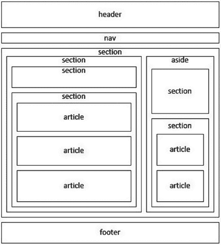
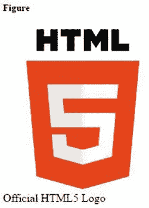
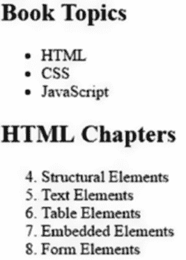
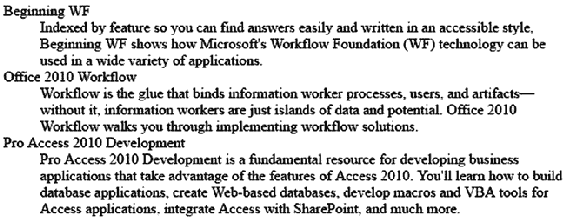
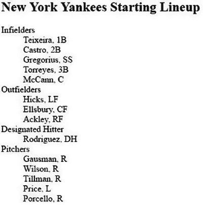

## 第 4 章：HTML 结构元素

我在第 [1](http://dx.doi.org/10.1007/978-1-4842-2463-2_1) 章中简要介绍了 HTML 的基本语法，然后解释了 `head` 元素内部的信息。`head` 元素中没有可显示的内容；其中的数据供浏览器、屏幕阅读器或搜索引擎等应用程序使用。现在我们将注意力转向 `body` 元素；这里才是内容所在之处。

### 内容分类

HTML5 中定义了 100 多个元素。我在第 [1](http://dx.doi.org/10.1007/978-1-4842-2463-2_1) 章中已经解释了一部分，在接下来的五章中，我将演示其余的元素。元素按内容分类进行组织，并且基于这些分类存在通用规则，这些规则定义了元素可以在哪里使用以及它可以包含什么内容。

一个元素可以属于多个类别，也有少数元素不属于任何类别。

- **元数据** - 这些元素已在第 [1](http://dx.doi.org/10.1007/978-1-4842-2463-2_1) 章中解释过；它们没有实质内容，但提供关于 HTML 文档的元数据以及供处理文档的应用程序使用的信息。

- **分区** - 这些元素用于将页面组织成各个部分，也用于构建文档大纲。

# HTML5 内容类别

- **标题（Heading）** - 这些元素用于在章节内定义标题和副标题。
- **嵌入内容（Embedded）** - 嵌入元素用于在文档中插入非 HTML 内容，如图像。这些将在[第 7 章](http://dx.doi.org/10.1007/978-1-4842-2463-2_7)中介绍。
- **交互内容（Interactive）** - 这些元素提供用户交互功能。常见的例子有`button`或`input`字段。
- **表单（Form）** - 表单元素用于捕获用户输入，并进一步分为几个子类别。我将在[第 8 章](http://dx.doi.org/10.1007/978-1-4842-2463-2_8)中解释这些内容。
- **短语内容（Phrasing）** - 这些元素用于标记文本，或更确切地说是短语，这些短语组合起来形成段落。这些元素将在[第 5 章](http://dx.doi.org/10.1007/978-1-4842-2463-2_5)中演示。
- **流内容（Flow）** - 绝大多数元素都属于这个类别。这些元素包含实际内容，如文本或某些嵌入内容（如图像或视频）。使用“流”这个术语是因为这些元素占据空间，并且通常从一个元素流向下一个元素，横向或纵向排列。

附录 C 中的参考资料包含了所有 HTML5 元素的字母顺序列表，并指出了每个元素所属的类别。

© Mark J. Collins 2017
M. J. Collins, *Pro HTML5 with CSS, JavaScript, and Multimedia*, DOI 10.1007/978-1-4842-2463-2_4
第 4 章 ■ 结构化 HTML 元素

> **注意** 大多数不属于任何内容类别的元素仅用作特定元素的子元素。例如，`table`元素属于流内容类别，但`tr`和`td`等子元素不被分配类别，因为它们仅在表格内使用。

本章将解释如何使用分区和标题元素来组织你的 HTML 文档。

## 分区内容

将 HTML 文档组织成逻辑分区是一个好主意，尤其对于较大的文档。在 HTML5 之前，使用分区（`div`）元素来对内容进行分组，并且可以像这样嵌套：

```
<div>
  <div>
    <div>
    </div>
  </div>
</div>
```

不幸的是，`div`可用于因多种不同原因对内容进行分组，而这些原因对读者来说并不明显。HTML5 引入了一些新的元素，提供了更具体的语义分组。这些元素中的每一个都用于将内容分组为更大的单元。然而，每个元素对内容进行分组的原因各不相同。你可以使用通用的`div`元素来完成分组；而使用更具体的元素是为了明确*为什么*要建立这个分组。因此，请密切关注每个元素的特定用途，并根据你想要实现的目标使用正确的元素。

### 分区（Section）

`section`元素用于将内容组织成逻辑分区。回想一下你为学校作业写的论文，其中会有引言、三个主要论点和结论。

这些部分在 HTML 中都将表示为`section`。此外，`section`元素可以像`div`元素一样嵌套。如果你的每个主要论点都有子论点，你可以对每个子论点使用一个`section`。

在选择`section`元素时，有两个指导原则。首先，分区应该按主题划分；你是根据所呈现的材料来组织内容。其次，分区应该线性流动。

例如，引言流向第一个主要论点，依此类推。当我在讨论`aside`元素时，这种原则的反面会更加明显。

### 文章（Article）

`article`元素用于对可以独立存在的内容进行分组。这通常用于内容被重复使用的情况。如果你拿起当地的周日报纸阅读你最喜欢的漫画连载，你可能没有意识到，但同样的漫画连载被收录在世界各地的报纸中。同样的概念也适用于网站，联合内容会被包含在多个页面中。这些内容应放置在`article`元素中，因为这些内容独立于页面的其余部分。

# 结构化 HTML 元素

然而，`article`元素最常见的用途之一是在博客中。博客中的每篇文章通常是独立的内容，并且通常被分组到`article`元素中。此外，发布到博客的评论也通常放在`article`元素中。

你可以在任何适合使用`section`元素的地方使用`article`元素，只要内容是独立且可重用的。一个较大的文章通常会像我之前描述的那样，使用`section`元素按主题进行组织。此外，`article`元素可以包含其他`article`元素，就像包含评论的博客文章那样。

## `aside`元素

`aside`元素用于对不属于文档正常流程的内容进行分组。这可以是用于参考目的的支持性信息，或者关于作者的信息。它也可以是不相关的信息，例如广告位或事件日历。

`aside`元素通常以侧边栏的形式呈现，这样它就不会中断其他内容的流程。然而，这将由 CSS 决定；内容作者的工作是表明一组内容不属于正常的文档内容流。这是通过`aside`元素完成的。

## `nav`元素

`nav`元素用于对一组链接进行分组。一个典型的例子是页面上有某种菜单，用于跳转到内部书签或其他相关页面。另一个例子是你提供指向更多信息或相关材料的链接。

你不需要把每个链接都放进`nav`元素中。但如果你有主要由链接组成的内容，请将其放入`nav`元素中。这将表明此部分内容提供了导航功能。

## `address`元素

`address`元素不属于分区内容。我在这里描述它是因为它用于为整个文档或特定文章提供联系信息。要将其用于单个文章，它应该放在`article`元素内部的某处。如果它适用于文档，则必须放在`body`元素内部；这通常放在`footer`元素中。

> **提示：** `address`元素旨在提供与文档或文章相关的联系信息。这可以包括电子邮件地址、URL、电话号码、邮寄地址或任何其他与作者沟通的方式。它可能命名为`contact`会更好，因为这才是它的用途。你不应该用它来描述一个地址，除非该地址是作为联系信息提供的。

以下是在`footer`中包含`address`元素的示例：

```html
<footer>
  <p>Closing content</p>
  <address>
    <p>Provided by
      <a href="mailto:mcollins@theCreativePeople.com">Mark J. Collins</a>
    </p>
    <p>For more information
      <a href="www.theCreativePeople.com">visit his website</a>
    </p>
  </address>
</footer>
```

`address`元素的默认样式是以斜体显示文本。此`footer`的默认样式将如图 4-1 所示。

***图 4-1.** 默认地址样式*

### 大纲

在 HTML5 规范中，有一个关于文档大纲的概念，被称为大纲算法。作为内容根元素的`body`元素在文档大纲中创建一个顶层节点。添加任何分区元素（`section`、`article`、`aside`或`nav`）都会在大纲中创建一个新的节。嵌入额外的分区元素会向大纲中添加更多节点。这里的想法是，通过简单地嵌套分区元素，就为你的文档创建了一个显式的大纲。

#### 显式节

让我们通过创建一个包含一些嵌套节的 HTML 文档来测试这一点。创建没有标签的大纲并不有趣。因此我们将在每个节中添加一个`h1`元素来给它命名。示例文档如清单 4-1 所示。

***清单 4-1.** 使用节创建文档大纲*

```html
<body>
```

# 我的示例页面

## 导航

## 顶层

### 主内容

#### 精选内容

#### 文章

##### 文章 1

### 相关内容

`Chapter 4 ■ StruCtural htMl eleMentS`

#### HTML 参考

#### 图书列表

##### 图书 1

如果仅使用默认样式在浏览器中渲染此页面，页面将显示为 `Figure 4-2.`。

**图 4-2.** 应用默认样式的示例文档

请注意，尽管所有标签都使用了同一个 `h1` 元素，但每个标签的字体却各不相同。样式会根据元素在文档大纲中的位置自动更新。

`Chapter 4 ■ StruCtural htMl eleMentS`

**注意：** `aside` 元素位于主区块下方，而非侧边。各区块的对齐方式将通过 CSS 控制。我将在 `Cha[pter 13.](http://dx.doi.org/10.1007/978-1-4842-2463-2_13)` 中对此进行说明。

为了进一步说明这一点，有一个便捷的网页可以读取你的 HTML 文档并显示其大纲。你可以访问 `https://gsnedders.html5.org/outliner` 这个网站。粘贴你的 HTML 文档，然后点击“Outline this”按钮。显示的大纲将类似于 `Figure 4-3.`。

**图 4-3.** 查看文档大纲

#### 文档标题

HTML5 支持文档标题元素。除了本例中使用的 `h1` 元素外，还有 `h2`、`h3`、`h4`、`h5` 和 `h6` 元素。每个元素都用于指示标题在文档大纲中应处的指定层级。`h1`–`h6` 元素的默认样式与显式大纲文档中使用的样式相同。

在 HTML5 之前，区块元素尚不存在。但是，使用 `h1`–`h6` 元素，你可以提供隐式区块。如果前一个标题使用了 `h2` 元素，而当前标题使用了 `h3`，则会隐式定义一个新的区块。同样，从 `h3` 回到 `h2` 则会关闭当前区块。

若要创建具有类似大纲的文档，你可以使用 `h1`–`h6` 元素创建隐式区块。

你不需要在所有地方都使用 `h1` 元素，而是使用不同的元素来指示其在层级结构中的级别。以下 HTML 将生成完全相同的大纲（以及浏览器中的输出）：

```html
<body>
  <h1>我的示例页面</h1>
  <h2>导航</h2>
  <h2>顶层</h2>
  <h3>主内容</h3>
  <h4>精选内容</h4>
  <h4>文章</h4>
  <h5>文章 1</h5>
  <h3>相关内容</h3>
  <h4>HTML 参考</h4>
  <h4>图书列表</h4>
  <h5>图书 1</h5>
</body>
```

`Chapter 4 ■ StruCtural htMl eleMentS`

然而，W3C 的官方建议是不要依赖区块元素的轮廓。

`Figure 4-4 shows` 显示了 W3C 文档（`http://www.w3.org/TR/html5/sections.html`）中的警告信息。

**图 4-4.** 关于轮廓算法的警告

你绝对应该使用区块元素来将 HTML 文档组织成各个区块。此警告是建议，在可行的情况下，你也应根据文档层级使用相应的 `h1`–`h6` 元素。

`article` 元素适用于可复用的内容。在这种情况下，内容通常不与主 HTML 文档位于同一文件中。它可能从数据库中读取、通过某种内容提要提供或从单独的文件中提取。它可能对该内容被插入的文档大纲一无所知。`article` 应从 `h1` 级别开始，并根据需要包含额外的区块元素。当 `article` 被包含到文档中时，实际的大纲级别将根据插入时的当前层级进行调整。

■ **注意** 创建大纲的具体算法在 W3C 推荐标准中有详细说明，你可以通过以下地址查看：[`www.w3.org/TR/html5/sections.html#outlines`](http://www.w3.org/TR/html5/sections.html#outlines)

#### 页眉与页脚

在组织页面时，你还应考虑在顶部添加一个 `header` 元素，在底部添加一个 `footer` 元素。这些元素可用于对文档某一部分的引言或结语内容进行分组。

与 `article` 或 `section` 等分区元素不同，`header` 和 `footer` 元素不会在文档大纲中创建新的分区。它们仅用于对所在分区的内容进行分组。通常你会在 `body` 元素中使用 `header` 和 `footer` 元素来定义页面页眉和页脚。它们也可以放置在子分区（例如 `section` 元素）内部。在这种情况下，它们仅对该分区的引言内容进行分组。



#### 规划页面布局

在创建新网页之前，最好先勾勒出基本的页面结构。这有助于你直观地了解整体布局，并看清元素是如何嵌套在一起的。

本章中我将演示的页面将在顶部使用 `header` 和 `nav` 元素，在底部使用 `footer` 元素。中间的主区域将使用一个 `section` 元素，并包含两个并排的区域，每个区域都包含一系列 `article` 标签。较大的区域将被另一个 `section` 元素包裹，并提供主要内容，这些内容被组织成 `article` 元素。右侧较小的区域将使用一个 `aside` 元素，其中包含一个 `section` 元素。该 `section` 元素将包含一系列 `article` 元素，用于展示相关信息。图 4-5 展示了该页面布局。

**图 4-5.** 规划页面布局

■ **注意** 此示意图在元素之间显示了间距，以便于理解。在实际网页中，大多数情况下，通过将 `margin` 属性设置为 0 可以移除这些间距。

#### 分区根元素

有少部分 HTML 元素被称为分区根元素，它们拥有自己的大纲，且不参与文档其余部分的大纲。`body` 元素便是其中之一，尽管这可以说是一个特例；`body` 元素的大纲也就是文档的大纲。此类别中的其他元素包括 `blockquote`、`details`、`fieldset`、`figure` 和 `td`。我将在第 8 章中解释 `fieldset` 元素，在第 6 章中解释 `td` 元素。

### Blockquote

当你需要在文档中包含一段长引用时，可以使用 `blockquote` 元素。引用的内容放置在 `blockquote` 元素内部，可以包含多个元素，包括标题文本、段落和嵌入内容。一个简单的引用示例如下：

```html
<blockquote cite="www.apress.com">
<h1>引用</h1>
<p>这是一段引用</p>
</blockquote>
```

标题文本（`h1`–`h6`）会在引用内部定义分区，但这些分区不会成为文档大纲的一部分。你可以通过将 `blockquote` 元素添加到文档中，并使用我之前提到的大纲工具来运行验证这一点。

除了全局属性，`blockquote` 元素还支持 `cite` 属性。使用该属性来标识引用来源的 URL，或包含引用相关信息的资源地址。

■ **提示** `cite` 属性提供了有关引用的详细信息，但不会（至少通常不会）显示出来。浏览器可以使用这些信息，但它基本上作为元数据提供。要显示来源或引用信息，应使用 `cite` 元素，该元素将在下一章中解释。

### Details

`details` 元素允许你创建可折叠的内容区域。在 `details` 元素内部，你可以包含一个可选的 `summary` 元素，该元素包含在元素折叠时显示的内容。如果未使用 `summary` 元素，则折叠时显示的文本将是“详情”。

`details` 元素的其余内容在折叠时将被隐藏。`details` 元素的初始状态为折叠状态。如果你希望在页面加载时显示内容，请添加 `open` 布尔属性。

```html
<details open>
<summary>这是折叠文本</summary>
<h1>详情</h1>
<p>这些是可折叠的详情内容</p>
</details>
```

同样，与其他分区根元素一样，你可以在 `details` 元素中包含 `h1`–`h6` 元素，这些元素将为 `details` 定义一个大纲。但是，这些分区不会包含在文档大纲中。



■ **注意** 截至撰写本文时，`details` 元素不受 Internet Explorer 或 Edge 浏览器支持，并且 Firefox 浏览器也未完全支持。

### Figure

`figure` 元素用于对自包含的内容进行分组，这些内容在逻辑上可以移动到其他位置而不会影响文档的主要流程。`figure` 元素的一个独特功能是能够在内容中包含标题。

`figure` 元素通常用于将图像或其他嵌入内容与标题组合在一起。它也可用于将文本（例如代码清单）与标题组合在一起。

# 分组元素

上一节描述了用于将 HTML 文档组织成更小分区的元素，以及与文档大纲相关的元素。现在我将解释其余的分组元素。

这些元素主要用于语义目的，不会影响大纲。

## figure 和 figcaption

要添加标题，请在 `figure` 元素内包含 `figcaption` 元素。`figcaption` 元素必须是 `figure` 元素中的第一个或最后一个子元素。如果 `figcaption` 元素是第一个子元素，标题将位于内容上方。否则，标题将位于内容下方。

以下是一个包含嵌入图像的简单 `figure` 示例。在 Chrome 浏览器中的渲染效果如下图所示（图 4-6）。

```
<figure>
<h1>图形</h1>

<figcaption>官方 HTML5 徽标</figcaption>
</figure>
```

***图 4-6.** 使用 figure/figcaption 元素*

## 段落

段落（`p`）元素用于定义一个段落，即包含单一思想或观点的文本部分。它通常在视觉上与其他段落有所区别。例如，在本书中，大多数段落的首行会缩进，以使段落更醒目。`p` 元素的默认样式会设置外边距，从而在段落之间增加一些额外的空白。

`p` 元素可能是最被滥用的元素之一。我再怎么强调也不为过——所选元素应基于其语义含义。段落是文档中一个独特的部分，包含单一思想或观点。如果这描述了你正在添加的内容，请使用 `p` 元素。如果不是，请继续寻找。下一章将描述短语元素，其中某一种可能更合适。

如果使用了合适的元素，默认样式通常也会是合理的。但你不应基于元素自带的样式来选择元素。只要一致地使用合适的元素，就可以通过 CSS 轻松更改样式。

## 水平线

在 HTML4 中，`hr` 元素用于创建水平线。由于 HTML5 为其元素提供了更多的语义定义，该元素已被重新定义为主题分隔。当话题发生转变时，它通常放置在段落之间。

`hr` 元素仍会渲染为水平线以保持向后兼容。当然，这可以通过 CSS 进行修改。`hr` 元素内没有内容，且无需闭合标签。添加一个 `hr` 元素的方式如下：

```html
<p>段落 1</p>

<hr />

<p>段落 2</p>
```

## 预格式化

放置在预格式化（`pre`）元素中的内容将完全按照输入方式呈现，包括空白字符。正如我在第 1 章中所解释的，浏览器通常会忽略空白字符，包括回车符、制表符和额外空格。使用 `pre` 元素可以告知浏览器保留这些字符。默认样式会使用等宽字体，这也有助于保持格式。

> **注：** `pre` 元素是少数例外之一，其使用并非主要出于语义原因。

`pre` 元素用于包含已经格式化且需要保持该格式的内容。包含代码片段就是一个很好的例子。`pre` 元素的另一个常见用途是包含诗歌。例如：

```html
<pre>我听到圣诞节的钟声响起

它们演奏着古老而熟悉的颂歌，

甜美而狂野

词句反复吟唱

人间和平，善意待人！</pre>
```

<cite>亨利·沃兹沃思·朗费罗 - 1863 年，公共领域</cite>

这在浏览器中的渲染效果如图 4-7 所示。

**图 4-7：** 使用 `pre` 元素

尝试将 `pre` 元素替换为标准段落（`p`）元素。内容将显示在一行上，并根据页面宽度自动换行。

> **注：** 这里有一个小趣闻：这首诗是美国内战期间由亨利·沃兹沃思·朗费罗所作。他在不久前失去了妻子，随后得知儿子查尔斯在战斗中受伤。正值圣诞时节，听到教堂钟声奏响颂歌，他开始怀疑是否真的存在和平与善意。这首诗反映了作者对此的挣扎，并在结尾得出结论：只要教堂钟声仍在敲响，希望就依然存在。

## 主要内容

`main` 元素用于表示其内容呈现了文档的主要目的或主题。

它标识了文档的核心和中心主题。因此，`main` 元素不能放置在 `article`、`aside`、`footer`、`header` 或 `nav` 元素内部，因为这些元素用于辅助性内容。此外，每个文档只能有一个 `main` 元素，这一点应相当明确。`main` 元素中的内容应具有文档独特性，不应与其他文档共享。

当然，`main` 元素可以根据需要划分为多个部分。虽然对在 `main` 元素中包含 `article`、`aside` 或 `nav` 元素没有限制，但这通常被认为是糟糕的实践。`article` 包含可复用或独立的内容，因此很少在文档中具有独特性。`aside` 元素用于不属于主要内容流的内容，很可能不属于 `main` 元素所保留的中心主题。然而，如果 `aside` 或 `article` 元素的内容满足 `main` 元素的标准，也可以使用它们。

`main` 元素没有默认样式；它的使用纯粹是语义性的。使用它有助于屏幕阅读器或搜索引擎等应用程序直接跳转到文档的核心内容。

## 分区

我将 `div` 元素留到了最后。正如我之前提到的，在 HTML5 之前，`div` 元素用于所有类型的分组。现在我们有了专门用于特定目的的新元素：按主题划分（`section`）、独立或可复用内容（`article`）、正常流程之外（`aside`）以及导航（`nav`）。此外，还有一些可用于语义分组的元素，如 `main`、`figure` 和 `blockquote` 元素。`div` 元素则用于所有其他分组需求。

# HTML5 结构化元素

## 使用 `div` 元素进行样式控制

`div` 元素的一个常见用途是将样式应用于其所有子元素。大多数样式属性会从父元素继承。因此，在 `div` 元素上设置一个属性将向下传播到 `div` 内的所有元素。例如，你可能需要根据用户输入或网页状态隐藏或显示某些内容。通过将所有内容放在一个 `div` 中，你可以简单地更新 `div` 属性。

### 列表元素

现在我们来学习用于列出内容的元素，例如项目符号列表。然而，HTML5 中的列表并不局限于一系列项目符号或编号项。任何时候你有一个事物列表，即使这些“事物”是大的内容块，你也应该考虑将它们创建在这些列表元素之一中。再次强调，这关乎语义；将内容放在列表中可以清楚地表明你在枚举一个列表。

### 列表

HTML5 既支持使用 `ol` 元素的有序列表，也支持使用 `ul` 元素的无序列表。除了有序列表可用的一些额外属性外，它们的工作方式基本相同。对于任何一种列表，元素的顺序都是固定的，由项在列表中的包含顺序决定。根据语义选择合适的类型。如果列表的顺序没有意义，请使用无序列表。例如，如果你列出一些流行的运动，如 Football、Baseball 和 Basketball，请使用无序列表。相反，如果你要指定最受欢迎的三项运动，你可能希望按受欢迎程度列出它们。在这种情况下，顺序是有意义的，你应该使用有序列表。

无序列表的默认样式是为每个项添加某种类型的项目符号，并且所有项使用相同的符号。对于有序列表，默认样式将使用数字，并且数字将按顺序分配。

列表（无论有序还是无序）中的项由列表项元素 `li` 表示。可以包含在 `ul` 或 `ol` 元素内的唯一元素是 `li` 元素。但是，你可以在 `li` 元素内放置任何流元素。清单 4-2 展示了一个简单的无序列表和一个有序列表。

使用默认样式，这将呈现如图 4-8 所示。

**清单 4-2.** 示例无序列表和有序列表

```html
<h2>Book Topics</h2>

<ul>
  <li>HTML</li>
  <li>CSS</li>
  <li>JavaScript</li>
</ul>

<h2>HTML Chapters</h2>

<ol start="4">
  <li>Structural Elements</li>
  <li>Text Elements</li>
  <li>Table Elements</li>
  <li>Embedded Elements</li>
  <li>Form Elements</li>
</ol>
```



第 4 章 ■ 结构化 HTML 元素

**图 4-8.** 示例无序列表和有序列表

如前所述，有序列表支持一些额外的属性。最常见的是 `start` 属性，我在前面的例子中使用过。在这个例子中，我列出了本书中介绍 HTML 元素的章节。前三章包含了介绍性材料，因此关于 HTML 的第一章就是本章，[第 4 章](http://dx.doi.org/10.1007/978-1-4842-2463-2_4)。`start` 属性指示用于第一个 `li` 元素的数字；在本例中是 4。如果省略，编号将从 1 开始。

`reversed` 属性是一个布尔属性，用于按倒序分配数字。例如，如果你要列出最受欢迎的三项运动并希望将最受欢迎的放在最后，你会使用此属性。编号将是倒序的：3，2，1。如果你未指定 `start` 属性，则第一个项的数字会被设置为使得最后一个元素为 1。如果你在一个列表中放入十个项并指定了 `reversed` 属性但没有指定 `start` 属性，则项将从 10 到 1 编号。如果你同时指定了 `start` 和 `reversed`，第一个项将使用 `start` 属性中指定的值，其余项将依次递减，因此你最终可能得到负数。

> **提示：** `reversed` 属性不会改变 `li` 元素的顺序。它们始终按照在列表中的包含顺序渲染。`reversed` 属性仅影响项的编号。

`type` 属性指定要使用的“编号”类型。以下是支持的值：

- `1` - 使用数字（如果未指定，这是默认值）
- `A` - 使用大写字母（例如 A, B, C, D）
- `a` - 使用小写字母
- `I` - 使用大写罗马数字（例如 I, II, III, IV）
- `i` - 使用小写罗马数字

无论为 `type` 指定了什么值，`start` 属性始终是数字。它将被转换为适当的类型表示。例如，如果你指定了 `4` 并且 `type` 是 `I`，则第一个元素将使用 `IV`。

> **注意：** 字母或罗马数字不支持零或负数。如果需要这些值，它们将以数字形式显示。例如，如果你在列表中有五个项，并将 `ol` 元素指定为 `<ol start="3" type="a" reversed>`，则编号将是 `c, b, a, 0, -1`。

你可以使用列表来呈现一系列链接，例如菜单。例如：

```html
<nav>
  <h1>Navigation</h1>
  <ul>
    <li><a href="/">Home</a></li>
    <li><a href="http://www.apress.com">Apress</a></li>
    <li><a href="http://www.theCreativePeople.com">My Site</a></li>
  </ul>
</nav>
```

这将显示一个带项目符号的链接列表。但是，使用 CSS，你可以以多种方式呈现它，包括按钮或水平排列的链接。我将在[第 13 章](http://dx.doi.org/10.1007/978-1-4842-2463-2_13)中演示这一点。

## 描述列表

描述列表元素 `dl` 用于定义术语列表。它被实现为一组名称/值对。它常用于创建词汇表。在这种情况下，名称是要定义的术语，值是这些术语的定义或描述。你可以在 `dl` 元素内放置一系列术语元素 `dt` 和描述元素 `dd`。

例如，一个简单的 `dl` 元素可能像这样使用：

```html
<dl>
  <dt>Term1</dt>
  <dd>Definition</dd>
  <dt>Term2</dt>
  <dd>Definition</dd>
</dl>
```

> **注意：** 在 HTML4 中，`dl` 元素被称为定义列表，旨在定义一个术语列表。HTML5 中的语法没有改变，但名称已更改为描述列表，以传达该元素的更广泛用途。在 HTML5 中，它用于提供术语/描述对的组合。

清单 4-3 说明了如何使用此模式来列出一系列书籍以及每本书的描述。图 4-9 显示了在仅使用默认格式的浏览器中将如何显示。



第 4 章 ■ 结构化 HTML 元素

**清单 4-3.** 使用 `dl`、`dt` 和 `dd` 元素

```html
<dl>
  <dt>Beginning WF</dt>
  <dd>
    Indexed by feature so you can find answers easily and written in an accessible style,
    Beginning WF shows how Microsoft's Workflow Foundation (WF) technology can be used in a wide
    variety of applications.
  </dd>
  <dt>Office 2010 Workflow</dt>
  <dd>
    Workflow is the glue that binds information worker processes, users, and artifacts—
    without it, information workers are just islands of data and potential. Office 2010 Workflow
    walks you through implementing workflow solutions.
  </dd>
  <dt>Pro Access 2010 Development</dt>
  <dd>
    Pro Access 2010 Development is a fundamental resource for developing business
    applications that take advantage of the features of Access 2010. You'll learn how to build
    database applications, create Web-based databases, develop macros and VBA tools for Access
    applications, integrate Access with SharePoint, and much more.
  </dd>
</dl>
```

# 第 4 章 ■ 结构性 HTML 元素

***图 4-9.** 渲染描述列表*

然而，你并不局限于这种一对一映射。`dl` 元素的另一种用途是列出带有分组标题的事物组。你可以通过使用 `dt` 元素作为分组标题，`dd` 元素作为组成员来实现这一点。例如，清单 4-4 包含了纽约洋基队的首发阵容，按位置类别整理。图 4-10 显示了该内容的默认渲染效果。



**清单 4-4.** 为每个术语使用多个描述元素

```html
<h2>New York Yankees Starting Lineup</h2>

<dl>

<dt>内野手</dt>

<dd>Teixeira, 一垒手</dd>

<dd>Castro, 二垒手</dd>

<dd>Gregorius, 游击手</dd>

<dd>Torreyes, 三垒手</dd>

<dd>McCann, 捕手</dd>

<dt>外野手</dt>

<dd>Hicks, 左外野手</dd>

<dd>Ellsbury, 中外野手</dd>

<dd>Ackley, 右外野手</dd>

<dt>指定打击</dt>

<dd>Rodriguez, DH</dd>

<dt>投手</dt>

<dd>Gausman, 右投</dd>

<dd>Wilson, 右投</dd>

<dd>Tillman, 右投</dd>

<dd>Price, 左投</dd>

<dd>Porcello, 右投</dd>

</dl>
```

**图 4-10.** 纽约洋基队首发阵容

另一种可能是让多个术语引用同一个描述项。你也可以这样做，但需要将同类术语放在一起。例如：

```html
<dl>

<dt>Hicks, 左外野手</dt>

<dt>Ellsbury, 中外野手</dt>

<dt>Ackley, 右外野手</dt>

<dd>外野手 - 棒球中在内场菱形区域后方草地（即外场）上进行防守的位置。这些位置包括左外野手、中外野手和右外野手。</dd>

</dl>
```

`dt` 元素理应相对简短，例如一个单词或短语。对于 `dt` 元素中可以包含哪些类型的元素，有特定的限制。你不能在 `dt` 元素内部使用标题、页脚或任何分区内容。即便如此，也并没有什么能阻止你在 `dt` 元素中包含段落的文本内容。然而，从语义规则的角度来看，这样做是不恰当的。`dl` 元素用于描述术语列表，而一个文本段落并非术语。

`dd` 元素则没有此类限制。你可以在 `dd` 元素中放置任何流式内容，包括分区内容和嵌入内容。

#### 内联框架

`iframe` 元素用于在当前文档中嵌入另一个网页。我将在此简要介绍，我们将在第 17 章更详细地探讨。你可以使用如下标记包含一个 `iframe`：

```html
<iframe src="http://www.apress.com" width="100%" height="400">

<p>您的浏览器不支持 iframe</p>

</iframe>
```

只有在浏览器不支持 `iframe` 元素时，`iframe` 元素内部的容才会被渲染。`iframe` 元素支持多个属性，可用于配置元素的渲染方式以及允许哪些选项。

- `allowfullscreen` - 如果指定了此布尔属性，则嵌入页面中的脚本可以通过调用 `requestFullScreen()` 方法切换到全屏模式。
- `height` - `iframe` 元素的高度，以像素或相对于父页面的百分比表示。
- `name` - 当从父文档中提供指向 `iframe` 的链接时，可以使用 `name` 属性。
- `sandbox` - 可用于限制在嵌入页面中可以执行的操作。这将在第 17 章中介绍。
- `src` - 用于指定要嵌入的页面的 URL。
- `srcdoc` - 如果指定并受支持，`srcdoc` 属性将覆盖 `src` 属性的值。这通常与 `sandbox` 属性一起使用。
- `width` - `iframe` 元素的宽度，以像素或相对于父页面的百分比表示。

## 已弃用的元素

一些分组元素已从 HTML5 规范中移除。我将在此简要描述它们。为了确保向后兼容性，这些元素可能还会被支持一段时间。但是，你不应在任何新的开发工作中使用它们。

### `hgroup` 元素

`hgroup` 元素曾用于对 `h1`–`h6` 元素进行分组，并在文档大纲中仅保留第一个标题，隐藏其余标题。例如，若你希望为某个章节同时设置主标题和副标题，可能会使用 `h1` 元素作为主标题，`h2` 作为副标题。然而，`h2` 元素会在文档大纲中开始一个新的章节。

将两者放入 `hgroup` 元素中，则只会创建一个单独的章节，并使用 `h1` 标题。

建议的做法是，不使用 `hgroup` 元素，而是将主标题和副标题放入 `header` 元素中。主标题应使用 `h1`–`h6` 元素来定义章节，并加入文档大纲。其余标题内容，如副标题或标语，应放在 `p` 或 `span` 标签中，然后通过 CSS 进行适当的样式设置。更多信息和示例，请参阅 W3C 规范：

[`www.w3.org/TR/html5/common-idioms.html#sub-head`](http://www.w3.org/TR/html5/common-idioms.html#sub-head)

### `dir` 元素

目录列表 (`dir`) 元素曾用于展示目录列表。此列表中的项目包含在 `li` 元素中。`dir` 元素在 HTML5 中已被弃用。你应该使用无序列表 (`ul`) 代替。

### `frame` 和 `frameset` 元素

`frame` 和 `frameset` 元素曾用于将页面组织成多个部分。这包括逻辑分区和页面布局。逻辑分区现在可以借助我之前介绍的分区内容来实现，例如 `section`、`aside` 和 `article`。布局则通过 CSS 配置，我将在第 [13](http://dx.doi.org/10.1007/978-1-4842-2463-2_13) 章中进行演示。

#### 小结

在本章中，我演示了用于组织内容的所有 HTML 元素。这些元素为内容分组提供了语义含义。

文档通过使用分区内容来组织，以定义文档的较大区块。这些内容与标题元素 (`h1`–`h6`) 共同定义了文档大纲。`header` 和 `footer` 元素用于标识文档级别以及章节内的引言和结论内容。

分区根元素包括 `blockquote`、`details` 和 `figure` 元素，它们拥有自己的章节，不影响文档大纲。

还有其他几个分组元素不影响大纲，但在较低层面提供语义分组。这些包括 `main`、段落 (`p`)、水平线 (`hr`) 和分区 (`div`) 元素。

预格式化 (`pre`) 元素主要用于保留内容的格式，而非出于语义原因。最后，有序列表 (`ol`)、无序列表 (`ul`) 和描述列表 (`dl`) 提供了呈现项目列表的方式。

通过使用这些元素，你可以为内容提供语义细节，这将使得应用一致的样式规则更加容易。即使没有自定义 CSS，文档也会开始呈现出“形状”，因为默认样式会根据每个元素的语义目的一致地渲染内容。

清单 4-5 中显示的 HTML 文档演示了本章描述的所有技术。

此文档也可在源代码下载中找到。在下一章中，我将开始在此结构上放置一些实际内容。我将解释为文本内容提供语义含义的各种元素。

***清单 4-5.*** 第 4 章的完整 HTML 文档

```html
<!DOCTYPE html>
<html lang="en">
<head>
<meta charset="utf-8" />
<meta name="author" content="Mark J Collins" />
<meta name="description" content="Sample HTML document" />
<title>HTML5 Sample</title>
<link rel="stylesheet" href="Initial.css" />
<link rel="stylesheet" href="Print.css" media="print" />
<link rel="icon" type="image/x-icon" href="HTMLBadge.ico" />
<link rel="alternate" type="application/pdf" href="MainPage.pdf" />
<link rel="author" href="mailto:markc@thecreativepeople.com" />
</head>
```

# 排版后的文档

## 导航

- [首页](/)
- [Apress 出版社](http://www.apress.com)
- [我的网站](http://www.theCreativePeople.com)

## 顶级

### 纽约洋基队首发阵容

<details>
<summary>此内容已折叠</summary>

**内场手**
- 泰谢拉，一垒手
- 卡斯特罗，二垒手
- 格雷戈柳斯，游击手
- 托雷耶斯，三垒手
- 麦卡恩，接手

**外场手**
- 希克斯，左外野手
- 埃尔斯伯里，中外野手
- 阿克利，右外野手

**指定打击**
- 罗德里格斯，指定打击

**投手**
- 高斯曼，右投
- 威尔逊，右投
- 蒂尔曼，右投
- 普莱斯，左投
- 波塞洛，右投

**外场手**——棒球比赛中在内野菱形区域后方的草地（即外场）上防守的位置。这些位置包括左外野手、中外野手和右外野手。

</details>

## 主要内容

### 特色内容

> **引用**
> 这是一个引用

段落 1

---

段落 2

## 文章

### 文章 1

```
我听见圣诞节的钟声
奏响古老而熟悉的颂歌，
狂野而甜美，
不断重复着
人间和平，善意待人的词句！
```

亨利·沃兹沃思·朗费罗 - 1863 年，公共领域

#### 图表


官方 HTML5 徽标

## 相关内容

### HTML 参考资料

#### 图书主题

- HTML
- CSS
- JavaScript

#### HTML 章节

III. 结构元素
II. 文本元素
I. 表格元素
V. 嵌入元素
IV. 表单元素

### 图书列表

**《入门 WF》**
按功能索引，方便快速找到答案，并以通俗易懂的风格编写。《入门 WF》展示了微软工作流基金会（WF）技术如何广泛应用于各类应用程序。

**《Office 2010 工作流》**
工作流是连接信息工作者流程、用户和工件之间的纽带——没有它，信息工作者只是孤立的数据和潜在可能。《Office 2010 工作流》带领你逐步实现工作流解决方案。

**《精通 Access 2010 开发》**
《精通 Access 2010 开发》是开发利用 Access 2010 功能的企业应用程序的基础资源。你将学习如何构建数据库应用程序、创建基于 Web 的数据库、为 Access 应用程序开发宏和 VBA 工具、将 Access 与 SharePoint 集成，以及更多内容。

#### 图书 1

<iframe src="http://www.apress.com" width="100%" height="400">
您的浏览器不支持 iframe
</iframe>

---

结尾内容

由 [马克·J·柯林斯](mailto:mcollins@theCreativePeople.com) 提供

更多信息请 [访问他的网站](www.theCreativePeople.com)
