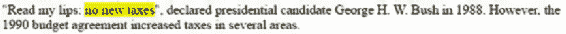
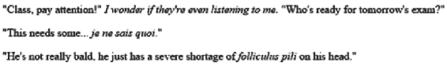
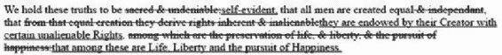
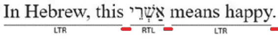
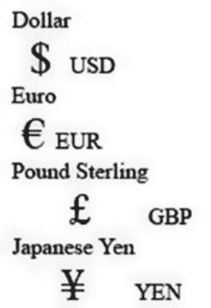

# 第 5 章：短语 HTML 元素

在上一章中，我们探讨了用于将 HTML 文档组织成章节和更低层级分组（即小节）的元素。每个元素都有其特定的语义用途。在本章中，我将演示用于标记实际文本内容的 HTML 元素。在创建内容时，也应根据语义原因来选择这些元素。

> **注** 嵌入元素，如图像（`img`）、音频、视频和`canvas`，也被视为短语内容。不过，这些元素将在第[7](http://dx.doi.org/10.1007/978-1-4842-2463-2_7)章中单独介绍。

## 突出显示文本

> **注意** 在 HTML4 中，有几个纯粹用于呈现的元素，即它们仅用于定义如何渲染。这些元素包括粗体（`b`）、斜体（`i`）、下划线（`u`）和删除线（`s`或`strike`）。由于 HTML5 注重语义，这些元素已被更注重语义的元素所取代。

`strike`元素已从 HTML5 中移除。而`b`、`i`、`u`和`s`元素则被赋予了新的名称及相应的语义定义。

HTML5 提供了几个用于为文本片段提供风格强调的元素。每个元素都有其特定的语义用途；有些更为具体，而另一些则相对通用。我将逐一解释每个元素及其预期用途。你应该始终使用最适合当前情况、最具体的元素，并且仅在没有更具体的元素适用时，才使用较通用的元素。

> **注** 我将根据元素的预期用途来称呼它们，而不是使用用于创建它们的实际 HTML 标签。对于已经熟悉诸如`b`、`i`、`em`和`strong`等标签的读者来说，这可能有些令人困惑。然而，我旨在强调每个元素的恰当用法，而在大多数情况下，标签本身并不能很好地传达这一点，甚至根本无法传达。

© 马克·J·柯林斯 2017

M. J. Collins, *精通 HTML5：CSS、JavaScript 与多媒体*，DOI 10.1007/978-1-4842-2463-2_5

### 重要性（`strong`）

W3C 参考规范指出：“`strong`元素表示一段具有很强重要性的文本。”这里的关键词是*重要性*。`strong`元素用于表明文本的重要性高于其周围的文本。它可以是一个词、短语、句子，甚至是关键的段落。

你还可以嵌套`strong`元素来表示额外的重要性。例如：

```html
<strong>
<strong>警告！</strong> 务必 <strong>熄灭</strong> 所有明火！</strong>
```

这可以在一个重要的句子中标识出重要的词语。

### 强调（`em`）

在日常口语中，强调常被用来改变句子的含义。考虑这个句子，“男孩喜欢巧克力甜甜圈”，并思考当不同词语被强调时，句子的含义如何改变。例如，“*男孩*喜欢巧克力甜甜圈”暗示了女孩不喜欢。类似地，“男孩喜欢巧克力*甜甜圈*”则会让你好奇他们不喜欢哪些巧克力制品。

上面这段文字完美说明了强调（`em`）元素应如何使用。放在`em`元素内的文本应该带有强调地阅读。即使你并不是在大声朗读，在你的脑海中，你仍然能“听到”这种强调，并捕捉到它所蕴含的细微差别。

另一个很好的例子是引入新术语或新概念时。你可能已经注意到，在本书中，每当引入一个新术语时，它都会被强调。这就像我在和你交谈，第一次使用一个新词时，我会稍微提高音量，或许在它前后稍作停顿，因为我希望你听到它。然后我会接着解释这个术语的含义。这种强调有助于你将新术语与其后面的定义联系起来。

### 相关性（`mark`）

相关性元素（`mark`）用于表示在当前上下文中特别相关的文本。以下是规范的描述：

> *`mark`元素表示一个文档中因与另一上下文相关而为了参考目的被标记或高亮显示的文本。*

# 排版结果

此处的思路是，你引用其他来源的内容，并因该内容在当前语境中的相关性而添加强调。关键点在于，与强调元素（importance）和着重元素（emphasis）的区别是，这种强调并非原文原有，而是后加的，只因它在当前语境中具有相关性。

这种做法有两种常见应用场景。首先，你可以使用关联元素（`mark`）来高亮引用内容中与当前用法特别相关的部分。例如：

```html
<p>
"请仔细听好了：**<mark>** 不会增加新税收**</mark>** "，总统候选人乔治·H·W·布什在 1988 年宣称。然而，1990 年的预算协议却在多个领域增加了税收。
</p>
```

默认样式会将背景色设置为黄色，如图 5-1 所示。



关联元素的第二个常见用途是在显示搜索结果时。它用于高亮显示符合指定搜索条件的单词或短语。例如，如果某人搜索“HTML”这个词，而页面显示了包含该文本的文章。在这种情况下，你可能需要高亮显示所有出现“HTML”文本的地方。关联元素（`mark`）正是用于实现这一目的。

**提示** 请记住，关联元素（`mark`）用于高亮从其他来源引用的文本，且原文中原本并没有强调。不要用它来强调原创文本；而应使用其他元素，例如强调元素（importance）或着重元素（emphasis）。

## 替代语音 (`i`)

`i` 元素在 HTML4 中用于表示斜体显示，但在 HTML5 中被赋予了语义含义。以下是 W3C 规范对其的描述：

*`i` 元素代表一段与周围内容相隔离的文本，不传达任何额外的强调或重要性，其传统排版表现为斜体文本；例如，生物分类学名称、技术术语、来自其他语言的惯用短语、一段思绪或船名。*

本质上，当文本需要以与周围文本不同的样式呈现，但你无需暗示任何更高的重要性或强调时，就应该使用 `i` 元素。遗憾的是，这个定义并非十分具体，且往往与我接下来要描述的 `b` 元素有所重叠。

然而，规范进一步提供了适合使用 `i` 元素的示例。这些场景可以概括为使用一种*替代语音*，我认为这有助于理解该元素何时适用。

如果文本引用了某人的话语，而你希望在其中插入一段思绪，请使用此元素，例如：

```html
<p>
"同学们，注意了！" **<i>** 我怀疑他们到底有没有在听我说话。 **</i>** "谁准备好明天的考试了？"
</p>
```

这段思绪是一种不同的语音，因为它是在头脑中而非从口中说出的。另一个例子是当某人用英语说话时，引用了一个外来词或短语。这与文本其余部分语音不同，因为它是一种不同的语言。

```html
<p>
"这需要一些... **<i>** 我说不出的气质**</i>** 。"
</p>
```

该概念的另一种应用是使用技术术语。此处语音发生了变化，因为它从日常英语变成了熟悉度有限的术语。

```html
<p>
"他并非真的秃顶，只是他的头上严重缺乏 **<i>** 毛囊菌**</i>** 。"
</p>
```

在所有这些示例中，文本都通过替代语音 (`i`) 元素进行标识，以指示语音或语气的变化：无论是从一种语言切换到另一种语言，从言语转为内心独白，还是从日常用语切换为技术行话。默认样式会将其渲染为斜体，如图 5-2 所示。



### 图 5-2. 备选声音元素的渲染效果

#### `small`（小号文本）

你是否听过“阅读小字”这种说法？通常指那些虽然有时被忽略，但却很重要的法律术语。HTML5 定义了 `small` 元素，你可以将这类内容放入其中。

`small` 元素适用于提供与主要内容通常无关的细节性短文本。

请使用 `small` 元素来放置版权信息、免责声明或其他法律信息。你也可以用它来包含披露声明、许可详情，或注明材料来源。不要将 `small` 元素用于主文档流之外的大块内容，这类情况应使用 `aside` 元素。

■ **注意** 在 HTML4 中，`small` 元素被用来使字体变小。而在 HTML 中，它已被重新定义为提供语义含义，尤其是针对法律细节。不要仅仅为了让字体变小而使用 `small` 元素，这一操作应在 CSS 中完成。

`small` 元素并不暗示任何较低的重要性。事实上，`small` 元素中的细节往往非常重要。如果内容是主流程之外的法律细节，请将其放入 `small` 元素中。如果它同时也是重要信息，还应将其包含在表示重要性的元素（`strong`）内。

#### 删除线（`s`）

删除线元素（`s`）用于表示不再具有*相关性*或*准确性*的内容。“相关”和“准确”这两个术语来自 HTML5 规范，是你在判断删除线元素是否为语义正确选择时需要考虑的关键概念。

■ **警告** 在 HTML4 中，`s` 和 `strike` 元素都受支持，用于以删除线字体渲染文本。但在 HTML5 中，`strike` 元素已被废弃。

在大多数情况下，如果信息不准确，你通常会直接修正；不相关的数据则会删除或替换。然而，如果你希望突出显示已做出的更改，可以保留旧文本，但将其包裹在删除线元素中，如下所示：

```html
<p>
  限时优惠 **<s>$9.95</s>** $7.99 即可获得...
</p>
```

在此例中，`$9.95` 的价格已不再准确，价格已更新为 `$7.99`。但显示先前价格是为了展示降价幅度。

■ **提示** 不要使用删除线元素来表示已删除的文本。用于此目的的是删除（`del`）和插入（`ins`）元素，我将在本章后面进行解释。

假设你有一个页面，列出了某支体育队伍所有主场比赛的日期和时间。这些信息可能每个都链接到可预订比赛座位的页面。那么，你可以将所有已结束或已售罄的比赛放入删除线元素中。你保留这些比赛列表，因为它们可能是有用的信息，但对于当前预订座位的目的而言已不相关。

在我给出的示例中，删除线元素内的内容都是文本，默认样式会以删除线字体渲染。然而，删除线元素用于其语义含义，因此它也适用于其他类型的内容，如图像、音频/视频以及输入控件。你需要在 CSS 中定义如何渲染不准确或不相关的图像，但将其包含在 HTML 的删除线元素内，在语义上绝对是有效的。

#### 文体偏移（`b`）

HTML4 中的旧加粗元素（`b`）在 HTML5 中被重新定义为**文体偏移**内容，且不传递重要性。我在这里用了一个非常清晰的名称来称呼它：*文体偏移*。以下是 HTML5 规范对其的定义：

*`b` 元素表示一段文本区间，出于实用目的而吸引注意力，但不传递任何额外的重要性，也不暗示存在替代性内容。*

# HTML 语义化元素指南

## 语气或情绪

例如文档摘要中的关键词、评论中的产品名称、交互式文本驱动软件中的可操作词或文章导语。

换句话说，当文本需要以某种方式突出显示，而之前描述的其他元素都不适用时，应使用此元素。它并不重要，不需要任何强调，也不反映另一种语气或情绪。然而，出于其他原因，你希望引起读者对此文本的注意。

规范继续列举了一些应使用样式偏移（`stylistically offset`）元素的示例：

- 关键词
- 产品名称
- 可操作词
- 文章导语（开头段落）

由于此元素是故意通用的，最好包含一个`class`属性，指明该元素为何需要突出显示。这不仅明确了语义含义，还使`CSS`能够根据使用原因进行不同的样式设置。例如：

```html
<p>
  文本高亮元素包括<b class="keyword">重要性</b>、
  <b class="keyword">强调</b>以及<b class="keyword">另一种语气</b>。
</p>
```

**提示：** 样式偏移元素（`<b>`）是最通用的元素，仅应在没有更具体的元素适用时使用。

## 未明确说明的内容（`<u>`）

下划线元素（`<u>`）在`HTML4`中用于指定应加下划线的文本。除了像`<b>`和`<i>`元素那样纯粹的表现性之外，`<u>`元素也常被避免使用，因为带下划线的文本常被误认为是超链接。然而，`<u>`元素在`HTML5`中被赋予了“未明确说明内容”（unarticulated）的语义含义。

规范对于何时使用此元素并不十分明确，仅举了两个示例：拼写错误的单词和中文专有名词。规范的实际定义是：“一种未明确说明、但明确呈现的非文本注释。”本质上，这意味着当你需要注释文本（让其以不同格式显示）但没有其他元素能清晰定义你这样做的原因时，应使用`<u>`元素。

规范进一步指出，通常有更合适的元素可用：

> 在大多数情况下，另一个元素可能更合适：表示加重语气应使用`<em>`元素；表示关键词或短语，根据上下文应使用`<b>`元素或`<mark>`元素；表示书名应使用`<cite>`元素；为文本标注明确的文本注释应使用`<ruby>`元素；表示科技术语、分类名称、音译、某种想法或西方文本中的船名，应使用`<i>`元素。

换句话说，请将此作为最后的手段。那么何时应使用`<u>`元素？让我们看看给出的两个示例。当指示拼写错误的单词时，标准惯例是加下划线。同样，为中文专有名词加下划线也是一种标准做法。在西方语言中，专有名词通过首字母大写来指示。而在中文中，指示专有名词的方法则是加下划线。因此，如果你包含中文内容，专有名词应包含在`<u>`元素中。

对于这两个示例，你都有需要以某种方式注释的文本；其他元素均不具备合适的语义含义，且公认的惯例是加下划线。然而，通常情况下，只要没有更具体的元素适用，你都可以使用`<u>`元素。

与`<b>`元素一样，你应该包含一个`class`属性来说明文本被注释的原因，因为元素本身并不能明确这一点。例如，以下内容突出显示了文中的拼写、语法和用词错误：

```html
<p>
  请务必**<u class="spelling">检查</u>**你的**<u class="usage">四</u>**个拼写**<u class="grammar">错误</u>**。
</p>
```

你可以在`CSS`中使用`class`属性来改变下划线的颜色。例如，对拼写错误使用红色下划线，对语法错误使用绿色下划线。

**提示：** 如果你只想简单地给文本加下划线，而不表示“未明确说明的标注”的语义含义，请将文本放入`<span>`标签中，并使用`CSS`应用下划线样式。

## 元素回顾

我用英语写这本书，并且假设你们中的大多数人都能相当流利地阅读英语。然而，`HTML`用于渲染世界上任何语言。重要性、强调等语义概念是通用的，但它们在网页上的物理表示方式可能因语言或文化而异。这也是内容作者应关注这些元素的语义含义而非其默认表示的另一个原因。

- **重要性** - `<strong>` - 不应错过的关键点或核心概念
- **强调** - `<em>` - 以强调方式阅读，发音不同的内容
- **相关性** - `<mark>` - 为参考目的而高亮显示的文本
- **另一种语气** - `<i>` - 外来词、科技术语等
- **小号文本** - `<small>` - 主流程之外的法律细节短文本
- **删除线** - `<s>` - 不再准确或相关的内容
- **样式偏移** - `<b>` - 需要突出显示的关键词或其他短语
- **未明确说明的内容** - `<u>` - 指示拼写或语法错误、专有名词或姓氏

**提示：** W3C 提供了一篇简短但有用的文章，解释了更通用的元素`<b>`和`<i>`应在何时以及如何使用。可以在 [`www.w3.org/International/questions/qa-b-and-i-tags`](http://www.w3.org/International/questions/qa-b-and-i-tags) 找到。我建议通读此文，其中的示例非常有帮助。

### 其他语义短语

`HTML5`提供了几个具有非常特定用途的元素。如果这些元素符合你正在添加的内容，请使用它们来提供适当的语义信息。

### 代码、示例、键盘输入和变量

如果你在记录一个计算机应用程序，`<code>`、`<kbd>`和`<samp>`元素有助于区分这些类型的内容。`<var>`元素在此场景以及其他场景（如包含公式）中也很有用。这些都属于内联短语元素，通常不跨段落。

`<code>`元素表示某种计算机代码的一部分，通常是源代码或某种计算机脚本。它也可以用于文件名、数据库表或服务器名。基本上，`<code>`元素用于任何计算机程序可识别的文本。

**提示：** 没有明确的机制来指示源代码的计算机语言。然而，建议使用`class`属性，并以`language-`为前缀。例如：

```html
<code class="language-javascript">Item.prototype.isAvailable = true;</code>
```

在我看来，接下来的两个元素`<kbd>`和`<samp>`命名不当。`<kbd>`元素标识输入到计算机中的内容，例如键盘输入。相反地，`<samp>`元素用于指示某种计算机输出的内容，例如屏幕上的提示符或写入控制台窗口或日志文件的文本。规范有时称此为样本输出，`samp`这个名字即由此而来。

这里的关键点是：`<kbd>`用于输入，`<samp>`用于输出。它们也可以用在`<code>`元素内，因为它们都是计算机程序可识别的。然而，`<kbd>`和`<samp>`更具体，在适当的情况下应优先于`<code>`使用。

如果代码片段超过一行，应将代码元素包含在预格式化（`pre`）元素内。正如前一章所述，预格式化元素会保留空白字符，并完全按照输入时的原样渲染内容。

在代码片段内部，可以使用变量元素（`var`）来标识变量，这有助于提高代码的可读性。变量元素的默认样式是使用斜体字体。

以下 HTML 代码包含一段 `JavaScript` 代码。其默认渲染效果见图 5-3。

```html
<pre>
<code class="language-javascript">
this.log = function () {
	console.log("Quantity: " + <var> this.count</var> + ", Color: " + <var> this.color</var> );
};
</code>
</pre>
```

图 5-3. 使用 `code`、`pre` 和 `var` 元素

**提示** 键盘元素（`kbd`）和示例元素（`samp`）用于语义目的，指示内容是向计算机程序输入或从计算机程序输出的内容。它们也可以嵌套使用。例如，当输出的某部分是被回显到屏幕上的输入时，输入应放在键盘元素内，而整个输出则应放在示例元素内。

变量元素也可以在其他上下文中使用。例如：

`<p>长度为 <var> l</var>、宽度为 <var> w</var> 的矩形的面积为 <var> l</var> * <var> w</var> 。</p>`

## 缩写词与定义

缩写元素（`abbr`）用于包含缩写词或首字母缩略词的完整形式。

缩写形式作为元素的内容提供（位于开始和结束标签之间）。`title` 属性包含缩写词的完整版本，该版本在鼠标悬停于缩写词上之前不会显示。

例如，以下代码在缩写元素中使用了术语 `HTML`，其渲染效果见图 5-4。

`<p>使用 <abbr title="超文本标记语言"> HTML</abbr> 极大地促进了基于 Web 的应用程序的普及。<br /></p>`

图 5-4. 显示缩写词

`title` 属性是可选的。如果没有 `title` 属性，缩写元素仅表明所包含的文本是一个缩写词或首字母缩略词。这可能会很有用，尤其是在你想应用不同样式时。如果指定了 `title` 属性，它应仅包含完整形式。如果用完整形式替换缩写词，句子应仍然读得通。

# 第 5 章 HTML 元素的措辞

## 定义实例

定义实例元素（`dfn`）用于标识正在被定义的术语。将被定义的术语放在定义实例元素内，而实际的定义放在该元素之外，通常在其后面。例如，以下代码表明术语 `HTML` 正在被定义。

```html
<p><dfn>HTML</dfn> 是一种添加语义信息以支持内容丰富格式化的标准化方式。</p>
```

W3C 规范规定，如果使用了 `dfn` 元素，则最近的父元素必须包含对该 `dfn` 元素内术语的定义。在此示例中，包含 `dfn` 元素的段落元素也包含了该术语的定义。

定义实例元素的默认样式是以斜体显示文本。在本书中，术语首次出现时以斜体显示，后跟其定义。定义实例元素为此技术提供了语义框架。

与缩写元素一样，你也可以包含一个 `title` 属性，当鼠标悬停在该元素上时会显示该属性。此外，如果你希望能够在文档后面再次使用该术语时引用该定义，可以包含一个 `id` 属性。例如，此标记演示了同时使用 `title` 和 `id` 属性。在第二段中，使用了术语 `HTML` 并带有一个指向最初定义的链接。

```html
<p><dfn id="htmlDef" title="超文本标记语言" >HTML</dfn> 是一种添加语义信息以支持内容丰富格式化的标准化方式。<br /></p>

<p>学习 <a href="#htmlDef"> HTML</a> 当然是值得且有收获的。</p>
```

当被定义的术语也是一个缩写词或首字母缩略词时，你可以像这样同时使用缩写元素和定义实例元素：

```html
<p><dfn><abbr title="超文本标记语言">HTML</abbr></dfn> 是一种添加语义信息以支持内容丰富格式化的标准化方式。</p>
```

你可以通过在定义实例元素中简单地包含 `title` 属性来实现悬停文本展开缩写。然而，使用缩写元素提供了语义含义，明确了 `title` 是缩写词的完整形式。

## 下标与上标

如果你需要将文本显示为下标，请使用下标元素（`sub`）。这会使字符比其他字符略微降低。类似地，使用上标元素（`sup`）可以使文本显示得更高。例如，以下代码的渲染效果见图 5-5。

```html
<p>H<sub> 2</sub> O 是水的化学分子式。<br />e=mc<sup> 2</sup> 是质能等价公式。</p>
```

**图 5-5.** 使用下标和上标

**注意** 不应纯粹出于展示目的使用下标和上标元素。仅当不使用它们会改变内容含义时才应使用。例如，没有上标的 `e=mc2` 含义不同；上标中的字符 `2` 意味着变量应被平方。同样，在某些语言中，字符的上标或下标会改变单词的含义。

下标元素也可以作为变量元素（`var`）的一部分使用，我之前演示过这一点。

## 时间

`time` 元素允许你为指向时间点的文本提供语义含义。然后你可以使用 `datetime` 属性来包含一个机器可读的版本。例如：

```html
<p>您的复诊预约将在 <time datetime="2016-06-28"> 星期二</time> 后的一周。</p>
```

`datetime` 属性不会显示；它仅提供给可能需要访问此信息的脚本和其他应用程序使用。如果你希望显示实际日期，请将其放在 `time` 元素的内容部分。

如本例所示，`datetime` 属性可以包含一个特定的日期。它也可以同时指定时间和日期，或者仅指定时间本身。`datetime` 属性的格式有多种不同方式。W3C 规范提供了许多带有示例的详细信息，可以在 `http://www.w3.org/TR/html5/text-level-semantics.html#the-time-element` 找到。

## 编辑

如果你想显示对文档所做的更改，可以将它们包含在插入元素（`ins`）和删除元素（`del`）中。将从原始版本中删除的内容放在删除元素中，并将添加的内容放在插入元素（`ins`）中。如果文本发生了变化，请将原始版本放在删除元素中，将新版本放在插入元素中。

例如，以下 HTML 显示了《独立宣言》初稿在最终版本发布前是如何被编辑的。

```html
<p>我们认为这些真理是

<del cite="https://www.loc.gov/exhibits/declara/ruffdrft.html" datetime="1776-06-28"> 神圣

& 不可否认；</del><ins> 不言而喻，</ins> 人人生而平等<del> & 独立</del> ，<del> 从这种平等诞生中，他们获得了固有且不可剥夺的权利</del><ins> 造物主赋予他们若干不可剥夺的权利</ins> ，<del> 其中包括保护生命、自由和追求幸福的权利；</del><ins> 其中包括生命权、自由权和追求幸福的权利。</ins>
```

这些元素的默认样式是对新文本加下划线，对删除文本加删除线，如图 e 5-6.所示。



**图 5-6.** 默认编辑渲染效果示意

除了全局属性外，插入元素和删除元素都支持两个特定属性：

- `cite` - 使用此属性来指明更改的来源。如果使用，该属性值应为指向在线资源的引用。此属性不会显示，但可被搜索引擎以及脚本使用。
- `datetime` - 指明更改发生的日期/时间。标准格式为 `YYYY-MM-DDThh:mm:ss` *(时区)*。

**提示** 当然，你始终可以通过 CSS 和 JavaScript 更改默认样式。例如，你可以在页面上提供一个选项，仅显示最终版本。为此，可以将删除元素的样式设置为 `display: none`，并对插入元素使用标准样式。而通过隐藏插入元素并对删除元素使用标准样式，你也可以显示原始版本。

## 引用

在上一章中，我介绍了 `blockquote` 元素，它是一种结构元素，用于包含长篇引用及其相关元素。现在，我将介绍使用引用的推荐技术，包括 `blockquote`、行内引用（`q`）和引用来源（`cite`）元素。

当你想在当前句子或段落中包含一段简短引用时，请使用行内引用（`q`）元素。例如：

```html
<p>
    正如亚伯拉罕·林肯曾说的，<q> 无论你是什么人，都做一个好人</q> 。
</p>
```

行内引用不会开始一个新段落，其内容会像其他措辞元素（如 `strong` 或强调）一样，从上一个元素延续下来。此外，行内引用不应跨越多个段落。

相比之下，`blockquote` 元素定义了一个新的区块，就像 `div` 或更具语义的元素（如 `aside` 和 `section`）一样。它可以包含多个段落以及其他元素，包括标题文本和页脚。例如，以下 HTML 的渲染效果见图 5-7。

```html
<blockquote>
    <h1>葛底斯堡演说</h1>
    <p>
        八十七年前，我们的先辈在这个大陆上创立了一个新国家，它孕育于自由之中，奉行一切人生而平等的原则。
    </p>
    <p>
        现在我们正从事一场伟大的内战，以考验这个国家，或者任何一个孕育于自由并奉行上述原则的国家，是否能够长久存在下去。我们在这场战争的一个伟大战场上集会。我们来此，是为了将战场的一部分奉献给那些为使这个国家能够生存下去而献出自己生命的人，作为他们最后的安息之地。我们这样做是完全应该且正当的。
    </p>
    <footer>
        <small>亚伯拉罕·林肯，1864 年</small>
    </footer>
    <cite>
        <a href="http://www.abrahamlincolnonline.org/lincoln/speeches/gettysburg.htm">
            葛底斯堡演说
        </a>
    </cite>
</blockquote>
```

**图 5-7.** 块引用的默认渲染效果

所有引用都应注明出处，以尊重来源。由于行内引用不能包含除其他措辞元素之外的元素，因此引用使用之前解释过的 `cite` 属性来注明。

`cite` 属性的值应为指向提供有关该引用更多信息的页面的 URL。此信息通常不会由浏览器显示。要提供可视化的引用标注，你需要在行内引用元素之外添加额外的文本，例如本例中的“正如亚伯拉罕·林肯曾说的”。

对于块引用，引用通过 `cite` 元素进行标注。被引用来源的名称（例如“葛底斯堡演说”）应放在 `cite` 元素内部。如果你还想包含一个链接，请为此目的添加一个锚点（`a`）标签。通过将其放入 `cite` 元素内部，链接的语义含义变得更加明显。

**提示** 由于 `blockquote` 是一个流式元素，你几乎可以在其中包含任何内容。例如，你可以包含一张图片，或一个音频或视频片段。如果你想包含一幅《蒙娜丽莎》的图片，将其置于 `blockquote` 元素中能清楚地表明你是在引用他人的作品。同时，在 `blockquote` 中包含一个 `cite` 元素来注明作品名称“蒙娜丽莎”，并添加其他内容以表明它是由列奥纳多·达·芬奇于约 1506 年绘制的。

## Span

`span` 元素是一个通用容器，不提供任何语义含义。但是，你可以在 `span` 元素上使用属性来指明语义信息。`class` 属性是用于此目的最常用的属性，但还有其他属性，如 `lang` 和 `dir`，也可能很有用。

考虑以下 HTML：

```html
<p>
    三原色是 <span class="red">红色</span>、<span class="blue">蓝色</span> 和 <span class="yellow">黄色</span>。
</p>
```

`span` 元素没有语义含义；它也没有默认样式。没有任何 CSS 规则时，此内容中的 `span` 元素不会产生任何效果。但是，你可以使用 CSS 来改变这些文本部分的字体颜色或背景颜色。

## 添加换行符

有几种方法可以用于在文档中添加空白。这些方法可以强制或建议在文本内进行换行。

### 换行

换行元素（`br`）在文本中插入一个换行符。回顾上一章，浏览器会忽略 HTML 中的空白字符。如果你需要文本从新的一行开始，请在文本之前或前一个文本之后插入一个换行元素。例如：

```html
<p>
    八十七年前，**<br />**
    我们的先辈在这片大陆上创立了**<br />**
    一个新国家，它孕育于自由之中**<br />**
    并奉行一切人生而平等的原则。**<br />**
</p>
```

换行元素是一个*空*元素，意味着它在开始和结束标签之间没有内容。事实上，HTML5 并不区分开始标签（`<br>`）和结束标签（`</br>`）。如果你输入

```html
One <br> Two </br> Three
```

每个单词都会显示在不同行，因为开始和结束标签都会产生一个换行。HTML5 相当宽松，允许 `<br>`、`</br>`、`<br/>` 和 `<br />` 作为有效语法。在本书中，我将一致使用 `<br />` 格式约定来处理所有自闭合标签。

**■ 注意** 不要仅仅为了在元素之间添加垂直间距而使用换行元素。这应该通过 CSS 样式来完成。换行元素只应在你需要强制文本换到新行时使用。格式化地址块就是一个很好的例子。

### 单词换行时机

浏览器会自动换行文本，以使其适合为元素定义的水平空间。有几种方法可以控制用于换行的规则，我将在第 [10](http://dx.doi.org/10.1007/978-1-4842-2463-2_10) 章中介绍。换行通常发生在单词之间存在空白或标点符号的位置。但是，如果你遇到一个相当长的单词，这种方式可能不会如你所愿地工作。

# 关于单词换行与软连字

如果你不允许单词被断开，那么当长单词必须从下一行开始时，可能会导致某一行出现大量空白。更糟的是，如果单词本身在一行内放不下，它就会溢出所分配的区域。如果你允许单词被断开，它可能会在不太理想的位置断开。

`<wbr>`（单词换行机会元素）用于指示在需要时，单词可以在何处断开。例如，考虑以下 HTML：

```html
<p style="width: 70px; word-wrap: break-word">
  Supercalifragilisticexpialidocious<br />
  --<br />
  Super<wbr />cali<wbr />fragilistic<wbr />expiali<wbr />docious
</p>
```

内联样式将段落的宽度设置为 70 像素，并在必要时允许单词换行。英语中最长的单词 `Supercalifragilisticexpialidocious` 被包含了两次。第二个实例在合乎逻辑的位置包含了`<wbr>`元素，这样即使换行，单词仍然可读。其渲染结果如图 5-8 所示。正如你所见，第二个实例在更合理的位置进行了换行。

**图 5-8.** 演示单词换行机会元素

**注意** 好吧，也许 `Supercalifragilisticexpialidocious` 并不是一个真正的单词。但它同时被收录在韦氏词典和牛津词典中。这个无意义词的变体已经存在一段时间了。这个特定的版本因迪士尼 1964 年的电影《欢乐满人间》而闻名。

你可能永远不需要断开这么长的单词。然而，`<wbr>`的一个有用应用场景是显示 URL，URL 通常可能相当长，并且通常不包含任何空白字符。你可以在精心挑选的位置放置`<wbr>`元素，这样如果 URL 需要换行，它仍然能以合理的方式显示。

# 连字符

`<wbr>`元素标识了单词在必要时可以断开并换行到下一行的逻辑位置。你也可以使用连字符或*软连字*来实现这一点。

连字符（`-`）即使单词不需要换行也会显示出来。然而，软连字是一个插入到单词中的不可见字符。它使用 `&shy;` 输入。连字符和软连字都会告诉浏览器换行点可以出现在哪里。软连字仅在单词实际在该位置换行时才显示出来。

■ **提示** 你也可以使用 Unicode 表示法 `&#173;` 来指定软连字。

为了尝试这一点，让我们修改示例 HTML，使用软连字来包含第三个 `Supercalifragilisticexpialidocious` 实例。

```html
<p style="width: 70px; word-wrap: break-word">
  Supercalifragilisticexpialidocious<br />
  --<br />
  Super<wbr />cali<wbr />fragilistic<wbr />expiali<wbr />docious<br />
  --<br />
  Super&shy;cali&shy;fragilistic&shy;expiali&shy;docious
</p>
```

呈现结果将如图 5-9 所示。

***图 5-9.** 使用软连字*

当包装 URL 时，你不希望包含连字符，因为当行重新组合在一起时，你会得到多余的字符，导致 URL 不正确。在这种情况下，请使用`<wbr>`元素。然而，对于像 `Supercalifragilisticexpialidocious` 这样的单词，你应该使用软连字（`&shy;`），因为你希望显示一个连字符来表明单词在下一行继续。

### 双向文本

在某些语言中，例如希伯来语和阿拉伯语，文本是从右到左书写的。浏览器通常能很好地处理从右到左的语言。只需在 `<html>` 元素上将 `dir` 属性设置为 `rtl`，在大多数情况下就能正确渲染。当然，也会有一些你需要处理的情况，为此，你首先需要理解*Unicode 双向算法*，下面我将进行解释。

## 文本方向

# 字符串与双向文本

字符串本质上是一个字符数组。逻辑顺序指的是字符在内存中的排列顺序。例如，希伯来语中表示“快乐”的单词包含四个字符：

1. אַ
2. שְׁ
3. רֵ
4. י

这是逻辑顺序。然而，由于希伯来语是一种从右向左书写的语言，其视觉顺序（即渲染效果）为：ירֵשא

■ **注意**：实际上，如果你将这些字符逐个粘贴到 Microsoft Word 甚至记事本中，顺序会自动反转。粘贴字符后，尝试使用左右箭头键导航，你会发现一些有趣的现象：`Home`键会将光标移动到单词的右侧，而右箭头键实际上会向左移动。

每个 Unicode 字符都有一个方向属性，用于指示其排序方式（从左到右或从右到左）。当你输入字符时，光标会自动越过当前字符（移动到其右侧），指示下一个字符的位置。如果你使用的是从右向左的字符集，则输入时光标会移动到字符的左侧。这是根据输入的字符自动发生的。

然而，在使用从右向左的字符集时，如果你输入一个数字，光标会移动到它的右侧。这是因为数字始终是从左到右排列的，即使出现在从右向左的语言中也是如此。这就是使用“双向”术语的原因：在一个文本块中，混合了从左到右和从右到左的文本。

每个部分被称为一个“方向段”，它是一个沿单一方向流动的字符串。

## 流动方向

通常，内联内容的每个部分都是从左到右流动的，因为这是默认方向。方向通过`dir`属性设置，这是一个可以应用于任何元素的全局属性。如果整个页面使用的是从右向左的语言，请在`html`元素上设置方向：

```html
<html dir="rtl">
```



第五章：解析 HTML 元素

如果只有部分文本是从右向左的，请将`dir`属性设置在适当的容器元素上，例如`div`、`p`或`span`标签。`dir`属性会从父元素继承，如果未另行指定，`html`元素的默认值为`ltr`。在双向算法中，这被称为“基础方向”。

空格和标点符号被视为中性字符，因为它们可以同时用于从左到右和从右到左的语言。如果两个方向相同的字符之间存在一个或多个中性字符，则这些中性字符将被假定为具有相同的方向，并包含在同一个方向段中。不同方向段之间的中性字符将使用基础方向。这意味着它们将被包含在与基础方向相同的一个方向段中。同样，文本块开头或结尾的中性字符也将使用基础方向。如果该方向与相邻段的方向匹配，则它们将被包含在内；否则，它们将形成自己的方向段。

例如，考虑以下标记。图 5-10 说明了每个方向段。

```html
<p>
In Hebrew, this יֵרְׁשַא means happy.
</p>
```

***图 5-10.** 方向段示意图*

图 5-5 中较短、较粗的下划线表示方向由基础方向确定的内容。如果基础方向是`ltr`，则这些字符也将是`ltr`，并且会有三个方向段，只有四个希伯来字符位于单独的方向段中。

然而，如果基础方向是`rtl`，则会有四个方向段，因为句子末尾的句点将是`rtl`，必须位于其自己的方向段中。这些方向段中的每一个也将从右向左流动。因此，按照我们习惯的从左到右阅读顺序，会先看到一个句点，然后是“means happy,”，接着是一个希伯来单词，最后是“In Hebrew, this.”。

### 方向语境中的数字字符

数字字符属于弱类型字符，处理方式略有不同。一串数字字符始终从左到右渲染；但它们被视为前文方向序列的一部分，即使前文是右到左方向也是如此。例如，请看以下代码：

```html
<p>
  <span>!123</span> <span>יֵרְׁשַא</span> <span>456!</span><br />
</p>
```

文本 `456` 将按从左到右渲染，但会被视为希伯来文方向序列的一部分，即从右到左。`456` 文本将出现在希伯来文之后，这意味着它会位于其左侧。

文本 `123` 处于其自有的从左到右方向序列中，这意味着如果基准方向是 `ltr`（从左到右），它会位于 `456` 的左侧。该段落将渲染为 `!123 456י רֵשְׁאַ!`

然而，如果基准方向是 `rtl`（从右到左），则所有方向序列都将变为从右到左。每个 `<span>` 元素将按相反顺序渲染（从我们的从左到右视角来看），希伯来文位于中间，`123` 文本在其右侧，`456` 在其左侧。

### 紧密包裹

在解释了双向算法的作用之后，我们来看看一些操纵它的方法，以确保得到期望的结果。第一种方法是*紧密包裹*每个短语。这意味着文本中可能使用不同方向的每个部分都放置在其自己的元素中，并在每个元素上使用 `dir` 属性来明确设置方向。

例如，之前的 HTML 中 `123` 和 `456` 短语在基准方向为 `ltr` 时出现了一个意想不到的问题。为了便于说明，我已经将每个短语放入其自己的 `span` 元素中。要解决这个问题，只需像这样设置 `dir` 属性：

```html
<p>
  <span dir="ltr">!123</span> <span dir="rtl">יֵרְֹשַא</span> <span dir="ltr">456!</span>
</p>
```

现在，文本在从左到右和从右到左模式下都将按预期渲染。

> **提示** 在紧密包裹方向短语时，不必使用 `span` 元素。如果该文本出于语义原因已经位于一个独立的元素中，你可以将 `dir` 属性添加到现有元素上。

### 使用隔离

有时你需要插入来自数据库或用户输入的动态文本，并且不知道文本的方向。在这种情况下，请将动态文本放在双向隔离元素 `<bdi>` 内，如下所示：

```html
<p>
  The user entered <mark> <bdi> user input </bdi> </mark> on this form.
</p>
```

如果动态文本已经位于其自身的元素中，请按照上例所示，将 `bdi` 元素嵌套在内部。`bdi` 元素将 `dir` 属性默认设置为 `auto`。这使得动态文本的方向能够根据其内容来确定。它还告诉浏览器在渲染相邻文本时忽略此文本的方向。这是通过在该元素上设置 CSS 属性 `unicode-bidi: isolate` 来实现的。

> **备注** 你也可以通过设置 `dir="auto"` 并应用 CSS 规则 `unicode-bidi: isolate` 来在不使用 `bdi` 元素的情况下实现同样的效果。然而，使用 `bdi` 元素提供了语义含义，是实现这一目标的最佳方式。

每当你在一个元素上使用 `dir` 属性时，`unicode-bidi: isolate` 规则会自动应用。前面描述的紧密包裹方法也在建立隔离。此外，之前 `123` 和 `456` 文本的问题也可以简单地通过将右到左文本放在 `bdi` 元素内来解决：

```html
!123 <bdi>יֵרְׁשַא</bdi> 456!
```

### 覆盖方向

你还可以通过使用双向覆盖元素 `<bdo>` 来覆盖文本方向。例如：

```html
<p>
  <bdo>יֵרְׁשַא</bdo><br />
  <bdo dir="rtl">Supercalifragilisticexpialidocious</bdo>
</p>
```

在第一行中，未设置 `dir` 属性，它将从父元素继承。在第二行中，`dir` 属性被明确设置为 `rtl`，因此该单词将反向拼写，无论之前的基准方向是什么。

如果基础方向为默认的 `ltr`，则渲染结果如图 5-11 所示。

**图 5-11.** 覆盖文本方向

■ **注意** 除非是为了好玩，否则很少有必要使用 `bdo` 元素。你可能会好奇 `supercalifragilisticexpialidocious` 倒过来拼写是什么样子。但对于阅读希伯来语的人来说，前面的例子看起来同样奇怪。

在所有其他元素中，`dir` 属性定义其子元素的流动方向。`bdo` 元素是一个特例；当在 `bdo` 元素中使用 `dir` 属性时，它会影响文本方向。

■ **提示** 有关双向文本的更多信息，W3C 提供了几篇有用的文章，你可以在 [`www.w3.org/International/tutorials/bidi-xhtml`](http://www.w3.org/International/tutorials/bidi-xhtml) 找到。

## Ruby

`ruby` 元素用于使用小文本注释内容，这称为 ruby 注释。Ruby 注释用于东亚排版，主要针对日语、中文和韩语，以辅助发音。被注释的内容包含在 `ruby` 元素中。

在 `ruby` 元素内部，还有一个或多个 `rt` 元素。这些是实际的注释。Ruby 注释的名称来源于排版术语中一种非常小的字体（通常为 5.5 磅）。此文本通常显示在主内容上方。如果有多个，则额外的注释会显示在侧面。

以下内容显示了一些常见货币符号，并用它们的名称和货币代码进行注释：



```
<p>
<ruby>$<rp>(</rp><rt>Dollar</rt><rt>USD</rt><rp>)</rp></ruby><br />
<ruby>€<rt>Euro</rt><rt>EUR</rt></ruby><br />
<ruby>£<rt>Pound Sterling<rt>GBP</ruby><br />
<ruby>¥<rt>Japanese Yen</rt><rt>YEN</rt></ruby><br />
</p>
```

如果 `rt` 元素后面跟着另一个 `rt` 元素、`rp` 元素或结束的 `ruby` 标签，则它不需要结束标签。为了演示这一点，上面关于英镑符号的代码没有使用结束标签。

如果浏览器不支持 `ruby`，注释将简单地内联显示在主内容之后。为了实现回退功能，你应该用圆括号将它们包裹起来，以明确注释不是主要内容流的一部分。为此，请使用 `rp` 元素。当支持 `ruby` 时，`rp` 元素会被隐藏。USD 货币条目演示了 `rp` 元素的使用。

上述 HTML 的渲染结果如图 5-12 所示（由于注释使用了非常小的字体，我在此截图时放大了不少）。

**图 5-12.** 渲染 ruby 注释

■ **提示** 这些 ruby 注释类似于我本章前面描述的 `abbr` 和 `small` 元素。虽然你当然可以在其他场景中使用 ruby 注释，但它们主要是为东亚语言设计的。对于其他场景，请考虑改用 `abbr` 或 `small` 元素。关于 ruby 的一些背景信息，请参见 [`html5doctor.com/ruby-rt-rp-element`](http://html5doctor.com/ruby-rt-rp-element) 上的文章。

## 总结

在为 HTML 文档包含内容选择元素时，请仔细选择。当然，你可以把所有内容都放在段落或 `span` 标签中，它也能“工作”。但每个元素都为你的内容提供了语义。这最终将使你的文档更易于维护，并且在编写 CSS 时，你会庆幸自己当初这样做了。

在下一章中，我将演示如何将表格数据组织到 HTML 文档中。将内容放入行和列是呈现某些类型数据的绝佳方式。
