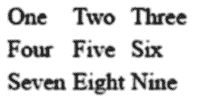
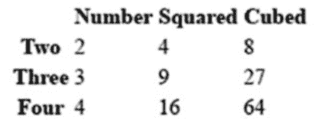
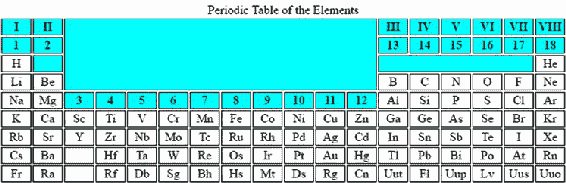
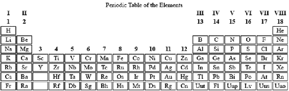

# 第 6 章：表格 HTML 元素

在本章中，我将向你展示如何将内容组织成由行和列组成的表格。有很多场景需要显示项目列表，而表格是完美的解决方案。在第 4 章中，我 [`dx.doi.org/10.1007/978-1-4842-2463-2_4`](http://dx.doi.org/10.1007/978-1-4842-2463-2_4)。

## 表格 HTML 元素

表格通过有序列表和无序列表（`ol`、`ul`）元素来演示。然而，这些元素虽然支持多行，但只能支持单列。如果你需要将一行组织成多列，表格是可行的方法。

> **警告：** 表格应仅用于呈现表格数据，例如电话列表或团队排名。不要使用表格来定义文档多个部分的布局。例如，如果你想让一个 `<aside>` 元素与主部分右对齐，请使用 CSS 而不是表格。我将在第 [13](http://dx.doi.org/10.1007/978-1-4842-2463-2_13) 章中解释如何做到这一点。

## 简单表格

我将从一个非常简单的表格开始，该表格有三行三列。使用 `<table>` 元素来定义表格。在 `<table>` 元素内部，使用表格行（`<tr>`）元素来定义每一行。在每一行内，使用表格单元格（`<td>`）元素来定义该行中每个单元格的内容。例如，清单 6-1 中的 HTML 将呈现为图 6-1 所示。

**清单 6-1。** 创建简单表格

```
<table>
<tr>
<td>一</td>
<td>二</td>
<td>三</td>
</tr>
<tr>
<td>四</td>
<td>五</td>
<td>六</td>
</tr>
<tr>
<td>七</td>
<td>八</td>
<td>九</td>
</tr>
</table>
```

© Mark J. Collins 2017

M. J. Collins, *Pro HTML5 with CSS, JavaScript, and Multimedia*，DOI 10.1007/978-1-4842-2463-2_6



**图 6-1。** *一个简单表格*

> **注意：** HTML4 在 `<table>`、`<tr>` 和 `<td>` 元素上支持许多用于定义表格格式的属性，例如 `border`、`bgcolor`、`width` 和 `align`。在 HTML5 中，这些属性已被弃用，转而使用 CSS 来实现此目的。在第 [13](http://dx.doi.org/10.1007/978-1-4842-2463-2_13) 章中，我将解释如何使用 CSS 的功能来设置表格样式。

如果你想为表格添加标题，请将 `<caption>` 元素作为 `<table>` 元素内的第一个子元素（在第一行之前）添加。例如：

```
<table>
  <caption>简单表格</caption>
  <tr>
```

尽管标题位于行详细信息之前，但使用 CSS，你可以将标题在视觉上放置在相对于实际表格的任意位置。

## 列标题和行标题

如果你想在某个单元格中放置列标题或行标题，则应使用表格标题单元格（`<th>`）元素而不是 `<td>` 元素。表格标题单元格元素的默认样式是使文本变为粗体。更重要的是，使用此元素提供了语义信息，表明其内容描述了一组单元格。

使用表格标题单元格元素时，你应该指定其 `scope` 属性。这定义了标题内容所描述的单元格集合。对于列标题，使用 `scope="col"`；对于行标题，使用 `scope="row"`。其他可能的值是 `colgroup` 和 `rowgroup`，我将在本章后面解释。

`scope` 属性在大多数浏览器中不会影响内容的呈现方式。然而，这些信息在某些应用程序（例如屏幕阅读器）中可能很有用。

清单 6-2 演示了一个使用列标题和行标题的表格。该表格列出了三个数字（2、3 和 4）以及这些数字的平方值和立方值。第一行包含列标题，每一行的第一个单元格包含行标题。其结果如图 6-2 所示。

**清单 6-2。** 使用列标题和行标题

```
<table>
<caption>平方与立方</caption>
<tr>
<td></td> <!-- 空单元格 -->
<th scope="col">数字</th>
<th scope="col">平方</th>
<th scope="col">立方</th>
</tr>
<tr>
<th scope="row">二</th>
<td>2</td>
<td>4</td>
<td>8</td>
</tr>
<tr>
<th scope="row">三</th>
<td>3</td>
<td>9</td>
<td>27</td>
</tr>
<tr>
<th scope="row">四</th>
<td>4</td>
<td>16</td>
<td>64</td>
</tr>
</table>
```



**图 6-2。** *使用列标题和行标题*

# 排版后内容

## 关于表格单元格的注意事项

**提示**：请注意第一行中的空单元格。即使该单元格中没有内容，也必须定义它，以便其他单元格正确对齐。每一行中的单元格数量应相同。如果某行中省略了一个单元格，则该行的最后一个单元格将为空。

### 列组

通过使用表格表头单元格元素（`<th>`）作为标题，使用表格单元格元素（`<td>`）作为普通内容，可以轻松地以不同方式设置它们的样式。但是，您可能希望将某些普通单元格列与其他列进行不同的样式设置。例如，在前面的示例中，您可能希望 `Squared` 和 `Cubed` 列的格式与 `Number` 列不同。您可以将这些列包含在列组（`<colgroup>`）元素中，然后对列组元素应用样式来实现这一点。

有两种使用列组元素的方法。首先，使用 `span` 属性指定该组将包含多少列。列被顺序分配给组。如果第一个组跨两列，它将包含前两列。如果下一个组跨一列，它将是表格中的第三列。要将前一个示例中的最后两列放入它们自己的组中，只需在第一行之前添加以下加粗的代码：

```
<table>
<caption>Squares and Cubes</caption>
<colgroup span="1"></colgroup>
<colgroup span="1"></colgroup>
<colgroup span="2" style="background-color: #b6ff00"></colgroup>
<tr>
```

前两个组各跨一列：行标题列和 `Number` 列。`span` 属性的默认值是 1，因此您也可以省略这些列组元素上的 `span` 属性。最后一个组跨越剩余的两列，即 `Squared` 和 `Cubed` 值。我已在此组上添加了一个 `style` 属性，以便您可以看到如何使用该组，但这通常应在 CSS 中处理。通过这些添加，表格现在呈现为图 6-3 所示。

***图 6-3.** 使用样式添加列组*

另一种方法是在列组元素中使用列（`<col>`）元素，而不是使用 `span` 属性。对于每个应包含的列，在组中包含一个列元素。列的分配顺序与第一种方法相同。您也可以在列元素上使用 `span` 属性。

**注意**：在列组（`<colgroup>`）元素中，您不能同时包含 `span` 属性和一个或多个列（`<col>`）元素。您可以使用任何一种方法，但不能在同一组中同时使用。

为了演示第二种方法，以下加粗的代码可以替换前面的列组元素。在此示例中，我将前两列放在一个组中，而不是单独的组中。在第一个组中，有两个列元素表示该组中有两列。在第二个组中，使用一个带有 `span` 属性的列元素来表示包含两列。

```
<table>
<caption>Squares and Cubes</caption>
<colgroup>
  <col style="background-color: #f00"/>
  <col />
</colgroup>
<colgroup style="background-color: #b6ff00">
  <col span="2" />
</colgroup>
<tr>
```

第二种方法的一个优点是您可以在列元素和列组元素上定义样式。您可以通过列组元素对一组列应用样式，或者如前面的示例所示，使用列元素对特定列应用样式。此表格的第一列呈现为红色背景，如图 6-4.

***图 6-4.** 同时使用 `col` 和 `colgroup` 元素*

如果您使用任一方法定义了列组，则可以在定义表格表头单元格（`<th>`）元素的 `scope` 时使用它们。将 `scope` 属性设置为 `colgroup` 将指示标题文本应用于当前列组中的列。

## 表格标题和页脚

通常，表格顶部会有一行或多行列标题，接着是多行数据，底部会有一行或多行汇总数据。您可以使用已经讨论过的元素来实现这一点。由于 HTML5 完全关乎语义，因此有额外的元素可用于区分属于标题或页脚的行与构成表格主体的行。通常，在 HTML 中提供尽可能多的信息是一个好主意。这还将在以后应用样式时提供更多选项。

如果有列标题，应将其放在表格头部（`<thead>`）元素中。如果有汇总信息，这些行应放在表格页脚（`<tfoot>`）元素中。构成表格主要部分的其余行应放在表格主体（`<tbody>`）元素中。列表 6-3 中显示了一个简单示例。

***列表 6-3.** 带有标题和页脚的表格*

```
<table>
<caption>Scoreboard</caption>
<thead>
  <tr>
    <th>Inning</th>
    <th>Runs</th>
    <th>Hits</th>
    <th>Errors</th>
  </tr>
</thead>
<tbody>
  <tr><td>1</td><td>0</td><td>1</td><td>0</td></tr>
  <tr><td>2</td><td>2</td><td>5</td><td>0</td></tr>
  <tr><td>3</td><td>0</td><td>1</td><td>1</td></tr>
  <tr><td>4</td><td>0</td><td>0</td><td>0</td></tr>
  <tr><td>5</td><td>1</td><td>2</td><td>0</td></tr>
  <tr><td>6</td><td>0</td><td>1</td><td>0</td></tr>
  <tr><td>7</td><td>0</td><td>0</td><td>0</td></tr>
  <tr><td>8</td><td>1</td><td>3</td><td>1</td></tr>
  <tr><td>9</td><td>1</td><td>2</td><td>0</td></tr>
</tbody>
<tfoot>
  <tr><td>Final</td><td>5</td><td>15</td><td>2</td></tr>
</tfoot>
</table>
```

**注意**：在 HTML4 中，表格页脚元素必须放在任何主体元素之前。在 HTML5 中，这一限制已被移除，因此您可以将页脚放在其逻辑上所属的主体之后。然而，无论页脚元素放置在何处，它都将在表格末尾渲染。因此，包含多个表格页脚元素是没有意义的。这不会导致错误，但所有页脚元素都会合并到表格底部。

表格头部、主体和页脚元素本身不会影响表格的渲染方式。使用默认样式，此示例表格的格式如图 6-5 所示。这三个元素都是可选的，您可以包含它们的任意组合。

***图 6-5.** 使用表格头部和页脚元素*

`<thead>`、`<tbody>` 或 `<tfoot>` 元素内的行被视为一个**行组**。在定义表格表头单元格元素的 `scope` 属性时，使用 `rowgroup` 值指示标题文本应用于当前行组。

一个表格内可以有多个表格主体部分。如果您有一个大表格并希望将其分成多个部分，这将特别有用。您也可以拥有多个表格头部元素，以便在每个主体元素之前放置不同的标题文本。正如我之前提到的，只会有一个页脚元素，并且它将在表格的末尾。

## 跨单元格

在 HTML5 中处理表格时，您可以将几个相邻的单元格合并为一个单元格。这类似于电子表格中的合并单元格。HTML 表格的单元格由表格单元格（`<td>`）和表格表头单元格（`<th>`）元素组成，如前所述。每个元素占据表格网格中的一个单元格。但是，这两个元素都支持 `colspan` 和 `rowspan` 属性。两个属性的默认值都是 1，因此每个元素恰好占一个空间。

# HTML 表格元素与嵌入内容

## 使用 `colspan` 和 `rowspan` 合并表格单元格

假设你有一个包含五列的表格。每个表格行元素总共包含五个 `td` 或 `th` 元素（这些元素可以互换使用）。如果你将其中一个元素的 `colspan` 属性设置为 `2`，它将占据两个单元格的空间，并且该行只需要四个元素。如图 6-6 所示。

**图 6-6.** 使用 `colspan` 属性

第一行包含五个元素。然而，第二行只有四个元素，因为其中一个元素占据了两个单元格。这与之前我在 `colgroup` 或 `col` 元素中解释的 `span` 属性的工作方式类似。

`rowspan` 属性的工作方式与之相同，区别在于单元格是向下扩展（包含其下方的单元格），而非向右扩展。当然，你也可以同时包含 `colspan` 和 `rowspan` 属性。在这种情况下，合并后的单元格将同时变得更宽和更高，如图 6-7 所示。

**图 6-7.** 使用 `colspan` 和 `rowspan` 属性

这会给后续的行元素带来一些有趣的副作用。在图 6-7 所示的表格中，第二行只有四个元素，因为一个元素占用了两个单元格。然而，在第三行中，单元格 2 和 3 已经被上一行的合并单元格分配掉了。只剩下三个可用单元格，因此第三行只会添加三个元素。第四行也是如此。

## 构建元素周期表

现在，让我们应用这个概念来构建元素周期表。如果你上过基础化学课，很可能见过这个表的某个版本。它以表格形式列出了所有元素。列和行具有特殊含义，与其原子结构有关。例如，最后一列的所有元素被称为稀有气体；其左侧的列包含所有卤族元素。

由于这种表格布局，网格中会存在空隙，尤其是在前几行。虽然我们可以创建大量空单元格，但更好的做法是将这些空单元格合并成一个单元格。

## 第 6 章：表格 HTML 元素

此表格的部分 HTML 代码如清单 6-4 所示。为简洁起见，我已省略了表格的最后四行。下载的代码将包含完整的源代码。完整表格有十八列、七行数据以及两行表头。

**清单 6-4.** 元素周期表源代码

```html
<table id="Periodic">

<caption>元素周期表</caption>

<tr>

<th>I</th>

<th>II</th>

<th colspan="10" rowspan="4"></th>

<th>III</th>

<th>IV</th>

<th>V</th>

<th>VI</th>

<th>VII</th>

<th>VIII</th>

</tr>

<tr>

<th>1</th>

<th>2</th>

<!-- 跳过 10 个单元格-->

<th>13</th>

<th>14</th>

<th>15</th>

<th>16</th>

<th>17</th>

<th>18</th>

</tr>

<tr>

<td>H</td>

<th></th> <!-- 空单元格 -->

<!-- 跳过 10 个单元格-->

<th colspan="5"></th>

<td>He</td>

</tr>

<tr>

<td>Li</td>

<td>Be</td>

<!-- 跳过 10 个单元格-->

<td>B</td>

<td>C</td>

<td>N</td>

<td>O</td>

<td>F</td>

<td>Ne</td>

</tr>

<tr>

<td>Na</td>

<td>Mg</td>

<th>3</th>

<th>4</th>

<th>5</th>

<th>6</th>

<th>7</th>

<th>8</th>

<th>9</th>

<th>10</th>

<th>11</th>

<th>12</th>

<td>Al</td>

<td>Si</td>

<td>P</td>

<td>S</td>

<td>Cl</td>

<td>Ar</td>

</tr>

<!-- 为简洁起见，省略最后四行 -->

</table>
```

第一行有一个元素跨越了十列和四行。在随后的三行中，我添加了注释以指示被跳过的单元格位置。这些空间被那个大的合并单元格占据。我在前四行中使用 `th` 元素来处理所有标题数据以及空单元格。

## 添加 CSS 来格式化表格

我将在第 [13](http://dx.doi.org/10.1007/978-1-4842-2463-2_13) 章中解释如何使用 CSS 格式化表格。不过现在，为了让这个表格看起来熟悉，我会添加一些非常简单的 CSS。因为元素太多，添加内联样式不切实际。在 `head` 元素中，我将添加以下 `style` 元素：

```css
<style>

#Periodic td {

width: 35px;

border: 1px solid black;

padding: 1px;

margin: 1px;

text-align: center;

}

</style>
```

这个选择器会找到所有位于 `id` 为 `Periodic`（即该表格元素的 `id`）的元素内部的 `td` 元素。这些声明设置了每个元素的宽度，并使文本居中并添加边框。元素周期表将呈现如图 6-8 所示的效果。





**图 6-8.** 元素周期表

为了能够看到合并的单元格，请在 `style` 元素中添加以下以粗体显示的 CSS 规则。这将为 `th` 元素添加边框并设置背景色。

```css
<style>

#Periodic td {

width: 35px;

border: 1px solid black;

padding: 1px;

margin: 1px;

text-align: center;

}

#Periodic th {

border: 1px solid black;

background-color: #0ff;

padding: 1px;

margin: 1px;

text-align: center;

}

</style>
```

现在表格将呈现如图 6-9 所示的效果。

**图 6-9.** 为 `th` 元素设置样式

请注意表格中间的大块区域。它有四行高、十列宽。整个区域周围有一个边框，因为它被视为一个单一的单元格。

### 本章小结

在本章中，我解释了如何使用 `table` 元素来呈现表格数据。一个表格由行组成，行由 `tr` 元素表示。每一行包含一组 `td` 和/或 `th` 元素。列并没有明确定义，而是基于 `td` 或 `th` 元素的存在来推断。例如，每行的第一个元素被视为第一列。

你可以使用 `colgroup` 和/或 `col` 元素来定义列。这实际上并不会创建或定义任何表格单元格，但允许你将样式应用于特定列或列组。出于语义目的，你还可以将表格行分组到 `thead`、`tbody` 和 `tfoot` 元素中。

最后，你可以使用 `colspan` 和 `rowspan` 属性将单元格合并为一个单元格。由于合并后的单元格会占用更多空间，因此包含合并单元格的那一行所需的元素会更少。

使用 `rowspan` 属性尤其有趣，它要求你在后续行中跳过一些单元格。我建议你在表格中添加注释以指示被跳过的单元格。

在下一章中，我将解释如何在文档中包含嵌入内容，例如图像。

我还会演示如何使用原生的 `audio` 和 `video` 元素。
