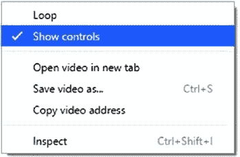
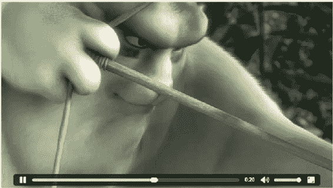
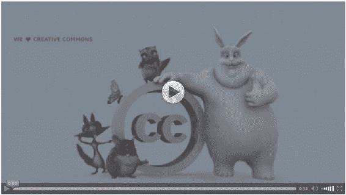
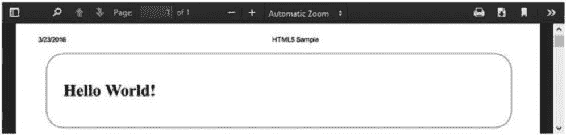

# 第 7 章：嵌入 HTML 元素

在本章中，我将演示 HTML5 文档中可用的嵌入元素。到目前为止我所研究的内容（主要是文本）都是在 HTML 文档中提供的。然而，对于嵌入元素，内容是由外部文件（如图像或视频剪辑）提供的。HTML 文档通过某个嵌入元素提供对该文件的引用。我将首先演示用于提供指向其他资源的超链接的 `a` 元素。然后，我会解释三种最常见的嵌入元素：`img`、`audio` 和 `video`；本章大部分内容将解释这三个元素的功能。

`audio` 和 `video` 元素也被视为交互元素，因为用户通常会通过用户界面来操作它们。例如，他们可能想要播放、暂停、快退或调整音量。

# 嵌入式 HTML 元素

本章将介绍用于这些交互的原生控件。在[第 21 章](http://dx.doi.org/10.1007/978-1-4842-2463-2_21)中，我将演示如何使用 JavaScript 实现自定义控件。

HTML5 还支持 `embed` 和 `object` 元素，它们允许你引用用于渲染内容的自定义插件。其他嵌入式元素，例如标量矢量图形（`svg`）和 `canvas`，需要专门的章节进行详细描述，我将分别在[第 22 章](http://dx.doi.org/10.1007/978-1-4842-2463-2_22)和[第 23 章](http://dx.doi.org/10.1007/978-1-4842-2463-2_23)中介绍它们。

### 锚点

从技术上讲，锚点（`a`）元素并不属于嵌入式内容范畴。我将其放在此处，是因为它不适合放在其他任何章节中。然而，理解锚点元素（以及一般情况下的资源导航）对于本章及后续章节至关重要。

锚点元素用于将内容转换为超链接。锚点元素内部的内容可以是除交互式内容之外的任何类型的流式内容或短语内容。锚点元素支持 `href` 属性，该属性定义了链接将要导航到的 URL。例如：

```
<a href="http://www.apress.com">
Apress
</a>
```

元素内部的内容（此处为“Apress”）将被渲染，当用户点击该内容时，浏览器将渲染 `href` 属性中指定的 URL。锚点元素内的文本内容通常会带有下划线。锚点元素内的内容也可以是图像，我将在本章后面进行说明。

© Mark J. Collins 2017

M. J. Collins, *Pro HTML5 with CSS, JavaScript, and Multimedia*, DOI 10.1007/978-1-4842-2463-2_7

`href` 属性还可以提供指向当前页面中特定元素的链接。例如，设置 `href="#Chapter5"` 将会滚动当前文档，使得 `id` 属性设置为 `Chapter5` 的元素出现在视口中。此外，链接资源不一定是网络资源。URL 的第一部分指定了协议（例如 `http:`），但还有其他类型的资源可供链接。以下是一些常用的类型：

- `http:` – 网络资源
- `ftp:` – 文件传输
- `mailto:` – 发送电子邮件
- `tel:` – 拨打电话号码（尤其适用于移动设备）
- `file:` – 打开文件

`target` 属性用于指定链接资源的显示位置。该属性值指示了应使用的浏览上下文。我在[第 4 章](http://dx.doi.org/10.1007/978-1-4842-2463-2_4)中解释过浏览上下文。有多个可用值，但最常用的是 `_self`（默认值）和 `_blank`。使用 `_self` 或不指定 `target` 属性，将导致链接资源在当前上下文中显示。通常，这意味着浏览器将离开当前页面并加载一个新页面。如果指定 `_blank`，链接资源将在新标签页或窗口中显示。

如果链接资源是一个应下载而非由浏览器渲染的文件，请使用 `download` 属性。包括文件应保存的默认名称：例如，`download="MyPicture.png"`。当用户点击链接时，将显示文件保存对话框，并且此文件名将被设置为默认值。但是，不允许使用 `/` 和 `\` 字符，因此无法设置默认的文件路径。

还有几个其他属性可以包含在内，它们仅提供关于链接资源的语义信息：

- `hreflang` – 指示链接资源的语言
- `rel` – 定义与链接资源的关系（更多信息请参见[第 1 章](http://dx.doi.org/10.1007/978-1-4842-2463-2_1)）
- `type` – 指示资源的 MIME 类型

### 图像

最常用的嵌入式元素是图像。在我们这个视觉导向的世界里，几乎找不到没有图像的网页；很多网页大部分内容都是图像（或视频）。图像元素没有内容，即开始标签和结束标签之间没有内容。事实上，它是我在[第 1 章](http://dx.doi.org/10.1007/978-1-4842-2463-2_1)中列出的自闭合标签之一。这些有时被称为*空*元素，因为它们的“内容”完全通过其属性进行配置。

图像元素的格式如下：

```

```

图像有两个必需的属性：`src` 和 `alt`。`src` 属性指定了所引用图像文件的 URL。在 `alt` 属性中提供图像的文本描述。如果图像无法下载或文件格式不受支持，则会显示此文本。非可视化浏览器（如屏幕阅读器）也会使用此信息。

图像可以以多种文件格式存储。这些格式之间的差异主要在于数据的压缩方式以及支持的颜色数量。每种格式在某些场景下表现更佳。现实情况是，我们将继续使用多种格式，而 HTML5 规范并未指定必须支持哪些文件格式。

> **提示：** 如果你坚持使用三种主流格式——JPEG、GIF 和 PNG——在可预见的未来你应该会很安全。所有浏览器都支持这些格式，并且它们将长期存在。TIFF 和 BMP 也得到了相当好的支持，但通常不被视为网络友好型格式，因为它们的文件大小相对较大，会拖慢下载速度。这里有一篇好文章介绍了所有五种文件类型及其最佳适用场景：[`1stwebdesigner.com/image-file-types`](http://1stwebdesigner.com/image-file-types)。这里有另一篇来自摄影师视角、内容相似的的文章：[`users.wfu.edu/matthews/misc/graphics/formats/formats.html`](http://users.wfu.edu/matthews/misc/graphics/formats/formats.html)。

图像元素还支持 `height` 和 `width` 属性。如果使用，单位必须设置为像素；不能使用相对单位来设置。如果未提供，将使用图像文件本身的固有尺寸。指定这些属性的一个好处是可以在下载完成之前预先分配空间。如果未指定，页面布局可能会在图像可用后发生变化。

### 多来源

图像元素包含 `srcset` 和 `sizes` 属性，允许你指定一组图像文件及其相关信息，以便浏览器选择最合适的一个进行下载和渲染。我将通过演示这些属性旨在解决的用例来解释它们。

### 像素比选择

在典型的移动设备或平板设备上，相同空间内通常包含更多的像素。例如，我的 24 英寸纯平显示器分辨率为 1920 x 1200 像素。我 5 英寸的 Lumia 手机分辨率几乎一样高，为 1280 x 720 像素。显示器的像素密度为 93 像素/英寸（PPI）；手机为 294 PPI，大约是前者的三倍。

考虑到这一点，你可能希望根据像素密度提供同一图像的多个缩放版本。这通过使用 `srcset` 属性并提供以逗号分隔的图像源列表以及 `x` 描述符来实现。`1x` 描述符对应典型的桌面分辨率；`2x` 描述符用于像素密度两倍的设备。例如，以下代码定义了图像文件的两个额外版本：

```

```

`src` 属性仍需保留，以防浏览器不支持 `srcset` 属性。同时，`src` 属性中的图像默认使用 `1x` 描述符，因此无需在 `srcset` 属性中重复包含 `1x` 选项。

**提示** 当你在 `` 元素中指定多个文件时，需要为网站提供多个版本的图片；但浏览器只会下载其中一个。这些方案不仅能提升用户体验，还能改善性能。

### 视口选择

假设你有一张希望横跨整个屏幕（或窗口）宽度的图片。你可以通过 CSS 将图片宽度设置为 `100%` 来实现。如果使用大屏显示器（如我的 24 英寸显示器），图片会按需拉伸。图片可能为了保持宽高比而被垂直拉伸，也可能固定高度导致图片变形。这两种结果可能都并非你所预期。

为解决这一场景，你可以结合使用 `srcset` 和 `sizes` 属性，根据*视口*宽度指定不同的图片文件。视口即网页的可见区域。在移动设备上，它等于设备尺寸；在桌面端，则取决于浏览器窗口的大小。

从作者的角度看，解决这个用例的方法其实很简单：告知浏览器每张图片的宽度，以及图片在宽度上应占用的空间。浏览器会据此决定下载哪个文件。所有这些决策仅涉及图片宽度和视口宽度。

#### 第一步：定义图片宽度

你需要使用 `srcset` 属性，但这里用的是 `w` 描述符而非 `x` 描述符。例如，若图片宽度为 300 像素，则描述符应设为 `300w`。

```html
srcset="Media/HTML5.jpg 300w, Media/HTML5_2.jpg 150w"
```

当使用`w`描述符时，支持`srcset`属性的浏览器会忽略`src`属性。与`x`描述符（默认值为`1x`）不同，`w`描述符没有默认值，因此你仍需提供`src`属性，但仅用于不支持`srcset`的旧浏览器。

## 第二步：使用`sizes`属性

浏览器在解析文档、下载 CSS 文件并应用所有 CSS 规则后，才能最终确定图片宽度。但为加速渲染过程，图片会在 CSS 应用之前预加载。因此，浏览器需要一些提示来决定下载哪些文件，这正是`sizes`属性的作用。

`sizes`属性是一个提示，用于指定渲染后图片的预期宽度。我在第[2 章](http://dx.doi.org/10.1007/978-1-4842-2463-2_2)中解释过，距离单位可以是固定单位（如像素）或相对单位。`sizes`属性支持所有这些单位，但在此场景下，相对于视口宽度指定最为实用。例如，若图片占满宽度，则设为`sizes="100vw"`；若仅占一半，则设为`50vw`。

如果网页采用分栏布局，栏数可能由视口尺寸决定。大屏上可能有四栏，此时`sizes`属性应为`25vw`。但随着视口缩小，栏数可能减至三栏、两栏，最终一栏。为支持这种变化，`sizes`属性的值需要根据视口动态调整。

你可能会疑问为什么`sizes`是复数形式。实际上，它支持逗号分隔的列表，允许你指定多个值。每个值可以通过媒体查询来限定生效条件。我将在第[9 章](http://dx.doi.org/10.1007/978-1-4842-2463-2_9)详细讲解媒体查询。以下示例根据视口宽度将`sizes`设为`25vw`、`33vw`、`50vw`或`100vw`：

```html
sizes="(max-width: 600px) 25vw, (max-width: 400px) 33vw, (max-width: 200px) 50vw, 100vw"
```

当视口宽度至少为 600 像素时，显示四栏，因此`sizes`设为`25vw`。随着视口缩小，栏数减少，单张图片的相对尺寸增大。

## 应用示例：基于设备尺寸选择图片

例如，假设你想展示 Arnold Friberg 的名画《福吉谷的祈祷》。在宽屏设备上，你会希望显示完整的画作，如图 7-1 所示。

  


**图 7-1.** Arnold Friberg 的《福吉谷的祈祷》

然而，如果网页在竖屏模式的移动设备上渲染，你可能希望显示裁剪后的版本，如图 7-2 所示。

**图 7-2.** 裁剪版

你可以通过如下`srcset`属性实现：

```html
<figure>
  
  <footer><small>Copyright © Friberg Fine Art</small></footer>
  <figcaption>Arnold Friberg's The Prayer at Valley Forge</figcaption>
</figure>
```

**注意** 新的`<picture>`元素正在提议中，以进一步辅助图片文件选择。截至本书撰写时，该元素仅受 Chrome 浏览器支持，故本书未予涵盖。如果你感兴趣，可以关注此特性。以下是当前规范的链接：  

[`html.spec.whatwg.org/multipage/embedded-content.html#the-picture-element`](https://html.spec.whatwg.org/multipage/embedded-content.html#the-picture-element)

### 图像映射（Image Map）

你可以轻松地将图片转换为超链接，只需将其放入锚点标签内：

```html
<a href="https://html.spec.whatwg.org/multipage/embedded-content.html">
  
</a>
```

这里用图片代替了文本作为内容。点击图片的任何位置都会导航到`href`属性中的地址。如果图片无法加载，`alt`属性中的文本会作为超链接显示。

然而，如果你希望仅在点击图片的特定区域时才触发链接，则需要设置图像映射。你也可以在单张图片上定义多个区域，每个区域导航至不同的链接。为演示此功能，我创建了一张包含红色正方形、绿色圆形和蓝色三角形的图片。图片高 50 像素，宽 150 像素，如图 7-3 所示。

**图 7-3.** 包含三个形状的示例图片

`<map>`元素可以放在 HTML 文档中的任何位置（无论在使用该映射的图片之前或之后）。通过`name`属性设置名称，在图片中使用时通过此名称引用。你可以创建多个映射，但每个映射的名称必须唯一。

`<map>`元素包含一个或多个`<area>`元素。每个`<area>`元素定义图片的一个区域及其点击后跳转的`href`。以下是针对图 7-3 中每个形状定义链接的`<map>`元素：

```html
<map name="shapeMap">
  <area shape="rect" coords="0,0,50,50" alt="square" title="Square" />
  <!-- 此处继续添加圆形和三角形的 area 元素 -->
</map>
```

### 图像映射

```html

<map name="shapeMap">
  <area shape="rect" coords="0,0,50,50" alt="square" title="Square"
        href="https://en.wikipedia.org/wiki/Square" />
  <area shape="circle" coords="75,25,25" alt="circle" title="Circle"
        href="https://en.wikipedia.org/wiki/Circle" />
  <area shape="poly" coords="101,50,126,0,150,50" alt="triangle" title="Triangle"
        href="https://en.wikipedia.org/wiki/Triangle" />
</map>
```

区域由`shape`属性和`coords`属性中的一组逗号分隔的坐标定义。支持三种形状：矩形（`rect`）、圆形（`circle`）和多边形（`poly`）。对于矩形，`coords`属性中应有四个值：左上角的`x`和`y`坐标，以及右下角的`x`和`y`坐标。对于圆形，应有三个值：圆心的`x`和`y`坐标以及半径。对于多边形，`coords`属性会有可变数量的坐标对，每对指定一个点的`x`和`y`坐标，这些点集合定义多边形。在本例中，有三个点：左下角、三角形的顶部和右下角。

**提示**：你可以定义一个没有`href`属性的区域，这被称为死区：一个不可点击的区域。此外，如果你想要定义一个覆盖整个图像的区域，请设置`shape="default"`，并且不要指定`coords`属性。

`area`元素也支持`target`、`rel`和`download`属性，它们的工作方式与其他超链接相同。如果图像无法显示，`alt`属性用作超链接文本。你还可以指定`title`属性，当鼠标悬停在可点击区域时会显示为悬停文本，如图 7-4 所示。

**图 7-4.** 显示悬停文本

要将映射链接到图像，你需要在`img`元素上设置`usemap`属性。该属性的值是`map`元素的名称，前面加一个井号。例如：

```html

```

**提示**：这个示例有点刻意，主要是为了演示图像映射的功能。如果你真的想根据点击的形状链接到一个页面，更好的做法是为每个形状创建单独的图像，并将它们放入各自的锚标签中。

---

### 音频

# HTML5 中的`audio`元素

HTML5 中的`audio`元素使得在 HTML 文档中嵌入音频变得极其容易。由于主流浏览器现在已经统一了标准文件格式，这变得更加简单。我喜欢将嵌入的文件（如音频和视频剪辑）放在 Web 应用程序的单独文件夹中。这样可以在我开发和维护的 HTML 文件与那些不是通过 HTML 创建的内容之间进行清晰分离。我在 Web 项目中创建了一个`Media`文件夹，并将所有嵌入内容放在那里。

**注意**：如果你使用的是源代码下载包，实际的音频文件已被移除，以避免任何版权侵权。要尝试本章其余部分的示例，你至少需要一个音频剪辑。你可以通过翻录音频 CD 来获取音频剪辑。下载中包含的视频文件根据知识共享署名许可授权，允许免费重用和分发。

添加音频就像添加一个`audio`元素并设置`src`属性指向音频剪辑的位置一样简单。例如：

```html
<audio src="Media/Linus and Lucy.mp3">
  <p>您的浏览器不支持 HTML5 音频</p>
</audio>
```

开始和结束标签之间的内容仅在`audio`元素不受支持或文件无法加载/播放时使用。有几个布尔属性可以与`audio`元素一起使用：

- `preload` - 如果存在，页面渲染时会预加载音频内容
- `autoplay` - 如果存在，音频剪辑会在内容加载完成后立即开始播放
- `muted` - 设置后，音频静音，不产生声音
- `loop` - 如果设置，音频剪辑会在播放完毕后自动回到开头重新播放
- `controls` - 如果存在，会向用户提供原生控件来与音频剪辑交互

如果添加了`autoplay`属性，音乐将在页面加载时立即开始播放。但是，没有控件可以停止它。截至撰写本文时，Chrome、Firefox 和 Opera 会在浏览器标签页中显示一个图标，表示音频剪辑正在播放。Firefox 和 Opera 允许你单击此图标来静音或取消静音。例如，Firefox 的标签图标如图 7-5 所示。

***图 7-5.** 在标签页中显示音频图标*

`audio`元素支持`volume`属性，你可以在其中预设播放音频剪辑时的音量级别。该值指定为 0 到 1 之间的数字，默认值为 1。本质上，1 表示音量应为设备设定音量的 100%。

---

## 使用原生控件

在用户界面方面，基本上有三个选项：

- **无控件**：音频播放，但用户没有可用的控件。可以使用`autoplay`属性在页面加载时自动启动剪辑。你也可以使用 JavaScript 启动、暂停和停止音频剪辑。
- **原生控件**：浏览器提供原生控件，供用户播放、暂停、停止音频剪辑以及控制音量。
- **自定义控件**：页面提供自定义控件，通过 JavaScript 与`audio`元素交互。

要启用原生控件，只需像这样添加`controls`属性：

```html
<audio src="Media/Linus and Lucy.mp3" autoplay controls>
```

在 Internet Explorer 中，原生控件看起来应该像图 7-6 所示的图像。在 Edge 浏览器中，它们看起来类似但更小。

***图 7-6.** 在 Internet Explorer 中显示原生音频控件*

在 Opera 和 Chrome 中，控件看起来像图 7-7。

***图 7-7.** Opera 中的音频控件*

在 Firefox 中，控件看起来像图 7-8。

***图 7-8.** Firefox 中的音频控件*

在 Safari 中，音频控件看起来像图 7-9。

***图 7-9.** Safari 中的音频控件*

**提示**：Windows 7 上的 Safari 需要安装 QuickTime 才能支持`audio`元素。你可以从以下网站下载：[`support.apple.com/kb/DL837?locale=en_US`](https://support.apple.com/kb/DL837?locale=en_US) 。在安装 QuickTime 后，你可能需要重启 PC，Safari 才能正常工作。

如你所见，每个浏览器中的控件样式都不同。使用原生控件，你对音频控件的显示方式几乎没有控制权。你可以通过设置`style`属性来更改宽度，这会拉伸进度条。将高度扩展到正常高度以上只会在控件顶部添加空白区域。但是，在 IE 中减小高度会缩小控件；在 Chrome 中，则会裁剪它。

---

## 文件格式

在 HTML5 中，你可以为音频剪辑指定多个源。这允许你提供不同文件格式的音频剪辑，让浏览器选择它支持的格式。虽然所有主流浏览器都支持`audio`元素，但它们并不都支持相同的音频格式。不过，目前大多数浏览器都支持 MP3 以及用于视频的 MP4。

**提示**：我提供这些信息是为了解释 HTML5 中提供的功能。然而，你很少需要使用它。在 HTML5 早期，这是一个重要的特性，因为浏览器并不都支持相同的文件类型。幸运的是，所有主流浏览器现在都支持 MP3 音频和 MP4 视频。

# 音频元素

`audio`元素允许你指定多个资源来源，浏览器会逐个尝试这些资源，直到找到它支持的格式。你可以在`audio`元素内提供一个或多个`source`元素，而不是直接使用`src`属性，示例如下：

```html
<audio autoplay controls>
  <source src="Media/Linus and Lucy.ogg" />
  <source src="Media/Linus and Lucy.mp3" />
  <p>HTML5 音频在你的浏览器上不被支持</p>
</audio>
```

浏览器会使用它支持的第一个资源，因此如果你有偏好，应将首选文件列在前面。例如，Chrome 同时支持 MP3 和 Vorbis 格式。如果你希望使用 MP3 文件，则应将其列在`.ogg`文件之前。

虽然仅像这样列出资源也能工作，但浏览器需要下载并打开文件以判断其能否播放。下载一个相当大的文件后发现无法使用，效率很低。你还应包含`type`属性，该属性指定资源的类型。浏览器可以通过查看标记来判断文件是否受支持。`type`属性指定 MIME 格式，如下所示：

```html
<source src="Media/Linus and Lucy.ogg" type="audio/ogg" />
<source src="Media/Linus and Lucy.mp3" type="audio/mp3" />
```

你也可以在`type`属性中指定编解码器，如下所示：

```html
<source src="Media/Linus and Lucy.ogg" type='audio/ogg; codecs="vorbis"'/>
```



这将帮助浏览器更高效地选择兼容的媒体文件。请注意，编解码器值包含在双引号内，因此你需要对`type`属性值使用单引号。

**提示：** 这里有一个实用页面，用于测试浏览器对`audio`和`video`元素的支持：[`hpr.dogphilosophy.net/test/`](http://hpr.dogphilosophy.net/test/)。它还提供了各种浏览器支持情况的概览。

# 视频元素

在本节中，我将使用随下载源代码提供的演示视频。这是来自*Big Buck Bunny*电影的预告片。该视频由创用共享许可提供，可自由再分发（版权 2008，Blender Foundation / [www.bigbuckbunny.org](http://www.bigbuckbunny.org/)）。当然，你也可以使用自己的视频，但建议使用 MP4 格式以确保兼容所有主流浏览器。

`video`元素与`audio`元素几乎相同。你可以在元素内提供后备内容，该内容仅在`video`元素或文件类型不被支持时显示。只需将`src`属性设置为视频文件的 URL，如下所示：

```
<video src="Media/BigBuckBunny.mp4" autoplay>
  <p>HTML5 视频在你的浏览器上不被支持</p>
</video>
```

`autoplay`属性会在页面加载时开始播放视频，但由于没有原生控件，你将无法暂停或重新播放片段。不过，如果你在视频上右键单击，会弹出一个选项菜单，可与此视频交互，包括显示原生控件。具体选项可能因浏览器而异。Chrome 中的菜单如图 7-10 所示。Firefox 还允许你调整播放速度，以及暂停、静音和切换到全屏模式。

`图 7-10. Chrome 中的视频菜单`

添加`controls`属性将提供与音频片段相似的控件，如图 7-11 所示。这些控件通常隐藏，除非鼠标悬停在`video`元素上。



`图 7-11. 显示带原生控件的视频`

`video`元素还允许你通过`source`元素指定多个资源来源，与`audio`元素类似。如果你提供的是 MP4 格式的视频，通常不需要使用此功能。

`poster`属性受`video`元素支持（但`audio`元素不支持）。在视频播放之前，你可以使用`poster`属性指定显示的图像。如果未指定，浏览器通常会打开视频并显示第一帧。要添加海报，只需将图像包含在你的项目中，并在`poster`属性中引用它。使用海报时，通常不应设置`autoplay`属性，否则海报将不会被看到。

不过有一件事需要小心。如果你定义了海报，`video`元素的初始大小将是海报图像的大小。如果这不同于视频的大小，则视频开始播放时会改变大小。你应确保图像与视频大小一致，或明确设置`video`元素的大小，这将拉伸（或缩小）海报图像以适应。

以下是使用海报图像的示例。这在 Firefox 中的渲染效果见图 7-12。请注意，海报变暗，播放按钮显示在视频中央。

```
<video src="Media/BigBuckBunny.mp4" controls
       poster="Media/BBB_Poster.png" width="852" height="480">
  <p>HTML5 视频在你的浏览器上不被支持</p>
</video>
```



`图 7-12. 在 Firefox 中显示视频海报`

# 轨道元素

`audio` 和 `video` 元素都支持 `track` 元素，它用于提供与媒体片段时间同步的基于文本的内容。例如，你可以在音频播放时显示歌词。对于视频，你可能希望包含隐藏式字幕或字幕。

`track` 元素是一个空元素；它使用自闭合标签，完全通过其属性进行配置。`track` 元素只能用在 `audio` 或 `video` 元素内部。如果你使用 `source` 元素提供多种文件类型，则 `track` 元素应放在 `source` 元素之后。

`kind` 属性指定轨道内容的用途。允许的值包括：

- `captions` - 用于隐藏式字幕，轨道提供对话的转录以及相关音效，例如“笑声”或“电话铃声”等。这用于听力障碍用户或音频静音时。
- `chapters` - 用于较长的片段，当用户浏览媒体文件时提供章节标题。
- `descriptions` - 对音频或视频文件内容的文本描述。用于视障用户或视频不可用时。
- `metadata` - 提供供脚本使用的数据；通常不显示给用户。
- `subtitles` - 如果未指定 `kind` 属性，这是默认值。字幕提供不同语言对话的翻译。它还可以提供附加信息，例如所描绘事件的日期和地点。

`src` 属性是必需的，它指定包含轨道内容的文件 URL。这通常是 WebVTT 文件，但其他格式也可能受支持。该文件包含一系列提示点，每个提示点都有开始和结束时间（相对于文件开始）以及在此间隔内应显示的文本。时间元素以小时、分钟、秒和毫秒指定，例如“00:02:15:420”，表示片段中的 2 分 15 秒 420 毫秒处。示例 WebVTT 文件如清单 7-1 所示。

**清单 7-1.** `bbb.vtt`，一个示例轨道文件

```
WEBVTT - For Big Buck Bunny trailer.

NOTE This is for demonstrational purposes

00:00:09.231 --> 00:00:11.121
- [Bunny looks around]

00:00:15.712 --> 00:00:16.892
- [Rodents snickering]

00:00:25.528 --> 00:00:27.631
- [Squirrel takes aim]
```

Mozilla 提供了一些有用的 WebVTT 文件示例，可在 [`developer.mozilla.org/en-US/docs/Web/API/Web_Video_Text_Tracks_Format`](https://developer.mozilla.org/en-US/docs/Web/API/Web_Video_Text_Tracks_Format) 找到。[网页视频文本轨道格式](https://developer.mozilla.org/zh-CN/docs/Web/API/Web_Video_Text_Tracks_Format) 也支持其他格式的轨道文件。下文提供了更多关于可选格式的详细信息：[`www.miracletutorials.com/`](http://www.miracletutorials.com/how-to-create-captionssubtitles-for-video-and-audio-in-webtvv-srt-dfxp-format/) [如何为 WebVTT、SRT、DFXP 格式的视频和音频创建字幕/说明。](http://www.miracletutorials.com/how-to-create-captionssubtitles-for-video-and-audio-in-webtvv-srt-dfxp-format/)

> **注意：** 轨道文件必须通过 Apache 或 IIS 等网络服务器提供。你不能像访问 HTML 文档那样，直接从本地文件夹访问 WebVTT 文件。你可能还需要定义 MIME 类型为 `text/vtt`。

`srclang` 属性指定了文本内容的语言。如果 `kind` 属性设置为 `subtitles`，则此属性是必需的。`label` 属性定义了用户选择相应轨道时显示的文本。要为 Big Buck Bunny 视频添加轨道，请像这样添加 `track` 元素：

```html
<video src="Media/BigBuckBunny.mp4" controls
       poster="Media/BBB_Poster.png" width="852" height="480">
    <track kind="captions" src="bbb.vtt" srclang="en" label="英语" />
    <p>您的浏览器不支持 HTML5 视频</p>
</video>
```

由于 `video` 元素包含一个含有字幕的 `track` 元素，原生控件将包含一个额外的按钮，使用户能够控制字幕显示。`label` 属性会显示在隐藏式字幕菜单中，如图 7-13 所示。如果包含了多个 `track` 元素，用户便可以从可用的轨道中进行选择。




**图 7-13.** Edge 浏览器中的隐藏式字幕菜单

> **提示：** 有一个由 Google 开发的关于使用轨道实现字幕的简单演示。你可以在 [`html5-demos.appspot.com/static/video/track/index.html`](http://html5-demos.appspot.com/static/video/track/index.html) 试试看。这使用了 WebM 视频格式，并非所有浏览器（尤其是 IE 或 Edge）都支持。请在 Chrome 中打开以查看演示。

## HTML5 插件

到目前为止，我已经解释了如何使用适当的元素将图像、音频和视频嵌入到 HTML 文档中。这类内容非常普遍，因此提供了特定的元素来访问浏览器的内置功能。在本节最后，我将介绍如何使用 `object` 元素嵌入几乎任何内容。

`object` 元素是任何外部内容的通用容器。对象的实际类型由 `type` 属性定义，并以 MIME 类型的形式提供。例如，如果你要嵌入 Flash 视频，请使用 `application/x-shockwave-flash`；如果你要嵌入 PDF 文件，请使用 `application/pdf`。当然，浏览器可能需要合适的插件才能呈现内容，但使用 `object` 元素提供了一种处理自定义嵌入内容的标准方法。

`object` 元素有两个必需的属性：我已经提到的 `type` 属性，以及指定嵌入内容 URL 的 `data` 属性。`data` 属性定义外部资源，`type` 属性指定应使用哪个应用程序（或插件）来呈现内容。你还可以指定 `height` 和 `width` 属性来为此内容分配所需的空间。

例如，要将 PDF 文件嵌入 HTML 文档，请添加以下内容，它将如图 7-14 所示呈现。

```html
<object data="MainPage.pdf" type="application/pdf" width="850" height="200">
    <a href="MainPage.pdf">主页</a>
</object>
```

**图 7-14.** 嵌入 PDF 文档

请注意 `object` 元素内部的备用内容。这是一个指向同一 PDF 文件的超链接。如果不支持 `object` 元素或特定类型，用户将看到指向该文件的链接，而不是嵌入的文件。如果你使用的是自定义插件，你可能希望在此处放置如何安装该插件的说明。如果未安装插件，他们将看到这些说明，而不是嵌入的内容。

`object` 元素还允许你使用 `param` 元素向插件传递参数。`param` 元素有两个属性：`name` 和 `value`。你使用 `param` 元素来提供一组名称/值对。`param` 元素使用自闭合标签，只能在 `object` 元素内部使用，并且应该放在任何回退内容之前。例如：

```html
<object data="some file" type="application/some plug in">
    <param name="paramName" value="paramValue" />
    <p>回退内容</p>
</object>
```

> **提示：** 并非所有插件都支持使用 `param` 元素传递参数。例如，向 PDF 查看器传递选项需要包含在 URL 中。例如，使用 `data="MainPage.pdf#zoom=50"` 会将初始缩放比例设置为 50%。你需要检查你正在使用的插件支持哪些功能。

HTML5 也支持 `embed` 元素，它类似于 `object` 元素。`embed` 元素在 HTML4 中就受支持，而 `object` 元素相对较新。许多文章建议 `embed` 元素已被弃用，但在撰写本文时，它仍包含在 HTML5 规范中。然而，普遍的共识是 `object` 元素比 `embed` 更受青睐。

`embed` 元素是一个空元素，这意味着它使用自闭合标签。这也意味着它不支持回退内容或 `param` 元素。除此之外，它的工作方式与 `object` 元素非常相似，只是资源的 URL 在 `src` 属性中提供。你可以像这样使用 `embed` 元素嵌入 PDF 文档：

```html
<embed src="MainPage.pdf" type="application/pdf" width="850" height="150"/>
```

### 总结

在本章中，我解释了如何将外部内容嵌入到 HTML5 文档中。嵌入内容的主要类型是图像、音频和视频，HTML5 为这些类型中的每一种都提供了特定的元素。你可以提供多个图像文件，让浏览器根据设备特征选择最合适的文件来下载和呈现。你还可以在图像上定义可点击的区域，这些区域可以用作链接。

主流浏览器都已将 MP3 标准化为音频格式，MP4 标准化为视频格式，这使得在 HTML 文档中包含它们变得非常容易。对于音频和视频，你还可以包含时间同步的文本，这些文本将作为字幕、说明或其他详细信息出现。

对于其他类型的嵌入内容，`object` 元素提供了一种标准化的包含方式。这可能需要自定义浏览器插件，但 `object` 元素是引用它们的一致方式。当插件不受支持时，你还可以提供回退内容。

在下一章中，我将演示支持用户输入的 HTML 元素。无论你是创建一个完整的输入表单，还是只是一个简单的搜索字段，这些元素都提供了用户与你的网页进行交互的能力。


