## 第 8 章：HTML 表单元素

在传统的 Web 应用程序中，表单是一个网页或其中的一部分，其中包含供用户输入信息的位置。一旦数据输入完毕，表单便会连同输入数据一起提交给服务器。服务器处理这些数据，并返回新页面，然后由客户端渲染该页面。

在本章中，我将解释如何在 HTML5 中创建表单。我还将演示通常与表单相关的 HTML 元素，例如 `label`、`input` 和 `button` 元素。其中许多元素也可以在不实际位于表单上的情况下在 HTML5 文档中使用。

### 概述

# 在浏览器中导航到网页时

当您在浏览器中导航到网页时，页面的 URL 会通过 HTTP 请求（如果使用安全传输则为 HTTPS）发送到相应的 Web 服务器。Web 服务器会返回一个由浏览器渲染的 HTML 文档。如图 8-1 所示。

***图 8-1.** 客户端/服务器架构*

如果网页包含表单，则在提交表单时，会向服务器发送另一个 HTTP 请求。该请求包含的 URL 与第一个请求相同，但也包含了来自输入字段的数据。这些数据可以包含在请求正文中，也可以作为查询字符串参数包含在 URL 本身中。我会在本章后面解释这一点。响应要么是一个新的网页，要么是对现有网页的更新。

© Mark J. Collins 2017

M. J. Collins，*精通 HTML5、CSS、JavaScript 与多媒体*，DOI 10.1007/978-1-4842-2463-2_8

---

## 表单元素

通过服务器请求提交输入数据是网站和 HTML 的基本功能。`form` 元素用于将一个或多个输入元素分组，以便将这些信息发送到 Web 服务器。您还可以在 `form` 元素中配置数据提交的位置（以及方式）。

一个 `form` 元素将包含一个或多个输入元素，这些是用户输入数据的字段。表单通常还会包含 `label` 元素，它们是描述输入元素的简单文本块。一个简单的表单定义如下：

```html
<form action="" method="get">
  <label for="iFirstName">名字:</label>
  <input id="iFirstName" type="text" />
  <label for="iLastName">姓氏:</label>
  <input id="iLastName" type="text" />
  <input type="submit" value="提交" />
</form>
```

此表单包含两个输入字段（名字和姓氏），以及每个字段对应的一个 `label` 元素。最后一个输入元素的 `type="submit"`，默认情况下会将其渲染为一个按钮。更重要的是，当单击此按钮时，表单将提交到服务器。此表单的渲染效果如图 8-2 所示。

***图 8-2.** 一个简单的表单渲染*

> **提示：** 如我在示例表单中所示，通过将输入元素放置在 `form` 元素内部，可以将它们与表单关联。但是，您也可以通过使用 `form` 属性来引用某个 `form` 元素，从而将输入元素包含在该表单中。这允许您将输入元素放置在文档的任何位置，并将其 `form` 属性设置为某个 `form` 元素的 `id` 属性。当提交该表单时，该输入值也会被提交。

### 表单操作

如果您在这些字段中输入数据并点击提交按钮，将会发送类似以下的 HTML 请求：`http://localhost:5266/?FirstName=Mark&LastName=Collins`

您可能还会注意到页面刷新时出现闪烁。Web 服务器会用一个新 HTML 文档来响应此请求。`action` 属性指定了请求的 URL。由于此处留空，因此使用了当前页面的地址。在我的例子中，它是 `http://localhost:5266`。所以浏览器会返回并重新渲染同一页面。

在许多情况下，`action` 属性会指定一个不同的页面。例如，假设初始页面提供了一个表单用于输入搜索条件。提交这些数据后，您会希望根据用户输入返回一个结果页面。此情况下的 `action` 属性就是结果页面的地址。

当提交初始表单时，您实际上是在请求渲染结果页面，并将搜索详情作为请求的一部分提供。

在其他场景中，您希望渲染现有页面。更准确地说，您希望根据刚刚输入的信息来*重新渲染*它。这被称为`回发`。这是指网页提交一个请求，让服务器刷新页面自身，通常会将数据传递给服务器。例如，如果您在一个页面上呈现一系列问题，但某个问题的答案可能会使其他一些问题不再适用。一旦该问题得到回答，一个简单的回发就可以仅用适用的问题重新渲染页面。

> **注意：** 在当前的网页设计中，回发通常不被看好，因为往返服务器和重新渲染整个页面可能会很慢。在这个例子中，最好在客户端用 JavaScript 来处理。

#### 表单方法

到目前为止，您可能已经正确地推断出，`form` 元素完全是关于定义提交表单时的 HTTP 请求。我已经解释了 `action` 属性，它指定了请求发送到的 URL。`method` 属性指示应该使用哪个 HTTP 动词。目前仅支持两个：`GET` 和 `POST`。

`GET` 动词不支持消息正文，因此所有表单数据必须像我之前演示的那样在 URL 中传递。如果您将 `method` 属性设置为 `post`，则表单数据将位于请求正文中。

为了演示这一点，我使用 Fiddler 拦截了请求，原始请求如下所示：

```http
POST http://localhost:5266/ HTTP/1.1
Host: localhost:5266
Connection: keep-alive
Content-Length: 31
Cache-Control: max-age=0
Origin: http://localhost:5266
Upgrade-Insecure-Requests: 1
User-Agent: Mozilla/5.0 (Windows NT 10.0; WOW64) AppleWebKit/537.36 (KHTML, like Gecko)
Chrome/51.0.2704.103 Safari/537.36
Content-Type: application/x-www-form-urlencoded
Accept: text/html,application/xhtml+xml,application/xml;q=0.9,image/webp,*/*;q=0.8
Referer: http://localhost:5266/
Accept-Encoding: gzip, deflate
Accept-Language: en-US,en;q=0.8

FirstName=Mark&LastName=Collins
```

第一行指示被请求的 URL，随后的行列出了 HTTP 请求中包含的所有标头。其中一些标头可以使用其他属性进行调整，我稍后会解释。最后一行是消息正文，包含表单数据。

> **提示：** 表述性状态转移（REST）是一种用于与网站和 Web 服务通信的架构风格。在 RESTful 应用中，HTTP 动词是请求的重要组成部分。您可以对完全相同的 URL 使用不同的动词，并获得截然不同的结果。在我看来，HTML5 不支持其他动词如 `PUT` 和 `DELETE` 非常遗憾。虽然有一些增加这些动词的动向，但似乎缺乏动力。如果您感兴趣，可以查看这篇文章：
>
> [`programmers.stackexchange.com/questions/114156/why-are-there-are-no-put-and-delete-methods-on-html-forms`](http://programmers.stackexchange.com/questions/114156/why-are-there-are-no-put-and-delete-methods-on-html-forms)

## 其他属性

`enctype` 属性可用于控制数据的格式化方式；但是，这里的选项并不多。默认值是 `application/x-www-form-urlencoded`，这基本上意味着输入数据经过 URL 编码。本质上，空格和特殊字符会被编码以满足 URL 格式规则。如果 `method` 属性是 `get`，这是您可以使用的唯一选项。实际上，`enctype` 属性仅在 `method` 属性设置为 `post` 时才允许使用。

# HTML 中的表单处理

如果使用的是 `post` 方法，URL 编码仍然可用，并且是默认选项。请注意，上一个示例中的消息体格式与通过 URL 传递时完全相同。此外，还有另外两个选项可供选择。使用 `text/plain` 时，空格会被转换为“+”，但其他特殊字符不会被编码。另一个选项是 `multipart/form-data`。同样，这个名称并不直观，但在请求中上传一个或多个文件时必须使用此值。

你可以使用 `accept-charset` 来指定服务器支持的字符集。如果未指定，则使用文档的字符集（详见第 [1 章）。由于这是用户输入的数据，你可能需要根据预期的受众支持额外的字符集。你可以通过用空格分隔来包含多个字符集。例如，`accept-charset="UTF-8 ISO-8859-1"` 包含了两种最常见的字符集。浏览器会根据自身支持的字符集选择其一。

当表单提交时，浏览器会对输入字段进行客户端验证。我稍后会解释这种验证。不过，你可以在 `form` 元素中添加 `novalidate` 属性来禁用验证。这是一个布尔属性。

## 输入元素

表单中最有趣的部分是输入元素，用户通过它们与表单交互以输入信息。HTML5 定义了一系列令人印象深刻的输入类型供选择。它们都使用相同的 `input` 元素，但通过分配的 `type` 属性来区分。可用的类型在附录 C 的参考数据中列出。

## 文本形式数据

输入的表单数据大部分是文本形式的；然而，有几种元素和元素类型是处理特殊类型文本的。它们有一些共同的功能，因此我将把它们作为一组来描述。

## 文本值

有几种输入类型本质上是文本框，它们根据指定的 `type` 属性提供数据验证。这些类型包括：

- `text` - 如果未指定 `type` 属性，这是默认值。如果文本字段中输入了换行符，它们在表单提交前会被移除。如果需要多行，请使用 `textarea` 元素。单行限制也适用于其余文本值类型。

- `email` - 它的工作方式类似于普通文本字段，但内置了验证功能，用于检查文本格式是否符合标准电子邮件地址。请记住，这仅验证格式；它不确保这是一个实际有效的电子邮件地址，甚至不验证域名是否存在。你还可以包含 `multiple` 属性以允许输入多个电子邮件地址。

- `password` - 它会将输入的字符显示为星号或其他遮挡输入的方式。这只是一个 UI 功能；数据在表单中仍以明文形式存在，并在表单提交时以这种形式发送。

- `search` - 此类型在功能上与普通文本类型没有区别，但搜索字段可能应用了不同的样式。你可以添加 `autosave` 属性，以便输入的数据可在其他页面的自动完成列表中使用。

- `tel` - 用于输入电话号码；但仅用于语义目的。由于国际上使用的格式多种多样，它没有提供内置验证。你可以使用 `pattern` 属性提供自己的验证规则。

- `url` - 与 `email` 类型类似，它会验证输入的文本是否为格式正确的 URL。它不验证资源是否实际存在。格式正确的 URL 包括协议，因此 `apress.com` 甚至 `www.apress.com` 不是有效的 URL，但 `http://www.apress.com` 是有效的。

## Textarea

`textarea` 元素是一个独立的 HTML 元素，而不是 `input` 元素的一种类型。然而，它的功能与 `type="text"` 的 `input` 元素非常相似，只是它允许 CR/LF 字符。它支持几个特定的属性，包括：

- `cols` - 指定单行应显示的字符数，类似于稍后描述的 `size` 属性。

- `rows` - 指定应可见的行数。实际数据可以包含更多行，但用户需要滚动才能看到它们。

- `wrap` - 指定文本应如何换行；允许的值为 `hard` 和 `soft`。默认值是 `soft`，这意味着只有当数据包含 CR/LF 字符时文本才会换行。用户可能需要水平滚动才能看到所有数据。值为 `hard` 表示文本始终换行以适合元素的宽度。

## 基于文本的输入元素的公共属性

每个基于文本的输入元素以及 `textarea` 元素都支持几个公共属性。这些属性包括：

- `inputmode` - 适用于 `email`、`password`、`text` 或 `url` - 可以作为提示提供给浏览器，提示应显示哪种键盘。这对于需要显示键盘供用户输入的触控设备非常重要。支持的值包括 `verbatim`、`latin`、`latin-name`、`latin-prose`、`full-width-latin`、`kana`、`katakana`。其他支持的类型（`email`、`numeric`、`tel` 或 `url`）应使用相应的 `type` 属性设置，而不是使用 `inputmode`，不过这里也支持这些类型。

- `maxlength` - 指定可输入到字段中的最大字符数。

- `minlength` - 指定此字段所需的最小字符数。

- `pattern` - 指定用于验证输入数据的正则表达式。某些文本值类型具有内置的验证逻辑。使用 `pattern` 属性将提供额外的验证。`textarea` 元素不支持此属性。

- `placeholder` - 放置在元素内的文本，用于说明字段中应输入什么数据。这是关于数据格式的提示，通常是预期输入的示例。例如，如果字段期望输入电话号码，则占位符可能包含一个按表单预期格式格式化的电话号码。占位符文本仅在字段为空时显示，并在字段被选中或输入第一个字符时隐藏。

- `size` - 指定输入元素的物理大小，以字符数表示。如果未指定 `size`，默认值为 20。这意味着元素应足够大以显示至少 20 个字符。这是一个指导原则，而不是绝对要求，因为字符可能具有不同的宽度。如果你输入二十个大写 W，它们可能无法全部显示。例如，我在 Chrome 中测试了这一点，在一个默认大小的输入元素中，我可以输入 64 个小写 i，但只能输入 13 个大写 W。请注意，这与 `maxlength` 属性不同，后者限制数据中的字符数。你可以将 `size` 属性设置为 10，大约 10 个字符可见。`maxlength` 属性可以设置为更高的值，但并非所有字符都可见。`textarea` 元素不支持此属性；请改用 `cols` 和 `rows` 属性。

- `spellcheck` - 一个布尔属性，指示是否应对输入数据进行拼写和语法检查。

## 自动填充

自动填充是一个非常方便的功能，浏览器可以根据之前的输入记录自动填充输入字段。当你输入时，列表会被筛选，仅显示与已输入字符匹配的条目。通常，在只输入一两个字符后，就可以选择而无需进一步输入。`autocomplete` 属性决定是否使用此功能，并控制可用的选项。

# 自动填充功能

自动填充功能可以在表单或字段级别开启或关闭。如果在`form`元素上将`autocomplete`属性设置为`off`，则除非在一个或多个`input`元素中显式开启，否则所有字段的自动填充功能都将关闭。类似地，如果在`form`元素中将其设置为`on`，则除非在`input`元素中将其设置为`off`，否则所有字段的自动填充功能都将开启。

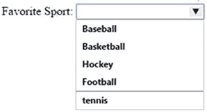

# 第 8 章 ■ HTML 表单元素

## 自动填充详情令牌

然而，仅仅开启自动填充功能还不够。例如，如果我正在输入电子邮件地址，我不希望在自动填充列表中看到姓名、地址或电话号码。你不应将`autocomplete`属性设置为`on`，而应将其设置为特定的自动填充详情令牌，在本例中为`email`。这样，自动填充列表将只包含在其他具有相同自动填充详情令牌的字段中输入的值。

目前已经定义了一个相当长的自动填充详情令牌列表，包括电话号码、地址或支付信息的各个部分，以及许多其他类型的信息。与其在这里重复所有信息，最好直接查阅规范，你可以在[`html.spec.whatwg.org/multipage/forms.html#autofill`](https://html.spec.whatwg.org/multipage/forms.html#autofill)找到它。这也是获取最新信息的最佳途径。

## 使用 `datalist` 元素

你还可以使用`datalist`元素提供自定义的自动填充列表。`datalist`元素包含一组`option`元素。然后，你可以使用`list`属性将`datalist`分配给`input`元素。

你在`datalist`中包含的任何值现在都会出现在自动填充建议中。以下是一个简单的示例：

```
<datalist id="sports">
  <option value="Baseball" />
  <option value="Basketball" />
  <option value="Hockey" />
  <option value="Football" />
</datalist>

<label for="iSport">最喜欢的运动:</label>
<input type="text" id="iSport" name="Sport" list="sports" />
```

### 示例说明

`datalist`元素包含四个值，它们是四种热门运动的名称。`datalist`通过其`id`属性被引用，我将其`id`指定为`sports`。然后，在`input`元素中，我添加了`list`属性：`list="sports"`。

带有预填充`datalist`的文本框与你使用`select`元素创建的下拉列表不同，这一点我稍后会解释。用户不仅限于这些选项；他们可以输入任何想要的内容。这只是在需要一些常见值时让输入稍微方便一些。建议列表会随着你的输入自动过滤。例如，输入字母“b”后，只有 Baseball 和 Basketball 会保留下来供选择。此外，如果自动完成功能已启用，基于之前的输入，建议列表还会添加额外的条目。例如，我之前输入过`tennis`，现在文本框看起来就像图 8-3 所示。

**图 8-3.** 使用预填充的`datalist`

# 第 8 章 ■ HTML 表单元素

## 属性

在继续介绍其余输入类型之前，我想先涵盖`input`元素支持的其他属性，这些属性大多适用于所有类型（有几个属性有一些限制）。

这将让你对文本元素有一个完整的了解。

- `name` - 提交表单时，输入字段会作为一组名称/值对发送到服务器，要么在消息正文中，要么在 URL 中，正如我之前演示的那样。名称部分来自`name`属性，值来自`value`属性（我稍后会解释）。如果未提供`name`属性，数据将不会发送到服务器。

- `value` - 正如我所说，`value`属性提供了传递给服务器的数据。当你向`input`元素（如文本框）中输入数据时，这些数据会存储在该元素的`value`属性中。这个`value`属性会显示在输入字段中，并在表单提交时被提交。你也可以在

# HTML 表单输入属性

`HTML`将使用指定的值预填充字段。`value`属性对于`checkbox`和`radio`类型是必需的，但对于所有其他类型是可选的。对于按钮类型，`value`属性提供按钮上的显示文本。

- `disabled` - 这是一个布尔属性，当为`true`时，将禁用对`input`元素的任何用户交互。此外，禁用字段不会随表单数据一起提交。

- `readonly` - 一个布尔属性，防止用户更改`input`元素的值。这与`disabled`属性略有不同，在`disabled`属性中，用户可以与元素交互但无法更改值。标记为`readonly`的元素在提交表单时也会被提交。但是，`readonly`属性会被几种输入类型忽略，包括`checkbox`、`color`、`file`、`hidden`、`radio`、`range`或按钮类型之一（`button`、`image`、`reset`、`submit`）。

- `required` - 一个布尔属性，指示用户必须为此元素输入（或选择）一个值。提交表单时，页面验证将强制执行此设置。您可以使用伪类 `:optional` 和 `:required` 为必需或可选元素应用样式。我将在[第 9 章](http://dx.doi.org/10.1007/978-1-4842-2463-2_9)中介绍这些内容。`required`属性不允许用于`hidden`类型或按钮类型之一。

- `autofocus` - 一个布尔属性，指示页面加载时`input`元素应获得焦点。只有一个元素可以设置此属性，并且此属性不允许用于`hidden`类型，我稍后会解释。

还有几个特定于某些输入类型的属性。我将在演示这些类型时进行解释。

## 回顾

为了快速回顾文本输入类型，以下是一段演示其中许多类型的`HTML`代码片段：

```html
<input type="email" name="Email" size="100"
placeholder="enter 1 or more email addresses" multiple required />
<input type="password" name="Password" maxlength="12" minlength="6" size="12" />
<input type="search" name="Search" placeholder="search criteria..." autofocus />
<input type="tel" name="Phone" placeholder="(800) 555-1212"
pattern="^(\+\d{1,2}\s)?\(?\d{3}\)?[\s.-]\d{3}[\s.-]\d{4}$" />
```

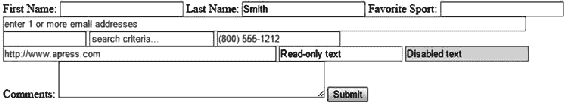

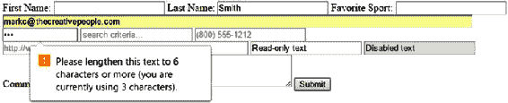

第 8 章 ■ HTML 表单元素

```html
<input type="url" name="Website" placeholder="http://www.apress.com" size="50" />
<input type="text" value="Read-only text" readonly name="ReadOnly" />
<input type="text" value="Disabled text" disabled />
<label for="iComments">Comments:</label>
<textarea id="iComments" rows="3" cols="50" wrap="hard" maxlength="250" name="Comments">
</textarea>
```

在电子邮件字段上，将`size`设置为 100 以使其足够大以容纳一个或两个电子邮件地址。这还具有`multiple`属性以允许输入多个地址。密码字段使用`minlength`和`maxlength`属性提供客户端长度验证。电话号码字段包含一个支持美国电话号码的正则表达式模式。`placeholder`属性还提供了号码格式的提示。

这包括一个禁用和一个只读文本框，以便您了解它们工作方式的差异。对于这两种情况，值都是通过`value`属性设置的，因为它无法在表单上输入。您可以突出显示只读字段上的文本并复制它，但无法在禁用字段上执行此操作。最后，注释字段使用一个`textarea`元素，显示三行文本。其最大长度为 250 个字符。

如果您将这些输入元素添加到本章开头显示的初始表单中，它看起来将类似于图 8-4。

***图 8-4.** 添加示例文本字段*

光标应位于搜索框中，因为该元素具有`autofocus`属性。当您提交表单时，如果任何验证失败，表单将显示错误，如图 8-5 所示。

***图 8-5.** 显示验证错误*

## 选择元素

有几种结构允许你在表单上呈现一组固定的选项。复选框和单选按钮可以通过 `input` 元素的 `type` 属性来创建。下拉列表则通过 `select` 和 `option` 元素来创建。

## 复选框

复选框用于表示布尔值，例如“可用？”或“可以打电话？”。值为真时选中，值为假时取消选中。通过将 `input` 元素的 `type` 属性设置为 `checkbox` 来创建复选框。

当你希望从一组选项中允许多选时，也可以使用复选框。例如，如果你正在订购披萨并选择配料，你可能希望列出所有可用的项目，如蘑菇、香肠、橄榄等，并在每个项目旁边放一个复选框。从技术上讲，每个项目都是一个具有布尔值的独立字段：你要蘑菇吗？你要香肠吗？

要指示复选框已被选中，请使用布尔属性 `checked`。如果存在此属性，则复选框被选中；否则不选中。提交表单时，只有选中的元素才会包含在表单数据中，而 `value` 属性决定了实际提交的内容。如果你希望数据为 `CanCall=true`，那么将 `name` 属性设置为 `CanCall`，`value` 属性设置为 `true`。在披萨示例中，你可以将所有复选框的 `name` 属性设置为 `Topping`，并将 `value` 属性设置为 `Mushrooms`、`Sausage` 或 `Olives`。提交表单时，每个被选中的复选框都会提交一个 `Topping` 字段及其对应的值。

> **提示：** 复选框要么选中要么未选中；没有不确定的值。HTML5 不支持三态复选框（选中、未选中、未指定），尽管有一些 JavaScript 解决方案可以提供此功能。例如，[请参阅 http://jquer.in/jquery-plugins-for-html5-forms/tristate/](http://jquer.in/jquery-plugins-for-html5-forms/tristate/)

`input` 元素并不显示任何文本。`name` 和 `value` 属性仅在提交数据时使用。你可以为每个 `input` 元素使用一个 `label` 元素，或者简单地将内容环绕在复选框周围。例如，选定的配料可以这样呈现：

```html
<p>配料：

<input type="checkbox" name="Topping" value="Mushrooms" />蘑菇？

<input type="checkbox" name="Topping" value="Sausage" />香肠？

<input type="checkbox" name="Topping" value="Olives" />橄榄？

</p>
```

当 `required` 属性用于 `type="checkbox"` 的 `input` 元素时，表示在提交表单之前必须选中该复选框。当用户需要在继续之前确认某些事项（例如条款和条件）时，你会用到此功能。

## 单选按钮

通过使用 `input` 元素并将 `type` 属性设置为 `radio` 来创建单选按钮。单选按钮的工作方式与复选框非常相似：`checked` 属性指示是否被选中；只有选中的值才会被提交；`value` 属性指定应提交的文本。

主要区别在于，单选按钮通常作为一组按钮提供，并且一组中只能选择一个单选按钮。当选中一个单选按钮时，该组中所有其他元素的 `checked` 属性都会被移除。单选按钮组由 `name` 属性决定。所有具有相同 `name` 属性值的元素被视为同一组。

回到我们的披萨示例。假设你提供三种类型的饼皮：薄皮、厚皮和深盘。你可以添加三个单选按钮，它们的 `name` 属性都设置为 `Crust`。每个按钮的值不同，分别为 `Thin`、`Thick` 或 `DeepDish`。提交表单时，例如，如果选择了厚皮选项，该字段将提交为 `Crust="Thick"`。和复选框一样，你可以在单选按钮周围定义额外的文本：

# 表单元素

```html
<p>饼皮：

<input type="radio" name="Crust" value="Thin" />薄皮

<input type="radio" name="Crust" value="Thick" />厚皮

<input type="radio" name="Crust" value="DeepDish" />深盘

</p>
```

你可以通过在其中一个单选按钮上添加 `checked` 属性来默认选中一个选项。如果你要求必须进行选择，请将 `required` 属性添加到其中一个单选按钮上；哪个按钮添加该属性无关紧要。在多个按钮上添加 `required` 属性没有额外效果。如果存在 `required` 属性，浏览器将不会提交表单，直到选中其中一个单选按钮，如图 8-6 所示。

> **图 8-6.** 验证必选的单选按钮

## 下拉列表

对于前两种输入类型，所有选项始终可见。使用复选框可以进行多项选择；使用单选按钮每组只能选择一个。然而，对于下拉列表，在用户点击下拉菜单之前，只显示选中的选项，然后才显示可用选项。

使用 `select` 元素创建下拉列表。在 `select` 元素内部，为每个可用选项包含一个 `option` 元素。在 `select` 元素上设置 `name` 属性，以指定提交表单时将发送的字段名。在 `option` 元素上使用 `value` 属性，以指示选中该选项时将提交的字段值。

`option` 元素可以通过嵌套在 `optgroup` 元素内来进行分组。这仅用于视觉目的，对提交的数据或选项的选中与取消选中没有影响。当选项列表相对较长时，`optgroup` 元素会很有帮助。`optgroup` 元素有一个必需的 `label` 属性。在此处指定组文本，该文本会显示在选项之前。`optgroup` 元素中的选项也会进行缩进。

默认情况下，第一个选项将被选中并在提交表单时提交。你可以通过将 `selected` 属性添加到所需的 `option` 元素，来选择另一个选项作为默认选项。只有一个选项应具有 `selected` 属性；如果多个选项具有 `selected` 属性，则除最后一个外，其他都将被忽略。

通过选择另一个选项来取消选中当前选项。没有办法取消选中选项使得没有任何选项被选中。为了解决这个问题，你可以包含一个*未选中*的选项，其 `value` 属性设置为空字符串。通常你会为其指定一个显示字符串，例如 `请选择`。如果选择了此选项，则会向服务器提交一个空字符串。你可以在 `select` 元素上添加 `required` 属性，以要求选择某个其他选项（该选项的 `value` 属性非空）。

可以像这样创建一个带有分组的下拉列表。其渲染结果如图 8-7 所示。

```html
<p>附加品：

<select name="Addons" required>

<option value="">请选择...</option>

<option value="None">仅披萨</option>

<optgroup label="附加品">

<option value="Wings">一份布法罗鸡翅</option>

<option value="GarlicBread">添加蒜香面包</option>

</optgroup>

</select>

</p>
```

> **图 8-7.** 带有分组的选择选项

在此示例中，初始选项的 `value` 属性为空，并且 `select` 元素具有 `required` 属性。用户在提交表单之前需要在此下拉菜单中做出选择。

## 多选列表

如果你添加了 `multiple` 属性，`select` 元素允许你选择多个选项。使用 `multiple` 属性后，用户界面会显著改变。这不再是一个只显示选中选项的下拉列表。相反，它更像一个显示所有选项的简单列表。你可以通过设置 `size` 属性来控制可见选项的数量。如果选项多于该数量，用户可以通过滚动列表来查看它们。

# 使用多选列表

要选择多个选项，您需要在单击所需选项的同时按住`Ctrl`键。您也可以先选择一个选项，按住`Shift`键，再选择另一个选项，这将选中两者之间的所有选项。在不按住`Ctrl`或`Shift`键的情况下单击某个选项，将会首先取消所有选项的选中状态。

为了演示这一点，我们使用一个多选列表框（如以下代码所示）重新实现`Toppings`字段。选择几个选项后，其渲染效果将如图 8-8 所示。

```html
<select name="Toppings" multiple size="4">
  <option label="Mushrooms?" value="Mushrooms" />
  <option label="Sausage?" value="Sausage" />
  <option label="Olives?" value="Olives" />
</select>
```

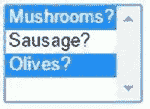

**图 8-8.** 使用多选列表框

> **注意：** `size`属性也支持下拉列表（即不包含`multiple`属性的情况）。这将始终显示指定数量的选项。然而，从用户界面（UI）角度看，这样做通常没有意义。

当表单提交时，发布的数据将与使用复选框的初始实现完全相同。`name`属性定义了所使用的字段名称，`value`属性指定了提交时的字符串。每个被选中的选项都会提交一个独立的字段。

---

## 其他类型

有几种用于特殊用途的其他输入类型，每种都有特定的属性来控制这些元素的独特方面。

### 数字（Number）

数字输入类型相当直接。它的行为很像文本框，但只允许输入数字。它允许输入小数值，但不会强制任何特定的格式或数字类型（例如仅限整数）。如果需要这些限制，您可以像前面描述的那样使用`pattern`属性。

您可以使用`min`和`max`属性来指定此字段的允许范围。浏览器将确保输入的数字在此范围内。大多数浏览器还提供上下箭头，可用于递增或递减当前值。这仅适用于整数，如果预期输入小数值则无效。

以下是数字输入字段的典型实现：

```html
<p>Number of utensils:
  <input type="number" min="1" max="4" value="1" name="Utensils" />
</p>
```

### 颜色（Color）

颜色输入类型将显示所选颜色的示例。点击该示例时，浏览器会显示一个颜色选择器，如图 8-9 所示。

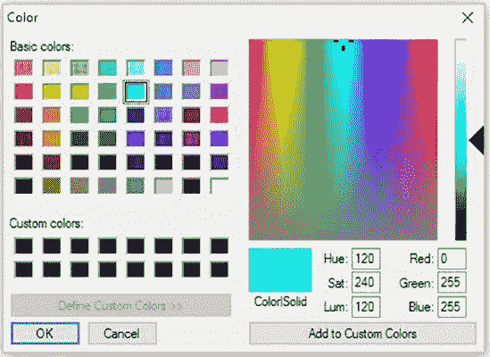

**图 8-9.** 一个颜色选择器示例

当表单提交时，所选颜色将以 RGB 表示法提供。例如，绿色指定为`#00ff00`。然而，如果进行 URL 编码，井号（`#`）会被替换为`%23`。

> **注意：** 截至撰写本文时，只有 Chrome、Firefox 和 Opera 支持颜色输入类型。

### 文件（File）

使用文件输入类型可以轻松选择一个或多个文件。如果您希望允许选择多个文件，请添加`multiple`属性。您还可以通过使用`accept`属性来提供所需文件类型的提示。该属性接受一个以逗号分隔的 MIME 类型列表，例如`text/css`。您可以使用通配符，例如以下几种常见值：

- `text/*` - 文本文件
- `image/*` - 图像文件
- `audio/*` - 音频文件
- `video/*` - 视频文件

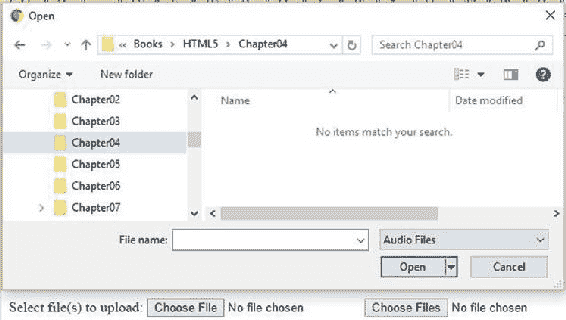

您也可以列出一个或多个文件扩展名，例如`accept=".jpg, .gif"`。以下是一个包含两个输入字段的简单示例。第一个可以选择单个音频文件；第二个可以选择一个或多个扩展名为`.jpg`或`.png`的图像文件：

```html
<p>Select file(s) to upload:
  <input type="file" name="music" accept="audio/*" />
  <input type="file" name="pictures" multiple accept=".jpg, .png" />
</p>
```

> **注意：** `accept`属性有助于引导用户选择合适的文件类型。但是，

# 文件输入与范围输入

用户通常可以轻松覆盖默认设置并选择不同类型的文件。但服务器端代码应始终验证文件是否为正确的类型。

图 8-10 和图 8-11 分别展示了 Chrome 和 Firefox 中的输入按钮及文件对话框。

***图 8-10.** Chrome 中的文件输入与对话框*

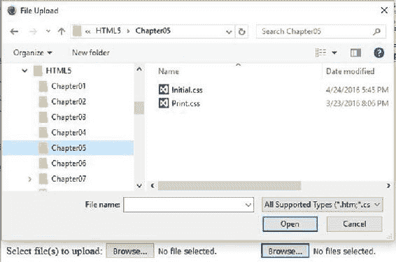

*第 8 章 ■ HTML 表单元素*

***图 8-11.** Firefox 中的文件输入与对话框*

如您所见，其格式和具体功能可能有所不同，但基本能力是一致的。

## 范围（Range）

范围输入类型在 W3C 规范中也被称为“不精确的数字输入控件”。它通常用于当具体数值不如其在某种尺度上的相对值重要时。

不过，此输入类型最终会有一个数值。其用户界面呈现为一个滑块，用户可以拖动它，并根据其位置确定一个值。

范围输入类型具有 `min` 和 `max` 属性，用于定义滑块两端的值。当滑块位于刻度左侧（或底部）时，其值为 `min` 属性指定的值。`max` 属性必须大于 `min` 属性，但两者或其中之一可以为负值。

您还可以指定 `step` 属性，该属性定义了滑块上的停止点。例如，将 `step` 属性设置为 `10` 将只允许您以 10 的间隔停止。默认值为 `1`，这将确保用户只能选择整数。如果您将值设置为 `any`，则没有预设的停止点，用户可以在任意位置停止。

■ **注意**：设置 `step="any"` 时要小心，因为该值将是一个浮点数，例如 `44.9814126394052`（我在测试时恰好得到了这个值）。由于这被称为“不精确的数字输入控件”，这可能是您不想要的精度。如果您需要比 `1` 更精细的粒度，可以对 `step` 属性使用小数值，例如 `.1`。


*第 8 章 ■ HTML 表单元素*

您可以在滑块上方显示刻度标记，以指示停止点的位置。但要做到这一点，您必须使用 `datalist` 元素来定义它们。为每个需要显示刻度标记的位置添加一个带有 `value` 属性的 `option` 元素。然后，在 `input` 元素中使用 `list` 属性引用该 `datalist`。例如：

```
<datalist id="SurveyStops">
  <option value="0" />
  <option value="10" />
  <option value="20" />
  <option value="30" />
  <option value="40" />
  <option value="50" />
</datalist>

<p>您对订购流程的满意度如何？
  <input type="range" name="Survey" min="0" max="50" step="10" list="SurveyStops" />
</p>
```

不同浏览器实现之间的用户界面差异很大。例如，Chrome、Firefox、IE 和 Opera 对此标记的渲染效果分别如图 8-12、8-13、8-14 和 8-15 所示。

***图 8-12.** Chrome 中的范围输入类型*

***图 8-13.** Firefox 中的范围输入类型*

***图 8-14.** IE 中的范围输入类型*

***图 8-15.** Opera 中的范围输入类型*

由于停止点和刻度标记是独立定义的，它们不必相同。您可以将停止点设置为每隔 5 一个，而刻度标记设置为每隔 10 一个。当然，它们也可以完全不同步，例如每 7 个标记一个刻度，而 `step` 设置为 `10`。然而，这会让用户感到困惑，应避免这样做。

在撰写本文时，Firefox 不支持刻度标记，如图 8-13 所示。此外，在 IE 11 中，如果您没有通过 `datalist` 元素指定刻度标记，它会自动根据 `step` 属性显示它们。在 IE 和 Edge 中，当用户点击输入字段时，选中的数值会显示在滑块上方。

*第 8 章 ■ HTML 表单元素*

## 隐藏输入（Hidden Input）

`<input>`元素也支持`hidden`类型。正如你所料，这种类型没有用户界面；用户无法看到或修改它的值。不过，当表单提交时，它会与其他元素一起提交。这允许你在提交的数据中包含一些硬编码的内容。例如，假设你有多个表单提交到同一个服务器地址，你可以在隐藏输入字段中包含使用的是哪个页面。为此，只需在标记中设置`value`属性即可。

这种类型的另一个更常见的应用是捕获通过 JavaScript 收集的数据。例如，你可以使用 JavaScript 获取用户的位置，并将其包含在表单数据中。在这种情况下，`value`属性是通过 JavaScript 设置的。

### 日期与时间数据

HTML5 规范定义了许多与日期/时间值相关的输入类型。其中五种类型得到了大多数主流浏览器的支持，而 Firefox 是最显著的例外。此外，IE 也不支持这些类型，但它们可以在 Edge 浏览器中工作。如果不被支持，这些输入元素将显示为简单的文本框。你应该包含`placeholder`属性来指示预期的格式。在支持该输入类型的浏览器中，`placeholder`会被忽略。

这五种类型是：

- `date` - 不含时间部分的日期
- `datetime-local` - 日期和时间；时间为（浏览器的）本地时间 - 不支持世界时或时区
- `time` - 本地时间；同样不支持时区
- `month` - 特定的年份和月份
- `week` - 特定的周，表示为年份和周数（1-53）

> **注意**：是的，通常一年只有 52 周。然而，52 * 7 只有 364 天，所以每年会多出一天，大约每四年会多出两天。因此，每五到六年，我们就会有一个第 53 周。

这些类型都允许使用`min`和`max`属性来定义允许输入值的范围。

然而，浏览器对这些属性的支持程度参差不齐。对于`month`和`week`类型，没有任何浏览器支持它们。对于其他三种类型，它们在大多数情况下得到支持，但并不一致。

不过，你应该始终提供额外的客户端或服务器端验证，而不是依赖浏览器。

你应该酌情定义这些属性，因为在支持它们的浏览器中，浏览器可以提供更好的用户体验。

`step`属性也针对这些类型进行了定义。不过，目前它仅支持`time`和`datetime-local`类型。用户界面通常会提供向上/向下箭头，让用户可以在允许的值之间滚动。规范并未明确说明`step`属性应如何使用。支持该属性的浏览器主要将其用于秒数。例如，如果你设置`step="15"`，单击向上箭头将使所选时间增加 15 秒。

与其他输入类型一样，你可以通过添加`value`属性来设置初始值。如果未指定，字段通常会使用当前日期（或时间）。这可能会受到`min`和`max`属性的影响。例如，如果`min`属性是未来的日期，那么它通常会成为初始值。初始值仅影响日期选择器和滚动功能。除非在标记中提供了值，否则在用户输入值之前，字段的实际值将为`null`。

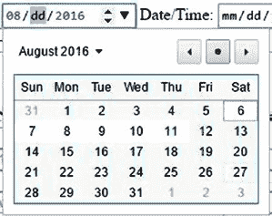

第 8 章 ■ HTML 表单元素

以下标记将创建每种受支持类型的一个实例：

```
<p>
  Date:
  <input type="date" name="Date" min="2016-08-06" max="2016-08-11"
    placeholder="mm/dd/yy" />
  Date/Time:
  <input type="datetime-local" name="DateTime" step="30"
    placeholder="mm/dd/yy hh:mm:ss AM" />
  Time:
  <input type="time" name="Time" min="10:00:00" max="17:00:00" step="15"
    placeholder="hh:mm:ss AM" />
  Month:
  <input type="month" name="Month" min="2016-01-01" max="2017-12-31"
    placeholder="yyyy-mm" />
  Week:
  <input type="week" name="Week" min="2016-01-01" max="2017-12-31"
</p>
```

`placeholder="yyyy-W##"` />

每个浏览器呈现的 UI 差异很大。Chrome 和 Opera 中的日期选择器可能是最自然的。它显示一个可滚动浏览的月历。由于我使用了`min`和`max`属性将日期范围设置为 8 月 6 日至 11 日，因此所有其他日期都显示为灰色，如图 8-16 所示。月份滚动也被禁用，因为这些日期在允许范围之外。

**图 8-16.** Chrome 中的日期选择器

大多数浏览器支持滚动功能来选择单独的日期/时间元素。例如，在`datetime-local`类型中有七个部分：月、日、年、时、分、秒、上午/下午，如图 8-17 所示。您可以点击每个部分，然后使用上/下箭头为该部分选择一个值。我将`step`属性设置为`30`，因此在滚动秒数时只有两个值：0 和 30。如果设置了`min`和`max`属性，滚动功能通常会遵循这些限制。例如，在最大值时向上滚动会将值更改为最小值。

**图 8-17.** Chrome 中的`datetime-local`输入类型

截至撰写本文时，只有 Edge 浏览器支持时间选择器。要查看时间选择器，请点击时间字段或`datetime-local`字段中的时间部分的任意位置。桌面浏览器的 UI 略有不同，但与移动设备上的预期类似。小时、分钟、秒和上午/下午值显示在列中。您可以在某一列上悬停，然后使用鼠标滚轮滚动该列，如图 8-18 所示。

**图 8-18.** Edge 中的时间选择器

从图 8-18 可以看出，可用小时数仅限制为 10 和 11，这是因为`min`属性设置为上午 10:00。要选择中午之后的值，请将上午/下午列更改为下午，您将看到小时数 12-5，因为`max`属性设置为下午 5:00。如果您选择了 5 小时，则唯一可用的分钟值是 00。

Edge 中的日期选择器以相同的方式工作。您可以单独滚动月份、日期和年份列以选择所需日期。这同样遵循`min`和`max`属性的限制，如图 8-19 所示。

**图 8-19.** Edge 中的日期选择器

Edge 日期选择器的最大缺点是不显示星期几。例如，如果您想选择下周一，则必须知道具体日期。使用 Chrome 的日期选择器，由于它显示月历，因此您可以轻松查看。

Safari 不提供任何日期或时间选择器。此外，您无法选择单独的部分并滚动以选择其值。它有一个滚动功能，但针对的是整个字段。对于`date`类型，这将一次滚动一天。对于`datetime-local`或`time`类型，除非设置了`step`属性，否则它将一次滚动一秒。

使用`week`输入类型时，您需要选择年份和周数（1-53）。Chrome 和 Opera 中的 UI 显示一个月历，您可以在其中选择特定周。实际周号也会显示，如图 8-20 所示。

**图 8-20.** Chrome 中的周选择器

在 Edge 中，只显示年份和周号（见图 8-21）。

**图 8-21.** Edge 中的周选择器

## 其他视觉元素

有几个元素用于向表单提供视觉信息，而不是接受用户输入。您无疑见过`label`元素，因为它几乎用于每个表单。其他元素如`output`、`meter`和`progress`有更专门的用途，但可能非常有用。

### 标签

我在本章开头介绍了`label`元素，但没有详细说明。您需要为表单中的字段添加标题，以便用户知道在每个字段中输入什么。然而，正如我在本章中多次演示的，您可以在表单中包含内容，而无需使用`label`元素。由于 HTML5 注重语义，作为标题（或标签）的内容应通过将其放入`label`元素中来称为标签。

`label`元素应该与其描述的`input`元素关联，有两种方法可以实现。我个人更倾向于简单地将`input`元素嵌入到`label`元素内部。另一种选择是使用`label`元素的`for`属性。`for`属性指定了输入类型的`id`。当然，这要求您为`input`元素分配一个唯一的`id`。这两种技术如下所示：

```html
<p>Deliver to: <br />
<label>
Address:
<input type="text" size="30" name="Address" />
</label>
<label>
ZipCode:
<input type="text" maxlength="5" size="5" name="Zip" />
</label>
<label for="telephone">Phone #:</label>
<input type="tel" id="telephone" name="Phone" />
</p>
```

使用关联的`label`元素有一个优点（除了更好的语义之外）。如果您点击一个`label`元素，关联的`input`元素将获得焦点，用户可以开始向其中输入数据。

在前面的示例中，如果您点击**Deliver to:** 文本，则不会发生任何事情。但如果您点击**Address:**、**ZipCode:** 或 **Phone #:** 文本，关联的`input`元素将被选中。

### Output 元素

如果表单有输入，那么它们也可以有输出，这似乎也很合理，对吧？在 HTML5 之前，答案是否定的，但现在我们有了`output`元素。它用于计算出的数据，这些数据通常基于用户的输入，但并非直接输入。例如，在选择完所有披萨选项后，您会希望显示应付款总额。这正是`output`元素的用途。

当页面首次加载时，您可能不知道`output`元素的值。您可以使用默认值（如 0），或者添加`hidden`属性使其不显示。一旦输入了必要的值，您可以在客户端执行计算并更新`output`元素。然而，在我们的披萨订单示例中，您可能需要将表单提交到服务器，而回发响应将设置`output`元素的内容。

您应该为计算出的值添加一个标签，可以像这样将其嵌套在`label`元素内：

```html
<p>
<label>Total due:
<output id="total" name="Total">$0.00</output>
</label>
</p>
```

`output`元素支持`for`属性，您可以在其中指定用于计算此值的输入元素。每个输入元素的`id`应包含在`for`属性中，用空格分隔。

### Meter 元素

`meter`元素类似于我前面描述的`range`元素，它显示一个值，不是作为具体数字，而是通过其在刻度线上的位置来显示。然而，用户无法更改`meter`元素的值。

`meter`元素类似于汽车中的温度表。我并不关心温度是 205° 还是 210°，我只想知道它是否*正常*。有一天我开车去上班，开了一会儿后碰巧注意到温度表显示在低温区域。我觉得这很有趣，但并没有太担心。过了一会儿，我看到它显示发动机运行温度比正常高；我觉得这更有趣了。不久，它超出了刻度范围，我知道自己有麻烦了。您可能已经猜到了，我的节温器卡住了。起初它卡在开启状态，然后卡在了关闭状态。温度表通过简单地将值显示为低温、正常、高温或“靠边停车！”告诉我需要知道的一切。

# HTML 表单元素

## `<meter>` 元素

`meter` 元素的工作原理与此相同。通过指定 `min` 和 `max` 属性来定义刻度，然后 `value` 属性会在该连续区间内显示对应的位置。与温度计类似，你可以在该刻度内定义范围，以指示最佳值所在区域。`meter` 元素支持定义这些范围的 `low`、`high` 和 `optimum` 属性。

然而，这可能有点难以理清，因为最佳范围可能位于刻度的低端、高端，或者中间某个位置。你如何设置这些属性取决于不同的场景。

图 8-22 展示了每种场景，并说明了每种情况下应如何设置这些属性。

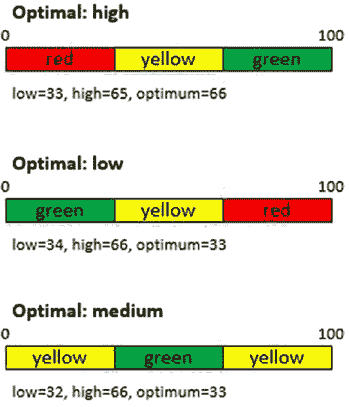

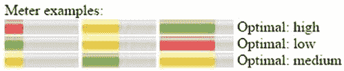

**图 8-22.** *定义最佳范围*

为了测试这一点，以下标记将为每种场景创建三个 `meter` 元素，并在每个元素上设置 `value` 属性，以测试所有三个范围。在 Chrome 中渲染的结果内容如 图 8-23 所示。

```
<p>Meter 示例：<br />

<meter min="0" max="100" low="33" high="65" optimum="66" value="25"></meter>

<meter min="0" max="100" low="33" high="65" optimum="66" value="50"></meter>

<meter min="0" max="100" low="33" high="65" optimum="66" value="75"></meter> 最佳值：高<br />

<meter min="0" max="100" low="34" high="66" optimum="33" value="25"></meter>

<meter min="0" max="100" low="34" high="66" optimum="33" value="50"></meter>

<meter min="0" max="100" low="34" high="66" optimum="33" value="75"></meter> 最佳值：低<br />

<meter min="0" max="100" low="32" high="66" optimum="33" value="25"></meter>

<meter min="0" max="100" low="32" high="66" optimum="33" value="50"></meter>

<meter min="0" max="100" low="32" high="66" optimum="33" value="75"></meter> 最佳值：中<br />

</p>
```

**图 8-23.** *Chrome 中的 `meter` 元素*


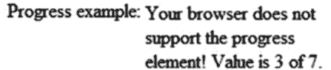

你可以在 `meter` 元素内部提供备用内容，当浏览器不支持 `meter` 元素时，将显示该内容。

## `<progress>` 元素

`progress` 元素与 `meter` 元素类似，只是没有 `low`、`high` 和 `optimum` 属性。它还有一个非常特定的语义目的——显示进度。例如，你可能想在一个表单上显示进度。假设有七个输入字段。你可以添加一个 `min` 属性设为 `0`、`max` 属性设为 `7` 的 `progress` 元素。每输入一个字段，客户端代码就可以将 `progress` 元素的 `value` 加一。这能让用户直观地了解还剩多少工作。

另一个更有用的例子是，当有多个表单必须提交时。

例如，如果你在申请一份工作，可能需要填写不同的表单，如教育经历、工作经验、联系详情等。在每个表单上提供一个 `progress` 元素，可以直观地反馈用户在整个流程中所处的位置。

一个简单的 `progress` 元素创建如下。在 Firefox 中渲染的结果如 图 8-24 所示。

```
<p>进度示例：

<progress min="0" max="7" value="3">

您的浏览器不支持 progress 元素！当前值为 3/7。

</progress>

</p>
```

**图 8-24.** *Firefox 中的进度条*

如果元素中的信息很重要，并且浏览器可能不支持它，你应该包含备用文本。例如，由于 Safari 不支持 `progress` 元素，其渲染结果如 图 8-25 所示。

**图 8-25.** *Safari 中的进度条*

### 按钮类型

在一个典型的表单中，你会拥有向用户提供信息的内容、用户输入信息的输入元素，以及启动操作的按钮。我之前已经演示过如何使用 `type` 属性设置为 `submit` 的 `input` 元素来创建提交按钮。实际上有两种创建表单按钮的方法：第一种，就像我演示过的，是使用带有适当 `type` 属性的 `input` 元素（有四种类型可以生成按钮）。第二种方法是使用 `button` 元素，它也支持 `type` 属性，并且有三种不同的类型，这些类型基本上与 `input` 的类型等效。

`input` 元素支持以下按钮类型：

- `submit` - 点击后，将提交表单。
- `reset` - 点击后，将清除输入元素并将表单重置为原始值。
- `image` - 功能类似于 `submit` 类型，但支持 `src` 属性来指定用作按钮的图像。
- `button` - 创建一个没有默认操作的按钮。你可以使用它通过 JavaScript 实现自定义操作。

`button` 元素支持以下 `type` 值：

- `submit` - 提交表单，就像 `submit` 输入类型一样。
- `reset` - 重置表单，就像 `reset` 输入类型一样。
- `button` - 一个没有定义操作的按钮，就像 `button` 输入类型一样。

使用 `input` 类型长期以来一直是 Web 表单的标准，而 `button` 元素则相对较新。早期浏览器无法正确处理 `button` 元素存在一些问题，但这已不再是主要考虑因素。

如前所述，`input` 元素没有内容。按钮的文本通过 `value` 属性设置，`src` 属性可用于指定图像（仅适用于 `image` 类型）。然而，`button` 元素内部确实有内容，因此你拥有更大的灵活性；你可以使用任何类型的短语内容。正因如此，`button` 元素无需单独的 `image` 类型；所有 `button` 元素都可以包含图像。此外，由于 `button` 元素使用常规内容（而非通过属性），你可以拥有更多样式选项，包括 `::before` 和 `::after` 伪元素。

将 `input` 元素改为 `button` 元素对页面没有影响：

```
<!--<input type="submit" value="提交" />-->

<button type="submit">提交</button>
```

### 组织表单

一个布局良好的表单会将相关信息分组，组织成逻辑清晰的各个部分。例如，在我们的披萨订单中，用户会选择饼底、挑选配料、选择附加配菜、输入配送详情等。按照这些线索对各种输入元素进行分组，可以使订购过程更易于理解。

这对于复选框，尤其是单选按钮来说，确实如此。在我们的饼底示例中，有三个单选按钮，每个选择不同类型的饼底。通过将所有按钮的 `name` 属性设置为相同的值，浏览器可以在选中一个时自动取消选择其他按钮。但是 `name` 属性对用户是不可见的，也没有视觉提示表明这三个输入元素是组合在一起的。

`fieldset` 元素用于提供这些输入元素的视觉分组。它会在输入元素周围绘制一个框。你还可以在 `fieldset` 元素内部包含一个 `legend` 元素，以定义在框上显示的文本。例如，我们之前示例中的配料和饼底选择，可以像这样使用 `fieldset` 和 `legend` 元素：

```
<fieldset>

<legend>配料：</legend>

<input type="checkbox" name="Topping" value="Mushrooms" />蘑菇？

<input type="checkbox" name="Topping" value="Sausage" />香肠？

<input type="checkbox" name="Topping" value="Olives" />橄榄？

</fieldset>

<fieldset>

<legend>饼底：</legend>

<input type="radio" name="Crust" value="Thin" required />薄底

<input type="radio" name="Crust" value="Thick" />厚底

</fieldset>
```

```html
<input type="radio" name="Crust" value="DeepDish" />铁盘披萨
```

`</fieldset>`

页面渲染后的效果见图 8-26。

**图 8-26.** 使用 `fieldset` 和 `legend` 元素

`fieldset` 元素支持 `disabled` 属性。如果设置该属性，`fieldset` 中的所有 `input` 元素都将被禁用。

**注意：** `fieldset` 元素支持 `name` 属性；但这并不能替代单个 `input` 元素上的 `name` 属性。`input` 元素的 `name` 属性用于表单提交以及单选按钮的分组。

### 验证

当表单提交时，你应当始终提供服务器端验证，而不能仅依赖客户端验证。不过，这超出了本书的讨论范围。同时，你也应尽可能提供实用的客户端验证。在客户端发现验证错误通常能带来更好的用户体验。

第一步是使用最合适的 `input` 类型。虽然每个输入字段都可以使用标准文本框，但使用更具针对性的类型往往能启用一些内置验证功能。例如，使用日期选择器比验证输入的日期字符串是否有效要方便得多。

下一步是定义所有适用的约束验证。例如，你可以为所有文本输入类型设置 `maxlength` 属性。如果数据库列只支持 30 个字符，就应将 `input` 元素的 `maxlength` 属性设置为 `30`，以防止截断错误。在适用的情况下，使用 `pattern` 属性确保数据有效。如果某个字段不应包含空格，则设置 `pattern` 属性在表单提交前进行检查。

在 `placeholder` 属性中提供提示信息，让用户了解预期输入内容。这虽然不能确保用户按此格式输入数据，但有助于向用户明确字段格式，从而可能减少验证错误。使用 `required` 属性指定必填字段。除了在提交时提供验证外，你还可以对这些字段设置样式，使用户清楚知道它们为必填项。

**提示：** Mozilla 提供了一篇关于客户端表单验证的优秀文章：[`developer.mozilla.org/en-US/docs/Web/Guide/HTML/Forms/Data_form_validation`](https://developer.mozilla.org/en-US/docs/Web/Guide/HTML/Forms/Data_form_validation)。建议阅读本文并应用其中适用的技术。其中部分内容需要 JavaScript，我将在第 4 节中介绍。

## 本章总结

在本章中，我解释了表单的提交方式以及用于收集信息的 `input` 元素。几乎每种类型的信息都使用同一个 `input` 元素，通过 `type` 属性来指定具体的数据输入类型和应使用的验证。这些类型在附录 C 的参考信息中列出。

本章中，我介绍了大多数主流浏览器所提供的功能。截至本书撰写时，有少数浏览器支持有限，我已指出这些情况。你可以放心使用我所演示的所有内容，相信大多数用户都能获得良好体验。

请定期访问 `html5test.com` 等网站查看最新的浏览器支持情况，因为新功能会不断发布。

HTML 标记元素部分至此结束。下一部分（第 [9–15 章](http://dx.doi.org/10.1007/978-1-4842-2463-2_9)）将探讨 CSS 的功能，使你能够对内容进行样式化。下一章将演示用于定义样式规则应用到哪些元素的 CSS 选择器。
