# 第 12 章 边框与背景

## 边框

在前几章的一些示例中，我通过在元素周围添加边框来帮助可视化它们所占用的空间。我使用了如下的 CSS 规则：

```css
border: 1px solid black;
```

这使用了简写符号，设置了边框的三个主要方面：宽度、样式和颜色。这相当于分别设置每个属性：

```css
border-width: 1px;
border-style: solid;
border-color: black;
```

### 基本样式

共有八种边框样式，如图 12-1 所示。所有主流浏览器都支持这些样式，尽管具体实现因浏览器而异。

---

**图 12-1.** 基本边框样式

© Mark J. Collins 2017

M. J. Collins, *Pro HTML5 with CSS, JavaScript, and Multimedia*, DOI 10.1007/978-1-4842-2463-2_12

---

为了创建此演示，我使用了以下标记，创建了八个 `div` 元素，每个元素都带有 `box` 类属性以及针对八种样式各自的特定类。

```html
<section>
  <div class="box solid">solid</div>
  <div class="box double">double</div>
  <div class="box dashed">dashed</div>
  <div class="box dotted">dotted</div>
  <div class="box inset">inset</div>
  <div class="box outset">outset</div>
  <div class="box ridge">ridge</div>
  <div class="box groove">groove</div>
</section>
```

为了更容易观察，我使用了以下样式规则，为这些元素设置固定大小、背景色，并使文本居中。

```css
section {
  background-color: lightyellow;
}

.box {
  display: inline-block;
  width: 100px;
  height: 50px;
  margin: 10px;
  background-color: lightblue;
  text-align: center;
  line-height: 50px;
}
```

以下规则仅通过类选择器设置边框样式；未指定宽度和颜色，允许浏览器使用默认值。

```css
.solid { border-style: solid; }
.double { border-style: double; }
.dashed { border-style: dashed; }
.dotted { border-style: dotted; }
.inset { border-style: inset; }
.outset { border-style: outset; }
.ridge { border-style: ridge; }
.groove { border-style: groove; }
```

默认宽度为 `3px`，对于简单样式，默认颜色为黑色。然而，后四种样式使用多种颜色来实现 3D 效果。为了使这一点更明显，我通过将以下规则添加到 `box` 选择器中来使边框更宽。结果如图 12-2 所示。

```css
border-width: 12px;
```

---

**图 12-2.** 加宽后的边框效果

## 使用更宽的边框

你也可以像这样调整颜色：

`border-color: green;`

对于前四种样式，由于它们使用纯色，`border-color` 属性的工作方式与预期完全相同。然而，3D 样式会使用明暗组合来创建阴影效果。

当你指定颜色时，大多数浏览器会针对亮部采用该颜色，并针对阴影区域使用黑色。例如，Chrome 会将其渲染为图 12-3 所示。

## 在 Chrome 中使用 3D 效果和颜色

在我看来，这削弱了 3D 效果，看起来不太真实。相比之下，Firefox 使用指定颜色的浅色和深色色调，效果要好得多，如图 12-4 所示。

## 在 Firefox 中使用 3D 效果和颜色

### 单独边缘

`border-style`、`border-width` 和 `border-color` 这些属性实际上本身也是简写属性。你可以分别为每条边指定属性。例如：

```
.solid {
  border-top-width: 3px;
  border-right-width: 6px;
  border-bottom-width: 9px;
  border-left-width: 12px;
}
```

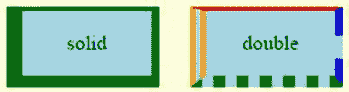

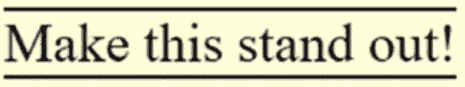

第 12 章 ■ 边框与背景

对于每条边也有一个简写形式，允许你通过单个声明指定宽度、样式和颜色，如下所示：

```
.double {
  border-top: 3px solid red;
  border-right: 6px dashed blue;
  border-bottom: 9px dotted green;
  border-left: 12px double orange;
}
```

**注意** 能做到并不意味着应该做。CSS 语法为你控制边框属性提供了极大的灵活性。然而，作为一般设计原则，边框在边缘周围应保持一致。看一下图 12-5 混合边框属性时的糟糕效果。如果你不统一应用边框，3D 效果当然会完全失效。

## 混合边框属性

为了演示单独边框属性的更恰当用法，我将创建一个新的 `<p>` 元素并应用以下 CSS 规则：

```
<p class="standOut">Make this stand out!</p>
.standOut {
  border-top: 2px solid black;
  border-bottom: 2px solid black;
  display: inline-block;
  text-align: center;
  font-size: xx-large;
}
```

我只设置了顶部和底部边缘的实线边框，这将在文本上方和下方添加一条线，如图 12-6 所示。

## 仅使用顶部和底部边框

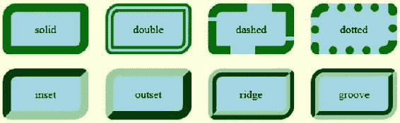

第 12 章 ■ 边框与背景

### 圆角

你可以通过设置 `border-radius` 属性轻松创建圆角。例如，要将所有四个角设置为半径为 5px 的圆角，请使用：

`border-radius: 5px;`

同样，这实际上是一个简写属性；你也可以分别设置各个值。然而，圆角应用于角而不是边，因此各个属性如下：

- `border-top-left-radius`
- `border-top-right-radius`
- `border-bottom-right-radius`
- `border-bottom-left-radius`

你也可以通过单个 `border-radius` 声明指定多个值。如我所示，传递单个值会调整所有四个角。如果传递两个值，第一个将应用于左上角和右下角，第二个应用于右上角和左下角。如果传递三个值，第一个将应用于左上角，第二个应用于右上角和左下角，第三个应用于右下角。如果传递四个值，每个值将应用于不同的角，从左上角开始按顺时针顺序进行。

为了演示这一点，我将向 `box` 类选择器添加以下声明。这将使左上角和右下角的半径大于其他两个角。渲染结果如图 12-7 所示。

`border-radius: 20px 10px;`

## 应用不同的圆角半径

# CSS 边框与背景

每个角实际上有两个半径：一个水平方向，一个垂直方向。如图 12-8 所示。

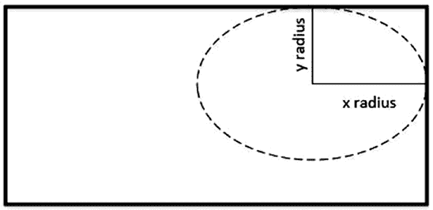

**图 12-8.** 椭圆角解释

如果只提供一个值（如前面的示例），它将同时用于`x`半径和`y`半径。在这种情况下，边框形状是一个圆形。输入两个值的语法是用`/`字符分隔它们。

例如：

```
border-radius: 5px / 10px;
```

如果为每个角指定不同的半径，先指定`x`值，然后添加`/`，再输入`y`值。可以为`x`半径提供 1-4 个值，为`y`半径提供 1-4 个值。不必为`x`和`y`使用相同数量的值。例如，可以为`x`提供一个值，为`y`提供四个值，反之亦然。举例说明，以下声明集合是等效的：

```
border-radius: 20px 10px 5px / 5px 10px;
```

等效于：

```
border-top-left-radius: 20px / 5px;
border-top-right-radius: 10px / 10px;
border-bottom-right-radius: 5px / 5px;
border-bottom-left-radius: 10px / 10px;
```

在前面的示例中，半径指定为绝对长度；但是，也可以将其指定为元素尺寸的百分比。一个特别有趣的应用是像这样设置半径，渲染结果如图 12-9 所示。

```
border-radius: 50% / 50%;
```

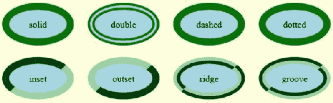

**图 12-9.** 使用椭圆边框

### 使用图像

除了八种标准边框样式外，还可以使用图像获得几乎无限的灵活性。图像文件通过`border-image-source`属性指定：

```
border-image-source: url(pattern.png);
```

### 切片

图像文件具有固定大小，但添加边框的元素可能会根据内容收缩和增长。也可以将图像边框应用于不同形状和大小的元素。为了有效处理这个问题并避免图像失真，图像文件被*切片*成碎片并重新组装。边框图像使用指定的偏移值被切分为九个区域，如图 12-10 所示。

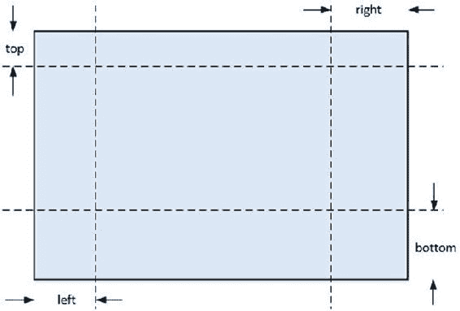

**图 12-10.** 切片边框图像

这些偏移量通过`border-image-slice`属性指定，提供上、右、下、左的值：

```
border-image-slice: 20 25 30 35;
```

这些值指定为不带单位的数字；对于位图图像，它们将被解释为像素；对于光栅图像（如 SVG），则被解释为坐标。也可以将这些值指定为百分比，表示整体图像宽度（或高度）的比例。按照典型的 CSS 方式，也可以提供少于四个的值。单个值将用于所有四个偏移量。如果提供两个值，第一个用于顶部和底部，第二个用于左侧和右侧。如果提供三个值，第一个是顶部偏移量，第二个是左右偏移量，第三个是底部偏移量。还可以在值列表中的任何位置包含关键字`fill`。如果省略，图像的中心部分将被丢弃。如果指定了`fill`，中心将作为背景使用。

### 分配空间

现在有了八个（或九个）碎片，需要定义如何使用它们来创建边框。第一步是为边框分配空间。最简单的方法是定义一条普通的实线边框，并使用透明颜色。例如：

```
border: 35px solid transparent;
```

这不会添加可见的边框，但会在现有元素周围定义一个 35 像素宽的空间。后续的边框属性将应用于此空间。另一种方法是使用`border-image-width`属性：

```
border-image-width: 35px;
```

这也会分配一个 35 像素宽的空间，但有一个非常重要的区别。`border`属性会在元素外部分配空间。例如，如果一个元素是 100 像素宽的正方形，添加边框将使总占用空间增加到 170 像素。然而，`border-image-width`属性会在元素内部分配空间。同样是 100 像素的正方形，现在只有 30 像素可用于渲染实际内容。可以通过`border-image-outset`属性进行调整。

```
border-image-outset: 35px;
```

这将把每个边缘的位置向外移动；左边缘向左移动指定的距离，右边缘向右移动，等等。现在元素的实际内容将拥有原始的 100 像素正方形。然而，这引入了另一个问题：`border-image-outset`属性不会在 DOM 中分配额外的空间；相邻元素的位置不会改变，可能导致溢出情况。这可以通过增加外边距来解决。因此，需要以下声明：

```
border-image-width: 35px;
border-image-outset: 35px;
margin: 35px;
```

> **提示**：为简单起见，我为这些属性中的每一个传递单个值来定义宽度、外移量和外边距，这将为所有四个边缘使用相同的距离。也可以指定两个、三个或四个值，按照前面描述的方式应用。

如我所述，使用`border`属性是最简单的方法。但无论哪种方式，现在在元素周围都有一个 35 像素宽的条带，用于显示图像碎片。

### 组装

回到八个或九个图像碎片；现在将它们组装到分配的空间中。图 12-10 说明了如何将图像文件切片成区域。类似的进程也会发生在正在添加边框的元素上。沿边缘的窄条的宽度由边框宽度定义（在当前示例中为 35 像素）。顶部和底部条带的长度由元素宽度决定。同样，左右边缘的长度由元素高度决定。角落部分由边框宽度定义：在这种情况下是一个 35 像素的正方形。

来自图像文件的对应切片随后被缩放以适合边框的空间。角落部分相当直接。实际上，如果将切片的偏移量设置为与边框宽度相同，则无需缩放；角落完全不会变形。然而，边缘通常需要相当大的缩放，特别是在为不同大小的元素添加边框时。有几种选项可以通过`border-image-repeat`属性解决这个问题。

- `stretch` — 图像文件中的碎片根据需要进行拉伸或收缩以适应边框。如果切片偏移量与边框宽度相同，通常只需要在一个方向上进行此操作。

  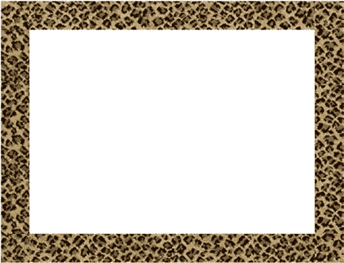

- `repeat` — 碎片根据需要重复多次以填充空间，通常最后一个实例会裁剪部分副本。

- `round` — 碎片像`repeat`选项一样重复，但只使用整数个碎片，并且单个碎片会被缩放以适应空间。这可以防止渲染部分副本。

为了演示这一点，我使用了一个带有动物印花图案（我想这是美洲豹）的图像文件，用于边框。标记将创建一个简单的`div`元素：

```
<div class="pattern"></div>
```

CSS 规则将设置固定的宽度和高度，然后定义一个 35 像素的边框。我还使用了`35`作为切片偏移量，这样角落就不会被缩放。无论实际元素的大小如何，边缘部分只会在一个方向上缩放。如果图像被拉伸，由于所使用的图案，这种拉伸会稍微明显一些，因此我使用了`repeat`选项。最终的 CSS 规则如下，元素渲染结果如图 12-11 所示。

```
.pattern {
  width: 350px;
  height: 250px;
  margin: 10px;
  border: 35px solid transparent;
  border-image-source: url(pattern.png);
  border-image-slice: 35;
  border-image-repeat: repeat;
}
```

**图 12-11.** 使用 `repeat` 的图像边框

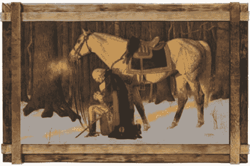

如果仔细观察边框，可以看到因为使用了`repeat`选项，图像被拼接在一起的痕迹。不过，由于该图案整体具有随机性，除非放大查看，否则这种痕迹并不十分明显。这展示了`stretch`、`repeat`和`round`选项之间的权衡。有些图像适合拉伸，而有些则适合重复。

> **注意：** 图像边框不支持圆角。如果你为边框应用了`border-radius`属性，元素本身会显示圆角，但其周围的可见边框仍然会是方角。

为了进一步演示，我将为一个图像添加边框。这张图像是乔治·华盛顿的一幅著名肖像画，我在第[7](http://dx.doi.org/10.1007/978-1-4842-2463-2_7)章中使用过它。边框使用了一张画框的图片。以下是实现此效果的标记和 CSS 规则。

```html

```

```css
img {
  margin: 10px;
  width: 350px;
  border: 34px solid transparent;
  border-image-source: url("frame.jpg");
  border-image-slice: 34;
  border-image-repeat: stretch;
}
```

CSS 与第一个示例类似；我仅指定了图像元素的宽度，以便画像能保持其原始宽高比。边框配置基本相同，只是我使用了`stretch`选项。由于我将切片偏移量和边框宽度都设置为`34px`，角落不会被缩放。边缘部分大多是直线，因此沿着该维度拉伸它们不会显得失真。这同时也避免了图像片段的拼接，而拼接在这种图像上会更加显眼。结果如图 12-12 所示。

**图 12-12.** 使用 `stretch` 选项

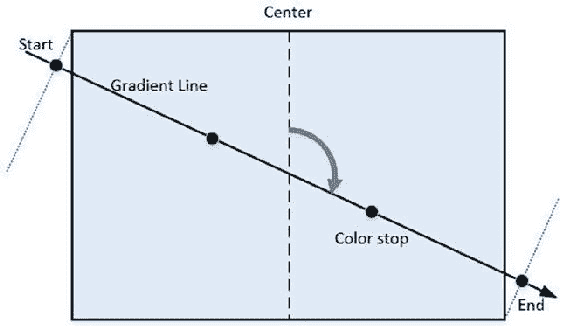

## 渐变

作为最后一种边框选项，你还可以使用颜色渐变。渐变允许颜色在一个区域内逐渐变化。它们常用于背景，我将在本章后面进行演示。它们同样可以应用于边框。渐变有两种类型：

- **线性渐变** - 颜色从一条边（或一个角）向对边（或对角）变化。
- **径向渐变** - 颜色随着从中心向外移动而变化。

渐变的结果本质上是一幅图像。它不是需要下载的资源；然而，它可以在 CSS 中任何需要图像的位置使用。要使用渐变边框，你需要将渐变定义为`border-image-source`属性的值。

### 线性渐变

顾名思义，线性渐变由一条穿过元素中心的线定义，这条线被称为渐变线。如图 12-13 所示。渐变线以一个角度定义，该角度从垂直轴开始顺时针测量；图 12-13 中的渐变线大约为 130°。线的方向很重要；如果你希望起点在右侧，则在该角度上加 180°。

**图 12-13.** 定义线性渐变

渐变线也可以使用`to`关键字来指定。在`to`关键字之后，指定其中一条边（`top`、`right`、`bottom`或`left`）。因此，`to right`将创建一个从左到右的水平渐变。如果你希望渐变从一个角到对角，则将终点角指定为一对边。例如，`to bottom left`，渐变将从对角（即右上角）开始，结束于左下角。这对边的顺序可以调换。

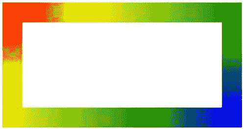

颜色沿着这条线在多个点被指定。至少需要指定起点和终点的颜色。你还可以指定一个或多个颜色停靠点，这些点被定义为起点和终点之间总距离的百分比。在这些指定的点之间，颜色会逐渐变化。为了简单演示，以下标记创建了一个空的`div`元素，CSS 规则将其边框定义为线性渐变。

```html
<div class="linear"></div>
```

```css
.linear {
  width: 350px;
  height: 150px;
  margin: 10px;
  border: 35px solid yellow;
  border-image: linear-gradient(130deg, red, yellow 20%, green 80%, blue);
  border-image-slice: 1;
}
```

这创建了一个线性渐变，颜色从红色、黄色、绿色到蓝色逐渐变化。然而，由于两个颜色停靠点非常接近起点和终点，大部分颜色将介于黄色和绿色之间，起点处有少量红色，终点处有少量蓝色。渲染结果如图 12-14 所示。

**图 12-14.** 使用线性渐变作为边框

> **注意：** 某些浏览器可能不支持渐变，因此你应该设置一个纯色作为后备方案。（目前，Safari 浏览器不支持边框渐变）。与之前示例中将纯色边框设置为透明不同，这里应该将其设置为一种颜色，以便在渐变无法使用时作为替代。此外，`border-image-slice`属性是必需的，但你可以将其设置为`1`。由于渐变会根据元素大小自动缩放，因此无需实际对图像进行切片和重新组装。

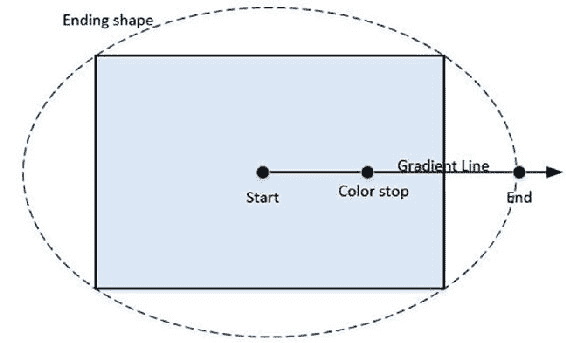

### 径向渐变

径向渐变从其中心点开始，颜色向外移动时均匀变化。如图 12-15 所示。渐变结束时的最终形状可以是圆形或椭圆形。与线性渐变类似，你必须指定起始和结束颜色，也可以在这两者之间定义一个或多个颜色停靠点。

**图 12-15.** 径向渐变

要定义径向渐变，你需要指定以下细节：

- **最终形状** - 可以是`circle`或`ellipse`；默认为`ellipse`。
- **范围** - 渐变的最终大小由以下关键字之一决定：（`farthest-corner`、`farthest-side`、`closest-corner`、`closest-side`）。
- **起始位置** - 如果省略，默认为元素的中心。它被指定为与左上角的偏移量。
- **颜色停靠点** - 0% 表示起点，100% 表示终点形状。

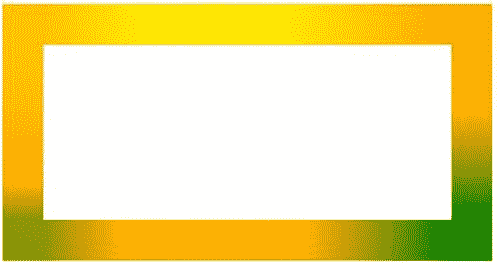

为了演示，以下标记创建了一个空的`div`元素，CSS 规则定义了一个要与之配合使用的径向渐变。渲染结果如图 12-16 所示。

```html
<div class="radial"></div>
```

```css
.radial {
  width: 350px;
  height: 150px;
  margin: 20px;
  border: 35px solid yellow;
  border-image: radial-gradient(ellipse farthest-corner at 175px 0px, yellow 0%, orange 75%, green 100%);
  border-image-slice: 1;
}
```

**图 12-16.** 带有径向渐变的边框

### 盒子阴影

在上一章中，我解释了如何配置文本阴影。你可以使用`box-shadow`属性在几乎所有元素上实现类似的效果。该属性接受多个值；有些是必需的，但许多是可选的。如果提供，这些值应按以下顺序排列：

# 盒子阴影 (Box Shadows)

- `inset` - （可选）如果未包含此值，阴影将绘制在元素外部，就像元素位于周围区域之上。如果指定了 `inset`，阴影将绘制在元素内部，就像元素沉入其周围区域之下。
- `x offset` - （必需）阴影的水平偏移量；负值将使阴影位于元素的左侧。
- `y offset` - （必需）阴影的垂直偏移量；负值将使阴影位于元素的上方。

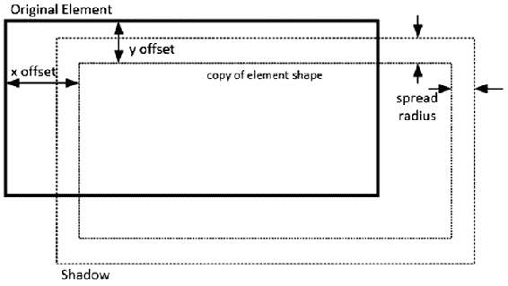

**第 12 章 ■ 边框与背景**

- `blur radius` - （可选）指定阴影超出其原始大小的扩散程度。较大的值会产生更大但更浅的阴影。如果未提供，默认为 `0`；不允许使用负值。
- `spread radius` - （可选）定义阴影的相对大小。默认值为 `0`，意味着阴影与元素大小相同。负值会使阴影缩小，正值则使其变大。
- `color` - （技术上可选，但为了最大兼容性应提供）使用任何颜色单位定义阴影的颜色。

阴影本质上是一个新元素，在 Z 轴上位于原始元素的正下方。其大小和位置相对于原始元素。要计算阴影的大小和位置，原始元素的形状会根据 `x` 和 `y` 偏移值进行移动。然后根据 `spread radius` 指定的值进行拉伸或收缩。这在图 12-17 中进行了说明。阴影使用指定的颜色作为实心填充背景。如果定义了 `blur radius`，其边缘会以模糊效果向指定大小之外拉伸。

***图 12-17.** 计算阴影位置和大小*

`box-shadow` 有两种常见用途。一种是让元素看起来从页面中凸起。这通常通过将阴影稍微向下和向右移动来实现，如图 12-18 所示。这通过以下声明实现：

```
box-shadow: 10px 10px 5px black;
```

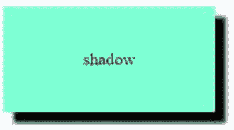

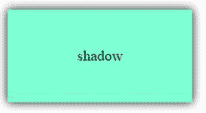

**第 12 章 ■ 边框与背景**

***图 12-18.** 使元素从页面凸起*

另一种技术是通过在所有侧边添加模糊效果来柔化元素的线条，如图 12-19 所示。这通过以下声明实现，该声明保持与原始元素相同的大小和位置，仅使模糊效果可见：

```
box-shadow: 0px 0px 15px black;
```

***图 12-19.** 在元素周围添加模糊效果*

> **注意：** 如果使用了 `border-radius`，阴影也将具有圆角。它遵循与原始元素相同的形状。

## 轮廓 (Outlines)

轮廓是绘制在元素周围的框，类似于边框。重要的区别在于它不占用任何空间；它绘制在现有元素分配空间的上方。因此，轮廓通常与 `:hover` 等伪类一起使用，因为可以在不影响页面布局的情况下添加或移除该框。定义轮廓时，可以指定以下属性：

- `outline-color`
- `outline-style`
- `outline-width`

这些属性可以单独设置，也可以像定义边框一样使用 `outline` 简写符号。支持的样式值与边框样式支持的八个值相同（`solid`、`double`、`dashed`、`dotted`、`inset`、`outset`、`ridge` 和 `groove`）。你也可以使用值 `none`，这将隐藏轮廓。

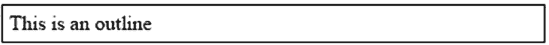

**第 12 章 ■ 边框与背景**

此外，`outline-offset` 属性在元素和轮廓之间添加内边距。例如，添加此属性将使轮廓在所有方向上偏移 `5` 像素。这无法通过 `outline` 简写属性实现。

```
outline-offset: 5px;
```

> **注意：** `outline-offset` 属性目前不支持 IE 或 Edge。

以下标记创建了一个 `div` 元素，CSS 规则为其添加了轮廓，渲染结果如图 12-20 所示。

```html
<div class="outline">This is an outline</div>
```

```css
.outline {
  outline: 1px solid black;
  outline-offset: 5px;
}
```

***图 12-20.** 演示轮廓*

> **注意：** 边框越宽，轮廓占用的空间就越大。它不会调整元素的位置，而是将框叠加到现有空间上。该框始终位于被勾勒元素的*外部*，因此不会影响元素本身，但可能会溢出到相邻元素中。

## 背景 (Backgrounds)

为元素设置背景基本上有两种选择：颜色或图像。要使用颜色，只需使用第 [2](http://dx.doi.org/10.1007/978-1-4842-2463-2_2) 章中解释的任何颜色单位设置 `background-color` 属性。这些也在附录 C 的参考资料中进行了总结。使用图像时，还有一些属性控制图像的显示方式。

### 图像属性

可以使用 `background-image` 属性为元素指定背景图像。这相当简单；只需指定要使用的图像文件的 URL。你可以指定多个图像，它们将按指定的顺序堆叠在一起。但是，还有几个其他属性会影响图像的渲染方式。

**第 12 章 ■ 边框与背景**

### 附着 (Attachment)

`background-attachment` 属性定义图像如何定位，并支持以下值：

- `fixed` - 图像相对于窗口保持固定；滚动窗口对背景图像没有影响。
- `local` - 图像相对于元素的内容固定。如果滚动内容，背景图像将随之滚动。
- `scroll` - （这是默认值）图像相对于元素固定。它会随元素移动，但如果元素内部的内容被滚动，背景不会滚动。

此外，由于可以指定多个图像，因此也可以为 `background-attachment` 属性指定多个值。每个值用逗号分隔，并按指定顺序应用于相应的图像。

### 原点 (Origin)

对于 `local` 和 `scroll` 选项，`background-origin` 属性定义图像的包含矩形。支持以下值：

- `border-box` - 背景扩展到元素边框的外边缘。
- `content-box` - 背景仅覆盖实际元素内容区域（不包括内边距和边框）。
- `padding-box` - 背景包括元素内容和内边距，但不包括边框。

### 重复 (Repeat)

`background-repeat` 属性指定背景图像是否以及如何重复以填充所需空间。图像可以在水平和垂直方向上重复，你可以为 `background-repeat` 属性提供两个不同的值。第一个值适用于水平行为，第二个值用于垂直重复。允许以下值：

- `no-repeat` - 图像不重复，可能留下未被图像覆盖的区域。
- `repeat` - （默认）根据需要尽可能多地重复图像，最后一个重复图像通常被裁剪。
- `round` - 重复图像，但仅显示完整图像。然后均匀拉伸显示的图像以填充任何剩余间隙。
- `space` - 仅重复完整图像，类似于 `round` 选项。但是，不是拉伸图像来填充间隙，而是在它们之间留下均匀的间距。第一个和最后一个图像固定在左右边缘（或底部和顶部），间距位于图像之间。

**第 12 章 ■ 边框与背景**

# CSS 背景属性

## 单值简写

还存在一种简写方式，可以用单个值同时指定水平和垂直行为。如果使用单个值如`no-repeat`、`repeat`、`round`或`space`，它将同时应用于水平和垂直方向的值。此外，`repeat-x`表示水平方向使用`repeat`，垂直方向使用`no-repeat`。同样地，`repeat-y`表示相反的情况。

■ **注意**：截至撰写本文时，`round`和`space`值在 Firefox 或 Safari 中不受支持。

### 位置

`background-position` 属性用于指定图像相对于其原点的位置。默认值为 `0 0`，表示左上角。位置可以使用以下关键字之一指定：`top`、`right`、`bottom`、`left` 或 `center`。也可以指定为一对距离值（相对或绝对），用空格分隔。如果使用多个图像，也可以指定多个位置，这些位置应用逗号分隔。

## 大小

图像的大小通过 `background-size` 属性指定。大小可以使用以下关键字之一指定：

- `contain` - 图像在保持原始宽高比的同时尽可能放大。这通常意味着在某一维度上，图像周围会有空白区域。该图像通常居中，除非被 `background-position` 属性覆盖。

- `cover` - 图像在保持宽高比的同时尽可能放大。然而，为了覆盖较小的维度，图像通常在另一维度上被裁剪。

或者，你可以指定单个距离值（相对或绝对），这将定义背景的宽度。在这种情况下，高度将设置为 `auto`。你也可以指定两个值，用空格分隔：第一个定义宽度，第二个定义高度。关键字 `auto` 可以与单个或双值输入一起使用。它指定该维度基于图像的内在大小或根据需要设置以保持宽高比。如果有多个图像，也可以提供多个大小，用逗号分隔。

### 裁剪

`background-clip` 属性指定背景应在何处被裁剪。此属性允许你控制背景是否应延伸到元素的内边距和边框区域。

支持以下值：

- `border-box` - 背景延伸到元素边框的外边缘。

- `content-box` - 背景仅覆盖实际元素内容区域（不包括内边距和边框）。

- `padding-box` - 背景包括元素内容和内边距，但不包括边框。

■ **注意**：这些值与 `background-origin` 属性相同，实际上 `background-clip` 的工作原理与 `background-origin` 非常相似。需要明确的是，`background-origin` 决定图像的定位，即图像与哪个矩形对齐。而 `background-clip` 属性决定背景结束的矩形，无论是对于颜色还是图像背景。

## 背景简写

通常的做法是使用 `background` 简写符号，在单个声明中指定多个背景属性。以下属性可以在 `background` 简写中设置：

- `background-image`
- `background-position`
- `background-size`
- `background-repeat`
- `background-attachment`
- `background-origin`
- `background-clip`
- `background-color`

所有这些属性都是可选的。通常，顺序无关紧要，但 `background-size` 必须直接跟在 `background-position` 之后（如果两者都使用），并且它们之间应用斜杠（`/`）分隔。其他属性用空格分隔。

我之前提到过，可以在背景中定义多个图像，这些被称为图层。使用简写时，应为第一个图层指定所有所需的属性，然后添加逗号，再指定下一个图层的属性。单个图层的属性一起声明，每个图层用逗号分隔。`background-color` 属性只能在最后一个图层上设置。

使用 `background` 简写时，任何未指定的属性都将设置为默认值。如果在某个声明中指定了一个背景属性（例如 `background-position`），然后在另一个声明中使用简写设置，则先前对 `background-position` 的设置将被撤销并恢复为默认值。例如，考虑以下情况。背景将不会居中，因为简写只提供了颜色属性；位置已恢复为默认值。

```css
div {
    background-position: center;
    background: red;
}
```

## 示例

为了快速演示，我将回到本章开头的边框示例，并用图像替换背景颜色，使用 `background` 快捷键。CSS 规则现在如下所示：

```css
section {
    /*background-color: lightyellow;*/
    background: url(smiley.png) scroll space;
}
```

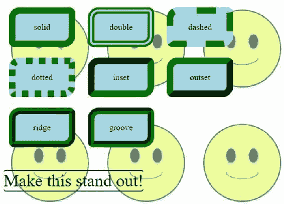

我使用了 `scroll` 作为 `background-attachment`，因为我希望图像固定到包含元素。由于图像相对较小，我需要在两个方向上重复；但是，我不希望任何面部被裁剪，只剩下半张脸。`round` 值可以实现这一点，但会通过拉伸图像来填补间隙而导致图像变形。`space` 值是 `background-repeat` 选项的合适选择。渲染结果如图 12-21 所示。

***图 12-21.** 使用重复背景图像*

为了演示渐变的使用，我将用线性渐变替换它，通过 `background-image` 属性设置。在此示例中，我使用方向关键字而不是角度来定义渐变线。渲染结果如图 12-22 所示。

```css
section {
    /*background-color: lightyellow;*/
    /*background: url(smiley.png) scroll space;*/
    background-image: linear-gradient(to right bottom, #FFF, #0EE);
}
```

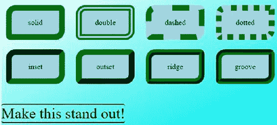

***图 12-22.** 使用背景渐变*

当装裱图片时，通常使用衬板来在图片和实际边框之间提供边界。在 CSS 中，可以通过结合使用 `background` 和 `border` 属性来实现相同的效果。我将使用乔治·华盛顿的画作来展示如何做到这一点。我会在之前演示的 CSS 规则中添加内边距和背景颜色。结果如图 12-23 所示。

```css
img {
    margin: 10px;
    width: 350px;
    border: 34px solid transparent;
    border-image-source: url("frame.jpg");
    border-image-slice: 34;
    border-image-repeat: stretch;
    padding: 30px;
    background-color: silver;
}
```

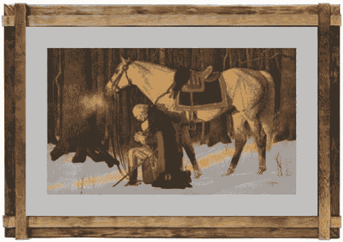

***图 12-23.** 为图片添加衬板*

■ **提示**：如果你想创建多个衬板，可以通过将图像元素放入一个 `div` 元素中来实现。将图像的 `background` 设置为内层衬板，`div` 的 `background` 设置为外层衬板。然后将边框放在 `div` 上而不是图像上。

作为最终演示，我将向 `body` 元素添加一个固定的背景图像：

```css
body {
    background: url(smiley.png) fixed no-repeat center;
}
```

这将使用相同的笑脸图像，但使其固定到窗口。当滚动时，背景图像不会随内容移动。`no-repeat` 值设置了 `background-repeat`。

# 该属性确保只显示单个实例。`center`值设置`background-position`属性，使图像居中，在此示例中为窗口居中。效果如图 12-24 所示。

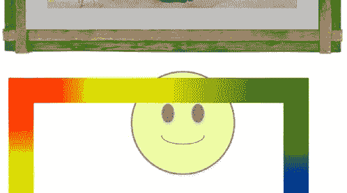

## 第 12 章 ■ 边框与背景

`图 12-24. 使用固定背景图像`

其工作原理类似于我在第[10 章](http://dx.doi.org/10.1007/978-1-4842-2463-2_10)中解释的`display: fixed;`属性。然而不同之处在于，由于背景图像在 z 轴层级上位于前景元素之后，因此图像的部分或全部可能被遮挡。

> **提示：** 使用固定背景图像时，它被分配给哪个元素并不重要，因为其位置基于窗口而非元素本身。但例如，如果将其添加到`div`或`p`元素，则每个元素都会显示独立的图像。这些图像会位于同一位置，因此不会改变页面显示效果，但渲染多幅图像显然效率更低。由于`body`元素只有一个，因此它是放置固定背景图像最合理的位置。

### 本章小结

在本章中，我介绍了许多利用各类边框和背景来增强网页效果的技术。两者有相似之处，主要在于都可以通过颜色、图像或渐变来定义。此外，两者在 z 轴层级上都位于元素下方。边框会占据文档空间，而背景则不会。我还解释了阴影和轮廓的用法，它们虽然与边框不同，但能达到类似效果。

这里有许多可用的属性，其中大部分可以通过简写符号来表达。特别是边框，由于每条边都可以单独定义，因此有大量属性。不过，可以使用简写来定义单条边的所有属性。同样，也可以使用简写来设置所有边的单个属性。

使用图像作为边框可以产生一些非常有趣的效果，但需要了解浏览器如何使用它们。图像被分割成多个部分，每个部分应用于边框的不同位置。相关属性使您能够控制每个部分如何根据需要拉伸或重复以填充空间。

渐变用于沿特定方向逐渐改变颜色。线性渐变从一条边或一个角向对边或对角改变颜色。径向渐变从中心向外改变颜色。您可以定义起始和结束颜色，还可以沿着渐变定义特定的色标。

在下一章中，我将介绍如何使用表格来排列和格式化内容。

---
