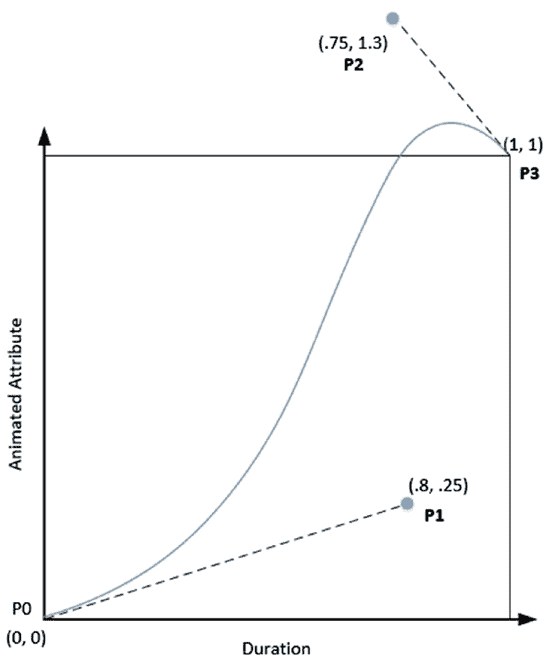
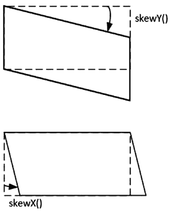
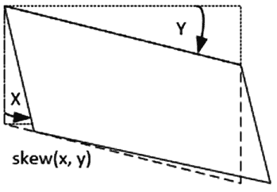
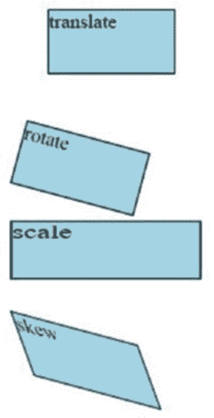
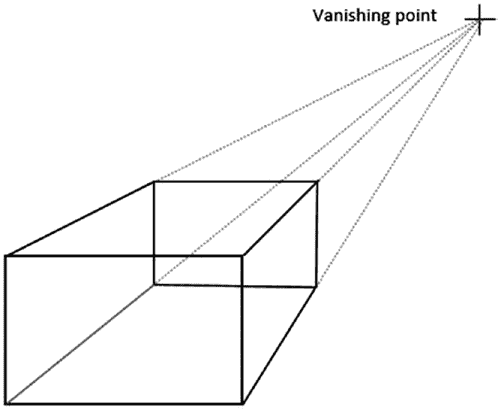
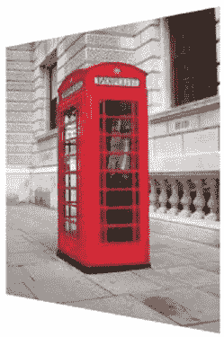

# 第 15 章 动画与变换

### 动画

# 动画与变换

动画看起来非常令人印象深刻，但实际上实现起来却相当简单。动画本质上就是随时间改变一个或多个属性。过去这需要编写 JavaScript 来设置计时器，并在每次计时事件中操作属性。而现在，你只需使用 CSS 就能完成。

## 关键帧

在 CSS 中，创建动画的第一步是定义`关键帧`。每个关键帧指定了在特定时间点上的一组 CSS 属性。这大致类似于一部动画电影，它由一组称为帧的图片组成，这些图片被快速连续播放，从而产生画面在运动的错觉。

幸运的是，我们不需要像大多数视频那样每秒提供 30 或 60 帧。

使用关键帧类似于定义渐变，这在第 [12](http://dx.doi.org/10.1007/978-1-4842-2463-2_12) 章中已经解释过。你至少需要定义起始帧和结束帧，浏览器会在它们之间提供平滑的过渡。

不过，你也可以定义额外的帧来控制动画的进程。动画有一个指定的持续时间，每个关键帧被分配到这个持续时间内的一个特定时间点，该时间点以百分比表示。初始帧位于 `0%`，最终帧位于 `100%`。

关键帧有时被称为 `@` 规则（at-rules）。它们类似于普通的 CSS 规则，只是使用百分比作为选择器。在每个帧内部，你可以指定任意数量的 CSS 属性。一个简单的关键帧可能看起来像这样：

```css
@keyframes colors {
  0% {
    background-color: yellow;
  }
  100% {
    background-color: blue;
  }
}
```

在动画开始时，背景颜色是黄色，到动画结束时，颜色逐渐变为蓝色。你还可以添加更多的帧。假设你想要颜色从红色变为黄色，再变为蓝色，然后又变回红色。关键帧可以这样定义：

```css
@keyframes colors {
  0%, 100% {
    background-color: red;
  }
  33% {
    background-color: yellow;
  }
  66% {
    background-color: blue;
  }
}
```

注意，初始帧和最终帧具有相同的值，因此它们可以在同一个帧中指定，百分比之间用逗号分隔，这在 CSS 选择器语法中是逻辑“或”运算符。

另外，`0%` 和 `100%` 可以分别用别名 `from` 和 `to` 来表示。所以，第一组关键帧也可以这样写：

```css
@keyframes colors {
  from {
    background-color: yellow;
  }
  to {
    background-color: blue;
  }
}
```

## 配置动画

动画被应用于一个或多个元素。例如，前面的关键帧修改了 `background-color` 属性。这需要应用到某个元素上，然后该元素的背景颜色就会随动画变化。为了提供一个简单的演示，我将使用一个空的 `div` 元素：

```html
<div class="circle"></div>
```

为了增加一点趣味性，我将通过以下 CSS 规则把它变成一个红色的圆：

```css
.circle {
  width: 300px;
  height: 300px;
  margin: 10px 0 0 0;
  border-radius: 50%;
  background-color: red;
}
```

这将创建一个高度等于宽度的 `div` 元素。将半径设置为 `50%` 会将这个正方形变成一个圆形。最后，为了给背景颜色添加动画效果，使用以下规则：

```css
.circle {
  animation: colors 5s;
}
```

这里使用了 `animation` 简写属性来指定两个必需的属性。第一个指示要使用的关键帧的名称，也就是之前创建的那个。第二个指定动画的持续时间，这里是 5 秒。当页面加载时，圆形会从红色开始，然后逐渐变为黄色，再变为蓝色，最后变回红色。

## 动画属性

有八个属性可用于配置动画。我之前提到了前两个；以下是完整的集合及其可用选项：

- `animation-name` - 定义要设置的属性及其相对时间点的关键帧名称。

### CSS 动画属性说明

- `-duration` - (默认 `0s`) 单次执行动画所需的总时间。

- `-timing-function` - (默认 `ease`) 指示帧之间的过渡方式。这里有多种选项，Mozilla 有一篇详细描述每种选项的文章，参见 [`developer.mozilla.org/en-US/docs/Web/CSS/timing-function`](https://developer.mozilla.org/en-US/docs/Web/CSS/timing-function)。支持以下常见值：
  - `linear` - 帧之间均匀过渡
  - `ease-in` - 过渡在开始时较慢
  - `ease-out` - 过渡在结束时变慢
  - `ease-in-out` - 过渡在开始和结束时都较慢
  - `ease` - 类似于 `ease-in-out`，但开始时的减速程度小于结束时

- `-delay` - (默认 `0s`) 页面加载后到动画开始前的暂停时长。

- `-iteration-count` - (默认 `1`) 动画应执行的次数；若动画持续运行，可设为 `infinite`。

- `-direction` - (默认 `normal`) 指示动画在关键帧之间是正向还是反向运行。支持以下值：
  - `normal` - 动画按顺序从 `0%` 到 `100%` 遍历关键帧；如果重复执行，则从头开始。
  - `alternate` - 首次执行从 `0%` 到 `100%`，但后续执行将反向进行。奇数次执行为正向，偶数次执行为反向。
  - `reverse` - 动画从 `100%` 到 `0%` 反向执行；后续执行也是反向的。
  - `alternate-reverse` - 首次执行为反向（从 `100%` 到 `0%`），但下一次执行为正向。所有奇数次执行为反向，偶数次执行为正向。

- `-fill-mode` - (默认 `none`) 指定动画前后如何应用关键帧属性。注意，实际初始帧由 `animation-direction` 属性控制；结束帧也取决于使用 `alternate` 方向时执行的迭代次数。支持以下值：
  - `none` - 动画前后不影响元素的值。
  - `forwards` - 动画完成后，目标元素将保留最后一个关键帧的值。
  - `backwards` - 如果动画启动有延迟，目标元素将使用初始关键帧的值。
  - `both` - 同时应用 `forwards` 和 `backwards` 的行为。

- `-play-state` - (默认 `running`) 指示动画当前是运行还是暂停。

> **提示**：时间单位可以用秒或毫秒指定。必须使用 `s` 或 `ms` 后缀，否则该值将被视为数值。值与其单位之间不允许有空格。

### 动画简写

如前所述，所有八个属性都可以使用 `animation` 简写设置。从技术上讲，它们都是可选的，若省略则使用默认值。但是，如果不指定 `animation-name` 和 `animation-duration`，则无法进行任何动画。

简写中的属性由空格分隔，可以按任意顺序指定，但需注意几个细节。有两个时间值：`animation-duration` 和 `animation-delay`。第一个时间值将赋给 `animation-duration`，第二个（如果提供）将用于 `animation-delay`。

有四个属性具有预设的支持值列表，它们不会重叠：`animation-timing-function`、`animation-direction`、`animation-fill-mode` 和 `animation-play-state`。这些属性可以按任意顺序提供，因为浏览器可以通过值来确定将其分配给哪个属性。任何无法识别的值将被赋给 `animation-name` 属性。

# 关键帧命名与多动画配置

如果你希望为关键帧取一个与属性值同名的名称（例如 `reverse`），则需要小心处理。你必须先指定对应的属性（在本例中为 `animation-direction`），然后再指定 `animation-name`。如果你希望动画方向为 `reverse`，则需要将值 `reverse` 包含两次：第一个用于 `animation-direction`，第二个用于 `animation-name` 属性。你不能让浏览器设置默认值。如果你希望使用默认值 `normal`，则需要在 `reverse` 之前显式包含 `normal`。

## 多动画

你可以在同一个目标元素上定义多个动画。例如，一个动画可以移动元素，另一个动画可以改变其颜色。这些动画是独立应用的。如果你使用 `animation` 简写属性，则需要为第一个动画指定所有所需属性，然后依次为第二个动画指定，以此类推。每个动画的属性之间用逗号分隔。例如，以下代码将为所有带有 `circle` 类的元素应用两个动画：

```css
.circle {
  animation: colors 5s 3, otherKey 2s 4s alternate;
}
```

如果你正在设置各个属性，则需要为每个动画提供一个属性值，这些值之间用逗号分隔。请为每个属性按相同顺序指定值。`animation-name` 的第一个值将与 `animation-direction` 的第一个值对应，以此类推。为了演示，上述动画可以按如下方式指定：

```css
.circle {
  animation-name: colors, otherKey;
  animation-duration: 5s, 2s;
  animation-iteration-count: 3;
  animation-delay: 0s, 4s;
  animation-direction: normal, alternate;
}
```

请注意，对于 `animation-iteration-count`，只指定了一个值，该值将应用于第一个动画。对于 `animation-delay` 和 `animation-direction`，需要提供默认值，以便第二个值可以应用于第二个动画。

> **注意**：并非所有 CSS 属性都可以进行动画。这里有一篇文章列出了所有可动画的属性：[`developer.mozilla.org/en-US/docs/Web/CSS/CSS_animated_properties`](https://developer.mozilla.org/en-US/docs/Web/CSS/CSS_animated_properties)。不可动画的属性通常是那些无法随时间逐渐改变的属性，例如 `font-family`。

### 三次贝塞尔曲线

正如我之前所说，动画本质上是随时间调整一个或多个属性。在最简单的情况下，你定义起始值和结束值，浏览器将插值计算中间值。`animation-timing-function` 属性决定了用于执行插值的函数。有几种常见的值，例如 `ease-in` 和 `linear`，我已经提到过。

其中最简单的是线性函数。假设你有一个持续时间为 5 秒的动画，它修改 `margin-left` 属性。起始值为 `0`，结束值为 `250px`。使用线性函数，每秒将改变 `margin` 值 `50px`。因此，1 秒后为 `50px`，2 秒后为 `100px`，以此类推。使用 `ease-in` 函数时，动画开始较慢并逐渐加速。例如，1 秒后，左边距可能只到 `30px`。

这些值（如 `ease-in`）仅仅是预定义的贝塞尔曲线。贝塞尔曲线使用数学公式计算一个轴作为另一个轴函数的值。具体来说，计时函数使用三次贝塞尔曲线，该曲线需要四个点来定义公式。在本例中，特定的属性值 `margin-left` 是在 5 秒持续时间内每一点计算的。图 15-1 展示了一条说明这一点的三次贝塞尔曲线。

点 `P0` 是起点，代表初始（0%）属性值和持续时间的开始。点 `P3` 是终点，代表 100% 属性值。图形总是按比例缩放，使这些点分别位于 `(0, 0)` 和 `(1, 1)`。点 `P1` 和 `P2` 定义了连接 `P0` 和 `P3` 的曲线的形状。

图 15-1 中的三次贝塞尔曲线由 `P1` 和 `P2` 的值定义，分别为 0.8、0.25 和 0.75、1.3。

在 CSS 中指定如下：

`animation-timing-function: cubic-bezier(0.80, 0.25, 0.75, 1.30);`



**图 15-1.** 三次贝塞尔曲线

在这种情况下，动画开始时速度缓慢，类似于 `ease-in`，但在结束时，它实际上会超出目标值，然后必须回退才能完成动画。

> **提示** 如果你想尝试使用三次贝塞尔曲线，请访问网站 [`cubic-bezier.com`](http://cubic-bezier.com/)。该网站允许你以图形方式调整曲线，并显示 `p1` 和 `p2` 的值，以便你将其输入到你的 CSS 中。

另一个有用的网站是 [`easings.net`](http://easings.net/)。

为了演示这一点，我将创建另一个空的 `div` 元素：

```html
<div class="bounce"></div>
```

对于简单的样式，我使用了以下 CSS 规则：

```css
.bounce {
  width: 100px;
  height: 35px;
  margin-left: 300px;
  border-radius: 10px;
  background-color: lightblue;
}
```

这将创建一个带有圆角的小矩形。然后使用以下规则配置动画：

```css
@keyframes bounce {
  from {
    margin-left: 0;
  }
  to {
    margin-left: 300px;
  }
}

.bounce {
  animation: 3s cubic-bezier(0.80, 0.25, 0.75, 1.30) bounce;
}
```

这将使 `div` 元素在页面上移动，起初缓慢，然后经过其最终位置后，必须反转并稍微回退一点。

### 过渡

当 CSS 属性在运行时（即页面加载后）被更改时，你可以使用过渡来使变化更平滑，而不是突兀的变化。例如，你可以使用 `:hover` 伪类在鼠标悬停时更改元素的背景颜色。通常，一旦鼠标悬停在元素上，该变化会立即发生。但是，你可以定义一个过渡，以使这种变化更渐进。

过渡与动画非常相似，并使用一些相同的技术。主要区别在于，你不需要在过渡中定义关键帧；过渡仅处理目标元素的开始和结束状态。这就像一个只定义了 0% 和 100% 值的关键帧。

另一个主要区别是，与动画不同，过渡不定义开始和结束状态；这些状态在过渡之外定义。开始和结束状态通常在 CSS 中定义。例如，`background-color` 是通过 CSS 规则应用于元素的 CSS 属性。第二个规则使用 `:hover` 伪类，应用不同的 `background-color`。这两个规则定义了开始和结束状态。然后可以添加过渡来操控从一个规则到另一个规则的变化，使其成为一个平滑的过渡，而不是立即的变化。

一个示例有助于演示这一点。以下标记创建了一个空的 `div` 元素。然后，一个 CSS 规则定义其高度和宽度以及边框和背景颜色。下一个规则在鼠标悬停在元素上时修改高度和宽度。

```html
<div class="tran"></div>
```

```css
.tran {
  width: 200px;
  height: 100px;
  background-color: lightyellow;
  border: 1px solid black;
}

.tran:hover {
  width: 420px;
  height: 150px;
}
```

如果你尝试这个，你会看到当鼠标移到元素上时，大小会立即跳转到更大的尺寸。现在你可以定义如何发生这个过渡。有四个 CSS 属性可以应用：

- `transition-property` - （默认值 `all`）指定应应用过渡的属性。
- `transition-duration` - （默认值 `0s`）完成过渡所需的时间长度。
- `transition-delay` - （默认值 `0s`）过渡开始之前的等待时间。
- `transition-timing-function` - （默认值 `ease`）指定过渡如何随时间进行的函数。其工作原理与 `animation-timing-function` 属性相同，并支持相同的值。

好的，作为高级文档工程师，我将根据您提供的规则和示例，将给定的英文文本翻译成中文。

好的，作为高级文档工程师，我将根据您提供的属性，通过添加以下 CSS 规则来使过渡变得平滑。我使用了与上一个动画相同的三次贝塞尔曲线。

```
.tran {
  transition-property: width;
  transition-duration: 3s;
  transition-delay: 0s;
  transition-timing-function: cubic-bezier(0.80, 0.25, 0.75, 1.30);
}
```

现在，当您将鼠标悬停在该元素上时，宽度将逐渐变化。注意，当宽度超出最终状态并需要稍微回调时，会产生轻微的反弹效果。然而，高度会立即改变，因为过渡仅应用于 `width` 属性。您可以为 `transition-property` 属性使用 `all` 关键字，以便过渡应用于所有变化的属性。

您也可以为每个目标属性定义不同的过渡属性。例如，如果您希望高度过渡更快，可以单独定义其 `transition`。为此，需要为每个属性提供多个以逗号分隔的值：

```
transition-property: width, height;
transition-duration: 3s, 1s;
```

这将使宽度过渡耗时 3 秒，而高度过渡仅耗时 1 秒。

`transition-property` 属性定义了过渡的数量。在这种情况下，由于提供了两个值，因此将有两个过渡。其余属性可以具有相同数量的值，这些值按顺序应用，因此 `3s` 持续时间应用于 `width` 属性，`1s` 持续时间应用于 `height` 属性。如果提供的值较少，则提供的值将根据需要重复，以便为 `transition-property` 属性提供的每个值都有一个值。由于 `transition-delay` 属性只有一个值，它将被重复，因此 `0s` 延迟将同时用于 `width` 和 `height` 属性。如果提供的值多于 `transition-property` 属性的值，则多余的值将被忽略。

我将过渡应用于 `.tran` 类选择器，因此它将同时影响过渡到悬停状态以及过渡回初始状态的过程。请注意，如果您将鼠标从元素上移开，它会逐渐过渡回初始状态。如果我将更改应用于 `.tran:hover` 选择器，则过渡到悬停状态将是渐进的，但移开鼠标时，过渡会立即发生。您可以利用此行为来提供不同的过渡。例如，您可以更快地过渡回初始状态。

为此，我将在 `.tran` 选择器中定义一个较慢的过渡，并在 `.tran:hover` 选择器中覆盖持续时间，使其更长。

```
.tran {
  width: 200px;
  height: 100px;
  background-color: lightyellow;
  border: 1px solid black;
  transition-property: width, height;
  transition-duration: 1s;
  transition-delay: 0s;
  transition-timing-function: cubic-bezier(0.80, 0.25, 0.75, 1.30);
}

.tran:hover {
  width: 420px;
  height: 150px;
  transition-duration: 3s, 1s;
}
```

> **提示：** 为了演示过渡，我使用 `:hover` 伪类强制更改属性。但是，过渡适用于任何属性更改，无论其如何触发。在下一节中，我将解释如何通过 JavaScript 操作 HTML 和 CSS。如果您通过客户端脚本修改属性，CSS 中应用于它的任何过渡都将被触发。

您还可以使用 `transition` 简写在一个声明中提供所有四个值。您可以按任意顺序提供这些值；但是，与 `animation` 属性一样，第一个时间值将用作持续时间，第二个用作延迟。如果省略任何值，将使用我之前指出的默认值。例如，此过渡将应用于所有属性，持续时间为 3 秒，并使用 `ease-in` 定时函数。由于未指定延迟，因此将为 `0s`。

```
transition: all 3s ease-in;
```

如果您想定义不同的过渡，可以使用 `transition` 简写，并用逗号分隔每个过渡。

```
transition: width 3s 0s ease-in, height 1s;
```

与其他简写属性一样，未提供的任何值将使用默认值。在此示例中，对于 `height` 属性，由于未指定，将使用默认的 `ease` 定时函数。

在定义多个过渡时，使用单独的属性可能更容易一些，因为如前所述，单个值将应用于所有过渡。

#### 变换

您可以使用 `transform` 属性通过调整元素的坐标系来修改其渲染方式。使用 `transform` 属性时，您必须指定一个变换函数，这些函数可以分为以下几类：

- **平移** - 元素沿水平方向、垂直方向或同时向两个方向移动。元素保留其原始大小和形状，但被移动到不同的位置。

- **旋转** - 元素绕一个或多个轴旋转。与平移一样，它保持其原始大小和形状。

- **缩放** - 元素沿一个或多个轴拉伸或收缩。这将改变元素的大小，并可能改变其宽高比。

- **倾斜** - 元素被扭曲或变形。例如，矩形可以变成平行四边形。

对元素应用 `transform` 会改变其在页面上的渲染方式和位置。但是，这不会影响其相邻元素的布局。这可能导致元素相互重叠的溢出情况。

#### 平移

平移可能是最简单的变换。支持三个函数：

- `translateX()` - 按指定距离水平移动元素

- `translateY()` - 垂直移动元素

- `translate()` - 接受两个值，一个用于 X，一个用于 Y，并水平且垂直地移动元素。

如果调用 `translate()` 函数时只指定一个值，则它将被用于水平平移元素。正值将元素向右（或向下）移动；负值向左（或向上）移动。以下声明将元素向右上方移动：

```
transform: translate(30px, -10px);
```

#### 旋转

旋转元素时，首先需要决定它应该绕哪个轴旋转。X 轴是一条水平线。绕 X 轴旋转元素意味着元素的顶部会离您更近或更远，而底部则相反。想象一下通过向上拉动纸张底部来翻页，露出下一页，就像翻日历一样。这有时被称为**军用翻转**。Y 轴是一条垂直线，绕 Y 轴旋转类似于翻书页。Z 轴垂直于页面。

有四个与旋转相关的函数可用：

- `rotateX()`

- `rotateY()`

- `rotateZ()`

- `rotate()`

前三个函数不言自明，它们使元素沿相应轴旋转指定的角度，该角度作为参数传入。`rotate()` 函数与 `rotateZ()` 功能相同。提供此函数是因为绝大多数时候您会使用 Z 轴，这算是一种快捷符号。

> **警告：** 除非您使用 3D 变换（我将在后面解释），否则绕 X 轴或 Y 轴旋转并不是很有用。在二维系统中，绕 X 轴旋转只会使形状变矮，绕 Y 轴旋转会使元素变窄。但是，旋转 180 度（或半圈）会使元素翻转。大多数情况下，您将绕 Z 轴旋转。

旋转元素时，您还需要决定其旋转的基点。默认情况下，这将是元素的中心。但是，您可以使用 `transform-origin` 属性来更改此设置。

# CSS 变换函数

此函数接受三个值，用于指定 X、Y 和 Z 偏移量。默认值为`50% 50% 0`，即元素的水平和垂直中心。您可以为每个偏移量提供绝对值或相对值，且需按此顺序（X、Y、Z）输入。如果只提供两个值，则它们将用作 X 和 Y 值。

还可以使用一些关键字，包括`left`、`right`、`top`、`bottom`和`center`。例如，指定`top right`将使元素围绕其右上角定义的点进行旋转。关键字可以任意顺序输入，因为浏览器可以判断其适用于哪个值。`center`关键字同时指定了 X 和 Y 值，等同于默认值（`50% 50% 0`）。

## 缩放

缩放函数相当直观。有`scaleX()`和`scaleY()`函数，它们会分别沿 X 轴或 Y 轴放大或缩小元素。如果希望在两个方向上缩放，`scale()`函数接受两个值来定义水平和垂直缩放比例。值为`1`表示不缩放；大于`1`的值会使元素变大。小于`1`的值会使元素变小。

例如，指定`0.5`将使元素在指定维度上缩小到原始大小的一半。

`transform-origin`属性会影响缩放的方式，或者更准确地说，会影响结果形状相对于原始元素的定位方式。如果保持默认值`center`，元素将向两个方向扩展，使新形状的中心恰好位于原始元素中心的位置。例如，如果将其设置为`top left`，左上角将保持固定，元素将向右下方向扩展。



负值将沿相反轴翻转元素。例如，使用`scaleY(-1)`将垂直翻转元素（沿水平轴）。因此，以下函数将实现相同的效果：`transform: rotateX(.5turn);`和`transform: scaleY(-1);`。值为`-1`仅会翻转元素；值为`-2`则会翻转并使其大小加倍。

## 倾斜

倾斜元素，尤其是在二维空间中倾斜，可能有点难以理解。让我们从一个维度开始。想象一个矩形，它的一侧固定，另一侧被向下拉动，导致整个元素扭曲。这被视为*倾斜*，可以通过`skewY()`函数实现，如图 15-2 所示。`skewY()`函数将在垂直维度上移动或倾斜非固定边。倾斜量以角度指定。`skewX()`函数将水平移动非固定边。

***图 15-2.** 说明倾斜效果*

■ **注意** 在这些示例中，我假设左侧或顶边是固定的。但是，这由`transform-origin`属性控制，就像旋转和缩放函数一样。更改此属性不会影响最终形状，但会改变元素的定位方式。

`skew()`函数允许同时指定 X 和 Y 值。在两个方向上的倾斜如图 15-3 所示。这结合了两种倾斜类型的效果。



***图 15-3.** 二维空间中的倾斜*

## 演示

以下内容将演示所有这些变换。标记创建了四个空的`div`元素，并带有`class`属性，以便轻松选择它们。

```html
<div class="transform translate">translate</div>
<div class="transform rotate">rotate</div>
<div class="transform scale">scale</div>
<div class="transform skew">skew</div>
```

CSS 首先为所有这些`div`元素应用一些基本样式，然后为每个元素应用不同的变换。结果如图 15-4 所示。

```css
.transform {
  margin: 25px;
  height: 50px;
  width: 100px;
  border: 1px solid black;
  background-color: lightblue;
}
.translate {
  transform: translate(30px, -10px);
}

.rotate {
    transform: rotate(15deg);
    transform-origin: bottom left;
}

.scale {
    transform: scale(1.5, .9);
    transform-origin: bottom left;
}

.skew {
    transform: skew(20deg, 15deg);
    transform-origin: top left;
}
```



***图 15-4.** 每种变换的效果*

请注意，所有这些效果不仅作用于元素的形状，也作用于其内容。例如，文本也会被缩放或倾斜。

## 3D 变换

三维变换试图在二维页面上模拟三维物体。为此，你需要配置一些额外信息，以便浏览器知道如何执行变换。这些额外属性是 `perspective` 和 `perspective-origin`。为了理解它们的用法，我先解释一些基本的绘图技巧。

如果你有一个三维物体（例如一个盒子）并想在二维纸上画出它，最简单的方法是使用一个消逝点。这需要先画出盒子的一面，然后在矩形之外的某个位置定义一个消逝点。接着，从每个角向该点画一条假想线。这些线中的一部分将构成盒子的边缘。最后，通过创建一个与这些消逝线相交的平行矩形来确定盒子的背面。如图 15-5 所示。



***图 15-5.** 演示消逝点*

你大概能想象到，移动消逝点并随之拖动线条，会从不同视角观察同一个盒子。这正是这些额外属性允许你做的。`perspective` 属性定义了从原始图像到消逝点的距离。距离越大，3D 效果越微妙。

`perspective-origin` 属性定义了消逝点在图像的哪一侧。在图 15-5 中，消逝点位于右上角。这产生了从上方和右侧俯视盒子的效果。`perspective-origin` 接受 X 和 Y 值，以百分比表示，从 0% 到 100%。也有一些预定义值。例如，`0% 0%` 也可以输入为 `left bottom`，而 `100% 100%` 是 `right top`。单独的值 `center` 等同于 `50% 50%`，表示消逝点直接在图像后方。

这些透视细节需要在容器元素上定义，而不是在正在变换的元素上。此外，如果你希望浏览器执行 3D 变换，需要设置 `transform-style` 属性。该属性的默认值是 `flat`，它将执行简单的 2D 变换。你需要将其设置为 `preserve-3d`。

为了演示这一点，我将创建一个 `div` 元素作为容器，并在其中放置一张图片。`div` 元素使用 `rotate3D` 类以便于选择。

```html
<div class="rotate3D">
  
</div>
```



为了辅助演示，我将使用一个过渡效果，使旋转缓慢进行，从而更容易看到 3D 效果。以下 CSS 规则可以实现这一点。

```css
.rotate3D {
    margin: 100px;
    transform-style: preserve-3d;
    perspective: 360px;
    perspective-origin: left;
}

img {
    transition: all 5s linear;
}

img:hover {
    transform: rotateY(180deg);
}
```

在容器上，我设置了三个变换属性：`transform-style`、`perspective` 和 `perspective-origin`。这些属性总是在容器元素上定义。在图像元素上，我使用 `linear` 时间函数对所有修改过的属性定义了一个 5 秒的过渡。最后，在 `:hover` 伪类上，我使用了前面描述过的 `transform` 属性，配合 `rotateY()` 函数。

当你将鼠标悬停在图像上时，它会以 3D 效果缓慢旋转，如图 15-6 所示。

***图 15-6.** 演示 3D 变换*

在旋转元素时，你可能不希望看到它们的背面（这并非双关语）。在这个例子中，看到电话亭的背面没有问题。实际上，我们看到的不是背面，而是正面转向了另一面。你可以通过将 `backface-visibility` 属性设置为 `hidden` 来使元素在转过去时不可见。其默认值是 `visible`。例如，如果盒子的背面有不同的图片，那么当盒子转过去时，你就不希望显示正面的图像。

## 总结

在本章中，我演示了创建动画的技术。动画本质上是在动画持续时间内修改一个或多个 CSS 属性。浏览器会执行插值，所以你不需要定义每一帧。对于简单的动画，你只需定义起始帧和结束帧。

随时间逐渐变化的过程由时间函数控制，该函数由一条三次贝塞尔曲线定义。这由两个点的 X 和 Y 坐标定义。这为控制实际过渡提供了很大的灵活性。不过，也有一些预定义的曲线，例如 `linear` 和 `ease-in`。

过渡与动画类似，但它在 CSS 属性被改变时触发。过渡不会改变属性本身，而是在值发生变化时定义渐变过程。当属性通过客户端脚本更改时，CSS 过渡也会被触发。

变换是用于调整元素大小、形状或位置的函数。这些函数分为四类（平移、旋转、缩放和倾斜）。这些变换可以应用于 X、Y 或 Z 轴。也可以进行 3D 变换，但需要设置更多属性，例如 `perspective` 和 `transform-style`。

下一章将开始关于 JavaScript 的新章节。这将从研究浏览器环境以及页面脚本可用的设施开始。
