# 第 16 章

## 浏览器环境

在[第 3 章](http://dx.doi.org/10.1007/978-1-4842-2463-2_3)中，我解释了 JavaScript 语言的机制。在本书的后续章节中，我将演示如何将 JavaScript 嵌入到 HTML 文档中。你将会大量使用 JavaScript，因此如果你对这方面的内容还不太熟悉，可能需要回顾一下第 3 章。在接下来的两章中，我将解释网页所运行的操作环境。浏览器提供了大量可通过 JavaScript 操作的功能。

### 浏览器对象模型

浏览器提供的功能（从 `window` 对象开始）被非正式地称为浏览器对象模型（Browser Object Model，BOM）。然而，对此并没有官方的标准。幸运的是，主要浏览器厂商都提供了基本相同的属性和方法。

> **注意：** 我将描述那些在大多数现代浏览器中普遍可用且使用起来相对安全的功能。但是，你不应假设我提到的所有内容在每个浏览器中都可用。
>
> 请在大量浏览器上测试你的代码，并确保为关键功能提供备选方案。

位于全局命名空间中的 `window` 对象是访问浏览器功能的起点。它代表一个单独的窗口或标签页。如果你打开了多个标签页，每个标签页以及整个窗口都会有一个独立的 `window` 对象实例。同样，如果你打开了一个对话框，也会为该对话框使用一个单独的 `window` 实例。我将在[第 17 章](http://dx.doi.org/10.1007/978-1-4842-2463-2_17)中解释如何处理多个窗口和框架。现在，我将从一个简单的案例开始，即单窗口/标签页的情况。

除了 `window` 对象上可用的众多属性和函数外，还有几个提供特定功能的子对象。主要的子对象如图 16-1 所示，我将逐一进行描述。`document` 对象代表窗口中正在渲染的 HTML 文档。第 18 章和第 19 章将专门讨论如何通过 JavaScript 操作它，因此我在此不多赘述。

© Mark J. Collins 2017

M. J. Collins, *Pro HTML5 with CSS, JavaScript, and Multimedia*, DOI 10.1007/978-1-4842-2463-2_16

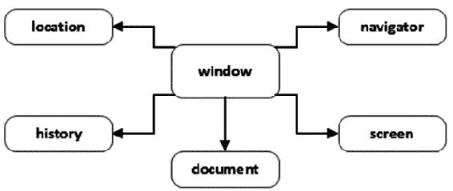

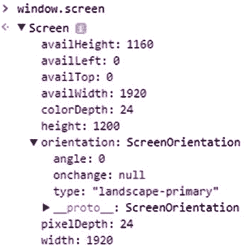

**图 16-1.** 主要的浏览器对象

> **提示：** 虽然这些对象都是 `window` 的子对象，但它们在全局命名空间中也是可用的。
>
> 例如，如果你从全局命名空间访问 `screen` 或 `document` 属性，它将返回与当前窗口或标签页关联的对象。

在描述 `window` 对象本身之前，我将首先演示这些主要的子对象。

### Screen

`screen` 对象提供了关于浏览器运行设备的详细信息。查看其内容最简单的方法是尝试一下。如果你在浏览器的控制台中输入 `window.screen`，你会看到类似于图 16-2 的内容。

**图 16-2.** 显示 `screen` 对象

如你所见，我使用的是一台分辨率为 1920 x 1200、颜色深度为 24 位的显示器。这些属性都是只读的，因为你无法更改设备特性。这些信息可供你的网页使用。例如，如果你要启动一个新窗口或弹出对话框，设备特性可能会影响新窗口的大小和位置。

但是，如果你在多个浏览器中查看 `screen` 对象，你会发现它们提供的属性集合略有不同。以下是你可以基本信赖的基础属性集：

- `height` - 设备的总高度（以像素为单位）
- `width` - 设备的总宽度（以像素为单位）
- `availHeight` - 操作系统未占用的垂直空间量（例如任务栏占用的空间）
- `availWidth` - 可用的水平空间量
- `colorDepth` - 用于指定颜色的位数
- `pixelDepth` - 与 `colorDepth` 相同

设备方向尚未标准化；对于 Firefox 和 Edge，可以分别使用带前缀的属性 `mozOrientation` 和 `msOrientation`。对于 Chrome，方向以对象形式提供，你可以访问其 `type` 属性（`screen.orientation.type`）。不过，由于你可以获取高度和宽度，因此很容易确定方向。

### Location

`location` 对象提供了窗口中加载文档的网址。它也与 `document` 对象相关联，因此可以通过 `window.location` 或 `document.location` 访问，或者正如我之前解释过的，直接使用 `location`。它包含 URL 各个部分的独立属性：

- `protocol`
- `hostname`
- `port`
- `pathname`
- `search` - 一个或多个以问号（`?`）开头的查询字符串参数
- `hash` - 井号（`#`）后跟片段标识符

为了方便，还提供了一些额外的属性：

- `href` - 提供完整的 URL
- `host` - 包含主机名和端口
- `origin` - 包含协议、主机名和端口

`ToString()` 方法会返回 `href` 属性，因此你可以直接引用 `location` 对象来获取完整的 URL。例如，以下代码将弹出如图 16-3 所示的弹窗：

```
alert(location);
```

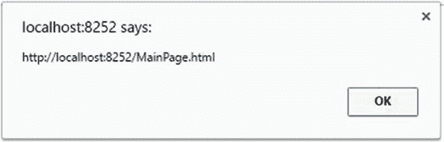

**图 16-3.** 显示 URL

与 `screen` 对象一样，`location` 对象通常是只读的。一个很大的例外是，你可以使用 `location` 对象的 `assign()` 方法导航到另一个页面。你也可以直接将 URL 值赋给 `location` 对象，因此以下两种方式都可以达到相同效果：

```
location.assign("http://www.google.com");
```

或

```
location = "http://www.google.com";
```

你也可以修改 URL 的某个组成部分，而不是整个 URL。一个有用的例子是修改 `search` 属性中的查询字符串参数。如果用户更改了搜索条件，你可以简单地更新 `search` 属性，然后新的请求将被发送到服务器。

除了使用 `assign()` 方法，你还可以使用 `replace()` 方法，该方法的工作方式相同，只是当前页面不会被保存到历史记录中，我稍后将对此进行解释。`location` 对象还支持 `reload()` 方法，该方法将刷新当前窗口。`reload()` 方法接受一个布尔参数，如果传入 `true`，则页面从服务器重新加载。如果传入 `false` 或不提供参数，浏览器可能会使用本地缓存刷新页面。

### History

`history` 对象跟踪在单个窗口中加载的页面。这不是包含昨天或上周访问网站的完整浏览历史记录，它也不知道在其他窗口或标签页中加载的页面。它用于支持后退按钮，允许你返回到上一个页面。

`history` 对象有一个 `length` 属性，表示历史记录中的条目数。这将包括当前页面，因此至少会有一个条目。你可以通过调用 `back()` 方法导航到上一个页面。同样，你可以使用 `forward()` 方法移动到下一个页面。这与用户单击浏览器上的后退或前进按钮的工作方式相同。`history` 对象还支持一个通用的 `go()` 函数，其中方向和页面数由整数值指定。

使用 `go(-1)` 等同于 `back()`，`go(1)` 等同于 `forward()`。但是，你可以使用 `go()` 方法跳过多个页面，例如 `go(-2)`，这将回退两个页面。

`注意` 如果发生超出范围的情况，例如在最新页面上调用 `forward()`，该调用将被忽略且无效。

`history` 对象还支持 `pushState()` 和 `replaceState()` 方法，你可以使用它们来操作历史堆栈。调用 `pushState()` 将添加另一个历史元素，就像你实际导航到了一个新页面（例如使用 `location.assign()` 方法）一样。`replaceState()` 方法使用提供的数据更新现有的历史元素。但是，这两种方法都不会实际导航到新页面。

两种方法都支持三个参数：

- `state` - 一个 JSON 字符串，包含你想要存储在这里的任何可序列化数据。

- `title` - 此参数目前已被忽略；你可以输入一个空字符串或一个描述页面的简短标题。

- `url` - 将存储在历史记录中并用于后退或前进的地址。

顾名思义，使用 `pushState()` 和 `replaceState()` 成员，可以让你将状态信息与历史记录关联起来。如果有人离开了你的页面，然后使用后退按钮返回，你的页面可以利用此状态数据。例如，假设你的页面执行了客户查询并检索了用户的详细信息。此数据可以存储在历史状态中，这样当他们导航回你的页面时，无需再次执行查询即可获取数据。

有两种方法可以获取状态数据。首先，你可以监听 `popstate` 事件，该事件在通过历史记录导航时触发。只有当当前 URL 和新 URL 指向同一个文档时，才会触发 `popstate` 事件。因此，如果用户导航到一个完全不同的网站，然后又导航回你的页面，则不会触发任何事件。此外，Chrome 仅在向后导航时触发该事件；向前导航时不会触发。

幸运的是，你还可以通过使用 `state` 属性直接从 `history` 对象获取当前状态数据。清单 16-1 中的代码演示了这些状态方法和属性。

**清单 16-1.** 演示历史状态

```
window.onpopstate = function (e) {
    console.log("popstate - url: " + location + ", state: " + JSON.stringify(e.state));
}

console.log("0-length: " + history.length + ", state: " + JSON.stringify(history.state));
history.replaceState({id: 1}, "", location);
history.pushState({id: 2}, "", location);
history.pushState({id: 3}, "", location);
console.log("1-length: " + history.length + ", state: " + JSON.stringify(history.state));
history.go(-1);
history.go(-1);
history.go(1);
history.go(1);
console.log("2-length: " + history.length + ", state: " + JSON.stringify(history.state));
```

这段代码首先通过简单地将详细信息写入控制台来实现 `popstate` 事件。然后，代码使用 `replaceState()` 方法在当前历史元素上设置状态。接着使用 `pushState()` 方法添加两个历史条目。请注意，`location` 对象作为第三个参数传入。这将指定 URL 的当前值，因此不会进行任何更改；只有状态被更新。这段代码还在进行任何更改之前、添加新历史条目之后以及导航完成之后，记录了历史记录长度和当前状态。控制台窗口的结果如图 16-4 所示。

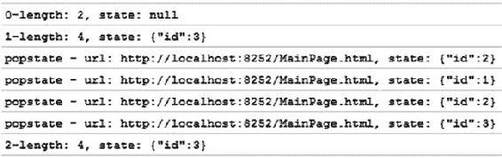

**图 16-4.** Firefox 中的控制台

历史记录长度最初为 2，因为当我启动浏览器时，它加载了默认主页，然后我输入了测试网站的 URL。正如预期的那样，初始状态为 `null`。调用 `pushState()` 两次后，长度为 4。每次调用 `go()` 方法时，都会触发 `popstate` 事件，并且状态会更新以反映新的当前条目。

## Navigator

与 `screen` 对象类似，`navigator` 对象提供了浏览器所运行设备的信息。`screen` 对象仅限于设备显示器（如尺寸和色彩深度）的详细信息。相比之下，`navigator` 对象支持相当多的属性和方法。我无意在此解释所有内容；不过它们在附录 C 的参考资料中都有列出并附有简短说明。

`navigator` 对象一个越来越有用的属性是 `geolocation`。该属性利用设备硬件，根据设备的支持能力，通过全球定位系统（GPS）、蜂窝三角测量、Wi-Fi 信息或 IP 查询来确定设备的当前位置。我将在第 26 章中详细介绍这一点。

## 用户代理

`navigator` 对象包含多个指示操作系统和浏览器详细信息的属性，包括：

-   `appCodeName`

-   `appName`

-   `appVersion`

-   `platform`

-   `product`

-   `userAgent`

这些信息中的大部分都不准确，也难以有效利用。例如，我在 Windows 10 上运行 Chrome、Firefox 和 Edge 浏览器，这三者的 `appCodeName`、`appName` 和 `product` 值都是相同的（分别是 Mozilla、Netscape 和 Gecko）。`userAgent` 属性是一个字符串，包含了来自其他属性的大部分信息。不过，这有点晦涩难懂。例如，以下是我刚才提到的三种浏览器的 `userAgent` 字符串：

-   `Mozilla/5.0 (Windows NT 10.0; WOW64) AppleWebKit/537.36 (KHTML, like Gecko) Chrome/54.0.2840.71 Safari/537.36`

-   `Mozilla/5.0 (Windows NT 10.0; WOW64; rv:49.0) Gecko/20100101 Firefox/49.0`

-   `Mozilla/5.0 (Windows NT 10.0; Win64; x64) AppleWebKit/537.36 (KHTML, like Gecko) Chrome/51.0.2704.79 Safari/537.36 Edge/14.14393`

造成这种混乱的原因之一是，Web 开发者过去（并且现在仍然）在代码中基于浏览器而不是使用特性检测来编写逻辑；如果是 Chrome 则执行这个，如果是 Firefox 则执行那个。因此，新浏览器会将 `userAgent` 属性设置得看起来像其他浏览器，以便应用程序能够利用这些浏览器的特性。

> `提示` 如果你想从 `userAgent` 中收集一些有用信息，我建议使用他人编写的解析器。有不少可供选择。只需谷歌搜索“parse user agent”即可。

## 电池

`battery` 属性返回一个 `BatteryManager` 对象，该对象提供以下属性：

-   `charging`（如果设备正在充电则为 true）。

-   `chargingTime`（充满电所需的剩余秒数）。

-   `dischargingTime`（电池完全放电所需的秒数）。

-   `level`（一个 0 到 1 之间的值，表示当前充电水平）。

你还可以监听当这些值发生变化时触发的事件。这些事件分别称为 `chargingchange`、`chargingtimechange`、`dischargingtimechange` 和 `levelchange`。

### Window 对象

现在让我们来看看 `window` 对象，并探索它所暴露的功能。它提供了大量的属性和方法，我已将标准的那些列在附录 C 的参考资料中。此外，还有大量你可以订阅的事件，这些也一并列出。

不过，我将在第 20 章中解释事件。

### 控制台

浏览器控制台通常是开发者工具的一部分，是一个方便的资源，允许你检查属性值并运行临时的 JavaScript 命令。控制台还包含一个日志，你可以在其中写入来自应用程序的调试信息，这一点我已经演示过。`window`对象也提供了一个`console`对象，你可以用它以编程方式与控制台交互。与`window`对象提供的许多其他对象一样，`console`也处于全局命名空间中，因此你可以通过`window.console`或仅用`console`来访问它。

`console`对象支持的方法在附录 C 的参考资料中列出并描述。我不会在这里全部介绍，但我会解释一些更有用的功能。

## 字符串替换

许多控制台方法，包括`log()`、`error()`、`info()`和`warn()`都支持字符串替换。

你可以将一个或多个百分号（`%`）作为占位符嵌入到文本中，然后为每个占位符提供一个额外的参数。在`%`符号旁边，你还需要指定以下格式字符之一：

-   `s` - 字符串
-   `d` 或 `i` - 数值
-   `f` - 浮点数
-   `o` - 对象

> **注意** Firefox 还支持限定数字和浮点数格式以指定位数。在撰写本文时，大多数其他浏览器不支持此功能，并可能导致某些浏览器（包括 Edge）中出现不正确的格式。

快速演示一下，以下代码将按指定格式输出四个值：

```js
console.info("Formatting: %i, %f, %s, %o", 22.651, Math.PI, "text", screen);
```

这将在 Edge 浏览器中的显示结果如图 16-5 所示，在 Chrome 中的显示结果如图 16-6 所示。注意那个带有“i”的蓝色圆圈，表示这是一个信息条目。

## 性能分析

大多数浏览器提供的开发者工具都包含评估性能的实用程序。这些工具可能非常强大，可以帮助你了解可以在哪些方面调整应用程序以提高响应能力。这超出了本书的范围，但我想给你提供几个链接来帮助你入门。这里有一篇关于`Chrome Timeline`工具的好文章：[`developers.google.com/web/tools/chrome-devtools/evaluate-performance/timeline-tool`](https://developers.google.com/web/tools/chrome-devtools/evaluate-performance/timeline-tool)。此外，Firefox 有一个`Performance`工具，从这篇文章开始的一系列文章中有介绍：[`developer.mozilla.org/en-US/docs/Tools/Performance`](https://developer.mozilla.org/en-US/docs/Tools/Performance)。

`console`对象提供了与这些性能工具集成的方法。例如，`profile()`方法将启动一个新的性能分析。你可以将此调用放在要评估的代码之前。然后调用`profileEnd()`方法停止分析并输出结果。谷歌提供了一篇很好的文章，描述了这些各种控制台功能，并提供了使用技巧：[`developers.google.com/web/tools/chrome-devtools/console/console-reference`](https://developers.google.com/web/tools/chrome-devtools/console/console-reference)。

`time()`和`timeEnd()`方法可用于收集一些简单的度量数据。这些方法就像一个秒表。如果你想知道一个函数完成需要多长时间，只需在函数前后加上这些方法即可。

例如，以下代码循环迭代 1000 次并记录完成所用的总时间。

```js
console.time("Stopwatch");

var j = 1;

for (var i = 0; i < 1000; i++) {
  j += j + i;
}

console.info("j = %i", j);
console.timeEnd("Stopwatch");
```

# 性能

从某种程度上说，`window`对象包含一个`performance`属性，用于访问 Web 性能 API。该 API 有两个属性：`navigation`和`timing`，分别提供页面加载方式的详细信息和各种计时指标。在浏览器控制台中输入`window.performance.timing`，即可看到如图 16-7 所示的一组计时详情。这些值的计算方式是从某个特定时间点开始的毫秒数。

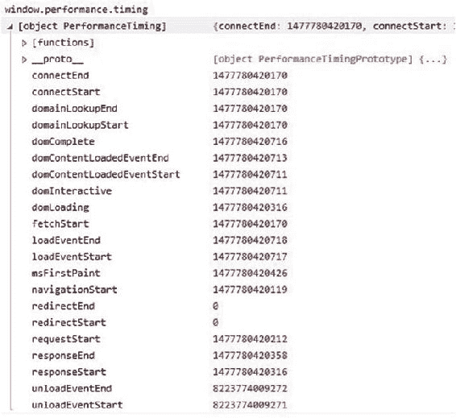

**图 16-7.** *性能计时详情*

该 API 还提供了一个`now()`方法，该方法使用相同的参考点返回毫秒数。此外，API 还提供了一个`mark()`方法，可用于添加自定义性能条目。

# 分组日志条目

你还可以使用`group()`方法对日志条目进行分组。添加日志条目后，调用`groupEnd()`方法关闭分组。作为简单演示，以下代码在一个分组内记录了三条条目。在 Firefox 控制台中的显示效果如图 16-8 所示。

```javascript
console.group("正在记录一组记录...");
console.log("日志条目 #1");
console.log("日志条目 #2");
console.log("日志条目 #3");
console.groupEnd();
```

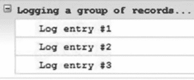

**图 16-8.** *在 Firefox 中显示日志分组*

除了使用`group()`方法，你还可以使用`groupCollapsed()`方法。该方法的工作方式与`group()`方法完全相同，只是分组在控制台中默认折叠，用户需要展开才能看到三条日志条目。

# Cookie

Cookie 允许你在客户端存储少量数据。它们实际上是`document`对象的一部分，但我会在此处与其他存储机制一起说明。文档的所有 Cookie 都以单个字符串形式提供，可通过`document.cookie`属性获取。Cookie 之间以分号分隔，每个 Cookie 的格式为`<名称>=<值>`。例如，如果有三个名为`Test1`、`Test2`和`Test3`的 Cookie，Cookie 字符串可能如下所示：

```
Test1=测试 Cookie #1; Test2=测试 Cookie #2; Test3=测试 Cookie #3
```

> **提示：**Cookie 的一个重要特点是它们会随每个服务器请求一起发送。这使得服务器可以访问这些客户端数据。服务器也可以设置 Cookie 的值。

要添加 Cookie，你可以使用同样的`document.cookie`属性为其赋值。不过，你一次只能设置一个 Cookie 值。例如：

```javascript
document.cookie = "Test1=测试值";
```

这将创建一个名为`Test1`的新 Cookie，如果已存在同名 Cookie，则会更新其值。这不会影响任何其他已定义的 Cookie。然而，获取`document.cookie`属性时，会像之前所述返回所有 Cookie。要获取特定 Cookie，你需要解析 Cookie 字符串，查找所需 Cookie。要删除 Cookie，则需要将其值更新为空字符串。

创建 Cookie 时，你还可以在 Cookie 值后面包含一些其他属性。以下是支持的属性：

- `domain=` - 指定可以访问该 Cookie 的域名；如果未指定，默认使用文档的域名。
- `expires=` - 指示 Cookie 的过期时间；如果未指定，Cookie 将在会话关闭时过期。该值必须格式化为 UTC 字符串；可以使用`toUTCString()`方法辅助格式化。
- `max-age=` - 指定 cookie 过期的另一种方式；指定 cookie 过期前的秒数。
- `path=` - 指定 cookie 应存储的位置。
- `secure` - 指示 cookie 仅应在使用`https`时发送。

例如，要设置过期日期，可以像这样创建一个新的 cookie：

```javascript
document.cookie = "Test=Test cookie; expires=Sun, 30 Oct 2016 12:00:00 UTC";
```

使用 cookie 有些繁琐，我建议你创建（或借用）一些辅助函数来简化对它们的访问。清单 16-2 中的代码创建了三个函数，用于创建、删除和获取 cookie。其余代码则使用这些函数，并将结果写入控制台。

## 清单 16-2. 使用 Cookie

```javascript
function storeCookie(key, value, duration) {
  var expDate = new Date();
  expDate.setTime(expDate.getTime() + duration * 86400000);
  document.cookie = key + "=" + value + ";expires=" + expDate.toUTCString();
}

function removeCookie(key) {
  storeCookie(key, "", 0);
}

function getCookie(key) {
  var cookies = document.cookie.split(';');
  for(var i=0; i<cookies.length; i++) {
    if (cookies[i].trim().indexOf(key + "=") == 0) {
      return cookies[i].trim().substring(key.length + 1);
    }
  }
  return null;
}

storeCookie("Test1", "Test cookie #1", 5);
storeCookie("Test2", "Test cookie #2", 5);
storeCookie("Test3", "Test cookie #3", 5);
console.log(document.cookie);
console.log("Test2:", getCookie("Test2"));
removeCookie("Test2");
console.log("Test2:", getCookie("Test2"));
console.log(document.cookie);
```

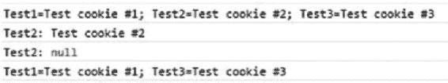

控制台日志中的结果如图 16-9 所示。添加三个 cookie 后，它们都会在 `cookies` 属性中返回。`getCookie()` 函数返回了指定的 cookie，但在此 cookie 被删除后，该函数返回了 `null`。另外，在删除一个 cookie 后，`cookie` 属性只返回两个 cookie。

**图 16-9. 显示 cookie 结果**

### 存储

HTML5 定义了两个新的客户端缓存存储机制：`localStorage` 和 `sessionStorage`。

两者都是 `window` 对象的属性，并返回一个 `Storage` 对象。两者之间的唯一区别是数据的可用持续时间。`sessionStorage` 在浏览器关闭时被清除，而 `localStorage` 则被无限期保留。

`Storage` 对象包含一组键值对，两者都必须是字符串。你可以在 `Storage` 对象中存储任何可序列化的数据。通过调用 `setItem()` 方法并传入一个键和一个字符串值来添加项目。如果指定的键已存在，其值将被更新；否则，会将新项目添加到存储中。你可以通过调用 `getItem()` 并传入所需项目的键来检索项目。如果找不到指定的键，`getItem()` 将返回 `null`。

- **注意** 在调用 `setItem()` 时始终检查异常，因为可能会发生异常。如果缓存已满，`setItem()` 将抛出异常。此外，在某些浏览器的隐私模式下，它也会抛出异常。

如果你想从存储中移除一个项目，可以调用 `removeItem()` 方法并传入该项目的键。你也可以通过调用 `clear()` 方法移除所有项目。`Storage` 的方法在以下代码中演示：

```javascript
var cache = window.sessionStorage;
cache.clear();
cache.setItem("key1", "This is my saved data");
console.log("Saved data: " + cache.getItem("key1"));
cache.removeItem("key1");
console.log("Saved data: " + cache.getItem("key1"));
```

本地存储和会话存储都有大小限制，具体因浏览器和操作系统而异。这里有一个页面可以测试你的特定浏览器并验证存储限制：[`dev-test.nemikor.com/web-storage/support-test/`](http://dev-test.nemikor.com/web-storage/support-test/)。但通常，你应该有大约 5MB 的存储空间。

#### 浏览器界面元素

浏览器提供了多个 UI 组件，如菜单、工具栏和状态栏，用户可借此与浏览器交互并控制其行为。每个组件都支持 `BarProp` 接口，该接口只暴露一个属性 `visible`。JavaScript 可以访问这些组件，以判断特定元素是否对用户可见。支持以下窗口属性：

- `locationbar` - 显示当前文档的 URL。
- `menubar` - 浏览器提供的任何类型的菜单。
- `personalbar` - 提供用户偏好设置、书签、收藏夹等。
- `scrollbar` - 垂直或水平滚动条。
- `statusbar` - 提供当前页面或页面上选中元素的状态。这可能包括资源的下载状态或链接指向的 URL。
- `toolbar` - 包含基于 UI 的命令（如后退按钮或刷新按钮）的组件。

你无法隐藏或显示这些 UI 组件，但可以判断它们当前是否可见。例如，要查看菜单是否可见，可以调用以下代码：

```javascript
if (window.menubar.visible) {
  console.log("菜单可见");
}
```

### 计时器

`window` 对象提供了两种类型的计时器：

- `setTimeout()` - 在指定的时间后调用指定的函数。
- `setInterval()` - 在指定的时间后调用指定的函数，并按照相同的时间间隔持续调用该函数。

这两个方法都会返回一个句柄，你可以用其取消计时器。这对于 `setInterval()` 尤为重要，因为它会持续调用该函数，直到被取消为止。要取消计时器，请使用相应的方法 `clearTimeout()` 或 `clearInterval()`，并将设置方法的返回值传入。

下面是一个简单的演示，让你了解其实际运作方式：

```javascript
function logMessage() {
  console.log("计时器触发了！");
}

var timer = setTimeout(logMessage, 2000);

// 不要调用这一行，否则计时器将永远不会触发
//clearTimeout(timer);
```

我特意注释掉了 `clearTimeout()` 的调用，这样计时器最终就会到期。页面加载大约 2 秒后，你应该会在控制台日志中看到一条新记录。

## 第 16 章 - 浏览器环境

### 本章小结

在本章中，我涵盖了与浏览器环境及可用功能相关的广泛主题。你可以利用大量可用信息来影响应用程序的行为。`window` 对象是起点，并提供了访问这些功能的途径。主要的子对象包括：

- `screen` - 提供显示设备的详细信息。
- `location` - 提供当前网址的详细信息，并可用于导航到其他页面。
- `history` - 用于支持后退按钮，并且可以通过操作来改变后退按钮的行为。你还可以包含状态信息，以便在导航回上一页面时使用。
- `navigator` - 提供有关设备的详细信息，包括硬件、操作系统和浏览器信息。它还提供了 `geolocation` 对象。

`window` 对象提供了一些有用的功能，例如控制台日志记录，以及性能分析和性能指标。你还可以通过 Cookie、本地存储和会话存储来存储客户端数据。

计时器也可以通过 `window` 对象使用。虽然我没有详细讲解，但参考材料中提供了大量相关功能。

在下一章中，我将进一步解释 `window` 本身，包括对话框、框架和多标签应用程序。

## 第 17 章 - Window 对象

在本章中，我将解释如何使用 JavaScript 创建和操作窗口。我将首先打开一个弹出窗口，并演示如何控制其大小、位置以及其他属性。

我将展示如何使用 `window` 对象上的方法来移动和调整窗口大小。我还会提供一个使用 HTML、CSS 和 JavaScript 模拟模态对话框的示例。最后，我将简要解释如何使用内联框架嵌入来自其他来源的内容。

#### 创建窗口

我首先打开一个通过 JavaScript 创建的现有窗口。接着，我会演示如何通过 JavaScript 来操控这个新窗口。通过调用`window.open()`方法可以轻松创建新窗口。该方法有两个必需的参数：窗口的名称以及其文档的网页地址。

■ **注意** `window`对象提供了修改其属性（如大小和位置）的方法。然而，出于安全考虑，只能调整通过 JavaScript 创建的窗口。因此，你无法更改由浏览器创建的初始窗口。但是，你可以使用`open()`方法创建新窗口，然后通过 JavaScript 操控它，这正是我接下来要演示的。

在我的 Web 项目中，有一个非常简单的 HTML 文档，名为`MainPage.html`，其标记如下：

```html
<!DOCTYPE html>
<html lang="en">
<head>
<meta charset="utf-8" />
<title>Chapter 17 - Windows</title>
<script src="SampleScript.js"></script>
</head>
<body>
<p>Hello World!</p>
</body>
</html>
```

© Mark J. Collins 2017

M. J. Collins, *Pro HTML5 with CSS, JavaScript, and Multimedia*, DOI 10.1007/978-1-4842-2463-2_17

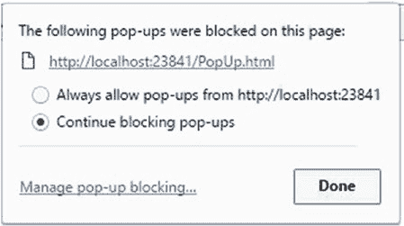

# 第 17 章 ■ 窗口对象

对于新窗口，我还有`PopUp.html`和`PopUp2.html`文件，它们与初始文档基本相同，只是在标题和段落元素上略有变化，以便区分。弹出文档也引用了一个不同的脚本文件`PopUp.js`，该文件初始为空。`SampleScript.js`文件初始包含以下 JavaScript 代码：

```javascript
"use strict";
window.name = "Chapter17";
var popup = window.open("PopUp.html", "popup");
```

通过`open()`方法创建的窗口，其`name`属性由第二个参数设置。然而，通过浏览器创建的窗口没有此属性，因此这段脚本设置了`name`属性。然后它使用`PopUp.html`文档创建了一个新窗口。

## 弹出窗口拦截器

当你尝试此操作时，除非你已禁用弹出窗口拦截器，否则你很可能会收到类似于图 17-1（来自 Chrome 浏览器）所示的警告。弹出窗口通常非常烦人且可能构成安全威胁，因此所有现代浏览器都能拦截弹出窗口。在大多数情况下，这是默认设置。

***图 17-1.** Chrome 中的弹出窗口警告*

我建议你点击“管理弹出窗口拦截”或等效链接，有选择地允许某些弹出窗口。如果你完全禁用拦截，浏览器将容易受到攻击。但是，如果不启用弹出窗口，本章中的大多数演示将无法工作。在弹出窗口例外对话框中，你可以输入`localhost`，如图 17-2 所示。

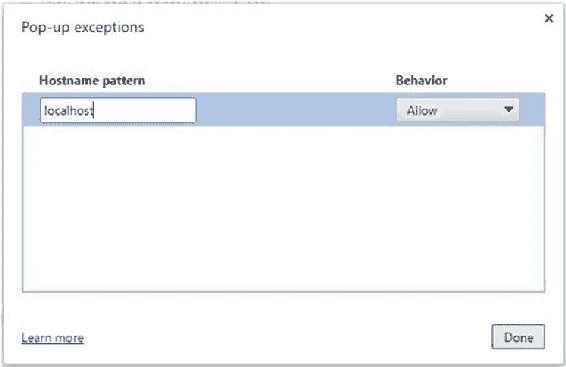

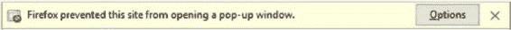

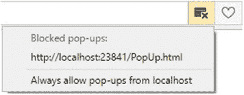

***图 17-2.** 在 Chrome 中配置弹出窗口例外*

每个浏览器用于报告被拦截的弹出窗口以及管理允许哪些弹出窗口的界面都不同。例如，Firefox 中的警告如图 17-3 所示，Opera 中的警告如图 17-4 所示。

***图 17-3.** Firefox 中的弹出窗口拦截器*

***图 17-4.** Opera 中的弹出窗口拦截器*

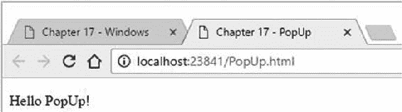

一旦你禁用了弹出窗口拦截器，你需要刷新页面以便重新运行脚本。你应该会看到另一个标签页，如图 17-5 所示。

***图 17-5.** 打开第二个标签页*

## 重用窗口

当通过 JavaScript 创建窗口时，你必须给它一个名称，即传递给`open()`方法的第二个参数。如果你尝试使用相同的名称打开另一个窗口，它将使用现有窗口，但会用新的 URL 替换其内容。要测试这一点，请转到初始标签页并打开控制台窗口。然后输入以下命令：

```javascript
window.open("PopUp2.html", "popup");
```

因为名称相同（“popup”），所以将使用同一个窗口，但它会加载指定的文档`PopUp2.html`。

`open()`方法还会返回一个`window`对象，在我的示例中，它被存储在`popup`变量中。你可以使用它来操控窗口，我将在本章后面演示这一点。

## 配置参数

`open()`方法还接受第三个参数，该参数包含一个配置字符串，有时被称为窗口特性字符串。如果你不提供此参数，或者该参数为空字符串，则新窗口将在现有浏览器窗口中作为一个新标签页创建，正如我之前演示的那样。但是，提供任何值（即使是单个空格）都会导致创建单独的窗口。

■ **提示** 窗口特性字符串仅在窗口首次创建时使用。如果你使用`open()`方法替换其内容，此参数将被忽略，并保留现有的窗口特性。

这个窗口特性字符串包含一组由逗号分隔的名称/值对，每个对定义了新窗口的一个特性。可以在此字符串中指定的特性有很多。我将它们组织成逻辑组。

■ **注意** 规范指出，每个名称/值对之间不应有空格，只能有逗号。但根据我的经验，每个值之间的空格会被忽略。

### 位置和大小

支持以下与新窗口位置或大小相关的值，它们相当不言而喻：

- `left`
- `top`
- `height`
- `width`
- `outerHeight`
- `outerWidth`

`left`和`top`值指示新窗口的位置，并指定距离显示器左边缘和上边缘的像素数。`height`和`width`值指定文档实际内容可用的区域。`outerHeight`和`outerWidth`值包括内容的区域以及标题区域、菜单、工具栏等。如果同时指定了内外值，则外部值优先。

为了演示这一点，关闭第二个标签页，转到初始页面的控制台窗口。然后输入以下命令：

```javascript
window.open("PopUp.html", "popup", "height=300,width=400,top=400,left=150");
```

■ **警告** 浏览器对这些特性的支持并不一致。Chrome、IE 和 Edge 不支持`outerHeight`和`outerWidth`特性。Opera 支持，但如果使用它们，`top`和`left`特性将被忽略，并且窗口将与初始窗口的左上角对齐。Chrome 需要`height`和`width`特性；如果未提供，整个字符串将被忽略。Edge 不支持`top`和`left`特性；新窗口总是位于初始窗口下方和右侧约 20 像素的位置。

### Chrome 特性

下一组特性与浏览器的 UI 组件相关，通常被称为 chrome（不要与 Chrome 浏览器混淆）。如果未设置这些特性，大多数浏览器的默认行为是仅包括标题栏和地址区域；但 IE 默认不包括地址栏。

规范定义了以下值。然而，在撰写本文时，只有 Firefox 和 Edge 支持它们。

- `location`
- `menubar`
- `personalbar`
- `status`
- `titlebar`
- `toolbar`

这些是布尔值，不需要指定值；它们的存在表示请求该特性，它们的缺席表示相反。将它们的值设置为`no`，例如`menubar=no`也会禁用该特性。要测试这一点，请从 Firefox 或 IE 中关闭弹出窗口，并在初始窗口的控制台中输入以下命令：

```javascript
window.open("PopUp.html", "popup", "height=300,width=400,top=400,left=150,location,menubar,status,toolbar");
```

# 注意事项：浏览器对标志行为的影响

**注意：** 这些标志的行为因浏览器而异。例如，在 `IE` 中（如前所述），`位置区域`默认不显示，但可以通过将 `location` 添加到窗口特性字符串来包含它。然而，添加 `location` 会隐藏`标题栏`。在 `Firefox` 中，如果添加了 `menubar`，新窗口会使用`标签页`，并且页面标题会显示在`标签页`中，而非`标题区域`。

# 窗口特性

还有一些定义窗口行为的额外特性。目前对这些特性的支持非常有限，因此我仅在此列出，以备将来可能支持。

## 特性列表

- `alwaysLowered` - 将新窗口置于 Z 轴顺序中现有窗口之下。
- `alwaysRaised` - 将新窗口置于 Z 轴顺序中现有窗口之上。
- `close` - 设置为 `no` 可禁用关闭图标。
- `dependent` - 依赖窗口在其父窗口关闭时自动关闭。
- `minimizable` - 禁用最小化图标。
- `fullscreen` - 将新窗口置于全屏模式。
- `resizable` - 允许调整窗口大小；默认启用。
- `scrollbars` - 设置为 `no` 可禁用滚动条。默认情况下，当内容超出分配空间时会显示滚动条。

# 操作窗口

创建新窗口后，可以使用窗口的属性和方法来查看和调整其大小、位置和滚动属性。

## 属性

窗口的当前位置和大小可以通过 `window` 对象获取。`open()` 方法返回代表新窗口的 `window` 对象。初始窗口可以利用该对象来查找窗口的位置。你还可以确定窗口的当前滚动位置。以下是可用的属性：

- `innerHeight` - 可用于内容的高度。
- `innerWidth` - 可用于内容的宽度。
- `outerHeight` - 窗口的总高度，包括浏览器 UI 元素。
- `outerWidth` - 窗口的总宽度，包括浏览器 UI 元素。
- `screenX` - 设备左边缘到窗口左边缘的距离。
- `screenY` - 设备顶部边缘到窗口顶部边缘的距离。
- `scrollX` - 文档水平滚动的像素数。
- `scrollY` - 文档垂直滚动的像素数。

## 方法

这些属性都是只读的；但可以通过 `window` 对象提供的一组方法进行操作。以下是可用的方法：

- `moveBy()` - 按指定的像素数移动窗口；需同时指定水平和垂直偏移量。如果某个方向不需移动，则设置为 0。负值将使窗口向上或向左移动。
- `moveTo()` - 移动窗口，使其左上角位于指定位置。
- `resizeBy()` - 按指定量增加窗口大小；需同时指定水平和垂直增量。如果某个维度需要缩小，则设置为负值。窗口的顶部和左边缘保持不变。
- `resizeTo()` - 指定新窗口的大小。窗口的顶部和左边缘保持不变。
- `scrollBy()` - 按指定的像素数滚动；可同时指定水平和垂直值。
- `scrollByLines()` - 按指定的行数垂直滚动文档。
- `scrollByPages()` - 按指定的页数垂直滚动文档。
- `scrollTo()` - 滚动到指定的水平和垂直位置。
- `sizeToContent()` - 更改窗口大小以适应现有内容。

### 演示

为了演示这些功能，我首先在 `PopUp2.html` 文件中添加了一幅大图像（以粗体显示的代码行）。这使你能够看到滚动行为以及 `sizeToContent()` 方法的效果。

```html
<body>
  <p>Hello PopUp 2!</p>
  
</body>
```

然后，我将 `SampleScript.js` 替换为清单 17-1 中所示的代码。

### 清单 17-1：重写`SampleScript.js`以测试窗口操作

```javascript
"use strict";

window.name = "Chapter17";

var popup = window.open("PopUp2.html", "popup", "height=300,width=400,left=400,top=150,location,toolbar,menubar,scrollbars");

var i = 1;

var timer = window.setInterval(adjustWindow, 2000);

function adjustWindow() {

    if (i > 9) {
        clearInterval(timer);
    }
    else {
        console.log("outerH: %i, outerW: %i, innerH: %i, innerW: %i, screenX: %i, screenY: %i, scrollX: %i, scrollY: %i",
            popup.outerHeight, popup.outerWidth, popup.innerHeight, popup.innerWidth,
            popup.screenX, popup.screenY, popup.scrollX, popup.scrollY);
    }

    switch (i) {
        case 1:
            popup.scrollBy(50, 30);
            break;
        case 2:
            popup.moveBy(50, 50);
            break;
        case 3:
            popup.moveTo(200, 100);
            break;
        case 4:
            popup.resizeBy(50, 50);
            break;
        case 5:
            popup.resizeTo(700, 500);
            break;
        case 6:
            popup.scrollByLines(5);
            break;
        case 7:
            popup.scrollByPages(1);
            break;
        case 8:
            popup.sizeToContent();
            break;
        case 9:
            popup.close();
            break;
    }
    i++;
}
```

通过使用上一章中介绍的`setInterval()`方法，`adjustWindow()`函数每 2 秒被重复调用一次。每次调用时，它都使用不同的方法来调整弹出窗口的大小、位置或滚动。在每次迭代中，当前窗口属性都会被写入控制台日志。在最后一次调用时，通过调用`close()`方法关闭弹出窗口。完成时，控制台日志将类似于图 17-6 所示。

**图 17-6.** 控制台日志中的结果

## 焦点

你可以通过编程方式更改哪个窗口获得焦点。当打开一个新窗口时，它通常会获得焦点。如果要打开一个新窗口来显示某些信息，但用户仍在与初始窗口交互，则应在打开新窗口后对初始窗口调用`focus()`方法。这将使主窗口保持焦点。

窗口还支持`blur()`方法。这个名称起初可能看起来有些奇怪，但获得焦点的反义词便是模糊化。调用`blur()`方法会从窗口移除焦点，焦点将转移到 Z 轴顺序中的下一个窗口。

## 模态对话框

到目前为止，我创建的窗口都是*非模态*的，这意味着用户也可以与其他窗口进行交互。相比之下，*模态*窗口会获得焦点，并禁用应用程序的其余部分，直到该窗口被关闭。现在，我将向你展示如何创建模态对话框。

### 标准弹出对话框

在解释更通用的模态对话框之前，我想先指出，通过 JavaScript 有三种标准的模态对话框可用。它们使用起来快速简便，但外观不美观且无法自定义样式。第一个是警告框，我在第 3 章中向你展示过。它仅显示一条文本信息，并带有一个**确定**按钮，用于关闭对话框。第二个是确认框，它显示一条文本信息，但包含**确定**和**取消**两个按钮。如果点击**确定**则返回`true`，点击**取消**则返回`false`。最后一个是提示框，它显示一条文本信息和一个用于输入值的文本字段。输入的值将被返回。以下代码演示了所有三种对话框：

```javascript
window.alert("这是一个警告框。\n 这是第二行");

if (window.confirm("是否继续？")) {
    var answer = window.prompt("你有多少只宠物？", 0);
    console.log("输入了 %i 只宠物。", answer);
}
else {
    console.log("确认失败");
}
```

`alert()`方法展示了如何使用`\n`转义序列来包含换行符。其他两个弹出对话框也支持此功能。`confirm()`方法嵌套在`if`语句中。如果用户点击**取消**按钮，则跳过后续代码并向控制台写入一条消息。`prompt()`方法接受两个参数。第一个参数是对话框中显示的文本，第二个参数是可选的默认值。在 Firefox 中显示的对话框如图 17-7、17-8 和 17-9 所示。每个浏览器对这些对话框的格式化方式各不相同。

**图 17-7.** Firefox 中的警告框

**图 17-8.** Firefox 中的确认框

**图 17-9.** Firefox 中的提示框

### 自定义模态对话框

在 HTML/JavaScript 中创建一个真正的模态对话框颇具挑战性。一段时间以来，存在几种方法，如 `openDialog()` 和 `showModalDialog()`。然而，由于安全漏洞和各种实现问题，这些方法已被弃用。事实上，此功能已在多个浏览器中完全移除。对于任何新应用程序，你绝对不应再使用这些方法。

HTML5 规范定义了一个新的 `<dialog>` 元素，有望简化模态对话框。然而，在撰写本文时，几乎还没有浏览器支持它。存在一些 jQuery 解决方案以及其他 polyfill 可供使用，但这超出了本书的范围。

我将演示一种相当简单的方法来模拟模态对话框，仅使用原生 HTML、CSS 和 JavaScript，这种方法有时被称为`玻璃窗格`方法。其基本思想是用一个透明或半透明的元素覆盖整个窗口，称为`玻璃`。这就像在画作上盖一块玻璃板；虽然你能看到玻璃板下的画作，但却无法实际触摸到画作。实际的对话框及其元素则放置在玻璃之上。你可以与对话框交互，但不能与页面的其余部分交互。从用户的角度来看，它的行为就像一个模态对话框。

> **提示** 为了完成这个任务，我需要让你提前了解一下接下来的两章内容。你将需要通过 `JavaScript` 操作 `DOM` 元素及其样式。

玻璃覆盖层和对话框元素的 HTML 代码包含在主 HTML 文档中，但在你希望打开对话框之前，它们保持隐藏状态。以下是所需的标记代码。

```html
<body>
    <p>你好，世界！</p>
    <button onclick="showDialog()">显示对话框</button>
    <div id="glass" class="glass">
        <div class="dialog">
            <h3>提示</h3>
            <p>你有多少只宠物？</p>
            <input type="number" value="0" id="numPets" />
            <button id="dialogOK" type="Submit" onclick="OK()">确定</button>
        </div>
    </div>
</body>
```

我添加了一个用于显示对话框的按钮；其点击事件将调用需要实现的 `showDialog()` 函数。其余标记代码创建了玻璃，它是一个简单的 `<div>` 元素。在该 `<div>` 元素内部，是另一个包含实际对话框内容的 `<div>` 元素。这包括一个用于标题的标题元素 `<h3>`，一个包含提示的段落元素 `<p>`，一个接受用户输入的 `<input>` 元素，以及一个用于提交条目的按钮。点击该按钮将调用 `OK()` 函数。

玻璃和对话框通过以下两条 CSS 规则进行样式设置：

```css
.glass {
    position: fixed;
    left: 0;
    top: 0;
    background-color: rgba(225,225,225,.7);
    height: 100vh;
    width: 100vw;
    z-index: 100;
}

.dialog {
    height: 125px;
    width: 220px;
    margin: 0 auto;
    padding: 15px;
    border: 1px solid black;
    background-color: white;
}
```

该玻璃层使用了 `position: fixed`，正如我在[第 10 章](http://dx.doi.org/10.1007/978-1-4842-2463-2_10)中解释的那样，这会使元素相对于窗口保持固定。通过将 `left` 和 `top` 设置为 `0`，并将 `height` 和 `width` 分别设为 `100vh` 和 `100vw`，该元素将占据整个窗口区域。`z-index` 被设为 `100`，以确保该元素位于所有其他元素之上。

你可以根据自己的偏好调整背景；我将其设置为透明度为 30%的灰色背景。这能清楚地表明对话框周围的其他控件不可用。你也可以使用完全透明的背景，这样其他元素会正常显示，但用户仍然无法与之交互。或者使用完全不透明的背景来隐藏其他元素。这些选择纯粹是视觉上的，不会影响页面的功能。

对话框的格式非常直接，使用固定尺寸并通过 `margin: 0 auto;` 声明实现水平居中。我没有添加其他美化格式，但你可以根据需要添加更多声明。

将所有内容整合起来所需的 JavaScript 如清单 17-2 所示。

**清单 17-2.** 对话框的实现

```javascript
// 存储对话框的结果
var result = 0;

function showDialog() {
  var dialog = document.getElementById("glass");
  dialog.style.visibility = "visible";
}
```

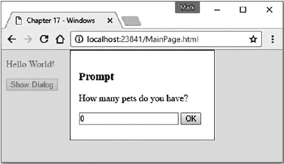

```javascript
function closeDialog() {
  var dialog = document.getElementById("glass");
  dialog.style.visibility = "hidden";
}

function OK() {
  var input = document.getElementById("numPets");
  result = input.value;
  closeDialog();
  console.log("#Pets: " + result);
}

// 确保对话框在初始状态下是关闭的
closeDialog();
```

前两个函数 `showDialog()` 和 `closeDialog()` 获取 `glass` 元素，并将其 `visibility` 属性设为 `visible` 或 `hidden`。提交按钮调用的 `OK()` 函数从 `input` 元素中获取值，并将其存储在 `result` 变量中，同时还调用了 `closeDialog()` 函数。定义这些函数后，会调用 `closeDialog()` 函数以确保页面首次加载时玻璃层是隐藏的。当点击 Show Dialog 按钮时，页面将如图图 17-10.所示。

**图 17-10.** 模态对话框

## 框架（Frames）

你可以使用内联框架（`iframe`）元素来嵌入来自另一个 HTML 文档的内容。例如，如果你想在页面中包含一个托管在其他网站（如 YouTube）上的视频，`iframe` 正是你需要的。我在[第 4 章](http://dx.doi.org/10.1007/978-1-4842-2463-2_4)中简要介绍过内联框架。

> **警告：** 在 HTML5 之前，`frame` 元素用于组织页面的各个部分，如页眉或侧边栏。每个部分都是一个独立的窗口，拥有独立的文档，并且可以独立于其他框架进行尺寸调整和移动。这是一种难以处理的模式。在 HTML5 中，`frame` 元素已被废弃，取而代之的是我在[第 4 章](http://dx.doi.org/10.1007/978-1-4842-2463-2_4)中介绍的分区元素（sectioning elements）。不过，内联框架得以保留，它提供了在父文档中锚定的同时嵌入另一个文档的能力。

如果你熟悉框架，不要尝试使用内联框架来实现 `frame` 方法；应该使用分区元素并通过 CSS 进行样式设计。

#### 简单示例

内联框架通过使用 `iframe` 元素来嵌入，并将其 `src` 属性设为要包含的文档的位置。例如：

```html
<iframe src="http://www.apress.com"></iframe>
```

与其他元素一样，你可以使用 CSS 对其进行样式设计。以下规则将 `width` 设置为 `95%`，为边框留出一些空间。同时还设置了 `height` 并应用了蓝色边框。结果如图 17-11 所示。

```css
iframe {
  width: 95vw;
  height: 300px;
  border: 3px solid blue;
}
```

# margin-top: 5px；

}


## 第 17 章 ■ Window 对象

***图 17-11.** 使用简单的 iframe*

内联框架元素支持多种可在标记中设置的属性。

-   `allowfullscreen` - 若希望嵌入窗口能够切换到全屏模式，请包含此属性。
-   `height` - 元素的高度，以像素为单位。
-   `name` - 框架的名称；可用于创建指向此元素的链接。
-   `sandbox` - 用于指定对窗口的限制，我将在后文详细说明。
-   `src` - 要在框架中加载的文档的 URL。
-   `srcdoc` - 与 `sandbox` 属性结合使用。
-   `width` - 元素的宽度，以像素为单位。

#### 访问框架

如前所述，框架实际上是另一个窗口，并且独立于父窗口运行。这包括样式，样式不会级联应用到框架内的内容。这些子窗口在 JavaScript 中可通过 `window` 对象的 `frames` 属性访问。例如，你可以通过调用 `window.frames.length` 查看有多少个框架，或者通过调用 `window.frames[0]` 访问第一个框架。后者会返回一个代表该框架的 `window` 对象。但是，如果你尝试访问它的任何属性，将会遇到跨域错误，如图 17-12 所示。

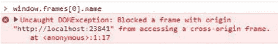

***图 17-12.** 显示跨域异常*

类似地，嵌入框架中的 JavaScript 可以通过调用 `window.parent` 访问外部窗口。当然，如果两个窗口源不同，你会遇到同样的错误。

#### 使用沙盒

我相信你能想到，在你的网页中嵌入他人的网页会带来一些安全漏洞。为了最小化这种风险，你可以创建内联框架并指定 `sandbox` 属性，该属性将对嵌入窗口强制执行一系列限制。要使用沙盒模式，请在 `iframe` 元素中添加 `sandbox=""`：

```
<iframe src=http://www.apress.com sandbox="" ></iframe>
```

你还可以通过在 `sandbox` 属性的值中列出一些特性，来选择性地允许其中的某些功能。你可以通过包含一个空格分隔的值列表来禁用多个限制。虽然并非所有浏览器都支持所有值，但已定义了以下这些值：

-   `allow-forms`
-   `allow-modals`
-   `allow-orientation-lock`
-   `allow-pointer-lock`
-   `allow-popups`
-   `allow-popups-to-escape-sandbox`
-   `allow-presentation`
-   `allow-same-origin`
-   `allow-scripts`
-   `allow-top-navigation`

### 本章小结

在本章中，我解释了 `window` 对象上用于创建和操作窗口的属性和方法。创建弹出窗口很容易，但这需要弹出窗口拦截器的允许。只有通过 JavaScript 创建的窗口才能通过 JavaScript 进行操作。我演示了标准模态对话框，以及如何通过 HTML、CSS 和 JavaScript 创建自定义模态对话框。我还解释了如何使用内联框架，并简要介绍了可用于降低风险的选项。

在下一章中，我将向你展示如何使用 JavaScript 操作 DOM。这将提供极大的灵活性，并为你提供改进网页功能的工具。

---
