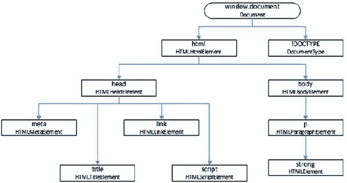
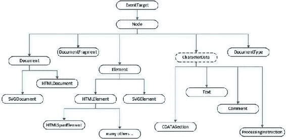
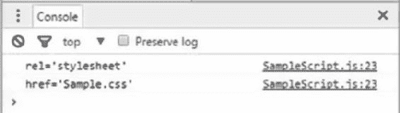
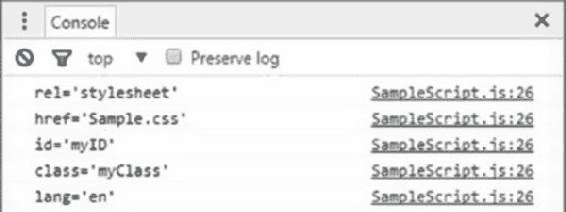

## 第 18 章

### DOM 元素

HTML 文档是一种专门的 XML 文档，并且与所有 XML 文档一样，由节点元素的层次结构组成。每个节点可以有一个父节点和零个或多个子节点。在前面的章节中，你通过某种 HTML 编辑器或简单的文本编辑器创建了这些节点。在本章中，我将向你展示如何通过 JavaScript 读取和操作这些节点。

#### 文档对象模型

快速回顾一下，这是一个非常简单的 HTML 文档。它包含一个 `head` 元素，该元素包含四个子元素：`meta`、`title`、`link` 和 `script` 元素。它还包含一个 `body` 元素，该元素只有一个 `paragraph` 元素。“Hello”这个词位于一个 `strong` 元素内部。

```
<!DOCTYPE html>
<html lang="en">
<head>
  <meta charset="utf-8" />
  <title>第 18 章 - DOM 元素</title>
  <link rel="stylesheet" href="Sample.css" />
  <script src="SampleScript.js" defer></script>
</head>
<body>
  <p><strong>Hello</strong> World!</p>
</body>
</html>
```

这些元素中的每一个都是文档中的一个节点。图 18-1 对此进行了说明。

© Mark J. Collins 2017  

M. J. Collins，《精通 HTML5、CSS、JavaScript 与多媒体》，DOI 10.1007/978-1-4842-2463-2_18





***图 18-1.** 一个简单的 HTML 文档*

正如我在[第 16 章](http://dx.doi.org/10.1007/978-1-4842-2463-2_16)中提到的，`window` 对象包含一个 `document` 属性，它允许你访问 HTML 文档。为了演示这一点，如果你打开浏览器控制台并输入 `window.document.childNodes`，将会列出一个节点数组，包含两个元素：`!DOCTYPE` 和 `html`。

#### 元素继承

在图 18-1 中，对于每个节点，我标明了 HTML 元素名称以及在 JavaScript 中代表该元素的对象类型。由于每个元素的行为不同，代表它们的对象类型也必须不同。可以想象，这些对象类型有很多。虽然并非每个 HTML 元素在 JavaScript 中都有专门的类，但许多元素都有。

幸运的是，这些对象类型使用继承，因此大多数元素都实现了一组通用的基对象。例如，`link` 元素由 `HTMLLinkElement` 对象表示。该对象从 `HTMLElement` 对象继承属性和方法，其他所有 HTML 元素对象（如 `script`、`p` 和 `strong`）也是如此。`HTMLLinkElement` 对象提供了 `link` 元素独有的额外功能。图 18-2 说明了一些常见对象的继承层次结构。

***图 18-2.** 继承层次结构*

> **提示** 所有代表 HTML 元素的 JavaScript 对象都派生自 `HTMLElement` 对象。由于有几十个之多，我未在图中全部展示。不过，附录 C 中的参考资料包含一个表格，列出了所有 HTML 元素及其对应的 JavaScript 对象。

`EventTarget` 对象提供了接收和处理事件所需的属性和方法。`Node` 对象提供了拥有父节点和零个或多个子节点的能力，以及遍历和修改它们的方法。`Element` 对象增加了更多在整体文档中操作元素的能力。`Element` 对象更重要的能力之一是查看和更新元素的属性。`HTMLElement` 对象在此基础上进一步扩展，提供了定义语言和分配样式等功能。

#### 简单演示

在详细讲解之前，先做一个快速演示。我将从 HTML 文件中移除 `body` 元素的内容，并使用 JavaScript 创建它。HTML 标记将有一个空的 `body` 元素。`head` 元素中引用的 `SampleScript.js` 文件包含了 `populateBody()` 函数。稍后我将更详细地解释这些方法调用。

```
function populateBody() {
  var body = document.getElementsByTagName("body")[0];
  var paragraph = document.createElement("p");
  paragraph.innerHTML = "<strong>Hello</strong> World!";
  body.appendChild(paragraph);
}
populateBody();
```

第一个调用使用 `getElementsByTagName()` 方法获取 `body` 元素。这会返回一个

# DOM 操作

该类元素的文档中所有元素的`array`。由于文档中通常只有一个 body 元素，因此它直接获取第一个实例。接下来，通过调用 `createElement()` 方法，并指定元素类型，创建了一个段落元素。该方法返回一个 `HTMLParagraphElement` 对象。段落元素的内容通过更新 `innerHTML` 属性来设置。最后，通过调用 `appendChild()` 方法将段落插入到 body 元素中。现在，要调用此函数，只需在 `SampleScript.js` 文件中调用它即可。

## 基本的 DOM 操作

这个简单的示例演示了操作 DOM 时使用的四种基本操作：

- 查找一个或多个元素
- 创建新元素
- 定位元素
- 修改元素

### 查找元素

通常，操作 DOM 的第一步是找到需要访问的元素。在前面的示例中，我必须获取 body 元素，以便修改其内容。根据用于搜索的数据，这里有几种可用的方法。

最简单的方法是依据元素的 `id` 属性来检索它。由于 `id` 属性在文档中必须是唯一的，因此该方法将返回零个或一个元素。如果未找到匹配的元素，则返回 `null`。

```javascript
var element = document.getElementById(id);
```

接下来的两种方法会返回一个元素数组，这些元素匹配元素类型或 class 属性。第一种方法已在最初的演示中使用过：

```javascript
var elementArray = document.getElementsByTagName(name);
```

```javascript
var elementArray = document.getElementsByClassName(names);
```

后一种方法允许你提供一个以空格分隔的 class 名称列表。如果提供了多个名称，则只会返回包含所有指定 class 名称的元素。如果未找到匹配的元素，这两种方法都将返回一个空数组。

在第 9 章中，我解释了 CSS 选择器的功能。你可以使用 `querySelector()` 和 `querySelectorAll()` 方法在 JavaScript 中利用此功能。使用这两种方法时，传入的选择器与 CSS 中使用选择器的方式完全相同。`querySelectorAll()` 方法返回所有匹配的元素，而 `querySelector()` 方法仅返回第一个匹配的元素。你可以使用复杂选择器，例如：

```javascript
var elementArray = document.querySelectorAll("header+p, .book, p:first-child");
```

> **提示：** 在这些示例中，我在 `document` 对象上调用搜索方法。这将对整个文档执行搜索。所有元素也都支持这些方法，因此你可以从某个子节点调用它们。这将从调用该方法的元素开始执行搜索。它会忽略其父元素和兄弟元素。

### 创建元素

正如我已经演示过的，你可以使用 `createElement()` 方法并传入元素类型（例如 `div`、`p` 或 `span`）来创建新元素。新元素在返回值中提供。返回的实际对象类型会根据指定的元素类型而有所不同。

除元素节点外，文档还具有*文本节点*。文本节点包含元素开始标签和结束标签之间的内容。例如，要创建一个段落元素并设置其内容：

```javascript
var p = document.createElement("p");
var text = document.createTextNode("This is a test");
p.appendChild(text);
```

如果在执行 JavaScript 后检查文档，你将看到元素定义如下：

```html
<p>This is a test</p>
```

你可以通过设置 `textContent` 属性来实现相同的目的。例如：

```javascript
p.textContent = "This is a test";
```

你也可以像在第一个示例中那样设置 `innerHTML` 属性。当使用 `innerHTML` 属性时，元素的内容可以包含子元素。在第一个示例中，部分文本包含在 `strong` 元素内。设置 `innerHTML` 属性时，其内容会被指定的文档片段替换。相比之下，`createTextNode()` 方法仅用文本更新元素的内容。如果你尝试在传递给它的字符串中嵌入元素，它们将被视为字面文本。

> **警告：** 设置 `innerHTML` 属性存在安全隐患。为了避免跨站脚本攻击，`script` 元素如果包含在 `innerHTML` 属性中将被忽略。设置 `innerHTML` 属性时仍应小心谨慎。不要使用 `innerHTML` 属性将用户输入插入到 DOM 中。请改用 `textContent` 属性。

### 移动元素

创建元素或文本节点只是创建了节点；它并没有将其放置在任何位置。要使其包含在文档中，你需要将其添加进去，可以将其作为文档的根节点，也可以作为现有节点的子元素。一个文档只能有一个根节点，除非你完全用 JavaScript 构建整个文档，否则你很可能要将新元素添加到现有节点中。

为此，在最初的示例中使用了 `appendChild()` 方法。你首先需要找到想要添加新元素的元素。然后，`appendChild()` 方法将使新元素成为该元素的子节点。该方法在父元素上调用，子元素作为参数传入。`appendChild()` 方法也会返回子节点，即正在添加的节点。

```javascript
var child = parentNode.appendChild(childNode);
```

如果父节点已有子元素，则新元素将位于现有子元素之后。如果这不是你想要的位置，你可以改用 `insertBefore()` 方法。它的工作方式与 `appendChild()` 类似，只是多了一个参数来指定新元素应放在哪个兄弟元素之前。

```javascript
var child = parentNode.insertBefore(childNode, sibling);
```

你在父节点上调用 `insertBefore()` 方法，第一个参数是要添加的元素。如果为兄弟元素参数传入 `null`，则该元素将被添加为最后一个子元素；这等效于调用 `appendChild()` 方法。

> **提示：** 既然有 `insertBefore()` 方法，你可能会认为也存在 `insertAfter()` 方法。但并没有。不过，这可以通过使用 `nextSibling` 属性轻松实现：`parentNode.insertBefore(childNode, sibling.nextSibling)`。所有 HTML 元素都继承自 `Node` 对象，该对象提供了一个 `nextSibling` 属性。在某个元素之后插入等同于在该元素的下一个兄弟元素之前插入。如果该元素恰好是最后一个子元素，那么它的 `nextSibling` 属性将为 `null`，而 `insertBefore()` 方法会将新元素添加为最后一个子元素。

你还可以使用 `removeChild()` 方法移除元素。与 `appendChild()` 和 `insertBefore()` 方法一样，`removeChild()` 方法在父节点上调用，要移除的元素作为参数传入。该元素仍然存在，但它不再是文档的一部分。与其他方法一样，被移除的元素会通过方法调用返回。

```javascript
var removedElement = parentNode.removeChild(childNode);
```

如果你想移动一个元素，你可以使用 `removeChild()` 方法将其从原始位置删除，然后使用 `appendChild()` 或 `insertBefore()` 将其移动到新位置。

> **注意：** 需要父元素来移除节点可能看起来有点奇怪，但它的工作原理就是这样。你可以通过元素的 `parentNode` 属性轻松获取父元素。因此，如果你有想要移除的元素，可以调用 `element.parentNode.removeChild(element)`。

最后，你可以使用 `replaceChild()` 方法用一个元素替换另一个现有元素。

它的工作方式与其他方法类似；它在父元素上被调用。它接受两个参数：第一个是要添加的元素，第二个是要移除的元素。新元素被添加到被移除元素的相同位置。被移除的元素会通过方法调用返回。

```javascript
var removedElement = parentNode.replaceChild(newElement, existingElement);
```

#### 修改元素

大多数 HTML 元素由它们的内容（开始和结束标签之间的文本）以及在开始标签中指定的属性组成。一些元素，如图像，没有任何内容，完全由其属性定义。正如我已经解释过的，元素的内容可以通过以下方式设置：

*   创建文本节点并将其附加到元素
*   设置 `textContent` 属性
*   设置 `innerHTML` 属性




为了操作属性，每个元素都有一个 `attributes` 属性，其中包含在该元素上定义的所有属性。这是一个名称/值对的集合。你可以通过调用 `hasAttribute()` 方法并传入属性名称来检查是否已指定特定属性。

你还可以向此集合添加属性或修改现有属性。以下代码演示了如何访问 `attributes` 属性。它会将第一个 `link` 元素的属性写入控制台。输出如图 18-3 所示。

```javascript
var link = document.getElementsByTagName("link")[0];
var attr = link.attributes;
for (var i=0; i < attr.length; i++) {
    console.log(attr[i].name + "='" + attr[i].value + "'");
}
```

***图 18-3.** 显示元素属性*

但是，这些属性也可以作为单个属性使用。你可以直接获取或给这些属性赋值。`HTMLElement` 对象支持所有全局属性，例如 `id` 和 `class`。为了说明这一点，我将修改前面的示例，设置 `id`、`class` 和 `lang` 属性。这些属性将包含在 `attributes` 属性中，如图 18-4 所示。

```javascript
var link = document.getElementsByTagName("link")[0];
link.id = "myID";
link.className = "myClass";
link.lang = "en";
var attr = link.attributes;
for (var i=0; i < attr.length; i++) {
    console.log(attr[i].name + "='" + attr[i].value + "'");
}
```

***图 18-4.** 显示附加属性*

> **注意** 属性名称可能与属性名不同。在这种情况下，`class` 是 JavaScript 中的保留字，因此该属性被称为 `className`。

其他专门的对象，如 `HTMLImageElement`，从 `HTMLElement` 继承全局属性，并提供特定于该元素的附加属性。例如，`HTMLImageElement` 暴露了 `alt`、`src` 和 `srcset` 属性。

### 相关元素

正如我所提到的，每个元素都是文档中的一个节点，可以有一个父节点（除了根节点之外的所有节点都有一个父节点）。一个节点也可以有零个或多个子节点。在从文档中获取元素后，有几个属性可以用来导航到相关元素。

以下是可用的属性：

*   `parentNode` - 节点的直接父节点；仅对根节点为 `null`
*   `children` - 一个 `HTMLCollection` 对象，包含节点的所有直接子节点
*   `firstChild` - `children` 集合中的第一个元素
*   `lastChild` - `children` 集合中的最后一个元素
*   `previousSibling` - 与当前节点具有相同直接父节点，并且在父节点的 `children` 集合中位于当前节点之前的元素。如果当前元素是父节点的第一个子节点，则为 `null`。
*   `nextSibling` - 与当前节点具有相同父节点，并且位于当前节点之后的元素。如果当前元素是其父节点的最后一个子节点，则为 `null`。

> **提示** 代表 HTML 元素的对象上有数百个属性、方法和事件。我已经解释了更常用的功能，但这并非详尽无遗的集合。
>
> Mozilla 有一个非常好的 API 参考，如果你需要更多细节，我推荐它。可以从这里开始：
> `https://developer.mozilla.org/en-US/docs/Web/API/HTMLElement`。本文描述了 `HTMLElement` 对象的成员，并提供了指向其他对象的链接。

### 使用 jQuery

> **注意** 在本书中，我专注于原生 HTML、CSS 和 JavaScript 的功能。但是，有许多库和框架扩展了这些功能。当然，它们各有优缺点。如果你正在进行任何严肃的 Web 开发，你会想要考虑其中一个或多个库，但我在本书中特意避免了它们。然而，在 DOM 操作方面，jQuery 已成为事实上的标准。

在[第 3 章](http://dx.doi.org/10.1007/978-1-4842-2463-2_3)中，我解释了如何定义一个命名空间来将变量保持在全局命名空间之外。如果你在名为 `MyNamespace` 的命名空间中定义了一个函数（例如 `log()`），你可以通过指定命名空间和函数名称来执行它。这避免了与其他可能也定义了 `log()` 函数的脚本发生任何潜在冲突。

```javascript
MyNamespace.log("Hello World");
```

在 jQuery 中，所有成员都定义在一个命名空间中，这个命名空间恰好被命名为“`$`”。每当你看到 `$.` 或 `$()` 时，就知道正在使用一个 jQuery 成员。

## 基础知识

使用 jQuery 非常简单，但你需要了解一些基础知识。

### 选择元素

所有 jQuery 操作的基本模式是选择一些东西，然后对它执行操作。语法如下所示：

```javascript
$(selector).action();
```

选择器将返回零个或多个元素。然后对集合中的每个元素执行指定的操作。选择器可以是任何有效的 CSS 选择器，这些选择器在[第 9 章](http://dx.doi.org/10.1007/978-1-4842-2463-2_9)中进行了描述。

jQuery 还支持额外的功能。这是一篇列出所有选择器及其示例和文档的文章：`http://codylindley.com/jqueryselectors/`。

你可以将选择和操作拆分为两个单独的调用。例如：

```javascript
var $elements = $(selector);
$elements.action();
```

如果你要对元素集执行多个操作，这尤其有用，因为它避免了再次执行选择。但请记住，选择器的结果是静态的；如果文档发生更改，它们不会更新。要反映最新状态，你需要重新执行选择器。

你也可以将对象传递给选择器，而不是选择器字符串。最常见的例子是使用 `document` 对象。例如，这将分配匿名函数在文档准备好时执行：

```javascript
$(document).ready(function(){... add code here ...});
```

jQuery 提供了许多基于索引的选择器，这些选择器根据元素在其父对象中的相对顺序来选择元素。索引是从零开始的，因此 `:eq(0)` 等同于使用 `first()` 方法。你还可以使用 `:lt()`、`:gt()`、`:even()` 和 `:odd()`。如果你为 `:eq()`、`:lt()` 或 `:gt()` 指定负值，则索引从末尾开始计数，而不是从开头。因此，`:eq(-1)` 等同于 `last()`。

### jQuery 对象

务必记住，从 jQuery 选择器返回的对象是 jQuery 对象，而不是像 `HTMLElement` 这样的原生 DOM 对象。原生对象被 jQuery 对象包装，并支持我稍后将演示的方法。如果你需要原生对象，请在 jQuery 对象上调用 `get()` 方法。

# jQuery DOM 操作方法

jQuery 对象提供的方法在功能上与本机对象类似，但名称有所不同。你需要留意当前处理的对象类型，因为它们拥有不同的属性和方法集。一种常见做法是，在所有 jQuery 变量前加上一个“$”字符。不过，这不应与 `$` 命名空间混淆。

此外，jQuery 选择器返回的是一个对象，而非对象数组。它类似于数组，例如，它具有 `length` 属性和 `first()` 方法，但也具备更多的功能。有关完整列表，请参阅 [`api.jquery.com/`](http://api.jquery.com/) 上的文章。

所有 jQuery 方法都返回一个支持元素集合的 jQuery 对象。即使是 `first()` 方法也会返回一个只包含一个元素的 jQuery 对象。`get()` 方法会从 jQuery 对象中返回原生 DOM 对象；但是，你必须提供索引。例如，要获取一个表示 body 元素的 `HTMLElement` 对象，可以使用以下代码：

```
var body = $("body").get(0);
```

## 操作 DOM 元素

jQuery 没有与 `createElement()` 完全等效的函数，不过你可以在调用其他 jQuery 方法时内联创建元素，我稍后会演示这一点。你可以使用 `createElement()` 创建一个原生对象，然后使用 jQuery 将其添加到文档中。

要将元素添加到文档中，请使用 `append()` 方法。选择器将决定新元素被添加到哪个（些）元素中。这大致相当于 `appendChild()` 函数。但是，如果选择器返回了多个元素，新元素的一个副本将被添加到每个匹配的元素中。与 `appendChild()` 方法类似，`append()` 会将新元素作为选定元素的子元素添加，并作为最后一个子元素，置于任何已有元素之后。如果你想将元素插入到现有子元素之前，可以使用 `prepend()` 方法。

`append()` 和 `prepend()` 方法都接受多种输入类型。你可以传入一个原生 DOM 对象（例如 `HTMLElement`）或一个包含一个或多个元素的 jQuery 对象。如果要添加多个元素，你还可以提供多个逗号分隔的参数，或者一个数组参数。也可以指定一个 HTML 字符串。例如，传入 `"<p></p>"` 会创建一个新的段落元素。HTML 字符串可以包含更复杂的、带有内嵌子元素的 HTML。这类似于设置 `innerHTML` 属性。但是，由 HTML 字符串定义的元素会被追加（或前置）到现有子元素之后，而不是替换它们。

在使用 `append()` 和 `prepend()` 方法时，选择器决定了目标元素（即元素将要被插入到的位置），而参数指定了要添加的元素。jQuery 还提供了 `appendTo()` 和 `prependTo()` 方法，它们使用不同的语法实现相同的结果。使用这些方法时，选择器决定了要添加的元素，而参数指定了目标元素。

`html()` 方法会用传入的 HTML 脚本来替换 `innerHTML` 属性。如果选择器匹配了多个元素，它们都会被更新。如果没有传入参数，它不会更新元素，而是返回现有的 HTML 字符串，包括所有子元素。如果选择器匹配了多个元素，则只返回第一个元素的 `innerHTML`。

所有这些方法都将新内容作为子元素添加到指定的父元素中。jQuery 还提供了 `before()` 和 `after()` 方法，它们将内容作为指定目标的兄弟元素添加。`before()` 方法与 `insertBefore()` 方法类似，区别在于你无需指定父元素。新元素会被插入到目标元素之前，作为其兄弟元素。类似地，`after()` 方法将元素插入到目标元素之后。

在使用 `before()` 和 `after()` 方法时，选择器决定了新元素应被添加到哪个目标元素旁，而参数指定了要添加的元素。该参数可以是 `append()` 方法中描述的任何值。jQuery 还提供了 `insertBefore()` 和 `insertAfter()` 方法。它们实现了与 `before()` 和 `after()` 相同的结果，但语法顺序相反，就像 `appendTo()` 方法一样。选择器决定了要添加的元素，而参数指定了目标元素。

`wrap()` 方法用于将一个元素作为父对象插入到选择器指定的目标外部。例如，如果你的文档中有一些图片元素，你可以将它们每个都嵌套在一个新的 `div` 元素内。选择器会找到这些图片元素，而参数则指定了被放置到内部的新元素：

```
$("img").wrap("<div class='image'></div>");
```

相反，`unwrap()` 方法会移除由选择器返回的元素的直接父元素。这将撤销调用 `wrap()` 方法的效果。

使用 `wrap()` 方法时，每个选中的元素都会被一个新的父元素包裹。`wrapAll()` 方法会将所有选中的元素包裹在单个父元素中。如果匹配元素之间存在不匹配的元素，它们将不会被包含在这个新的父元素内，而是紧跟在它之后。

`wrapInner()` 方法的工作方式类似于 `wrap()` 方法，不同之处在于它只包裹元素的内容，而不是整个元素。例如，你可以在段落标签的内容周围添加一个 `strong` 元素。如果原始 HTML 是：

```
<p class="myClass">Hello World</p>
```

你可以像这样调用 `wrapInner()` 方法：

```
$("p").wrapInner("<strong></strong>");
```

生成的 HTML 将是：

```
<p class="myClass"><strong>Hello World</strong></p>
```

可以通过 `remove()` 或 `detach()` 方法从文档中移除元素。使用这两种方法，由选择器返回的元素都会被移除。但是，`detach()` 方法会返回被移除的元素集合，以便稍后可以重新添加它们。当你希望将元素移动到不同位置时，请使用 `detach()` 方法。`empty()` 方法会移除由选择器返回的元素中的所有子元素。

你也可以使用 `replaceWith()` 方法替换元素。选择器指定了应被移除的元素。对于每个被移除的元素，传递给该方法的元素会被插入到它的位置。与 `detach()` 方法一样，它会返回被移除的元素集合。`replaceAll()` 方法的语法顺序是相反的；选择器指定了要添加的元素，而参数标识了要被替换的元素。

#### 总结

在本章中，我解释了使用 JavaScript 操作 DOM 元素的方法。有几种方法可用于查找一个或多个元素，具体取决于你执行搜索的方式。最灵活的方法是 `querySelectorAll()` 方法，它允许你使用任何支持的 CSS 选择器。创建元素后，你需要调用几种方法之一将其插入到文档中。向文档添加元素时，你需要指定父元素。

你也可以移除元素。有一些方法可用于提取和设置元素的属性。然而，在大多数情况下，你可以简单地将属性作为元素的属性来访问。

我简要介绍了如何使用 jQuery 操作文档。jQuery 库提供了一种更简单、功能更丰富的 DOM 操作方法。如果你需要访问和修改文档元素，应该考虑使用 jQuery。

在下一章中，我将向你展示如何使用类似的技术来操作文档元素的样式。
