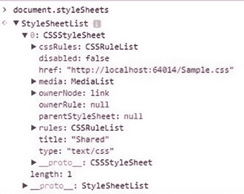
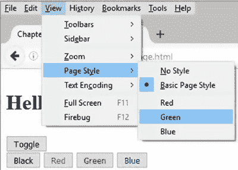

# 第十九章：动态样式

在上一章中，我解释了如何使用 JavaScript 动态更改 HTML 内容。

# 使用 JavaScript 实现动态样式

存在一些方法可以创建新的 DOM 元素，以及重新排列或修改现有元素。对于修改这些元素的样式，也存在类似的能力。在本章中，我将介绍四种可以使用 JavaScript 动态更改样式规则的技术：

- 替换样式表
- 更改样式规则
- 修改 CSS 类
- 调整内联样式

这些场景提供了对文档所应用样式越来越精细的控制，从替换整个样式表开始，到更新单个元素的样式结束。

## 更改样式表

我要介绍的第一种方法是替换整个样式表。例如，如果你想支持多个主题，这种技术会很有用。每个样式表都包含一组规则，为网页呈现特定的外观。然后根据用户偏好、用户输入或其他规则应用特定的样式表。你应该将通用规则放入一个始终使用的独立样式表中。主题元素则放入可以动态应用的独立样式表中。

**提示：** 你可以像上一章所介绍的那样，通过创建一个 `link` 元素来向文档添加新的外部样式表。你也可以创建一个新的 `style` 元素来创建内部样式表。

### 启用样式表

可用的样式表可以通过 `document.styleSheets` 属性访问。这会返回一个已加载样式表的集合。使用 `link` 元素将样式表添加到 HTML 文档后，可以在控制台中查看它，如图 19-1 所示。

```html
<link rel="stylesheet" href="Sample.css" title="Shared" />
```

© Mark J. Collins 2017

M. J. Collins, *精通 HTML5、CSS3、JavaScript 与多媒体*, DOI 10.1007/978-1-4842-2463-2_19



**图 19-1.** 查看样式表属性

`stylesheets` 集合的长度为 1，因为只加载了一个样式表。`link` 元素包含 `title` 属性，该属性在 `CSSStyleSheet` 对象上是可用的。

该对象上的大多数属性是只读的；但是，你可以更改 `disabled` 属性。为了演示这一点，我将在页面上添加一个按钮来切换 `disabled` 属性。以下是完整的 HTML 文档。

```html
<!DOCTYPE html>
<html lang="en">
<head>
<meta charset="utf-8" />
<title>第 19 章 - 动态样式</title>
<link rel="stylesheet" href="Sample.css" title="Shared" />
<script src="SampleScript.js" defer></script>
</head>
<body>
<p><strong>你好</strong> 世界！</p>
<button onclick="toggleSS()">切换</button>
</body>
</html>
```

`Sample.css` 文件包含一个使用更大字体的单一样式规则：

```css
p {
  font-size: xx-large;
}
```

`toggleSS()` 函数在 `SampleScript.js` 文件中实现：

```javascript
"use strict";
function toggleSS() {
  for (var i = 0; i < document.styleSheets.length; i++ ) {
    if (document.styleSheets[i].title == "Shared") {
      document.styleSheets[i].disabled = !document.styleSheets[i].disabled;
      break;
    }
  }
}
```

这个函数遍历所有样式表，如果 `title` 是 `"Shared"`，则切换 `disabled` 属性。

### 选择样式表

我们可以应用这种方法来动态选择样式表。文档将加载多个样式表，然后根据用户输入启用其中一个并禁用其他。对于这个示例，我将再使用三个样式表，每个设置不同的颜色。页面将有按钮用于选择颜色，这些按钮会调用一个 JavaScript 函数来启用/禁用相应的样式表。

新的样式表每个都有一条设置 `color` 属性的规则，像这样：

```css
p {
  color: red;
}
```

我将通过 `head` 元素内的以下 `link` 元素添加新的样式表。我没有使用 `title` 属性，我将在本章后面解释原因。

```html
<link rel="stylesheet" href="Red.css" />
<link rel="stylesheet" href="Green.css" />
<link rel="stylesheet" href="Blue.css" />
```

我还将添加四个按钮，用于选择相应的样式表。

```html
<button onclick="disableAll()">黑色</button>
<button onclick="enable('Red')" style="color: red">红色</button>
<button onclick="enable('Green')" style="color: green">绿色</button>
<button onclick="enable('Blue')" style="color: blue">蓝色</button>
```

第一个按钮调用 `disableAll()` 函数，该函数将禁用所有三个样式表。在这种情况下，内容将使用默认的黑色字体。其他按钮调用 `enable()` 函数，该函数将启用指定的样式表并禁用其他样式表。我们需要将这两个方法添加到 `SampleScript.js` 文件中：

```javascript
function disableAll() {
  for (var i = 0; i < document.styleSheets.length; i++ ) {
    if (document.styleSheets[i].title != "Shared") {
      document.styleSheets[i].disabled = true;
    }
  }
}

function enable(color) {
  for (var i = 0; i < document.styleSheets.length; i++ ) {
    if (document.styleSheets[i].href.includes(color)) {
      document.styleSheets[i].disabled = false;
    }
    else if (document.styleSheets[i].title != "Shared") {
      document.styleSheets[i].disabled = true;
    }
  }
}
```

为了找到相应的样式表，`enable()` 函数使用 `href` 属性并检查指定的颜色是否是 URL 的一部分。这两个函数都会忽略共享样式表。样式表默认都是启用的，因此最后加载的 `Blue.css` 会被应用。如果你希望最初使用黑色字体，可以在页面加载时调用 `disableAll()` 函数。

**提示：** IE 不支持 `includes()` 方法。有几种简单的 polyfill 可以替代使用。详情请参阅这篇文章：[`stackoverflow.com/questions/31221341/ie-does-not-support-includes-method`](http://stackoverflow.com/questions/31221341/ie-does-not-support-includes-method)。

### 替代样式表

正如我所演示的，你可以使用 JavaScript 启用或禁用样式表。然而，某些浏览器通过使用 `替代样式表` 为这种方法提供了原生支持。这是通过 `link` 元素的 `rel` 和 `title` 属性来控制的。没有 `title` 属性的元素始终应用于文档。这些被称为*永久*样式表。但是，正如我所展示的，它们可以通过 JavaScript 禁用。

具有 `title` 属性的样式表链接是动态的，并且可以通过用户操作启用或禁用。如果 `rel` 属性不包含 `alternate` 关键字，则该样式被称为*首选*样式；它默认是启用的。你只能有一个首选样式；如果有多个，则只会应用其中一个。首选样式默认启用，但如果选择了替代样式，它们就会被禁用。如果 `rel` 属性包含 `alternate` 关键字，则该样式被称为*替代*样式。替代样式默认是禁用的。这些规则总结在表 19-1 中。

**表 19-1.** 样式表类型

| 类型     | 有标题 | 替代 | 注释                                         |
|----------|--------|------|----------------------------------------------|
| 永久     | 否     | 否   | 始终应用，可通过 JavaScript 禁用             |
| 首选     | 是     | 否   | 默认启用，可通过 JavaScript 或选择替代样式禁用 |
| 替代     | 是     | 是   | 默认禁用，可通过 JavaScript 或选择首选样式启用 |

# 动态样式

| 类型   | 默认 | 替代 | 描述                                       |
|--------|------|------|--------------------------------------------|
| 永久   | 否   | 否   | 这些样式表始终应用。                       |
| 首选   | 是   | 否   | 默认应用；如果选择了替代样式则禁用。       |
| 替代   | 是   | 是   | 默认禁用。                                 |



根据这些规则，为前面的示例添加样式表的正确方法如下。`Sample.css` 始终应用且没有 `title` 属性。`Red.css`、`Green.css` 和 `Blue.css` 是替代样式表；它们有 `title` 属性和 `alternate` 关键字。

```html
<link rel="stylesheet" href="Sample.css" />
<link rel="alternate stylesheet" href="Red.css" title="Red" />
<link rel="alternate stylesheet" href="Green.css" title="Green" />
```

```html
<link rel="alternate stylesheet" href="Blue.css" title="Blue" />
```

在没有 JavaScript 的情况下，这些样式可以通过浏览器选择性启用。例如，在 Firefox 中，可以从“查看”菜单中选择备用样式，如图 19-2 所示。

**图 19-2.** 在 Firefox 中选择备用样式表

例如，如果你希望绿色样式默认启用，则移除 `alternate` 关键字，即 `rel="stylesheet"`。当页面加载时，该样式将被启用，但在选择红色或蓝色样式时会被禁用。

> **注意** Chrome 和 Opera 不支持备用样式表。没有用户界面可以选择备用样式之一。此外，如果有多个 `link` 元素包含 `title` 属性，则只有第一个会被启用。其他样式无法被启用，即使使用 JavaScript 也不行。在 JavaScript 示例中，样式表在添加时没有使用 `title` 属性，以便在 Chrome 中正常工作。

## 使用 style 元素

在前面的示例中，我使用了通过 `link` 元素引入的外部样式表。你也可以使用嵌入在 `style` 元素中的内部样式表；这些样式表同样可以通过 `document.styleSheets` 属性访问。当然，它们不会有 `href` 属性，因此你需要通过 `title` 属性来识别它们。

你可以将包含 `Red.css`、`Green.css` 和 `Blue.css` 的 `link` 元素替换为以下 `style` 元素。

```html
<style title="Red">
    p { color: red; }
</style>

<style title="Green">
    p { color: green; }
</style>

<style title="Blue">
    p { color: blue; }
</style>
```

在 Firefox 中，用于选择备用样式的相同用户界面同样适用于内部样式表。“查看”菜单会根据 `style` 元素中的 `title` 属性显示相同的“红色”、“绿色”和“蓝色”选项。

然而，JavaScript 函数将需要查看 `title` 属性而不是 `href` 属性。列表 19-1 展示了这些函数的一个实现，该实现根据存在的属性支持两种方式。

**列表 19-1.** 用于备用样式的最终 JavaScript 代码

```javascript
"use strict";

function toggleSS() {
    for (var i = 0; i < document.styleSheets.length; i++) {
        if ((document.styleSheets[i].href &&
            document.styleSheets[i].href.includes("Sample")) ||
            document.styleSheets[i].title == "Shared") {
            document.styleSheets[i].disabled = !document.styleSheets[i].disabled;
            break;
        }
    }
}

function disableAll() {
    for (var i = 0; i < document.styleSheets.length; i++) {
        if (!(document.styleSheets[i].href &&
            document.styleSheets[i].href.includes("Sample")) &&
            document.styleSheets[i].title != "Shared") {
            document.styleSheets[i].disabled = true;
        }
    }
}

function enable(color) {
    for (var i = 0; i < document.styleSheets.length; i++) {
        if ((document.styleSheets[i].href &&
            document.styleSheets[i].href.includes(color)) ||
            document.styleSheets[i].title == color) {
            document.styleSheets[i].disabled = false;
        }
        else if (!(document.styleSheets[i].href &&
            document.styleSheets[i].href.includes("Sample")) &&
            document.styleSheets[i].title != "Shared") {
            document.styleSheets[i].disabled = true;
        }
    }
}

disableAll();
```

> **注意** 我之前提到的 Chrome 限制同样适用于 `style` 元素。由于没有 `href` 属性可以替代 `title`，这在 Chrome 或 Opera 中无法工作。要解决这个问题，你需要使用 `style` 元素的 `id` 属性，并通过我在上一章中描述的 `getElementById()` 方法来选择它们。

### 修改规则

在上一节中，我演示了如何动态应用整个样式表，即一组预配置的样式规则。你也可以修改现有样式表的规则。如果只需要进行小调整，请使用此选项。

要查看现有规则，请回到 `document.styleSheets` 属性。每个样式表都有一个 `cssRules` 属性，该属性枚举了样式表中包含的规则。这是一个 `CSSStyleRule` 对象的集合，如图 19-3 所示。

**图 19-3.** 查看样式规则

每个 `CSSStyleRule` 对象都被分配了一个顺序索引。正如我在第 2 章中解释的，规则的包含顺序会影响冲突的解决方式。该索引也很重要，因为你需要它来删除规则。

为了进行简单演示，我将添加以下 JavaScript 代码。`newRuleIndex` 变量将存储新添加规则的索引，该规则添加一个细的黑色边框。`toggleRule()` 函数要么在 `newRuleIndex` 未设置时添加一条新规则，要么使用该变量来移除规则。

```javascript
var newRuleIndex = -1;

function toggleRule() {
    if (newRuleIndex == -1) {
        newRuleIndex = document.styleSheets[0].insertRule("p {border: 1px solid black;}", 1);
    }
    else {
        document.styleSheets[0].deleteRule(newRuleIndex);
        newRuleIndex = -1;
    }
}
```

newRuleIndex = -1;

}

}

```

这里我采取了一些捷径，只是将规则添加到第一个样式表中。你可能需要先选择要修改的样式表。最后，我们需要在页面上放置一个按钮来调用此函数。

当点击按钮时，边框会被添加，如图 19-4 所示。

```html
<button onclick="toggleRule()">Border</button>
```

图 19-4. 添加边框

■ **注意** 这会将一条新规则添加到第一个样式表，即 `Sample.css`。这个样式表也包含更大的字体规则。如果你点击切换按钮，整个样式表将被禁用，这将同时移除更大的字体和边框。即使样式表被禁用，点击“边框”按钮也会修改样式表；只是它不会影响页面，直到样式表被启用。

通过 `insertRule()` 或 `deleteRule()` 方法修改样式表不会影响原始源文档。对于内部样式，这些更改不会影响 HTML 文档，外部样式表的 CSS 文件也不会受到影响。如果页面被刷新，样式将恢复到其原始状态，直到 JavaScript 重新运行以修改它们。

### 修改类

最后一种场景修改了样式表中的规则，根据更改的不同，可能会影响文档中的多个元素。然而，在许多情况下，你只需要让现有规则在某些情况下应用于特定元素。伪类就是一个很好的例子。像 `:enabled`、`:selected` 或 `:hover` 这样的伪类允许你在特定动态条件下应用样式规则。然而，这些条件是有限的。

如果没有合适的伪类可用，你可以创建一个使用类选择器的样式规则。然后你可以根据需要，通过 JavaScript 动态应用相应的类。为了尝试这个，我将首先在 `Sample.css` 文件中添加一个带有类选择器的规则。这将把不透明度设置为 50%。

```css
.special {
    opacity: .5;
}
```

每个元素都有一个 `classList` 属性，该属性包含已分配给该元素的类列表。它支持四个方法，你可以使用这些方法来操作这个列表：

* `contains()` - 返回一个布尔值，指示类是否存在。
* `add()` - 添加一个新类。
* `remove()` - 移除指定的类。
* `toggle()` - 如果类不存在则添加，如果存在则移除。

以下 JavaScript 函数演示了所有这些方法。它将检查类是否存在，然后添加或移除它。

```javascript
function toggleClass() {
    var paragraph = document.querySelector("p");
    if (paragraph) {
        if (paragraph.classList.contains("special")) {
            paragraph.classList.remove("special");
        }
        else {
            paragraph.classList.add("special");
        }
        // 这也可以通过以下方式完成
        //paragraph.classList.toggle("special");
    }
}
```

■ **提示**：这完全可以通过简单地调用 `toggle()` 方法来实现，但我这样实现是为了演示其他方法。

最后，我会添加一个按钮来调用此函数：

```html
<button onclick="toggleClass()">Opacity</button>
```

## 第 19 章 ■ 动态样式

每个元素也支持 `className` 属性。这是一个字符串，包含以空格分隔的类列表，就像你在标记语言的 class 属性中看到的那样。如果你愿意，可以直接操作这个字符串，但 `classList` 属性使用起来更方便。

不过，有一个例外情况是当你想移除所有类时。此时无需枚举 `classList` 属性，只需将 `className` 属性设为空字符串即可：

```javascript
paragraph.className = "";
```

### 修改内联样式

前面的场景仅影响单个元素。然而，添加或移除一个类可以应用或移除多个样式规则，以及每条规则中的多个声明。在最后一个场景中，我将向你展示如何将内联样式应用于单个元素。通常，应用内联样式是一个坏主意，因为你会失去通过 CSS 变更调整样式的能力。但有时你确实需要这样做，并且不希望做出可能破坏其他元素的 CSS 修改。

#### 使用 CSSStyleDeclaration

所有 HTML 元素都有 `style` 属性，可以通过 JavaScript 的 `style` 属性访问它。在 JavaScript 中，它由 `CSSStyleDeclaration` 对象表示，该对象是名称/值对的集合。可以通过以下方法修改此对象上的样式声明。

- `setProperty()` —— 添加一条声明；接受两个必需参数 `property` 和 `value`，以及一个可选的 `priority` 参数，可以是空值或 `"important"` 关键字。
- `getPropertyValue()` —— 将属性名作为参数传入，并返回对应的值。
- `getPropertyPriority()` —— 如果指定属性包含 `important` 关键字，则返回 `"important"`。
- `cssText` —— 返回此样式上的所有声明，格式与 CSS 文档中的相同。
- `removeProperty()` —— 移除指定的属性。

为快速演示，以下解决方案将更新背景颜色。首先，我会添加一个按钮，在单击时调用 `toggleBackground()` 函数：

```html
<button onclick="toggleBackground()">Background</button>
```

`toggleBackground()` 函数使用 `querySelector()` 方法获取第一个段落元素。

它检查 `style` 属性的 `length` 属性，该属性指示已在此对象上设置了多少条声明。如果为零，则添加 `background-color` 属性；否则将其移除。

```javascript
function toggleBackground() {
  var p = document.querySelector("p");
  console.log("Initial style = " + p.style.cssText);
  if (p.style.length == 0) {
    p.style.setProperty("background-color", "yellow", "important");
    console.log("Value: " + p.style.getPropertyValue("background-color"));
    console.log("Priority: " + p.style.getPropertyPriority("background-color"));
  } else {
    p.style.removeProperty("background-color");
  }
  console.log("Updated style = " + p.style.cssText);
}
```

这段代码还会向控制台写入一些条目。点击 Background 按钮后，控制台日志应如图 19-5 所示。

图 19-5. 控制台输出

#### 设置样式属性

`CSSStyleDeclaration` 对象为每个 CSS 属性都提供了一个属性，你可以直接获取或设置这些属性。例如：

```javascript
var p = document.querySelector("p");
p.style.fontStyle = "italic";
p.style.fontSize = "xx-small";
console.log("Current color is " + p.style.color);
```

JavaScript 中属性的名称与 CSS 属性相同，只是所有连字符都被移除，并且下一个单词的首字母改为大写。因此，`font-size` 在 JavaScript 中变成了 `fontSize`。

# JavaScript 样式与事件

## 保留字与属性名称

您还需要注意 JavaScript 中的保留字，例如 `float`。这类属性名称需要添加 `"css."` 前缀。例如，要设置 `float` 值，请使用 `cssFloat`。

> **提示：** 如我之前所述，`CSSStyleRule` 对象代表一条样式规则。我演示了如何通过指定 CSS 条目来添加新规则。`CSSStyleRule` 对象也有一个 `style` 属性，可以通过这些方法进行操作，就像其他样式属性一样。

## 使用 `setAttribute`

设置样式属性的第三种方法是通过 `setAttribute()` 方法。您可以通过此方法设置任何 HTML 属性的值。它接受两个参数：属性名称和您希望设置的值。例如，可以这样设置 `style` 属性：

```javascript
var p = document.querySelector("p");
p.setAttribute("style", "font-style:italic; font-size:xx-small;");
```

> **警告：** 当设置特定的样式属性（如 `style.color`）时，只会影响该属性。但是，使用 `setAttribute()` 方法会用您在第二个参数中提供的内容替换整个现有的内联样式规则。`style` 属性的任何现有值都会被覆盖。

### 计算样式

正如我之前解释的，应用于元素的样式来自多种来源，例如外部和内部样式表以及内联样式属性。每个样式规则基于选择器影响元素，并且可能有多个规则适用于特定元素。其中一些规则是动态应用的，例如使用伪类。

然而，在任何给定的时间点，都会有一组固定的样式属性值为元素计算出来。您可以通过调用 `window.getComputedStyle()` 方法并将目标元素传递给它，在 JavaScript 中获取此信息。例如，如果您在控制台中运行以下代码，您将看到`图 19-6`所示的属性及其值：

```javascript
var p = document.querySelector("p");
window.getComputedStyle(p);
```

**`图 19-6`.** 显示计算后的样式

> **提示：** 元素的 `style` 属性只会返回内联样式。如果您想查看所有样式表和内联样式的最终效果，请使用 `getComputedStyle()` 方法。

#### 总结

在本章中，我解释了在 JavaScript 中调整样式的四种基本方法。这些技术范围从替换整个样式表到修改元素上的单个属性。我还给出了一些这些方法适用的场景示例。您拥有动态配置样式规则的强大能力。然而，第一步是决定您想要实现什么目标，然后选择最适合的方法。

在下一章中，我将演示如何在 JavaScript 中使用事件来实现功能逻辑，以响应用户和系统发起的事件。

---
