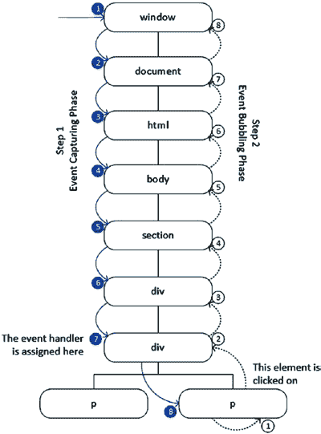
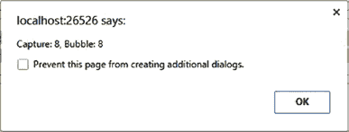
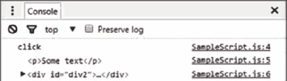

## 第 20 章：事件

事件是大多数网页不可或缺的一部分：它们允许您在事件发生时采取行动。“事情发生”被称为**事件**，Web 标准中定义了数十种事件。“采取行动”被称为**事件处理程序**，它只是一个简单的 JavaScript 函数。

### 初始示例

我将从一个简单的示例开始，然后描述各个部分。`清单 20-1`显示了一个基本的 HTML 文档。

**`清单 20-1`.** 初始 HTML 文档

```html
<!DOCTYPE html>
<html lang="en">
<head>
  <meta charset="utf-8" />
  <title>第 20 章 - 事件</title>
  <link rel="stylesheet" href="Sample.css" />
  <script src="SampleScript.js" defer></script>
</head>
<body>
  <section>
    <div id="div1">
      <div id="div2">
        <p>一些文本</p>
        <p>更多文本</p>
      </div>
    </div>
  </section>
</body>
</html>
```

© Mark J. Collins 2017
M. J. Collins, *Pro HTML5 with CSS, JavaScript, and Multimedia*, DOI 10.1007/978-1-4842-2463-2_20

该文档在一对嵌套的 `div` 元素中包含两个段落元素。为了帮助可视化这些元素使用的区域，我将为 `div` 元素添加边框，并为段落元素使用背景色。我还会使用内边距和外边距在它们之间添加一些空间。

```css
div {
  border: 1px solid black;
  padding: 10px;
}
p {
  margin: 5px;
  background-color: yellow;
}
```

为了设置事件逻辑，事件处理程序是一个名为 `someAction()` 的函数，它只弹出一个警告框。要配置此处理程序，脚本获取内部的 `div` 元素，然后调用 `addEventListener()` 方法，将处理程序分配给 `click` 事件。`addEventListener()` 方法在所有 HTML 元素上都可用，并有两个必需参数：事件的名称和事件发生时将调用的函数的引用。`EventTarget` 对象实现了 `addEventListener()` 方法，正如我在`第 18 章`中解释的，它是所有元素派生的基对象。

```javascript
"use strict";
function someAction() {
  alert("正在执行某些操作...");
}
var div = document.getElementById("div2");
div.addEventListener("click", someAction);
```

如果您单击内部 `div` 元素，您将看到如`图 20-1`所示的警告框。

**`图 20-1`.** 响应事件

#### 事件注册

事件注册是将三件事联系在一起的過程：将事件链接到特定 DOM 元素的事件处理程序。也就是说，1）这个**元素**通过执行 3）这个**处理程序**来响应 2）这个**事件**。`addEventListener()` 方法是实现此目的的首选方式。但是，还有其他方法可以做到这一点。

### 内联注册

一种称为*内联*注册的方法是在标记中包含注册信息。例如：

```html
<div id="div2" onclick="someAction()">
```

虽然这种技术已经存在了几十年，并且仍然相当频繁地使用，但应避免使用它。这会将 JavaScript 代码包含在您的 HTML 文档中，这明显违反了关注点分离原则。

### 传统注册

另一种方法是将事件处理程序分配给 DOM 元素的事件属性。每个 DOM 元素对于其支持的每个事件都有一个属性。这些事件属性保存了对相应事件的事件处理程序的引用。例如，`onclick` 属性可以存储一个对事件处理程序的引用，该处理程序将在 `click` 事件发生时被调用。我们可以像这样重写初始演示：

```javascript
// div.addEventListener("click", someAction);
div.onclick = someAction;
```

# 提示

**提示：**`addEventListener()` 方法（以及 IE 中的 `attachEvent()` 方法）允许你为同一事件分配多个事件处理程序。

这种方法有时被称为*传统*方法，是最安全且最普遍支持的事件注册方法。它自 Netscape 时代就已存在，并得到 IE4 及更高版本以及所有现代浏览器的支持。

> **警告：** 事件属性（例如 `onclick`）期望一个函数引用。不要在函数名称后添加括号，因为这将导致函数被执行，并且返回值将被注册为事件处理程序。

内联和传统方法的一个问题是，每个元素的每个事件只能有一个事件处理程序。如果您尝试注册第二个事件处理程序，它将替换第一个。例如，如果您有两个 JavaScript 库出于各自目的使用不同的事件处理程序，那么使用传统方法时它们无法共存。

### Internet Explorer 的 `attachEvent()` 方法

第三种方法仅由 Internet Explorer 支持，使用与 `addEventListener()` 类似的 `attachEvent()` 方法。IE 直到版本 9 才支持 `addEventListener()` 方法，因此如果您需要支持 IE8 及更早版本，则需要使用 `attachEvent()`（或传统方法）作为 polyfill。

## 事件传播

注册事件监听器时，会为特定元素的特定事件分配一个处理函数。前面的示例监听了内部 `div` 元素上的 `click` 事件。但是，你可以点击 `div` 元素中的任意位置，包括两个段落元素中的任何一个，都会显示警告。之所以有效，是因为事件的传播方式。

段落元素是内部 `div` 内容的一部分，因此点击它们被视为点击了 `div` 是合理的。同样，内部 `div` 是外部 `div` 的一部分，外部 `div` 是 `section` 的一部分，以此类推。如果在 `document` 或 `window` 对象上注册事件，会发生什么？正如你所料，点击其任何子元素都会执行事件处理程序。



### 事件

当事件发生时，例如鼠标点击，它首先被发送到 `window` 对象。然后通过文档层次结构向下传播，直到到达实际被点击的元素，该元素被称为*目标*。最后，它通过相同的对象反向传播回来，直到到达 `window` 对象。图 20-2 对此进行了说明。

***图 20-2.*** 事件传播

在我们的初始示例中，总共触发了 16 个事件：8 个在向下传播途中，8 个在向上返回途中。但是，我们只注册了一个事件处理程序，因此忽略了其中的 15 个。

事件向下传播被称为**捕获阶段**，而沿链向上返回被称为**冒泡阶段**。这个术语可能不是很有帮助，因为气泡倾向于上升到顶部；你可以记住冒泡阶段是向上进行的。

`addEventListener()` 方法支持第三个参数，你可以使用它来指定是监听捕获事件还是冒泡事件。传递 `true` 值以监听捕获事件。省略第三个参数或传递 `false` 以监听冒泡事件。

为了演示这种行为，我将用代码清单 20-2 中显示的代码替换之前的 JavaScript。

这定义了一对变量来记录捕获或冒泡事件被处理的次数。然后定义了两个事件处理程序，它们简单地递增这些计数器。事件首先在 `window` 对象上触发，也在 `window` 对象上结束。我将为 `window` 对象使用两个特殊的事件处理程序。`clearCount()` 函数将在捕获事件时被调用，并清除计数器。`reportCounts()` 函数将在冒泡事件时被调用，并弹出一个显示计数器值的警告。



***代码清单 20-2.*** 记录事件计数

```
var captureCount = 0;
var bubbleCount = 0;

function incrementCapture() {
    captureCount++;
}

function incrementBubble() {
    bubbleCount++;
}

function clearCounts() { // 在 window 捕获时调用
    captureCount = 1; // 将此事件计入计数
    bubbleCount = 0;
}

function reportCounts() { // 在 window 冒泡时调用
    bubbleCount++; // 将此事件计入计数
    alert("捕获: " + captureCount + ", 冒泡: " + bubbleCount);
}

var elements = document.querySelectorAll("*");
for (var i = 0; i < elements.length; i++ ) {
    elements[i].addEventListener("click", incrementCapture, true);
    elements[i].addEventListener("click", incrementBubble, false);
}

document.addEventListener("click", incrementCapture, true);
document.addEventListener("click", incrementBubble, false);

window.addEventListener("click", clearCounts, true);
window.addEventListener("click", reportCounts, false);
```

为了设置事件处理程序，我使用了在第[18 章](http://dx.doi.org/10.1007/978-1-4842-2463-2_18)中描述的 `querySelectorAll()` 方法。

这使用了全选选择器（`*`），将返回所有 HTML 元素。这包括 `html` 元素及其所有子元素。它不返回 `window` 或 `document` 对象，因此我单独添加了这些事件处理程序。

连接好这些事件处理程序后，如果你点击其中一个段落元素，你将看到一个如图 20-3 所示的警告。正如我在图 20-2 中所述，当事件在元素层次结构中向下和向上传播时，将处理八个捕获事件和八个冒泡事件。

***图 20-3.*** 报告事件计数

如果你点击内部 `div`（但不是点击段落元素），则只会处理七个事件。同样，如果你点击外部 `div`，则只会处理六个事件。`section` 和 `body` 元素本身不占据任何空间，因此你不能点击它们。如果你点击页面上的任何位置，但不在外部 `div` 元素内，则会处理三个事件。分配给 `window`、`document` 和 `html` 对象的事件处理程序将被调用。

**注意：** `addEventListener()` 方法是注册捕获事件的唯一方法。我之前提到的其他技术只能注册冒泡事件。

例如，如果你只需要知道何时点击了一个按钮，那么监听捕获事件还是冒泡事件实际上并不重要。但是，如果你有多个处理程序分配给不同的元素，那么拥有这两个选项会很有用。例如，如果你在父元素和子元素上都有不同的处理程序，那么在使用捕获事件时，父元素的处理程序将首先执行。在监听冒泡事件时，此顺序是相反的。

事件处理程序是串行执行的；当前事件处理程序必须完成，下一个才会被调用。如果你在同一个元素上有多个事件处理程序，它们也会按照注册的顺序串行执行。

### 取消注册事件

你可以移除事件处理程序，但根据事件处理程序最初注册的方式，过程会有所不同。如果你使用了 `addEventListener()`（或 `attachEvent()`），则可以为单个元素分配多个事件处理程序。为了移除正确的那个，你需要指定与注册事件处理程序时使用的所有相同信息。

例如，以下代码将移除在前一个示例中设置的处理程序。请注意，参数与注册事件处理程序时使用的完全相同：

```
function removeHandlers() {
    var div = document.getElementById("div2");
    div.removeEventListener("click", someAction, false);
}
```

为了使其正常工作，所有四条信息必须与原始注册详细信息匹配：

-   事件注册所在的元素。
-   事件类型。
-   已注册的处理函数。
-   指示这是在捕获阶段还是冒泡阶段注册的标记。

如果你使用 `attachEvent()` 方法注册了事件处理程序，请使用 `detachEvent()` 方法将其移除。它的工作方式与 `removeEventListener()` 类似，只是没有捕获/冒泡标记。

其他注册方法不允许有多个事件处理程序，因此移除它们是一个更简单的过程。只需将相应的事件属性设置为 `null`。例如：

```
div.onclick = null;
```



### 事件接口

当事件发生并且已注册相应的监听器时，将调用分配的事件处理程序。我已经对此进行了一些详细的解释。关于事件处理的另一个非常重要的方面是事件本身。当事件发生时，会创建一个包含事件详细信息的事件对象，并将其传递给事件处理程序。例如，如果点击了鼠标按钮，你可能想知道点击了哪个元素或使用了哪个按钮。

### 常见事件属性

您的事件处理程序可以通过声明一个函数参数来访问该事件对象。您可以随意命名该参数，但公认的惯例是使用 `e`。例如：

```javascript
function someAction(e) {
    ...
}
```

存在一个基础的 `Event` 对象，它提供了一些公共属性和方法。然而，还有数十个派生对象，它们根据事件类型提供专门的信息。主要的共享属性如下：

- `type` —— 事件类型；如果您要对多个事件使用单个事件处理程序，这会很有帮助。例如，您可能有一个处理程序来同时响应 `mouseup` 和 `mousedown` 事件。
- `target` —— 触发事件的元素。
- `currentTarget` —— 注册了事件处理程序的元素。

我将回到最初只有一个事件处理程序的例子。不再创建提示框，而是改为记录事件的某些详细信息。控制台将显示如 图 20-4 所示。

```javascript
function someAction(e) {
    console.log(e.type);
    console.log(e.target);
    console.log(e.currentTarget);
    // alert("Taking some action...");
}
```

```
**图 20-4.** 在控制台中显示事件详细信息

事件类型为 `click`，符合预期。我点击了第一个段落元素，事件目标确认了这一点。`currentTarget` 属性是注册了事件处理程序的内部 `div` 元素。

### 取消事件

所有事件都有几种通用的方法。这些方法用于修改事件的处理方式。这些方法在事件对象上调用。

- `stopPropagation()`
- `stopImmediatePropagation()`
- `preventDefault()`

之前我描述了事件如何从 `window` 对象向下传播到目标，再向上回到 `window` 对象。然而，如果您在事件对象上调用 `stopPropagation()` 方法，则不会发生进一步传播。如果您在捕获阶段处理事件并停止传播，则剩余的捕获阶段以及所有冒泡阶段事件都将被抑制。

`stopImmediatePropagation()` 方法也会像我刚才描述的那样停止传播，但还会执行一个额外的步骤：它会阻止当前元素上的其他任何处理程序被执行。为了说明这种行为，假设您在内部 `div` 元素（来自前面的示例）上注册了三个事件处理程序，都用于冒泡阶段的 `click` 事件。当事件最终传播到该 `div` 元素时，这三个事件处理程序将按照它们注册的顺序依次执行。如果第一个事件处理程序调用了 `stopImmediatePropagation()` 方法，则其他两个处理程序将不会被调用。但是，如果改为调用 `stopPropagation()` 方法，则其他两个事件处理程序仍会执行。然而，在这两种情况下，事件都不会进一步传播到其他元素。

浏览器会对某些事件执行默认操作。例如，如果您点击一个链接，浏览器会导航到该 URL；或者如果您右键点击某些元素，会出现一个上下文菜单。然而，您的自定义事件会在浏览器执行默认操作之前执行。如果您想禁用默认操作，事件处理程序可以调用事件对象上的 `preventDefault()` 方法。例如，如果您想在特定情况下阻止链接跳转，可以设置一个自定义处理程序来响应 `click` 事件。然后，如果不应该使用该链接，自定义处理程序就可以调用 `preventDefault()`。

### 探索事件

现在您已经了解了事件处理的基础知识，可以使用任何受支持的事件了。它们的工作方式都相同。每个事件之间的区别归结为两点：

- **事件何时被触发？** 我在本章的所有示例中都使用了 `click` 事件。它是在鼠标按钮被点击时触发的。所有其他事件都是在特定条件下触发的，例如按下按键、调整窗口大小、网络访问丢失等。

- **提供了哪些事件详情？** 所有事件处理程序都会收到一个事件对象，我已经解释了一些常见的属性和方法。大多数事件会在事件对象中提供额外的细节；这些细节会根据事件的不同而变化。例如，`keypress` 事件的事件对象应指明按下了哪个键。

我不打算在此列出所有可用事件；有数百个之多。不过，Mozilla 的这篇文章提供了一个相当不错的概述，将事件分类整理，并附有更多详细信息的链接：[`developer.mozilla.org/en-US/docs/Web/Events`](https://developer.mozilla.org/en-US/docs/Web/Events)

第 20 章 ■ 事件

每个事件都会提供一个特定的事件对象，尽管相关事件通常会使用相同的接口。例如，大多数鼠标事件（如 `click`、`dblclick` 和 `mousedown`）都提供了 `MouseEvent` 接口。事件接口存在一个层次结构。`MouseEvent` 派生自 `UIEvent`，而 `UIEvent` 又派生自 `Event`。

■ **提示** 你也可以创建自己的自定义事件。这超出了本书的范围，但如果你感兴趣，可以查看这篇文章：[`developer.mozilla.org/en-US/docs/Web/Guide/Events/Creating_and_triggering_events`](https://developer.mozilla.org/en-US/docs/Web/Guide/Events/Creating_and_triggering_events)

### 摘要

在本章中，我演示了如何使用事件处理程序来响应用户输入或系统触发的事件。你需要注册一个事件处理程序，它将三个要素联系在一起：
- 事件
- 事件处理程序
- DOM 元素

当指定元素触发了指定事件时，已注册的处理程序就会被执行。

推荐的事件处理程序注册方法是使用 `addEventListener()` 方法。虽然也支持其他旧式方法，但它们并不包含 `addEventListener()` 的全部功能。

当事件发生在某个元素（称为目标）上时，该事件会在 DOM 层次结构中的所有对象上被触发。事件从 `window` 对象开始，在捕获阶段向下冒泡至目标元素。然后，它再沿该链向上冒泡，直到再次到达 `window` 对象。

在本书的下一部分中，我将提供一些示例解决方案，演示 HTML5 的一些高级功能。我们将从自定义音频和视频元素的嵌入开始。
