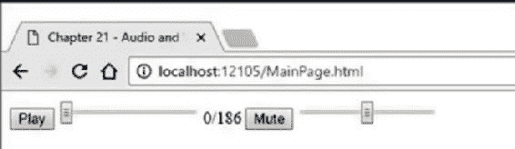
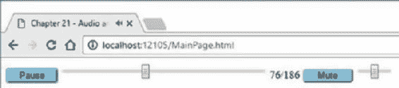

# 第 21 章

# 音频与视频

在第 7 章中，我介绍了 `audio` 和 `video` 元素，并演示了如何使用浏览器提供的原生控件将它们嵌入到你的 HTML 文档中。在本章中，你将使用自己的控件，这些控件通过 JavaScript 连接到 `audio` 和 `video` 元素。所有 DOM 元素和事件在 JavaScript 中都是可用的，因此创建与 `audio` 或 `video` 元素配合使用的自定义控件是一个相当直接的过程。然而，你需要控制多个方面，所以这并非一项简单的任务。

### 概述

你需要处理三个方面：
- 播放/暂停
- 显示进度及快进/快退
- 调节音量/静音

我将从为音频创建自定义控件开始，但你会看到，视频的处理过程本质上是相同的。你需要同时响应来自 UI 控件和 `audio` 元素的事件。你将从在页面中添加所有必要的控件开始。然后，我将向你展示如何实现每个方面所需的事件处理程序。你将用于控制 `audio` 元素的输入元素如下：
- 播放/暂停按钮：其标签将根据 `audio` 元素的状态在“播放”和“暂停”之间切换。
- 进度条：这是一个范围控件（在第 8 章中介绍），它既可以显示进度，也允许用户跳转到特定位置。
- 时长：这是一个 `span` 元素，用于显示音频文件的当前位置和总时长。
- 静音按钮：其标签将在“静音”和“取消静音”之间切换。
- 音量：这是另一个范围控件，用于指定音量级别。

你将为之提供处理程序的音频事件包括：
- `play`：音频开始时触发
- `pause`：音频暂停时触发
- `ended`：音频播放完成时触发
- `timeupdate`：随着音频剪辑的播放定期触发
- `durationchange`：时长发生变化时触发，这发生在文件加载时
- `volumechange`：音量级别改变或 `mute` 属性发生变化时触发

### 自定义音频控件

你将从创建一个包含 `audio` 元素的 HTML 文档开始。然后，你将添加用于控制音频的输入元素。

**练习 21-1. 创建标记**

1.  创建一个包含单个 `audio` 元素的 HTML 文档。你需要提供自己的音频文件，因此 `src` 属性将与这里显示的不同。此元素还包含 `controls` 属性，因此将使用原生控件，但稍后你会移除它。该页面在 Chrome 中的效果将如图 21-1 所示。

```html
<!DOCTYPE html>
<html lang="en">
<head>
    <meta charset="utf-8" />
    <title>第 21 章 - 音频与视频</title>
    <link rel="stylesheet" href="Sample.css" />
```

# 音频与视频控制

有两个范围控件：第一个控件会在播放音频片段时显示进度。用户也可以使用它来快退或快进到文件中的新位置。`min` 和 `max` 属性将根据音频文件的长度在 JavaScript 中设置。第二个范围控件用于调节音量。其 `min` 和 `max` 属性分别设置为 0 和 1。音量为 1 表示 100%，实际值应介于 0 到 1 之间。

还有两个按钮：第一个按钮同时充当播放和暂停按钮。其标签会根据音频元素的当前状态而变化。第二个按钮用于切换静音标志。同样，其标签会根据音频当前是否静音而改变。在这些控件中间有一个 `span` 元素，初始时不包含任何内容。它将显示文件长度和当前播放位置。

## 支持播放与暂停

页面上的所有元素就绪后，就可以开始编写一些 JavaScript 了。第一个练习将连接播放按钮并执行范围控件的初始配置。

**练习 21-2：支持播放与暂停**

1. 创建一个名为 `SampleScript.js` 的新 JavaScript 文件。由于音频元素会在多处被引用，因此需要声明一个变量来存储它。这样每次使用时就不必在 DOM 中搜索了。

    ```javascript
    "use strict";
    var audio = document.getElementById("audio");
    ```

2. 你需要一个事件处理程序来设置初始时长值。`setupSeek()` 方法会响应音频元素上的 `durationchange` 事件。当页面首次加载时，在文件打开并加载元数据之前，系统并不知道音频片段的时长。一旦元数据加载完成，即可确定时长，并触发该事件。`duration` 属性以秒为单位。`setupSeek()` 函数使用 `duration` 属性设置 `audioSeek` 范围控件的 `max` 属性，还用于设置 `span` 元素的初始值。注意这里调用了 `Math.round()` 函数，将值四舍五入到最接近的整数（秒）。

    ```javascript
    function setupSeek() {
        var seek = document.getElementById("audioSeek");
        seek.min = 0;
        seek.max = Math.round(audio.duration);
        seek.value = 0;
        var duration = document.getElementById("duration");
        duration.innerHTML = "0/" + Math.round(audio.duration);
    }
    ```

3. 当用户点击播放按钮时，会调用 `togglePlay()` 方法。如果音频元素的当前状态为 `paused` 或 `ended`，则调用 `play()` 函数。否则，调用 `pause()` 方法。

    ```javascript
    function togglePlay() {
        if (audio.paused || audio.ended) {
            audio.play();
        }
        else {
            audio.pause();
        }
    }
    ```

4. `updatePlayPause()` 方法在音频元素上注册了 `play` 和 `pause` 事件。它通过设置播放按钮的标签来反映音频元素的状态。如果音频当前正在播放，则文本更改为“暂停”，因为点击按钮将产生暂停效果。否则，文本设置为“播放”。

    ```javascript
    function updatePlayPause() {
        var play = document.getElementById("play");
        if (audio.paused || audio.ended) {
            play.value = "Play";
        }
        else {
            play.value = "Pause";
        }
    }
    ```

> **提示**：`togglePlay()` 函数响应播放按钮的点击，而 `updatePlayPause()` 函数响应音频元素的启动或暂停。当按钮被点击时，`togglePlay()` 方法会改变音频元素的状态。这种状态变化会触发 `play` 或 `pause` 事件，这些事件均由 `updatePlayPause()` 函数处理。之所以这样设计，是因为音频可能通过点击播放按钮之外的其他方式被播放或暂停。例如，如果你保留了 `controls` 属性，那么原生控件和自定义控件会同时存在。响应 `play` 和 `pause` 事件可确保无论音频元素如何操作，按钮标签始终正确。

5. 最后，`endAudio()` 函数被注册到 `audio` 元素，以响应 `ended` 事件——当音频播放完毕时会触发该事件。这会执行一些同步操作，包括设置按钮标签以及初始化范围控件和跨度控件。

    ```javascript
    function endAudio() {
        document.getElementById("play").value = "Play";
        document.getElementById("audioSeek").value = 0;
        document.getElementById("duration").innerHTML = "0/" + Math.round(audio.duration);
    }
    ```

6. 现在，你需要使用以下代码注册事件处理程序：

    ```javascript
    // 连接事件处理程序
    audio.addEventListener("durationchange", setupSeek, false);
    document.getElementById("play").addEventListener("click", togglePlay, false);
    audio.addEventListener("play", updatePlayPause, false);
    audio.addEventListener("pause", updatePlayPause, false);
    audio.addEventListener("ended", endAudio, false);
    ```

## 支持进度与搜索

我们希望能够使用滑块跳转到音频文件中的不同位置。接下来的练习将配置此功能，使其既能报告当前位置，也能更改位置。

### 练习 21-3：进度与搜索

1. 与播放按钮类似，有一个事件处理函数 `seekAudio()`，它响应对应 `input` 元素；以及另一个单独的事件处理函数 `updateSeek()`，它响应对应 `audio` 元素。`seekAudio()` 函数在用户移动范围控件上的滑块时被调用。它只是使用范围控件选定的值来设置 `currentTime` 属性。

    ```javascript
    function seekAudio() {
        var seek = document.getElementById("audioSeek");
        audio.currentTime = seek.value;
    }
    ```

2. `updateSeek()`函数在`audio`元素触发`ontimeupdate`事件时被调用。它会更新范围控件，以反映文件内的当前位置。它还会更新跨度控件，以显示实际位置（以秒为单位）。同样，这里将`currentTime`属性四舍五入为最接近的整数。

```javascript
function updateSeek() {
    var seek = document.getElementById("audioSeek");
    seek.value = Math.round(audio.currentTime);
    var duration = document.getElementById("duration");
    duration.innerHTML = Math.round(audio.currentTime) + "/" + Math.round(audio.duration);
}
```

3. 现在，你需要使用以下代码注册事件处理程序：

```javascript
document.getElementById("audioSeek").addEventListener("change", seekAudio, false);
audio.addEventListener("timeupdate", updateSeek, false);
```

## 控制音量

本练习将设置用于调整音量的控件，包括静音按钮。

### 练习 21-4：控制音量

1. 顾名思义，`toggleMute()`函数用于切换`audio`元素的`muted`属性。当该属性改变时，`audio`元素会触发`volumechange`事件。

```javascript
function toggleMute() {
    audio.muted = !audio.muted;
}
```

2. `updateMute()`函数响应`volumechange`事件，并根据`muted`属性的当前值设置按钮标签。再次强调，以这种方式操作可以确保按钮标签正确无误。

```javascript
function updateMute() {
    var mute = document.getElementById("mute");
    if (audio.muted) {
        mute.value = "Unmute";
    } else {
        mute.value = "Mute";
    }
}
```

3. 最后，当用户移动第二个范围控件上的滑块时，会调用`setVolume()`函数。它会将`audio`元素的`volume`属性设置为范围控件上选定的值。

```javascript
function setVolume() {
    var volume = document.getElementById("volume");
    audio.volume = volume.value;
}
```



4. 按如下方式注册事件处理程序：

```javascript
document.getElementById("mute").addEventListener("click", toggleMute, false);
audio.addEventListener("volumechange", updateMute, false);
document.getElementById("volume").addEventListener("change", setVolume, false);
```

> **注意**：`volume`属性的值介于 0 和 1 之间。你可以将其视为 0% 到 100%。
> `percent`。当定义范围控件时，`min` 属性被设置为 `0`，`max` 被设置为 `1`，因此比例是正确的。您只需使用范围值即可设置 `volume` 属性。如果要显示 `volume` 属性的实际值，只需将其转换为百分比即可。

### 调整样式

现在，您可以尝试使用自定义控件了。保存更改并浏览到您的页面。页面应类似于图 21-2。

***图 21-2.*** 自定义音频控件*

此处的样式非常单调；一点点 CSS 就有帮助。添加以下 CSS 规则来更改按钮和范围控件的大小。结果如图 21-3 所示。

```css
input[type="button"] {
  width: 75px;
  background-color: lightblue;
  border-radius: 5px;
}
#audioSeek {
  width: 300px;
}
#volume {
  width: 50px;
}
```



***图 21-3.*** 样式控件*

> **提示：** 更改范围控件的样式是可能的，但需要使用供应商前缀，并且每个浏览器都不同。如果您感兴趣，这里有一篇包含详细信息的文章：[`brennaobrien.com/blog/2014/05/style-input-type-range-in-every-browser.html`](http://brennaobrien.com/blog/2014/05/style-input-type-range-in-every-browser.html)

### 更改音频源

在此示例中，音频源是在标记中定义的。但是，您可以使用 JavaScript 轻松控制它。如果您像最初那样使用单个 `src` 属性，则只需更改此属性以引用不同的文件。但是，如果您使用多个 `source` 元素，则需要更新所有这些元素，然后调用 `load()` 方法。

**练习 21-5. 更改音频源**

1. 要尝试此操作，请添加一个按钮，将源更改为第二个音频剪辑并播放该剪辑。以下是将新按钮添加到页面的标记：

```html
<div>
  <input type="button" value="Track2" id="track2" />
</div>
```

2. 添加以下事件处理程序，该处理程序将在单击按钮时执行。

```javascript
function nextFile() {
  audio.src = "Media/Sample.mp3";
  //audio.load(); needed if there are multiple sources
  audio.play();
}
```

3. 向“下一个”按钮注册事件处理程序。

```javascript
document.getElementById("track2").addEventListener("click",
  nextFile, false);
```

> **注意：** 我在[第 7 章](http://dx.doi.org/10.1007/978-1-4842-2463-2_7)中解释了如何设置多个源。这在过去需要两个或更多音频文件来支持多个浏览器时非常重要。现在所有主流浏览器都支持单个 MP3 文件。如果有多个源，则需要更新所有源，然后调用 `load()` 方法。如果您使用单个源，则无需调用 `load()`。

### 自定义视频控件

创建自定义视频控件与音频控件相同。您需要提供播放和暂停视频、调节音量以及跳转到文件中特定位置的功能。我将添加[第 7 章](http://dx.doi.org/10.1007/978-1-4842-2463-2_7)中的相同视频元素。

```html
<video src="Media/BigBuckBunny.mp4" id="video"
  poster="Media/BBB_Poster.png" width="852" height="480">
  <p> HTML5 video is not supported on your browser</p>
</video>
```

由于实现与音频控件几乎相同，因此 JavaScript 完整地显示在清单 21-1 中。这些函数与其对应的音频函数等效。

***清单 21-1.*** 实现自定义视频控件*

```javascript
var video = document.getElementById("video");
function setupSeekVideo() {
  var seek = document.getElementById("videoSeek");
  seek.min = 0;
  seek.max = Math.round(video.duration);
  seek.value = 0;
  var duration = document.getElementById("durationVideo");
  duration.innerHTML = "0/" + Math.round(video.duration);
}
function togglePlayVideo() {
  if (video.paused || video.ended) {
```
