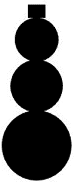
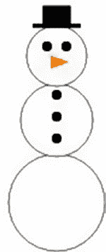
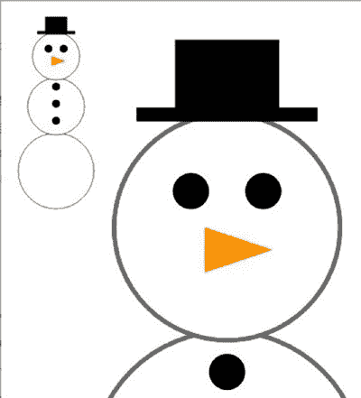
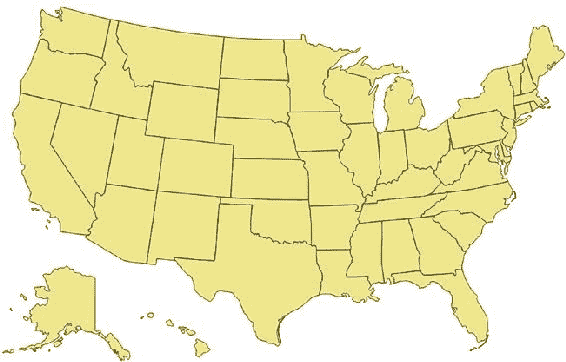
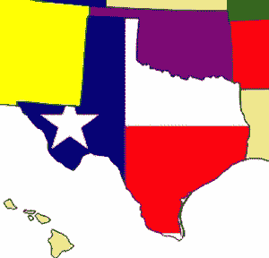

# 第 22 章 可缩放矢量图形

在本章中，我将向您展示如何在 HTML5 Web 应用程序中使用可缩放矢量图形 (SVG)。

使用 SVG 可以实现许多非常酷的功能。我挑选了一个有趣的演示，可以轻松应用于许多业务应用程序。但首先，让我向您介绍一下什么是 SVG。

## 矢量图形与 SVG 基础

大多数人认为图形元素是某种形式的位图，具有像素的行和列阵列，每个像素被分配特定的颜色。然而，相比之下，矢量图形将图像表达为公式的集合。例如，绘制一个圆心在点 `x,y` 且半径为 `r` 的圆。更复杂的图像被定义为图形元素的集合，包括圆、线和路径。虽然渲染引擎最终会确定需要设置的特定像素，但图像定义是基于公式的。这一根本性差异为使用矢量图形提供了两个显著优势。

首先，顾名思义，矢量图形是可缩放的。如果你想扩大图像的尺寸，渲染引擎只需根据新尺寸重新计算公式，并且不会损失清晰度。如果你放大位图图像，你会很快开始看到颗粒感，图像变得模糊。

其次，图像中的每个元素都可以独立操作。例如，如果图像中有多个圆，你可以通过简单地改变那个圆的颜色来突出显示它。由于矢量图形基于公式，你可以轻松调整公式以修改图像。特别有用的是，这些元素可以使用 `CSS` 进行样式化，利用我前几章向你展示的强大选择器和格式化能力。

## 介绍 SVG

你将首先创建一个使用简单几何形状绘制图片的页面。然后，你将使用 `CSS` 为这些形状应用样式。我将向你展示如何将这些标记元素保存到 `.svg` 图像文件中。这个图像文件可以像其他图像文件（如 `.jpg` 和 `.png` 文件）一样使用。

### 添加一些简单形状

为了演示 `svg` 元素如何工作，你将添加一些简单形状，如圆形、矩形和线条。大多数图像可以表示为几何形状的集合，我将在此演示这一点。

© Mark J. Collins 2017

M. J. Collins, *Pro HTML5 with CSS, JavaScript, and Multimedia*, DOI 10.1007/978-1-4842-2463-2_22

第 22 章 ■ 可缩放矢量图形

**练习 22-1 搭建一个雪人**

1. 在 `HTML` 文档的 `body` 中插入以下 `svg` 元素：

```html
<svg version="1.1"
  width="100px" height="230px"
>
</svg>
```

> **注意** `width` 和 `height` 属性定义了元素的固有尺寸。在大多数浏览器中，如果未指定 `width` 和 `height`，图像将被裁剪为某个默认大小。

2. 在 `svg` 元素内部，添加以下元素。这些只是简单的形状，主要是 `circle` 元素，以及一个 `rect`、`line` 和 `polygon`。

```html
<circle class="body" cx="50" cy="171" r="40" />
<circle class="body" cx="50" cy="103" r="30" />
<circle class="body" cx="50" cy="50" r="25" />
```

> **注意：** `audio` 和 `video` 元素在 JavaScript 中分别由 `HTMLAudioElement` 和 `HTMLVideoElement` 对象表示。这两者都派生自 `HTMLMediaElement`。

## 总结

在上一章中，我解释了如何在 JavaScript 中使用事件。从本章的示例中，您可以看到事件的重要性。无论是响应用户操作还是系统通知，所有逻辑都是在事件处理程序中实现的。在本章中，事件处理程序主要用于将 UI 元素与它们正在控制的音频或视频元素同步。

音频或视频的当前状态可通过 `duration`、`currentTime` 和 `volume` 等属性获取。其中一些属性（包括 `currentTime` 和 `volume`）也可以设置，允许您根据用户输入进行调整。要创建自己的自定义控件，您只需连接必要的事件处理程序，以便音频或视频状态的变化反映在 UI 元素中，反之亦然。

在下一章中，您将使用可缩放矢量图形 (SVG) 来创建一些令人印象深刻的图形应用程序。SVG 是一种在不损失图像质量的情况下按比例缩放图形的技术。SVG 的一个非常有用的特性是绘图元素可以使用 CSS 设置样式。

```javascript
video.play();
}

else {

  video.pause();

}

}

function updatePlayPauseVideo() {

  var play = document.getElementById("playVideo");

  if (video.paused || video.ended) {

    play.value = "Play";

  }

  else {

    play.value = "Pause";

  }

}

function endVideo() {

  document.getElementById("playVideo").value = "Play";

  document.getElementById("videoSeek").value = 0;

  document.getElementById("durationVideo").innerHTML = "0/" + Math.round(video.duration);

}

// Wire-up the event handlers

video.addEventListener("durationchange", setupSeekVideo, false);

document.getElementById("playVideo").addEventListener("click", togglePlayVideo, false);

video.addEventListener("play", updatePlayPauseVideo, false);

video.addEventListener("pause", updatePlayPauseVideo, false);

video.addEventListener("ended", endVideo, false);

// Support progress and seek

function seekVideo() {

  var seek = document.getElementById("videoSeek");

  video.currentTime = seek.value;

}

function updateSeekVideo() {

  var seek = document.getElementById("videoSeek");

  seek.value = Math.round(video.currentTime);

  var duration = document.getElementById("durationVideo");

  duration.innerHTML = Math.round(video.currentTime) + "/" + Math.round(video.duration);

}

document.getElementById("videoSeek").addEventListener("change", seekVideo, false);

video.addEventListener("timeupdate", updateSeekVideo, false);

// Support volume and mute

function toggleMuteVideo() {

  video.muted = !video.muted;

}

function updateMuteVideo() {

  var mute = document.getElementById("muteVideo");

  if (video.muted) {

    mute.value = "Unmute";

  }

  else {

    mute.value = "Mute";

  }

}

function setVolumeVideo() {

  var volume = document.getElementById("volumeVideo");

  video.volume = volume.value;

}

document.getElementById("muteVideo").addEventListener("click", toggleMuteVideo, false);

video.addEventListener("volumechange", updateMuteVideo, false);

document.getElementById("volumeVideo").addEventListener("change", setVolumeVideo, false);
```

# 第 22 章 ■ 可缩放矢量图形

<line class="hat" x1="30" y1="25" x2="70" y2="25" />

<rect class="hat" x="40" y="10" width="20" height="15" />

<circle class="button" cx="50" cy="82" r="4" />

<circle class="button" cx="50" cy="100" r="4" />

<circle class="button" cx="50" cy="118" r="4" />

<circle class="eye" cx="42" cy="42" r="4" />

<circle class="eye" cx="58" cy="42" r="4" />

<polygon class="nose" points="45,60 45,50 60,55" />

一个`circle`表示为圆心点`cx`和`cy`以及半径`r`。一条`line`指定为起点`x1`和`y1`以及终点`x2`和`y2`。一个`rect`元素由左上角位置`x`和`y`、`width`以及`height`描述。一个`polygon`由一组点定义，形式为`x1,y1 x2,y2 x3,y3`，你可以指定任意数量的点。它通过绘制每条线段来渲染，并绘制从最后一个点回到第一个点的线段。

3. 保存更改并在浏览器中查看网页。页面应如图 22-1 所示。



***图 22-1.** 未设置样式的初始 SVG 图像*

## 添加样式

这些元素的默认样式是纯黑色填充，因为其中一些形状彼此重叠，所以有几个当前不可见。请注意，你为每个元素分配了一个`class`属性。现在，你将使用类选择器为这些元素应用样式。

1. 将以下规则添加到`CSS`文件中。保存这些更改并刷新浏览器以查看更新的网页，其外观应如图 22-2 所示。

```
.body {
  fill: white;
  stroke: gray;
  stroke-width: 1px;
}
.hat {
  fill: black;
  stroke: black;
  stroke-width: 3px;
}
.button {
  fill: black;
}
.eye {
  fill: black;
}
.nose {
  fill: orange;
}
```



***图 22-2.** 应用样式后的 SVG 图像*

## 使用 SVG 图像文件

除了嵌入`svg`元素，你还可以将其保存为具有`.svg`扩展名的独立图像文件。此文件可以像其他图形图像一样使用。我将向你展示如何创建独立的`SVG`图像，然后在页面上使用它。

### 创建 SVG 图像

我将首先向你展示如何创建一个独立的`.svg`文件；稍后你将把它用作背景图像。这也将演示`SVG`图像的可缩放性。

**练习 22-2 创建 SVG 图像**

1. 在 Web 应用程序中创建一个名为`snowman.svg`的新文件。

2. 输入以下标记指令：

```
<?xml version="1.0" standalone="no"?>
<!DOCTYPE svg PUBLIC "-//W3C//DTD SVG 1.1//EN"
  "http://www.w3.org/Graphics/SVG/1.1/DTD/svg11.dtd">
```

3. 复制并粘贴之前`HTML`文档中的整个`svg`元素。

4. 你需要与`svg`元素在同一个文件中包含样式规则。为此，请在`svg`元素内部添加一个`style`元素。将`CSS`文件中的样式规则复制到`style`元素中。`snowman.svg`文件应包含指示这是一个`SVG`文件的`DOCTYPE`条目和一个`svg`元素。`CSS`规则将在`style`元素内部，而`style`元素则在`svg`元素内部。

5. 要测试你的图像，从桌面打开`snowman.svg`文件。这将启动浏览器并显示雪人图像。



### 使用 SVG 背景

现在你有了一个可以像其他图像一样使用的图像文件。为了演示这一点，你将使用`snowman.svg`文件作为初始网页的背景图像。

1. 在初始`CSS`文件中，添加以下样式规则：

```
body {
  background-image: url(snowman.svg);
  background-size: cover;
}
```

2. 这使用了新的`snowman.svg`图像，并将其配置为扩展以适合窗口。刷新浏览器后，除了小图像外，你还应该看到图像的较大版本，如图 22-3 所示。请注意，在扩大图像尺寸时，图像质量没有损失。

***图 22-3.** 带有雪人背景的页面*

## 创建交互式地图

绘制雪人图片可能很有趣，但让我们继续学习一些更实用的`SVG`用法。你将创建一个美国地图，每个州由一个单独的`SVG` `path`元素表示，稍后我会解释`path`元素。路径定义将存储在一个单独的`JavaScript`文件中。显示地图后，我将向你展示一些使用静态和动态样式来设置地图样式的`CSS`技巧。最后，你将添加一些动画，为你的网页增添一点魅力。

## 使用 Path 元素

`path`元素是所有`SVG`元素中用途最广泛的。它是“移动到”、“连线到”和各种“曲线到”命令的集合。形状通过遵循路径命令来绘制。每个命令从当前位置开始，要么移动到新位置，要么绘制一条线到下一个位置。这里有一个例子：

- 移动到 25, 50。
- 绘制一条线到 50, 50。
- 绘制一条线到 50, 25。
- 绘制一条弧线到 25, 50。

这表示为：

```
<path d="M25,50 L50,50 L50,25 A25,25 0 0,0 25,50 z" />
```

“移动到”和“连线到”命令非常直观。“弧线到”命令，以及所有其他曲线命令，则更为复杂，因为需要提供额外的控制点来描述曲线的绘制方式。每个命令使用单个字母表示，如表 22-1 所示。

***表 22-1.** 可用的路径命令*

| 命令 | 缩写 | 描述 |
|---|---|---|
| 移动到 | `M` | 移动到指定位置 |
| 连线到 | `L` | 绘制一条线到指定位置 |
| 水平连线到 | `H` | 绘制一条水平线到指定的 x 坐标 |
| 垂直连线到 | `V` | 绘制一条垂直线到指定的 y 坐标 |
| 弧线到 | `A` | 绘制一条弧线到指定位置 |
| 曲线到 | `C` | 绘制一条三次贝塞尔曲线 |
| 简写曲线到 | `S` | 绘制一条简化的三次贝塞尔曲线 |
| 二次曲线到 | `Q` | 绘制一条二次贝塞尔曲线 |
| 简写二次曲线到 | `T` | 绘制一条简化的二次贝塞尔曲线 |
| 闭合路径 | `Z` | 通过绘制一条线回到起始位置来闭合图形 |

对于这些命令中的每一个，当使用绝对坐标时，使用大写字母。你也可以指定相对坐标，并使用小写字母来表示相对于当前位置的值。有关构建路径元素的更多信息，请参阅文章 [`www.w3.org/TR/SVG/paths.html#PathData`](http://www.w3.org/TR/SVG/paths.html#PathData)。

正如你可能想象的那样，绘制像阿拉斯加州这样复杂的形状需要很多命令。你不想手动编辑这些内容。幸运的是，有些工具可以帮助构建路径定义。例如，[`code.google.com/p/svg-edit`](http://code.google.com/p/svg-edit) 上有一个免费的基于网页的工具。只是为了好玩，清单 22-1 展示了阿拉斯加的路径元素。

**清单 22-1.** 阿拉斯加的路径元素定义

```
<path d="M 158.07671,453.67502 L 157.75339,539.03215 L 159.36999,540.00211 L
162.44156,540.16377 L 163.8965,539.03215 L 166.48308,539.03215 L 166.64475,541.94205 L
173.59618,548.73182 L 174.08117,551.3184 L 177.47605,549.37846 L 178.1227,549.2168 L
178.44602,546.14524 L 179.90096,544.52863 L 181.0326,544.36697 L 182.97253,542.91201 L
186.04409,545.01361 L 186.69074,547.92352 L 188.63067,549.05514 L 189.7623,551.48006 L
193.64218,553.25833 L 197.03706,559.2398 L 199.78529,563.11966 L 202.04855,565.86791 L
```

203.50351,569.58611 L 208.515,571.36439 L 213.68817,573.46598 L 214.65813,577.83084 L 215.14311,580.9024 L 214.17315,584.29729 L 212.39487,586.56054 L 210.77826,585.75224 L 209.32331,582.68067 L 206.57507,581.22573 L 204.7968,580.09409 L 203.98849,580.9024 L 205.44344,583.65065 L 205.6051,587.36885 L 204.47347,587.85383 L 202.53354,585.9139 L 200.43195,584.62061 L 200.91693,586.23722 L 202.21021,588.0155 L 201.40191,588.8238 C 201.40191,588.8238 200.59361,588.50048 200.10863,587.85383 C 199.62363,587.20719 198.00703,584.45895 198.00703,584.45895 L 197.03706,582.19569 C 197.03706,582.19569 196.71374,583.48898 196.06709,583.16565 C 195.42044,582.84233 194.7738,581.71071 194.7738,581.71071 L 196.55207,579.77077 L 195.09712,578.31582 L 195.09712,573.30432 L 194.28882,573.30432 L 193.48052,576.6992 L 192.34888,577.1842 L 191.37892,573.46598 L 190.73227,569.74777 L 189.92396,569.26279 L 190.24729,574.92094 L 190.24729,576.05256 L 188.79233,574.75928 L 185.23579,568.77781 L 183.13419,568.29283 L 182.48755,564.57462 L 180.87094,561.66472 L 179.25432,560.53308 L 179.25432,558.26983 L 181.35592,556.97654 L 180.87094,556.65322 L 178.28436,557.29986 L 174.88947,554.87495 L 172.30289,551.96504 L 167.45306,549.37846 L 163.41152,546.79188 L 164.70482,543.55866 L 164.70482,541.94205 L 162.92654,543.55866 L 160.01664,544.69029 L 156.29843,543.55866 L 150.64028,541.13375 L 145.14381,541.13375 L 144.49717,541.61873 L 138.03072,537.73885 L 135.92912,537.41553 L 133.18088,531.59573 L 129.62433,531.91905 L 126.06778,533.374 L 126.55277,537.90052 L 127.68439,534.99062 L 128.65437,535.31394 L 127.19941,539.67879 L 130.43263,536.93055 L 131.07928,538.54716 L 127.19941,542.91201 L 125.90612,542.58869 L 125.42114,540.64875 L 124.12785,539.84045 L 122.83456,540.97208 L 120.08632,539.19381 L 117.01475,541.29541 L 115.23649,543.397 L 111.8416,545.4986 L 107.15342,545.33693 L 106.66844,543.23534 L 110.38664,542.58869 L 110.38664,541.29541 L 108.12338,540.64875 L 109.09336,538.22384 L 111.35661,534.34397 L 111.35661,532.5657 L 111.51827,531.75739 L 115.88313,529.49413 L 116.85309,530.78742 L 119.60134,530.78742 L 118.30805,528.20085 L 114.58983,527.87752 L 109.57834,530.62576 L 107.15342,534.02064 L 105.37515,536.60723 L 104.24352,538.87049 L 100.04033,540.32543 L 96.96876,542.91201 L 96.645439,544.52863 L 98.908696,545.4986 L 99.717009,547.60018 L 96.96876,550.83341 L 90.502321,555.03661 L 82.742574,559.2398 L 80.640977,560.37142 L 75.306159,561.50306 L 69.971333,563.76631 L 71.749608,565.0596 L 70.294654,566.51455 L 69.809672,567.64618 L 67.061434,566.67621 L 63.828214,566.83787 L 63.019902,569.10113 L 62.049939,569.10113 L 62.37326,566.67621 L 58.816709,567.96951 L 55.90681,568.93947 L 52.511924,567.64618 L 49.602023,569.58611 L 46.368799,569.58611 L 44.267202,570.87941 L 42.65059,571.68771 L 40.548995,571.36439 L 37.962415,570.23276 L 35.699158,570.87941 L 34.729191,571.84937 L 33.112578,570.71775 L 33.112578,568.77781 L 36.184142,567.48452 L 42.488929,568.13117 L 46.853782,566.51455 L 48.955378,564.41296 L 51.86528,563.76631 L 53.643553,562.958 L 56.391794,563.11966 L 58.008406,564.41296 L 58.978369,564.08964 L 61.241626,561.3414 L 64.313196,560.37142 L 67.708076,559.72478 L 69.00137,559.40146 L 69.648012,559.88644 L 70.456324,559.88644 L 71.749608,556.16823 L 75.791141,554.71329 L 77.731077,550.99508 L 79.994336,546.46856 L 81.610951,545.01361 L 81.934272,542.42703 L 80.317657,543.72032 L 76.922764,544.36697 L 76.276122,541.94205 L 74.982838,541.61873 L 74.012865,542.58869 L 73.851205,545.4986 L 72.39625,545.33693 L

# 第 22 章 ■ 可缩放矢量图形

70.941306,539.51713 L 69.648012,540.81041 L 68.516388,540.32543 L 68.193068,538.3855 L 64.151535,538.54716 L 62.049939,539.67879 L 59.463361,539.35547 L 60.918305,537.90052 L 61.403286,535.31394 L 60.756645,533.374 L 62.211599,532.40404 L 63.504883,532.24238 L 62.858241,530.4641 L 62.858241,526.09925 L 61.888278,525.12928 L 61.079966,526.58423 L 54.936843,526.58423 L 53.481892,525.29094 L 52.835247,521.41108 L 50.733651,517.85452 L 50.733651,516.88456 L 52.835247,516.07625 L 52.996908,513.97465 L 54.128536,512.84303 L 53.320231,512.35805 L 52.026941,512.84303 L 50.895313,510.09479 L 51.86528,505.08328 L 56.391794,501.85007 L 58.978369,500.23345 L 60.918305,496.51525 L 63.666554,495.22195 L 66.253132,496.35359 L 66.576453,498.77851 L 69.00137,498.45517 L 72.23459,496.03026 L 73.851205,496.67691 L 74.821167,497.32355 L 76.437782,497.32355 L 78.701041,496.03026 L 79.509354,491.6654 C 79.509354,491.6654 79.832675,488.75551 80.479317,488.27052 C 81.125959,487.78554 81.44928,487.30056 81.44928,487.30056 L 80.317657,485.36062 L 77.731077,486.16893 L 74.497847,486.97723 L 72.557911,486.49225 L 69.00137,484.71397 L 63.989875,484.55231 L 60.433324,480.83411 L 60.918305,476.95424 L 61.564957,474.52932 L 59.463361,472.75105 L 57.523423,469.03283 L 58.008406,468.22453 L 64.798177,467.73955 L 66.899773,467.73955 L 67.869736,468.70951 L 68.516388,468.70951 L 68.354728,467.0929 L 72.23459,446.44626 L 74.821167,466.76958 L 76.276122,467.90121 L 74.821167,470.00281 L 74.336186,471.45775 L 77.084435,473.07437 L 82.095932,474.85264 L 83.874208,473.88268 L 81.610951,469.51783 L 80.640977,466.2846 L 81.610951,465.47629 L 78.21606,463.53636 L 77.731077,462.40472 L 78.21606,460.78812 L 77.407756,456.90825 L 74.497847,452.22007 L 72.072929,448.01688 L 74.982838,446.07694 L 78.21606,446.07694 L 79.994336,446.72359 L 84.197528,446.56193 L 87.915733,443.00539 L 89.047366,439.93382 L 92.765578,437.5089 L 94.382182,438.47887 L 97.130421,437.83222 L 100.84863,435.73062 L 101.98027,435.56896 L

```svg
<path d="M 102.95023,436.37728 L 107.47674,436.21561 L 110.22498,433.14405 L 111.35661,433.14405 L
114.91316,435.56896 L 116.85309,437.67056 L 116.36811,438.80219 L 117.01475,439.93382 L
118.63137,438.31721 L 122.51124,438.64053 L 122.83456,442.35873 L 124.7745,443.81369 L
131.88759,444.46033 L 138.19238,448.66352 L 139.64732,447.69356 L 144.82049,450.28014 L
146.92208,449.6335 L 148.86202,448.82518 L 153.71185,450.76512 L 158.07671,453.67502 z M
42.973913,482.61238 L 45.075509,487.9472 L 44.913847,488.91717 L 42.003945,488.59384 L
40.225672,484.55231 L 38.447399,483.09737 L 36.02248,483.09737 L 35.86082,480.51078 L
37.639093,478.08586 L 38.770722,480.51078 L 40.225672,481.96573 L 42.973913,482.61238 z M
40.387333,516.07625 L 44.105542,516.88456 L 47.823749,517.85452 L 48.632056,518.8245 L
47.015444,522.5427 L 43.94388,522.38104 L 40.548995,518.8245 L 40.387333,516.07625 z M
19.694697,502.01173 L 20.826327,504.5983 L 21.957955,506.21492 L 20.826327,507.02322 L
18.72473,503.95166 L 18.72473,502.01173 L 19.694697,502.01173 z M 5.9534943,575.0826 L
9.3483796,572.81934 L 12.743265,571.84937 L 15.329845,572.17269 L 15.814828,573.7893 L
17.754763,574.27429 L 19.694697,572.33436 L 19.371375,570.71775 L 22.119616,570.0711 L
25.029518,572.65768 L 23.897889,574.43595 L 19.533037,575.56758 L 16.784795,575.0826 L
13.066588,573.95097 L 8.7017347,575.40592 L 7.0851227,575.72924 L 5.9534943,575.0826 z M
54.936843,570.55609 L 56.553455,572.49602 L 58.655048,570.87941 L 57.2001,569.58611 L
54.936843,570.55609 z M 57.846745,573.62764 L 58.978369,571.36439 L 61.079966,571.68771 L
60.271663,573.62764 L 57.846745,573.62764 z M 81.44928,571.68771 L 82.904234,573.46598 L
83.874208,572.33436 L 83.065895,570.39442 L 81.44928,571.68771 z M 90.17899,559.2398 L
91.310623,565.0596 L 94.220522,565.86791 L 99.232017,562.958 L 103.59687,560.37142 L
```

# 可伸缩矢量图形（第 22 章）

101.98027,557.94651 L 102.46525,555.52159 L 100.36365,556.81488 L 97.453752,556.00657 L
99.070357,554.87495 L 101.01029,555.68325 L 104.89016,553.90497 L 105.37515,552.45003 L
102.95023,551.64172 L 103.75853,549.70178 L 101.01029,551.64172 L 96.322118,555.19827 L
91.472284,558.10817 L 90.17899,559.2398 z M 132.53423,539.35547 L 134.95915,537.90052 L
133.98918,536.12224 L 132.21091,537.09221 L 132.53423,539.35547 z" />

**提示** 本数据以及其他所有州的数据均下载自 [`en.wikipedia.org/wiki/File:Blank_US_Map.svg`](http://en.wikipedia.org/wiki/File:Blank_US_Map.svg)。你可以通过访问 [`commons.wikimedia.org/`](http://commons.wikimedia.org/) 并在搜索条件中输入 **svg 地图** 来找到大量类似素材。

## 实现初始地图

首先，你将为地图应用基本样式来创建初始地图。路径定义在 `States.js` 文件中，该文件可从 [www.apress.com](http://www.apress.com/) 下载。你将创建一个新的 HTML 文档来显示地图，而实际的路径 DOM 元素将通过 JavaScript 创建。

### 练习 22-3：创建初始地图

1. 使用以下标记创建一个新的 HTML 文档。这与上一页类似；但请注意，高度和宽度不同，因为此地图具有不同的固有尺寸。

```html
<!DOCTYPE html>
<html lang="en">
<head>
  <meta charset="utf-8" />
  <title>第 22 章 - 美国地图</title>
  <link rel="stylesheet" href="Map.css" />
  <script src="States.js" defer></script>
  <script src="Map.js" defer></script>
</head>
<body>
  <svg version="1.1"
       width="959px" height="593px"
       id="map">
  </svg>
</body>
</html>
```

2. 从 [www.apress.com](http://www.apress.com/) 下载 `States.js` 文件。该文件定义了一个名为 `States` 的变量，它是一个对象数组。每个对象都具有 `StateCode`、`StateName` 和 `Path` 属性。



3. 创建一个 `Map.js` 文件，并使用以下代码进行实现。此代码将获取 `svg` 元素并将 `path` 元素作为子元素添加。`StateCode` 用于 `id`，`StateName` 用于 `class` 属性。

```javascript
var map = document.getElementById("map");
for (var i=0; i < States.length; i++) {
  var path = document.createElementNS("http://www.w3.org/2000/svg", "path");
  path.id = States[i].StateCode;
  path.setAttribute("class", States[i].StateName);
  path.setAttribute("d", States[i].Path);
  map.appendChild(path);
}
```

**注意**：因为 `path` 元素不是标准 HTML 命名空间的一部分，所以必须使用 `createElementNS()` 方法并指定 SVG 命名空间。

4. 创建 `Map.css` 文件并输入以下规则。这将改变填充颜色，以便州轮廓可见。

```css
path {
  stroke: black;
  fill: khaki;
}
```

5. 保存更改并在浏览器中显示 `Map.html` 文件。地图应如图 22-4 所示。

**图 22-4. 初始地图**

## 样式化州元素

现在所有机械性工作已完成，你可以通过样式化 `path` 元素来获得一些乐趣。正如我之前用雪人图像演示的那样，每个元素都可以使用 CSS 进行样式化。您也可以使用 JavaScript 动态地对其进行样式化。我将向您展示如何使用纯色填充、渐变和背景图像来格式化每个元素。

### 使用基本填充颜色

**注意**：在本章中，您将使用颜色来区分各州的样式。在本书的印刷版中，其中一些颜色在转换为灰度时可能显示不佳。您需要完成练习或下载项目才能看到应用样式的结果。

首先将添加一些简单的填充规则。使用简单的元素选择器，您已经将描边颜色设置为黑色，填充颜色设置为 `khaki`。现在，为了增加多样性并演示如何使用属性选择器，您将根据州代码更改填充颜色。

**练习 22-4. 添加基本填充颜色**

`id` 属性包含两个字母的州代码，`class` 属性包含州名。

使用 `id` 属性的首字母，您将按如下方式设置填充颜色：

* `A`：红色
* `N`：黄色
* `M`：绿色
* `C`：蓝色
* `O`：紫色
* `I`：橙色

1. 将以下样式规则输入到 `Map.css` 文件中。

```css
path[id^="A"] {
  fill: red;
}
path[id^="N"] {
  fill: yellow;
}
path[id^="M"] {
  fill: green;
}
path[id^="C"] {
  fill: blue;
}
path[id^="O"] {
  fill: purple;
}
path[id^="I"] {
  fill: orange;
}
```

2. 刷新浏览器，地图现在应如图 22-5 所示。

**图 22-5. 经过基本样式化的地图**

3. 当您在地图上移动鼠标时，突出显示鼠标当前指向的州会很好。将以下规则添加到 `Map.css` 文件中：

```css
path:hover {
  opacity: .5;
}
```

### 使用渐变填充

您可以对 SVG 元素使用渐变填充，但其实现方式与典型的 HTML 元素不同。您首先必须在 HTML 标记中定义渐变，然后使用 URL 引用它。

**练习 22-5. 添加渐变填充**

1. 将以下 `defs` 元素添加到 HTML 文档的 `svg` 元素内部：

```html
<defs>
  <linearGradient id="blueGradient"
                  x1="0%" y1="0%"
                  x2="100%" y2="100%"
                  spreadMethod="pad">
    <stop offset="0%" stop-color="#ffffff" stop-opacity="1"/>
    <stop offset="50%" stop-color="#6699cc" stop-opacity="1"/>
    <stop offset="100%" stop-color="#4466aa" stop-opacity="1"/>
  </linearGradient>
</defs>
```

`defs` 元素用于定义可以在文档后续部分引用的内容。它实际上在被引用之前不会执行任何操作。这里我们定义了一个 `linearGradient` 元素，并赋予其 `id` 为 `blueGradient`。您将使用 `id` 属性引用它。

这些属性与您在第 12 章中使用的渐变不同，但实现的基本功能相同。`x1`、`y1`、`x2` 和 `y2` 属性定义了一个向量，用于指定渐变的方向。在这种情况下，渐变将从左上角开始，到右下角结束。这里指定了三个颜色值，分别定义了渐变在起点、中点和终点的颜色。

2. 现在将以下规则添加到 `Map.css` 文件的末尾。这将为怀俄明州使用新的渐变。

```css
path[id="WY"] {
  fill: url(#blueGradient);
}
```

```
3. 刷新浏览器，你应该会看到怀俄明州使用了渐变填充，如图 22-6 所示。

**Figure 22-6.** 使用渐变填充



## 第 22 章 ■ 可缩放矢量图形

### 使用背景图像

你也可以使用图像文件作为形状的背景。首先需要在`defs`元素中将其定义为一个图案，然后像使用渐变一样引用它。在本练习中，你将使用一张德克萨斯州州旗的图像，并将其作为该州的背景。

**练习 22-6. 使用背景图像**

1. 在第 22 章的源代码下载中有一个`TX_Flag.jpg`文件；请下载此文件。

2. 将以下代码添加到你之前创建的 HTML 文档的`defs`元素中。这将定义背景图像，并指定图案应使用`TX_Flag.jpg`图像文件，并将其拉伸为 377 x 226 像素。这将使其足够大以覆盖`path`元素，而无需重复。

```html
<pattern id="TXflag" patternUnits="objectBoundingBox" width="1"
height="1">
  <image xlink:href="TX_Flag.jpg" x="0" y="0"
    width="377" height="226" />
</pattern>
```

3. 将以下规则添加到`Map.css`文件中，该规则将为德克萨斯州使用新的图案。

```css
path[id="TX"] {
  fill: url(#TXflag);
}
```

4. 保存更改并刷新浏览器。你应该会看到背景图像，如图 22-7 所示。

**Figure 22-7.** 使用背景图像


由于这是一章关于 SVG 的内容，我觉得使用位图图像有点不妥。当图像被拉伸时，你可以看到图像质量下降。德克萨斯州的州旗是最容易用 SVG 绘制的图案之一，但我想演示的是位图图像也可以在 SVG 定义中使用。不过，为了记录，清单 22-2 展示了用 SVG 表示的旗帜（这是从我之前提到的同一个 Wikimedia Commons 网站下载的，并稍作重新格式化）。

**清单 22-2.** 用 SVG 表示的德克萨斯州州旗

```svg
<rect width="1080" height="720" fill="#fff"/>
<rect y="360" width="1080" height="360" fill="#bf0a30"/>
<rect width="360" height="720" fill="#002868"/>
<g transform="translate(180,360)" fill="#fff">
  <g id="c">
    <path id="t" d="M 0,-135 v 135 h 67.5"
      transform="rotate(18 0,-135)"/>
    <use xlink:href="#t" transform="scale(-1,1)"/>
  </g>
  <use xlink:href="#c" transform="rotate(72)"/>
  <use xlink:href="#c" transform="rotate(144)"/>
  <use xlink:href="#c" transform="rotate(216)"/>
  <use xlink:href="#c" transform="rotate(288)"/>
</g>
```

请注意，组元素`g`用于定义单个路径。该路径通过五个不同的角度进行旋转，从而形成一个五角星。

## 使用 JavaScript 更改样式

这类应用的主要用途之一是，根据某些外部数据动态地设置每个元素的样式。例如，你可能希望突出显示有销售网点的州。或者，你可能希望根据人口统计等某些数据类型来设置颜色。到目前为止，你只使用了静态样式，但你也可以使用 JavaScript 来轻松地设置样式。

在此示例中，你将首先使用 JavaScript 将所有`path`元素的`fill`属性设置为`khaki`（卡其色）。这将替换设置默认颜色的 CSS 属性。然后，这段代码将设置弗吉尼亚州`path`元素的填充颜色。在实际应用中，你通常会根据外部数据来定义样式。

本练习还将演示如何使用 JavaScript 响应`mouseover`和`mouseout`事件。

你将替换`path:hover`规则，并使用这些事件处理程序来实现此功能。

### 练习 22-7. 使用 JavaScript 调整样式

1. 在`Map.js`脚本中添加以下函数：

```javascript
function adjustStates() {
  var paths = document.getElementsByTagName("path");
  for (var i = 0; i < paths.length; i++) {
    paths[i].setAttribute("fill", "khaki");
  }
  var path = document.getElementById("VA");
  path.setAttribute("fill", "teal");
}
```

2. 在`Map.js`脚本中调用`adjustStates()`方法。

```javascript
adjustStates();
```

3. 在`Map.css`文件中，像这样移除默认的 khaki 填充色：

```css
path {
  stroke: black;
  /*fill: khaki; */
}
```

4. 刷新浏览器，弗吉尼亚州应不再使用默认颜色，如图 22-8 所示。

**图 22-8.** 使用 JavaScript 设置样式的弗吉尼亚州

5. 现在你还将使用 JavaScript 来实现悬停样式。你可以使用`event.target`属性获取触发事件的`path`元素。然后，通过访问其`id`属性来确定州代码。在`Map.js`脚本中添加以下方法：

```javascript
function hoverState(e) {
  var event = e || window.event;
  var state = event.target.getAttribute("id");
  var path = document.getElementById(state);
  path.setAttribute("fill-opacity", "0.5");
}
function unhoverState(e) {
  var event = e || window.event;
  var state = event.target.getAttribute("id");
  var path = document.getElementById(state);
  path.setAttribute("fill-opacity", "1.0");
}
```

6. 然后，通过向`adjustStates()`函数添加以粗体显示的代码来绑定`mouseover`和`mouseout`事件处理程序。这将使用`addEventListener()`方法将`hoverState()`和`unhoverState()`事件处理程序绑定到每个`path`元素。

```javascript
function adjustStates() {
  var paths = document.getElementsByTagName("path");
  for (var i = 0; i < paths.length; i++) {
    paths[i].setAttributeNS(null, "fill", "khaki");
    paths[i].addEventListener("mouseover", hoverState, true);
    paths[i].addEventListener("mouseout", unhoverState, true);
  }
  var path = document.getElementById("VA");
  path.setAttributeNS(null, "fill", "teal");
}
```

> **注意：** 在 Internet Explorer 中，`event` 对象不会传递给事件处理程序。相反，它通过全局 `window.event` 属性提供。事件处理程序的编码可以兼容两种模型，只需像这样设置 `event` 变量：`var event = e || window.event`。如果传递了对象，则使用该对象；如果未传递，则使用全局 `window.event` 对象。但要使此方法生效，你必须使用 `addEventListener()` 方法注册事件处理程序。不能简单地设置 `mouseover` 属性。

7. 像这样移除 `path:hover` 样式规则：

```css
/*path:hover {
  opacity: .5;
}*/
```

8. 保存更改并刷新浏览器。当您移动鼠标时，各州的区域应像使用 `path:hover` 样式时一样高亮显示。

---

### 添加动画

此类地图的典型应用是允许用户选择一个区域，并因此触发某些操作。页面将根据所选项目显示一些信息。为了演示这一点，你将在用户点击某个州时添加一些动画效果。

我在[第 15 章](http://dx.doi.org/10.1007/978-1-4842-2463-2_15)中介绍的 CSS 动画无法在 SVG 元素上生效。相反，你将使用 JavaScript 来实现动画效果。当选中一个州时，你首先会复制所选元素。然后，使用计时器逐渐改变其旋转角度。你需要进行复制，这样当图像旋转时，地图上不会留下一个空洞。此外，新元素将位于所有其他元素之上，因此你不必担心它被其他元素遮挡。

一旦元素副本完成动画，你将其从文档中移除。然后，你将显示一个警告框，其中包含所选路径的州代码和州名称。

## 练习 22-8. 添加动画

1. 由于这使用了 3D 变换，你需要在 `path` 元素上设置一些变换属性。将以下规则添加到 `Map.css` 文件中：

```css
path {
  transform-style: preserve-3d;
  perspective: 200px;
}
```

2. 然后，将清单 22-3 中显示的代码添加到 `Map.js` 脚本中。

**清单 22-3.** 添加支持动画的函数

```javascript
// 设置一些全局变量
var timer;
var stateCode;
var stateName;
var animate;
var angle;

function selectState(e) {
  var event = e || window.event;
  // 获取州代码和州名称
  stateCode = event.target.getAttribute("id");
  stateName = event.target.getAttribute("class");
  // 获取选中的路径元素，然后复制它
  var path = document.getElementById(stateCode);
  animate = path.cloneNode(false);
  // 设置一些显示属性，并将副本添加到文档中
  animate.setAttribute("fill-opacity", "1.0");
  animate.setAttribute("stroke-width", "3");
  document.getElementById("map").appendChild(animate);
  angle = 0;
  // 设置一个每 10 毫秒运行一次的计时器
  timer = setInterval(function () { animateState(); }, 10);
}

function animateState() {
  angle += 1;
  // 如果旋转了 360 度，停止计时器，销毁元素副本
  // 并显示一个警告框
  if (angle > 360) {
    clearInterval(timer);
    animate.setAttribute("visibility", "hidden");
    var old = document.getElementById("map").removeChild(animate);
    alert(stateCode + " - " + stateName);
    return;
  }
  // 改变图像旋转
  animate.style.transform = "rotateY(" + Math.round(angle) + "deg)";
}
```

`selectState()` 函数从选中的 `path` 元素中获取州代码和州名称。然后，它获取 `path` 元素，并使用其 `cloneNode()` 方法复制它。由于鼠标当前悬停在选中的路径上，其不透明度将被设置为 50%。因此，此代码将副本的不透明度改为 100%。它还设置了描边宽度，使该元素具有更宽的边框。然后将副本添加到文档中，并启动一个计时器来触发动画。

每 10 毫秒，`animateState()` 函数被调用，它增加角度并重绘图像。如果旋转达到 360 度，此方法取消计时器并移除 `path` 元素的副本。同时，它会弹出一个警告框，显示州代码和州名称。

3. 通过向 `adjustStates()` 函数添加以粗体显示的代码来添加另一个事件处理程序。当用户点击一个 `path` 元素时，这将调用 `selectState()` 方法。

```javascript
function adjustStates() {
  var paths = document.getElementsByTagName("path");
  for (var i = 0; i < paths.length; i++) {
    paths[i].setAttribute("fill", "khaki");
    paths[i].addEventListener("mouseover", hoverState, true);
    paths[i].addEventListener("mouseout", unhoverState, true);
    paths[i].addEventListener("click", selectState, true);
  }
  var path = document.getElementById("VA");
  path.setAttribute("fill", "teal");
}
```

4. 刷新浏览器并点击一个州，您应该会看到它飞离页面，如图 22-9 所示。

5. 然后图像将飞回原位，并出现一个警告框，如图 22-10 所示。

**图 22-9.** 对选中的州进行动画处理

**图 22-10.** 显示选中州名称的警告框

---

#### 总结

相反，你将通过调用 JavaScript 中的各种绘图方法来定义内容。就像 `audio` 和 `video` 元素一样，当浏览器不支持 canvas 时，会使用 `canvas` 元素内的标记。你可以利用这一点来提供适当的回退内容。

通过本章的练习，你将创建三个不同的 canvas 实现，它们将共同展示 canvas 的能力。你将创建以下内容：

-   一个带有移动棋子的棋盘
-   一个简单的太阳系模型
-   一个展示形状各种合成方式的页面

当然，你可以发挥想象力，将这些原理应用到任何有趣且引人入胜的图形应用中。
