## 创建一个棋盘

在第一个应用中，你将绘制一个棋盘，它只是一系列颜色交替的方块。

我将向你展示如何使用渐变来使棋盘更有趣一些。你将使用图像文件在合适的方格中绘制棋子。最后，你将应用一点动画效果来在棋盘上移动棋子。这将让你在进入更高级的主题之前，很好地了解基本绘图技术是如何使用的。

`canvas` 元素的命名恰如其分，因为它提供了一个可供你绘制的区域。

当你创建一个 `canvas` 元素时，你使用 `height` 和 `width` 属性来定义其大小。你可以通过标记或 CSS 指定其他属性，如 `margin`、`padding` 和 `border`。这些属性会影响元素在页面中的位置。但是，你不能修改元素内的任何内容。`canvas` 元素本身只是定义了一个空白区域，你可以在上面创建你的杰作。

当你在 HTML 中创建一个 `canvas` 元素时，通常会分配一个 `id` 属性，以便你可以在 JavaScript 中使用 `getElementById()` 方法访问它。你不必这样做；你可以使用 `getElementsByTagName()` 方法访问它，或者使用我在 [第 18 章](http://dx.doi.org/10.1007/978-1-4842-2463-2_18) 中描述的新查询选择器。

© Mark J. Collins 2017
M. J. Collins, *Pro HTML5 with CSS, JavaScript, and Multimedia*, DOI 10.1007/978-1-4842-2463-2_23

一旦你有了 `canvas` 元素，你将通过调用 `getContext()` 来获取其绘图上下文。你必须指定要使用哪个上下文。上下文指定了一组 API 函数和绘图能力。唯一普遍可用的是 `2d`，我们将在本章中专门使用它。

> **注意：** 另一个可能的上下文并非你期望的 `3d`；它是 `WebGL`，或者在某些浏览器中是 `experimental-webgl`。这还没有完全准备好用于主流环境，并且它与 `2d` 上下文截然不同。

#### 绘制矩形

与 SVG 不同，你可以直接绘制的唯一形状是矩形。你可以使用路径绘制更复杂的形状，我将在后面解释。有三个方法可用于绘制矩形。

-   `clearRect()`：清除指定的矩形区域。
-   `strokeRect()`：绘制指定矩形的边框，不填充。
-   `fillRect()`：绘制一个填充的矩形。

这些方法每个都需要四个参数。前两个定义了矩形左上角的 `x` 和 `y` 坐标。最后两个参数分别指定了宽度和高度。绘图上下文具有 `strokeStyle` 和 `fillStyle` 属性，用于控制边框或填充的绘制方式。你在绘制矩形之前设置这些属性。一旦设置，后续所有形状都会使用这些属性进行绘制，直到你更改它们。

> **提示：** 与 SVG 一样，在 canvas 中，canvas 元素的左上角坐标为 `x` 和 `y`，其值为 `0, 0`。

为了演示绘制矩形，你将首先绘制棋盘，它包含八行八列方块。

#### 练习 23-1：绘制一个简单的棋盘

1.  创建一个名为 `Chess.html` 的新网页，使用基本标记：

```html
<!DOCTYPE html>
<html lang="en">
<head>
    <meta charset="utf-8" />
    <title>Chapter 23 - Chess</title>
    <script src="Chess.js" defer></script>
</head>
<body>
</body>
</html>
```

2.  通过在 `body` 元素中插入以下标记来添加一个 `canvas` 元素：

```html
<canvas id="board" width="600" height="600">
    Not supported
</canvas>
```

3.  然后使用以下代码创建一个 `Chess.js` 脚本文件：

```javascript
"use strict";
// Get the canvas context
var chessCanvas = document.getElementById("board");
var chessContext = chessCanvas.getContext("2d");
```

4.  向 `Chess.js` 文件添加一个绘制棋盘的函数，然后使用以下代码调用此函数：

```javascript
// Draw the chess board
function drawBoard() {
    chessContext.clearRect(0, 0, 600, 600);
    chessContext.fillStyle = "red";
    chessContext.strokeStyle = "red";
    // Draw the alternating squares
    for (var x = 0; x < 8; x++) {
        for (var y = 0; y < 8; y++) {
            if ((x + y) % 2) {
                chessContext.fillRect(75 * x, 75 * y, 75, 75);
            }
        }
    }
    // Add a border around the entire board
    chessContext.strokeRect(0, 0, 600, 600);
}
drawBoard();
```

`drawBoard()` 函数首先清空它将要绘制的区域。然后它使用嵌套的 `for` 循环来绘制方块。`fillStyle` 和 `strokeStyle` 属性都被设置为红色；默认情况下它们都是黑色。注意，它只绘制了红色的方块。由于整个区域先前已被清空，任何没有绘制到的区域都将是白色。此代码使用嵌套的 `for` 循环来遍历八行八列。红色方块是行数与列数之和为奇数的那些方块。对于偶数行（0、2、4 和 6），奇数列（1、3、5 和 7）将为红色。对于奇数行，偶数列将为红色。为了修整边缘方块，在整个棋盘周围绘制了一个红色边框。

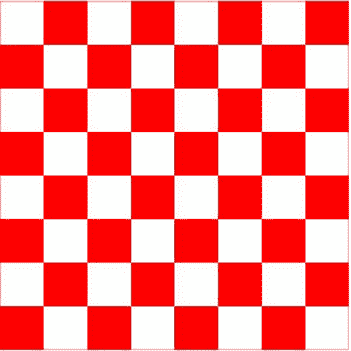

5.  保存你的更改，并在浏览器中显示 `Chess.html` 页面。该页面看起来应该类似于图 23-1。

***图 23-1.** 初始棋盘*

#### 使用渐变

你可以使用渐变而非纯色来填充形状。为此，你必须首先使用绘图上下文的 `createLinearGradient()` 方法创建一个渐变对象。该方法接受四个参数，分别是渐变起点和终点的 x 和 y 坐标。这让你能够指定渐变的方向：从上到下、从左到右，或是对角线方向。渐变是在整个画布上计算的。你无法为单个元素定义渐变。

接着，你必须定义颜色节点。每个颜色节点定义了渐变上的一个位置及其对应的颜色。

至少需要定义位置为 0 和 1 的颜色节点，它们分别指定渐变的起始颜色和结束颜色。如果你希望控制颜色过渡，还可以在它们之间添加颜色节点。例如，如果你想定义中点处的颜色，则使用 0.5。

最后，你将使用这个渐变来设置 `fillStyle` 属性。要尝试此功能，请添加以下粗体显示的代码：

```javascript
function drawBoard() {
    chessContext.clearRect(0, 0, 600, 600);
    var gradient = chessContext.createLinearGradient(0, 600, 600, 0);
    gradient.addColorStop(0.0, "#D50005");
    gradient.addColorStop(0.5, "#E27883");
    gradient.addColorStop(1.0, "#FFDDDD");
    chessContext.fillStyle = gradient;
    chessContext.strokeStyle = "red";
```

# 第 23 章 ■ Canvas

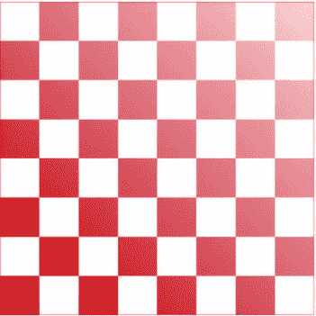

保存你的更改并刷新浏览器。页面现在应看起来像图 23-2。请注意，颜色过渡是跨越整个画布的，而非每个方格内部。

***图 23-2.** 使用渐变填充的棋盘*

## 使用图像

现在你可以准备添加棋子了，棋子将使用图像文件绘制。向画布添加图像非常简单。你创建一个`Image`对象，将其`src`属性设置为图像文件的位置，然后像这样调用绘图上下文的`drawImage()`方法：

```javascript
var myImage = new Image();
myImage.src = "images/sample.jpg";
context.drawImage(myImage, 0,0, 50, 100);
```

`drawImage()`方法的第一个参数指定要绘制的图像。它可以是我上面演示的`Image`对象。或者，你也可以指定页面上已有的`img`、`video`或`canvas`元素。接下来的两个参数指定图像左上角的 x 和 y 位置。

第四个和第五个参数是可选的，分别指定要将图像缩放到的宽度和高度。如果你不指定这些参数，图像将使用其原始尺寸绘制。

`drawImage()`方法还允许你提供额外的四个参数。这些参数用于指定应显示在画布上的图像部分。这些额外参数包括指定左上角的 x 坐标和 y 坐标，以及定义指定部分的宽度和高度。如果你只想绘制图像的一部分，请使用最后四个参数。如果省略它们，将显示整个图像。

在此应用中，你将使用 12 个不同的图像绘制 32 个棋子。此外，在本章后面，你将添加代码来移动棋子。为此，你将为应用添加一些结构。你将定义一个类，用于存储棋子属性，例如要使用的图像及其在棋盘上的位置。然后，你将实现一个通用的绘图函数，该函数使用这些属性中的详细信息。

## 练习 23-2. 绘制棋子

1. 在你的 web 应用中创建一个名为`Images`的新文件夹，用于存储图像文件。
2. 棋子的图像包含在源代码下载文件中。你可以在`Chapter23\Images`文件夹中找到它们。将全部 12 个文件拖到你的`Images`文件夹中。
3. 在`Chess.js`文件的开头添加以下变量声明（紧接在`chessCanvas`和`chessContext`变量之后）。这将定义一个变量来`reference`一个`Image`对象对应 12 个图像文件中的每一个。它还会定义一个数组，用于存储 32 个国际象棋棋子。

```javascript
// Define the chess piece images
var imgPawn = new Image();
var imgRook = new Image();
var imgKnight = new Image();
var imgBishop = new Image();
var imgQueen = new Image();
var imgKing = new Image();
var imgPawnW = new Image();
var imgRookW = new Image();
var imgKnightW = new Image();
var imgBishopW = new Image();
var imgQueenW = new Image();
var imgKingW = new Image();

// Define an array to store 32 pieces
var pieces = new Array(32);
```

4. 将`loadImages()`函数添加到`Chess.js`文件中。

```javascript
function loadImages() {
  imgPawn.src = "Images/pawn.png";
  imgRook.src = "Images/rook.png";
  imgKnight.src = "Images/knight.png";
  imgBishop.src = "Images/bishop.png";
  imgQueen.src = "Images/queen.png";
  imgKing.src = "Images/king.png";
  imgPawnW.src = "Images/wpawn.png";
  imgRookW.src = "Images/wrook.png";
  imgKnightW.src = "Images/wknight.png";
  imgBishopW.src = "Images/wbishop.png";
  imgQueenW.src = "Images/wqueen.png";
  imgKingW.src = "Images/wking.png";
}
```

5. 现在可以定义棋子了。你将使用一个对象定义来存储绘制棋子所需的属性。`image`属性包含对相应`Image`对象的引用。`x`和`y`属性指定棋子所在的方格，取值范围为 0 到 7，从左到右、从上到下。`height`和`width`属性表示图像的大小，会根据棋子类型而变化。`killed`属性用于表示棋子是否已被捕获。被捕获的图像将不显示。将以下代码添加到`Chess.js`中：

```javascript
// Define a class to store the piece properties
function ChessPiece() {
  this.image = null;
  this.x = 0;
  this.y = 0;
  this.height = 0;
  this.width = 0;
  this.killed = false;
}
```

6. 将以下函数添加到`Chess.js`文件中。这实现了`drawPiece()`函数，该函数根据类属性绘制单个棋子。它还实现了`drawAllPieces()`函数，该函数将绘制`pieces`数组中定义的每一个棋子。

```javascript
// Draw a chess piece
function drawPiece(p) {
  if (!p.killed)
    chessContext.drawImage(p.image,
      (75 - p.width) / 2 + (75 * p.x),
      73 - p.height + (75 * p.y),
      p.width,
      p.height);
}

// Draw all of the chess pieces
function drawAllPieces() {
  for (var i = 0; i < 32; i++) {
    if (pieces[i] != null) {
      drawPiece(pieces[i]);
    }
  }
}
```

7. 现在你需要创建 32 个`ChessPiece`类的实例，并指定所有适当的属性。添加清单 23-1 中所示的`createPieces()`函数。该函数创建`ChessPiece`类的实例，将它们存储在`pieces`数组中，并设置每个实例的属性。

> **提示**：由于此过程相当冗长且乏味，我将此函数作为单独的文件提供在源代码下载中。如果你愿意，可以不用手动输入清单 23-1 中的函数，而是在`Chapter23`文件夹中找到`createPieces.js`文件，并将其拖拽到你的 Web 项目中。然后在`head`元素中添加此引用：
> `<script src="createpieces.js" defer></script>`

***清单 23-1.*** 实现`createPieces()`函数

```javascript
function createPieces() {
  var piece;
  // Black pawns
  for (var i = 0; i < 8; i++) {
    piece = new ChessPiece();
    piece.image = imgPawn,
    piece.x = i;
    piece.y = 1;
    piece.height = 50;
    piece.width = 28;
    pieces[i] = piece;
  }
  // Black rooks
  piece = new ChessPiece();
  piece.image = imgRook;
  piece.x = 0;
  piece.y = 0;
  piece.height = 60;
  piece.width = 36;
  pieces[8] = piece;
  piece = new ChessPiece();
  piece.image = imgRook;
  piece.x = 7;
  piece.y = 0;
```

# 第 23 章 ■ Canvas

```javascript
piece.height = 60;
piece.width = 36;
pieces[9] = piece;

// Black knights
piece = new ChessPiece();
piece.image = imgKnight;
piece.x = 1;
piece.y = 0;
piece.height = 60;
piece.width = 36;
pieces[10] = piece;

piece = new ChessPiece();
piece.image = imgKnight;
piece.x = 6;
piece.y = 0;
piece.height = 60;
piece.width = 36;
pieces[11] = piece;

// Black bishops
piece = new ChessPiece();
piece.image = imgBishop;
piece.x = 2;
piece.y = 0;
piece.height = 65;
piece.width = 30;
pieces[12] = piece;

piece = new ChessPiece();
piece.image = imgBishop;
piece.x = 5;
piece.y = 0;
piece.height = 65;
piece.width = 30;
pieces[13] = piece;

// 黑方象
piece = new ChessPiece();
piece.image = imgBishop;
piece.x = 2;
piece.y = 0;
piece.height = 65;
piece.width = 30;
pieces[12] = piece;

piece = new ChessPiece();
piece.image = imgBishop;
piece.x = 5;
piece.y = 0;
piece.height = 65;
piece.width = 30;
pieces[13] = piece;

// 黑方后
piece = new ChessPiece();
piece.image = imgQueen;
piece.x = 3;
piece.y = 0;
piece.height = 70;
piece.width = 32;
pieces[14] = piece;

// 黑方王
piece = new ChessPiece();
piece.image = imgKing;
piece.x = 4;
piece.y = 0;
piece.height = 70;
piece.width = 28;
pieces[15] = piece;

// 白方兵
for (var i = 0; i < 8; i++) {
    piece = new ChessPiece();
    piece.image = imgPawnW;
    piece.x = i;
    piece.y = 6;
    piece.height = 50;
    piece.width = 28;
    pieces[16 + i] = piece;
}

// 白方车
piece = new ChessPiece();
piece.image = imgRookW;
piece.x = 0;
piece.y = 7;
piece.height = 60;
piece.width = 36;
pieces[24] = piece;

piece = new ChessPiece();
piece.image = imgRookW;
piece.x = 7;
piece.y = 7;
piece.height = 60;
piece.width = 36;
pieces[25] = piece;

// 白方马
piece = new ChessPiece();
piece.image = imgKnightW;
piece.x = 1;
piece.y = 7;
piece.height = 60;
piece.width = 36;
pieces[26] = piece;

piece = new ChessPiece();
piece.image = imgKnightW;
piece.x = 6;
piece.y = 7;
piece.height = 60;
piece.width = 36;
pieces[27] = piece;

// 白方象
piece = new ChessPiece();
piece.image = imgBishopW;
piece.x = 2;
piece.y = 7;
piece.height = 65;
piece.width = 30;
pieces[28] = piece;

piece = new ChessPiece();
piece.image = imgBishopW;
piece.x = 5;
piece.y = 7;
piece.height = 65;
piece.width = 30;
pieces[29] = piece;

// 白方后
piece = new ChessPiece();
piece.image = imgQueenW;
piece.x = 3;
piece.y = 7;
piece.height = 70;
piece.width = 32;
pieces[30] = piece;

// 白方王
piece = new ChessPiece();
piece.image = imgKingW;
piece.x = 4;
piece.y = 7;
piece.height = 70;
piece.width = 28;
pieces[31] = piece;
}
```

8. 修改`drawBoard()`函数，使其在绘制棋盘后也调用`drawAllPieces()`。

```javascript
// 为整个棋盘添加边框
chessContext.strokeRect(0, 0, 600, 600);
drawAllPieces();
}
```

9. 最后，将`Chess.js`文件中对`drawBoard()`函数的调用替换为以下代码。这将调用`loadImages()`和`createPieces()`函数，并在调用`drawBoard()`之前等待 1 秒钟。

```javascript
loadImages();
createPieces();
setTimeout(drawBoard, 1000);
```

10. 保存更改并刷新浏览器。您现在应该能看到国际象棋棋子，如图 23-3 所示。

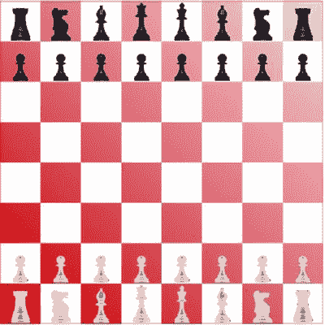

**图 23-3.** 显示棋子的棋盘

> **注** 当您创建一个`Image`对象并设置其`src`属性时，指定的图像文件会异步下载。有可能在调用`drawImage()`函数之前文件尚未加载完成。如果发生这种情况，图像将不会显示。1 秒的延迟是解决此问题的一个简单方法。您可以为每个`Image`对象实现`onload`事件处理程序，该处理程序在图像加载完成时被调用。但这会有些复杂，因为您需要等待所有 12 张图像加载完毕。

## 添加简单动画

为了演示如何使用 canvas 实现简单动画，您将让棋子移动。绘制每个棋子的函数会根据棋子所在格子计算其位置。要移动一个棋子，您只需更新其`x`或`y`属性，然后重新绘制它。

当您在新位置重新绘制棋子时，它在旧位置仍然可见。此外，如果您将棋子移动到另一个棋子所在的格子中以吃掉对方，最终会导致两个棋子落在同一个格子上。您可以实现一些复杂的逻辑来清除该格子，并在移动棋子前重新绘制一个红色或白色的格子。然而，在本演示中，您将简单地清除整个画布并重新绘制棋盘以及所有棋子。

# 实现自动化

要实现自动化，你将创建一个 `makeNextMove()` 函数。该函数将调整棋子的 `x` 和 `y` 位置，然后重新绘制棋盘和所有棋子。你将使用 `setInterval()` 函数重复调用此函数，使棋子依次移动。

## 第 23 章 ■ 画布

### 练习 23-3. 动画化国际象棋棋子

1. 在 `Chess.js` 文件开头附近添加以下以粗体显示的变量：

```javascript
// 定义一个数组来存储 32 个棋子
var pieces = new Array(32);
var moveNumber = -1;
var timer;
```

2. 使用以下代码在 `Chess.js` 文件中实现 `makeNextMove()` 函数。这段代码通过调整棋子的 `x` 和 `y` 属性来“移动”棋子。它跟踪移动编号，并使用该编号调整相应的棋子。第七步会捕获一个棋子并设置其 `killed` 属性。由于这结束了动画，第七步还会使用 `clearInterval()` 函数，以便不再发生计时器事件。每次移动后，棋盘和所有棋子都会被重绘。在第七步之后，该函数还会使用 `fillText()` 方法，该方法用于向画布写入文本。

```javascript
function makeNextMove() {
    function inner() {
        if (moveNumber === 1) {
            pieces[20].y--;
        }
        if (moveNumber === 2) {
            pieces[4].y += 2;
        }
        if (moveNumber === 3) {
            pieces[29].y = 4;
            pieces[29].x = 2;
        }
        if (moveNumber === 4) {
            pieces[6].y++;
        }
        if (moveNumber === 5) {
            pieces[30].x = 5;
            pieces[30].y = 5;
        }
        if (moveNumber === 6) {
            pieces[7].y++;
        }
        if (moveNumber === 7) {
            pieces[30].x = 5;
            pieces[30].y = 1;
            pieces[5].killed = true;
            clearInterval(timer);
        }
        moveNumber++;
        drawBoard();
        drawAllPieces();
        if (moveNumber > 7) {
            chessContext.font = "30pt Arial";
            chessContext.fillStyle = "black";
            chessContext.fillText("Checkmate!", 200, 220);
        }
    }
    return inner;
}
```

3. 将以下代码添加到 `Chess.js` 文件中。这将每 2 秒调用一次 `makeNextMove()` 函数。

```javascript
timer = setInterval(makeNextMove(), 2000);
```

4. 保存更改并刷新浏览器。经过一系列移动后，页面应如图 23-4 所示。

**图 23-4.** 完成的国际象棋棋盘

> **注意：** `makeNextMove()` 函数使用了 JavaScript 中一个经常被误解的特性——闭包，该特性在第 3 章中已经介绍过。此函数定义了另一个名为 `inner()` 的函数，它执行实际工作。然后返回 `inner()` 函数。当计时器到期时，`window` 对象将调用 `makeNextMove()` 函数。然而，它使用的所有变量（例如棋子数组）都将超出作用域。`inner()` 函数将能够访问这些变量，因此这解决了作用域问题。

## 模拟太阳系

对于下一个画布，你将绘制一个移动的太阳系模型。为节省时间，你只需显示地球、太阳和月亮。此实现将利用画布的两个重要特性：

- `路径`

- `变换`

### 使用路径

如前所述，画布支持的唯一简单图形是矩形，你在前面的示例中已经使用过。对于所有其他图形，你必须定义路径。在画布中定义路径的基本方法与 SVG 类似。你使用移动命令设置起点，然后使用线条和曲线命令的组合来绘制图形。

在画布中，你总是从 `beginPath()` 命令开始。调用所需的绘制命令后，通过调用 `stroke()`（绘制图形轮廓）或 `fill()`（填充图形）来完成路径。只有在调用 `stroke()` 或 `fill()` 之后，图形才会实际绘制到画布上。如果在完成当前图形（通过调用 `stroke()` 或 `fill()`）之前再次调用 `beginPath()`，画布将忽略之前的未完成命令。与矩形一起使用的 `strokeStyle` 和 `fillStyle` 属性同样定义了路径的颜色。

实际的绘制命令如下：

- `moveTo()`

- `lineTo()`

- `arcTo()`

- `bezierCurveTo()`

- `quadraticCurveTo()`

此外，还可以使用以下函数进行绘图：

- `closePath()`：执行从当前位置到起始位置的 `lineTo()` 命令，以闭合形状。如果使用 `fill()` 命令且当前不在起始位置，则会自动调用 `closePath()`。

- `arc()`：在指定位置绘制圆弧；无需先移动到该位置。但仍需按路径处理：需先调用 `beginPath()`，且圆弧直到调用 `stroke()` 或 `fill()` 时才真正绘制。

### 绘制圆弧

`arc()` 命令是常用且重要的命令。它接受以下参数：

`arc(x, y, radius, startAngle, endAngle, counterclockwise)`

前两个参数指定圆心的 `x` 和 `y` 坐标。第三个参数指定半径。第四和第五个参数确定圆弧的起始和结束角度。

这些角度基于 x 轴测量：0° 对应圆的最右侧，90° 对应圆的最底部。角度以弧度为单位指定，而非度数。

除非绘制完整圆形，否则圆弧的方向很重要。例如，若从 0° 绘制到 90°，则得到从右侧到底部的四分之一圆弧。但若使用相同端点以逆时针方向绘制，则会得到四分之三圆弧。最后一个参数若为 `true`，则表示以逆时针方向绘制圆弧；该参数可选，省略时默认顺时针方向绘制。

### 使用变换

初次接触 Canvas 变换时可能觉得有些费解，但理解后会发现它们非常有用。首先，变换对已绘制的图形没有影响；相反，它修改后续绘制所使用的网格系统。本章将演示三种变换：

- 平移

- 旋转

- 缩放

如前所述，Canvas 元素使用原点位于左上角的网格系统。因此，点 (100, 50) 表示距离左上角向右 100 像素、向下 50 像素的位置。

变换仅调整网格系统。例如，以下命令将原点向右平移 100 像素、向下平移 50 像素：

`context.translate(100, 50);`

如图 23-5 所示。

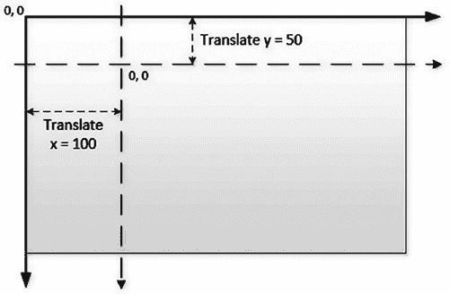

**图 23-5.** 平移上下文原点

此时移动至 (10, 20)，因相对于新原点，实际位置（相对于 Canvas）为 (110, 70)。你可能疑惑为何需要这样做。假设要绘制美国国旗（上有 50 颗星），五角星是较复杂的图形，需要多条绘图命令。绘制完第一颗星后，还需用不同坐标重复 49 次。

通过简单向右平移上下文，可用相同坐标值重复相同命令，但星形位于不同位置。当然，也可创建接受 `x`、`y` 参数的 `drawStar()` 函数，然后调用 50 次并传入不同值。但习惯变换后，尤其结合旋转等其他类型，会觉得更方便。

旋转变换不移动原点，而是将 x 轴和 y 轴旋转指定角度。正值为顺时针旋转，负值为逆时针旋转。图 23-6 演示了旋转变换的工作原理。

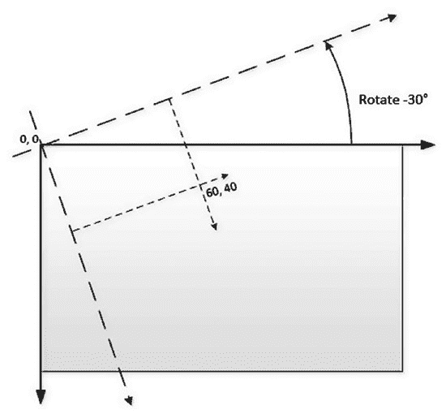

**图 23-6.** 旋转绘图上下文的网格

> **注意**：此处为了便于理解，角度以度数表示。但 `rotate()` 命令期望弧度值。若几何知识生疏，可记住完整圆为 360° 或 2π 弧度。JavaScript 中可使用 `Math.PI` 属性获取 π 值。例如，30° 是完整圆的 1/12，可表示为 `Math.PI * 2 / 12`。通常弧度计算方法为：`度数 * (Math.PI / 180)`。

可组合使用多个变换。例如，先平移原点再旋转坐标轴；也可再次旋转并平移。每次变换均相对于当前的位置和方向。

#### 保存上下文状态

绘图上下文的状态包括已使用的 `fillStyle`、`strokeStyle` 等属性，以及所有已应用的变换累积结果。若使用多个变换，恢复原始状态可能较困难。幸运的是，绘图上下文提供了保存和恢复状态的功能。

通过调用 `save()` 保存当前状态，该操作将当前状态压入栈中。调用 `restore()` 则弹出最近保存的状态并使其成为当前状态。如图 23-7 所示。

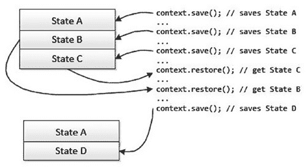

**图 23-7.** 保存和恢复绘图上下文状态

通常应在执行任何变换（尤其是复杂变换）前保存状态。完成需要变换的绘图元素后，可恢复状态。注意，通过设置 `fillStyle` 或执行变换来改变状态，不会影响已绘制的图形。

### 绘制太阳系

掌握这些特性后，让我们绘制一个简单的太阳系模型。

#### 练习 23-4：太阳系建模

1. 创建新网页 `Solar.html`，使用基本标记：

```html
<!DOCTYPE html>
<html lang="en">
<head>
    <meta charset="utf-8" />
    <title>Chapter 23 - Solar System</title>
    <script src="Solar.js" defer></script>
</head>
<body>
</body>
</html>
```

2. 在 `body` 元素内添加 `canvas` 元素：

```html
<canvas id="solarSystem" width="450" height="400">
    Not supported
</canvas>
```

3. 添加新的 `Solar.js` 脚本，使用以下代码。该代码获取 `canvas` 元素并获取 2D 绘图上下文，与前面的示例相同：

```javascript
"use strict";

// Get the canvas context
var solarCanvas = document.getElementById("solarSystem");
var solarContext = solarCanvas.getContext("2d");
```

4. 在 `Solar.js` 文件中添加 `animateSS()` 函数，使用以下代码：

```javascript
function animateSS() {
    var ss = document.getElementById('solarSystem')
    var ssContext = ss.getContext('2d');

    // Clear the canvas and draw the background
    ssContext.clearRect(0, 0, 450, 400);
    ssContext.fillStyle = "#2F1D92";
    ssContext.fillRect(0, 0, 450, 400);
    ssContext.save();

    // Draw the sun
    ssContext.translate(220, 200);
    ssContext.fillStyle = "yellow";
    ssContext.beginPath();
    ssContext.arc(0, 0, 15, 0, Math.PI * 2, true);
    ssContext.fill();

    // Draw the earth orbit
    ssContext.strokeStyle = "black";
    ssContext.beginPath();
    ssContext.arc(0, 0, 150, 0, Math.PI * 2);
    ssContext.stroke();

    ssContext.restore()
}
```

`animateSS()` 函数执行实际工作：清除整个区域并用深蓝色填充。其余代码依赖变换，因此先保存绘图上下文，完成后恢复。

该 `animateSS()` 函数使用 `translate()` 将原点移动到近似位置。

画布的中央。太阳和地球轨道是使用 `arc()` 函数绘制的。请注意，两者的中心点都是 `0, 0`，因为上下文的原点现在位于画布中央。此外，起始角度为 `0`，终止角度为 `Math.PI * 2`。以弧度表示，这是一个完整的圆周，即 360°。

太阳的弧线是填充的，而轨道不是。

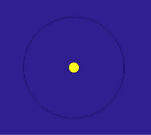

第 23 章 ■ Canvas

5. 调用 `setInterval()` 函数，每 100 毫秒调用一次 `animateSS()` 函数。

```javascript
setInterval(animateSS, 100);
```

6. 在浏览器中显示页面。到目前为止，这个绘图还不太有趣；它只是一个带有环绕轨道的太阳，如图 23-8 所示。

***图 23-8.** 初始的太阳系绘图*

现在你将绘制地球并让它沿轨道动画运行。通常，地球每 365.24 天绕太阳公转一周，但我们会加快速度，在 60 秒内完成一周。要确定每次重绘画布时地球的位置，你必须计算经过的秒数。每秒的旋转量计算为 `Math.PI * 2 / 60`。将此值乘以秒数，即可确定地球应该所处的角度。

7. 添加以下以粗体显示的代码。这段代码使用 `rotate()` 函数将绘图上下文旋转到适当的角度。由于地球轨道的弧线半径为 `150px`，这段代码随后使用 `translate()` 函数将上下文向右移动 150 像素，以便在调整后的 `0,0` 坐标处绘制地球。请注意，这是结合了两个独立的变换：一个根据地球在轨道上的位置进行旋转，另一个从太阳平移适当的距离。然后，使用以 `0,0`（上下文的新原点）为中心的填充弧线来绘制地球。

```javascript
// Draw the earth orbit
ssContext.strokeStyle = "black";
ssContext.beginPath();
ssContext.arc(0, 0, 150, 0, Math.PI * 2);
ssContext.stroke();

// Compute the current time in seconds (use the milliseconds
// to allow for fractional parts).
var now = new Date();
var seconds = ((now.getSeconds() * 1000) + now.getMilliseconds()) / 1000;
```

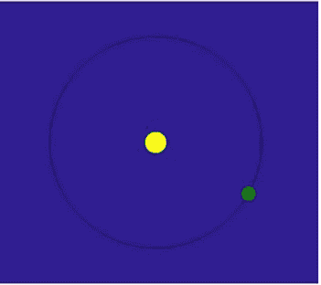

第 23 章 ■ Canvas

```javascript
//---------------------------------------------
// Earth
//---------------------------------------------
// Rotate the context once every 60 seconds
var anglePerSecond = ((Math.PI * 2) / 60);
ssContext.rotate(anglePerSecond * seconds);
ssContext.translate(150, 0);

// Draw the earth
ssContext.fillStyle = "green";
ssContext.beginPath();
ssContext.arc(0, 0, 10, 0, Math.PI * 2, true);
ssContext.fill();

ssContext.restore()
```

8. 保存更改并刷新浏览器。现在你应该能看到地球绕太阳运行，如图 23-9 所示。

***图 23-9.** 将地球添加到绘图中*

现在你将展示月球绕地球运行，这将展示使用变换的真正威力。月球的具体位置基于两个移动的物体。虽然可以使用一些复杂公式（科学家们已经这样做了几个世纪）来计算，但使用变换则无需如此。绘图上下文已根据当前时间（秒数）旋转到适当的角度，然后按轨道半径进行了平移，因此地球现在位于上下文的原点。地球在哪里并不重要；你只需相对于当前原点绘制月球即可。

第 23 章 ■ Canvas

9. 你现在将像绘制地球一样绘制月球。不同的是，原点位于地球上，你将让月球绕地球旋转，而不是原点在太阳上并让地球绕太阳旋转。月球大约每个月绕地球旋转一次；换句话说，地球每绕太阳公转一周，月球会完成大约 12 次公转。因此，你需要将旋转速度提高 12 倍。`anglePerSecond` 现在计算为 `12 * ((Math.PI * 2) / 60)`。添加

# 第 23 章 Canvas

## 绘制月亮

```javascript
// Draw the earth
ssContext.fillStyle = "green";
ssContext.beginPath();
ssContext.arc(0, -0, 10, 0, Math.PI * 2, true);
ssContext.fill();

//---------------------------------------------
// Moon
//---------------------------------------------
// Rotate the context 12 times for every earth revolution
anglePerSecond = 12 * ((Math.PI * 2) / 60);
ssContext.rotate(anglePerSecond * seconds);
ssContext.translate(0, 35);

// draw the moon
ssContext.fillStyle = "white";
ssContext.beginPath();
ssContext.arc(0, 0, 5, 0, Math.PI * 2, true);
ssContext.fill();
ssContext.restore()
```

> **注意** 每个太阳年大约有 12.368 个太阴月。你可以在上述代码中使用这个数值代替 12，使模型更加精确。

10. 保存更改并刷新浏览器。此时你应该可以看到月亮围绕地球旋转，如图 23-10 所示。

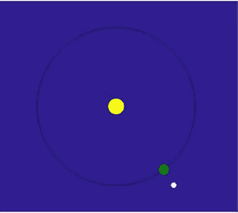

**图 23-10.** 包含月亮

## 应用缩放

在完成这个模型之前，还需要做一个小的修正。地球的轨道实际上并非完美的圆形，这个属性被称为离心率。（如果你对轨道离心率感到好奇，可以查阅 [`en.wikipedia.org/wiki/Orbital_eccentricity`](http://en.wikipedia.org/wiki/Orbital_eccentricity) 上的文章。）为了在绘图中模拟这一点，你需要将轨道拉伸，使其宽度略大于高度。为此，你将使用缩放功能。

`scale()` 函数执行第三种变换。此函数接受两个参数，用于指定沿 x 轴和 y 轴的缩放比例。缩放因子为 1 表示正常比例；小于 1 的因子会压缩图形；大于 1 的因子则会拉伸图形。尽管地球轨道的这种不完美特性极其微小，但这里我们会进行夸张处理，对 x 轴使用 1.1 的缩放因子。

在绘制地球轨道之前，添加以下以粗体显示的代码：

```javascript
// Draw the earth orbit
ssContext.scale(1.1, 1);
ssContext.strokeStyle = "black";
```

刷新浏览器；页面应如图 23-11 所示。

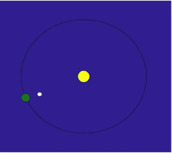

**图 23-11.** 添加缩放效果

现在你得到了一个略微变形的轨道。通过简单地更改缩放因子，各种绘图元素都按比例进行了调整。此外，在恢复上下文后，缩放比例也恢复正常，因此后续元素能正确绘制。

> **注意** 图 23-11 中的对齐展示了一次日食，即月球运行到地球和太阳之间，在地球上投下阴影。

## 裁剪画布

我想再介绍一个与路径相关的特性。之前我说过，在调用 `beginPath()` 以及所需的绘图函数后，可以调用 `stroke()` 或 `fill()`。其实还有一个可以调用的函数：`clip()`。`clip()` 函数会使用你刚刚定义的路径，并禁止在该路径之外绘制任何内容。这不会影响已经绘制的内容，但后续所有形状都将被限制在此路径定义的裁剪区域内。

为了演示这一点，我们将回到国际象棋棋盘的示例中，并使用一个圆弧来定义裁剪路径。

转到 `chess.js` 脚本，并在 `drawBoard()` 函数中添加以粗体显示的代码。

```javascript
var gradient = chessContext.createLinearGradient(0, 600, 600, 0);
gradient.addColorStop(0, "#D50005");
gradient.addColorStop(0.5, "#E27883");
gradient.addColorStop(1, "#FFDDDD");

// 裁剪路径
chessContext.beginPath();
chessContext.arc(300, 300, 300, 0, (Math.PI * 2), true);
chessContext.clip();

chessContext.fillStyle = gradient;
chessContext.strokeStyle = "red";

// 绘制交替的方格
```

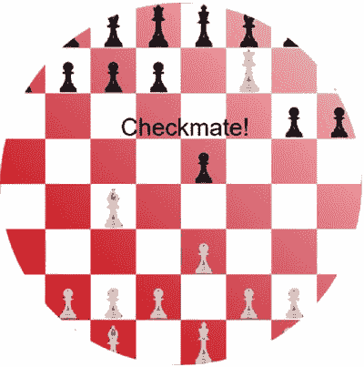

这会在画板上定义一个圆形区域，任何超出该圆形范围的内容都将不可见。在浏览器中打开 `Chess.html` 文件，效果应如图 23-12 所示。

**图 23-12.** 应用了裁剪路径的国际象棋棋盘

**注意：** 如果在绘制棋盘之后再定义裁剪路径，整个棋盘都会被绘制，但棋子会被裁切，因此任何超出裁剪区域的部分都会被隐藏。

## 理解合成

到目前为止，你绘制的所有图形中，后绘制的图形都会覆盖或隐藏先绘制的图形。这种行为被称为合成。默认行为是 `source-over`，即像你之前看到的那样，将当前图形绘制在画布上已有的图形之上。合成术语中，*source* 指代正在绘制的图形，*destination* 指代已绘制的结果。除了 `source-over` 之外，你还可以使用 `globalCompositeOperation` 属性配置其他 10 种行为。通过观察每种行为的示例，可以更好地理解它们。

在本练习中，你将用一个红色方块与一个蓝色圆形进行重叠。这个操作将重复 11 次，每次为 `globalCompositeOperation` 属性设置不同的值。为了实现这个效果，你需要创建 11 个 canvas 元素，并在每个元素上绘制相同的图形。

### 练习 23-5. 探索合成效果

1.  使用基本标记创建一个新的网页 `Compositing.html`：

```html
<!DOCTYPE html>
<html lang="en">
<head>
<meta charset="utf-8" />
<title>第 23 章 - 合成</title>
<script src="Compositing.js" defer></script>
<link rel="stylesheet" href="Compositing.css" />
</head>
<body>
</body>
</html>
```

2.  在 `body` 元素中，使用以下标记创建 11 个新的 canvas 元素：

```markdown
## 第 23 章 ■ Canvas

```html
<div>
<canvas id="composting1" width="120" height="120"></canvas>
<br />source-over
</div>
<div>
<canvas id="composting2" width="120" height="120"></canvas>
<br />destination-over
</div>
<div>
<canvas id="composting3" width="120" height="120"></canvas>
<br />source-in
</div>
<div>
<canvas id="composting4" width="120" height="120"></canvas>
<br />destination-in
</div>
<div>
<canvas id="composting5" width="120" height="120"></canvas>
<br />source-out
</div>
<div>
<canvas id="composting6" width="120" height="120"></canvas>
<br />destination-out
</div>
<div>
<canvas id="composting7" width="120" height="120"></canvas>
<br />source-atop
</div>
<div>
<canvas id="composting8" width="120" height="120"></canvas>
<br />destination-atop
</div>
<div>
<canvas id="composting9" width="120" height="120"></canvas>
<br />xor
</div>
<div>
<canvas id="composting10" width="120" height="120"></canvas>
<br />copy
</div>
<div>
<canvas id="composting11" width="120" height="120"></canvas>
<br />lighter
</div>
```

3. 创建一个 `Compositing.css` 文件，并包含以下样式规则。这将把 `canvas` 元素格式化为三列，以便你在一个屏幕上看到全部 11 个示例。

```css
body div {
-webkit-column-count: 3;
-moz-column-count: 3;
column-count: 3;
}
```

4. 添加包含以下代码的 `Compositing.js` 文件。

```javascript
"use strict";
for (var i = 1; i <= 11; i++) {
var c = document.getElementById("composting" + i);
var cContext = c.getContext("2d");
cContext.fillStyle = "red";
cContext.fillRect(10, 20, 80, 80);
switch (i) {
case 1: cContext.globalCompositeOperation = "source-over"; break;
case 2: cContext.globalCompositeOperation = "destination-over"; break;
case 3: cContext.globalCompositeOperation = "source-in"; break;
case 4: cContext.globalCompositeOperation = "destination-in"; break;
case 5: cContext.globalCompositeOperation = "source-out"; break;
case 6: cContext.globalCompositeOperation = "destination-out"; break;
case 7: cContext.globalCompositeOperation = "source-atop"; break;
case 8: cContext.globalCompositeOperation = "destination-atop"; break;
case 9: cContext.globalCompositeOperation = "xor"; break;
case 10: cContext.globalCompositeOperation = "copy"; break;
case 11: cContext.globalCompositeOperation = "lighter"; break;
}
cContext.fillStyle = "blue";
```

```javascript
cContext.beginPath();
cContext.arc(65, 75, 40, 0, (Math.PI * 2), true);
cContext.fill();
```

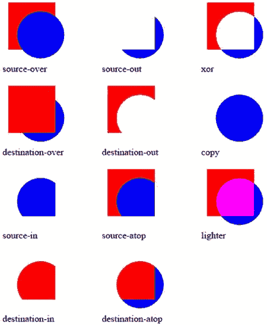

此代码使用了一个 `for` 循环来处理所有 11 个 `canvas` 元素。它先获取对应的元素，再获得其绘图上下文，添加一个红色正方形，然后设置 `globalCompositeOperation` 属性，最后添加一个蓝色圆形，其位置与正方形略微错开。

5. 保存更改，并在浏览器中打开 `Compositing.html` 文件。网页应如图 23-13 所示。

***图 23-13.** 演示合成选项*

合成选项如下：

- `source-over`：这是默认操作。源元素（正在添加的元素）绘制在目标（该位置已有的内容）之上。
- `destination-over`：这是 `source-over` 的反向操作，源元素添加在已有元素之下。
- `source-in`：仅显示源对象中与目标元素重叠的部分。请注意，目标元素完全不显示，它仅作为裁剪形状使用。
- `destination-in`：仅显示目标对象中与源元素重叠的部分。
- `source-out`：仅显示源元素中不与目标元素重叠的部分。
- `destination-out`：仅显示目标元素中不与源元素重叠的部分。
- `source-atop`：源元素显示在目标元素之上，但整个形状被目标元素裁剪。
- `destination-atop`：源元素显示在目标元素之下，但整个形状被源元素裁剪。
- `xor`：仅显示源元素和目标元素中不重叠的部分。
- `copy`：这个名称可能具有误导性。它会绘制源元素并清除其他所有内容。
- `lighter`：绘制源元素和目标元素，重叠区域以更浅的颜色显示。实际颜色由源元素和目标元素的颜色值相加决定。

> **提示** 这些合成选项的名称可能不太直观。建议你保留此图，以便日后在忘记 `copy` 等选项的作用时查阅。

### 本章小结

在本章中，你使用 `canvas` 元素创建了一些图形化网页。你使用矩形和路径在画布上绘制形状，还在画布上添加了图像。画布一个非常强大的功能是应用变换。恰当地使用变换可以显著简化某些复杂的绘图应用程序。

Canvas 与 SVG 有着本质区别。在 SVG 中，每个形状都是一个独立的 DOM 节点。这提供了两个 Canvas 无法实现的重要特性：

- 为单个形状附加事件处理程序。
- 单个形状可以被操作。一个很好的例子是定义 `:hover` 伪规则，当鼠标悬停在形状上时，可以更改该形状的属性。

与 SVG 相反，Canvas 基于像素，这意味着它依赖于分辨率。注意，所有绘图命令都使用了像素位置或大小。当你在 `canvas` 元素上绘制形状时，该画布的像素会被相应调整，最终只保留像素内容的结果。

Canvas 由于其原始像素操作，效率通常会更高。而另一方面，SVG 必须执行大量的渲染（和重新渲染）。然而，对于内容密度较低的大型图像（如地图），SVG 通常性能更好。

在下一章中，你将使用拖放功能来实现一个跳棋游戏。
