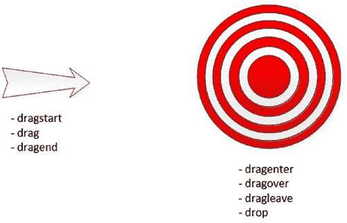
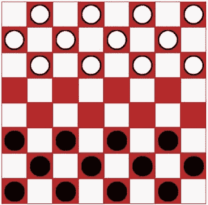
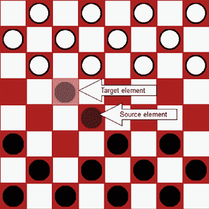
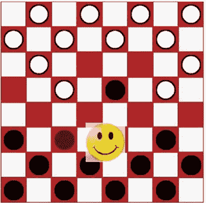

## 第 24 章 拖放

选择元素并将其拖动到其他位置的能力，是自然用户体验的一个绝佳范例。我至今还记得早期的苹果电脑，你可以通过将文件拖到垃圾桶图标上来删除它。这个操作，以及成百上千类似的操作，是桌面应用程序用户体验的关键组成部分。然而，Web 应用程序在这一领域远远落后。借助 HTML5 中的拖放（DnD）API，你会发现 Web 应用程序正在快速追赶。

在本章中，你将构建一个实现跳棋游戏的 Web 应用程序，使用 DnD API 在棋盘上移动棋子。我将首先解释概念以及 DnD 应用程序的结构。然后深入代码，演示各个方面。最后，我将介绍一些高级功能，包括在浏览器窗口之间拖放。

### 理解拖放
```

## 第 24 章 ■ 拖放

在开始构建应用程序之前，我想先解释一下 DnD API 的基本概念。这将帮助你在开始编写代码时更好地理解上下文。我首先会解释被触发的事件；了解每个事件在何时、在哪个对象上触发非常重要。然后你将了解`dataTransfer`对象，你可以用它来将信息从被拖动的对象传递给每个事件，并最终传递给放置操作。你还可以使用它来配置拖动操作的各个方面。最后，我将向你展示如何使对象可拖动。

### 处理事件

与桌面端的拖放一样，DnD 是一个基于事件的 API。当用户选择、移动并放下一个项目时，会触发事件，允许应用程序控制和响应这些操作。要有效使用此 API，你需要知道这些事件何时触发以及在哪个元素上触发。起初这可能看起来令人困惑，但一旦你理解了它，就会觉得很直接。

> **提示** 我在第 [20](http://dx.doi.org/10.1007/978-1-4842-2463-2_20) 章中解释了使用事件的基础知识。

在 DnD 操作中，涉及两个元素：

-   正在被拖动的元素，有时称为`源`。
-   被放下的元素，通常称为`目标`。

© Mark J. Collins 2017

M. J. Collins, *Pro HTML5 with CSS, JavaScript, and Multimedia*, DOI 10.1007/978-1-4842-2463-2_24



你可以将此理解为`源`是一个正在被放置在`目标`上的箭头，如图 24-1 所示。

***图 24-1.** `源`元素和`目标`元素*

在 DnD 操作期间，两个元素上都会触发事件，我指出了每个元素上触发的事件。在`源`元素上，`dragstart`、`drag`和`dragend`事件分别对应于 Windows 应用程序中的`mousedown`、`mousemove`和`mouseup`事件。当你单击一个元素并开始移动鼠标时，会触发`dragstart`事件，紧接着是`drag`事件，并且每次鼠标移动都会重复触发`drag`事件。最后，当释放鼠标按钮时，会触发`dragend`事件。

`目标`元素上的事件则更有趣一些。当鼠标在页面上移动时，一旦进入某个元素定义的区域，就会在该元素上触发`dragenter`事件。随着鼠标继续移动，会在`目标`元素上触发`dragover`事件。如果鼠标移出该元素，则会触发`dragleave`事件。此时，鼠标可能位于另一个元素上，那么该元素上就会触发`dragenter`事件。然而，如果在`目标`元素上释放鼠标按钮，则不会触发`dragleave`事件，而是触发`drop`事件。

现在让我们演练一个典型场景，看看这些事件的顺序。如表 24-1 所示。

***表 24-1.** 事件序列*

| 元素 | 事件 | 说明 |
| --- | --- | --- |
| `源` | `dragstart` | 当鼠标被单击并开始移动时触发 |
| `源` | `drag` | |

# 拖放事件

## 事件汇总

| 事件 | 描述 | 目标 |
|-------|-------------|--------|
| `drag` | 鼠标移动时持续触发 | 源 |
| `dragend` | 拖放操作结束时触发 | 源 |
| `dragenter` | 鼠标进入目标元素区域时触发 | 目标 |
| `dragenter` | 鼠标移动到新的目标元素时触发 | 目标 |
| `dragleave` | 鼠标离开当前目标元素时触发 | 目标 |
| `dragover` | 鼠标指针悬停在目标元素上且移动时触发 | 目标 |
| `dragstart` | 拖拽开始时触发 | 源 |
| `drop` | 鼠标按钮释放时触发 | 目标 |

现在您已经了解了所使用的事件，可以通过为每个事件提供相应的处理程序来实现拖放操作。

### 使用数据转移对象

还有一个拖放概念需要理解。仅仅在页面上拖拽元素并不实用；真正重要的是与元素关联的数据。在我之前给出的将文件拖到垃圾桶的例子中，看着图标被垃圾桶吞没可能很有趣，但最终目标是删除文件。在这种情况下，您正在将文件说明传递给回收站，以便它可以在文件系统中执行请求的操作。

#### 存储数据

在拖放 API 中，`dataTransfer`对象用于存储与操作关联的数据。`dataTransfer`对象通常在`dragstart`事件处理程序中初始化。回想一下，此事件在源元素上触发。事件处理程序可以从源元素访问数据，并将其存储在`dataTransfer`对象中。然后，该数据会提供给所有其他事件处理程序，以便它们可以在特定处理中使用。最终，`drop`事件处理程序会使用此数据对该数据执行相应的操作。

`dataTransfer`对象作为事件对象的属性提供，该事件对象会传递给每个事件处理程序。您可以使用`setData()`方法将数据存储在`dataTransfer`对象中。为了指示数据类型，还需要提供相应的 MIME 类型。例如，要添加一些简单文本，可以像这样调用该方法：

```javascript
e.dataTransfer.setData("text", "Hello, World!");
```

要在后续事件（例如`drop`事件）中访问此数据，请使用`getData()`方法，如下所示：`var msg = e.dataTransfer.getData("text");`

检索数据时，您需要使用与存储数据时相同的 MIME 类型。

> **警告：** 并非所有浏览器都识别所有 MIME 类型。在此示例中，您可能期望使用`text/plain`。这在 Firefox 和 Opera 中运行良好，但在 Chrome 或 IE 中不受支持。但是，如果仅使用`text`，则所有浏览器都将支持。

#### 使用放置效果

`dataTransfer`对象的另一个目的是向用户提供关于项目放置时将执行的操作的反馈。这称为放置效果，有四个可能的值：

- `copy`：选中的元素将在目标位置被复制。
- `move`：选中的元素将移动到目标位置。
- `link`：将在目标位置创建指向选中项目的链接。
- `none`：不允许放置操作。

当您开始拖拽项目时，光标将改变以指示项目放置在当前目标上时将发生的放置效果。这是标准的用户界面，您可以在大多数应用程序中尝试。例如，使用任何文本编辑器，选择一些文本，然后开始拖拽它。您应该会看到光标根据尝试移动的位置变为移动光标或“不允许”光标。如果在移动之前按住 Ctrl 键，您应该会看到复制光标而不是移动光标。

在`dragstart`事件处理程序中，您可以根据选中的源元素指定允许的放置效果。您可以通过简单连接它们来指定多个允许的效果（例如`copyMove`），或者像这样指定所有效果：

```javascript
e.dataTransfer.effectAllowed = "all"; // "copy", "link", "move", "copyLink", "linkMove", "copyMove"
```

然后，在`dragover`事件中，您将指定如果将源元素放置在那里将发生的放置效果。如果该放置效果是允许的效果之一，光标将改变以指示该放置效果。但是，如果不允许该效果，光标将使用“不允许”图标。如果这不是一个接受放置的有效位置，请将放置效果设置为`none`，如下所示：

```javascript
if (validLocation) {
  e.dataTransfer.dropEffect = "move";
} else {
  e.dataTransfer.dropEffect = "none";
}
```

### 启用可拖拽元素

现在您已经知道，可以通过在`dragover`事件中将放置效果设置为`none`来禁用元素上的`drop`事件。但是，如何控制哪些元素可以开始被拖拽呢？答案很简单：只需在元素的标记中设置`draggable`属性即可。例如，要创建一个可以拖拽的`div`，请输入如下标记：

```html
<div id="myDiv" draggable="true">
  <p>This div is draggable</p>
</div>
```

默认情况下，图像和链接是可拖拽的。访问 google.com 并尝试拖拽 Google 标志。当您移动光标时，您应该会看到该图像的一个略显暗淡的副本正在被拖拽。

如果您将此图像拖拽到 Firefox 浏览器窗口，Firefox 将导航到此图像。您刚刚见证了拖放的实际应用。因为使用拖放是一种非常自然的工作方式，浏览器尝试尽可能好地开箱即用。例如，如果您从看起来像 URL 的文本编辑器中拖拽一些文本到浏览器上，它将尝试导航到该地址。如果您将图像文件拖拽到浏览器上，它将导航到该文件或下载该文件。

有时默认操作可能会导致您的自定义代码出现问题。我将在练习 24-3 中向您展示如何禁用此功能。

> **注意：** 有关拖放 API 的更多信息，请查看 W3C 规范：[`dev.w3.org/html5/spec/single-page.html#dnd`](http://dev.w3.org/html5/spec/single-page.html#dnd)。

### 创建跳棋应用程序

为了演示拖放 API，您将创建一个 web 应用程序，显示一个典型的红白相间方格的跳棋棋盘。您将使用图像文件来表示棋子，并将其显示在初始起始位置。然后，您将创建事件处理程序，允许您将棋子移动到不同的方格。最后，您将添加逻辑来禁用非法移动。

> **提示：** 在本章中，当您向应用程序添加功能时，您将在此项目中添加和修改代码。如果对每个更改应在何处进行有任何疑问，最终代码列在附录 B 中，并且也可以通过源代码下载获得。

#### 创建项目

对于本章，您将创建一个名为 `Checkers` 的单个网页。

**练习 24-1. 创建 Web 项目**

1. 创建一个名为 `Checkers.html` 的 HTML 文件，并以标准标记开头。

```html
<!DOCTYPE html>
<html lang="en">
<head>
  <meta charset="utf-8" />
  <title>Chapter 24 - Checkers</title>
  <link rel="stylesheet" href="Checkers.css" />
  <script src="Checkers.js" defer></script>
</head>
<body>
</body>
</html>
```

2. 创建一个新的 `Checkers.js` 脚本文件；您将在完成练习时向其中添加代码。

3. 创建一个新的 `Checkers.css` 文件来存放样式规则。

4. 本章的源代码下载包含一个包含五个图像的 `Images` 文件夹。在您的 Web 项目中创建一个 `Images` 文件夹，并将所有五个图像复制到该文件夹中。

#### 绘制跳棋棋盘

为了绘制棋盘，您将为每个方格使用一个单独的 `div` 元素。您需要 8 行，每行 8 个 `div` 元素。您可以手动在 HTML 文档中创建 64 个 `div` 元素。但是，为了提高效率，您将使用 JavaScript 创建它们。

## 注意

在前一章中，你使用了`canvas`元素绘制棋盘。然而，这在此应用中并不适用，因为你需要为每个方格使用独立的`DOM`元素。你可能想尝试使用`SVG`来创建棋盘，因为每个`rect`元素都是独立的`DOM`元素；但是，`SVG`元素不支持`DnD API`。

## 练习 24-2：绘制棋盘

1. 在`body`元素中插入一个`div`元素；这将包含棋盘。

```html
<body>
  <div id="board">
  </div>
</body>
```

2. 将以下实现添加到`Checkers.js`文件中。

### 添加棋子

现在，通过在相应的`div`元素中包含一个`img`元素来添加跳棋棋子。将以下代码添加到`createBoard()`函数中。

```javascript
else {
  square.className = "bwhite";
}

// 如果方格应该放置棋子...
if ((x + y) % 2 != 0 && y != 3 && y != 4) {
  var img = document.createElement("img");
  if (y < 3) {
    img.id = "w" + square.id;
    img.src = "Images/WhitePiece.png";
  }
  else {
    img.id = "b" + square.id;
    img.src = "Images/BlackPiece.png";
  }
  img.className = "piece";
  img.setAttribute("draggable", "true");
  square.appendChild(img);
}

square.setAttribute("draggable", "false");
row.appendChild(square);
```

要确定合适的方格，第一条规则是跳棋棋子只位于黑色（在此例中为红色）方格上。因此，代码使用了与计算`class`属性相同的`(x + y) % 2 != 0`逻辑。然后，棋子仅放置在最上面三行和最下面三行，所以代码排除了第 3 行和第 4 行。如果行数小于 3，将添加白色棋子，否则添加黑色棋子。代码通过在方格的`id`前加上`w`或`b`来计算`img`元素的`id`。请注意，`draggable`属性设置为`true`。



### 设置棋子样式

`img`元素的`class`属性设置为`piece`。现在将以下规则添加到现有的`Checkers.css`文件中，这将添加内边距，使棋子居中于方格内。

```css
.piece {
  margin-left: 4px;
  margin-top: 4px;
}
```

刷新浏览器，你现在应该可以看到棋子，如图 24-3 所示。


### 添加拖放支持

`img`元素已添加了`draggable`属性，因此你应该能够选中并拖拽棋子。但你会发现所有格子都无法接收拖放操作，光标会显示“禁止”图标。如果你想试试浏览器的默认功能，可以尝试将图片拖拽到地址栏，浏览器会跳转到该图片的 URL。现在我们将添加代码以启用拖放功能，让你可以移动棋子。之后还会优化代码，确保只允许合法移动。

#### 允许拖放操作

现在你已拥有可拖拽元素，完成拖放操作只需一个能接收拖放的目标元素。为此需要为`dragover`事件添加事件处理器来设置拖放效果。默认情况下`effectAllowed`属性值为`all`，因此将拖放效果设置为`move`、`copy`或`link`都是有效设置。

##### 练习 24-3：实现拖放功能

1.  使用以下代码在`Checkers.js`脚本中添加`allowDrop()`函数。该代码使用了第 16 章介绍的`querySelectorAll()`函数来获取所有黑色格子，然后遍历返回的集合，为每个元素注册`dragover`事件的事件处理器。

    ```javascript
    function allowDrop() {
        // 为所有黑色格子绑定目标事件
        var squares = document.querySelectorAll('.bblack');
        var i = 0;
        while (i < squares.length) {
            var s = squares[i++];
            // 添加事件侦听器
            s.addEventListener('dragover', dragOver, false);
        }
    }
    ```

2.  使用以下代码实现`dragover`事件处理器。`dragOver()`函数调用`preventDefault()`来取消浏览器的默认操作，然后获取`dataTransfer`对象并将`dropEffect`属性设置为`move`。

    ```javascript
    // 处理 dragover 事件
    function dragOver(e) {
        e.preventDefault();
        e.dataTransfer.dropEffect = "move";
    }
    ```

3.  在`Checkers.js`文件中添加对`allowDrop()`函数的调用。

    ```javascript
    allowDrop();
    ```

4.  刷新浏览器并尝试拖拽棋子。现在所有黑色格子上应该都会显示移动光标，而白色格子上仍显示“禁止”光标。尝试将棋子拖放到空的黑色格子上。由于尚未实现拖放事件处理器，浏览器会执行默认的拖放操作（具体行为因浏览器而异，可能会跳转到图片文件）。

#### 执行自定义拖放操作

默认操作并不符合我们的需求，因此需要实现拖放事件处理器并提供自定义逻辑。拖放事件处理器是完成所有实际工作的地方——就像垃圾桶图标被拖放时会删除文件。在这个应用中，拖放操作会在目标位置创建新的`img`元素并移除原有图片。

要实现拖放功能，还需要提供`dragstart`事件处理器。在`dragstart`事件处理器中，需要将被拖拽`img`元素的`id`存储到`dataTransfer`对象中，供拖放事件处理器使用，以便知道要移除哪个元素。

## 在 `Checkers.js` 脚本中添加以下函数作为 `dragstart` 事件处理器

该代码获取源元素（记住 `dragstart` 事件在源元素上触发）的 `id`（即被选中的棋子图片的 `id`），并将其存储到 `dataTransfer` 对象中。由于需要移动图片，该函数还将允许的效果设置为 `move`。

```javascript
// 处理 dragstart 事件
function dragStart(e) {
    e.dataTransfer.effectAllowed = "move";
    e.dataTransfer.setData("text", e.target.id);
}
```

## 在 `Checkers.js` 脚本中添加以下代码实现拖放事件处理器

```javascript
// 处理 drop 事件
function drop(e) {
    e.stopPropagation();
    e.preventDefault();
    // 获取正在被拖拽的 img 元素
    var droppedID = e.dataTransfer.getData("text");
}
```

```javascript
var droppedPiece = document.getElementById(droppedID);

// 在目标位置创建一个新的图片元素
var newPiece = document.createElement("img");

newPiece.src = droppedPiece.src;

newPiece.id = droppedPiece.id.substr(0, 1) + e.target.id;

newPiece.draggable = true;

newPiece.classList.add("piece");

newPiece.addEventListener("dragstart", dragStart, false);

e.target.appendChild(newPiece);

// 移除之前的图片
droppedPiece.parentNode.removeChild(droppedPiece);
```

这段代码首先调用 `stopPropagation()` 函数，阻止该事件冒泡到父元素。同时调用 `preventDefault()` 来取消浏览器的默认行为。然后从 `dataTransfer` 对象中获取 `id`，并利用它访问 `img` 元素。接下来，函数创建一个新的 `img` 元素，并设置所有必要的属性，同时添加所需的事件处理函数。正如之前解释的，`drop` 事件会在目标元素（即被拖放到的元素）上触发。新 `img` 元素的 `id` 通过新位置的 `id` 计算而来，该 `id` 从事件对象的 `target` 属性获得。ID 前缀（`b` 或 `w`）则从现有的 `img` 元素中复制。最后，代码移除现有的 `img` 元素。

接下来需要绑定事件处理函数。为此，请在 `allowDrop()` 函数中添加以下代码。

```javascript
var squares = document.querySelectorAll('.bblack');
var i = 0;
while (i < squares.length) {
  var s = squares[i++];
  // 添加事件监听器
  s.addEventListener('dragover', dragOver, false);
  s.addEventListener('drop', drop, false);
}

// 为所有图片绑定源事件
i = 0;
var pieces = document.querySelectorAll('img');
while (i < pieces.length) {
  var p = pieces[i++];
  p.addEventListener('dragstart', dragStart, false);
}
```

由于棋盘格是目标元素，因此为它们添加了 `drop` 事件处理函数。而 `dragstart` 事件需要添加到 `img` 元素上。这段代码通过 `querySelectorAll()` 函数获取所有 `img` 元素。

重新启动浏览器，现在你应该能将棋子拖放到任意未占用的红色格子上。

## 提供视觉反馈

拖放元素时，最好提供一些视觉反馈来指示选中的对象。通过在 `dragover` 事件处理函数中设置 `dropEffect` 属性，光标可以显示拖放操作是否被允许。但这还不够，源元素和目标元素都应在视觉上突出显示，以便用户能轻松看出释放鼠标后棋子将从哪里移动到哪里。

为此，你需要动态地为源元素和目标元素添加 `class` 属性，然后通过常规的 CSS 样式规则来设置它们的样式。对于源元素，可以使用 `dragstart` 和 `dragend` 事件来分别添加和移除 `class` 属性。同理，对于目标元素，则使用 `dragenter` 和 `dragleave` 事件。

### 练习 24-4：添加视觉反馈

1. 你已经有一个 `dragstart` 事件处理函数，请在 `dragStart()` 函数中添加以下代码。这将为元素添加 `selected` 类。

```javascript
function dragStart(e) {
  e.dataTransfer.effectAllowed = "all";
  e.dataTransfer.setData("text/plain", e.target.id);
  e.target.classList.add("selected");
}
```

2. 使用以下代码添加 `dragEnd()` 函数，该函数会在拖放操作完成后简单移除 `selected` 类。

```javascript
// 处理 dragend 事件
function dragEnd(e) {
  e.target.classList.remove("selected");
}
```

3. 使用以下代码添加 `dragEnter()` 和 `dragLeave()` 函数。它们分别为元素添加和移除 `drop` 类。

```javascript
// 处理 dragenter 事件
function dragEnter(e) {
  e.target.classList.add('drop');
}

// 处理 dragleave 事件
function dragLeave(e) {
  e.target.classList.remove("drop");
}
```

4. 由于新增了三个事件处理函数，你需要添加代码来注册事件监听器。请在 `allowDrop()` 函数中添加以下代码。

```javascript
var squares = document.querySelectorAll('.bblack');

var i = 0;

while (i < squares.length){

var s = squares[i++];

// 添加事件监听器
s.addEventListener('dragover', dragOver, false);

s.addEventListener('drop', drop, false);

s.addEventListener('dragenter', dragEnter, false);

s.addEventListener('dragleave', dragLeave, false);

}
```

```javascript
i = 0;

var pieces = document.querySelectorAll('img');

while (i < pieces.length){

var p = pieces[i++];

p.addEventListener('dragstart', dragStart, false);

p.addEventListener('dragend', dragEnd, false);

}
```

5. 现在需要对 `drop` 事件处理程序做几处修改。你在 `dragenter` 事件中为目标元素添加了 `drop` 类，然后在 `dragleave` 事件中将其移除。然而，如果用户拖放了图片，`dragleave` 事件不会被触发。因此，你也需要在 `drop` 事件中移除 `drop` 类。此外，在创建新的 `img` 元素时，还需要绑定 `dragend` 事件处理程序。

6. 添加以下代码。

```markdown
## 强制执行游戏规则

你可能已经注意到，你可以将棋子移动到任意红色方块。当前的实现并未强制执行任何规则来确保走法合法。现在需要添加该逻辑。以下事件将需要此逻辑：

* `dragover`：对非法走法将 `dropEffect` 设置为 `none`

* `dragenter`：仅对有效的放置位置更改样式

* `drop`：仅在走法合法时执行移动

你将实现一个 `isValidMove()` 函数，该函数将评估尝试的走法，如果非法则返回 `false`。然后在这三个事件处理程序中分别调用此函数。

### 验证走法

幸运的是，跳棋的规则相当简单。由于 `dragover` 事件处理程序没有添加到白色方块上，因此已禁止将棋子放到那里，这进一步简化了所需的工作。以下是需要强制执行的规则：

* 不能移动到已有棋子的格子。

* 棋子只能向前移动。

* 棋子只能沿对角线移动一格，或者如果跳过被占用的格子，则沿对角线移动两格。

* 只能跳过不同颜色的棋子。

* 被跳过的棋子必须从棋盘上移除。

> **注意** 稍后将添加逻辑来处理棋子升变为王。

**练习 24-5. 强制执行规则**

1. 通过在 `Checkers.js` 脚本中添加以下代码来实现 `isValidMove()` 函数。

```javascript
function isValidMove(source, target, drop) {

  // 获取棋子的前缀和位置
  var startPos = source.id.substr(1, 2);
  var prefix = source.id.substr(0, 1);

  // 获取放置位置，去掉前缀（如果有）
  var endPos = target.id;
  if (endPos.length > 2) {
    endPos = endPos.substr(1, 2);
  }

  // 不能放在当前位置
  if (startPos === endPos) {
    return false;
  }

  // 不能放在被占用的格子上
  if (target.childElementCount != 0) {
    return false;
  }

  // 计算 x 和 y 坐标
  var xStart = parseInt(startPos.substr(0, 1));
  var yStart = parseInt(startPos.substr(1, 1));
  var xEnd = parseInt(endPos.substr(0, 1));
  var yEnd = parseInt(endPos.substr(1, 1));

  switch (prefix) {
    // 对于白色棋子...
    case "w":
      if (yEnd <= yStart)
        return false; // 不能后退
      break;
    // 对于黑色棋子...
    case "b":
      if (yEnd >= yStart)
        return false; // 不能后退
      break;
  }

  // 以下规则适用于所有棋子
  if (yStart === yEnd || xStart === xEnd)
    return false; // 必须斜向移动

  // 移动距离不能超过两格
  if (Math.abs(yEnd - yStart) > 2 || Math.abs(xEnd - xStart) > 2)
    return false;

  // 如果移动两格，找到被跳过的格子
  if (Math.abs(xEnd - xStart) === 2) {
    var pos = ((xStart + xEnd) / 2).toString() +
              ((yStart + yEnd) / 2).toString();
    var div = document.getElementById(pos);
    if (div.childElementCount === 0)
      return false; // 不能跳过空格子
    var img = div.children[0];
    if (img.id.substr(0, 1).toLowerCase() === prefix.toLowerCase())
      return false; // 不能跳过相同颜色的棋子
    // 如果此函数由 drop 事件调用
    // 移除被跳过的棋子
    if (drop) {
      div.removeChild(img);
    }
  }

  return true;
}
```

`isValidMove()` 函数的参数包括源和目标元素。请记住，源是一个 `img` 元素，其 `id` 属性是颜色（`w` 或 `b`）与 x、y 坐标的组合。目标是一个 `div` 元素，其 `id` 属性仅为 x、y 坐标。这段代码中添加了许多注释，因此应该相当容易理解，但我还是会指出几个更有趣的点。

- 要判断一个格子是否被占据，只需检查 `childElementCount` 属性。空格子该属性为 `0`。

- 对于白色棋子，前进意味着 y 坐标增加，但对于黑色棋子则相反。为此，函数使用 `switch` 语句为每种棋子应用不同的规则。

- 如果棋子移动两格，函数需要检查被跳过的格子。其位置由起始位置和结束位置的平均值确定。

- 如果格子被占据，代码会检查棋子颜色是否相同。它首先获取子元素，即该格子上的 `img` 元素。颜色由 `id` 属性的前缀确定。在比较之前，代码会将前缀转换为小写。稍后会解释原因。

- 如果跳过了不同颜色的棋子，由于代码已经获取了 `img` 元素，你将移除它。不过，只有当此方法由 `drop` 事件调用时才应执行此操作，由该函数的第三个参数指定。另外两个事件（`dragOver` 和 `dragEnter`）使用此方法来验证移动，但并未实际执行移动，因此它们会为第三个参数传递 `false`。

现在需要更改 `dragover` 事件，以便在设置 `dropEffect` 之前验证移动。将现有的 `dragOver()` 函数实现替换为以下代码。新代码从 `dataTransfer` 对象中获取正在拖动的 `img` 的 `id`，然后使用该 `id` 获取元素。该元素与目标元素（通过事件对象 `e.target` 获取）一起传递给 `isValidMove()` 函数。仅当这是一个有效移动时，`dropEffect` 才会被设置为 `move`。

```javascript
// 在目标位置创建新的图片
var newPiece = document.createElement("img");
newPiece.src = droppedPiece.src;
newPiece.id = droppedPiece.id.substr(0, 1) + e.target.id;
newPiece.draggable = true;
newPiece.classList.add("piece");
newPiece.addEventListener("dragstart", dragStart, false);
newPiece.addEventListener("dragend", dragEnd, false);
e.target.appendChild(newPiece);

// 移除之前的图片
droppedPiece.parentNode.removeChild(droppedPiece);

// 移除目标元素的拖放效果
e.target.classList.remove('drop');
```

7. 最后，需要为 `drop` 和 `selected` 值定义 CSS 规则。这里选择设置 `opacity` 属性，但你也可以轻松添加边框、更改背景颜色，或实现任意数量的效果来达到预期目的。将以下规则添加到 `Checkers.css` 文件中：

```css
.bblack.drop {
  opacity: 0.5;
}

.piece.selected {
  opacity: 0.5;
}
```

8. 刷新浏览器并尝试将图片拖放到红色方块；你应该能看到预期的视觉反馈，如图 24-4 所示。



**图 24-4.** 显示拖放操作的视觉反馈
```

```javascript
function dragOver(e) {
  e.preventDefault();
  // 获取正在拖动的 img 元素
  var dragID = e.dataTransfer.getData("text");
  var dragPiece = document.getElementById(dragID);
  // 解决方法 - 如果无法获取 dataTransfer，暂时不禁止移动，drop 事件会处理此情况
  if (dragPiece) {
    if (e.target.tagName === "DIV" &&
        isValidMove(dragPiece, e.target, false)) {
      e.dataTransfer.dropEffect = "move";
    }
    else {
      e.dataTransfer.dropEffect = "none";
    }
  }
}
```

# 注意

截至撰写本文时，Chrome、IE 和 Opera 不允许在 `dragEnter` 和 `dragOver` 事件中访问 `dataTransfer` 对象。不过，这在 `drop` 事件中是可行的。在 `dragOver` 事件中的解决方法是：如果源对象不可用，则允许移动操作。游戏仍然可以工作，因为 `drop` 事件会忽略任何无效移动，但用户体验并不理想。`dragEnter` 事件用于应用 `drop` 类以实现样式效果，但这也无法正常工作。在接下来的章节中，我将使用 Firefox 来测试应用程序。

## 3. 将 `dragEnter()` 函数的实现替换为以下代码

这段代码与 `dragOver()` 函数基本相同，区别在于它向元素添加了 `drop` 类，而不是设置 `dropEffect`。

```javascript
function dragEnter(e) {
  // 获取正在拖动的图片元素
  var dragID = e.dataTransfer.getData("text");
  var dragPiece = document.getElementById(dragID);

  if (dragPiece &&
      e.target.tagName === "DIV" &&
      isValidMove(dragPiece, e.target, false)) {
    e.target.classList.add('drop');
  }
}
```

## 4. 对于 `drop()` 函数，通过添加以粗体显示的代码，将执行放置操作的代码包裹在验证移动的 `if` 语句中。这次，代码向 `isValidMove()` 函数传递了 `true` 作为第三个参数。

```javascript
if (droppedPiece &&
    e.target.tagName === "DIV" &&
    isValidMove(droppedPiece, e.target, true)) {
  // 在目标位置创建新的图片
  var newPiece = document.createElement("img");
  newPiece.src = droppedPiece.src;
  newPiece.id = droppedPiece.id.substr(0, 1) + e.target.id;
  newPiece.draggable = true;
  newPiece.classList.add("piece");
  newPiece.addEventListener("dragstart", dragStart, false);
  newPiece.addEventListener("dragend", dragEnd, false);
  e.target.appendChild(newPiece);
  // 移除之前的图片
  droppedPiece.parentNode.removeChild(droppedPiece);
  // 从目标元素移除 drop 效果
  e.target.classList.remove('drop');
}
```

## 5. 现在应用这些更改后，尝试运行应用程序。您应该只能进行合法的移动。如果您跳过一个棋子，它应该从棋盘上移除。

## 升级为王

在跳棋中，当一个棋子一路移动到最后一排时，它会被升级为王。王的玩法与普通棋子相同，区别在于它可以向后移动。现在，您将添加代码来检查一个棋子是否需要被升级。要升级一个棋子，您将更改显示的图像以表示它是王。您还将更改前缀，使其成为大写字母 `B` 或 `W`。然后，您可以为王设置不同的规则。

您将把所有逻辑放在一个名为 `kingMe()` 的函数中，并在每次放置操作发生时调用它。

如果棋子已经是王，或者它不在最后一排，该函数将直接返回。否则，它将执行升级操作。

### 练习 24-6：添加升级功能

#### 1. 将 `kingMe()` 函数添加到 `Checkers.js` 脚本中。

```javascript
function kingMe(piece) {
  // 如果已经是王，则直接返回
  if (piece.id.substr(0, 1) === "W" || piece.id.substr(0, 1) === "B")
    return;

  var newPiece;

  // 如果是白棋且位于第 7 行
  if (piece.id.substr(0, 1) === "w" && piece.id.substr(2, 1) === "7") {
    newPiece = document.createElement("img");
    newPiece.src = "Images/WhiteKing.png";
    newPiece.id = "W" + piece.id.substr(1, 2);
  }

  // 如果是黑棋且位于第 0 行
  if (piece.id.substr(0, 1) === "b" && piece.id.substr(2, 1) === "0") {
    var newPiece = document.createElement("img");
    newPiece.src = "Images/BlackKing.png";
    newPiece.id = "B" + piece.id.substr(1, 2);
  }

  // 如果创建了新棋子，设置其属性和事件
  if (newPiece) {
    newPiece.draggable = true;
    newPiece.classList.add("piece");
    newPiece.addEventListener('dragstart', dragStart, false);
    newPiece.addEventListener('dragend', dragEnd, false);
    var parent = piece.parentNode;
    parent.removeChild(piece);
    parent.appendChild(newPiece);
  }
}
```

# 排版后的文本

`kingMe()`函数首先检查`id`前缀是否为`B`或`W`，如果是则直接返回，表示该棋子已经是王。然后它会检查该棋子是否为位于第 7 行的白棋或位于第 0 行的黑棋。如果是，则创建一个新的`img`元素，设置适当的`src`和`id`属性。如果创建了新`img`，该函数随后设置所有属性和事件，从`div`元素中移除现有的`img`元素，并添加新的`img`元素。


# 第 24 章 拖放

2. 修改`drop()`函数，在拖放完成后调用`kingMe()`函数，添加加粗显示的代码行。

```javascript
// Remove the previous image
droppedPiece.parentNode.removeChild(droppedPiece);
// Remove the drop effect from the target element
e.target.classList.remove('drop');
// See if the piece needs to be promoted
kingMe(newPiece);
```

**提示**：在实现`isValidMove()`函数时，防止棋子后退的规则仅适用于`b`和`w`前缀。由于王拥有大写字母`B`或`W`，因此该规则不适用，王可以后退。此外，在跳棋时，比较操作是在转换为小写后进行的。

这将允许白棋跳过黑棋或黑王。

3. 尝试移动棋子，直到将棋子移动到最后一行。您应该会看到图像发生变化，表示该棋子已成为王，如图 24-5 所示。

***图 24-5.** 带有王的棋盘*

4. 拥有王之后，尝试让其后退，并尝试使用它跳棋。

# 第 24 章 拖放

## 轮流移动

您可能已经注意到，该应用程序并未强制玩家交替回合。现在您将实现这一逻辑。每次移动完成后（处理`drop`事件），您将为刚刚移动的颜色的所有棋子的`draggable`属性设置为`false`。这将防止您移动相同颜色的棋子。不过，这条规则有一个例外情况需要额外处理。如果您跳过了某个棋子，那么只要该棋子能再次进行跳跃，它就可以继续移动。

您将首先实现通用规则。这将通过创建一个名为`enableNextPlayer()`的新函数来完成。该函数将使用`querySelectorAll()`函数获取所有`img`元素。`draggable`属性将根据`id`前缀设置为`true`或`false`。稍后您将添加处理跳跃条件的特殊逻辑。

**练习 24-7. 轮流**

1. 在`Checkers.js`脚本中添加`enableNextPlayer()`函数。

```javascript
function enableNextPlayer(piece) {
  // Get all of the pieces
  var pieces = document.querySelectorAll('img');
  var i = 0;
  while (i < pieces.length) {
    var p = pieces[i++];
    // If this is the same color that just moved, disable dragging
    if (p.id.substr(0, 1).toUpperCase() ===
        piece.id.substr(0, 1).toUpperCase()) {
      p.draggable = false;
    }
    // Otherwise, enable dragging
    else {
      p.draggable = true;
    }
  }
}
```

2. 在`isValidMove()`函数的末尾，添加加粗显示的代码。这将在执行拖放时调用`enableNextPlayer()`函数。

```javascript
// Set the draggable attribute so the next player can take a turn
if (drop) {
  enableNextPlayer(source);
}
return true;
```

**注意**：通常将此调用放在`drop()`函数中可能更合理。然而，只有`isValidMove()`函数知道发生了跳跃，您需要在此处添加覆盖逻辑。这需要在应用通用规则之后进行。

3. `drop()`函数会创建一个新的`img`元素，并当前将其`draggable`属性设置为`true`。现在您需要根据现有棋子的`draggable`属性来使其具有条件性。将`drop()`函数中的现有行替换为以下加粗显示的代码：

```javascript
// Create a new img on the target location
var newPiece = document.createElement("img");
newPiece.src = droppedPiece.src;
newPiece.id = droppedPiece.id.substr(0, 1) + e.target.id;
newPiece.draggable = droppedPiece.draggable;
newPiece.classList.add("piece");
newPiece.addEventListener("dragstart", dragStart, false);
newPiece.addEventListener("dragend", dragEnd, false);
e.target.appendChild(newPiece);
```

4. 现在你需要修改 `dragStart` 事件处理程序，使其在元素不可拖动时忽略该事件。将以下以**粗体**显示的代码添加到 `dragStart()` 函数中：

```javascript
function dragStart(e) {
  if (e.target.draggable) {
    e.dataTransfer.effectAllowed = "move";
    e.dataTransfer.setData("text/plain", e.target.id);
    e.target.classList.add("selected");
  }
}
```

现在你需要实现特殊的跳跃逻辑。如果棋子刚刚完成了一次跳跃，你需要将 `draggable` 属性重新设为 `true`，使其可以再次移动。不过，你还需要将 `jumpOnly` 类添加到 `classList` 中，从而强制规定其唯一允许的移动是另一次跳跃。

5. 将以下以**粗体**显示的代码添加到 `isValidMove()` 函数中。这段代码会在 `classList` 中查找 `jumpOnly`，并相应设置 `jumpOnly` 标志。

```javascript
var jumpOnly = false;
if (source.classList.contains("jumpOnly")) {
  jumpOnly = true;
}

// 计算 x 和 y 坐标
var xStart = parseInt(startPos.substr(0, 1));
var yStart = parseInt(startPos.substr(1, 1));
```

6. 现在，将以下以**粗体**显示的代码添加到 `isValidMove()` 函数中。第一部分添加了一条规则，确保当 `jumpOnly` 为 `true` 时，必须执行跳跃动作。第二部分设置 `jumped` 标志，表明此移动是一次跳跃。

```javascript
// 以下规则适用于所有棋子
if (yStart === yEnd || xStart === xEnd)
  return false; // 移动必须是对角线方向

// 不能移动超过两格
if (Math.abs(yEnd - yStart) > 2 || Math.abs(xEnd - xStart) > 2)
  return false;

// 只允许跳跃
if (Math.abs(xEnd - xStart) === 1 && jumpOnly)
  return false;

var jumped = false;

// 如果移动两格，找到被跳过的格子
if (Math.abs(xEnd - xStart) === 2) {
  var pos = ((xStart + xEnd) / 2).toString() +
            ((yStart + yEnd) / 2).toString();
  var div = document.getElementById(pos);
  if (div.childElementCount === 0)
    return false; // 不能跳过空格
  var img = div.children[0];
  if (img.id.substr(0, 1).toLowerCase() === prefix.toLowerCase())
    return false; // 不能跳过己方棋子

  // 如果此函数是从 drop 事件调用的
  // 移除被跳过的棋子
  if (drop) {
    div.removeChild(img);
    jumped = true;
  }
}
```

7. 在 `isValidMove()` 函数的末尾，添加以下以**粗体**显示的代码。如果进行了跳跃，这段代码会覆盖 `draggable` 属性，并将 `jumpOnly` 添加到 `classList` 中。

```javascript
if (drop) {
  enableNextPlayer(source);
  // 如果我们跳过了一个棋子，允许再次行动
  if (jumped) {
    source.draggable = true;
    source.classList.add("jumpOnly"); // 但仅限于再次跳跃
  }
}
```

> **注：** `enableNextPlayer()` 函数禁用了当前玩家的所有棋子，并启用对方玩家的棋子。随后这段代码启用了刚刚完成跳跃的棋子。因此，两者都处于启用状态：该棋子可以再次跳跃，或者对方玩家可以移动。这两种情况都是有效的，所以我们需要同时允许它们。

8. 修改 `drop()` 函数，在创建新的 `img` 元素时，通过添加以下以**粗体**显示的代码，也将 `jumpOnly` 添加到 `classList` 中。

```
// 在目标位置创建一个新的 img
var newPiece = document.createElement("img");
newPiece.src = droppedPiece.src;
newPiece.id = droppedPiece.id.substr(0, 1) + e.target.id;
newPiece.draggable = droppedPiece.draggable;
if (droppedPiece.draggable){
  newPiece.classList.add("jumpOnly");
}
newPiece.classList.add("piece");
```

9. 现在，你需要在下一步移动完成时，从 `classList` 中清除 `jumpOnly`。你将在 `enableNextPlayer()` 函数中通过添加以下以`粗体`显示的代码来完成此操作。

```
function enableNextPlayer(piece) {
  // 获取所有棋子
  var pieces = document.querySelectorAll('img');
  var i = 0;
  while (i < pieces.length) {
    var p = pieces[i++];
    // 如果这是刚移动过的同色棋子，则禁用拖放
```

# 代码片段分析

```javascript
if (p.id.substr(0, 1).toUpperCase() ===
    piece.id.substr(0, 1).toUpperCase()) {
    p.draggable = false;
}
// Otherwise, enable dragging
else {
    p.draggable = true;
}
p.classList.remove("jumpOnly");
```

10. 现在测试应用，确保每位玩家必须交替回合。同时，验证你可以连续跳跃。

# 第 24 章 拖放

**注意**：`draggable`属性最初对白色和黑色棋子都设置为`true`，这样任一颜色都可以走第一步。如果你想指定哪种颜色先走，可以修改`createBoard()`函数（该函数创建初始`img`元素），为其中一种颜色将`draggable`属性设置为`false`。我做了一些研究，想看看哪种颜色应该先走，但发现了矛盾的结果。有些地方指出黑方先走，另一些则说白方先走。然而，有些人说这只是一个游戏，有什么区别呢？我决定实现这种逻辑，所以双方都可以先走。

### 使用高级功能

在我结束本章之前，我将简要讨论两件事情。首先，我将展示如何使用自定义拖放图像。然后，我将演示如何在浏览器窗口之间拖放元素。

#### 更改拖放图像

当你拖放一个元素时，该元素的副本会跟随光标在页面上移动。这被称为拖放图像。但是，你可以指定使用不同的图像。这是通过`dataTransfer`对象的`setDragImage()`方法完成的。

在`Images`文件夹中有一个笑脸图像。将以下加粗显示的代码添加到`dragStart()`函数中，以将其用作拖放图像。

```javascript
function dragStart(e) {
    if (e.target.draggable) {
        e.dataTransfer.effectAllowed = "move";
        e.dataTransfer.setData("text", e.target.id);
        e.target.classList.add("selected");
        // 使用自定义拖放图像
        var dragIcon = document.createElement("img");
        dragIcon.src = "Images/smiley.jpg";
        e.dataTransfer.setDragImage(dragIcon, 0, 0);
    }
}
```

尝试这个应用，当你移动棋子时，你应该会看到如图 24-6 所示的笑脸。



**图 24-6.** 更改拖放图像

#### 在窗口之间拖放

正如我在本章开头提到的，源元素和目标元素上会触发不同的事件。这些元素可能位于不同的浏览器窗口，甚至不同的应用中。然而，这个过程的工作方式是相同的。

为了演示这一点，打开浏览器的第二个实例，并导航到跳棋应用。

你应该会看到两个浏览器窗口都显示棋盘。在一个窗口中选择一个棋子，并将其拖到第二个窗口中的某个方格。你会注意到，你只能将棋子放到相对于第一个窗口中原始位置的方格上。当你放下棋子时，棋子被移动到放下位置，但从第二个窗口（而非你最初选择的图像）中被移除。

跨窗口拖放的关键是`dataTransfer`对象。该对象在目标对象的`dragenter`、`dragover`和`dragleave`事件中提供。拖放从哪里开始并不重要；这些信息被放置在`dataTransfer`对象中，并提供给任何支持这些事件的窗口。

当`drop`事件接收到这些信息时，它会移除`dataTransfer`对象中指定位置的`img`元素。因为`drop`事件在第二个窗口中被处理，所以`img`元素从第二个窗口中被移除。

`drag`和`dragend`事件在源元素上触发。在这些事件处理程序中编写的任何逻辑都在第一个窗口中执行。请注意，被选中的`img`元素在拖放期间被静音，但在放下执行后恢复正常。这是因为在源元素上触发的`dragend`事件清除了`selected`类。

当你像这里一样控制操作的两端时，你可以决定需要传输哪些数据并实现两组事件处理程序。在许多情况下，你只能控制过程的一端。例如，用户可以将文件从 Windows 资源管理器拖到你的网页上。`dragstart`、`drag`和`dragend`事件（或它们的等效事件）在 Windows 资源管理器应用中触发，你无法控制。然而，`dragenter`、`dragover`、`dragleave`和`drop`事件都在你的网页上触发。你可以根据被放下的元素以及`dataTransfer`对象的内容来决定是否接受放下。你还控制放下完成时发生的过程。

#### 总结

在本章中，我解释了作为 DnD API 一部分触发的所有事件，以及它们分别在哪些元素上触发。源元素接收以下事件：

- `dragstart`：当元素被选中且鼠标移动时
- `drag`：鼠标移动时持续调用
- `dragend`：当鼠标按钮释放时

以下事件在目标元素上触发：

- `dragenter`：当鼠标首次进入目标空间时
- `dragover`：当鼠标在目标上移动时持续触发
- `dragleave`：当鼠标离开目标空间时
- `drop`：当鼠标按钮释放时

`dataTransfer`对象用于传递关于源元素的信息。它在所有事件处理程序中提供，尤其被`drop`事件处理程序用于执行必要的处理。这也使得跨越应用的拖放成为可能。

`dragover`事件处理程序设置`dropEffect`，该属性控制所使用的光标。将其设置为`none`将导致使用“不允许”光标，表示源元素不能放在那里。

为了提供一些视觉反馈，`dragstart`和`dragend`事件处理程序应修改源元素，以指示其被选中并正在拖放。同样地，`dragenter`和`dragleave`事件处理程序应高亮目标元素。这将为用户提供一种简单的方式来查看所选元素将放在何处。

你创建的示例应用实现了一些复杂的规则，用于确定哪些元素可以被拖放以及它们可以被放在何处。

在下一章中，我将解释如何使用 Indexed DB 技术，该技术提供了客户端的数据库类似功能。
