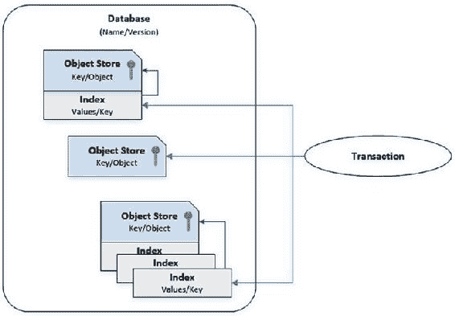
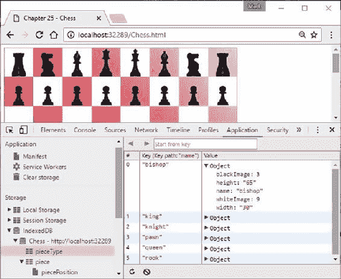
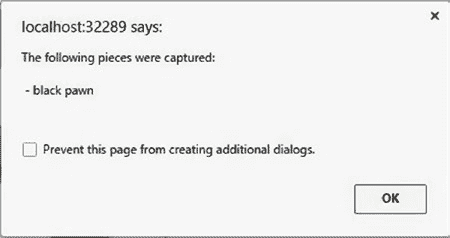

# 第 25 章 ■ Indexed DB

随着浏览器功能的发展，在客户端设备上提供越来越多的功能，本地存储和操作数据的需求也随之增加。为了满足这一需求，Indexed DB 技术应运而生。这是一个使用键和索引来存储和检索对象的 API。

本章将演示如何使用 Indexed DB 在客户端存储和使用数据。如果你习惯于使用 SQL 数据库，我要提醒你，这不是一个 SQL 数据库。一旦你掌握了它，它会非常强大和有用，但在学习本章时，你需要调整你的视角，暂时搁置你的 SQL 经验。

为了探索 Indexed DB 的能力，你将重写在[第 23 章](http://dx.doi.org/10.1007/978-1-4842-2463-2_23)中使用 canvas 创建的棋盘应用。在我解释每个练习时，我不会深入 canvas 的细节；不过，如果你需要更多信息，请参考[第 23 章](http://dx.doi.org/10.1007/978-1-4842-2463-2_23)。你的新版本应用将创建对象存储以定义每个棋子的位置，然后在移动棋子时操作这些数据。

## 介绍 Indexed DB

在我开始详细演示之前，有一些关键点我认为将有助于你更好地理解 Indexed DB 的工作方式。像其他数据库一样，数据被放置在一个持久的数据存储中。

在这种情况下，数据位于本地硬盘上。数据是永久性的。

# IndexedDB 实体介绍

我将详细解释这些实体，但首先介绍它们及其关系。

一个数据库由多个`对象存储`（object stores）组成。每个对象存储是一个对象的集合，每个对象通过唯一键（`key`）标识。一个对象存储可以有一个或多个索引。每个`索引`提供了另一种识别对象存储键的方法。如图 25-1 所示。

© Mark J. Collins 2017

M. J. Collins, *Pro HTML5 with CSS, JavaScript, and Multimedia*, DOI 10.1007/978-1-4842-2463-2_25



**图 25-1.** 数据库实体

对象存储通过`事务`（transaction）对象访问。创建事务时，必须定义其作用域（`scope`）。这指明了它将引用哪些对象存储，以及是读取还是写入数据库。

### 使用对象存储

主要的存储单元称为对象存储（object store）。这个名称很贴切，因为它们只是通过键引用的对象集合。可以将其视为一组键值对，其中值为具有一组属性的对象。可以使用内联键（`inline key`），即对象的某个属性作为键。例如，如果对象具有唯一值的`id`属性，可以将其用作内联键。如果使用外联键（`out-of-line keys`），则在向存储添加对象时需要指定键。或者，可以使用键生成器（`key generator`），对象存储会自动分配递增的键值。以下代码演示了这些选项：

```javascript
// 使用内联键
var typeStore = db.createObjectStore("pieceType", { keyPath: "id" });
typeStore.add(pieceType);

// 使用外联键
var sampleStore = db.createObjectStore("sample", { });
sampleStore.add(sample, 5);

// 使用键生成器
var pieceStore = db.createObjectStore("piece", { autoIncrement: true });
pieceStore.add(piece);
```

顾名思义，还可以在对象存储上创建索引；实际上，可以创建任意数量的索引。索引可以快速找到特定对象或对象集合。索引是一组键值对，其中值是对应对象存储的键。例如，如果有客户对象存储，并希望按姓氏搜索，可以在对象的`lastName`属性上创建索引。数据库会自动为存储中的每个对象在索引中创建一个条目。该条目包含姓氏和对应对象的键。以下代码演示了如何使用索引：

```javascript
// 在 lastName 属性上创建索引
customerStore.createIndex("lastName", "id", { unique: true });

// 获取索引
var index = customerStore.index("lastName");
index.get(lastName).onsuccess = function(); // 获取对象
index.getKey(lastName).onsuccess = function(); // 获取键
```

`createIndex()`函数的第二个参数（本例中为`id`）指定了键路径（`key path`）。这告诉数据库引擎如何从对象中提取键。对于内联键，这是用于定义唯一键的属性名。

IndexedDB 不支持对象存储之间的关系。例如，无法强制实施外键关系。当然可以使用外键，即一个对象存储中的属性是另一个对象存储中的键，我将在后面演示。但数据库不会强制实施此约束。此外，也无法在对象存储之间执行连接（`join`）操作。

### 定义数据库

打开数据库时，需要实现三个事件处理器：

* `onsuccess`：数据库已打开；进行相关操作。

* `onerror`：发生了错误，通常是访问问题。

* `onupgradeneeded`：需要创建或升级数据库。

打开数据库时，如果数据库不存在，会自动创建；但会触发`onupgradeneeded`事件。必须为此事件实现事件处理器，该处理器将创建对象存储并用默认数据填充它们。这是唯一允许更改数据库结构的地方。需要记住的重要一点是：`onupgradeneeded`事件在`onsuccess`事件之前触发。

`open()`调用还指定了版本号。如果不是当前版本，在这种情况下也会触发`onupgradeneeded`事件。事件处理器需要处理结构更改，以匹配调用者请求的版本。可以像这样查询数据库的当前版本：

```javascript
var request = dbEng.open("Sample", 2); // 获取版本 2
request.onupgradeneeded = function (event) {
    alert("Configuring database - current version is " + e.oldVersion +
          ", requested version is " + e.newVersion);
}
```

根据当前版本，代码可能需要执行不同的操作。

### 异步处理

IndexedDB 的一个关键方面可能需要适应，即其异步处理；几乎所有数据库操作都是异步执行的。一般模式是调用一个方法执行数据库操作，如打开数据库或检索一组记录（对象）。这会返回一个请求对象。然后必须为该请求对象实现`onsuccess`和`onerror`事件处理器。如果请求成功，则调用`onsuccess`处理器，并通过事件对象传递方法调用的结果。

对于需要多次数据库调用的复杂处理，需要小心地嵌套事件处理器，并考虑它们的执行时机。例如，如果需要发起三个数据库请求，代码可能如下所示：

```javascript
var request = dbCall1()
request.onsuccess = function (e1) {
    f1(e1.target.result);
    dbCall2().onsuccess = function (e2) {
        f3(e2.target.result, e1.target.result);
        dbCall3().onsuccess = function (e3) {
            f5(e3.target.result, e2.target.result, e1.target.result);
        }
        f4(e2.target.result);
    }
    f2(e1.target.result);
}
request.onerror = function(e) {
    alert("The call failed");
}
```

这段代码依次调用`dbCall1()`、`dbCall2()`和`dbCall3()`，它们将按顺序处理。换句话说，`dbCall2()`不会启动，直到`dbCall1()`完成且成功。每个调用都提供了`onsuccess`事件处理器，该处理器发起下一次调用。如果第一次调用失败，则会弹出警报。可能出乎意料的是非数据库调用的执行顺序。数据库调用立即返回，事件处理器稍后在操作完成时调用。一旦调用`dbCall2()`，函数就返回，然后执行`f2()`。稍后`dbCall2()`完成，其事件处理器被调用，并执行`f3()`。

> **提示：** `onerror`事件会冒泡到层级结构。例如，发生在请求对象上的错误，如果未被处理，将冒泡到事务对象。如果仍未处理，将冒泡到数据库对象。在许多情况下，可以仅在数据库级别使用一个事件处理器来处理所有错误。

由于嵌套方式，事件处理器可以访问先前调用的事件对象。因此，应该为事件参数使用唯一的名称。这样可以避免歧义。另外，注意使用闭包来访问这些事件对象。如前所述，`f2()`在`f3()`之前调用，因此`dbCall1()`的事件处理器（定义了`e1`参数）在`dbCall2()`的事件处理器执行时已完成且不再作用域内。JavaScript 的闭包特性允许后续的事件处理器访问该对象。这一点很重要，因为如果需要访问所有三个对象存储来完成操作，必须等待所有三个都完成，然后访问所有三个结果。

# 排版后的内容

为避免闭包问题，`提示`：你可以从前两次数据库调用中提取所需属性，并将其存储在局部变量中（在 `dbCall1()` 调用之前声明）。然后在 `f5()` 调用中，使用这些变量代替 `e1` 和 `e2` 事件对象。这仅仅是个人偏好问题，因为两种方法都能正常工作。

## 使用事务

所有数据访问（包括读取和写入）都在事务内完成，因此你必须首先创建一个事务对象。创建事务时，需要指定其作用域（由其将要访问的对象存储定义），同时指定模式（只读或读写）。然后，你可以从事务中获取对象存储，并像这样从存储中获取或放入数据：

```
var xact = db.transaction(["piece", "pieceType"], "readwrite");
var pieceStore = xact.objectStore("piece");
```

对于读写事务，数据更改在事务完成前不会提交。

一个值得思考的问题是：“事务何时完成？”当没有未完成的请求时，事务即告完成。请记住，一切都是基于请求的。你发出一个请求，然后实现一个事件处理程序，在请求完成时执行操作。如果该事件处理程序对该事务发出另一个请求，则事务保持活跃状态。这是嵌套事件处理程序的另一个重要原因。如果你在未发出其他请求的情况下结束事件处理程序，事务将完成，所有更改都将提交。如果之后尝试使用该事务，你将收到 `TRANSACTION_INACTIVE_ERR` 错误。

另一点需要记住的是，读写事务的作用域不能重叠。如果你创建了一个读写事务，只要第二个事务不包含与第一个事务相同的对象存储，就可以创建第二个事务。如果它们的作用域重叠，则必须等待第一个事务完成，再创建第二个。而只读事务的作用域可以重叠。

## 创建应用程序

首先，你将使用 Canvas 创建一个棋盘，并为棋子配置图像，就像在[第 23 章](http://dx.doi.org/10.1007/978-1-4842-2463-2_23)中那样。

### 创建 Web 项目

首先，创建一个 HTML 文档和一个脚本文件。你还需要棋子的图像文件。

### 第 25 章 ■ Indexed DB

**练习 25-1. 创建 Web 项目**

1. 使用基本标记创建一个名为 `Chess.html` 的新网页：

```
<!DOCTYPE html>
<html lang="en">
<head>
<meta charset="utf-8" />
<title>第 25 章 - 国际象棋</title>
<script src="Data.js" defer></script>
<script src="Chess.js" defer></script>
</head>
<body>
</body>
</html>
```

2. 然后使用以下代码创建一个 `Chess.js` 脚本文件：

```
"use strict";
```

3. 在 `Chess.html` 文件的空 body 元素中添加一个 `div` 元素，使用以下标记：

```
<div>
<canvas id="board" width ="600" height ="600">
不支持
</canvas>
</div>
```

4. 在 Web 项目中添加一个 `Images` 文件夹。

5. 棋子的图像包含在源代码下载文件中。这些与[第 23 章](http://dx.doi.org/10.1007/978-1-4842-2463-2_23)中使用的图像相同。你可以在 `Chapter23\Images` 文件夹中找到它们。将所有 12 个文件拖放到 Web 项目的 `Images` 文件夹中。

### 绘制 Canvas

现在，你将使用 JavaScript 设计 Canvas 元素。初始设计仅绘制一个空棋盘，稍后你将添加棋子。有关 Canvas 元素的更多说明，请参阅[第 23 章](http://dx.doi.org/10.1007/978-1-4842-2463-2_23)。将清单 25-1 中的代码添加到 `Chess.js` 脚本中。

***清单 25-1.*** 设计初始 Canvas

```
// 获取 Canvas 上下文
var chessCanvas = document.getElementById("board");
var chessContext = chessCanvas.getContext("2d");

drawBoard();
function drawBoard() {
  chessContext.clearRect(0, 0, 600, 600);

  var gradient = chessContext.createLinearGradient(0, 600, 600, 0);
  gradient.addColorStop(0, "#D50005");
  gradient.addColorStop(0.5, "#E27883");
  gradient.addColorStop(1, "#FFDDDD");
  chessContext.fillStyle = gradient;
  chessContext.strokeStyle = "red";

  // 绘制交替的方格
  for (var x = 0; x < 8; x++) {
    for (var y = 0; y < 8; y++) {
      if ((x + y) % 2) {
        chessContext.fillRect(75 * x, 75 * y, 75, 75);
      }
    }
  }

  // 为整个棋盘添加边框
  chessContext.strokeRect(0, 0, 600, 600);
}
```


在浏览器中显示 `Chess.html` 文件，其效果应如图 25-2 所示。

**图 25-2.** 初始（空白）棋盘

# 第 25 章 ■ 索引数据库

## 配置棋子

你将使用图像文件来表示国际象棋棋子。在将它们添加到画布之前，需要为每个棋子创建一个 `Image` 对象，并指定其 `src` 属性。你还需要将这些对象放入一个数组中，以便更轻松地通过编程方式选择所需的图像。

此外，你需要定义将加载到对象存储中的数据。`pieceTypes[]` 数组定义了显示每个棋子所需的属性，例如高度和宽度。它还指定了 `images[]` 数组中黑子和白子图像对应的索引。`pieces[]` 数组包含上一章中使用的相同详细信息，例如行和列，并定义了 32 个棋子的起始位置。

将清单 25-2 中显示的代码添加到新的 `Data.js` 脚本文件中。此文件也包含在源代码下载中，因此你可以直接将其复制到你的 Web 项目中，而无需重新输入这些数据。

**清单 25-2.** 定义静态数据

```
// 定义象棋棋子图像
var imgPawn = new Image();
var imgRook = new Image();
var imgKnight = new Image();
var imgBishop = new Image();
var imgQueen = new Image();
var imgKing = new Image();
var imgPawnW = new Image();
var imgRookW = new Image();
var imgKnightW = new Image();
var imgBishopW = new Image();
var imgQueenW = new Image();
var imgKingW = new Image();

// 指定每个图像的源文件
imgPawn.src = "images/pawn.png";
imgRook.src = "images/rook.png";
imgKnight.src = "images/knight.png";
imgBishop.src = "images/bishop.png";
imgQueen.src = "images/queen.png";
imgKing.src = "images/king.png";
imgPawnW.src = "images/wpawn.png";
imgRookW.src = "images/wrook.png";
imgKnightW.src = "images/wknight.png";
imgBishopW.src = "images/wbishop.png";
imgQueenW.src = "images/wqueen.png";
imgKingW.src = "images/wking.png";

// 定义 Image 对象的数组
var images = [
  imgPawn,
  imgRook,
  imgKnight,
  imgBishop,
  imgQueen,
  imgKing,
  imgPawnW,
  imgRookW,
  imgKnightW,
  imgBishopW,
  imgQueenW,
  imgKingW
];

var pieceTypes = [
  { name: "pawn", height: "50", width: "28", blackImage: 0, whiteImage: 6 },
  { name: "rook", height: "60", width: "36", blackImage: 1, whiteImage: 7 },
  { name: "knight", height: "60", width: "36", blackImage: 2, whiteImage: 8 },
  { name: "bishop", height: "65", width: "30", blackImage: 3, whiteImage: 9 },
  { name: "queen", height: "70", width: "32", blackImage: 4, whiteImage: 10 },
  { name: "king", height: "70", width: "28", blackImage: 5, whiteImage: 11 }
];

var pieces = [
  { type: "pawn", color: "white", row: 6, column: 0, pos: "a2", killed: false },
  { type: "pawn", color: "white", row: 6, column: 1, pos: "b2", killed: false },
  { type: "pawn", color: "white", row: 6, column: 2, pos: "c2", killed: false },
  { type: "pawn", color: "white", row: 6, column: 3, pos: "d2", killed: false },
  { type: "pawn", color: "white", row: 6, column: 4, pos: "e2", killed: false },
  { type: "pawn", color: "white", row: 6, column: 5, pos: "f2", killed: false },
  { type: "pawn", color: "white", row: 6, column: 6, pos: "g2", killed: false },
  { type: "pawn", color: "white", row: 6, column: 7, pos: "h2", killed: false },
  { type: "rook", color: "white", row: 7, column: 0, pos: "a1", killed: false },
  { type: "rook", color: "white", row: 7, column: 7, pos: "h1", killed: false },
];
```

```json
{
  "type": "knight",
  "color": "white",
  "row": 7,
  "column": 1,
  "pos": "b12",
  "killed": false
},
{
  "type": "knight",
  "color": "white",
  "row": 7,
  "column": 6,
  "pos": "g1",
  "killed": false
},
{
  "type": "bishop",
  "color": "white",
  "row": 7,
  "column": 2,
  "pos": "c1",
  "killed": false
},
{
  "type": "bishop",
  "color": "white",
  "row": 7,
  "column": 5,
  "pos": "f1",
  "killed": false
},
{
  "type": "queen",
  "color": "white",
  "row": 7,
  "column": 3,
  "pos": "d1",
  "killed": false
},
{
  "type": "king",
  "color": "white",
  "row": 7,
  "column": 4,
  "pos": "e1",
  "killed": false
},
{
  "type": "pawn",
  "color": "black",
  "row": 1,
  "column": 0,
  "pos": "a7",
  "killed": false
},
{
  "type": "pawn",
  "color": "black",
  "row": 1,
  "column": 1,
  "pos": "b7",
  "killed": false
},
{
  "type": "pawn",
  "color": "black",
  "row": 1,
  "column": 2,
  "pos": "c7",
  "killed": false
},
{
  "type": "pawn",
  "color": "black",
  "row": 1,
  "column": 3,
  "pos": "d7",
  "killed": false
},
{
  "type": "pawn",
  "color": "black",
  "row": 1,
  "column": 4,
  "pos": "e7",
  "killed": false
},
{
  "type": "pawn",
  "color": "black",
  "row": 1,
  "column": 5,
  "pos": "f7",
  "killed": false
},
{
  "type": "pawn",
  "color": "black",
  "row": 1,
  "column": 6,
  "pos": "g7",
  "killed": false
},
{
  "type": "pawn",
  "color": "black",
  "row": 1,
  "column": 7,
  "pos": "h7",
  "killed": false
},
{
  "type": "rook",
  "color": "black",
  "row": 0,
  "column": 0,
  "pos": "a8",
  "killed": false
},
{
  "type": "rook",
  "color": "black",
  "row": 0,
  "column": 7,
  "pos": "h8",
  "killed": false
},
{
  "type": "knight",
  "color": "black",
  "row": 0,
  "column": 1,
  "pos": "b8",
  "killed": false
},
{
  "type": "knight",
  "color": "black",
  "row": 0,
  "column": 6,
  "pos": "g8",
  "killed": false
},
{
  "type": "bishop",
  "color": "black",
  "row": 0,
  "column": 2,
  "pos": "c8",
  "killed": false
},
{
  "type": "bishop",
  "color": "black",
  "row": 0,
  "column": 5,
  "pos": "f8",
  "killed": false
},
{
  "type": "queen",
  "color": "black",
  "row": 0,
  "column": 3,
  "pos": "d8",
  "killed": false
},
{
  "type": "king",
  "color": "black",
  "row": 0,
  "column": 4,
  "pos": "e8",
  "killed": false
}
```

# 第 25 章 ■ Indexed DB

## 创建数据库

现在你已经准备好创建并使用本地 Indexed DB 数据库来配置和显示棋盘上的棋子了。初始阶段，数据将从静态数据加载，你只需简单地显示开局阵型。稍后，你将通过更新对象存储中的棋子位置来实现动画效果。

你需要向数据库中填充一些数据。在本应用程序中，你只需使用 `Data.js` 脚本中声明的数据，并将其复制到对象存储中。对于其他应用，这些数据可能从服务器下载或由用户输入获得。

## 打开数据库

将清单 25-3 所示的代码添加到 `Chess.js` 脚本中，紧跟在 `drawBoard()` 调用之后（并在 `drawBoard()` 函数实现之前）。

`清单 25-3.` 打开数据库

```
var dbEng = window.indexedDB ||
  window.webkitIndexedDB || // Chrome
  window.mozIndexedDB || // Firefox
  window.msIndexedDB; // IE
var db; // 这是数据库的句柄
if (!dbEng)
  alert("此浏览器不支持 IndexedDB");
else {
  var request = dbEng.open("Chess", 1);
  request.onsuccess = function (event) {
    db = event.target.result;
  }
  request.onerror = function (event) {
    alert("请允许浏览器打开数据库");
  }
  request.onupgradeneeded = function (event) {
    configureDatabase(event);
  }
}
```

如果无法访问 `indexedDB` 对象，则说明浏览器不支持它。在本演示中，你可以简单地使用 `alert()` 来通知用户并停止后续处理。

然后，此代码使用 `indexedDB` 对象打开 Chess 数据库，并指定使用的版本号。`open()` 方法返回一个 `IDBOpenDBRequest` 对象，正如我之前所述。你将为此请求附加三个事件处理程序。

- `onsuccess`：此事件处理程序仅保存对数据库的引用。稍后你将在此处添加更多逻辑。请注意，数据库是从 `event.target.result` 属性中获取的，所有结果都通过该属性返回。

- `onerror`：浏览器无法打开数据库的主要原因在于浏览器已阻止 IndexedDB 功能。出于安全原因，该功能可能被禁用。在这种情况下，系统会提示用户允许访问。或者，你也可以选择显示错误信息。

- `onupgradeneeded`：如果数据库不存在或指定的版本不是当前版本，则会触发此事件。这会调用 `configureDatabase()` 函数，接下来你将实现该函数。

## 定义数据库结构

将列表 25-4 中显示的代码添加到 `Chess.js` 脚本中，以实现 `configureDatabase()` 函数。

`列表 25-4.` 定义数据库结构

```
function configureDatabase(e) {
    alert("Configuring database - current version is " + e.oldVersion +
        ", requested version is " + e.newVersion);
    db = e.currentTarget.result;
    // Remove all existing data stores
    var storeList = db.objectStoreNames;
    for (var i = 0; i < storeList.length; i++) {
        db.deleteObjectStore(storeList[i]);
    }
    // Store the piece types
    var typeStore = db.createObjectStore
        ("pieceType", { keyPath: "name" });
    for (var i in pieceTypes){
        typeStore.add(pieceTypes[i]);
    }
    // Create the piece data store (you'll add
    // the data later)
    var pieceStore = db.createObjectStore
        ("piece", { autoIncrement: true });
    pieceStore.createIndex
        ("piecePosition", "pos", { unique: true });
}
```

`■ 注意` 如果数据库不存在或不是当前版本，则会调用 `configureDatabase()` 函数。对于版本变更，你可以使用 `db.version` 属性获取当前版本，然后进行必要的调整。另外，传递给 `onupgradeneeded` 事件处理器的事件对象将包含 `e.oldVersion` 和 `e.newVersion` 属性。为了简化本项目中的操作，你将简单地删除所有对象存储并从头重建数据库。这将清除所有现有数据。对于这个例子来说没问题，但在大多数情况下，你需要尽可能保留数据。

数据库对象的 `objectStoreNames` 属性包含所有已创建对象存储的名称列表。要移除所有现有对象存储，列表中的每个名称都会被传递给 `deleteObjectStore()` 方法。

最初，你将使用 `createObjectStore()` 方法创建两个数据存储。

- `pieceType`：包含每种棋子类型的对象，例如兵、车或王。
- `piece`：包含每个棋子的对象，黑方 16 个，白方 16 个。

## 指定对象键

创建对象存储时，你必须在调用 `createObjectStore()` 方法时指定存储的名称。你还可以指定一个或多个可选参数。只支持两个参数。

- `keypath`：指定为属性名称的集合。如果使用单个属性，你可以将其指定为字符串而不是字符串集合。这定义了将用作键的对象属性（或多个属性）。如果未指定 `keypath`，则必须使用键生成器或提供键值来定义键，稍后将在本节中解释。
- `autoIncrement`：如果为 `true`，表示键由对象存储按顺序分配。

存储中的每个对象都必须具有唯一的键。有三种指定键的方法。

- 使用 `keypath` 参数指定一个或多个定义唯一键的属性。当添加对象时，`keypath` 用于根据对象的属性生成键。
- 使用键生成器。如果指定了 `autoIncrement`，对象存储将基于内部计数器分配键。
- 添加对象时提供键值。如果你没有指定键路径或使用键生成器，则在将对象添加到存储时必须提供键。

对于 `pieceType` 存储，你将使用 `keypath`。`name` 属性将指定类型，例如兵或马。这将是每个对象的唯一值。这也是将用于检索对象的值，因此这非常适合作为键路径。创建对象存储后，来自 `pieceTypes[]` 数组的数据将被复制到 `pieceType` 存储中。

`■ 注意` 在 `onupgradeneeded` 事件处理程序中，无需显式创建事务即可将数据添加到对象存储。存在一个隐式事务，该事务是在响应 `onupgradeneeded` 事件时创建的。

## 创建索引

对于 `piece` 存储，棋子数据中没有自然可用的键，因此你将使用键生成器。它会生成唯一的键，但这些键没有实际意义；它们只是为了满足唯一约束而创建的合成键。最初在绘制棋盘时，你将检索所有对象，因此不需要知道键是什么。

稍后，你将需要检索一个棋子以便移动它。你将根据棋子在其棋盘上的位置来找到它。为此，你将基于 `pos` 属性向存储添加一个索引。由于没有两个棋子可以占据同一个格子，`pos` 属性可以用作唯一索引。通过将其指定为唯一索引，如果你尝试插入一个位置与现有对象相同的新对象，将会收到错误。

`■ 注意` 由于 `pos` 属性是唯一的，你可能会想将其用作键。但是，因为你会移动棋子，它们的位置会发生变化，使用经常变化的键被认为是一种糟糕的设计模式。对于 IndexedDB 来说，这尤其有问题，因为你实际上无法更改键；你必须删除当前对象，然后使用新键重新添加它。

创建索引时，你必须像这样指定一个 `keypath`：

```
pieceStore.createIndex
    ("piecePosition", "pos", { unique: true });
```

# IndexedDB

在这种情况下，`pos`属性是这个索引的键路径。`keypath`可能包含多个属性，在这种情况下，索引将基于所选属性的组合。当对象存储具有索引时，当对象被添加到存储中时，索引会自动填充。

## 重置棋盘

你已经创建了`piece`对象存储，但尚未填充数据。你将在单独的函数中执行此操作。

为了理解原因，让我解释一下数据库生命周期。第一次显示网页时，数据库会被打开，由于它不存在，将创建一个新数据库。这是因为会触发`onupgradeneeded`事件，并且你实现了这个事件处理器来创建对象存储。当再次显示页面（或简单刷新）时，由于数据库已存在，将跳过此步骤。

稍后，当你开始移动棋子以及删除它们时，你希望在重新加载页面时将它们移回初始位置。你可以使用此方法来实现。现在，你将使用以下代码向`Chess.js`脚本添加一个`resetBoard()`函数。此函数不是在数据库创建时调用，而是在页面加载时调用。

```javascript
function resetBoard() {
    var xact = db.transaction(["piece"], "readwrite");
    var pieceStore = xact.objectStore("piece");
    var request = pieceStore.clear();
    request.onsuccess = function(event) {
        for (var i in pieces) {
            pieceStore.put(pieces[i]);
        }
    }
}
```

此代码使用读写模式创建一个事务，并仅指定`piece`对象存储，因为这是你唯一需要访问的。然后从事务中获取`piece`存储。`clear()`方法用于从存储中删除所有对象。最后，`pieces[]`数组中的所有对象都被复制到对象存储中。

现在，将下面以粗体显示的代码添加到`onsuccess`事件处理器中。这将在数据库打开后调用`resetBoard()`函数。

**注意** `onupgradeneeded`事件被触发，其事件处理器必须在`onsuccess`事件被触发之前完成。这确保了数据库在使用前已被正确配置。

```javascript
var request = dbEng.open("Chess", 1);
request.onsuccess = function (event) {
    db = event.target.result;
    // Add the pieces to the board
    resetBoard();
}
```

**提示**：在`resetBoard()`函数中，你调用了`put()`方法（重复了 32 次）。然而，你没有获取任何响应对象或实现任何事件处理器。这段代码看起来是同步执行的。

实际上，这些调用是异步处理的，并且在两种情况下都会返回响应对象，但返回值被忽略了。你可以为这些请求实现`onsuccess`和`onerror`事件处理器。

在这个例子中，你取了一点巧。由于不像检索数据时需要结果值，你不需要处理`onsuccess`事件。因为这些调用位于一个事务内，其他事务对这些对象存储的后续使用将被阻塞，直到更新完成。

## 绘制棋子

到目前为止，你已经打开了数据库，并在必要时配置了对象存储。你还用初始位置填充了棋子存储。现在你可以绘制棋子了。为此，你将实现一个`drawAllPieces()`函数来遍历所有棋子，以及一个`drawPiece()`函数来显示单个图像。这些函数类似于你在[第 23 章](http://dx.doi.org/10.1007/978-1-4842-2463-2_23)中创建的同名函数。

然而，这些函数的数据将从新数据库中检索。

`drawAllPieces()`函数将使用一个游标来处理`piece`对象存储中的所有对象。

对于每个棋子，它将提取必要的属性并将它们传递给`drawPiece()`函数。然后`drawPiece()`函数必须访问`pieceType`存储以获取类型属性（如高度和宽度），并在适当的位置显示图像。

## 使用游标

从对象存储中检索数据时，如果你想使用键检索单个记录，请使用`get()`方法（我将在后面描述）。你也可以使用索引选择一个或多个对象，我将在本章后面解释这一点。要获取所有棋子，你需要访问整个对象存储，这将通过使用游标来完成。

创建事务并获取对象存储后，你将调用它的`openCursor()`方法。这将返回一个`IDBRequest`对象，你需要为其提供一个`onsuccess`事件处理器。当事件触发时，它只提供第一个对象。你可以通过调用`continue()`方法获取下一个对象。为了演示这一点，将清单 25-5 中所示的函数添加到`Chess.js`脚本中。

**清单 25-5.** 绘制棋子

```javascript
function drawAllPieces() {
    var xact = db.transaction(["piece", "pieceType"]);
    var pieceStore = xact.objectStore("piece");
    var cursor = pieceStore.openCursor();
    cursor.onsuccess = function (event) {
        var item = event.target.result;
        if (item) {
            if (!item.value.killed) {
                drawPiece(item.value.type,
                    item.value.color,
                    item.value.row,
                    item.value.column,
                    xact);
            }
            item.continue();
        }
    }
}
```

这段代码创建了一个将同时使用`piece`和`pieceType`对象存储的事务。模式未指定，默认值为`readonly`。然后它获取`piece`对象存储并调用其`openCursor()`方法。`onsuccess`事件处理器从事件对象（使用`event.target.result`）获取第一个对象。如果棋子未被吃掉，则调用`drawPiece()`函数显示它（你将在下一步实现该函数）。我稍后会解释`killed`属性。你传入它所需的所有属性，如`type`、`color`、`row`和`column`。你还需要传入事务对象，以便`drawPiece()`函数可以使用同一事务访问`pieceType`存储。

调用`continue()`方法将导致同一事件再次触发，这次在`event.target.result`属性中提供下一个对象。如果没有更多对象，则`result`属性将为`null`。这就是你获知所有对象已处理完毕的方式。

### 过滤与排序

`openCursor()`方法提供了一些基本功能来过滤返回的对象。如果未提供参数，它将返回存储中的所有对象。你可以使用以下方式之一指定键范围：

- `IDBKeyRange.only()`：指定单个值，仅返回匹配的记录。
- `IDBKeyRange.lowerBound()`：仅返回大于指定值的键值。默认情况下这是包含性的，因此它也会返回键值完全匹配的对象，但你可以更改此设置，使其仅返回更大的值。
- `IDBKeyRange.upperBound()`：工作方式与`lowerBound()`类似，不同之处在于它返回小于或等于指定值的值。我将在本章后面演示这一点。
- `IDBKeyRange.bound()`：允许你同时指定下限和上限。你还可以指示这些值中的任一个是否为包含性的。这些值的默认值为`false`，表示不包含。

你还可以向`openCursor()`函数传递第二个参数，以指定返回记录的方向。支持的值定义在`IDBCursorDirection`枚举中。可能的值如下：

- `next`：按递增键顺序返回下一条记录（这是默认值）。
- `prev`：返回前一条记录。
- `nextunique`：返回具有不同键的下一条记录；这忽略重复的键。
- `prevunique`：返回前一条记录，忽略重复的键。

以下示例将返回键大于 3 且小于等于 7 的对象，并按降序返回它们。创建键范围时的最后两个参数表示下限不包含，而上限包含。打开游标时，第二个参数指定应使用反向方向。

```javascript
var keyRange = IDBKeyRange.bound(3, 7, false, true);
store.openCursor(keyRange, IDBCursorDirection.prev);
```

#### 检索单个对象

现在你将实现`drawPiece()`函数，该函数将在棋盘上绘制单个棋子。它必须首先访问`pieceType`对象存储以获取图像细节。在这种情况下，你将使用其键检索单个对象。`pieceType`对象存储的键是`type`属性。将清单 25-6 中所示的函数添加到`Chess.js`脚本中。

***清单 25-6.*** 绘制单个棋子

```javascript
function drawPiece(type, color, row, column, xact) {
  var typeStore = xact.objectStore("pieceType");
  var request = typeStore.get(type);
  request.onsuccess = function (event) {
    var img;
    if (color === "black") {
      img = images[event.target.result.blackImage];
    }
    else {
      img = images[event.target.result.whiteImage];
    }
    chessContext.drawImage(img,
      (75 - event.target.result.width) / 2 + (75 * column),
      73 - event.target.result.height + (75 * row),
      event.target.result.width,
      event.target.result.height);
  }
}
```

此代码使用传入的同一个事务对象。它获取`pieceType`对象存储，然后调用其`get()`方法。`onsuccess`事件处理器获取必要的属性并调用画布的`drawImage()`方法。有关在画布上绘制图像的更多信息，请参阅[第 23 章](http://dx.doi.org/10.1007/978-1-4842-2463-2_23)。

现在，通过添加如下所示以粗体显示的代码，在`open()`调用的`onsuccess`事件处理器中添加对`drawAllPieces()`的调用。

```javascript
request.onsuccess = function (event) {
  db = event.target.result;
  // 将棋子添加到棋盘上
  resetBoard();
  // 在初始位置绘制棋子
  drawAllPieces();
}
```

#### 测试应用程序

现在你可以测试应用程序了，它将显示初始起始位置。刷新浏览器，你应该会看到一个警告，告知正在配置数据库，如图 25-3 所示。

***图 25-3.*** 显示正在配置数据库的警告

再次运行此应用程序时，无需再进行此配置。棋盘应如图 25-4 所示。

**图 25-4.** 已完成静态棋子布局的棋盘

---

**提示**：若要从计算机中删除数据库，可找到其存储文件夹并删除对应的子文件夹。以我的机器上的 Firefox 为例，路径为 `C:\Users\Mark\AppData\Roaming\Mozilla\Firefox\Profiles\p1i1rsab.default\storage\default`。此文件夹中每个数据库都有一个子文件夹，子文件夹名称包含协议（`http`）、域名和端口（如有）。对于我的应用程序，该子文件夹名为 `http+++localhost+25519`。删除此文件夹并重启浏览器。由于必须新建数据库，页面将重新配置。对于 Chrome，文件路径为：`C:\Users\Mark\AppData\Local\Google\Chrome\User Data\Default\IndexedDB`。

如果在 Chrome 中打开 `Chess.html` 文件，可通过开发者工具访问此数据库。选择“Application”链接，然后展开“Storage”部分的 `IndexedDB` 项，如图 25-5 所示。



**图 25-5.** 在 Chrome 中查看数据库

---

### 移动棋子

现在你可以通过移动棋子来让棋盘动态起来了。这里将使用第 23 章中用过的相同预设走法。只需更新棋子的位置并重新绘制棋盘即可移动一个棋子。

不过有一个复杂情况：如果某次移动吃掉了棋子，你需要将其从棋盘上移除。目前，你只需从存储中删除该对象即可，但本章末尾会介绍更好的方法。

#### 定义走法

既然你现在对数据库已经相当熟悉了，就把走法也存储在数据库中吧。一次走法由起始位置和终止位置定义。例如，“将 `e2` 处的棋子移动到 `e3`”。你将对这些走法从 1 到 7 编号，以便按正确顺序执行。你需要一个新的对象存储来保存走法详情。为此，需要指定一个新版本，这将触发 `onupgradeneeded` 事件。然后，在 `configureDatabase()` 函数中添加逻辑来创建新存储。

---

**练习 25-2. 添加走法存储**

1. 在调用 `drawBoard()` 函数之前，将以下代码添加到 `Chess.js` 脚本的开头。

```javascript
var moves = [
  { id: 1, start: "e2", end: "e3" },
  { id: 2, start: "e7", end: "e5" },
  { id: 3, start: "f1", end: "c4" },
  { id: 4, start: "h7", end: "h6" },
  { id: 5, start: "d1", end: "f3" },
  { id: 6, start: "g7", end: "g6" },
  { id: 7, start: "f3", end: "f7" }
];
```

2. 将以下以粗体显示的代码添加到 `configureDatabase()` 函数的末尾。这将在配置数据库时创建并填充走法存储。

```javascript
pieceStore.createIndex
("piecePosition", "pos", { unique: true });
// 存储走法
var moveStore = db.createObjectStore
("move", { keyPath: "id" });
for (var i in moves) {
  moveStore.add(moves[i]);
}
```

3. 在 `open()` 调用中，将版本号改为 2（如粗体所示）。这将导致下次加载页面时触发 `onupgradeneeded` 事件。

```javascript
if (!dbEng)
  alert("此浏览器不支持 IndexedDB");
else {
  var request = dbEng.open("Chess", 2);
```

**注意**：在此示例中，`configureDatabase()` 函数会直接删除所有现有数据存储，然后重新创建它们。之所以可以这样做，是因为你无需操心维护任何现有数据；这些数据都是用预设值重新加载的。在许多场景中，你不能这样做，而需要根据当前版本进行具体更改。例如，如果请求版本 5 而当前版本是 2，则需要先添加版本 3 的更改，再添加版本 4 的更改，最后添加版本 5 的更改。在规划结构变更时务必牢记这一点。

---

#### 转换位置

棋子存储区中的对象具有 `row`、`column` 和 `pos` 属性。`row` 和 `column` 属性遵循第 23 章中使用的相同约定，即左上角方格位于 `0,0`。这与 canvas 的工作方式一致，并简化了 `drawPiece()` 的实现。相比之下，`pos` 属性使用国际象棋中广泛使用的记谱法，从左到右移动时，列（棋盘纵线）依次为 `a` 到 `h`。从棋盘底部移动到顶部时，行（棋盘横线）依次为 `1` 到 `8`。因此，`a1` 表示左下角的方格。

在开始移动棋子的繁重工作之前，你将创建一个函数，用于将 `pos` 属性转换为 `row` 和 `column` 属性。例如，当一个棋子被移动到 `e3` 时，你需要将 `e3` 转换为对应的 `row` 和 `column` 坐标，即 `5`（行）和 `4`（列）。将清单 25-7 所示的函数添加到 `Chess.js` 脚本中。

***清单 25-7.*** 实现 `computeRowColumn()` 函数

```javascript
function computeRowColumn(oStart, end) {
  oStart.pos = end;
  switch (end.substring(0, 1)) {
    case "a": oStart.column = 0; break;
    case "b": oStart.column = 1; break;
    case "c": oStart.column = 2; break;
    case "d": oStart.column = 3; break;
```

# 第 25 章 ■ IndexedDB

## 执行移动

就像你在第 23 章中所做的那样，你将使用一个计时器每隔两秒执行下一步移动。你需要一个计时器变量，以便在动画完成时清除该计时器。你还需要跟踪当前的移动步数。在调用 `drawBoard()` 方法之前，将以下两个变量添加到 `Chess.js` 脚本中。

```javascript
var moveNumber = 1;
var timer;
drawBoard();
```

移动一个棋子最多需要进行五次数据库调用：

1.  从移动存储区获取下一个对象（该对象定义了起始和结束位置）。
2.  获取起始位置的对象。
3.  获取结束位置的对象（如果该移动是吃子，则只会有一个对象）。
4.  移除结束位置的对象（此步骤仅在某些移动时需要）。
5.  更新起始位置的对象（将其移动到结束位置）。

这些调用都将使用同一个事务进行。正如我在本章开头演示的那样，你需要为每一个调用嵌套 `onsuccess` 事件处理程序。将清单 25-8 所示的 `makeNextMove()` 函数添加到 `Chess.js` 脚本中。

**清单 25-8.** 实现 `makeNextMove()` 函数

```javascript
function makeNextMove() {
  var xact = db.transaction(["move", "piece"], "readwrite");
  var moveStore = xact.objectStore("move");
  moveStore.get(moveNumber).onsuccess = function (e1) {
    var startPos = e1.target.result.start;
    var endPos = e1.target.result.end;
    var startKey = null;
    var oStart = null;
    var pieceStore = xact.objectStore("piece");
    var index = pieceStore.index("piecePosition");
    index.getKey(startPos).onsuccess = function (e2) {
      startKey = e2.target.result;
      index.get(startPos).onsuccess = function (e3) {
        oStart = e3.target.result;
        // 如果结束位置存在棋子，我们需要更新它以防止出现重复的 pos 索引
        removePiece(endPos, oStart, startKey, pieceStore);
      }
    }
  }
}
```

此函数会创建一条事务，同时访问移动存储和棋子存储。模式设置为 `readwrite`，因为棋子存储中的对象将被修改。接着它获取移动存储，并调用其 `get()` 方法，传入当前棋步（即表格的键）。这将返回一个对象，并在 `onsuccess` 事件处理程序中从结果中提取起始位置和结束位置。

**提示**：请注意，这段代码并未显式定义 `request` 变量。相反，`onsuccess` 事件处理程序直接附加在数据库调用上。在前面的示例中，我声明了一个 `request` 变量，然后将事件处理程序附加到该变量上，以帮助你理解操作过程。然而，将事件处理程序直接附加到方法上也能达到相同效果，并且让代码更简洁一些。

## 获取对象键

对于棋子存储，你使用了键生成器，因此键并非对象的一部分。`makeNextMove()` 函数中的代码将使用基于 `pos` 属性建立的索引，来检索起始位置处的对象（如果终点位置有棋子，也会检索该位置的对象）。要更新或删除对象，你需要获取其键。

在检索起始位置的棋子对象时，这段代码首先从事务中获取棋子存储。然后从中获取 `piecePosition` 索引。要获取键值，你需要调用 `index.getKey()` 方法，该方法会返回所请求起始位置的键。该键值存储在 `startKey` 变量中。

要获取所需的对象，你需要调用 `index.get()` 方法，并传入要搜索的位置。这会返回所请求起始位置处的对象，并将其存储在 `oStart` 变量中。

在这两种情况下，数据都会通过 `result` 属性返回。同时，处理结果的事件处理程序采用了嵌套形式。

获取到必要的数据后，会调用 `removePiece()` 方法，并传入以下参数：

* `end`：被移动棋子的终点位置
* `oStart`：表示被移动棋子的对象
* `startID`：`oStart` 对象的键
* `pieceStore`：将用于执行更新的棋子存储

## 执行更新

现在你将实现 `removePiece()` 函数。这个函数的名字可能有些误导，因为它只在必要时才会移除棋子。将清单 25-9 中的代码添加到 `Chess.js` 脚本中，以实现 `removePiece()` 函数：

**清单 25-9.** `removePiece()` 的实现

```javascript
function removePiece(endPos, oStart, startKey, pieceStore) {
    var index = pieceStore.index("piecePosition");
    index.getKey(endPos).onsuccess = function(e4) {
        var endKey = e4.target.result;
        if (endKey) {
            pieceStore.delete(endKey).onsuccess = function(e5) {
                movePiece(oStart, startKey, endPos, pieceStore)
            }
        } else
            movePiece(oStart, startKey, endPos, pieceStore);
    }
}
```

这段代码获取终点位置的键。如果那里有棋子，它会调用 `delete()` 方法将其移除，然后在 `delete()` 方法的 `onsuccess` 处理程序中调用 `movePiece()` 函数。

请注意，它并没有检索对象；执行删除操作只需要键。如果那里没有棋子，则直接调用 `movePiece()` 函数。调用 `movePiece()` 函数时，它会传入所需的全部数据，包括对象、对象键、终点位置以及将要使用的对象存储。

现在你将实现 `movePiece()` 函数，该函数将最终执行实际的更新操作。要更新对象，你需要调用 `put()` 方法。与之前添加棋子时使用的 `add()` 方法不同，`put()` 方法同时需要对象和键。如果不存在具有指定键的对象，则会添加该对象。将清单 25-10 所示的 `movePiece()` 方法添加到 `Chess.js` 脚本的末尾。

**清单 25-10.** 实现 `movePiece()` 函数

```javascript
function movePiece(oStart, startID, end, pieceStore) {
    computeRowColumn(oStart, end);
    var startUpdateReq = pieceStore.put(oStart, startID);
    startUpdateReq.onsuccess = function (event) {
        moveNumber++;
        drawBoard();
        drawAllPieces();
        if (moveNumber > 7) {
            clearInterval(timer);
            chessContext.font = "30pt Arial";
        }
    }
}
```

# 第 25 章 ■ IndexedDB

```javascript
chessContext.fillStyle = "black";
chessContext.fillText("Checkmate!", 200, 220);
}
}
}
```

此代码首先使用之前创建的 `computeRowColumn()` 函数计算行和列属性。然后更新对象。在 `onsuccess` 事件处理程序中，它递增 `moveNumber` 变量，并使用现有函数绘制棋盘和所有棋子。最后，如果是最后一步，则清除计时器，并在画布上绘制“将死！”文本。

## 启动动画

最后一步是启动计时器，以调用 `makeNextMove()` 函数。你将在 `open()` 调用的 `onsuccess` 事件处理程序中执行此操作。添加以粗体显示的代码：

```javascript
var request = dbEng.open("Chess", 2);
request.onsuccess = function (event) {
    db = event.target.result;
    // 添加棋子到棋盘
    resetBoard();
    // 在初始位置绘制棋子
    drawAllPieces();
    // 启动动画
    timer = setInterval(makeNextMove, 2000);
}
```

保存更改并刷新浏览器。由于你更改了数据库版本，你应该会看到提示数据库正在配置的警报。经过一系列移动后，你应该会看到如图 25-6 所示的完整棋盘。

**图 25-6.** 完整的棋盘

## 追踪被吃掉的棋子

当吃掉一个棋子时，你直接删除了该对象，这在棋子不需要显示时是有效的。但是，如果你希望应用程序追踪被吃掉的棋子，你可能希望将该对象保留在存储中。现在，我将展示如何更改代码，使其更新对象而不是删除它。我还将展示如何查询此存储以列出已被吃掉的棋子。

第一步是更改 `removePiece()` 函数。与其删除目标位置的棋子对象，不如更新它并设置 `killed` 属性。由于存在唯一索引，你还需要更改 `pos` 属性。因为棋子不显示，所以位置可以是任意值。为了确保其唯一性，你可以在其唯一 ID 前加上前缀 `X`。此外，通过在前面加上 `X`，你将能够查询到它们，稍后我会解释。

注释掉 `delete()` 调用，并添加以粗体显示的代码：

```javascript
function removePiece(end, oStart, startID, pieceStore) {
    var index = pieceStore.index("piecePosition");
    index.getKey(end).onsuccess = function (e4) {
        var endKey = e4.target.result;
        if (endKey) {
            // pieceStore.delete (endKey).onsuccess = function (e5) {
            // movePiece(oStart, startID, pieceStore);
            //}
            index.get(endPos).onsuccess = function (e5) {
                var oEnd = e5.target.result;
                oEnd.pos = 'x' + endKey;
                oEnd.killed = true;
                pieceStore.put(oEnd, endKey).onsuccess = function (e6) {
                    movePiece(oStart, startKey, endPos, pieceStore);
                }
            }
        }
        else
            movePiece(oStart, startID, end, pieceStore);
    }
}
```

现在，将清单 25-11 中所示的代码添加到 `Chess.js` 脚本中，以实现 `displayCapturedPieces()` 函数：

**清单 25-11.** `displayCapturedPieces()` 的实现

```javascript
function displayCapturedPieces() {
    var xact = db.transaction(["piece"]);
    var textOut = "";
    var pieceStore = xact.objectStore("piece");
    var index = pieceStore.index("piecePosition");
    var keyRange = IDBKeyRange.lowerBound("x");
    var cursor = index.openCursor(keyRange);
    cursor.onsuccess = function (event) {
        var item = event.target.result;
        if (item) {
            textOut += " - " + item.value.color + " " +
                item.value.type + "\r\n";
            item.continue();
        }
        else if (textOut.length > 0)
            alert("以下棋子已被吃掉:\r\n" + textOut);
    }
}
```

此代码使用单一的 `piece` 存储创建了一个只读事务。然后获取该存储及其 `piecePosition` 索引。它使用 `x` 作为下界定义了一个键范围。这将只返回以 `x` 或更大字符开头的对象。由于棋盘上的棋子位置以 `a` 到 `h` 开头，这些棋子将被排除在外。代码随后遍历游标，将棋子详情拼接成一个文本字符串。结果通过 `alert()` 函数显示。



**注意** 请注意，键范围中的字符串比较是区分大小写的。如果你使用了大写的 `X`，这将无法生效，因为小写的 `a` 位于大写的 `X` 之后。W3C 规范提供了关于比较规则如何运作的详细信息。详情请参阅文章 [www.w3.org/TR/IndexedDB/#key-construct](http://www.w3.org/TR/IndexedDB/#key-construct)。

现在，你需要在动画完成后调用此函数。在 `movePiece()` 函数中显示“将杀！”文本后，添加以下代码行：

```javascript
displayCapturedPieces();
```

保存修改并刷新浏览器。动画结束后，你应该会看到如图 25-7 所示的警告框。

**图 25-7.** 列出已捕获的棋子

#### 总结

在本章中，你速成学习了 IndexedDB。IndexedDB 能做的事情非常多。由于数据存储在客户端，你避免了与服务器的往返通信。通过一个相当简单的应用程序，你利用了这项新技术的大部分功能。最大的挑战可能是习惯异步处理。示例应用程序通过`onsuccess`事件处理器提供了大量嵌套连续调用的示例。以下是需要记住的一些关键概念：

- 创建数据库，并在数据库打开时通过响应`onupgradeneeded`事件处理器来创建其结构。如有必要，使用版本号来强制升级。
- 存储中的对象必须有一个唯一的键，可以通过内联键的键路径或外联键的键生成器来定义。你也可以在添加对象时手动提供键。
- 所有数据访问（读取和写入）都必须通过事务对象完成。创建事务时，必须指定作用域，即它将使用的对象存储列表，以及所需的访问类型。
- 你可以向一个对象存储添加一个或多个索引。每个索引将对象中的键路径映射到该对象的键。
- 使用游标来处理对象存储中的多个对象。可以通过指定键范围来过滤选中的对象。
- 向对象存储添加对象，并在之后更新它。
- 从对象存储中检索对象。
- 通过指定对象的键，从对象存储中删除对象。
- 使用索引的`getKey()`方法获取对象的键。
- 使用对象存储的`put()`方法来添加或更新对象。`put()`方法需要对象和键。如果指定的键不存在，则会添加该对象。

下一章将演示如何在网页中使用地理定位和地图功能。

---
