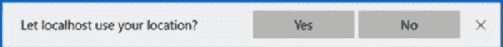
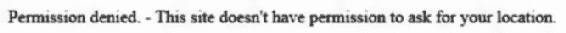
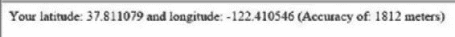
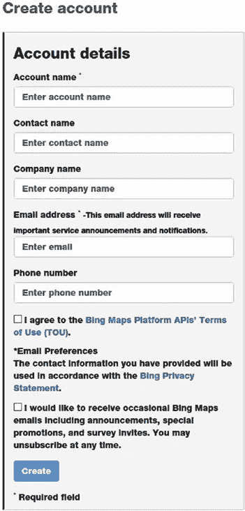
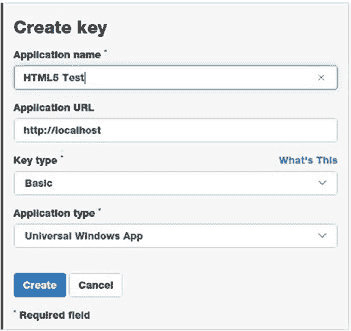
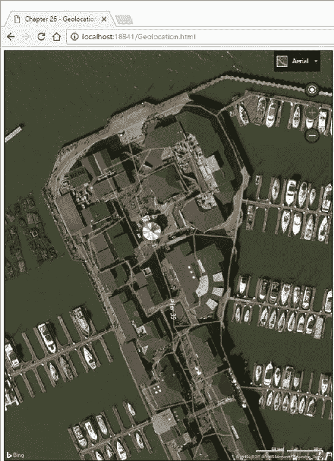
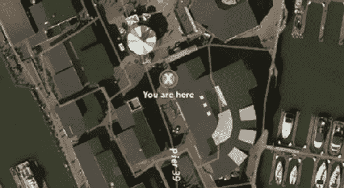
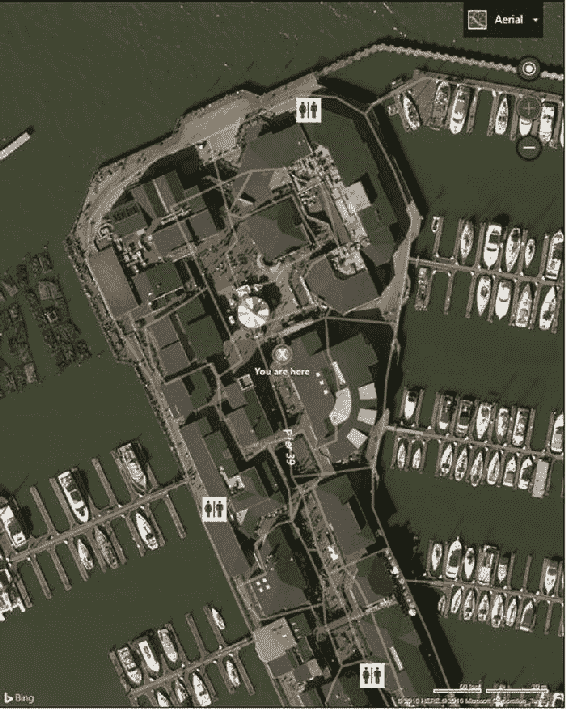

# 第 26 章 ■ 地理定位与地图

本章将演示两项技术，它们提供了强大的功能，使你能够轻松创建一些有用的网站。地理定位提供了一个标准化的 API，用于确定客户端的位置。地图技术增加了在地图上显示该位置以及其他兴趣点的能力。这两者共同构成了一个有许多实用应用的平台。

在本章中，你将使用地理定位 API 来查找你当前的位置。该位置的精度会因可用硬件和环境的不同而有很大差异。然而，HTML5 定义了一个在所有设备上使用的标准 API，因此你可以提供与设备无关的解决方案。

仅知道经纬度坐标并不实用。为了利用这些数据，你将使用 Bing Maps API 在地图上显示该位置。然后，你可以标记更多的兴趣点，并查看它们与你当前位置的相对关系。

### 理解地理定位

虽然严格来说并非 HTML5 规范的一部分，但 W3C 已定义了一个用于访问地理定位信息的标准 API，该 API 得到了所有主流浏览器当前版本的支持。然而，确定位置的技术因设备能力和客户端环境的不同而有很大差异。

#### 概览地理定位技术

有几种技术可用于确定当前位置，包括以下内容：

- **全球定位系统（GPS）：** GPS 与卫星通信，以极高的精度确定当前位置，尤其是在农村地区。城市中的高楼大厦会影响精度，但在大多数情况下，GPS 能提供良好的结果。最大的限制是它在室内效果不佳。使用 GPS，设备必须配备特定的 GPS 硬件，但这在移动设备上已越来越常见。
- **Wi-Fi 定位：** Wi-Fi 网络覆盖范围相对较短，像 Skyhook Wireless 这样的系统维护着一个庞大的 Wi-Fi 网络及其位置数据库。只要连接到某个 Wi-Fi 网络，就能对位置有相当准确的了解。然而，你通常可能处于多个网络的覆盖范围内，系统可以利用三角测量法以更高的精度确定位置。当然，这要求你的设备支持 Wi-Fi 功能，并且在没有 Wi-Fi 网络的农村地区无法工作。
- **手机基站三角测量：** 这使用了与 Wi-Fi 定位相同的原理，只是使用的是手机基站。但它的精度较低，因为基站覆盖范围大得多。由于所有手机都能与基站通信，这项技术应用广泛。
- **IP 地址段：** 每台连接到互联网的设备都有一个 IP 地址，通常由 ISP 提供。每个 ISP 都拥有一个可用的 IP 地址段，这些地址段通常按地理位置分配。因此，你连接到互联网时所使用的 IP 地址可以提供大致的位置信息，通常是一个大城市区域。然而，有几种因素（如 NAT 地址）可能导致不准确的结果。

以上每种技术都有不同的硬件要求，并提供不同级别的精度。通过地理定位规范，你可以轻松地向浏览器请求当前位置，并让浏览器根据当前硬件和对外部来源（包括卫星、基站和 Wi-Fi 网络）的访问情况，确定提供该位置的最佳方式。

#### 使用地理定位数据

大多数人认为地理定位是一种提供逐向导航的设备，但这只是该技术的一种应用。当然，这需要只有通过 GPS 才能获得的精确位置。然而，即使当前的位置信息没那么精确，你的网站仍然可以利用这些信息创造价值。例如，即使位置仅由 IP 地址确定，这通常也足以设置默认语言。你可能需要允许最终用户覆盖此设置，但你的大多数受众将会看到以其母语显示的初始页面。

在检索当前位置时，地理定位服务也会返回估计精度。你的应用程序应据此决定提供哪些功能。例如，假设你正在为美国邮政服务创建一个网页，用于显示最近的邮局位置。如果当前位置的精度很高，网页可以显示地图，标示当前位置及附近的邮局。此外，它还可以提供前往每个邮局的预估驾车时间。

然而，如果位置精度较低，页面可以显示一张地图，展示该区域内邮局的分布位置。用户大概知道自己身处何处，并可根据这些信息确定最佳选择。但如果精度很差，页面应提示用户输入邮政编码，然后根据用户输入显示最近的邮局。因此，根据精度不同，应用程序可以优雅地降级功能。

### 使用地理定位 API

为演示如何使用地理定位 API，你将创建一个简单的网页，调用该 API 来确定当前位置。最初，这些数据将以文本形式显示在网页上。稍后，你将在地图上显示该位置。

#### 创建 Web 项目

首先，创建一个与前面章节项目结构相似的网页。

**练习 26-1. 创建 Web 项目**

1. 使用基本标记创建一个名为`Geolocation.html`的新网页：

```html
<!DOCTYPE html>
<html lang="en">
<head>
    <meta charset="utf-8" />
    <title>第 26 章 - 地理定位</title>
    <script src="Geolocation.js" defer></script>
</head>
<body>
</body>
</html>
```

2. 然后使用以下代码创建一个`Geolocation.js`脚本文件：

```javascript
"use strict";
```

3. 在`Geolocation.html`文件的空`body`元素中添加一个`div`元素，使用以下标记：

```html
<div>
    <span id="lbl"> </span>
</div>
```

#### 使用地理定位对象

地理定位 API 由`geolocation`对象提供，你可以通过`navigator`对象访问它，如下所示：

```javascript
navigator.geolocation
```

如果返回的是假值（如`null`或`undefined`），则说明当前浏览器不支持地理定位。你可以使用如下代码检查支持情况：

```javascript
if (!navigator.geolocation) {
    alert("地理定位不受支持");
} else {
    // 使用地理定位执行某些操作
}
```

# 第 26 章 地理定位与地图

要获取当前位置，请使用 `getCurrentPosition()` 函数，该函数接受三个参数：

- 成功调用时执行的回调函数
- 发生错误时调用的错误回调函数
- 包含零个或多个选项的 `PositionOptions` 集合

最后两个参数可以省略。支持以下选项：

- `maximumAge`：浏览器可以缓存之前的位置并在不实际尝试定位的情况下返回该结果。但 `maximumAge` 属性指定了在不重新查询当前位置的情况下，先前位置可被重复使用的时间（以毫秒为单位）。
- `timeout`：`timeout` 属性指定了浏览器应等待 `geolocation` 对象响应的最长时间，同样以毫秒表示。
- `enableHighAccuracy`：这只是一个对浏览器的提示。如果你特定目的不需要更高精度，将此设置为 `false` 可能会获得更快的响应或消耗更少的电量，这对移动设备来说是一个考虑因素。

如果调用成功，位置信息将传递给指定的回调函数。`Position` 对象包含一个 `coords` 对象，其中包含以下必需属性：

- `latitude`（以度为单位指定）
- `longitude`（以度为单位指定）
- `accuracy`（以米为单位指定）

此外，根据环境和可用硬件，可能还会提供以下可选属性。如果不支持这些属性，它们将被设置为 `null`。（可选属性通常仅在启用 GPS 时可用）。

- `altitude`（以米为单位）
- `altitudeAccuracy`（以米为单位）
- `heading`（以度为单位；正北为 0，正西为 90，以此类推；静止时值为 `NaN`）
- `speed`（以米/秒为单位，静止时值为 0）

这些属性可以通过回调函数获取，如下所示：

```javascript
function successCallback(pos) {
  var lat = pos.coords.latitude;
  var long = pos.coords.longitude;
  var accuracy = pos.coords.accuracy + " meters";
}
```

如果调用不成功，`PositionError` 对象将被传递给错误回调函数。该对象包含一个 `code` 属性和一个 `message` 属性。错误码可能取三个值之一。

- 1：`PERMISSION_DENIED`
- 2：`POSITION_UNAVAILABLE`
- 3：`TIMEOUT`

> **警告：** 你的应用会获取位置信息并直接显示（后续会将其绘制在地图上）。然而，你的脚本很容易将这些信息传回服务器，这是一个潜在的隐私问题。由于浏览器无法控制客户端如何利用这些信息，出于隐私考虑，浏览器可能会阻止对 `geolocation` 对象的访问。在这种情况下，会返回 `PERMISSION_DENIED` 错误码。我稍后会对此进行演示。

## 显示位置

如果客户端正在移动，并且你想持续监控当前位置，你可以通过 `setInterval()` 函数重复调用 `getCurrentLocation()` 函数。为了简化这一过程，`geolocation` 对象包含一个 `watchPosition()` 函数。该函数与 `getCurrentLocation()` 函数接收相同的三个参数（成功回调、错误回调和选项）。每当位置发生变化时，就会调用回调函数。`watchPosition()` 函数返回一个定时器句柄。当你想要停止监控位置时，可以将此句柄传递给 `clearWatch()` 函数，如下所示：`var handle = geolocation.watchPosition(callback);`

```javascript
geolocation.clearWatch(handle);
```

现在，你将为你的应用添加代码，以获取当前位置并显示它。网页中有一个 `id` 为 `lbl` 的 `span` 元素。你将获取 `geolocation` 对象并调用其 `getCurrentLocation()` 函数。

成功回调函数和错误回调函数都会在 `span` 元素中显示相应的结果。

### 练习 26-2. 显示位置

1. 将以下代码添加到 `Geolocation.js` 脚本中。

```javascript
var lbl = document.getElementById("lbl");
var latitude = 0;
var longitude = 0;
if (navigator.geolocation) {
  navigator.geolocation
    .getCurrentPosition(showLocation,
      errorHandler,
      {
        maximumAge: 100,
        timeout: 6000,
        enableHighAccuracy: true
      });
} else {
  alert("Geolocation not suported");
}

function showLocation(pos) {
  // 保存坐标供后续使用
  latitude = pos.coords.latitude;
  longitude = pos.coords.logitude;
  lbl.innerHTML =
    "您的纬度：" + pos.coords.latitude +
    "，经度：" + pos.coords.longitude +
    "（精确度：" + pos.coords.accuracy + " 米）";
}
```

# 第 26 章 地理定位与地图绘制





2. 在浏览器中显示 `Geolocation.html` 文件。当网站首次尝试访问 `geolocation` 对象时，你会看到一个类似图 26-1 所示的提示。

图 26-1. 请求地理定位访问权限的提示

> **注意：** 我在此演示中使用的是 Edge 浏览器。如果你使用不同的浏览器，此提示的行为可能略有不同。

3. 要测试错误处理程序，请选择“否”选项。页面应显示一条错误消息，如图 26-2 所示。

图 26-2. 显示访问被拒绝的错误

4. 使用不同的浏览器打开 `Geolocation.html` 文件。您当前的定位应如图 26-3 所示。

图 26-3. 显示当前定位

我使用的是普通局域网连接的机器，没有蜂窝网络或 GPS 支持，因此它通过 IP 地址来确定位置。因此，定位精度估计为 1.8 公里（约 1 英里）。

> **注意** 地理定位功能在所有现代浏览器上均可使用。但是，如果你在较老的浏览器（如 IE 8）上尝试此应用，将会看到地理定位不受支持的警报。

## 使用地图平台

仅显示经纬度并不有趣（或实用）。然而，将你的位置与其他兴趣点相关联则更有用。在地图上显示这些信息，并辅以道路和其他参考点，才能真正发挥其价值。幸运的是，地图技术已变得非常先进且易于获取，实现这一点非常简单。

> **注意** 为了本章的演示，我将使用必应地图。还有其他可用的地图平台。如果你感兴趣，可以查阅 [`en.wikipedia.org/wiki/Comparison_of_web_map_services`](http://en.wikipedia.org/wiki/Comparison_of_web_map_services) 上的文章，了解不同地图服务的概述。

### 创建必应地图账户

要使用必应地图，你首先需要设置一个账户，这对开发者来说是免费的。创建账户后，你将获得一个密钥，在访问地图 API 时需要包含此密钥。我将带你完成设置账户的流程。

**练习 26-3. 创建必应地图账户**

1. 访问必应地图网站，地址为：[www.microsoft.com/maps/create-a-bing-maps-key.aspx](http://www.microsoft.com/maps/create-a-bing-maps-key.aspx)。
2. 你需要获取一个密钥来访问地图 API。转到“基础密钥”（Basic Key）选项卡。一个免费的、基础级别的密钥足以完成这些练习。点击页面底部的“获取基础密钥”（Get the Basic Key）链接。
3. 在下一页，你需要使用 Windows Live ID 登录。如果你没有，请点击“创建”（Create）按钮来创建一个账户。
4. 登录后，你应该会看到如图 26-4 所示的“创建账户”（Create account）页面。

    

    图 26-4. “创建账户”页面

5. 输入账户名称。这仅用于在你拥有多个账户时进行标识；输入“testing”即可。电子邮件地址应从你的 Windows Live 账户自动填入。确保选中复选框以同意使用条款。点击“保存”（Save）按钮创建账户。

    

6. 从“我的账户”（My account）菜单中，选择“我的密钥”（My keys）链接。你可能还没有任何现有密钥，页面将显示“创建密钥”（Create key）对话框。如果没有，请点击链接创建一个新密钥。
7. 在“创建密钥”（Create key）页面，输入应用程序名称，例如 `HTML5 test`。对于 URL，请输入 `http://localhost`，并在应用程序类型中选择“通用 Windows 应用”（Universal Windows app），如图 26-5 所示。点击“提交”（Submit）按钮。

    图 26-5. 创建密钥

    > **注意** 必应地图会监控你的密钥使用情况。但是，因为你并未实际将其部署到面向公众的网站，所以这一点实际上并不适用。如果你正在开发商业应用程序，可以出于开发目的使用免费密钥，但对于正式网站，你需要购买一个密钥。

8. 密钥生成后，它应该会显示在页面上。请保存此密钥，因为你稍后将用到它。

### 添加地图

现在，你将向网页中添加地图。首先，在页面中添加一个 `div` 元素，该元素将包含地图。

你还需要添加一个对用于操作地图的脚本的引用。然后，你将显示地图，并将其中心点设置为你的当前位置。

**练习 26-4. 添加地图**

1. 将以下粗体显示的代码添加到 `body` 元素中，这将添加用于显示地图的 `div`。

    ```html
    <body>
        <div>
            <span id="lbl"> </span>
        </div>
        <div id="map">
        </div>
    </body>
    ```

2. 创建一个 `Geolocation.css` 样式表，并添加以下样式规则，该规则将设置包含地图的 `div` 的大小。

    ```css
    #map {
        width: 800px;
        height: 1000px;
        border: 1px solid black;
    }
    ```

3. 在 `head` 元素内添加以下 `link` 元素，以引用 `Geolocation.css` 样式表。

    ```html
    <link rel="stylesheet" href="Geolocation.css" />
    ```

4. 在 `head` 元素内添加以下 `script` 元素。这将使你的页面能够调用地图 API。此元素需要放在 `Geolocation.js` 脚本元素之后。

    ```html
    <script
        src="http://www.bing.com/api/maps/mapcontrol?branch=release&callback=DisplayMap"
        async defer>
    </script>
    ```

    这将异步加载地图脚本，并在加载完成后调用 `DisplayMap()` 函数。

5. 使用以下代码将 `DisplayMap()` 函数添加到 `Geolocation.js` 脚本中。你需要插入之前在练习 26-3 中获得的 API 密钥。

    ```javascript
    function DisplayMap() {
        var map = new Microsoft.Maps.Map(document.getElementById('map'),
        {
            credentials: '<use your key here>',
            center: new Microsoft.Maps.Location(latitude, longitude),
            mapTypeId: Microsoft.Maps.MapTypeId.aerial,
            zoom: 20
        });
    ```

# 第26章 地理定位与地图绘制

对`Map()`函数的调用接受两个参数：第一个是用于显示地图的 HTML 元素。这是你之前设置的`div`元素，通过`getElementById()`方法获取。第二个参数是一个包含一系列选项的 JSON 对象。`credentials`字段包含你的 API 密钥，`center`字段指定地图的中心点，即由地理定位对象返回的位置。此外，`mapTypeId`指定使用卫星视图，`zoom`设置为 20。

6. 刷新浏览器。根据你的位置，页面应如图 26-6 所示。注意页面右上角的控件。你可以使用它来放大、缩小以及向任意方向平移。你还可以将视图更改为道路或街边视图。



**图 26-6.** 显示初始地图

在调用`Map()`函数指定中心位置时，此代码还将缩放级别设置为 20。根据你的应用需求，你可能不希望在初始时放大到此程度。尝试使用 15 或 16 来查看效果。当然，用户在地图显示后也可以调整缩放级别。



## 添加图钉

现在，你将在地图上显示一些图钉。要添加图钉，首先创建一个`Pushpin`对象，指定其位置。然后将其添加到地图的实体集合中。首先，你将在当前位置添加一个默认图钉。稍后，你将添加自定义图钉来指示兴趣点。

将以下粗体显示的代码添加到`DisplayMap()`函数的末尾：

```javascript
function DisplayMap() {
    var map = new Microsoft.Maps.Map(document.getElementById('map'), {
        ...
    });
    var pushpin = new Microsoft.Maps.Pushpin(map.getCenter(), {
        color: 'orange',
        text: 'X',
        title: 'You are here'
    });
    map.entities.push(pushpin);
}
```

`Pushpin()`方法接受一个位置和一个包含选项的 JSON 对象。对于位置，我简单地使用`getCenter()`方法来获取地图的中心点，该中心点是在加载地图时指定的。我也可以像这样创建一个位置对象：

```javascript
new Microsoft.Maps.Location(latitude, longitude)
```

对于选项，我将颜色设为橙色，在图钉上添加"X"标记并加上"您在此处"标签。刷新浏览器后，您应该能看到一个指示当前位置的图钉，如图 26-7 所示。

**图 26-7.** 在当前位置添加图钉

网页中最常见的地图应用之一是显示附近位置。例如，您可能有多个门店地点，需要标注每个门店的位置。或者您可能身处警察局，想标出某些犯罪案发位置。又或者您运营公共交通系统，需要显示所有公交站或地铁站的位置。

这些场景本质上相同：您有一组需要在地图上显示的位置集合。您可以根据需要添加任意数量的位置。每个位置只需创建一个图钉对象并添加到实体集合中。如果有多个位置，应让图钉呈现出不同样式，方便用户轻松区分。

此演示中，您将标注附近洗手间的位置。我们将采用常见洗手间图标的图片，而非标准图钉。通常需要根据客户端位置查询服务器获取位置列表，但为简化练习，这里将使用硬编码数据。

> **注意**：我硬编码了洗手间位置，这些位置可能离您当前位置非常远。您可以提供附近的洗手间位置，或者直接覆盖当前坐标以匹配我的数据，这样就能与洗手间位置保持一致。

### 练习 12-5 添加自定义图钉

1. 源代码下载中包含`restroom.gif`图片文件。将此文件拖拽至您的 Web 项目中。

2. 在现有`Geolocation.js`脚本顶部添加以下声明，用于定义洗手间位置。

```javascript
var restrooms = [
    { lat: 37.810079, long: -122.410806 },
    { lat: 37.809579, long: -122.410206 },
    { lat: 37.811279, long: -122.410446 }
];
```

3. 在`DisplayMap()`函数中创建地图对象之前添加以下代码，这将覆盖当前位置使其靠近洗手间位置。

```javascript
// 测试用覆盖坐标
latitude = 37.810579;
longitude = -122.410546;
```

4. 在`Geolocation.js`脚本末尾添加以下函数。`markRestrooms()`函数遍历数组，为每个位置调用`markRestroom()`函数。`markRestroom()`函数用于添加单个图钉，首先创建定义图片文件及尺寸的选项集合，该选项在创建`Pushpin`对象时传入。

```javascript
function markRestrooms(map) {
    for (var i in restrooms) {
        markRestroom(map, restrooms[i].lat, restrooms[i].long);
    }
}

function markRestroom(map, lat, long) {
    var pushpinOptions = { icon: '/images/restroom.gif', width: 35, height: 35 };
    var pushpin = new Microsoft.Maps.Pushpin
        (new Microsoft.Maps.Location(lat, long), pushpinOptions);
    map.entities.push(pushpin);
}
```

5. 在`DisplayMap()`函数末尾添加此函数调用，以显示额外图钉：

```javascript
// 显示洗手间位置
markRestrooms(map);
```

6. 刷新浏览器，您应能看到洗手间位置处出现图钉，如图 26-8 所示。



*图 26-8. 添加洗手间图钉*

> **注意**：此数据纯属虚构。若您碰巧在阅读此书时身处旧金山 39 号码头，请勿依照此地图寻找洗手间。

地图 API 还能实现更多功能，例如显示前往所选地点的导航路线，甚至显示当前交通拥堵区域。欢迎访问交互式 SDK：[`www.bing.com/api/maps/sdk/mapcontrol/isdk`](http://www.bing.com/api/maps/sdk/mapcontrol/isdk)。您可以逐一体验各项功能，地图下方会显示对应的 JavaScript 代码。

### 本章小结

在本章中，您将地理定位功能与 Bing Maps 相结合，创建了非常实用的网站。

地理定位请求异步处理。获取地理定位对象后，调用其`getCurrentPosition()`函数并指定成功和失败的回调函数。获取位置后，`Position`对象会传递给回调函数，其中包含纬度、经度和估算精度。若客户端具有 GPS 功能，`Position`对象还会包含海拔、速度和方向。

Bing Maps 等地图平台易于使用且能轻松集成到网页中。在本应用中，您展示了地图并以当前位置为中心，同时添加图钉标注附近洗手间位置。
