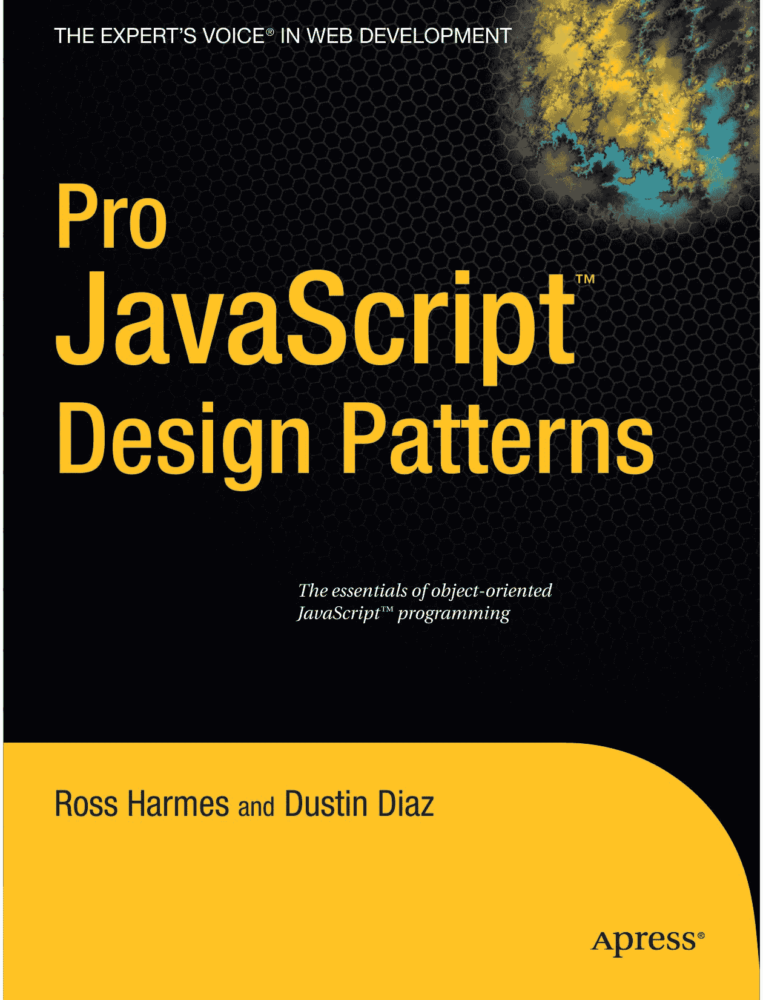

**出版社：** Apress **ISBN-10：** 1-4842-4501-6 **ISBN-13：** 978-1-4842-4501-9

**Java |** **Kotlin |** **Android**

**Pro Git（第 2 版）** 作者：Scott Chacon 和 Ben Straub

**Kotlin 实战** 作者：Dmitry Jemerov 和 Svetlana Isakova

**Android 编程：大牛农场指南** 作者：Bill Phillips、Chris Stewart、Brian Gardner 和 Kristin Marsicano

**深入浅出 Android 开发** 作者：Dawn Griffiths 和 David Griffiths

**Android 开发的忙碌程序员指南** 作者：Mark L. Murphy

**你好，Android** 作者：Ed Burnette

**Android UI 设计** 作者：Adam Gerber 和 Clifton Craig

**对 Java、Android 和 Kotlin 的回顾**

版权所有。未经版权所有者及出版人事先书面许可，本书的任何部分均不得以任何形式或通过任何方式（电子或机械，包括影印、录制或任何信息存储检索系统）进行复制或传播。

本书中可能会出现商标名称、标识和图像。对于商标名称的每次出现，我们未使用商标符号，仅在编辑风格中使用这些名称，以维护商标所有者的利益，且无意侵犯商标权。

Java 及所有基于 Java 的标志均为 Oracle 和/或其关联公司在美国及其他国家的商标或注册商标。Apress Media, LLC 与 Oracle 和/或其关联公司无关联，本书的撰写未经 Oracle 和/或其关联公司的认可。

本出版物中使用的商品名称、商标、服务标志及类似术语，即使未被标识为商标，也不应被视为对其是否受专有权利保护的立场表达。

**编辑委员会：** Steve Anglin, Mark Beckner, Ewan Buckingham, Gary Cornell, Jonathan Gennick, Jonathan Hassell, Michelle Lowman, Matthew Moodie, Jeff Olson, Jeffrey Pepper, Douglas Pundick, Ben Renow-Clarke, Gwenan Spearing, Matt Wade, Tom Welsh

**协调编辑：** Mark Powers **文字编辑：** April Ronneburg

本书通过 Springer Science+Business Media New York 在全球图书贸易中发行，地址：233 Spring Street, 6th Floor, New York, NY 10013。电话：1-800-SPRINGER，传真：(201) 348-4505，电子邮件：`orders-ny@springer-sbm.com`，或访问：`www.springeronline.com`。Apress Media, LLC 是一家加利福尼亚有限责任公司，其唯一成员（所有者）是 Springer Science + Business Media Finance Inc（SSBM Finance Inc）。SSBM Finance Inc 是**特拉华州**的一家公司。

关于翻译事宜，请直接联系 Apress：地址：233 Spring Street, New York, NY 10013。电话：212-731-1700，电子邮件：`info@apress.com`，或访问：`www.apress.com`。

更多关于 Apress 及其产品的信息，请访问 `www.apress.com`。

本书中的信息按“现状”分发，不提供任何担保。尽管在编写本书时已采取一切预防措施，但作者和 Apress 均不对因本书所含信息直接或间接造成的任何损失或损害向任何个人或实体承担责任。

本书的源代码可供读者在 `www.apress.com` 获取。

**致母亲，** 以及那些倾听过的人，谢谢你们 **致 Alex、Dymphia 和 Terry** **致 Ross Barnes** **内容概览** **关于作者** ...................................................................................................... xvii **关于技术审校** ........................................................................................ xix **致谢** ......................................................................................................... xxi **引言** ................................................................................................................. xxiii

**练习**


### 类型转换

## 隐式类型转换

- `implicitTypeConversion`（重复多次，保留一次）
- `explicitTypeConversion`
- `stringConversion` 和 `numberConversion`
- `booleanConversion`
- `nullConversion` 和 `undefinedConversion`
- `objectConversion`

### 字符串转换

`String()` 转换

- `String()` 转换
- `toString` 方法

### 数字转换

`Number()` 转换

- `Number()` 转换
- `parseInt()`
- `parseFloat()`
- `Math.floor()`
- `Math.round()`
- `Math.ceil()`
- `Math.trunc()`

### 布尔转换

`Boolean()` 转换

### 对象转换

`Symbol.toPrimitive` 转换

### 数组转换

`Array.from()` 转换

### 日期转换

`Date()` 转换

### JSON 转换

`JSON.stringify()` 转换

### 进制转换

`Number.toString(radix)` 转换

### 类型判定

`typeof` 和 `instanceof` 转换

```
typeof
```

## 显式类型转换

### 使用构造函数

- `Number()`
- `String()`
- `Boolean()`

### 全局方法

- `parseInt()`
- `parseFloat()`

## 静态方法

- `Array.from()`
- `Object.keys()`
- `Object.values()`
- `Object.entries()`

### 运算符

- `typeof`
- `instanceof`

## 自动装箱

`ValueOf` 和 `toString`

## 其他

`Symbol.toPrimitive`


