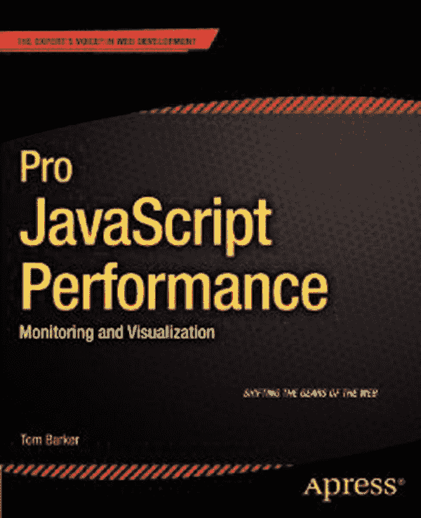
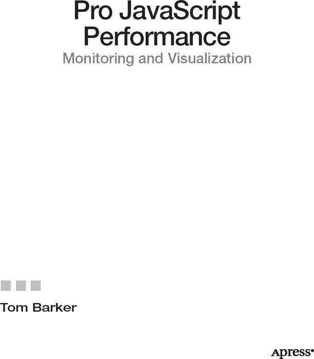

**专业级 JavaScript 性能优化**

版权所有 © 2012 Tom Barker

本作品受版权保护。出版商保留所有权利，无论涉及材料的全部或部分，特别是翻译权、重印权、插图复用权、朗诵权、广播权、以缩微胶片或任何其他物理形式复制权，以及电子信息存储与检索权、电子改编权、计算机软件权，或任何现有或未来开发的类似或不同方法。法律保留的例外情况包括：与书评或学术分析相关的简短摘录，或为进入计算机系统并执行而专门提供的材料（仅供购买者独家使用）。未经出版商所在地现行版权法许可，不得复制本出版物或其任何部分，且必须始终获得施普林格（Springer）的许可才能使用。可通过版权清算中心的 RightsLink 获取使用许可。违反相关版权法将受到起诉。

ISBN-13（平装版）：978-1-4302-4749-4

ISBN-13（电子版）：978-1-4302-4750-0

本书中可能出现商标名称、标识和图像。我们并非在每次出现商标名称、标识或图像时都使用商标符号，而是仅以编辑方式使用这些名称、标识和图像，以维护商标所有者的利益，且无意侵犯商标权。

本出版物中使用的商品名称、商标、服务标记及类似术语，即使未标明，也不应被视为对其是否受专有权利保护的立场表达。

尽管本书中的建议和信息在出版时被认为是真实准确的，但作者、编辑及出版商均不对可能存在的任何错误或遗漏承担法律责任。出版商对本书所含内容不作任何明示或暗示的担保。

总裁与出版人：Paul Manning

首席编辑：Ben Renow-Clarke

技术审校：Anirudh Prabhu

编辑委员会：Steve Anglin, Ewan Buckingham, Gary Cornell, Louise Corrigan, Morgan Ertel, Jonathan Gennick, Jonathan Hassell, Robert Hutchinson, Michelle Lowman, James Markham, Matthew Moodie, Jeff Olson, Jeffrey Pepper, Douglas Pundick, Ben Renow-Clarke, Dominic Shakeshaft, Gwenan Spearing, Matt Wade, Tom Welsh

协调编辑：Katie Sullivan

文字编辑：James Compton

排版：Bytheway

索引编制：SPi Global

美术：SPi Global

封面设计：Anna Ishchenko

本书通过施普林格科学与商业媒体纽约（Springer Science+Business Media New York, 233 Spring Street, 6th Floor, New York, NY 10013）在全球图书贸易中发行。电话：1-800-SPRINGER，传真：(201) 348-4505，电子邮件：`orders-ny@springer-sbm.com`，或访问：[`www.springeronline.com`](http://www.springeronline.com)。

如需翻译信息，请发送电子邮件至：[`rights@apress.com`](http://rights@apress.com)，或访问：[`www.apress.com`](http://www.apress.com)。

Apress 及 friends of ED 图书可批量购买用于学术、企业或促销用途。大多数图书也提供电子书版本和许可证。更多信息，请参阅我们的特别批量销售–电子书许可网页：[`www.apress.com/bulk-sales`](http://www.apress.com/bulk-sales)。

作者在本书中引用的任何源代码或其他补充材料均可供读者在 [`www.apress.com`](http://www.apress.com) 获取。有关如何找到本书源代码的详细信息，请访问：[`www.apress.com/source-code`](http://www.apress.com/source-code)。

*献给我美丽的兔子。*

*——Tom Barker*

## 目录概览

 关于作者

 关于技术审校

 致谢

 第 1 章：什么是性能

 第 2 章：衡量与影响性能的工具与技术

 第 3 章：WPTRunner——使用 WebPagetest 实现自动化性能监控与可视化

 第 4 章：perfLogger——JavaScript 基准测试与日志记录

 第 5 章：展望未来，性能标准

 第 6 章：Web 性能优化

 第 7 章：运行时性能

 第 8 章：性能与软件工程最佳实践的平衡及生产环境运行

 索引

# 目录

 作者简介
 技术审校简介
 致谢
 第 1 章：什么是性能
Web 性能
解析与渲染
渲染引擎
JavaScript 引擎
运行时性能
性能为何重要？
检测与可视化
本书目标
所用技术及延伸阅读
总结
 第 2 章：衡量与影响性能的工具与技术
Firebug
如何安装
如何使用
YSlow
如何安装
如何使用
WebPagetest
代码压缩
Minify
YUI Compressor
Closure Compiler
结果对比
分析与可视化
R 语言入门
安装与运行 R
R 语言初探
使用 R 绘制简单图表
R 语言实践案例
使用 `apply()` 函数
总结
 第 3 章：WPTRunner——基于 WebPagetest 的自动化性能监控与可视化
架构
创建共享配置文件
访问 WebPagetest API
解析测试结果
完整示例
使用 R 绘制图表
数据解析
绘制加载时间
绘制有效载荷与 HTTP 请求数
开源
总结
专访 WebPagetest 创始人 Patrick Meenan
创建 WebPagetest 的初衷是什么？
将项目开源是否困难？
在项目开发过程中遇到了哪些挑战？
WebPagetest LLC 的目标是什么？
测试结果会存储多久？
测试平均运行时间是多长？
在使用 API 时，您是否推荐采用轮询之外的方式检查测试完成状态？
测试在队列中的处理流程是怎样的？
您听说过人们用 WebPagetest 做的最有趣的事情是什么？
能简单介绍一下代理（Agent）架构吗？
您在您自己的应用程序中是如何使用 WebPagetest 的？
WebPagetest 近期和远期的功能规划是什么？就我个人而言，我很想要一个内存分析工具。
 第 4 章：perfLogger——JavaScript 基准测试与日志记录
架构
开始编码！
计算测试结果
设置测试结果元数据
显示测试结果
保存数据
构建公开 API
远程日志记录
保存测试结果
示例页面
绘制结果图表
开源
总结
 第 5 章：展望未来——性能标准
W3C Web 性能工作组
`Performance` 对象
性能计时（`Performance Timing`）
将 `Performance` 对象集成到 `perfLogger`
更新日志记录功能
性能导航（`Performance Navigation`）
性能内存（`Performance Memory`）
高精度时间（High-Resolution Time）
可视化新数据
总结
 第 6 章：Web 性能优化
优化页面渲染瓶颈
脚本加载
`async` 属性
结果对比
懒加载
懒加载的艺术
懒加载脚本
懒加载 CSS
为何不懒加载图片
总结
 第 7 章：运行时性能
跨作用域缓存变量与属性
创建新文件
创建测试
可视化结果
属性引用示例
核心 JavaScript 与框架的对比
jQuery vs JavaScript：循环
jQuery vs JavaScript：DOM 访问
`Eval` 的真正代价
DOM 访问
对 DOM 元素的变更进行排队
对新添加节点进行排队
嵌套循环的代价
总结
 第 8 章：在软件工程最佳实践与生产环境运行之间平衡性能
在性能与可读性、模块化和良好设计之间寻求平衡
极端性能优化（Scorched-Earth Performance）
函数内联
Closure Compiler
下一步：从实践到实际应用
监控 Web 性能
在你的站点中植入检测代码
在测试实验室中进行基准测试
分享你的发现
总结
 索引
