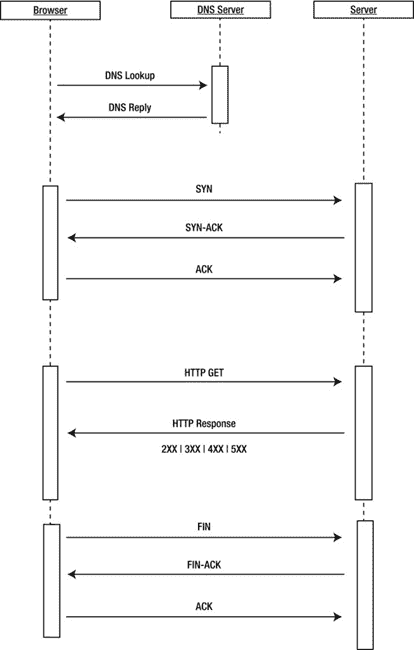
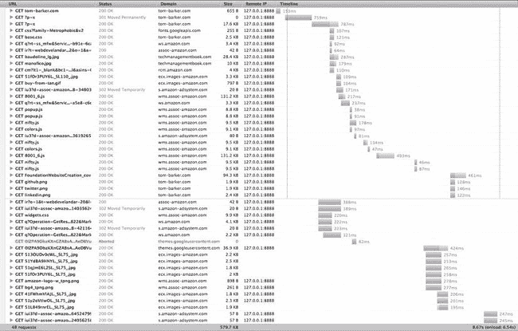
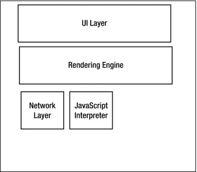
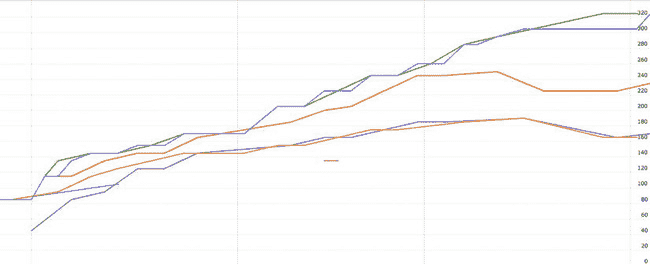

## 第 1 章


### 什么是性能

*性能*是指应用程序运行的速度。它是质量的一个多层面属性。当我们谈论 Web 应用程序时，应用程序呈现给用户所花费的时间，我们称之为*Web 性能*。而应用程序响应用户交互的速度，我们称之为*运行时性能*。这就是我们将要探讨的性能的两个方面。

在 Web（尤其是移动 Web）开发语境下，性能是一个相对较新的课题，但它绝对值得获得如今所受到的关注。

在本书中，我们将探讨如何在 Web 性能和运行时性能的背景下量化和优化 JavaScript 性能。这一点至关重要，因为在尝试解决网站整体性能问题时，JavaScript 可能具有最大的改进空间。Web 性能领域的先驱、YSlow 和 PageSpeed 的架构师史蒂夫·索德斯通过一项实验证明了这一点：他在从一组样本网站中移除 JavaScript 后，平均性能提升了 31%。¹ 我们可以像史蒂夫在实验中那样完全移除网站中的 JavaScript，也可以优化 JavaScript 的编写方式，并学会衡量所写代码的效率。

完全从前端移除 JavaScript 并不现实，因此让我们专注于提升 JavaScript 的效率。可以说更为重要的是，让我们探讨如何创建自动化工具来追踪这些效率，并将其可视化以用于报告和分析。

#### Web 性能

无论是使用笔记本电脑还是手持设备，当你打开浏览器、输入 URL 并按下回车键，然后等待页面传输并由浏览器渲染时，这段等待页面可用的时间跨度就取决于 Web 性能。就本书而言，我们将 Web 性能定义为页面传输并可供最终用户使用的总体时间指标。

影响 Web 性能的因素有很多，网络延迟是首要因素。你的网络有多快？提供内容需要多少次往返和服务器响应？

为了更好地理解网络延迟，我们先来看 HTTP 事务中的步骤（图 1.1）。

当浏览器请求一个 URL 时——无论是网页的 URL 还是网页上某个资源的 URL——它会启动一个线程来处理该请求，并在远程 DNS 服务器上发起 DNS 查询。这样浏览器就能获取所输入 URL 的 IP 地址。

__________

¹ [`http://www.stevesouders.com/blog/2012/01/13/javascript-performance/`](http://www.stevesouders.com/blog/2012/01/13/javascript-performance/)



***图 1-1.** 请求一个网页时网络事务的时序图，该过程会针对网页中包含的每个远程对象重复*

 **注：** *线程*是应用程序中受控执行的顺序单元。每当应用程序执行任何操作时，它都会使用一个线程。有些应用程序是多线程的，这意味着它们可以同时处理多件事务。通常，浏览器至少为每个标签页使用一个线程。这意味着线程执行的步骤——即我们概述的连接、下载和渲染过程中的步骤——是顺序处理的。

接下来，浏览器与远程 Web 服务器协商 TCP 三次握手，以建立 TCP/IP 连接。此握手包括在浏览器和远程服务器之间传递同步（SYN）、同步确认（SYN-ACK）和确认（ACK）消息。此握手允许客户端尝试通信，服务器确认并接受该尝试，然后客户端确认尝试已被接受。

这种握手很像双向无线电通信中的军事语音程序。想象一下双向无线电两端的双方——他们如何知道对方何时说完，如何避免互相打断，以及如何确保一方理解了另一方的信息？这些在语音程序中已经标准化，其中某些关键短语具有细微的含义；例如，“Over”表示一方已说完并等待回应，“Roger”表示信息已被理解。

与所有通信协议一样，TCP 握手只是一种定义多方之间通信的标准化方式。

# TCP/IP 模型

`TCP`代表传输控制协议。它是 TCP/IP 模型中使用的协议，定义了客户端和服务器之间的通信方式，具体包括将数据分割成段，以及处理我们之前描述的握手（图 1.1）。

TCP/IP 模型是一个四层模型，代表了定义数据如何在互联网上共享的不同协议之间的关系。TCP/IP 模型的规范由互联网工程任务组（IETF）维护，收录于两份 RFC（请求评议）文档中，地址如下：[`http://tools.ietf.org/html/rfc1122`](http://tools.ietf.org/html/rfc1122) 和 [`http://tools.ietf.org/html/rfc1123`](http://tools.ietf.org/html/rfc1123)。

TCP/IP 模型的四层，按照从距离最终用户最远到最近顺序排列，依次为：网络访问层、互联网层、传输层和应用层。

## TCP/IP 模型概述

网络接入层控制着网络中硬件之间的通信。

互联网层负责网络寻址和路由，获取 IP 地址和 MAC 地址。

传输层是 TCP（或 UDP）通信发生的地方。

应用层处理客户端和服务器使用的高级通信，例如用于电子邮件客户端的 HTTP 和 SMTP。

如果将 TCP/IP 模型与我们的时序图进行比较，我们会看到浏览器如何在模型中上下穿梭以提供页面，如下所示。

一旦建立了 TCP/IP 连接，浏览器就会通过该连接向远程服务器发送一个 HTTP GET 请求。远程服务器找到资源，并通过 HTTP 响应将其返回，状态码为 200 表示正常响应。如果服务器找不到资源，或者在尝试解释资源时发生错误，或者请求被重定向，HTTP 响应的状态码也会反映这些情况。完整的状态码列表可以在 [`http://www.w3.org/Protocols/rfc2616/rfc2616-sec10.html`](http://www.w3.org/Protocols/rfc2616/rfc2616-sec10.html) 找到，但最常见的状态码如下：

*   200 表示来自服务器的成功响应。
*   404 表示服务器未能找到请求的资源。
*   500 表示在尝试完成请求时发生错误。

正是在此处，Web 服务器提供资源，而客户端开始下载它。也正是在此处，页面的总负载（包括所有图片、CSS 和 JavaScript 的文件大小）开始发挥作用。

页面的总大小很重要，不仅因为下载所需的时间，还因为 IPv4 和 IPv6 的 IP 数据包最大大小为 65535 个八位组。如果将页面总大小转换为字节，然后除以最大数据包大小，你将得到提供总负载所需的服务器响应次数。



**图 1-2.** 浏览器架构

导致网络延迟的另一个因素是页面加载所有对象所需的 HTTP 请求数量。页面中包含的每个资源——每张图片以及每个外部 JavaScript 和 CSS 文件——都需要一次与服务器的往返。每一个都会启动一个新线程和 图 1-1 中所示流程的一个新实例，这再次包含了 DNS 查询、TCP 连接、HTTP 请求和响应的开销，以及传输每个资源本身文件大小的时间开销。

参见 图 1-2，了解这个简单概念如何呈指数级增长，并在规模上导致性能问题。

瀑布图是一种工具，用于展示请求一个页面及其包含的所有资源所需的时间。它们显示了构建页面所需的每个资源的 HTTP 事务，包括每个资源的大小、每个资源的下载时间以及下载顺序。从高层次来看，瀑布图中的每个条形代表我们正在下载的一个资源。条形的长度对应于一个项目连接和下载所需的时间。图表按时间顺序运行，因此最顶部的条形是第一个被下载的项目，最底部的条形是最后一个项目，时间线的最左侧是连接开始的时间，最右侧是连接结束的时间。我们将在 第 2 章 讨论衡量和影响性能的工具时，更详细地讨论瀑布图。

## 解析与渲染

除了网络问题之外，Web 性能的另一个影响因素是浏览器的解析与渲染过程。浏览器的解析与渲染受到多种因素的影响。为了更好地理解这个概念，我们首先看一下与解析和渲染网页相关的浏览器架构概览（图 1-3）。

大多数现代浏览器具有以下架构：用于处理 UI（包括地址栏和历史按钮）的代码；用于解析和绘制页面中所有对象的渲染引擎；用于解释 JavaScript 的 JavaScript 引擎；以及用于处理 HTTP 请求的网络层。

由于浏览器从上到下读取内容，因此资源放置的位置会影响用户感知到的网站速度。例如，如果将 JavaScript 标签放在 HTML 内容之前，浏览器将启动 JavaScript 解释器并在完成渲染剩余 HTML 内容之前解析 JavaScript，这可能会延迟页面供最终用户使用。

浏览器是 Web 开发者的饭碗，因此你应该对每个渲染引擎和 JavaScript 引擎了如指掌。花时间下载那些开源的引擎（参见下一节获取相关网址）并通读一些源代码是非常值得的。如果你更加大胆，还可以向源代码中添加自己的检测或日志记录，并在你分叉的引擎中自动化运行你自己的性能测试。



**图 1-3.** 我的举重日志时间序列

### 渲染引擎

让我们来看一些目前在外部广泛使用的渲染引擎。重要的是，不要仅仅将渲染引擎视为浏览器的一部分。通过将浏览器的架构模块化，浏览器制造商得以将其组件联合起来。不仅仅是浏览器，包括电子邮件客户端和其他应用程序中的 Web 组件在内的更多工具都会渲染 HTML。通过拥有可分发的渲染引擎，浏览器制造商可以重用他们自己的引擎，或将其许可给其他公司使用。这也通常使开发人员仅通过了解软件包使用的渲染引擎就能预知其表现。

Firefox 及其所有衍生产品和同类产品（如 Thunderbird，Mozilla 的电子邮件客户端）都使用 `Gecko`，可在 [`https://developer.mozilla.org/en/Gecko`](https://developer.mozilla.org/en/Gecko) 获取。`Gecko` 最初由 Netscape 开发，早在 1997 年，在 Mozilla 项目作为独立实体分离出来之前，它作为原始 Netscape 渲染引擎的继任者被推出。

`Webkit` 是 Chrome 和 Safari 使用的引擎，也是大多数移动 Web 开发的目标引擎，因为它被用作 Android 设备、iOS 设备上的移动 Safari 以及 Kindle Fire 上的 Silk 浏览器的布局或渲染引擎。`Webkit` 可在 [`http://www.webkit.org/`](http://www.webkit.org/) 获取。`WebKit` 始于 2001 年，由 Apple 基于之前的渲染引擎 `KHTML`（来自 `KDE`）分叉而来。`WebKit` 于 2005 年公开开源。

桌面端、移动端，甚至所有任天堂游戏机（NDS, Wii）上的 Opera 都使用 `Presto`，它于 2003 年随 Opera 7 一起推出。关于 `Presto` 的更多信息可在 [`http://dev.opera.com/articles/view/presto-2-1-web-standards-supported-by/`](http://dev.opera.com/articles/view/presto-2-1-web-standards-supported-by/) 找到。

最后，Internet Explorer 以及其他微软产品（如 Outlook）使用 `MSHTML`，代号为 `Trident`。微软于 1997 年在 Internet Explorer 4 中首次引入了 `Trident`，此后一直在迭代该引擎。`Trident` 的文档可在此处找到：[`http://msdn.microsoft.com/en-us/library/bb508515`](http://msdn.microsoft.com/en-us/library/bb508515)。

### JavaScript 引擎

接下来，我们来看看最流行的浏览器所使用的 JavaScript 引擎。将 JavaScript 解释器模块化，与将渲染引擎模块化或任何代码模块化一样有意义。解释器可以与其他属性共享，也可以嵌入到其他工具中。开源解释器甚至可以在你自己的项目中使用，例如用于构建你自己的静态代码分析工具，或者仅仅是为了提供 JavaScript 支持，让你的用户能够在你的应用程序中通过脚本实现某些功能。

# JavaScript 引擎与性能

`SpiderMonkey` 是 Mozilla 制作的 JavaScript 引擎，用于 Firefox。JavaScript 的创建者 Brendan Eich 于 1996 年创建了 `SpiderMonkey`，它自此成为 Netscape 及随后的 Firefox 的 JavaScript 解释器。`SpiderMonkey` 的文档可在此处获取：[`https://developer.mozilla.org/en/SpiderMonkey`](https://developer.mozilla.org/en/SpiderMonkey)。Mozilla 还提供了文档，展示如何将 `SpiderMonkey` 嵌入到我们自己的应用程序中：[`https://developer.mozilla.org/en/How_to_embed_the_JavaScript_engine`](https://developer.mozilla.org/en/How_to_embed_the_JavaScript_engine)。

Opera 使用 `Carakan`，该引擎于 2010 年推出。关于 `Carakan` 的更多信息可在此处找到：[`http://my.opera.com/dragonfly/blog/index.dml/tag/Carakan`](http://my.opera.com/dragonfly/blog/index.dml/tag/Carakan)。

Chrome 使用的 Google 开源 JavaScript 引擎可在此处获取：[`http://code.google.com/p/v8/`](http://code.google.com/p/v8/)。其文档可在此处获取：[`https://developers.google.com/v8/intro`](https://developers.google.com/v8/intro)。

Safari 使用 `JavaScriptCore`，有时也称为 `Nitro`。关于 `JavaScriptCore` 的更多信息可在此处找到：[`http://www.webkit.org/projects/javascript/index.html`](http://www.webkit.org/projects/javascript/index.html)。

最后，Internet Explorer 使用 `Chakra` 作为其 `JScript` 引擎。请记住，正如 Douglas Crockford 在 [`http://www.yuiblog.com/blog/2007/01/24/video-crockford-tjpl/`](http://www.yuiblog.com/blog/2007/01/24/video-crockford-tjpl/) 中详述的那样，`JScript` 最初是微软自己对 JavaScript 进行逆向工程后的版本。此后，微软在整体生态系统中赋予了 `JScript` 自己的地位。它是 ECMAScript 规范的一个合法实现，而且 `Chakra` 甚至支持大多数其他 JavaScript 引擎不支持的某些方面，特别是条件编译（请参见随附的条件编译讨论）。

在讨论和优化你网站的整体 Web 性能时，所有这些细微差别都是需要考虑的因素。

Mozilla 的 JavaScript 团队还维护了一个网站 [`http://arewefastyet.com/`](http://arewefastyet.com/)，该网站比较了 `V8` 和 `SpiderMonkey` 的基准测试时间，对比了两个引擎各自运行基准测试套件的结果。

## 条件编译

条件编译是某些语言的一项功能，传统上允许语言编译器根据在编译时指定的条件生成不同的可执行代码。这对于 JavaScript 来说有点用词不当，因为 JavaScript 是解释执行的，而不是编译的（它不在内核级别运行，而是在浏览器中运行），但概念是相通的。

条件编译允许编写只有在满足特定条件时才会被解释的 JavaScript 代码。默认情况下，`JScript` 的条件编译是关闭的；我们需要提供一个解释器级别的标志来启用它：`@cc_on`。如果我们要编写条件编译的 JavaScript，我们应该将其包裹在注释中，这样我们的代码就不会在不支持条件编译的其他 JavaScript 解释器中出错。

`JScript` 条件编译的一个示例如下：

```
<script>
var useAX = false; //默认使用 ActiveX 控件，设为 false
/*@cc_on
@if (@_win32)
     useAX = true;
@end
*/
</script>
```

## 运行时性能

运行时是指应用程序执行或运行的时间段。运行时性能关乎你的应用程序在运行时响应用户输入的速度——例如，在保存偏好设置时，或访问 DOM 中的元素时。

运行时性能受许多因素影响——从特定功能所采用算法的效率，到解释器或浏览器渲染引擎的优化或不足，再到有效的内存管理和 CPU 使用率，以及同步或异步操作之间的设计选择。

虽然运行时性能是对应用程序整体响应速度的主观感受，但你可以构建检测机制来追踪用户整体体验的形态和趋势，并分析异常值。你还可以进行多变量测试实验，看看哪种方法能在规模化条件下，以及在你特定用户群使用的浏览器中产生最大的性能提升。

我们将在第 4 章中探讨这些概念。

## 为什么性能至关重要？

首要原因显而易见——更快的网站意味着为终端用户带来更出色的整体体验。理论上，更好的体验应能带来更高的用户满意度。

更快的体验还意味着用户能更快地访问你的功能，理想情况下能在他们放弃会话之前完成操作。会话或网站放弃可能由多种原因导致：页面加载时间过长、用户失去兴趣、浏览器崩溃，或任何其他数不胜数的原因。

计算自己网站的放弃率其实很简单。只需将完成你预期操作的用户总数——例如购买商品、注册新账户、升级服务、浏览其他版块页面、点击首页特定按钮，或任何你为网站设定的高层目标——除以总访问次数。然后用 1 减去这个比值，再乘以 100，就能得到未达成目标前放弃你网站的用户百分比：

`[放弃率] = (1 - ([达成目标数] \ [总访问次数])) * 100`

举例来说，假设我们有一个网页表单，可能是客户注册页面。该页面的核心目标是让用户创建账户——一旦拥有账户，我们就能根据个人偏好定制内容，针对购物习惯投放广告，并根据过往购买和浏览记录给出推荐。无论具体目的如何，我们期望用户登录，并以此衡量页面成功与否。当用户点击表单的提交按钮后，系统会跳转至一个 PHP 脚本，该脚本更新数据库，在`User`表中创建新条目，然后重定向至首页。

现在我们查看该页面的浏览量指标，发现共有 10 万次独立页面浏览；在我们的算法中，这就是总访问次数。再查看数据库中已创建的用户数量，发现有 3 万个用户。此时应用算法即可得出 70%的放弃率：

`(1 - (30,000 \ 100,000)) * 100 = 70`

通过降低放弃率，提升性能能为你的利润带来显著效益。已有多个知名案例研究表明，糟糕的网站性能会带来切实损害（表现为放弃率上升）。

Keynote 提供了 Alberto Savoia 的一篇文章，详细阐述了性能对放弃率的影响，可参见 [`http://www.keynote.com/downloads/articles/tradesecrets.pdf`](http://www.keynote.com/downloads/articles/tradesecrets.pdf)。在其白皮书《为何网站性能至关重要》（[`http://www.gomez.com/pdfs/wp_why_web_performance_matters.pdf`](http://www.gomez.com/pdfs/wp_why_web_performance_matters.pdf)）中，Gomez 详细说明了仅通过增加页面负载的延迟，放弃率就可能从 8%飙升至 38%。

你可以利用上述计算方法自行开展实验，量化并推断优化网站性能的投资回报率。

## 工具化与可视化

本书的一个重要部分是在代码中引入工具，并利用数据可视化来展示结果。事实上，这正是本书的核心主旨。性能优化没有一劳永逸的银弹。某个人看到的结果可能与他人不同，因为他们可能拥有完全不同的用户群体，并使用截然不同的浏览器。

也许你的用户因企业政策限制只能使用 Internet Explorer，或者你的受众主要由早期采用者构成，其中大量用户使用浏览器测试版，这些版本的解析器或渲染引擎可能存在不同的优化，甚至可能包含缺陷。

无论何种情况，你的结果都会有所差异。而且差异会随规模扩大而显现，原因包括一天中不同时段的连接速度（用户在工作与在家中）、连接方式（有线宽带与拨号上网），或任何其他因素。

但通过测量自身结果并对其进行可视化，以审视数据的整体形态，你将能够基于自己的真实数据和趋势，精准调优网站。

## 数据可视化与性能优化

数据可视化作为一门学科近年来蓬勃发展。它不再局限于数学、理论或制图领域。我还记得自己第一次隐约意识到数据可视化潜力的时刻。那是在圣克拉拉举办的 Velocity 大会上，我与同行们聚在一起。我观看了 John Rauser 的演讲，内容是关于他和亚马逊团队如何通过分析生产日志来调试生产环境问题。他在演讲中提到，有时需要提取单个用户级别的细粒度数据，将其打印在纸上，然后眯起眼睛观察数据的整体形态——正是这种形态揭示了问题的本质。

这让我深受触动，自那以后，我在自己生活的几乎每个方面都践行了这一理念。

在工作中，我将数据可视化作为管理工具来运营我的团队。本书中我们将要创建的一些图表，正是源于我定期为自己的团队制作的图表。

在闲暇时，我会追踪自己的力量举训练日志，观察力量增长、重置以及平台期的情况（参见图 1-4）。通过交叉比时间序列中的日期，我可以看到生活中其他事务如何影响我的力量增长。数据分析实际上是力量举的核心概念之一，它通过测量恢复时间来管理重量增长。进阶到更高训练水平的标志，便是从大重量训练中恢复所需的时间以及举重量的增加。初学者进步迅速，因为他们远未达到潜在重量上限；但中级和高级训练者的肌肉承受极大负荷，工作强度接近其潜在上限，因此他们需要更长的时间来恢复并增加举重量。²

在家中，我还追踪每个房间的湿度水平，并调节控制旋钮。我观察开启暖气、填缝地板与墙壁之间的缝隙，甚至每个房间开门与关门对湿度的影响。通过这种方式，我可以在不开启除湿机的情况下，力求让房屋自然保持尽可能低的湿度水平。

将数据可视化，使我能够更宏观地审视整体情况，并清晰识别原始数据中可能不明显的任何峰值、异常值或趋势。

__________

² 参见 Mark Rippetoe 所著 `《起始力量》`（Aasgard Press）



***图 1-4** 我的训练日志时间序列*

### 本书目标

关于当前性能最佳实践的信息，在网上和其他书籍中并不少见——但性能是一个动态的目标。由于每个浏览器都使用不同的 JavaScript 解释器和渲染引擎，因此你在不同浏览器及其版本中获得的结果也会不同。由于解释器层面的变化和优化、系统配置的差异以及网络速度的不同，最佳实践也在不断变化或重新定义。大多数浏览器采用的加快发布节奏更是加剧了这种变化速度。

然而，遵循最佳实践同样重要的是衡量自身性能的能力，这样你才能随着时代变迁做出调整，才能注意到自己代码中的细微差别，并通过自己的观察来定义属于你的最佳实践。

本书的目标是为你提供从多个角度随时间观察和追踪 Web 应用程序性能的工具，让你始终了解性能的方方面面。这里所说的工具，不仅指我们将在本书开发过程中编写的代码，也指我们将讨论甚至实现自动化的现有应用程序。更关键的是，我希望赋予你关注这些指标的洞察力，以及将此类工具化和可视化融入你所有工作中的心智模型。

从许多方面来看，分析并优化事物运行和运作的效率，是迈向卓越下一步的一部分。任何熟练工都能按照规格创造出东西，但大师以卓越技艺精雕细琢，并用经验数据证明这种卓越。

### 所用技术及延伸阅读

正如书名所示，本书将大量使用 JavaScript。我们还使用 PHP 来自动化某些工具、抓取结果并格式化数据。如果你还不熟悉 PHP，它的语法和词汇与 JavaScript 相当相似，因此你在两种语言之间切换上下文应该没有问题。对 PHP 的全面介绍超出了本书的范围。如果你想对该语言有更多了解，可以查阅 W. Jason Gilmore 的 `Beginning PHP and MySQL`（Apress, 2005）；如果你想更深入地了解现代 PHP，请查阅 Peter MacIntyre、Brian Danchilla 和 Mladen Gogala 合著的 `Pro PHP Programming`（Apress, 2011）。

我们将大量使用的另一种语言是 R，它既是一种语言，也是运行该语言的环境，用于运行统计计算和对你导入或衍生的数据进行图表化。它是一种非常有趣的语言，具有非常特定的用途。

如果你不熟悉其语法，甚至不了解像不同数据类型这样基础的概念，R 起初可能会让人望而生畏。别担心；我会解释你理解我们将用 R 编写的代码所需的一切。如果你想更深入地了解 R——考虑到顶尖公司的大多数统计信息都是用 R 推导得出的³，并且数据科学是未来几年增长最大的领域之一⁴，你难道不想多了解 R 吗？——那么我推荐 Robert Kabicoff 的 `R in Action`（Manning, 2011）和 Norman Matloff 的 `The Art of R Programming: A Tour of Statistical Design`（No Starch Press, 2011）。这两本书都将 R 视为一种编程语言，而非数学环境，这使得开发者更容易掌握。

学习 R 非常有用，你用得越多，就越会发现它的用途。而且它是完全可扩展的，拥有丰富的插件架构和庞大的社区来构建插件；几乎找不到 R 做不到的事情——至少在统计学和数据可视化领域是如此。

正如我之前所说，关于整体 Web 性能优化的主题，有大量资源可供进一步阅读和探索。我已经提及了 Steve Souders 的著作；他是 Web 性能领域的杰出人物。他的网站是 [`http://www.stevesouders.com/`](http://www.stevesouders.com/)，他撰写了两本书，深入探讨了 Web 性能的许多方面。他还运行着 [`http://httparchive.org/`](http://httparchive.org/)，其目标是成为 Web 性能指标和统计数据的档案库。在这里可以找到各种有趣的东西，从使用 jQuery 的网站百分比到 Flash 使用量的长期趋势。这对于查看整体趋势以及在开发新功能或应用程序时进行竞争分析非常有用。

万维网联盟（W3C）有一个专门致力于 Web 性能的工作组。该小组正在努力为当前标准创建规范和扩展，以公开功能，使开发者能够更原生地在浏览器中跟踪性能。他们的章程位于：[`http://www.w3.org/2010/webperf/`](http://www.w3.org/2010/webperf/)。我们将在第 5 章中讨论该小组取得的进展和制定的规范。

由于本书的重点不仅在于性能，还在于信息可视化，我推荐 Nathan Yau 的著作 `Visualize This: The FlowingData Guide to Design, Visualization, and Statistics`（Wiley, 2011）作为数据可视化这门手艺的绝佳入门读物。Nathan 还维护着 [`http://flowingdata.com/`](http://flowingdata.com/)。

### 本章小结

本章探讨了围绕性能的一些入门概念。我们定义了 Web 应用程序的两个性能方面：**Web 性能** 指的是向最终用户提供内容所需的时间，而**运行时性能**则指最终用户在使用应用程序时，应用程序的响应速度。

我们简要探讨了将 Web 连接起来的一些协议，例如 TCP/IP 模型，并追踪了从浏览器发起内容请求，向上经过 TCP/IP 模型的过程，将每个操作与它在模型中发生的位置关联起来。我们研究了 TCP 往返的架构，并看到了浏览器为我们请求的每段内容所需经历的步骤——有时在遇到 HTTP 重定向的情况下，每段内容需要多次请求。

______

³ [`http://www.revolutionanalytics.com/what-is-open-source-r/companies-using-r.php`](http://www.revolutionanalytics.com/what-is-open-source-r/companies-using-r.php) 和 [`http://www.nytimes.com/2009/01/07/technology/business-computing/07program.html`](http://www.nytimes.com/2009/01/07/technology/business-computing/07program.html)

⁴ [`http://mashable.com/2012/01/13/career-of-the-future-data-scientist-infographic/`](http://mashable.com/2012/01/13/career-of-the-future-data-scientist-infographic/)

我们研究了现代浏览器的架构，发现浏览器不再是巨大的黑盒单体，而是模块化的，有些甚至是开源的。我们讨论了这种模块化架构的好处，指出随着 Web 变得无处不在，渲染引擎正被用于其他应用程序，例如解析和渲染电子邮件客户端中的标记，或嵌入到自定义应用程序中，我们甚至可以将浏览器的部分组件嵌入到自己的应用程序中。

我们探讨了性能为何对企业至关重要，从客户满意度到关注用户流失率。

最后，我们开始讨论收集、分析和可视化数据。这最后一点是本书中反复出现的主题——用经验数据进行度量和量化，然后将这些数据可视化以展示数据的整体形态。数据的形态是关键；它能揭示原始数据中不明显的趋势和模式。我们看一眼可视化图表，就能大致明白它在表达什么。

在接下来的章节中，我们将更深入地探讨这些概念。下一章我们将从探索可用于跟踪和改进性能的工具开始。
