## 第 2 章


### 用于度量和影响性能的工具与技术

第一章 概述了 Web 性能和运行时性能的概念，并讨论了各自的影响因素。本章将介绍一些可用于跟踪性能并帮助改进性能的工具。

在未来的章节中，我们将探讨如何以编程方式使用其中一些工具，并将它们组合起来创建图表和报告应用程序，因此首先熟悉它们是必不可少的。其他工具，如 Firebug 和 YSlow，则是开发和维护高性能网站的基本工具。

#### Firebug

2006 年是 Web 开发领域精彩的一年。首先，微软发布了 Internet Explorer 7，它原生支持 `XMLHttpRequest` 对象的 JavaScript 支持——在此之前，Web 开发人员必须编写分支代码。如果浏览器的 JavaScript 引擎支持 XHR，我们就使用它；否则，我们就知道正在使用早期版本的 IE，并实例化 XHR ActiveX 控件。

2006 年还涌现出了一系列新的框架，包括 jQuery、MooTools 和 YUI，它们的共同目标是加速和简化开发。

可以说，这一年最重要的里程碑是来自 Joe Hewitt 和 Mozilla 团队发布的 Firebug。Firebug 是一个浏览器内置工具，使得 Web 开发人员能够完成许多以前无法完成的任务。我们现在可以通过控制台命令行调用函数或运行代码，动态修改 CSS，以及——在谈论性能时让我们最感兴趣的一点——监控构成页面的网络资源在下载过程中的情况。如果你目前还没有在计算机上运行 Firebug，请按照以下步骤进行安装。

##### 如何安装

首先，我们来安装 Firebug。你可以从这里获取最新版本的 Firebug：[`https://getfirebug.com/downloads/`](https://getfirebug.com/downloads/)。它最初是作为 Firefox 扩展发布的，但此后也有了适用于大多数其他浏览器的 Firebug 精简版。由于 Firebug 精简版不包含网络监控选项卡，因此本节我们将使用 Firefox，以便能够使用 Firebug 的所有功能。

导航到刚才显示的 URL，你会看到一个页面，其中提供了可供下载的不同版本的 Firebug，如图 2-1 所示。


图 2-1. Firebug 下载界面

选择你想要的 Firebug 版本后，会跳转到下载页面（图 2-2）。点击“添加到 Firefox”，扩展程序将自行下载并安装。重新启动浏览器以完成安装。

安装好 Firebug 后，点击浏览器右上角的 Firebug 图标，或者在“文件”菜单中点击“Web 开发者” “Firebug”，即可打开 Firebug 控制台，如图 2-3 所示。

这个控制台既美观又非常实用。在这里，你可以查看插入到代码中的调试信息、查看错误信息、输出对象以查看其结构和值、调用页面作用域内的函数，甚至运行临时的 JavaScript 代码。如果你在 Firebug 出现之前没有从事过 Web 开发，你可能无法体会它最终能在浏览器中完成这些事情是一个多么重要的分水岭。那时，如果你已经习惯了用于编译型语言的集成开发环境（IDE），习惯了内存分析、能够在运行时调试代码、查看变量内部值并单步执行逻辑，你可能会对 Web 开发缺乏这些工具而感到相当沮丧。


图 2-2. 点击“添加到 Firefox”按钮以安装该插件。


图 2-3. Firebug 控制台

尽管控制台既美观又实用，但我们目前关注的是“网络”选项卡。

##### 使用方法

Firebug 中的网络监控是一个被动工具；你只需点击 `Net` 标签（Network Monitoring 的缩写）（如果是首次点击该标签，则需要启用此面板），然后导航至一个网页（以下示例中是我的 `tom-barker.com`）。在页面加载过程中，你会看到所有网络资源开始加载。此显示是一个瀑布图（参见图 2-4）。

如第 1 章所述，瀑布图是一种数据可视化工具，用于演示系统中依次添加和移除元素所产生的效果。在网页性能监控领域，瀑布图被用来展示页面的有效载荷和加载时间如何受构成页面的各个组件的影响。

瀑布图中的每个长条都是你页面中的一个远程内容片段，无论是图片、JavaScript 文件、SWF 文件还是网络字体。这些长条按行堆叠，从上到下依次表示最先下载到最后下载的条目。这向我们展示了每个条目在下载过程中的位置——图片 A 在图片 B 之前下载，外部 JS 文件最后下载，以此类推——以及每个内容片段需要多长时间才能下载完成。除了图表中的长条，每一行还有若干列，用于显示对应内容片段的 URL、HTTP 状态、源域名、文件大小和远程 IP 地址。蓝色垂直线表示文档解析已完成，红色垂直线表示文档加载已完成。这些竖直长条的颜色编码表示在给定时间点，连接特定资源所处的过程阶段：蓝色部分表示 DNS 查找，黄色部分表示连接，红色部分表示发送，紫色部分表示等待数据，绿色部分表示接收数据。

`Net` 标签下方有一个子导航栏，允许你在瀑布图中过滤结果。你可以显示所有内容、仅 HTML 内容、仅 JavaScript、仅 Ajax 请求（称为 `XHR`，即 `XML Http Request` 对象）、仅图片、仅 Flash 内容或仅媒体文件。参见图 2-5 中按 JavaScript 过滤后的结果。

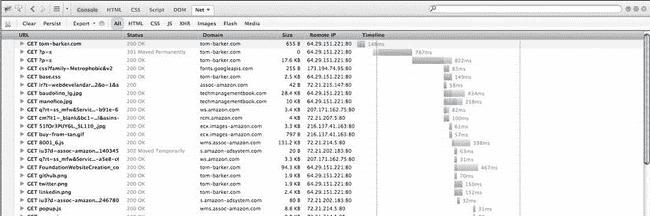

图 2-4. 网络监控标签中的瀑布图

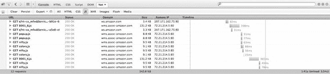

图 2-5. 按资源类型过滤结果

通常情况下，你可以使用 Firebug 来了解开发或生产支持中可能存在的问题。你可以主动监控有效载荷的大小和总体加载时间，还可以检查以确保你的页面加载时间不会过长。我的页面总体大小是多少？哪些资源最大？哪个资源加载时间最长？你可以回答诸如此类的问题。你可以使用过滤器重点关注某些方面，例如查看外部 JavaScript 文件有多大。甚至还可以按域名对行进行排序，以查看按域名分组的内容，或者按 HTTP 状态排序，以快速找出任何报错的调用。

由于 Firebug 是一个仅报告当前情况而不提供改进建议的被动工具，它最适合用作开发工具或用于调试出现的问题。

#### YSlow

若要更深入地分析页面的网页性能，你可以使用 YSlow。

YSlow 由 Steve Souders 和雅虎团队开发，于 2007 年发布。它最初是作为 Firefox 扩展发布的，但后来也移植到了大多数其他浏览器。与 Firebug 类似，YSlow 也是一个浏览器内工具，并且同样不支持太多自动化操作，但它是评估页面网页性能并获取改进性能步骤反馈的宝贵工具。

改进步骤是 YSlow 的真正与众不同之处。它使用一套标准来评估给定页面的性能，并提供针对你网站特定需求的反馈。最棒的是，这些标准是动态更新的，YSlow 团队会随着最佳实践的变化和旧标准变得不再适用而对其进行更新。

让我们来试试 YSlow。

##### 安装方法

要安装 YSlow，只需导航至 [`http://yslow.org/`](http://yslow.org/) 并选择你想运行的平台。图 2-6 展示了 YSlow 网站上当前可用的所有不同浏览器和平台。

由于我们已经在使用 Firebug 的 Firefox 浏览器，让我们继续使用该浏览器来运行 YSlow。选择 Firefox 版本后，安装该扩展并重启浏览器，你就可以开始使用 YSlow 了。


图 2-6. 访问 YSlow 的不同方式

##### 使用方法

在 Firefox 中打开 Firebug，可以看到它新增了一个名为 `YSlow` 的选项卡。点击该选项卡后，会显示如图 2-7 所示的启动画面。在此画面中，你可以对浏览器当前加载的页面运行 `YSlow` 测试，或选择在每次加载新页面时自动运行测试。

你还可以选择用于评估页面的规则集。正如我一直强调的，最佳实践是不断变化的，不同的规则集反映了这一点。规则集包括：`YSlow` 最初发布时附带的一组经典规则；一个更新后的规则集（`V2`），它改变了某些规则（如将 CSS 和 JavaScript 外部化）的权重，并添加了许多新规则；以及一组适用于小型站点和博客的规则子集，在这些场景下，某些规则可能显得过于严苛。

运行测试后，你将看到如图 2-8 所示的结果界面。结果界面分为两个区域：左侧是各项规则及其相应的评级，右侧是对规则的说明。

关于 `YSlow` 所用规则的详细分类，请参阅 [`http://developer.yahoo.com/performance/rules.html`](http://developer.yahoo.com/performance/rules.html)。

结果下方有一个子导航栏，可进一步细分结果，显示页面组件、页面统计信息以及可用于进一步优化性能的工具。

**组件**部分与 Firebug 中的**网络监视**选项卡非常相似；它列出了页面中的各个资源，以及每个组件的文件大小、`URL`、响应头、响应时间、过期头和 `etag`。


**提示：** 实体标签（简称 `etag`）是由 Web 服务器生成的指纹，通过 HTTP 事务发送并存储在客户端。这是一种缓存机制：客户端通过在其事务中发送存储的 `etag` 来请求内容，服务器则进行比较，看发送的 `etag` 是否与其存储的 `etag` 匹配。如果匹配，客户端将使用缓存的版本。


***图 2-7.** YSlow 扩展*

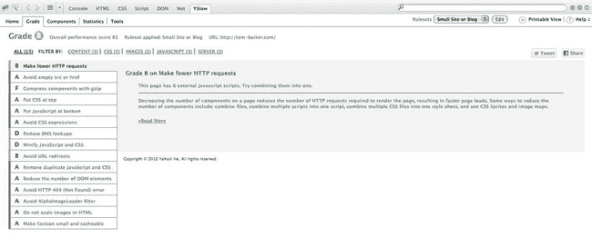

***图 2-8.** YSlow 结果界面*

但请注意：`etag` 对生成它的服务器是唯一的。如果你的内容由服务器集群（而非单台服务器）提供，那么当客户端从不同的服务器请求内容时，`etag` 将不匹配，你也无法获得内容被缓存的优势。

**统计信息**部分，如图 2-9 所示，显示两个饼图，展示了页面组件的分解情况。左侧图表显示未缓存任何内容时的结果，右侧显示后续缓存后的视图。这对于识别能够带来最大性能提升的领域非常有用。

通过比较图 2-9 中的两个图表，你可以看到，在缓存之前，JavaScript 和图片是页面中占比最大的两部分。缓存可以缓解图片方面的问题，但我相信，通过使用我们即将讨论的工具 `Minify`，我们可以进一步减少 JavaScript 的占用空间。

还有其他与 `YSlow` 类似的产品。谷歌随后推出了 `Page Speed`，作为一个独立站点，地址为：[`https://developers.google.com/speed/pagespeed/insights`](https://developers.google.com/speed/pagespeed/insights)。`Page Speed` 也可作为 Chrome 或 Firefox 的浏览器扩展使用，下载地址为：[`https://developers.google.com/speed/pagespeed/insights_extensions`](https://developers.google.com/speed/pagespeed/insights_extensions)。

`YSlow` 与 `Page Speed` 之间的差异可以忽略不计，主要取决于个人在风格和呈现方式上的偏好。

图 2-10 展示了在 Chrome 开发者工具中运行的 `Page Speed` 测试结果。

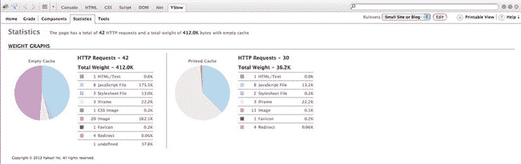

***图 2-9.** YSlow 结果界面——统计信息*

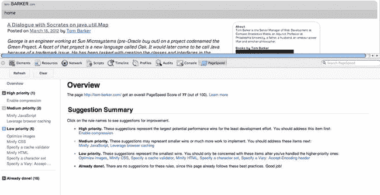

***图 2-10.** Page Speed 结果*

另一个类似的产品是 `WebPagetest`。由于其丰富的功能集和潜在的自动化能力，`WebPagetest` 将是我们接下来要详细讨论的产品。

### WebPagetest

`WebPagetest` 最初由 AOL 创建，并于 2008 年开源供公众使用和贡献。它既可以作为公共网站，也可以作为开源项目使用，还可以下载后运行私有实例。其代码仓库位于 [`http://code.google.com/p/webpagetest/`](http://code.google.com/p/webpagetest/)。公共网站地址为 [`http://www.webpagetest.org/`](http://www.webpagetest.org/)，如图 2-11 所示。该公共站点由 Pat Meenan 通过其公司 WebPagetest LLC 维护和运营。

`WebPagetest` 是一个 Web 应用程序，它以 URL 和一组配置参数作为输入，并对该 URL 运行性能测试。我们可以为 `WebPagetest` 配置的参数数量和范围非常强大。

如果您需要对非公开可用的网站（例如 QA 或开发环境）运行测试，或者由于法律或其他原因只能将测试结果存储在自己的服务器上，那么安装您自己的 `WebPagetest` 私有实例是可行的方法。否则，没有理由不使用公共实例。

您可以从全球各地的一组位置中选择测试运行的地点。每个地点都配备了一个或多个可用于在该地点进行测试的浏览器。您还可以指定连接速度和要运行的测试次数。

在“高级”（Advanced）面板中，您可以在文档加载完成时停止测试运行。这将在 `document.onload` 事件被触发时通知我们，而不是在页面上的所有资源都加载完毕时。这很有用，因为页面加载后可能发生的 XHR 通信会被注册为新活动，从而影响测试结果。您还可以让测试忽略 SSL 证书错误，否则这些错误会阻止测试，因为需要与最终用户交互才能允许事务继续、查看证书或取消事务。

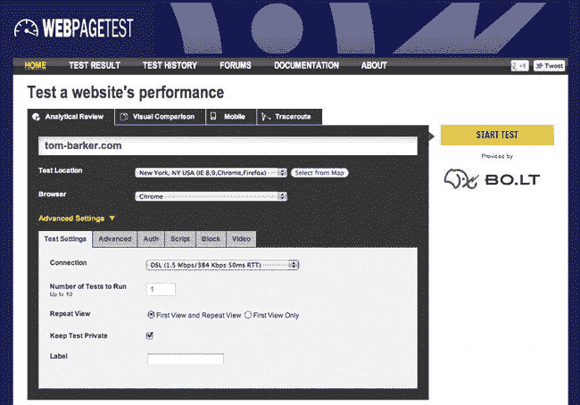

***图 2-11.** Webpagetest.org*

在“高级”选项卡中还有许多其他选项；您可以让测试捕获数据包跟踪和网络日志，提供测试中涉及的网络事务的详细细节，或者选择“保留原始用户代理字符串”（Preserve original User Agent string）选项，让测试保留运行测试的浏览器的用户代理字符串，而不是附加一个字符串来将访问标识为 `WebPagetest` 测试。

在“身份验证”（Auth）选项卡中，如果网站使用 HTTP 身份验证进行访问，您可以指定要使用的凭据；但请务必谨慎。绝不建议使用真实的生产环境用户名和密码来测试和存储数据于公共服务器上。更可取的做法是为此目的创建具有受限权限的测试凭据。

有时您需要测试非常特定的条件。也许您正在对某个功能集进行多变量测试，其中您只在特定的客户端配置上提供特定功能，例如 iPhone 特定功能。或者，您需要针对根据推断的使用习惯分组的目标用户测试某些功能。那么您就需要对这些仅由特殊事件触发的功能运行性能测试。

“脚本”（Script）选项卡正可让您实现这一点。您可以运行更复杂的测试，包括多个步骤，例如导航到多个 URL、向 DOM 发送点击和按键事件、提交表单数据、执行临时 JavaScript 以及更新 DOM。您甚至可以更改 HTTP 请求设置，以执行诸如设置特定 Cookie、设置主机 IP 或更改用户代理等操作。

例如，要让客户端显示为 iPhone，只需添加以下脚本：

```
setUserAgent          Mozilla/5.0 (iPhone; U; CPU iPhone OS 4_0 like Mac OS X; en-us)
AppleWebKit/532.9 (KHTML, like Gecko) Version/4.0.5 Mobile/8A293 Safari/6531.22.7
navigate http://tom-barker.com
```

`setUserAgent` 命令会模拟客户端用户代理，而 `navigate` 命令则会指示测试访问指定的 URL。您可以在此处阅读更多关于语法以及使用脚本控制 `WebPagetest` 所能实现的一些出色功能：[`https://sites.google.com/a/webpagetest.org/docs/using-webpagetest/scripting`](https://sites.google.com/a/webpagetest.org/docs/using-webpagetest/scripting)。

“阻止”（Block）选项卡允许我们阻止请求中的内容。这对于比较有广告和无广告、有 JavaScript 和无 JavaScript、有图片和无图片时的结果非常有用。除了使用“阻止”选项卡，我们也可以将阻止命令作为脚本的一部分集成到“脚本”选项卡中。如果我们想通过脚本阻止网站中的所有 PNG，脚本如下所示：

```
block .png
navigate http://www.tom-barker.com
```

最后，“视频”（Video）选项卡允许您在页面加载时捕获屏幕截图，并将其作为视频查看。这对于观察页面加载时的外观非常有用，尤其是当您有异步加载的内容时；您可以查看在流程的哪个时间点页面看起来可用了。

因此，一旦您设置了所有配置选项，就可以运行测试了。您可以在图 2-12 中看到我的结果屏幕。

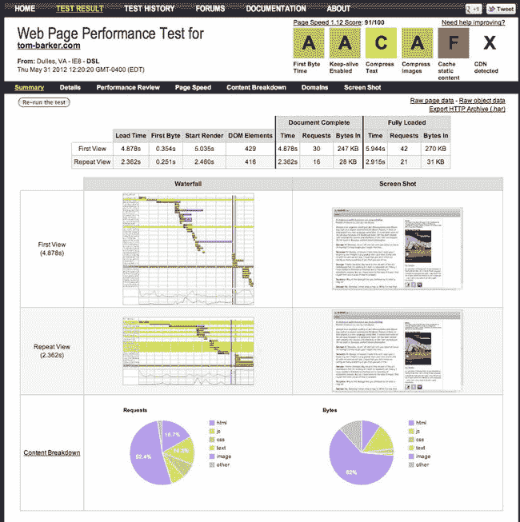

*图 2-12. 网页测试结果页面*

首先，“摘要”（Summary）屏幕为您汇总了所有关键相关信息。右上角是我们页面的“页面速度”（Page Speed）结果摘要。这是以 YSlow 的字母评分格式展示的、与我们在“页面速度”中运行测试时将呈现的相同信息的高级表示。

在瀑布图和屏幕截图上方有一个表格，其中包含页面级指标，例如：整个页面的加载时间、首字节加载耗时、第一块内容绘制到屏幕上所花时间、页面上的 DOM 元素数量、`document.onload` 事件触发所花时间、页面上所有元素加载完成所花时间，以及绘制页面所需的 HTTP 请求数量。

请记下这些数据。它们构成了基本的量化指标，您将在下一章中使用这些指标来绘制 Web 性能图表。它们是一个网站 Web 性能的真正核心。

在此表格下方有两列。左侧是首次访问和缓存后重复访问的瀑布图，右侧是对应的屏幕截图。我们已经详细讨论过瀑布图的巨大作用了。

再下面是两个饼图。左侧的饼图显示了按内容类型划分的请求百分比。右侧的饼图显示了按内容类型划分的字节数百分比，这对于识别可以优化的最大领域非常有用。如果您的 `JavaScript` 仅占总负载的 5%，而图片占了 70%，那么优先优化图片会效果更好。

此摘要页面以高级别汇总了您可以通过其子导航栏访问的页面中的所有数据。单击此栏中的“详细信息”（Details）、“性能审核”（Performance Review）、“页面速度”（Page Speed）、“内容分解”（Content Breakdown）、“域”（Domains）和“屏幕截图”（Screen Shot）链接，可以深入了解每一项。“内容分解”部分如图 2-13 所示。它显示了每一块内容在列名中列出的标准（保持连接、Gzip 文本、压缩图片、缓存静态资源、合并、检测到 CDN、压缩 JS 和 Cookie）下的表现。绿色勾号表示满足标准，带感叹号的黄色三角形表示警告，红色 X 表示错误。

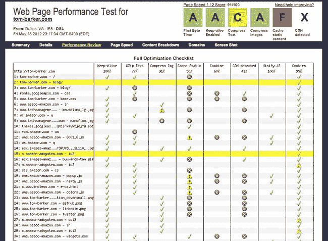

*图 2-13. Webpagetest 性能优化检查清单*

正如您所见，WebPagetest 提供了关于网站 Web 性能的丰富信息，但最重要的是，它是完全可编程的。它提供了一个 API，您可以调用它来获取所有这些信息。下一章我们将探索该 API，并构建我们自己的应用程序来跟踪和报告 Web 性能。

### 代码压缩

通常，人们会花费大量精力来优化缓存。这是一件好事，因为尽可能多地缓存内容不仅可以为后续访问带来更好的用户体验，还可以节省带宽以及对源服务器的请求次数。

但当用户首次访问网站时，缓存是空的。因此，为了确保首次访问尽可能流畅，我们需要压缩 `JavaScript`。

代码压缩的核心理念是：`JavaScript` 解释器会忽略空格、换行符以及注释，因此我们可以通过删除这些不必要的字符来减小 `.js` 文件的总体积。

有很多工具可以对 `JavaScript` 进行代码压缩。一些优秀的工具还在此基础上增加了新的功能。

#### Minify

首先，我们来看一下 `Minify`，可在 [`http://code.google.com/p/minify/`](http://code.google.com/p/minify/) 获取。`Minify` 代理了 `JavaScript` 文件；页面上的 `script` 标签指向 `Minify`，它是一个 `PHP` 文件（在下面的代码中，我们直接指向 `/min` 目录，因为 `PHP` 文件是 `index.php`）。该 `script` 标签如下所示：

```html
<script type="text/javascript" src="/min/?f=lib/perfLogger.js"></script>
```

`注意`：Web 代理是一种代码，它接受一个 URL，读取并处理该 URL 的内容，然后使这些内容可用于其他场景，无论是原样提供还是附加了额外的功能或格式。通常，我们使用代理来使一个域名上的内容可供另一个域名的客户端代码使用。`Minify` 读取内容，通过删除多余字符来修饰它，并对响应进行 gzip 压缩。

`Minify` 读取 `JavaScript` 文件，对其进行压缩，并在响应时设置 HTTP 头 `Accept-Encoding` 为 `gzip, deflate`。实际上，它内置了 HTTP 静态压缩功能。当您的网站托管商不允许对静态内容进行 gzip 压缩时（不幸的是，就像我使用的网站托管商一样），这尤其有用。请参见图 2-14 了解 `Minify` 工作的高级架构。

要使用 `Minify`，只需从 [`http://code.google.com/p/minify/`](http://code.google.com/p/minify/) 下载项目，将解压缩后的 `/min` 文件夹放置在您网站的根目录下，然后导航至 `Minify` 控制面板，其路径为 `/min/builder/`。

在此控制面板中，您可以添加希望包含在压缩结果中的 `JavaScript` 文件，页面会生成一个 `script` 标签，您可以使用该标签来链接到压缩后的结果。非常简单。

*图 2-14. Minify 的序列图。`script` 标签指向 `Minify`，并传入 `JavaScript` 文件的 URL。`Minify` 删除不必要的字符，将响应头设置为 gzip 编码，并将结果返回给 `script` 标签，该标签在浏览器中加载此脚本。*

#### YUI Compressor

另一个代码压缩工具是雅虎的 `YUI Compressor`，可在此处获取： [`http://yuilibrary.com/download/yuicompressor/`](http://yuilibrary.com/download/yuicompressor/)。`YUI Compressor` 是一个 `jar` 文件，可以通过命令行运行。因此，它可以很容易地集成到构建过程中。其使用方式如下：

```bash
java -jar yuicompressor-[version].jar [options] [file name]
```

与 `Minify` 一样，`YUI Compressor` 会从您的 `JavaScript` 中删除所有不必要的字符，包括空格、换行符和注释。要更详细地了解 `YUI Compressor` 的可用选项，请参见 [`http://developer.yahoo.com/yui/compressor`](http://developer.yahoo.com/yui/compressor)。

#### Closure Compiler

最后，我们来看一下谷歌的 `Closure Compiler`，可在 [`https://developers.google.com/closure/compiler/`](https://developers.google.com/closure/compiler/) 获取。`Closure Compiler` 也可以从命令行运行并集成到自动化流程中，但它更进一步，不仅对 `JavaScript` 进行压缩，还会进行重写。为了重写我们的 `JavaScript`，`Closure Compiler` 会执行一系列“焦土”优化——它会展开函数、重写变量名、删除从未被调用的函数（就它所能判断的而言）。这些被称为“焦土”优化，因为它们会剥离所有内容，包括最佳实践，以追求尽可能精简的载荷。这种方法非常成功。我们永远不会用这种风格来编写代码，因此我们会保留原始版本，并通过 `Closure Compiler` 将它们“编译”成最优化代码。我们将这种“编译”后的代码保存为单独的文件，以便保留原始代码进行更新。

为了解 `Closure Compiler` 如何重写我们的 `JavaScript`，让我们看一段代码在运行 `Closure Compiler` 前后的对比。对于“之前”的代码，我们使用一个小例子，该例子将在第 7 章中使用。

```markdown
# JavaScript 性能测试与代码压缩

```javascript
<script src="/lib/perfLogger.js"></script>
<script>
     function populateArray(len){
          var retArray = new Array(len)
          for(var i = 0; i < len; i++){
               retArray[i] = 1;
          }
          return retArray
     }
perfLogger.startTimeLogging("page_render", "timing page render", true, true)
/* ***
7.1
Compare timing for loop against for in loop
****/
var stepTest = populateArray(40);
perfLogger.startTimeLogging("for_loop", "timing for loop", true,true, true)
for(var x = 0; x < stepTest.length; x++){
}
perfLogger.stopTimeLogging("for_loop");
perfLogger.startTimeLogging("for_in_loop", "timing for in loop", true, true)
for(ind in stepTest){
}
perfLogger.stopTimeLogging("for_in_loop")
/** end 7.1 ***/
/* ***
7.1.1
Benchmark for loop and for in loop
****/
function useForLoop(){
     var stepTest = populateArray(40);
     for(var x = 0; x < stepTest.length; x++){
     }
}
function useForInLoop(){
     var stepTest = populateArray(40);
     for(ind in stepTest){
     }
}
perfLogger.logBenchmark("f", 1, useForLoop, true, true);
perfLogger.logBenchmark("fi", 1, useForInLoop, true, true);
perfLogger.stopTimeLogging("page_render")
</script>
```

`Closure Compiler` 将该代码重写为：

```javascript
<script>
var b=[];function e(a,c){b[a]={};b[a].id=a;b[a].startTime=new Date;b[a].description=c;b[a].a=!0}
function f(a){b[a].d=new Date;b[a].c=b[a].d-b[a].startTime;b[a].url=window.location;b[a].
e=navigator.userAgent;b[a].a&&g(a)}function h(a,c){for(var d=0,j=0;10>j;j++)e(a,"benchmarking"
+c),c(),f(a),d+=b[a].c;b[a].a=drawToPage;b[a].b=d/10;b[a].a&&g(a)}
function g(a){var c=document.getElementById("debug"),d="<p><strong>"+b[a].description+"</strong>
<br/>",d=b[a].b?d+("average run time: "+b[a].b+"ms<br/>"):d+("run time: "+b[a].
c+"ms<br/>"),d=d+("path: "+b[a].url+"<br/>"),d=d+("useragent: "+b[a].e+"<br/>"),a=d+"</p>";c?c.
innerHTML+=a:(c=document.createElement("div"),c.id="debug",c.innerHTML=a,document.body.
appendChild(c))}function i(){for(var a=Array(4E4),c=0;4E4>c;c++)a[c]=1;return a}e("page_
render","timing page render");var k=i();e("for_loop","timing for loop");
for(var l=0;l<k.length;l++);f("for_loop");e("for_in_loop","timing for in loop");for(ind in
k);f("for_in_loop");h("f",function(){for(var a=i(),c=0;c<a.length;c++);});h("fi",function(){var
a=i();for(ind in a);});f("page_render");
</script>
```

在所有性能指标上都有了显著改善，但代价是牺牲了可读性和与原始代码的抽象层次。

## 结果比较

为了确定在特定情况下使用的最佳工具，我们将采用科学方法！我们来实现刚刚讨论过的工具，并运行一个多变量测试，亲自看看哪个工具能给我们带来最佳效果。

首先，我们来看一个未压缩代码样本的瀑布图，如图 2-15 所示。我们看到，未压缩和未精简的 JavaScript 文件大小为 2.1 KB，页面总大小为 3.3 KB。该样本可在 [`http://tom-barker.com/lab/perfLogger_example.html`](http://tom-barker.com/lab/perfLogger_example.html) 找到。

现在，让我们使用 `Minify` 并测试其结果。从图 2-16 的瀑布图中可以看到，由 `Minify` 提供的 JavaScript（经过精简和 Gzip 压缩）仅为 573 字节，页面总大小为 1.9 KB。

当我在同样的文件上使用 `YUI Compressor` 和 `Closure Compiler`（选择简单选项，仅精简文件而不重写代码）时，得到了相同的结果；JavaScript 文件大小均缩减至 1.6 KB，页面总大小为 2.9 KB。参见图 2-17。

请注意，我使用的 Web 主机不支持全局范围内的 HTTP 压缩，因此这些结果仅为精简后的结果，并未进行 Gzip 压缩。因此，这不是对压缩算法进行的公平比较，而只是对工具开箱即用效果的比较。

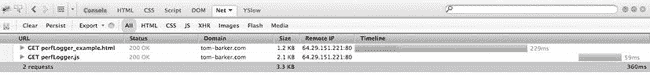

**图 2-15.** 未压缩 JavaScript 的瀑布图，我们的基准线

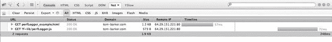

**图 2-16.** 使用 `Minify` 压缩后的页面

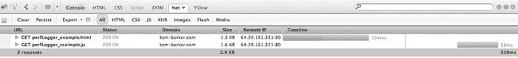

**图 2-17.** 使用 `Closure Compiler`（简单模式）压缩后的页面

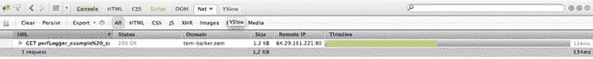

**图 2-18.** 使用 `Closure Compiler`（高级模式）压缩并内联后的页面

最后的比较是，将原始 JavaScript 文件通过启用 `Advanced` 选项的 `Closure Compiler` 运行，使其尽可能精简地重写代码。执行此操作时，请确保包含页面上的所有 JavaScript；也就是说，不仅包括远程的 `.js` 文件，还包括页面上实例化对象的 JavaScript。这样做是必要的，因为 `Closure Compiler` 会消除所有它认为未被执行的代码。所以，如果你在远程 JS 文件中有一个带命名空间的对象，但在 HTML 页面中有实例化它的代码，你需要将实例化该对象的代码包含在同一个文件中，这样 `Closure Compiler` 才能看到它被使用了，并将其包含在输出中。

我将把 `Closure Compiler` 的最终输出嵌入到 HTML 页面中，而不是外部链接。你可以在图 2-18 中看到结果。

现在我们有了一些数据，让我们将其可视化并进行评估。

### 分析与可视化

我们将打开 `R`，输入我们的精简结果、工具名称、每个工具输出文件的新大小以及每个文件的百分比差异。然后，我们将编写一些 `R` 代码，创建一个水平条形图来比较差异。

别担心，为此我们将深入探索 `R`，并且我会解释每一行代码的作用。现在，让我们先来看看你最终将生成的图表，如图 2-19 所示。
```

从图 2-19 中可以看出，`Closure Compiler` 开箱即用提供了最大的尺寸缩减，而 `Minify` 结合了精简和 Gzip 压缩，紧随其后，位列第二。`YUI` 和 `Closure Compiler` 提供的简单精简并列第三，但差距较大。

再次强调，这个比较是开箱即用的性能——如果我们对排名第三的结果进行 Gzip 压缩，它们会获得与 `Minify` 相似的结果，但 `Minify` 本身就提供了 Gzip 压缩。

单纯的文件尺寸缩减只是我们整体评估的一个方面。正如你在前面的例子中所见，`Closure Compiler` 高级模式的输出与原始代码大相径庭。如果生产环境出现问题，调试可能会非常困难，尤其是当你的页面中有第三方代码与你的代码交互时。

你的网站是否有第三方代码，例如广告代码？你是托管自己的服务器，还是受限于某个 Web 主机？与追求极致速度体验相比，生产环境支持对你来说有多重要？在确定自己偏好的工具时，最好像我们刚才做的那样进行评估，看看哪种工具最适合你自己的情况、环境和业务规则。例如，你是否有一个构建环境，可以在其中集成此工具并控制 Web 主机的配置？如果是这样，那么 `YUI` 或 `Closure Compiler` 可能是你的最佳选择。你是否能接受 `Closure Compiler` 高级设置那种“焦土”式的做法？如果是这样，它确实能带来最大的性能提升——但在生产环境中尝试调试其输出可就要祝你好运了。

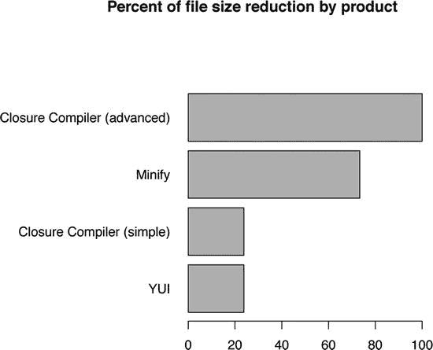

**图 2-19.** 在 `R` 中生成的比较图表，展示各产品的文件缩减百分比

## 开始使用 R

`R` 由 Ross Ihaka 和 Robert Gentleman 于 1993 年创建。它是 `S` 语言的扩展和继承者，而 `S` 语言本身是由 John Chambers 于 1976 年在贝尔实验室创建的一种统计语言。

`R` 既是一个开源环境，也是在该环境中运行的语言，用于进行统计计算。这是一个非常宽泛的描述。我既不是统计学家，也不是数据分析师。我是一名 Web 开发人员，并且管理着一个 Web 开发团队。如果你正在阅读本书，你很可能也是一名 Web 开发人员。那么，作为 Web 开发人员，我们用 `R` 做什么呢？

通常，我使用 `R` 来导入数据、解析数据、处理数据，然后将其可视化，用于报告目的。图 2-20 展示了这个工作流程。这不是我在这个流程中使用的唯一语言，但它是我最新的最爱。我通常需要其他语言来访问数据源或从其他应用程序抓取数据。在下一章中，我们将使用 `PHP` 作为我们的“胶水语言”来完成这项工作，但我们几乎可以使用任何其他语言——`Ruby`、Shell 脚本、`Perl`、`Python` 等等。

在使用胶水语言收集数据后，我将数据写入一个逗号分隔的文件，然后读入 `R`。在 `R` 中，我处理数据：拆分、求平均值、聚合、叠加两个或多个数据集，然后，在 `R` 内部，我将数据绘制成图表，以讲述我看到的故事。

一旦我创建了图表（通常保存为 `PDF` 格式以保持矢量和字体），我从 `R` 中将图表导入 `Adobe Illustrator` 或任何其他类似程序中，在那里我可以清理诸如字体一致性之类的问题，并确保长名称的轴标签清晰可见。

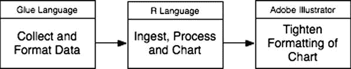

**图 2-20.** 使用 `R` 准备数据可视化的工作流程

我通常用 `R` 处理什么样的数据？各种类型的数据。在本书中，我们研究如何使用 `R` 来可视化性能数据，但我也会使用 `R` 报告我的部门指标，例如代码库的缺陷密度或代码覆盖率。

作为一种语言，它小巧、独立、可扩展，并且使用起来很有趣。话虽如此，它确实有自己的理念和特性，我们将在本书中探讨其中一部分。

### 安装与运行 R

要安装 `R`，首先需要从 [`http://cran.r-project.org/`](http://cran.r-project.org/) 下载预编译的 `R` 二进制文件。对于 Mac 和 PC，这是一个标准安装程序，会引导你完成安装过程。PC 安装程序有三种版本：`Base` 是基础安装版，`Contrib` 包含已编译的第三方包，`Rtools` 则包含用于自行构建 `R` 包的工具。就本书而言，我们将使用基础安装版。`R` 安装程序的截图请参见图 2-21。

对于 Linux 用户，则需要根据其特定的 Linux 发行版，在终端中执行相应的命令行来安装。

安装完成后，即可打开 `R Console`，这是我们将要运行 `R` 语言的交互环境。该控制台的界面如图 2-22 所示。

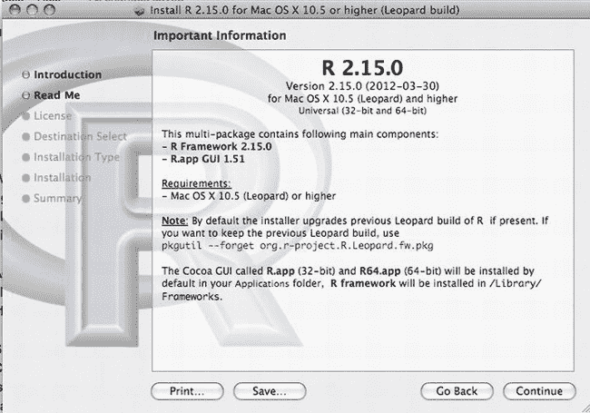

**图 2-21.** Mac 上的 `R` 安装程序

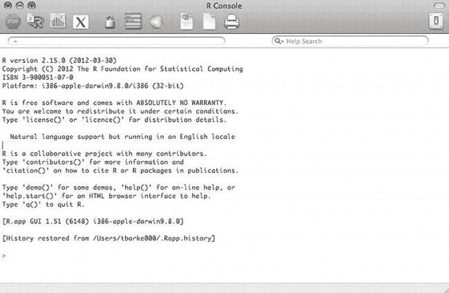

**图 2-22.** `R` 控制台

控制台的工具栏允许我们执行各种任务，例如中断正在运行的 `R` 进程、运行独立的 `.R` 文件、调整控制台的外观、创建新的独立 `.R` 文件等。

`R Console` 是一个用于执行临时 `R` 命令的命令行环境。我通常使用控制台来构思想法，并反复调整直到得到预期的结果，然后将这些可用的表达式转移到独立的 `R` 文件中。

你可以创建外部文件来保存 `R` 代码，这些文件通常以 `.R` 为扩展名。

`R` 还具有高度的可扩展性，并拥有一个活跃的社区，社区成员会构建各种包来扩展 `R` 的功能。尽管如此，本书中所有 `R` 代码将不会使用任何包，仅依赖 `R` 的基础安装功能。

### R 入门指南

既然你已经了解了 `R` 是什么，那么如何使用 `R` 呢？首先要注意的是，你随时可以输入 `?[关键字]` 来打开特定主题的帮助窗口。如果你不确定要查找的内容是否有独立主题，只需输入 `??[关键字]` 进行更广泛的搜索。例如，输入 `?hist` 搜索关于创建直方图的帮助。

```
> ?hist
starting httpd help server ... done
```

同样重要的是，`R` 支持单行注释，但不支持多行注释。井号 (`#`) 用于开始注释，`R` 解释器会忽略从井号到行尾的所有内容。

```
#this is a comment
```

#### 变量与数据类型

声明变量非常简单，只需为其赋值即可。赋值运算符是左箭头 `<-`，因此创建和声明变量如下所示：

```
foo <- bar
```

`R` 是弱类型语言，它支持所有你期望的标量数据类型：字符串、数字和布尔值。

```
myString <- “This is a string”
myNumber <- 23
myBool <- TRUE
```

它还支持列表，但这也是该语言的一个特殊之处。`R` 有一种叫做 `vector` 的数据类型，其功能几乎像一个严格类型的一维数组。它是一个所有元素均为相同数据类型（字符串、数字或布尔值）的列表。要声明 `vector`，请使用组合函数 `c()`，向 `vector` 添加元素也同样使用 `c()` 函数。使用方括号访问 `vector` 中的元素。与大多数语言中的数组不同，`vector` 的索引不是从零开始的；第一个元素被引用为元素 `[1]`。

```
myVector <- c(12,343,564) # 声明一个向量
myVector <- c(myVector, 545) # 将数字 545 追加到 myVector
myVector[3] # 返回 564
```

`R` 还有另一种列表类型，称为 `matrix`。`矩阵`类似于严格类型的二维数组。你使用 `matrix` 函数创建`矩阵`，该函数接受五个参数：用作内容的 `vector`，将内容塑形的行数，将内容塑形的列数，一个可选的布尔值，用于指示是否按行或按列塑形内容（默认值为按列塑形，即 `FALSE`），以及一个包含行名和列名向量的列表：

```
matrix([*内容向量*], nrow=[*行数*], ncol=[*列数*], byrow=[*排序方式*],
dimnames=[*行名向量*, *列名向量*])
```

同样使用方括号访问`矩阵`中的索引，但必须在方括号内同时指定行和列。

```
m <- matrix(c(11,12,13,14,15,16,17,18), nrow=4, ncol=2, dimnames=list(c("row1", "row2", "row3",
"row4"), c("col1", "col2")))
```

```
> m
    col1 col2
row1   11   15
row2   12   16
row3   13   17
row4   14   18
```

```
>m[1,1]  # 将返回 11
[1]11
```

```
> m[4,2]   # 将返回 18
[1] 18
```

# 数据框与数据操作

到目前为止，`matrices` 和 `vectors` 都只能包含单一数据类型。`R` 支持另一种列表类型，称为 `data frame`。`数据框`是多维列表，可以包含多种数据类型——但也不完全是。更简单的理解方式是将`数据框`视为 `vectors` 的集合。`向量`仍然只能保存一种数据类型，但`数据框`可以保存多种类型的`向量`。

你可以使用 `data.frame()` 函数创建`数据框`，该函数接受多个 `vector` 作为内容，以及以下参数：`row.names` 用于指定作为行标识符的 `vector`，`check.rows` 用于检查行数据的一致性，`check.names` 用于检查重复等其他语法检查。

```
userid <- c(1,2,3,4,5,6,7,8,9)
    username <- c("user1", "user2", "user3", "user4", "user5", "user6", "user7", "user8",
"user9")
    admin <- c(FALSE, FALSE, TRUE, FALSE, TRUE, FALSE, FALSE, TRUE, TRUE)
```

```
users <- data.frame(username, admin, row.names=userid)
> users
   username admin
1    user1 FALSE
2    user2 FALSE
3    user3  TRUE
4    user4 FALSE
5    user5  TRUE
6    user6 FALSE
7    user7 FALSE
8    user8  TRUE
9    user9  TRUE
```

使用方括号访问`数据框`中的单个 `vectors`：

```
> users[1]
   username
1    user1
2    user2
3    user3
4    user4
5    user5
6    user6
7    user7
8    user8
9    user9
```

使用 `$` 符号来隔离列，使用方括号来指定这些列的单个索引。`R` 中的 `$` 类似于大多其他语言中的点符号。

```
> users$admin[3]
[1] TRUE
```

# 导入外部数据

既然你已经了解了如何存储数据，现在我们来看看如何导入数据。你可以使用 `read.table()` 函数从平面文件读取数据。该函数接受四个参数：要读取的平面文件的路径，一个布尔值，指示平面文件的第一行是否包含列名，作为列分隔符的字符，以及作为行标识符的列。`read.table()` 函数返回一个 `data frame`。

```
read.table([文件路径], [是否将第一行视为列名],[列分隔符],[用作行标识符的列])
```

例如，假设你有以下平面文件，其中包含 bug 积压工作的细分：

```
Section,Resolved,UnResolved,Total
Regression,71,32,103
Compliance,4,2,6
Development,19,8,27
```

你可以使用以下代码读取此文件：

```
bugData <- read.table("/bugsbyUS.txt", header=TRUE, sep=",", row.names="Section")
```

如果你检查生成的 `bugData` 对象，应该会看到以下内容：

```
> bugData
            Resolved UnResolved Total
Regression        71         32   103
Compliance         4          2     6
Development       19          8    27
```

## 循环

`R` 同时支持 `for` 循环和 `while` 循环，它们的结构与你的预期非常相似：

```
for(n in list){}
while ([条件为真]){}
```

要遍历 `users` 数据框，你可以简单地执行以下操作：

```
for(i in users){
print(users$admin[i])
}
[1] FALSE FALSE  TRUE FALSE FALSE
[1] TRUE
```

同样适用于 bug 数据：

```
> for(x in bugData$UnResolved){
+      print(x)
+ }
32
2
8
```

### 函数

R 中的函数也与您预期的一样工作；我们可以传入参数，函数将其作为参数接收，并能从函数中返回数据。请注意，在 R 中所有数据都是按值传递的。

我们按如下方式构建函数：

```
functionName <- function([parameters]){

}
```

### 使用 R 进行简单绘图

现在开始，R 会变得真正有趣。您已经知道如何导入数据、存储数据以及遍历数据；接下来，让我们将数据可视化！

R 原生支持多种绘图函数。我们首先要看的是 `plot()` 函数。

`plot()` 函数会根据您传入的参数显示不同类型的图表。它接受以下参数：一个支持绘图功能的 R 对象；一个可选参数，当第一个参数不包含 y 轴值时，可作为 y 轴值的补充；数量可变的命名图形参数；一个用于确定图表绘制类型的字符串（稍后会详细说明）；图表的标题；图表的副标题；x 轴的标签；y 轴的标签；以及一个用于表示图表纵横比（纵横比即 y/x 的数值结果）的数字。

让我们看看一些绘图类型选项是如何在图表显示中体现的。请注意，当您绘制 `users` 数据框时，x 轴是用户名列的数值表示，y 轴是管理员列，但其显示范围是 0 到 1（而不是 TRUE 和 FALSE）。图 2-23 显示了结果。

```
plot(users, main="绘制用户数据框\n 未指定类型")
plot(users, type="p", main="绘制用户数据框\ntype=p 表示点图")
plot(users, type="l", main="绘制用户数据框\ntype=l 表示线图")
plot(users, type="b", main="绘制用户数据框\ntype=b 表示点线图")
plot(users, type="c", main="绘制用户数据框\ntype=c 表示线图（不含点）")
plot(users, type="o", main="绘制用户数据框\ntype=o 表示叠加图")
plot(users, type="h", main="绘制用户数据框\ntype=h 表示直方图")
plot(users, type="s", main="绘制用户数据框\ntype=s 表示阶梯图")
plot(users, type="n", main="绘制用户数据框\ntype=n 表示不绘图")
```

R 的基础安装也支持条形图，使用的是 `barplot()` 函数。`barplot()` 函数接受的一些最常用参数包括：一个用于表示条形高度的向量或矩阵；一个可选的 `width` 参数；每个条形前的间距；一个用于列出每个条形名称的向量；用作图例的文本；一个名为 `beside` 的布尔值，用于指示条形图是否堆叠；另一个布尔值，若设为 TRUE 则表示条形应为水平而非垂直；一个用于填充条形颜色的向量；一个用于设置每个条形边框颜色的向量；以及图表的标题和副标题。如需完整列表，只需在控制台中输入 `?barplot`。

图 2-24 显示了 `users` 数据框以条形图形式呈现的效果。

```
barplot(users$admin, names.arg=users$username, main="管理员用户条形图")
```

您还可以在 R 中原生创建气泡图。为此，请使用 `symbols()` 函数，传入您想要表示的 R 对象，并将 `circles` 参数设置为一个代表每个圆圈半径的列。

 注意：气泡图用于表示三维数据。它们与散点图非常相似，通过点在 x 轴和 y 轴上的位置来表示数值，但在气泡图中，点的半径也表示数值。

图 2-25 显示了结果。

```
symbols(users, circles=users$admin, bg="red", main="管理员用户气泡图")
```

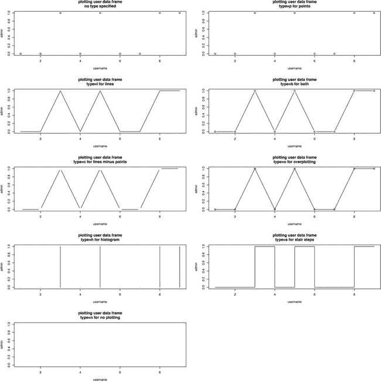

*图 2-23. 使用 plot 函数绘制的不同图表类型*

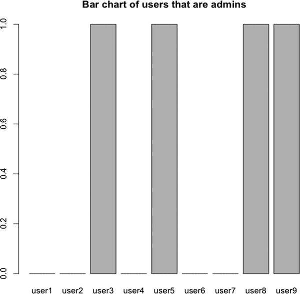

*图 2-24. 管理员用户条形图*

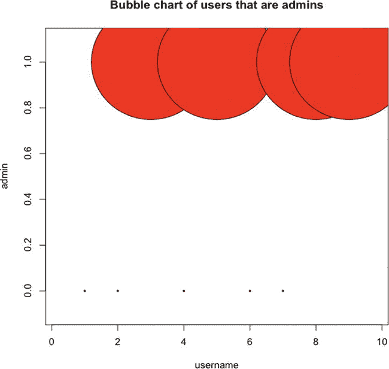

*图 2-25. 管理员用户气泡图*

`symbols()` 函数可用于在图表上绘制其他形状；有关此类型的更多信息，请在 R 控制台中输入 `?symbols`。

您可以通过调用与所需文件类型对应的函数来保存生成的图表。请注意，在输出完成后需要调用 `dev.off`。例如，要创建条形图的 JPEG 文件，您可以调用：

```
jpeg("test.jpg")
barplot(users$admin)
dev.off()
```

可用的函数如下：

```
pdf([filename]) #将图表保存为 PDF 文件
win.metafile([filename]) #将图表保存为 Windows 图元文件
png([filename]) #将图表保存为 PNG 文件
jpeg([filename]) #将图表保存为 JPG 文件
bmp([filename]) #将图表保存为 BMP 文件
postscript([filename]) #将图表保存为 PS 文件
```

## R 语言的实际示例

以上只是对 R 语言的初步体验，但既然你已经了解了它的基本构成要素，我们就来构建之前在图 2-19 中看到的图表。

首先，你将创建四个变量：一个用于保存未压缩 JavaScript 文件大小的数值，一个用于保存工具名称的向量，一个用于保存经过工具处理后的 JavaScript 文件大小的向量，以及最后一个用于保存压缩后大小与原始大小之间百分比差异的向量。

稍后你将对最后一个变量进行重构，但现在先让它保持硬编码状态，这样你就能看到我们用于计算百分比的模式——100 减去新大小除以总大小再乘以 100 的结果。

```
originalSize <- 2150
tool <- c("YUI", "Closure Compiler (simple)", "Minify", "Closure Compiler (advanced)")
size <- c(1638, 1638, 573, 0)
diff <- c((100 - (1638 / 2150)*100), (100 - (1638 / 2150)*100), (100 - (573 / 2150)*100), (100 - (0 / 2150)*100))
```

接下来，从这些向量创建一个数据框，并将工具名称的向量作为行标识符。

```
mincompare <- data.frame(diff, size, row.names=tool)
```

如果你在控制台中输入 `mincompare`，你会看到它的结构如下：

```
>mincompare
                                diff size
YUI                          23.81395 1638
Closure Compiler (simple)    23.81395 1638
Minify                       73.34884  573
Closure Compiler (advanced) 100.00000    0
```

完美！至此，你可以开始构建图表了。使用 `barplot` 函数绘制 `diff` 列。将图表设置为水平，显式地将 y 轴名称设为数据框的行名，并为图表添加标题“各产品文件大小缩减百分比”：

```
barplot(mincompare$diff, horiz=TRUE, names.arg =row.names(mincompare), main="Percent of file size reduction by product")
```

如果在控制台中运行此代码，你会发现已经接近目标了。结果应该类似于图 2-26。

你可以看到第一个和第三个 y 轴名称缺失了；这是因为当前文本太大，无法垂直显示。你可以通过将文本设置为与条形图一样的水平方向来修正这个问题。

为此，使用 `par` 函数设置图表的图形参数。但首先，保存现有参数，以便在创建图表后能恢复它们：

```
opar <- par(no.readonly=TRUE)
```

这会将现有参数保存到名为 `opar` 的变量中，以便在完成后恢复它们。

接下来，使用 `par()` 函数将文本设置为水平方向：

```
par(las=1, mar=c(10,10,10,10))
```

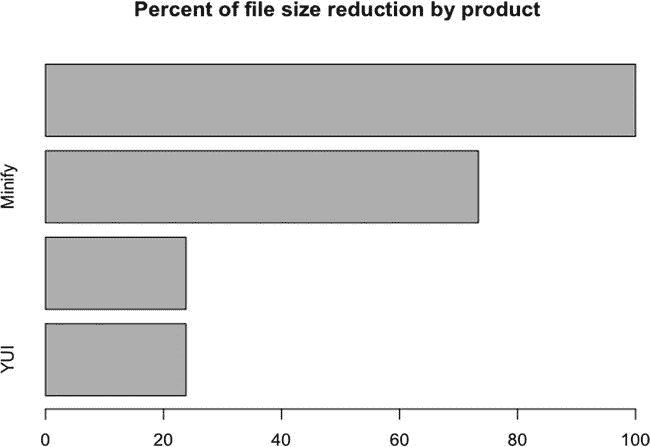

`par()` 函数可以接受多个参数。这段代码传入了 `las` 参数（用于更改坐标轴标签样式）并将其设置为 1，这使得坐标轴标签始终水平显示，同时传入了 `mar` 参数来设置图表的边距。

在调用 `barplot` 绘制图表后，你可以通过以下代码恢复原始的图形参数：

```
par(opar)
```

要保存此图表，你需要将其导出。你可以将对 `barplot` 和 `par` 的调用封装在对 `pdf` 函数的调用中，并传入要保存图表的文件名。本示例将导出为 PDF 格式，以保留矢量线条和原始文本，这样我们可以在后期使用 Illustrator 或其他类似程序进行编辑和优化：

```
pdf("Figure 2-19.pdf")
```

在恢复图形参数后，通过调用 `dev.off()` 关闭文件。

到目前为止，代码应该如下所示：

```
originalSize <- 2150
tool <- c("YUI", "Closure Compiler (simple)", "Minify", "Closure Compiler (advanced)")
size <- c(1638, 1638, 573, 0)
diff <- c((100 - (1638 / 2150)*100), (100 - (1638 / 2150)*100), (100 - (573 / 2150)*100), (100 - (0 / 2150)*100))
mincompare <- data.frame(diff, size, row.names=tool)

pdf("Figure 2-19.pdf")
opar <- par(no.readonly=TRUE)
     par(las=1, mar=c(10,10,10,10))
     barplot(mincompare$diff, horiz=TRUE, names.arg =row.names(mincompare), main="Percent of file size reduction by product")
par(opar)
dev.off()
```

但有些事情让我困扰。我不喜欢 `diff` 变量硬编码的方式，而且我们一遍又一遍地重复相同的算法来设置这些值。让我们把它抽象成一个函数。

将函数命名为 `getPercentImproved`，并让它接受两个参数：一个数值向量和一个数值：

```
getPercentImproved <- function(sourceVector, totalSize){}
```

在函数内部，创建一个空向量；这个向量将保存我们函数的结果，并且我们会在函数末尾返回这个向量：

```
percentVector <- c()
```

然后遍历传入的向量：

```
for(i in sourceVector){}
```

在迭代过程中，我们运行算法来计算每个元素中数值的差异。记住，公式是

(100–([新文件大小] / [原始文件大小])*100)

将结果保存到我们新的向量 `percentVector` 中：

```
percentVector <- c(percentVector,(100 - (i / totalSize)*100))
```

循环完成后，我们返回新的向量。

```
return(percentVector)
```

我们最终的函数应该如下所示：

```
getPercentImproved <- function(sourceVector, totalSize){
    percentVector <- c()
    for(i in sourceVector){
       percentVector <- c(percentVector,(100 - (i / totalSize)*100))
    }
    return(percentVector)
}
```

最后，将向量 `diff` 设置为 `getPercentImproved` 函数的结果，并传入名为 `size` 的向量和变量 `originalSize`：

```
diff <- getPercentImproved(size, originalSize)
```

你的最终代码应该如下所示：

### 使用 `apply()`

`apply()` 函数允许我们对列表中的元素应用一个函数。它接受多个参数：第一个是值列表，接下来是一个数字向量，用于指示我们如何对列表应用函数（`1` 代表行，`2` 代表列，`c(1, 2)` 代表行和列），最后一个参数是要应用于列表的函数：

`apply([列表], [应用函数的方式], [要应用的函数])`

我们可以去掉 `getPercentImproved` 函数，改用以下代码：

`diff <- apply(as.matrix(size), 1, function(x) 100 - (x / 2150) * 100)`

请注意，这会在将 `size` 变量传递给 `apply()` 时将其转换为矩阵。这是因为 `apply()` 期望接收矩阵、数组或数据框。`apply()` 函数还有一个衍生函数 `lapply()`，你也可以使用。

使用 `apply` 时，你的代码更精简，并且更符合语言的原本设计意图；它遵循语言的核心理念，即更侧重于结合统计分析的逻辑编程，而非命令式编程。更新后的代码现在应如下所示：

```r
originalSize <- 2150
tool <- c("YUI", "Closure Compiler (simple)", "Minify", "Closure Compiler (advanced)")
size <- c(1638, 1638, 573, 0)
diff <- apply(as.matrix(size), 1, function(x) 100 - (x / originalSize) * 100)
mincompare <- data.frame(diff, size, row.names = tool)

pdf("Figure 2-19.pdf")
opar <- par(no.readonly = TRUE)
   par(las = 1, mar = c(10, 10, 10, 10))
   barplot(mincompare$diff, horiz = TRUE, names.arg = row.names(mincompare), main = "Percent of file size reduction by product")
par(opar)
dev.off()
```

构建图表的最后一步是将其导入 Adobe Illustrator 或其他矢量绘图程序中进行精修，例如调整文本对齐方式或字体大小。虽然这种格式调整在 R 中也能实现，但在专门的应用程序中操作要强大得多。

## 总结

在本章中，我们学习了几种对我们创建和维护高性能网站至关重要的工具。我们了解到 Firebug 的网络监控标签是追踪构成页面的网络依赖关系及其对页面速度影响的绝佳工具。其被动特性使其成为我们在开发页面或调试已知问题时可用的优秀工具。

我们使用 YSlow 的不同过滤器测试了网站的当前性能，还获得了针对性地优化网站性能的定制化建议。

借助 WebPagetest，我们还能看到外部资源的影响并获得性能建议，并且能够查看重复访问的结果，以及获取多个数据维度的高级聚合数据。我们了解了 WebPagetest 强大的配置集，包括用于测试更复杂场景的脚本功能。我们还看到 WebPagetest 提供了一个 API，我们将在下一章使用它来自动化性能监控。

我们探索了几种用于压缩 JavaScript 的工具。我们实现了每个工具，并通过可视化每个工具带来的文件大小差异来比较结果。我们也开始关注一些抽象细节，这些细节表明性能不仅仅是数据那么简单。

随后，我们初步涉足了 R 语言。我们安装了 R 控制台，探索了 R 的一些入门概念，并用 R 编写了我们的第一个图表——也就是用来比较不同压缩工具结果的同一张图表。

在接下来的章节中，我们将运用并扩展 R 语言的知识，同时也会使用本章探讨的许多工具和概念。
