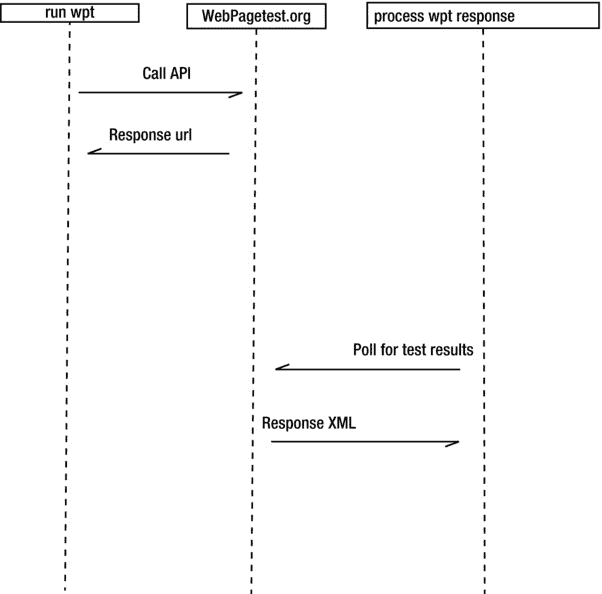
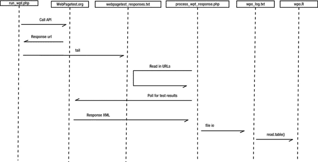
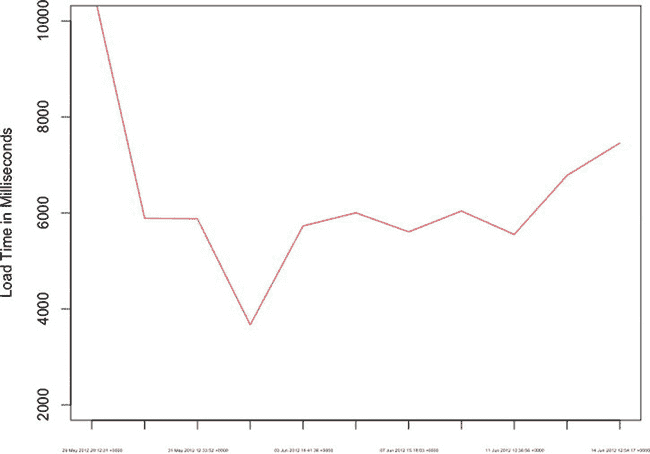
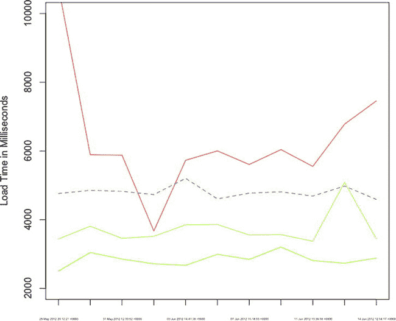
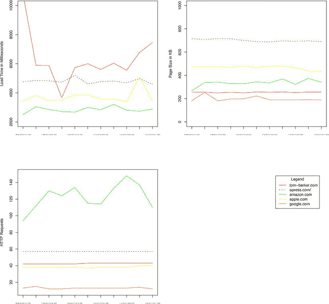

## 第 3 章


### WPTRunner——使用 WebPagetest 实现自动化性能监控与可视化

上一章为我们奠定了坚实的基础，我们将在本书的其余部分继续以此为基础进行构建。我们学习了如何使用 Firebug 和 YSlow 生成瀑布图，并将其作为调试工具。我们探索了 WebPagetest 的一些广泛特性和功能。我们讨论了压缩 JavaScript 的概念，并进行了一次多变量测试来比较几种压缩工具的结果。本章通过学习和编写 R 脚本来可视化多变量测试结果作为结尾。

本章将扩展这些概念。你将连接到 WebPagetest 提供的 API 来自动化监控多个 URL，并使用 R 来可视化这些结果。

你将本质上创建一个框架，使你能够监控网站的 Web 性能。通过接入特定的 URL，你还可以跨 URL 运行多变量测试，并比较功能更新或广告选择对网站性能产生的影响。

#### 架构

让我们首先来完善一个架构。我通常会在开始一个项目时，站在白板前，使用 UML 来梳理高层概念和用例。或者，我会打开 Omnigraffle、Visio 或其他流程图应用程序，制作一份架构文档。为此，你将创建一个 UML 序列图来展示系统中对象或流程之间的交互。

正如你在上一章所见，WebPagetest 是一个强大的 Web 应用程序，可以提供详细的 Web 性能信息。它还公开了一个 API，你可以调用它来触发测试。基于此，你知道需要一个东西来调用 API 并接收响应。

你也知道需要解析从 WebPagetest 返回的响应，所以让我们在架构文档中创建三个流程：一个代表 WebPagetest，一个用于调用 API，一个用于处理响应。

我们将调用分页测试 API 的流程称为 `run_wpt`，将处理结果的流程称为 `process_wpt_response`。到目前为止，我们的序列图应如图 Figure 3-1 所示。



***图 3-1.** 序列图的第一次迭代*

这是一个很好的开端。根据上一章使用 WebPagetest 的经验，我们知道 WPT 中的测试通常不是即时完成的。你需要排队，即使排到队列最前面，测试本身也需要一些时间。这是可以预料的，因为测试并非模拟体验，而是真实地在你选择的代理中加载网站。

从策略上讲，这意味着当你调用 API 时，它会返回一个 URL，你可以轮询该 URL 以了解测试何时完成。这一点很重要，因为你需要保存返回的 URL，并能够反复引用它们，直到测试完成，因此你需要将它们存储在一个平面文件中。你将把值追加到该平面文件中；也就是说，你将最新的值添加到文件末尾。为了保持简单，你可以使用一个名为 `webpagetest_responses.txt` 的平面文件。

测试完成后，你还需要使用一个平面文件来存储测试结果。你将把这个平面文件命名为 `wpo_log.txt`。最后，你还需要一个 R 脚本来读取 `wpo_log.txt` 并生成图表。

如果你将这些附加部分添加到序列图中，完成的架构文档应如图 Figure 3-2 所示。



***图 3-2.** 完整的 WPTRunner 序列图*

在本示例中，你将创建 PHP 文件来自动化 `run_wpt` 和 `process_wpt_response` 流程，但实际上，你可以使用几乎任何语言来实现。

为此项目创建以下目录结构：

`/data` - 存放平面文件

`/util` - 存放共享文件和工具

`/charts` - 存放我们用 R 生成的图表

好的，作为一名高级文档工程师和翻译员，我将严格遵循您提供的注意事项和示例格式，将给定的英文文本翻译成高质量的中文。

## 创建共享配置文件

在开始之前，你需要一个密钥来访问 WebPagetest API。根据 [`https://sites.google.com/a/webpagetest.org/docs/advanced-features/webpagetest-restful-apis`](https://sites.google.com/a/webpagetest.org/docs/advanced-features/webpagetest-restful-apis) 上的 API 文档，你可以通过给网站所有者 Pat Meenan 发送电子邮件至 `pmeenan@webpagetest.org` 来获取密钥。可能需要一两天或更长时间才能收到你的密钥。一旦你获得 API 密钥，就应该创建一个单独的文件来存放所有需要在进程之间共享的配置信息。

你将把密钥存储为字符串：

`$key = "[你的密钥在此]";`

你知道你会想在这个共享文件中存储 API 密钥，但还有一些其他东西也需要存储。

由于此框架的目的是通过编程方式随时间测试一系列 URL，因此你应该创建一个用于存储 URL 的机制。无论是包含实验性功能或配置的 URL，还是常规的网站监控，你都需要将所有 URL 存储在一个数组中：

`$urls_to_benchmark = array("tom-barker.com", "apress.com/", "amazon.com", "apple.com", "google.com");`

最后，你需要存储所有需要引用的平面文件的路径：

`$csvFiles = "/WPTRunner/data/webpagetest_responses.txt";`

`$wpologfile = "/WPTRunner/data/wpo_log.txt";`

你可以将这个共享文件命名为 `wpt_credentials_urls.php`。它应该位于 `/util` 目录中，内容如下所示：

```php
<?php
$key = "xxxx"; // 我们的 API 密钥
$urls_to_benchmark = array("tom-barker.com", "apress.com/", "amazon.com", "apple.com", "google.com"); // 我们用于监控的 URL 列表
$csvFiles = "/WPTRunner/data/webpagetest_responses.txt";  // 用于存储响应 URL 的平面文件
$wpologfile = "/WPTRunner/data/wpo_log.txt"; // 用于存储测试结果的平面文件
?>
```

从架构文档中你也了解到，你将需要写入几个平面文件。创建一个至少用于处理文件写入的共享文件可能是个好主意。因此，让我们创建一个名为 `fileio.php` 的文件，也放在 `/util` 目录下。

在 `fileio.php` 中，你将创建一个名为 `appendToFile()` 的函数，传入文件路径和数据。该函数将检查传入的文件是否存在，如果存在，则将传入的数据追加到文件中；如果不存在，则会创建该文件并将传入的数据写入其中。

```php
<?php
function appendToFile($data, $file){
     echo "正在写入文件 $file\n";
     $writeFlag = "w";
     if(file_exists($file)){
            $writeFlag = "a";
     }
     $fh = fopen($file, $writeFlag) or die("无法打开文件");
     fwrite($fh, $data . "\n");
     fclose($fh);
}

?>
```

到目前为止，你已经规划了系统的架构，并创建了用于存放配置信息和通用功能的外部文件。接下来，让我们开始充实系统本身。

## 访问 WebPagetest API

好的，让我们从编写初始测试请求的代码开始。访问 WebPagetest 的 URL 是 [`http://www.webpagetest.org/runtest.php.`](http://www.webpagetest.org/runtest.php.) 该 API 接受许多参数，其中包括：

> `url`：你想要测试的 URL。

> `location`：指定测试所用的代理位置、网速和浏览器，格式为 *`location.browser:location`*。例如，使用 Chrome 浏览器的 Dulles 位置可以写成 `Dulles.Chrome`。IE 浏览器略有不同，例如 IE 8 的格式为 `Dulles_IE8`。

 **注意** 文档没有明确说明为什么 Internet Explorer 使用下划线字符，但这种变体值得牢记。

> `runs`：指定要运行的测试次数。

> `fvonly`：如果将 `fvonly` 设置为 1，则只获取首次渲染的结果，不运行重复渲染测试。

> `private`：将 `private` 标志设置为 1，可确保测试结果不会显示在公开测试列表中。

> `block`：此参数允许你设置一个逗号分隔的屏蔽选项列表。还记得上一章的内容，你可以指定 URL 以及文件类型。

> `f`：指定测试结果的格式。它接受 `xml` 和 `json` 两种格式。

> `k`：在此处指定公共 API 密钥。

一个调用 API 的示例类似这样：

[`http://www.webpagetest.org/runtest.php?f=xml&private=1&k=111 &url=tom-barker.com`](http://www.webpagetest.org/runtest.php?f=xml&private=1&k=111&url=tom-barker.com)

你将创建一个名为 `run_wpt.php` 的新 PHP 文件。首先需要构建 URL。你需要引入共享配置文件，以确保能够访问 API 密钥和 URL 数组：

`require("util/wpt_credentials_urls.php");`

然后，你将创建一些变量来保存 API 参数。在这个示例中，你只关心输出格式，将其设置为 XML，并确保测试保持私有状态。

`$outputformat = "xml";`

`$private = 1;`

最后，你将创建一个新变量 `$wpt_url`，用于存储 API 的 URL，并将参数（除了 URL 参数）拼接上去。URL 参数将在下一步处理：

`$wpt_url = "http://www.webpagetest.org/runtest.php?f=$outputformat&private=private&k=$key&url=";`

要设置 URL 参数，你需要遍历在 `wpt_credentials_urls.php` 中设置的 URL 数组。

```php
for($x=0;$x<count($urls_to_benchmark); $x++){

}
```

当你遍历这个循环时，将逐个取出每个元素，并将其拼接到 `$wpt_url` 上。你将使用 PHP 的原生函数 `file_get_contents()` 来访问该 URL，并将服务器的响应读入变量 `$wpt_response`：

`$wpt_response = file_get_contents($wpt_url . $urls_to_benchmark[$x]);`

请记住，API 将返回一个需要解析的 XML 结构。这个 XML 看起来像这样：

```xml
<response>
<statusCode>200</statusCode>
<statusText>Ok</statusText>
<data>
<testId></testId>
<ownerKey></ownerKey>
<xmlUrl></xmlUrl>
<userUrl></userUrl>
<summaryCSV></summaryCSV>
<detailCSV></detailCSV>
</data>
</response>
```

因此，你将使用 `SimpleXMLElement()` 将 API 返回的字符串转换为 XML 对象，并将结果存储在 `$xml` 中。

`$wpt_response = file_get_contents($wpt_url . $urls_to_benchmark[$x]);`

`$xml = new SimpleXMLElement($wpt_response);`

这将允许你解析结果并提取必要的数据。你想要检查的第一个数据是 `statusCode` 节点。它包含了响应的 HTTP 状态码。如果是 200，表示响应成功，然后你提取 `xmlURL` 节点的值（该值包含测试完成后的测试结果 URL），并将其写入平面文件 `webpagetest_responses.txt`。

```
if($xml->statusCode == 200){
    appendToFile($xml->data->xmlUrl, $csvFiles);
}
```

你完成的 `run_wpt.php` 文件应该如下所示：

```php
require("util/wpt_credentials_urls.php");
require("util/fileio.php");
$outputformat = "xml";
$private = 1;
$wpt_url = "http://www.webpagetest.org/runtest.php?f=$outputformat&private=private&k=$key&url=";

for($x=0;$x<count($urls_to_benchmark); $x++){
    $wpt_response = file_get_contents($wpt_url . $urls_to_benchmark[$x]);
    $xml = new SimpleXMLElement($wpt_response);
    if($xml->statusCode == 200){
        appendToFile($xml->data->xmlUrl, $csvFiles);
    }
}
?>
```

 **注意** 务必在命令行中运行 `run_wpt.php`，而不是通过浏览器。要在命令行中运行 PHP 文件，只需调用 PHP 二进制文件并指定 `-f` 选项以及文件路径。`-f` 选项指示解释器读取文件、解析并执行它。因此，要运行 `run_wpt.php`，请在控制台中输入：

```
>php -f run_wpt.php
```

这应该会生成一个格式如下的纯文本文件：

```
http://www.webpagetest.org/xmlResult/120528_SK_db5196c3143a1b81aacc30b2426cec71/
http://www.webpagetest.org/xmlResult/120528_TB_0ca4cfaa17613b0c2213b4e701c5a9dd/
http://www.webpagetest.org/xmlResult/120529_TN_8c20efe8c82a663917456f56aae7c235/
http://www.webpagetest.org/xmlResult/120529_6P_253e58b1cda284b9cf9a80becd19ef9f/
```

### 解析测试结果

到目前为止，你有一个包含 URL 列表的纯文本文件，这些 URL 指向 WebPagetest 测试结果。这些测试并非瞬间完成，因此你需要等待它们完成才能开始解析结果。

你可以开始轮询测试结果 URL，以检查它们是否已完成。测试结果的格式如下：

```
<response>
<statusCode></statusCode>
<statusText></statusText>
<data>
<startTime></startTime>
</data>
</response>
```

要检查测试是否完成，需要检查 `statusCode` 节点。100 状态表示测试等待中，101 表示测试已开始，200 表示测试完成。任何 400 状态码都表示错误。

考虑到这一点，让我们开始解析结果！

首先，你需要包含共享文件，以便能够访问 `fileio()` 函数和纯文本文件的路径：

```php
require("util/wpt_credentials_urls.php");
require("util/fileio.php");
```

接下来，你需要创建一个函数来检查测试结果。将此函数命名为 `readCSVurls()`，并让它接受两个参数：`$csvFiles`（将引用包含测试结果 URL 的纯文本文件 `webpagetest_responses.txt`）和 `$file`（将引用用于存储从测试结果中提取的值的纯文本文件 `wpo_log.txt`）：

```php
function readCSVurls($csvFiles, $file){

}
```

在函数内部，如果 `wpo_log` 存在则将其删除。这只是出于整理目的，因为简单地重新写入结果比检查上次中断位置并插入更加简单且不易出错。然后检查 `webpagetest_responses` 是否存在且是否可读。如果是，则打开该文件并开始循环遍历：

```php
unlink($file); //删除 wpo_log
if (file_exists($csvFiles) && is_readable ($csvFiles)) { //如果文件存在且可读
       $fh = fopen($csvFiles, "r") or die("\n 无法打开文件 $csvFiles");
       while (!feof($fh)) {}
}
```

因此，在这个不断循环直至文件末尾的 `while` 循环中，你将提取文件的每一行，该行包含测试结果 URL。获取该 URL，从服务器获取响应，并将其存储在 `$tailEntry` 中：

```php
$line = fgets($fh);
$tailEntry = file_get_contents(trim($line));
```

如果收到响应，则将其从字符串值转换为名为 `$xml` 的 XML 对象：

```php
if($tailEntry){
$xml = new SimpleXMLElement($tailEntry);
```

响应 XML 的结构如下：

```
<response>
     <statusCode></statusCode>
     <statusText></statusText>
     <requestId></requestId>
     <data>
          <runs></runs>
          <average>
               <firstView>
               </firstView>
               <repeatView>
               </repeatView>
          </average>
          <run>
               <id></id>
               <firstView>
                     <results>
                     </results>
                     <pages>
                     </pages>
                     <thumbnails>
                     </thumbnails>
                     <images>
                     </images>
                     <rawData>
                     </rawData>
               </firstView>
               <repeatView>
                    <results>
                    </results>
                    <pages>
                    </pages>
                    <thumbnails>
                    </thumbnails>
                    <images>
                    </images>
                    <rawData>
                    </rawData>
               </repeatView>
          </run>
     </data>
</response>
```

在这个结构中，你首先关注的是 `statusCode` 节点。如果 `statusCode` 等于 200，说明你收到了一个有效的响应，可以开始解析 XML。如果不是 200，则说明测试尚未完成，应停止进一步处理：

```php
if($xml->statusCode == 200){

}else{
die("webpagetest 上的报告尚未就绪。\n");
}
```

从这个 XML 对象中，你将提取运行测试的页面 URL，以便将其用作行标识符。然后你将提取测试完成的日期、页面的加载时间、页面的总文件大小以及构成页面所需的 HTTP 请求数量。

然后将所有这些值连接成一个由逗号分隔的单个字符串，命名为`$newline`：

```php
$url = $xml->data->run->firstView->results->URL;
$date = $xml->data->completed;
$loadtime = $xml->data->run->firstView->results->loadTime;
$bytes = $xml->data->run->firstView->results->bytesInDoc;
$httprequests = $xml->data->run->firstView->results->requests;
$newline = "$url, $date, $loadtime, $bytes, $httprequests";
```

 **注意** 你正在从`firstView`节点提取结果数据。这样做是为了测试未缓存页面的情况。如果你想测试页面的缓存版本，请从`repeatView`节点提取数据。

然后你检查`wpo_log`是否存在。如果不存在——并且在循环第一次运行时它不会存在，因为你在函数开始时删除了它——你需要格式化该纯文本文件以包含必要的表头。

让我们将其抽象成一个函数。现在你可以在其中放一个名为`formatWPOLog()`的存根函数调用。完成当前函数后，你将回去定义其实现。

然后，你将`$newline`变量和`wpo_log`的路径传递给共享函数`appendToFile`：

```php
if(!file_exists($file)){
formatWPOLog($file);
}
appendToFile($newline, $file);
```

最后，当你从`webpagetest_responses`中提取完每一行后，关闭文件：

```php
fclose($fh);
```

只剩下一件事要做——为`formatWPOLog()`函数定义实现。它应该接受一个文件路径，并将文本“url,day,date,loadtime,bytes,httprequests”作为第一行追加。这第一行将是列标题：

```php
function formatWPOLog($file){
   $headerline = "url, day, date, loadtime, bytes, httprequests";
   appendToFile($headerline, $file);
}
```

### 完整示例

你完成的 `process_wpt_response` 文件应如下所示：

```php
<?php

require("util/wpt_credentials_urls.php");
require("util/fileio.php");

function readCSVurls($csvFiles, $file){
    unlink($file);
    if (file_exists($csvFiles) && is_readable ($csvFiles)) {
        $fh = fopen($csvFiles, "r") or die("\n can't open file $csvFiles");
        while (!feof($fh)) {
            $line = fgets($fh);
            $tailEntry = file_get_contents(trim($line));
            if($tailEntry){
               $xml = new SimpleXMLElement($tailEntry);
               if($xml->statusCode == 200){
                  $url = $xml->data->run->firstView->results->URL;
                  $date = $xml->data->completed;
                  $loadtime = $xml->data->run->firstView->results->loadTime;
                  $bytes = $xml->data->run->firstView->results->bytesInDoc;
                  $httprequests = $xml->data->run->firstView->results->requests;
                  $newline = "$url, $date, $loadtime, $bytes, $httprequests";
                  if(!file_exists($file)){
                      formatWPOLog($file);
                  }
                  appendToFile($newline, $file);

               }else{
                   die("report not ready at webpagetest yet.\n");
               }
           }
        }
      }
      fclose($fh);
}

function formatWPOLog($file){
  $headerline = "url, day, date, loadtime, bytes, httprequests";
  appendToFile($headerline, $file);
}

readCSVurls($csvFiles, $wpologfile);

?>
```

`process_wpt_response` 的输出是一个名为 `wpo_log` 的平面文件，现在它看起来应类似于这样：

```
url, day, date, loadtime, bytes, httprequests
http://tom-barker.com, Tue, 29 May 2012 20:12:21 +0000, 10786, 255329, 42
http://apress.com/, Tue, 29 May 2012 20:12:47 +0000, 4761, 714655, 57
http://amazon.com, Tue, 29 May 2012 20:13:07 +0000, 2504, 268549, 94
http://apple.com, Tue, 29 May 2012 20:12:41 +0000, 3436, 473678, 38
http://google.com, Tue, 29 May 2012 20:12:50 +0000, 763, 182802, 13
```

### 使用 R 绘制图表

每天运行 `run_wpt` 会生成一份每日日志，其中包含逗号分隔的列表，记录了每个你想跟踪的 URL 的加载时间、总负载以及 HTTP 请求数量。这很不错，但这只是其中的一部分。你不能直接把这份数据分发出去，还指望观众能理解全部情况。你需要通过可视化方式来呈现这些数据。

那么，让我们使用 R 来构建一个时间序列图表，以展示性能的变化。首先，创建一个新的 R 文件。根据架构图，你应该将其命名为 `wpo.R`。

首先创建变量，用于保存数据和图表目录的路径：

```r
dataDirectory <- "/Users/tbarke000/WPTRunner/data/"
chartDirectory <- "/Users/tbarke000/WPTRunner/charts/"
```

然后读取 `wpo_log` 的内容，并将其存储为一个名为 `wpologs` 的数据框：

```r
wpologs <- read.table(paste(dataDirectory, "wpo_log.txt", sep=""), header=TRUE, sep=",")
```

 **注意** 这段代码使用 `paste()` 函数将存储的数据目录与文件名拼接起来，以构建文件的完整路径。在 R 中，不像大多数其他语言那样有字符串拼接运算符。你必须使用 `paste()` 函数来代替。该函数接受 *N* 个要拼接的字符串，以及一个 `sep` 参数，用于指定字符串之间粘贴的内容——例如，如果你想在每个字符串之间插入逗号或其他分隔符。在示例中，你指定了一个空字符串。

同样，你应该创建一个变量来保存将为图表创建的文件的路径。将此变量命名为 `wpochart`，并将 `bytes` 列中的数据从字节转换为千字节。

```markdown
## 解析数据

此时，你已经加载了数据，并为要绘制的图表设置了路径。让我们来看看数据的结构。在控制台中输入 `wpologs`，数据应该如下所示：

```r
> wpologs
                     url  day                        date loadtime   bytes httprequests
1  http://tom-barker.com  Tue  29 May 2012 20:12:21 +0000    10786 255.329           42
2     http://apress.com/  Tue  29 May 2012 20:12:47 +0000     4761 714.655           57
3      http://amazon.com  Tue  29 May 2012 20:13:07 +0000     2504 268.549           94
4       http://apple.com  Tue  29 May 2012 20:12:41 +0000     3436 473.678           38
5      http://google.com  Tue  29 May 2012 20:12:50 +0000      763 182.802           13
6  http://tom-barker.com  Wed  30 May 2012 16:28:09 +0000     5890 256.169           42
7     http://apress.com/  Wed  30 May 2012 16:27:56 +0000     4854 708.577           57
8      http://amazon.com  Wed  30 May 2012 16:28:14 +0000     3045 338.276          112
9       http://apple.com  Wed  30 May 2012 16:27:58 +0000     3810 472.700           38
10     http://google.com  Wed  30 May 2012 16:28:09 +0000     1524 253.984           15
```

思考一下时间序列图是什么——你想要为每个 URL 绘制性能指标随时间变化的折线图。这意味着你需要分离出每个 URL 的数据。为此，创建一个名为 `createDataFrameByURL()` 的函数。你可以传入 `wpologs` 数据和想要分离的 URL：

```r
createDataFrameByURL <- function(wpologs, url){
}
```

在这个函数中，你将创建一个空的数据框；这个数据框将在函数中填充并返回：

```r
df <- data.frame()
```

接下来，你将循环遍历传入的 `wpologs` 数据：

```r
for (i in 1:nrow(wpologs)){}
```

在循环内部，你将检查 `url` 列是否与传入的 URL 值匹配。如果匹配，则将其添加到你在函数开头创建的新数据框中：

```r
if(wpologs$url[i] == url){
    df <- rbind(df , wpologs[i,])
}
```

然后设置新数据框的行名称，并将其从函数中返回：

```r
row.names(df) <- df$date
return(df)
```

现在你有了按 URL 分离 WebPagetest 结果的函数，接下来你需要为每个想要绘图的唯一 URL 创建新的数据框。

```r
tbdotcom <- createDataFrameByURL(wpologs, "http://tom-barker.com")
apr <- createDataFrameByURL(wpologs, "http://apress.com/")
amz <- createDataFrameByURL(wpologs, "http://amazon.com")
aapl <- createDataFrameByURL(wpologs, "http://apple.com")
ggl <- createDataFrameByURL(wpologs, "http://google.com")
```

如果在控制台中检查这些新数据框之一，你应该会看到：

```r
> tbdotcom
                                              url  day         date  loadtime    bytes
httprequests
29 May 2012 20:12:21 +0000 http://tom-barker.com  Tue  29 May 2012     10786  255.329
42
30 May 2012 16:28:09 +0000 http://tom-barker.com  Wed  30 May 2012      5890  256.169
42
31 May 2012 12:33:52 +0000 http://tom-barker.com  Thu  31 May 2012      5877  249.528
42
01 Jun 2012 17:58:19 +0000 http://tom-barker.com  Fri  01 Jun 2012      3671  255.337
42
03 Jun 2012 14:41:38 +0000 http://tom-barker.com  Sun  03 Jun 2012      5729  249.590
42
```

## 绘制加载时间

很好！现在我们来绘制其中一列数据。最重要的列是页面加载时间，所以我们先处理它。你将使用 `plot()` 函数并传入 `tbdotcom$loadtime`。你需要为 `plot()` 设置以下选项：

-   `type="l"` 以绘制线条
-   `xaxt="n"` 以不绘制 x 轴
-   `col="#ff0000"` 以将线条颜色设置为红色
-   `ylab = "Load Time in Milliseconds"` 以将其设置为 y 轴上显示的标签。

对 `plot()` 函数的调用应如下所示：

```r
plot(tbdotcom$loadtime, ylim=c(2000,10000), type="l", xaxt="n", xlab="", col="#ff0000",
ylab="Load Time in Milliseconds")
```

如果你没有隐藏 x 轴，它将以一系列数字的形式出现，因为当 R 将 x 轴名称识别为名义有序因子时，默认会将其显示为递增的整数。要让日期显示在 x 轴上，你需要绘制一个自定义坐标轴。使用 `axis()` 函数来实现这一点。`axis` 函数接受的第一个参数是一个数字，指示要绘制哪个坐标轴：1 表示底部，2 表示左侧，3 表示顶部，4 表示右侧。其余参数是命名值，包括以下这些：

> `at`：刻度线应绘制的位置点
> `lab`：作为轴标签显示的值，可以是布尔值，也可以是字符串向量
> `tick`：一个布尔值，用于显示或隐藏刻度标记
> `lty`：线条类型
> `lwd`：线条宽度

你还可以传入图形参数。有关更多详细信息，请在控制台输入 `?axis` 或 `?par`。

因此，你将使用 `axis()` 函数绘制一个 x 轴来显示所有日期，如下所示：

```r
axis(1, at=1: length(row.names(tbdotcom)), lab= rownames(tbdotcom), cex.axis=0.3)
```

有关图表的当前外观，请参见图 3-3。



**图 3-3.** tom-barker.com 随时间变化的加载时间

非常好！现在让我们叠加上其他 URL 的加载时间。你可以使用 `line()` 函数绘制线条。它的用法与 `plot()` 函数非常相似；你可以传入一个 R 对象来绘图，并选择线条类型和颜色。

让我们为你一直在跟踪的每个额外 URL 绘制加载时间的线条。
```

综合起来，加载时间图现在应该看起来像图 3-4。



`图 3-4.` 加载时间时间序列图

这令人兴奋，并且最终是从 WebPagetest 获取的数据中最重要的部分。但你也想绘制从测试结果中提取的性能的其他方面，因为它们会影响最终的页面加载时间。如果你绘制出页面大小和 HTTP 请求数量，你将描绘出一个更大的画面，显示页面速度的指标。

## 绘制有效负载和 HTTP 请求数量

下一个图表添加了这些元素。每个指标之间的量纲不同——页面速度是数千毫秒，HTTP 请求数量是数十个，文件大小是数百字节。你可以规范化所有这些数据并以标准差的形式显示，但这会使数据脱离实际数字，而你需要这些数字来调试任何问题。

相反，你将针对每个质量方面创建一个时间序列图。但你会将这些时间序列图放在一个图形中。这样做的原因是为了遵循爱德华·塔夫特（Edward Tufte）良好数据设计的原则之一——使我们的图形尽可能密集地包含数据。

这段代码绘制了数据框中剩余的列，即 `bytes` 和 `httprequests` 列，方式与你绘制 `loadtime` 列基本相同：

```
plot(tbdotcom$bytes, ylim=c(0, 1000), type ="l", col="#ff0000", ylab="Page Size in KB", xlab="",
xaxt="n")
axis(1, at=1: length(row.names(tbdotcom)), lab= rownames(tbdotcom), cex.axis=0.3)
lines(apr$bytes, type="l", lty = 2, col="#0000ff")
lines(amz$bytes, type="l", col="#00ff00")
lines(aapl$bytes, type="l", col="#ffff00")
lines(ggl$bytes, type="l", col="#ff6600")
```

```
plot(tbdotcom$httprequests, ylim=c(10, 150), type ="l", col="#ff0000", ylab="HTTP Requests",
xlab="", xaxt="n")
axis(1, at=1: length(row.names(tbdotcom)), lab= rownames(tbdotcom), cex.axis=0.3)
lines(apr$httprequests, type="l", lty = 2, col="#0000ff")
lines(amz$httprequests, type="l", col="#00ff00")
lines(aapl$httprequests, type="l", col="#ffff00")
lines(ggl$httprequests, type="l", col="#ff6600")
```

现在添加一个图例，以便你知道什么颜色对应什么 URL。首先，你将创建向量来保存每个 URL 的标签以及相应的颜色。

```
WebSites <- c("tom-barker.com", "apress.com/", "amazon.com", "apple.com", "google.com")
WebSiteColors <- c("#ff0000", "#0000ff", "#00ff00", "#ffff00", "#ff6600")
```

然后使用 `plot` 创建一个新图表，但将 `"n"` 传递给 `type` 参数，以便不向图表绘制线条，并将 `xaxt` 和 `yaxt` 设置为 `"n"`，以便不绘制坐标轴。但在这个图表中，你将使用 `legend()` 函数添加一个图例，并传入刚刚创建的标签和颜色向量：

```
plot(tbdotcom$httprequests, type ="n", xlab="", ylab="", xaxt="n", yaxt="n", frame=FALSE)
legend("topright", inset=.05, title="图例", WebSites, lty=c(1,2,1,1,1,1,1,1,1,1,1,1,1,1,1,2),
col= WebSiteColors)
```

要将所有这些图表绘制到同一个图形中，请将对 `plot()` 函数的所有这些调用包装在对 `par()` 的调用中，并向其传递命名参数 `mfrow`。`mfrow` 参数接受一个向量，指定应绘制多少行和多少列，因此传入 `c(2,2)` 表示两行和两列：

```
par(mfrow=c(2,2))
```

这将生成如图 3-5 所示的图形。



`图 3-5.` 完成的时间序列图形

你完成的 R 代码应如下所示：

```
dataDirectory <- "/Users/tbarke000/WPTRunner/data/"
chartDirectory <- "/Users/tbarke000/WPTRunner/charts/"
wpologs <- read.table(paste(dataDirectory, "wpo_log.txt", sep=""), header=TRUE, sep=",")
wpochart <- paste(chartDirectory, "WPO_timeseries.pdf", sep="")

createDataFrameByURL <- function(wpologs, url){
df <- data.frame()
for (i in 1:nrow(wpologs)){
   if(wpologs$url[i] == url){
       df <- rbind(df , wpologs[i,])
   }
}
row.names(df) <- df$date
return(df)
}

wpologs$bytes <- wpologs$bytes / 1000 #将字节转换为千字节

tbdotcom <- createDataFrameByURL(wpologs, "http://tom-barker.com")
apr <- createDataFrameByURL(wpologs, "http://apress.com/")
amz <- createDataFrameByURL(wpologs, "http://amazon.com")
aapl <- createDataFrameByURL(wpologs, "http://apple.com")
ggl <- createDataFrameByURL(wpologs, "http://google.com")
```

```markdown
## 重构与优化

和往常一样，重构和优化这段代码的方法有很多种。你可以将时间序列数据的绘图逻辑抽象为一个函数，以减少重复代码。我保留原样是为了强化你在创建时间序列时所做的事情。你也可以使用 R 原生的 `apply()` 函数，而不是在 `createDataFrameByURL()` 函数中循环遍历数据。我保留原样是为了尽可能详细地描述代码对数据进行的处理。

## 开源项目

我已经将这个项目命名为 `WPTRunner`，并将其源代码放到了 Github 上的一个独立开源项目中，网址是 [`https://github.com/tomjbarker/WPTRunner`](https://github.com/tomjbarker/WPTRunner)。欢迎各位下载并用于自己的目的，将其分支以启动您自己的项目，或者贡献回馈，使其成为一个对大家都有益的更好项目。

## 总结

本章探讨了一种使用 **WebPagetest、PHP 和 R** 来自动化跟踪一组 URL 网页性能的方法。这种方法有很多用途。当然，您可以用它来跟踪网站性能随时间的变化，但也可以用于跟踪您计划添加到网站的实验性功能的性能，甚至可以跟踪页面在投入生产前的开发阶段性能。

您可以将此报告的结果用作您期望的性能标准，并建立流程来确保新功能不会影响该性能。您可以生成内部、外部以及面向高管的报告，将这些数据与其他数据（如发布日期、用户访问量或任何其他相关和关键数据）关联起来。

下一章，您将创建一个 **JavaScript** 库来基准测试您 JavaScript 代码的运行时性能，并将这些数据绘制成图表，以提取有用的指标。这些指标不仅可以用于形成您自己的代码标准，还可以影响产品决策和浏览器支持矩阵。作为额外福利，我们将在本章结束时采访 **WebPagetest** 的创建者 **Patrick Meenan**，讨论这个工具及其未来。

## 采访 WebPagetest 的 Patrick Meenan

Patrick Meenan 非常友好地为 *Pro JavaScript Performance* 的读者回答了关于 WebPagetest 的广泛问题。

### 最初是什么启发了您创建 WebPagetest？

在 2006–2007 年创建它时，我们遇到了几个困难的情况：

> 1.  我们的大多数开发人员都在使用 Firefox（因为 Firebug）。

> 2.  我们的办公室就在数据中心街对面，因此开发人员与服务器之间的连接具有高带宽和低延迟。

结果就是，页面在开发人员看来总是很快，因此很难启动关于性能优化的讨论。我们的监控服务都是从骨干网节点进行测试的，所以也好不到哪去。因此，我们需要一个工具，让开发人员能够看到用户眼中的性能表现（使用更具代表性的浏览器和更接近真实的网络连接）。

### 将这个项目开源是否困难？

完全不难。**AOL** 非常支持，并且充分理解向社区开放这个工具的好处，特别是因为它对业务而言并非战略性的。

### 在项目开发过程中，您遇到了一些什么挑战？

最大的挑战是获取浏览器接口以获取有用信息。现在一些较新的浏览器让信息更易获取，但当时在 **IE** 中没有扩展或浏览器 API 可以获取请求链。我尝试了许多不同的技术和 API 拦截点，才最终找到一个有用的方案（并且这个方案仍在演进，即使是当前的注入点仍有局限，尤其是在 HTTPS 方面）。

另一个重大挑战是找到时间进行开发。它实际上并不是我在 AOL 日常工作的一部分，所以我主要是在有空的时候才去构建它。我非常感激 **Google** 现在能让我全职从事这项工作（尽管工作似乎总是超出可用时间）。

### WebPagetest LLC 的目标是什么？

它最初是作为一个壳公司创建的，用来持有 **WebPagetest** 的资产并为其提供一个归属地。2012 年初，我与几位其他网页性能开发者合作，共同成立了 **WPO Foundation**。我们仍在申请非营利组织身份的过程中，但其目标是建立一个致力于投资开源网页性能工作和免费数据研究的基金会。**WebPagetest** 正在被迁移到 **WPO Foundation** 中，并帮助为部分工作提供资金。

### 测试结果会存储多久？

理论上永久存储。我仍然保留着服务器上自 2008 年首次启动以来的测试数据。目前大约有 2TB，但考虑到存储系统的发展，我认为在可预见的将来不会有问题。**WebPagetest** 内置了自动归档支持，可以在一定时间后将测试数据归档到外部存储或云端，并且在访问测试时知道如何自动恢复归档，因此长期存储并不是大问题。话虽如此，我目前没有维护异地备份，因此如果站点发生灾难，数据将会丢失（我在本地维护了冗余副本）。

### 测试平均需要多长时间运行？

我不确定是否存在“平均时间”——这完全取决于运行次数以及测试是否包含首次查看和重复查看数据。每次运行在公共实例上有 60 秒的强制时间限制，因此最坏情况下，进行 10 次运行可能需要 20 分钟才能完成单个测试。由于一台特定的测试机器一次只能运行一个测试，这使得扩展成本非常高昂（这就是为什么通过 API 进行大量测试的支持并不广泛的原因）。

### 在使用 API 时，您是否推荐采用轮询以外的其他方法来检测测试完成？

**API** 支持一种回调方法，服务器会向您提供的信标 URL 发送请求（请参阅 `pingback` 测试参数），但您可能仍然需要轮询，以防回调因某种原因丢失。因此，您可以出于效率考虑使用回调，但这样做并不会使代码更简单。

### 测试在队列中处理的流程是怎样的？
```

# WebPagetest 问答

每个地点都有独立的队列，因此它们互不影响，但基本流程如下：

> 1. `runtest.php` 将任务文件写入指定地点的队列目录，并将其加入内存队列（以确保测试按顺序执行）。实际上，每个地点有 10 个不同的优先级队列，测试会根据情况被放入对应队列（用户发起的测试享有最高优先级，API 测试为中等优先级，还有其他几个明确的分类）。
> 2. 测试代理向服务器轮询获取任务，并在请求中指定其地点（`work/getwork.php`）。
> 3. 服务器按优先级顺序遍历队列，并返回为指定地点找到的第一个任务。
> 4. 测试代理解析测试请求并执行指定的测试（所有轮次，包括首次访问和重复访问）。
> 5. 每轮测试完成后，测试代理将结果上传至 `work/workdone.php`。
> 6. 当测试完全结束时，测试代理会随测试数据发送一个“完成”标记。

### 您听说人们用 WebPagetest 做过哪些最有趣的事情？

我很高兴看到大家在它之上构建的系统。HTTP Archive（`httparchive.org`）是一个很好的公开示例，但很多公司已经通过 API 将其集成到内部系统中。

### 您能简单介绍一下代理架构吗？

如今实际上有好几种不同的代理。有传统的 IE 代理、支持 Chrome 和 Firefox 的新版 Windows 代理，还有 Akamai 开源的 iOS 和 Android 代理。此外，我们正在开发一个实验性的 WebDriver/NodeJS 代理，它提供跨平台支持，可用于 Chrome 浏览器的测试。WebPagetest 为测试代理提供了标准 API，这使得开发新的代理并将其接入变得非常简单。

从架构上看，Windows 代理可能是最有趣的一类，因为它们会采用一些非常规手段来获取所需数据。例如，新版 Windows 代理：

> * 启动指定的浏览器进程（Chrome、Firefox 或 IE）。
> * 使用代码注入技术在浏览器的上下文中注入并运行代码。
> * 注入的代码会安装 `winsock`、`wininet` 和 SSL API 函数的拦截器，并拦截所有 API 调用以记录瀑布图数据。
> * 注入的代码还会在本地主机（浏览器内部）运行一个 Web 服务器，供我们的浏览器扩展与其通信。
> * 我们的浏览器扩展（每个支持的浏览器对应一个）通过 Ajax 轮询本地主机，获取需要执行的命令（例如导航浏览器）。
> * 浏览器扩展还会在事件发生时将事件（例如页面加载完成事件）发布给注入的浏览器代码。

想到浏览器内部竟然进行着如此复杂的设置，仅仅是为了控制浏览器和记录网络活动，实在令人称奇。

### 您如何在开发的应用程序中使用 WebPagetest？

WebPagetest 本身就是我开发的应用程序 ;-)。不过，在与开发人员讨论网站问题时，我经常使用它，因此我既能从用户角度也能从开发者角度来审视它。我主要做的是查看瀑布图。我无论如何强调都不为过：我认为所有 Web 开发人员都应该懂得如何解读瀑布图，而不是依赖清单或评分。了解网站的实际加载过程至关重要。

### WebPagetest 短期和长期内有哪些功能规划？我个人很希望有内存分析器。

移动端可能是目前最大的关注领域。这方面的工具还相当原始，要获取像桌面端那样的数据也困难得多，但我们正在取得进展。从浏览器获取更多信息也一直是优先事项。我们最近增加了从 Chrome 代理捕获 Chrome 开发者工具时间线数据的功能，并且正在探索其他可用的选项。
