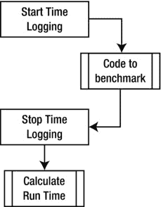
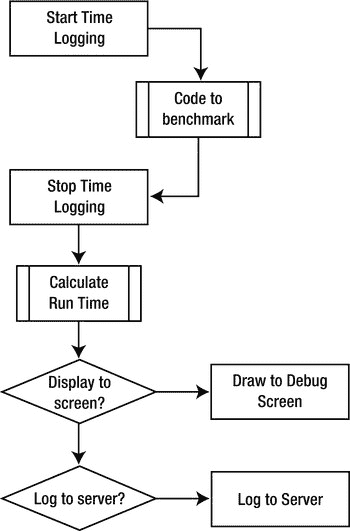
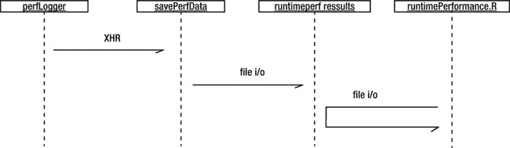
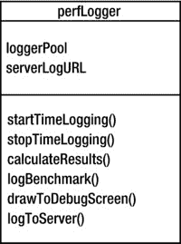
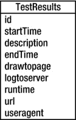
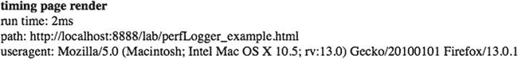
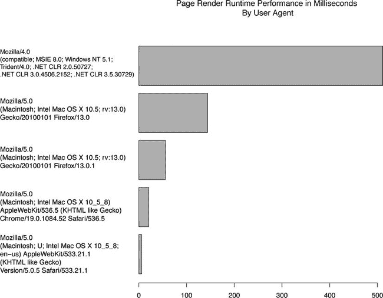

# 第四章


## perfLogger——JavaScript 基准测试与日志记录

上一章，我们编写了一个自动化解决方案，用于随时间跟踪和可视化 URL 的 Web 性能。我们使用 WebPagetest 生成指标，用 PHP 聚合和清洗数据，再用 R 语言从这些数据中创建数据可视化图表。我们将这个项目命名为 `WPTRunner`，它可用于评估我们未来想要实施的优化方案的效果，以及我们将要开发的新功能的性能。

`WPTRunner` 涵盖了 Web 性能的跟踪；在本章中，我们将创建一个用于跟踪运行时性能的工具。

我们将创建一个 JavaScript 库，用于对几乎任何内容进行运行时基准测试——从临时代码片段、函数，到模块的渲染时间。延续我们的主题，我们随后将对这些测试结果进行可视化。

我们将利用这些工具来分析一些性能最佳实践的结果，这些实践将在后续章节中讨论。但更重要的是，我希望你能将这些工具以及用经验数据量化结果的渴望，运用到你所做的每一件事中。

### 架构

我们再次从架构阶段开始。在开始任何工作之前，思考所有涉及的组件以及它们应该如何交互。

基准测试代码有几种方式——要么通过计时，要么计算执行期间执行的操作数量。对于我们的示例，为了尽可能减少观察者效应^(1)，我们将计算代码执行期间的毫秒时间。为此，我们会在开始运行代码之前捕获一个时间戳，并在代码运行之后捕获一个时间戳，将它们的差值称为运行时间结果。

```
[结束时间] - [开始时间] = [运行时间]
```

这是一个很好的起点。到目前为止，我们的流程图如图 4-1 所示。

__________

1 *观察者效应*指出，仅仅观察一个行为就会影响其结果。在我们的测试中，在计时的操作期间执行额外操作，可能会增加被基准测试代码的延迟。



**图 4-1.** 计算运行时间的工作流程

结果可能因多种不同原因而异，包括客户端机器可用资源、JavaScript 引擎和浏览器渲染引擎。因此，我们希望在整个用户群中通过对多次执行进行平均来基准测试。为此，我们将把基准测试代码投入生产环境，并记录所有结果，以便进行分析和绘图。

所以下一步是暴露我们的数据。我们已经设计了一个计算运行时间的工作流程；让我们扩展它，要么将运行时间信息展示给最终用户，要么将其记录到服务器。

假设有些时候我们不想暴露数据，因此我们应该让这一点依赖于一个决策树。这个逻辑的添加反映在图 4-2 的流程图中。



**图 4-2.** 运行时间记录流程图

至此，我们对基准测试引擎的工作原理有了一个高层描述。我们将这个功能称为 `perfLogger`。我们仍然需要与其他进程交互以保存数据并可视化，因此让我们创建一个序列图来详细描述这些进程的交互。

我们的基准测试进程 `perfLogger` 将调用一个外部进程 `savePerfData`。我们将使用 XHR 对象将数据发送到 `savePerfData`。进程 `savePerfData` 应将测试结果保存在一个平面文件中。我们将这个平面文件称为 `runtimeperf_results`。

正是这个平面文件，我们将从 R 中读取并生成图表。这个工作流的图示见图 4-3。



**图 4-3.** 高层序列图

到目前为止，你已经了解了如何为要基准测试的代码生成运行时间数值，以及如何保存数据的流程。现在让我们思考库的 API。

最终，`perfLogger` 是供外部代码使用的，所以务必考虑其公共签名是什么，它将具有哪些方法和属性，以及哪些应该公开暴露。

基于图 4-2，我们知道需要 `startTimeLogging()` 和 `stopTimeLogging()` 函数。我们将在临时代码之前和之后调用它们以获取开始和结束时间。图 4-2 还表明需要一个 `drawToDebugScreen()` 函数在页面上绘制测试结果，以及一个 `logToServer()` 函数将测试结果发送到 `savePerfData`。

但正如我所说，这个逻辑只是捕获临时代码的运行时间。基准测试不仅仅是捕获运行时间，它还涉及获取多次执行的平均值，因为系统差异可能会引入结果集的偏差。因此，让我们创建一个 `logBenchmark()` 函数，该函数将对多次调用 `startTimeLogging()` 和 `stopTimeLogging()` 的结果进行平均。

我们还应该暴露一个属性来保存 `savePerfData` 的 URL，我们将其称为 `serverLogURL`。

最后，我们需要一种方法能在单个页面上运行多个测试。为此，我们将创建一个关联数组，该数组以字符串作为标识符保存一组测试。我们将这个关联数组称为 `loggerPool`。

在这些方法和属性中，哪些我们想要公开暴露？我们不希望公开暴露任何属性；如果这样做，外部代码有可能更改它们。如果我们确实希望允许从外部设置它们，应该创建一个 setter 函数，但目前我们不需要。

函数 `drawToDebugScreen()`、`logToServer()` 和 `calculateResults()` 也不应该公开暴露。基于流程图，我们将传入布尔值来确定测试是否应该显示或保存，因此最有可能的是，我们会让 `stopTimeLogging()` 函数根据测试结果对象的属性来调用这些函数。

因此，我们将作为 API 暴露的唯一函数是 `startTimeLogging()`、`stopTimeLogging()` 和 `logBenchmark()`。使用 `startTimeLogging()` 和 `stopTimeLogging()` 将允许用户获取临时代码的运行时间，而使用 `logBenchmark()` 将实现真正的基准测试——对传入函数的多次执行结果进行平均。

这个架构的对象图见图 4-4。我们将列出所有属性和方法，但仅用粗体标记公共部分。



**图 4-4.** `perfLogger` 对象图

谈到使用 `loggerPool` 维护一个测试字典或列表，我们需要设计一个测试对象来保存与测试相关的所有信息。它应该包含 `startTime`、`endTime`，以及用于 `drawToPage` 和 `logtoserver` 的布尔值。我们还应该给它一个标识符，以便从字典中检索它，以及一个保存运行时间的变量，这样我们就不必在每次要引用它时重新计算。

为了我们自己的追踪目的，我们将包含运行测试的页面 URL 和一个用户代理字符串。这些元数据对于对我们收集的数据运行报告非常有用。想想看——有了这个结构，我们将能够按用户代理或任何我们以后可能想要添加的其他元数据来报告每个测试的性能。

基于此，我们应该重构 `perfLogger` 图，包含另一个私有函数 `setResultsMetaData()`。

我们的测试结果对象的对象图见图 4-5。



**图 4-5.** `TestResults` 对象图

## 让我们编码！

首先创建 `perfLogger` 对象。由于我们将保持某些属性和方法为私有，我们将从自执行函数中返回 `perfLogger` 对象作为对象字面量，并在自执行函数中声明我们的私有变量：

```javascript
var perfLogger = function(){
   var serverLogURL = "savePerfData.php",
   loggerPool = [];

   return {};
}()
```

接下来开始编写私有函数。既然我们已经勾勒出所需函数以及将用于测试结果的对象结构，就可以开始编写对应的代码了。让我们从 `calculateResults()` 开始。

### 计算测试结果

我们知道将通过 ID 引用测试结果对象，因此 `calculateResults()` 函数将接收一个 ID 参数：

```javascript
function calculateResults(id){
}
```

在 `calculateResults()` 函数内部，我们将通过传入的 ID 引用 `loggerPool` 中的测试结果，并执行我们在架构阶段讨论的计算——结束时间减去开始时间：

```javascript
function calculateResults(id){
    loggerPool[id].runtime = loggerPool[id].stopTime - loggerPool[id].startTime;
}
```

### 设置测试结果元数据

在处理上述功能的同时，对 `setResultsMetaData()` 也进行同样的操作。传入一个 ID，并在 `loggerPool` 中引用该测试。将 `url` 属性设置为当前窗口的位置，将 `useragent` 属性设置为 `navigator` 对象的 `userAgent` 属性。这些数据将为我们提供有趣的指标来比较结果，特别是用于比较不同渲染引擎和 JavaScript 解释器在处理特定功能时的差异。

```javascript
function setResultsMetaData(id){
    loggerPool[id].url = window.location.href;
    loggerPool[id].useragent = navigator.userAgent;
}
```

### 显示测试结果

接下来，添加私有函数 `drawToDebugScreen()`。要绘制调试屏幕，页面上需要有一个已命名的 div 用于写入。因此，首先创建一个对页面上 ID 为 "debug" 的元素的引用，并将该引用存储在名为 `debug` 的变量中。

然后格式化调试信息——但为了保持格式的模块化，我们将其抽象成自己的函数，并暂时仅插入一个函数调用。将格式化后的输出存储在名为 `output` 的变量中：

```javascript
function drawToDebugScreen(id){
    var debug = document.getElementById("debug")
    var output = formatDebugInfo(id)
}
```

现在变得有点意思了。你将测试 `debug` 变量是否有值；这可以判断页面上是否已存在一个可用于写入的命名元素。如果 `debug` 没有值，则创建一个新的 div，赋予其 ID 为 "debug"，将其 `innerHTML` 设置为我们格式化后的输出，并将其追加到页面中。

但如果 `debug` 已经存在，则直接将当前格式化后的输出信息追加到其 `innerHTML` 中。

```javascript
function drawToDebugScreen(id){
    var debug = document.getElementById("debug")
    var output = formatDebugInfo(id)
    if(!debug){
        var divTag = document.createElement("div");
        divTag.id = "debug";
        divTag.innerHTML = output
        document.body.appendChild(divTag);
    }else{
        debug.innerHTML += output
    }
}
```

现在完善 `formatDebugInfo()` 函数。就我们目前而言，保持简单即可。只需在一个段落中格式化一个字符串，描述部分加粗显示，运行时间和 useragent 在其下方各自独占一行。唯一复杂之处在于——基准测试会有平均运行时间，而临时测试则只有运行时间，因此你需要检查测试结果对象是否具有 `avgRunTime` 属性，如果有则使用该属性；如果没有，则默认使用 `runtime` 属性：

```javascript
function formatDebugInfo(id){
    var debuginfo = "<p><strong>" + loggerPool[id].description + "</strong><br/>";
    if(loggerPool[id].avgRunTime){
        debuginfo += "平均运行时间: " + loggerPool[id].avgRunTime + "ms<br/>";
    }else{
        debuginfo += "运行时间: " + loggerPool[id].runtime + "ms<br/>";
    }
    debuginfo += "路径: " + loggerPool[id].url + "<br/>";
    debuginfo += "用户代理: " + loggerPool[id].useragent + "<br/>";
    debuginfo += "</p>";
    return debuginfo
}
```

### 保存数据

最后一个私有函数是 `logToServer()`。同样，你将传入一个 ID 来引用 `loggerPool` 数组中的结果对象。但这次使用原生函数 `JSON.stringify()` 将对象字面量序列化为字符串值。在该字符串值前加上 `"data="` 前缀，将数据封装在一个名称中，以便你可以在服务器端从 POST 变量中提取出来：

```javascript
function logToServer(id){
    var params = "data=" + (JSON.stringify(loggerPool[id]));
}
```

接下来，该函数创建一个新的 XHR 对象，将传送方法设置为 POST，并指向我们保存的 `serverLogURL` 变量（该变量指向 `savePerfData`）。由于这些数据并非任务关键，`logToServer()` 不处理 `readystatechange` 事件，仅将我们的数据 POST 到等待它的脚本：

## 构建公共 API

现在，你将开始创建返回的对象字面量中的公共函数。首先处理 `startTimeLogging()`。我们将让它接受一个 ID（用作测试结果的 ID）、一个测试描述，以及两个布尔值 `drawToPage` 和 `logToServer`。在该函数内部，你将在 `loggerPool` 中创建一个新对象，并设置传入的属性，以及 `startTime` 值，该值仅为一个新的 `Date` 对象。

```javascript
startTimeLogging: function(id, descr, drawToPage, logToServer){
   loggerPool[id] = {};
   loggerPool[id].id = id;
   loggerPool[id].startTime = new Date;
   loggerPool[id].description = descr;
   loggerPool[id].drawtopage = drawToPage;
   loggerPool[id].logtoserver = logToServer
}
```

如果你想进一步优化，可以创建一个构造函数并在此处直接调用它。这将封装当前已有的功能，并允许你在其他地方重用，而无需重写。

接下来，编写 `stopTimeLogging()` 函数的实现。再次强调，你可以依赖上述架构，因此 `stopTimeLogging()` 只需设置停止时间，然后调用私有函数来计算运行时间并为测试结果设置元数据：

```javascript
loggerPool[id].stopTime = new Date;
calculateResults(id);
setResultsMetaData(id);
```

最后，`stopTimeLogging()` 会检查布尔值，以确定是否应将测试绘制到屏幕上以及是否应将其记录到服务器：

```javascript
if(loggerPool[id].drawtopage){
   drawToDebugScreen(id);
}
if(loggerPool[id].logtoserver){
   logToServer(id);
}
```

完整的函数应如下所示：

```javascript
stopTimeLogging: function(id){
   loggerPool[id].stopTime = new Date;
   calculateResults(id);
   setResultsMetaData(id);
   if(loggerPool[id].drawtopage){
      drawToDebugScreen(id);
   }
   if(loggerPool[id].logtoserver){
      logToServer(id);
   }
}
```

你需要实现的最后一个函数是 `logBenchmark()`。这是目前库中最复杂的函数。从高层次看，该函数将对传入的函数使用 `startTimeLogging()` 和 `stopTimeLogging()` 执行指定次数，然后获取结果的平均值。

我们一步步来。首先，你需要传入一个 ID、测试运行的次数、要测试的函数，以及是否将结果绘制到页面并记录到服务器：

```javascript
logBenchmark: function(id, timestoIterate, func, debug, log){
}
```

接下来，创建一个变量来保存每次测试运行的总和，并根据 `timestoIterate` 变量开始迭代：

```javascript
var timeSum = 0;
for(var x = 0; x < timestoIterate; x++){
}
```

在该循环中，调用 `startTimeLogging()`，执行传入的函数，调用 `stopTimeLogging()`，最后将每次迭代的运行时间添加到 `timeSum` 变量中：

```javascript
for(var x = 0; x < timestoIterate; x++){
   perfLogger.startTimeLogging(id, "benchmarking "+ func, false, false);
   func();
   perfLogger.stopTimeLogging(id)
   timeSum += loggerPool[id].runtime
}
```

请注意，循环中的每次迭代都使用相同的 ID 来标识正在运行的测试；你只是在每次迭代时覆盖测试结果。另外请注意，代码传入了 `false` 以避免绘制到调试屏幕或记录每个单独的测试。

循环结束后，通过将总运行时间除以次数来计算平均运行时间：

```javascript
loggerPool[id].avgRunTime = timeSum/timestoIterate
if(debug){
   drawToDebugScreen(id)
}
if(log){
   logToServer(id)
}
```

完成的函数现在应如下所示：

```javascript
logBenchmark: function(id, timestoIterate, func, debug, log){
   var timeSum = 0;
   for(var x = 0; x < timestoIterate; x++){
      perfLogger.startTimeLogging(id, "benchmarking "+ func, false, false);
      func();
      perfLogger.stopTimeLogging(id)
      timeSum += loggerPool[id].runtime
   }
   loggerPool[id].avgRunTime = timeSum/timestoIterate
   if(debug){
         drawToDebugScreen(id)
   }
   if(log){
         logToServer(id)
   }
}
```

你完成的库应如下所示：

```javascript
function logToServer(id){
    var params = "data=" + (JSON.stringify(loggerPool[id]));
    var xhr = new XMLHttpRequest();
    xhr.open("POST", serverLogURL, true);
    xhr.setRequestHeader("Content-type", "application/x-www-form-urlencoded");
    xhr.setRequestHeader("Content-length", params.length);
    xhr.setRequestHeader("Connection", "close");
    xhr.onreadystatechange = function(){};
    xhr.send(params);
}
```

### 性能日志记录器

```javascript
var perfLogger = function(){
   var serverLogURL = "savePerfData.php",
      loggerPool = [];

      function calculateResults(id){
         loggerPool[id].runtime = loggerPool[id].stopTime - loggerPool[id].startTime;
      }

      function setResultsMetaData(id){
         loggerPool[id].url = window.location.href;
         loggerPool[id].useragent = navigator.userAgent;
      }

      function drawToDebugScreen(id){
         var debug = document.getElementById("debug")
         var output = formatDebugInfo(id)
         if(!debug){
            var divTag = document.createElement("div");
            divTag.id = "debug";
            divTag.innerHTML = output
            document.body.appendChild(divTag);
         }else{
            debug.innerHTML += output
         }
      }
      function logToServer(id){
         var params = "data=" + (JSON.stringify(loggerPool[id]));
         var xhr = new XMLHttpRequest();
         xhr.open("POST", serverLogURL, true);
         xhr.setRequestHeader("Content-type", "application/x-www-form-urlencoded");
         xhr.setRequestHeader("Content-length", params.length);
         xhr.setRequestHeader("Connection", "close");
         xhr.onreadystatechange = function(){};
         xhr.send(params);
      }

      function formatDebugInfo(id){
         var debuginfo = "<p><strong>" + loggerPool[id].description + "</strong><br/>";
         if(loggerPool[id].avgRunTime){
            debuginfo += "average run time: " + loggerPool[id].avgRunTime + "ms<br/>";
         }else{
            debuginfo += "run time: " + loggerPool[id].runtime + "ms<br/>";
         }
         debuginfo += "path: " + loggerPool[id].url + "<br/>";
         debuginfo += "useragent: " +  loggerPool[id].useragent + "<br/>";
         debuginfo += "</p>";
         return debuginfo
      }

   return {
   startTimeLogging: function(id, descr,drawToPage,logToServer){
      loggerPool[id] = {};
      loggerPool[id].id = id;
      loggerPool[id].startTime = new Date;
      loggerPool[id].description = descr;
      loggerPool[id].drawtopage = drawToPage;
      loggerPool[id].logtoserver = logToServer
   },

   stopTimeLogging: function(id){
      loggerPool[id].stopTime = new Date;
      calculateResults(id);
      setResultsMetaData(id);
      if(loggerPool[id].drawtopage){
         drawToDebugScreen(id);
      }
      if(loggerPool[id].logtoserver){
         logToServer(id);
      }
   },

   logBenchmark: function(id, timestoIterate, func, debug, log){
      var timeSum = 0;
      for(var x = 0; x < timestoIterate; x++){
         perfLogger.startTimeLogging(id, "benchmarking "+ func, false, false);
         func();
         perfLogger.stopTimeLogging(id)
         timeSum += loggerPool[id].runtime
      }
      loggerPool[id].avgRunTime = timeSum/timestoIterate
      if(debug){
            drawToDebugScreen(id)
      }
      if(log){
            logToServer(id)
      }
   }
}
}()
```

 **注意：** 由于现代解释器和系统的高速运行，较小的临时测试可能得到 0 毫秒的结果。进行基准测试时，请确保测试的功能块足够大，以便产生可测量的结果。这意味着，如果要对数组循环进行基准测试，需要将数组设置得足够大，使其遍历耗时超过 1 毫秒。在后续章节中，当我们对零散的小段代码进行基准测试时，我会进一步讨论这一点；我们将以足够大的规模运行测试，以观察其实际隐含收益。我们还会在下一章探讨高分辨率时间的概念，该功能使我们能够以亚毫秒级精度获取时间测量值。

### 远程日志

好的，`perfLogger.js` 正在调用 `savePerfData`，并将测试结果序列化为字符串形式。现在我们来完善 `savePerfData` 的具体实现。

你可以复用上一章 WPTRunner 示例中的 `fileio.php` 共享文件，并创建两个变量：`$logfile` 用于保存平面文件的路径，`$benchmarkResults` 用于保存测试结果。从 `$_POST` 数组中取出结果；请注意，你曾将序列化对象的前缀设为 `"data="`，因此现在可以通过字符串 `"data"` 来引用它。预留一个 `formatResults` 函数调用，传入对 `$_POST` 的引用，并将返回值赋给 `$benchmarkResults`。最后，将 `$benchmarkResults` 和 `$logfile` 传递给预留的函数 `saveLog()`：

```php
<?php
require("util/fileio.php");

$logfile = "log/runtimeperf_results.txt";
$benchmarkResults = formatResults($_POST["data"]);

saveLog($benchmarkResults, $logfile);
?>
```

现在我们来完善 `formatResults()` 函数。它应接受一个参数 `$r`：

```php
function formatResults($r){}
```

请记住，由于数据经过序列化和编码以便通过 HTTP 传输，其格式大致如下：

## 保存测试结果

接下来我们来完善 `saveLog()` 函数。它接受一个字符串参数，即日志文件的路径。与上一章相同，它应检查文件是否存在，如果不存在，则创建并格式化新日志文件。为此，先预留一个名为 `formatNewLog()` 的函数调用。

```php
function saveLog($obj, $file){
   if(!file_exists($file)){
      formatNewLog($file);
   }
}
```

某些用户代理字符串包含逗号。由于平面文件中字段的分隔符将是逗号，因此需要从用户代理中去除逗号。将该功能抽象为独立的 `cleanCommas()` 函数，并暂时预留调用：

```php
$obj->useragent = cleanCommas($obj->useragent);
```

接下来，你将根据所有属性值构建一个逗号分隔的字符串，并将其传递给共享文件 `fileio.php` 中的 `appendToFile()` 函数。为增加数据维度，还需在该行前添加一个 IP 地址。添加此数据将使你能够以各种有趣的方式推断信息并对结果进行分类，例如，将 IP 地址转换为地理位置信息，并按区域或 ISP 对结果进行排序。

```php
$newLine = $_SERVER["REMOTE_ADDR"] . "," . $obj->id .",". $obj->startTime . "," . $obj->stopTime . "," . $obj->runtime . "," . $obj->url . "," . $obj->useragent;
appendToFile($newLine, $file);
```

完整的函数应如下所示：

```php
function saveLog($obj, $file){
   if(!file_exists($file)){
      formatNewLog($file);
   }
   $obj->useragent = cleanCommas($obj->useragent);
   $newLine = $_SERVER["REMOTE_ADDR"] . "," . $obj->id .",". $obj->startTime . "," . $obj->stopTime . "," . $obj->runtime . "," . $obj->url . "," . $obj->useragent;
   appendToFile($newLine, $file);
}
```

我们来快速完善预留的 `cleanCommas()` 函数。该函数将接受一个参数 `$data`。你可以使用一个小技巧：调用 `explode()` 函数——PHP 中与 `split()` 函数等价的函数，它会根据定义的分隔符（此处为逗号）分割字符串，并返回一个数组，每个字符串部分作为一个独立元素。将该数组传递给 `implode()` 函数，它是 PHP 中与 `join()` 函数等价的函数，接受一个数组并将所有元素连接成一个字符串。通过将这两个函数结合使用，便创建了一个单行的查找替换功能。

```php
function cleanCommas($data){
   return implode("", explode(",", $data));
}
```

 **注意：** 让我们稍微停留在这个查找替换技巧上，思考它是如何工作的。根据分隔符进行分割，会在每个分隔符出现的位置将字符串拆分。因此，如果我们将字符串“the quick brown fox jumps over the lazy dog”按分隔符“the”进行分割，会得到数组：

```json
["quick", "brown", "fox", "jumps", "over", "lazy", "dog"]
```

然后，如果我们对该数组使用 `implode` 函数，并传入字符串 `"a"` 作为粘合剂，会得到以下结果：

```json
"a quick brown fox jumps over a lazy dog"
```

最后，我们快速完善 `formatNewLog()` 函数。该函数将向新日志文件添加第一行，包含文件的所有标题：

```php
function formatNewLog($file){
   $headerline = "IP, TestID, StartTime, StopTime, RunTime, URL, UserAgent";
   appendToFile($headerline, $file);
}
```

完整的 `savePerfData.php` 文件应如下所示。

```php
<?php
require("util/fileio.php");

$logfile = "log/runtimeperf_results.txt";
$benchmarkResults = formatResults($_POST["data"]);

saveLog($benchmarkResults, $logfile);

function formatResults($r){
   $r = stripcslashes($r);
   $r = json_decode($r);
   if(json_last_error() > 0){
      die("invalid json");
   }
   return($r);
}

function formatNewLog($file){
   $headerline = "IP, TestID, StartTime, StopTime, RunTime, URL, UserAgent";
   appendToFile($headerline, $file);
}
```

`function saveLog($obj, $file) {

    if (!file_exists($file)) {

        formatNewLog($file);

    }

## 示例页面

太棒了！现在你可以快速创建一个页面，使用该库获取一些数据。创建一个 HTML 页面的基本结构，将标题设为 `perfLogger 示例`，并在页面的 `<head>` 部分链接 `perfLogger.js`。然后，同样在页面的 `<head>` 部分，放入另一个 `<script>` 标签，调用 `perfLogger.startTimeLogging()`。传入一个 ID `"page_render"`，一个描述“页面渲染计时”，以及 `true`（用于将结果显示在页面上），和 `true`（用于将结果也记录在服务器端）：

```html
<!DOCTYPE html>
<html>
<head>
    <title>perfLogger 示例</title>
    <script src="perfLogger.js"></script>
    <script>
    perfLogger.startTimeLogging("page_render", "页面渲染计时", true, true)
    </script>
</head>
<body>
<script>
perfLogger.stopTimeLogging("page_render")
</script>
</body>
</html>
```

你把这个函数调用放在 `<head>` 部分，是为了让它在页面可见部分开始渲染之前就开始计时。在 `<body>` 部分，我们将放入一个新的 `<script>` 标签，其中调用 `perfLogger.stopTimeLogging("page_render")`。

将此文件保存为 `perfLogger_example.html`。如果在浏览器中打开，它应该看起来像 图 4-6。



**图 4-6.** perfLogger_example.html 的屏幕截图

而 `runtimeperf_results.txt` 文件应如下所示：

```
IP, TestID, StartTime, StopTime, RunTime, URL, UserAgent
71.225.152.145,page_render,2012-06-19T23:52:52.448Z,2012-06-19T23:52:52.448Z,0,http://tom-
barker.com/lab/perfLogger_example.html,Mozilla/5.0 (Macintosh; Intel Mac OS X 10_5_8)
AppleWebKit/536.5 (KHTML like Gecko) Chrome/19.0.1084.52 Safari/536.5
71.225.152.145,page_render,2012-06-19T23:52:52.452Z,2012-06-19T23:52:52.452Z,0,http://tom-
barker.com/lab/perfLogger_example.html,Mozilla/5.0 (Macintosh; Intel Mac OS X 10_5_8)
AppleWebKit/536.5 (KHTML like Gecko) Chrome/19.0.1084.52 Safari/536.5
```

 **注释：** 根据浏览器的不同，此项测试可能得到 0 毫秒的结果，因为页面上没有任何内容。真实的测试中会包含内容。或者，你可以构建自己的测试套件来进行基准测试，类似于 SunSpider，地址为 [`http://www.webkit.org/perf/sunspider/sunspider.html`](http://www.webkit.org/perf/sunspider/sunspider.html)。

我们会把这个页面投入生产环境，以便为所有访问它的用户收集指标。你可以在 [`http://tom-barker.com/lab/perfLogger_example.html`](http://tom-barker.com/lab/perfLogger_example.html) 看到这个页面。

## 将结果绘制成图表

既然我们已经有了数据，不妨尝试将其可视化。我们将按用户代理查看 `page_render` 测试结果的运行时间。创建一个名为 `runtimePerformance.R` 的新 R 文档，并创建以下变量：`dataDirectory` 用于存放日志目录的路径，`chartDirectory` 用于存放图表输出目录的路径，以及 `testname` 用于存放要绘制图表的测试名称：

```r
dataDirectory <- "/Applications/MAMP/htdocs/lab/log/"
chartDirectory <- "/Applications/MAMP/htdocs/lab/charts/"
testname = "page_render"
```

读取日志文件，并将其存储为数据框，赋值给变量 `perflogs`；同时为要绘制的图表创建路径，赋值给变量 `perfchart`：

```r
perflogs <- read.table(paste(dataDirectory, "runtimeperf_results.txt", sep=""), header=TRUE,
sep=",")
perfchart <- paste(chartDirectory, "runtime_",testname, ".pdf", sep="")
```

接下来，我们进行一些分析。目前日志中只有 `page_render` 测试的结果，但随着未来运行不同的测试，你会得到不同命名的结果，因此我们只提取 `TestID` 列值为 `"page_render"` 的结果：

```r
pagerender <- perflogs[perflogs$TestID == "page_render",]
```

然后，创建一个仅包含我们想要绘制图表的列（`UserAgent` 列和 `RunTime` 列）的新数据框。

```r
df <- data.frame(pagerender$UserAgent, pagerender$RunTime)
```

接下来，我们将使用 R 的 `by()` 函数。该函数将一个函数应用于数据框，并根据传入的分组因子进行分组。在我们的示例中，我们将按 `UserAgent` 列进行分组，并对每个元素应用 `mean()` 函数。

```r
df <- by(df$pagerender.RunTime, df$pagerender.UserAgent, mean)
```

如果在控制台中再次输入 `df`，你会看到以下内容：

```
> df
df$pagerender.UserAgent
Mozilla/5.0 (Macintosh; U; Intel Mac OS X 10_5_8; en-us) AppleWebKit/533.21.1 (KHTML like Gecko)
Version/5.0.5 Safari/533.21.1

6.00000
Mozilla/5.0 (Macintosh; Intel Mac OS X 10_5_8) AppleWebKit/536.5 (KHTML like Gecko)
Chrome/19.0.1084.52 Safari/536.5

20.75000
Mozilla/5.0 (Macintosh; Intel Mac OS X 10.5; rv:13.0) Gecko/20100101 Firefox/13.0.1

55.63158
Mozilla/5.0 (Macintosh; Intel Mac OS X 10.5; rv:13.0) Gecko/20100101 Firefox/13.0

144.00000
Mozilla/4.0 (compatible; MSIE 8.0; Windows NT 5.1; Trident/4.0; .NET CLR 2.0.50727; .NET CLR
3.0.4506.2152; .NET CLR 3.5.30729)

511.00000
```

这个数据框现在包含了按原始用户代理分组的平均运行时间。它是按用户代理对每次测试的运行时间结果计算出的算术平均值。

最后，我们对数据框进行排序，并以条形图的形式生成图表。

```
df <- df[order(df)]
pdf(perfchart, width=10, height=10)
opar <- par(no.readonly=TRUE)
    par(las=1, mar=c(10,10,10,10))
    barplot(df, horiz=TRUE, main="页面渲染运行时间性能（毫秒）\n 按用户代理分")
par(opar)
dev.off()
```

结果图表请参见 图 4-7。



**图 4-7.** 按用户代理划分的页面渲染测试结果（毫秒）

完整的 R 脚本应如下所示：

```
dataDirectory <- "/Applications/MAMP/htdocs/lab/log/"
chartDirectory <- "/Applications/MAMP/htdocs/lab/charts/"
testname = "page_render"

perflogs <- read.table(paste(dataDirectory, "runtimeperf_results.txt", sep=""), header=TRUE,
sep=",")
perfchart <- paste(chartDirectory, "runtime_",testname, ".pdf", sep="")

pagerender <- perflogs[perflogs$TestID == "page_render",]
df <- data.frame(pagerender$UserAgent, pagerender$RunTime)
df <- by(df$pagerender.RunTime, df$pagerender.UserAgent, mean)
df <- df[order(df)]

pdf(perfchart, width=10, height=10)
opar <- par(no.readonly=TRUE)
    par(las=1, mar=c(10,10,10,10))
    barplot(df, horiz=TRUE)
par(opar)
dev.off()
```

#### 开放源代码

正如我对 `WPTRunner` 所做的那样，我已经将 `perfLogger` 的源代码上传到了 Github，可以在此处获取：[`https://github.com/tomjbarker/perfLogger`](https://github.com/tomjbarker/perfLogger)。

#### 总结

在本章中，你创建了一个工具，用于收集临时代码块的运行时间，或者通过聚合多次代码迭代的运行时间，对传入的函数进行基准测试。你创建了一个 PHP 服务器端脚本，我们的库可以将测试结果发送给它。最后，你创建了一个 R 脚本，用于提取我们的测试结果并将其绘制成图表。

在接下来的章节中，我们将探讨一些性能最佳实践。为了证明这些实践为何更高效，我们将使用你刚刚开发的这些工具，用实证数据支持这些论点，并将结果可视化以供广泛参考。

但首先，第 5 章将探讨浏览器性能的未来，以及 Web 性能标准的到来。
