## 第 5 章


### 展望未来：性能标准

在第 4 章中，我们构建了一个 JavaScript 库，用于追踪临时代码并对函数进行基准测试。正如你将在后续章节中看到的，这是一个收集时间度量指标并通过编码风格推断性能提升的绝佳工具。

到目前为止，我们已经了解了如何构建自己的工具，或使用现有工具来收集衡量性能所需的数据。但接下来，我们将关注 W3C 为制定浏览器性能追踪标准所做的工作。

需要注意的是，其中部分功能目前才刚刚开始在主流浏览器中得到支持；还有一些功能仅适用于浏览器的测试版或预测试版。因此，我将在本章的相关示例中指明所使用的浏览器发布版本。也正因如此，我可能会展示同一内容在不同浏览器中的屏幕截图，以说明这些功能支持程度的差异。

#### W3C Web 性能工作组

2010 年底，W3C 成立了一个新的工作组——Web 性能工作组。根据其使命页面的说明，该工作组的使命是*提供衡量用户代理功能和 API 的应用程序性能各方面的方法*。从实际意义上来说，这意味着该工作组开发了一套浏览器可以（也将会）暴露给 JavaScript 的 API，其中包含了关键的性能指标。

这一功能通过一个新的 `performance` 对象来实现，该对象是原生 `window` 对象的一部分：

```
>>window.performance
```

#### Performance 对象

如果你在 JavaScript 控制台中输入 `window.performance`，会发现它返回一个 `Performance` 类型的对象，其中包含多个可能暴露的对象和方法。图 5-1 展示了 Chrome 20 beta 版中的 `Performance` 对象结构。

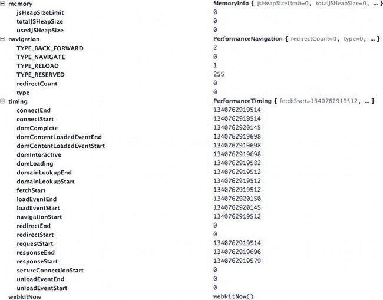

**图 5-1.** Chrome 20 beta 中的 `Window.performance`

在 Chrome 中输入该命令，我们会看到它支持一个 `PerformanceNavigation` 类型的 `navigation` 对象，以及一个 `PerformanceTiming` 类型的 `timing` 对象。Chrome 还支持一个 `memory` 对象，以及 `webkitNow`——这是高精度时间（High Resolution Time）的一个浏览器特定版本（我将在本章末尾介绍高精度时间）。

让我们逐一查看这些对象，并了解如何将它们用于我们自己的性能追踪。

##### Performance Timing

`timing` 对象具有以下属性，所有这些属性都包含事件发生时的毫秒级时间快照，这与上一章我们自己的 `startTimeLogging()` 函数非常相似。请参见图 5-2，其中按顺序列出了每个时间度量指标的流程图。

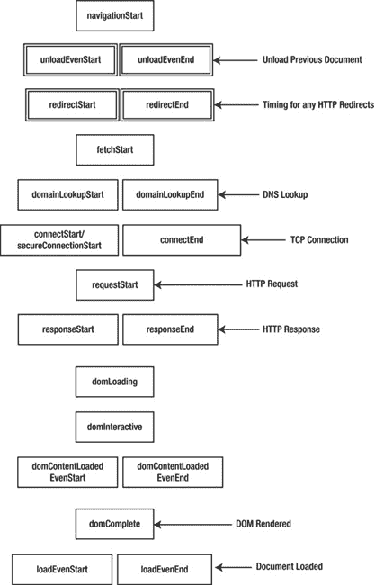

**图 5-2.** 性能指标的时序顺序

> **`navigationStart`**：这是导航开始的时间快照，无论浏览器是开始卸载上一个页面（如果有），还是开始获取内容。该值要么包含 `unloadEventStart` 数据，要么包含 `fetchStart` 数据。如果我们想追踪端到端的时间，通常会从这个值开始。

>

> **`unloadEventStart`**：这是浏览器开始卸载上一个页面（如果存在同一域名的上一个页面需要卸载）的时间快照。

>

> **`unloadEventEnd`**：这是浏览器完成卸载上一个页面的时间快照。

>

> **`redirectStart`**：这是浏览器开始任何 HTTP 重定向的时间快照。

>

> **`redirectEnd`**：这是所有 HTTP 重定向完成的时间快照。

要计算 HTTP 重定向总共花费的时间，只需用 `redirectEnd` 减去 `redirectStart`：

```
var http_redirect_time = performance.timing.redirectEnd - performance.timing.redirectStart;
```

> **`fetchStart`**：这是浏览器首次开始检查请求资源的缓存的时间快照。

要计算加载缓存总共花费的时间，用 `domainLookupStart` 减去 `fetchStart`：

```
var cache_time = performance.timing.domainLookupStart - performance.timing.fetchStart;
```

> **`domainLookupStart`**：这是浏览器开始对请求内容进行 DNS 查询的时间快照。

>

> **`domainLookupEnd`**：这是浏览器完成对请求内容进行 DNS 查询的时间快照。

要计算 DNS 查询总共花费的时间，用 `domainLookupEnd` 减去 `domainLookupStart`：

```
var dns_time = performance.timing.domainLookupEnd - performance.timing.domainLookupStart;
```

> **`connectStart`**：这是浏览器开始与远程服务器建立当前页面的 TCP 连接的时间快照。

>

> **`secureConnectionStart`**：当页面通过 HTTPS 加载时，该属性捕获 HTTPS 通信开始的时间快照。

>

> **`connectEnd`**：这是浏览器完成与远程服务器建立当前页面的 TCP 连接的时间快照。

要计算建立 TCP 连接总共花费的时间，用 `connectEnd` 减去 `connectStart`：

## 将 Performance 对象集成到 perfLogger 中

首先，你需要在 `perfLogger` 的自执行函数中创建私有变量。为感知时间、重定向时间、缓存时间、DNS 查找时间、TCP 连接时间、总往返时间和页面渲染时间创建值：

```javascript
var perfLogger = function(){
    var serverLogURL = "savePerfData.php",
    loggerPool = [];
    if(window.performance){
    var _pTime = Date.now() - performance.timing.navigationStart || 0,
    _redirTime = performance.timing.redirectEnd - performance.timing.redirectStart || 0,
    _cacheTime = performance.timing.domainLookupStart - performance.timing.fetchStart || 0,
    _dnsTime = performance.timing.domainLookupEnd - performance.timing.domainLookupStart || 0,
    _tcpTime = performance.timing.connectEnd - performance.timing.connectStart || 0,
    _roundtripTime = performance.timing.responseEnd - performance.timing.connectStart || 0,
    _renderTime = performance.timing.domComplete - performance.timing.domLoading || 0;
    }
}
```

首先，这段代码将变量赋值包裹在 `if` 语句中，以确保仅在当前浏览器支持时才调用 `window.performance`。然后注意，我们在赋值这些变量时使用了短路求值。这种技术在变量赋值中使用了逻辑运算符（在本例中为逻辑 OR）。如果第一个值不可用、为 `null` 或 `undefined`，则使用第二个值进行赋值。

接下来，仍然在自执行函数内，你将显式创建一个 `TestResults` 构造函数。请记住，我们在上一章架构了 `TestResults` 对象，但最终并没有使用它，而是让 `loggerPool` 持有通用对象。现在你将使用 `TestResults`，并利用原型继承来确保每个 `TestResults` 对象都内置了新的性能指标。

首先创建 `TestResults` 构造函数。

```javascript
function TestResults(){};
```

然后，为每个 `window.performance` 指标向 `TestResults` 的原型添加一个属性：

```javascript
TestResults.prototype.perceivedTime = _pTime;
TestResults.prototype.redirectTime = _redirTime;
TestResults.prototype.cacheTime = _cacheTime;
TestResults.prototype.dnsLookupTime = _dnsTime;
TestResults.prototype.tcpConnectionTime = _tcpTime;
TestResults.prototype.roundTripTime = _roundtripTime;
TestResults.prototype.pageRenderTime = _renderTime;
```

太好了！现在让我们编辑公共方法 `startTimeLogging()`。目前该函数的第一行将一个空对象赋值给 `loggerPool`：

```javascript
loggerPool[id] = {};
```

将其改为实例化一个新的 `TestResults` 实例：

```javascript
loggerPool[id] = new TestResults();
```

此时，如果你对 `TestResults` 对象执行 `console.log`，它应该看起来像 图 5-3。

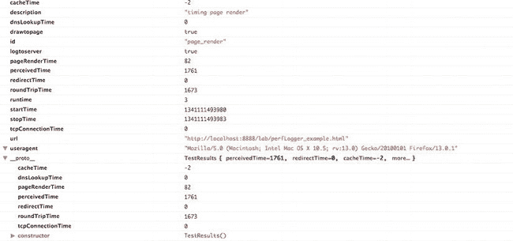

**图 5-3.** `TestResults` 对象

你可以看到，现在我们创建的每个 `TestResults` 对象都具有 `cacheTime`、`dnsLookupTime`、`pageRenderTime`、`perceivedTime`、`redirectTime`、`roundTripTime` 和 `tcpConnectionTime` 属性。你还可以看到这些属性存在于原型上。

这是一个重要的点，因为如果你在 `logToServer()` 中对序列化对象执行 `console.log`，你会看到这些属性并未与对象的其余部分一起被序列化。这是因为 `JSON.stringify` 不会序列化对象中未定义的值或函数。

不过，这没问题。要解决这个问题，你只需要创建一个小的私有函数来连接两个对象。回到顶部的自执行函数，在那里你将添加一个新函数 `jsonConcat()`，并让它接受两个对象：

```javascript
function jsonConcat(object1, object2) {}
```

接下来，遍历第二个对象中的每个属性，并将这些属性添加到第一个对象中。最后，返回第一个对象：

```javascript
for (var key in object2) {
object1[key] = object2[key];
}
return object1;
```

请注意，这也会覆盖两个对象可能共有的任何属性在第一个对象中的值。

完成的函数应该如下所示：

```
function jsonConcat(object1, object2) {
    for (var key in object2) {
        object1[key] = object2[key];
    }
    return object1;
}
```

现在，为了使其工作，回到 `logToServer()`。回想一下，在函数开头，我们这样序列化 `TestResults` 对象：

```
var params = "data=" + (JSON.stringify(loggerPool[id]));
```

将其改为将 `TestResults` 对象及其原型传递给 `jsonConcat()`，并将返回的对象传递给 `JSON.stringify`：

```
var params = "data=" + JSON.stringify(jsonConcat(loggerPool[id], TestResults.prototype));
```

如果你对 `params` 变量执行 `console.log`，它应该看起来像这样：

```
data={"id":"page_render","startTime":1341152573075,"description":"timing page render","drawtopag
e":true,"logtoserver":true,"stopTime":1341152573077,"runtime":2,"url":"http://localhost:8888/
lab/perfLogger_example.html","useragent":"Mozilla/5.0 (Macintosh; Intel Mac OS X 10.5; rv:13.0)
Gecko/20100101 Firefox/13.0.1","perceivedTime":78,"redirectTime":0,"cacheTime":-2,"dnsLookupTime
":0,"tcpConnectionTime":0,"roundTripTime":2,"pageRenderTime":72}
```

接下来，你将通过公共方法公开这些私有性能变量，以便通过 `perfLogger` 命名空间暴露它们，而无需运行任何测试。如果你不在对象级别暴露这些变量，你将需要创建一个测试并从测试对象中提取它们；回想一下，我们将这些 `Performance` 对象的数字添加到了每个测试对象的原型上。

```
//expose derived performance data
perceivedTime: function(){
    return _pTime;
},
redirectTime: function(){
    _redirTime;
},
cacheTime: function(){
    return _cacheTime;
},
dnsLookupTime: function(){
    return _dnsTime;
},
tcpConnectionTime: function(){
    return _tcpTime;
},
roundTripTime: function(){
    return _roundtripTime;
},
pageRenderTime: function(){
    return _renderTime;
}
```

太好了！这些公共函数如下所示暴露来自 `perfLogger` 对象的数据：

```
>>> perfLogger.perceivedTime()
78
```

所以现在你更新后的 `perfLogger.js` 应该如下所示：

```
var perfLogger = function(){
    var serverLogURL = "savePerfData.php",
        loggerPool = [],
        _pTime = Date.now() - performance.timing.navigationStart || 0,
        _redirTime = performance.timing.redirectEnd - performance.timing.redirectStart || 0,
        _cacheTime = performance.timing.domainLookupStart - performance.timing.fetchStart || 0,
        _dnsTime = performance.timing.domainLookupEnd - performance.timing.domainLookupStart || 0,
        _tcpTime = performance.timing.connectEnd - performance.timing.connectStart || 0,
        _roundtripTime = performance.timing.responseEnd - performance.timing.connectStart || 0,
        _renderTime = Date.now() - performance.timing.domLoading || 0;

    function TestResults(){};
    TestResults.prototype.perceivedTime = _pTime;
    TestResults.prototype.redirectTime = _redirTime;
    TestResults.prototype.cacheTime = _cacheTime;
    TestResults.prototype.dnsLookupTime = _dnsTime;
    TestResults.prototype.tcpConnectionTime = _tcpTime;
    TestResults.prototype.roundTripTime = _roundtripTime;
    TestResults.prototype.pageRenderTime = _renderTime;

    function jsonConcat(object1, object2) {
        for (var key in object2) {
            object1[key] = object2[key];
        }
        return object1;
    }

    function calculateResults(id){
        loggerPool[id].runtime = loggerPool[id].stopTime - loggerPool[id].startTime;
    }

    function setResultsMetaData(id){
        loggerPool[id].url = window.location.href;
        loggerPool[id].useragent = navigator.userAgent;
    }
```

```markdown
# 性能日志记录工具

```javascript
function drawToDebugScreen(id){
    var debug = document.getElementById("debug")
    var output = formatDebugInfo(id)
    if(!debug){
        var divTag = document.createElement("div");
        divTag.id = "debug";
        divTag.innerHTML = output
        document.body.appendChild(divTag);
    }else{
        debug.innerHTML += output
    }
}

function logToServer(id){
    var params = "data=" + JSON.stringify(jsonConcat(loggerPool[id],TestResults.prototype));
    var xhr = new XMLHttpRequest();
    xhr.open("POST", serverLogURL, true);
    xhr.setRequestHeader("Content-type", "application/x-www-form-urlencoded");
    xhr.setRequestHeader("Content-length", params.length);
    xhr.setRequestHeader("Connection", "close");
    xhr.onreadystatechange = function() {
        if (xhr.readyState==4 && xhr.status==200) {}
    };
    xhr.send(params);
}

function formatDebugInfo(id){
    var debuginfo = "<p><strong>" + loggerPool[id].description + "</strong><br/>";
    if(loggerPool[id].avgRunTime){
        debuginfo += "average run time: " + loggerPool[id].avgRunTime + "ms<br/>";
    }else{
        debuginfo += "run time: " + loggerPool[id].runtime + "ms<br/>";
    }
    debuginfo += "path: " + loggerPool[id].url + "<br/>";
    debuginfo += "useragent: " +  loggerPool[id].useragent + "<br/>";
    debuginfo += "</p>";
    return debuginfo
}

return {
    startTimeLogging: function(id, descr,drawToPage,logToServer){
        loggerPool[id] = new TestResults();
        loggerPool[id].id = id;
        loggerPool[id].startTime =  Date.now();
        loggerPool[id].description = descr;
        loggerPool[id].drawtopage = drawToPage;
        loggerPool[id].logtoserver = logToServer
    },
    stopTimeLogging: function(id){
        loggerPool[id].stopTime =  Date.now();
        calculateResults(id);
        setResultsMetaData(id);
        if(loggerPool[id].drawtopage){
            drawToDebugScreen(id);
        }
        if(loggerPool[id].logtoserver){
            logToServer(id);
        }
    },
    logBenchmark: function(id, timestoIterate, func, debug, log){
        var timeSum = 0;
        for(var x = 0; x < timestoIterate; x++){
            perfLogger.startTimeLogging(id, "benchmarking "+ func, false, false);
            func();
            perfLogger.stopTimeLogging(id)
            timeSum += loggerPool[id].runtime
        }
        loggerPool[id].avgRunTime = timeSum/timestoIterate
        if(debug){
            drawToDebugScreen(id)
        }
        if(log){
            logToServer(id)
        }
    },
    //expose derived performance data
    perceivedTime: function(){
        return _pTime;
    },
    redirectTime: function(){
        _redirTime;
    },
    cacheTime: function(){
        return _cacheTime;
    },
    dnsLookupTime: function(){
        return _dnsTime;
    },
    tcpConnectionTime: function(){
        return _tcpTime;
    },
    roundTripTime: function(){
        return _roundtripTime;
    },
    pageRenderTime: function(){
        return _renderTime;
    }
}
}();
```

## 更新日志记录功能

接下来，我们来更新 `savePerfData.php` 文件。首先在 `formatNewLog()` 函数中添加新的表头，以便每个新创建的日志文件都包含这些新数据点的列标题：

```php
function formatNewLog($file){
    $headerline = "IP, TestID, StartTime, StopTime, RunTime, URL, UserAgent, PerceivedLoadTime, PageRenderTime, RoundTripTime, TCPConnectionTime, DNSLookupTime, CacheTime, RedirectTime";
    appendToFile($headerline, $file);
}
```

然后更新 `saveLog()` 函数，使其包含我们现在传入的额外值：
```

### 保存日志函数

```php
function saveLog($obj, $file){
    if(!file_exists($file)){
        formatNewLog($file);
    }
    $obj->useragent = cleanCommas($obj->useragent);
    $newLine = $_SERVER["REMOTE_ADDR"] . "," . $obj->id .",". $obj->startTime . "," . $obj->stopTime . "," . $obj->runtime . "," . $obj->url . "," . $obj->useragent . "," . $obj->perceivedTime . "," . $obj->pageRenderTime . "," . $obj->roundTripTime . "," . $obj->tcpConnectionTime . "," . $obj->dnsLookupTime . "," . $obj->cacheTime . "," . $obj->redirectTime;
    appendToFile($newLine, $file);
}
```

更新后的日志文件现在应如下所示：

```
IP, TestID, StartTime, StopTime, RunTime, URL, UserAgent, PerceivedLoadTime, PageRenderTime, RoundTripTime, TCPConnectionTime, DNSLookupTime, CacheTime, RedirectTime
127.0.0.1,page_render,1.34116648339,1.3411664834,2,http://localhost:8888/lab/perfLogger_example.html,Mozilla/5.0 (Macintosh; Intel Mac OS X 10.5; rv:13.0) Gecko/20100101 Firefox/13.0.1115,86,21,1,1,-4,0
127.0.0.1,page_render,345.173000009,345.331000019,0.158000009833,http://localhost:8888/lab/perfLogger_example.html,Mozilla/5.0 (Macintosh; Intel Mac OS X 10_5_8) AppleWebKit/536.11 (KHTML like Gecko) Chrome/20.0.1132.43 Safari/536.11495,261,79,0,0,0,0
```

### 导航性能

现在让我们来看一下导航性能对象。如果你在控制台中输入 `performance.navigation`，将会看到类似图 5-4 的内容。

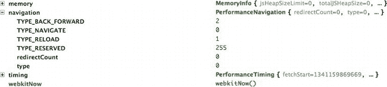

*图 5-4. 导航性能对象*

请注意，`navigation`对象有两个只读属性：`redirectCount`和`type`。`redirectCount`属性顾名思义，表示浏览器为到达当前页面所跟随的 HTTP 重定向次数。

 **注意：** HTTP 重定向很重要，因为每次重定向都会导致一次完整的往返。原始请求会从 Web 服务器返回为 301 或 302 状态码，并附带新位置的路径。然后，浏览器必须初始化一个新的 TCP 连接并为新位置发送新请求。请参见图 5-5 以了解单个 HTTP 重定向的序列图。请注意，DNS 查找、TCP 握手和 HTTP 请求都会为重定向的资源重复执行。这种重复使单次重定向的网络连接时间加倍。

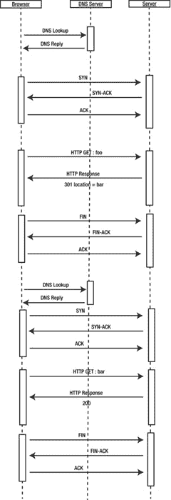

*图 5-5. HTTP 重定向*

我们可以这样访问 `redirectCount` 属性：

```
>>> performance.navigation.redirectCount
0
```

导航对象的另一个属性是 `type`。`navigation.type` 属性将是由以下常量表示的四个值之一：

> `TYPE_NAVIGATE`：值为 0，表示当前页面是通过点击链接、提交表单或直接在地址栏中输入 URL 导航而来的。

> `TYPE_RELOAD`：值为 1，表示当前页面是通过刷新操作到达的。

> `TYPE_BACK_FORWARD`：值为 2，表示页面是通过浏览器历史记录导航到的，无论是使用后退或前进按钮，还是通过浏览器的历史对象以编程方式实现的。

> `TYPE_RESERVED`：值为 255，是一个总括值，用于表示上述未定义的任何导航类型。

### 性能内存

`memory`对象是 Chrome 的一个特性，它允许我们查看 Chrome 在运行页面时占用的内存使用情况。请注意，在之前的图 5-1 中，所有值都返回 0——这是因为我们需要先启用内存信息标志才能利用此功能。

启用方式因平台略有不同，但本质上你需要向 Chrome 传递`--enable-memory-info`命令行参数。在 Windows 平台上，右键点击 Chrome 图标，进入“属性”，在可执行文件路径的末尾添加标志`--enable-memory-info`。可执行文件应如下所示：

`[path to exe]\chrome.exe --enable-memory-info`

对于 Mac OS，不是更新快捷方式，而是进入终端并像这样调用 Chrome 应用程序：

`/Applications/Google\ Chrome.app/Contents/MacOS/Google\ Chrome --enable-memory-info`

有关更多信息，请参阅[`http://www.chromium.org/developers/how-tos/run-chromium-with-flags`](http://www.chromium.org/developers/how-tos/run-chromium-with-flags)。

一旦你启用该标志启动 Chrome，你应该能在`memory`对象中看到数据，如图 5-6 所示。

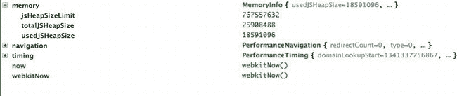

*图 5-6. 包含数据的 Performance Memory 对象*

```
>>> performance.memory. jsHeapSizeLimit
767557632
```

作为参考，*堆*是解释器在常驻内存中维护的 JavaScript 对象集合。在堆中，每个对象都是一个相互连接的节点，通过属性（如原型链或组合对象）连接。在浏览器中运行的 JavaScript 通过对象引用来引用堆中的对象，如图 5-7 所示。当我们在 JavaScript 中销毁一个对象时，我们实际上是在销毁对象引用。当解释器看到堆中一个没有任何引用的对象时，它会将该对象从堆中移除。这被称为*垃圾回收*。

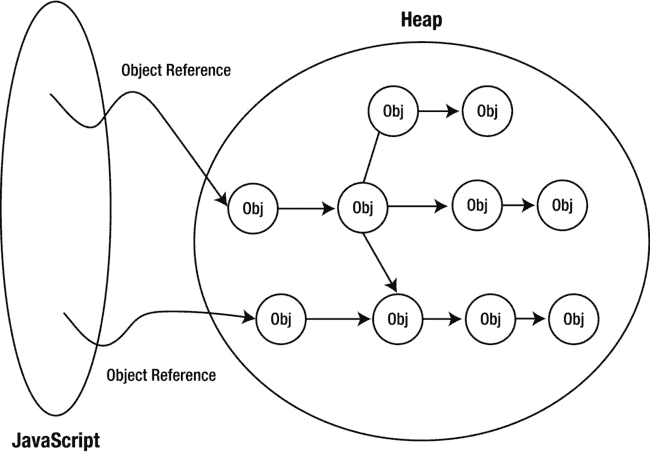

*图 5-7. JavaScript 堆*

图 5-6 中显示的`usedJsHeapSize`属性是堆中所有当前对象正在使用的内存量。`totalJsHeapSize`是堆的大小，包括对象未使用的空闲空间。

因为我们需要通过命令行参数启动浏览器才能获取这些属性，所以我们无法将其包含在我们的库中，并部署到生产环境中期望获取真实数据。相反，它是一个我们可以在自己的实验室中监控和运行的工具，用于性能分析目的。

 **注意：** 性能分析允许我们监控内存使用情况。这对于检测内存泄漏（即创建了从未被销毁的对象）非常有用。在 JavaScript 中，这通常发生在我们以编程方式为 DOM 对象分配事件处理器，却忘记移除它们时。性能分析不仅比单纯检测泄漏更加细致，它还有助于随时间优化我们应用程序的内存使用。我们应该智能地创建、销毁或重用对象，并始终留意作用域，以避免性能分析图表呈现出不断增长的持续上升尖峰形态。一个更好的性能分析图表应显示出可控的增长和平台期。

Firefox 也开始提供对其内存使用情况的洞察。在地址栏中输入`about:memory`，会显示一个页面，提供内存使用情况的高级细分；要获得更细粒度的洞察，请输入`about:memory?verbose`。请参见图 5-8 了解 Firefox 中内存使用的细粒度细分结果。

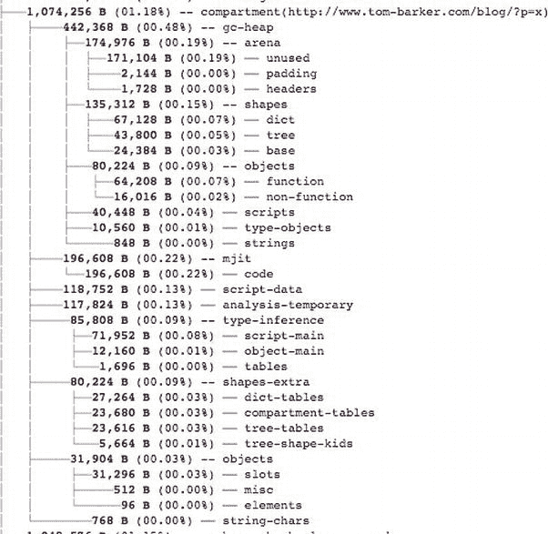

*图 5-8. Firefox 内存窗口*

### 高分辨率时间

我们将讨论的下一个变化是一个称为*高分辨率时间*的特性——以亚毫秒值记录的时间。这对于捕获在不到 1 毫秒内发生的计时数据非常有用。在下一章中，我们将广泛使用高分辨率时间来捕获运行时性能指标。

# Web 性能工作组详细描述了`performance`对象的一个公共方法：`performance.now()`。

正如你在上一章中所见，在计时代码执行时，我们遇到了结果为 0 毫秒的情况。这是因为从`Date()`对象返回的值精度只到 1 毫秒。在 JavaScript 控制台中输入以下内容来查看`Date()`对象：

```
>>> new Date().getMilliseconds()
603
>>> Date.now()
1340722684122
```

由于 JavaScript 解释器和浏览器渲染引擎性能的优化，我们的一些操作可能在微秒内完成。这就是我们测试得到 0 毫秒结果的原因。

这类测试的一个更微妙的危险在于，`Date`对象中的值基于系统日期，理论上在测试过程中可能会被更改，从而导致结果出现偏差。从夏令时调整到企业同步系统时间的策略，任何情况都可能在未经我们输入的情况下更改系统日期。其中任何一种情况都会改变我们的计时结果，甚至可能导致负数结果。

`performance.now()`方法返回的结果以毫秒的分数为单位。它还相对于`navigationStart`事件，而非系统日期，因此不会受到系统时间变化的影响。Chrome 从 Chrome 20 开始通过浏览器特定的前缀函数`webkitNow()`支持高分辨率时间，如下所示：

```
Google Chrome 20
>>> performance.webkitNow()
290117.4699999974
```

Firefox 从 Firefox 15 Aurora 版本开始支持高分辨率时间：

```
Firefox 15 aurora
>>> performance.now()
56491.447434
```

这很棒，但我们如何从现在开始使用它，以及如何确保我们现在编写的代码在将来所有浏览器都支持它时仍然有效？为了使我们的`perfLogger`库面向未来，我们可以针对`performance.now()`方法进行编码，并构建一个回退的 shim，以备浏览器尚未支持它时使用。

 `注意：` Shim 是一个抽象层，它拦截 API 调用或事件，要么更改调用的签名并传递调用以适应更新的 API 签名，要么自行处理 API 的功能。图 5-9 描述了 shim 在重新发布消息之前拦截事件或消息分发的原理，可能是为了执行某些逻辑。图 5-10 描述了 shim 覆盖函数或对象、处理信息，然后通过组合方式将数据传递给原始对象或函数，或者直接调用原始对象或函数。

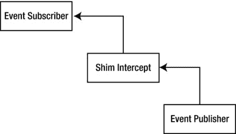

`图 5-9.` 拦截

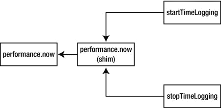

`图 5-10.` 覆盖

在这种情况下，你将覆盖`performance.now()`函数调用，并在将其传递出去或自行处理之前添加一层功能。

在`perfLogger.js`中，在 perfLogger 自执行函数之后，添加一个函数声明来覆盖对`performance.now`的原生调用：

```
performance.now = (function() {
})();
```

如果支持`performance.now`，此函数应返回它；如果不支持，代码会遍历可能的浏览器特定实现，如果这些都不支持，则默认使用旧的`Date()`功能。

```
performance.now = (function() {
return performance.now       ||
          performance.webkitNow ||
          function() { return new Date().getTime(); };
})();
```

接下来，更新 perfLogger 的`startTimeLogging()`和`stopTimeLogging()`函数以使用`performance.now()`：

```javascript
startTimeLogging: function(id, descr, drawToPage, logToServer) {
  loggerPool[id] = {};
  loggerPool[id].id = id;
  loggerPool[id].startTime = performance.now(); // 支持高精度时间
  loggerPool[id].description = descr;
  loggerPool[id].drawtopage = drawToPage;
  loggerPool[id].logtoserver = logToServer;
}

stopTimeLogging: function(id) {
  loggerPool[id].stopTime = performance.now(); // 支持高精度时间
  calculateResults(id);
  setResultsMetaData(id);
  if (loggerPool[id].drawtopage) {
    drawToDebugScreen(id);
  }
  if (loggerPool[id].logtoserver) {
    logToServer(id);
  }
}
```

现在，让我们来看看上一章的页面渲染基准测试结果在不同浏览器下的表现。在图 5-11 中，我们将观察 Chrome 19 下的结果，了解浏览器在缺乏高精度时间支持时的表现。在图 5-12 中，我们将查看 Firefox 15 Aurora 发行版下的结果；而在图 5-13 中，我们将看到 Chrome 20 下的结果，因为这两个浏览器都支持高精度时间。

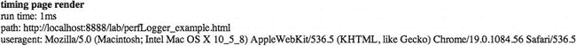

`图 5-11.` Chrome 19 默认使用 Date 对象

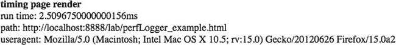

`图 5-12.` Firefox 15 Aurora 发行版支持 `performance.now`

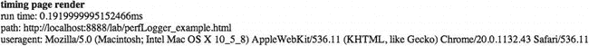

`图 5-13.` Chrome 20 支持 `performance.webkitNow`

至此，你已经将新的 `Performance` 对象集成到 `perfLogger` 库中，并为日志文件添加了几个新列。这些新数据点为分析数据增加了额外的维度。凭借我们新获得的高精度时间捕获能力，我们已经为下一章开始收集运行时指标做好了充分准备。

## 可视化新数据

现在，让我们从这些新数据中找点乐趣！我们可以分析一些重要的数据点：平均加载时间用户代理是多少？HTTP 事务处理过程的哪个部分平均耗时最长？以及总体加载时间分布情况如何？那么，我们开始吧。

我们的数据样本如下所示：

```
IP, TestID, StartTime, StopTime, RunTime, URL, UserAgent, PerceivedLoadTime, PageRenderTime,
RoundTripTime, TCPConnectionTime, DNSLookupTime, CacheTime, RedirectTime
75.149.106.130,page_render,1341243219599,1341243220218,619,http://www.tom-barker.com/
blog/?p=x,Mozilla/5.0 (Macintosh; Intel Mac OS X 10.5; rv:13.0) Gecko/20100101 Firef
ox/13.0.1790,261,-2,36,0,-4,0
75.149.106.130,page_render,633.36499998695,973.8049999869,340.43999999994,http://www.tom-barker.
com/blog/?p=x,Mozilla/5.0 (Macintosh; Intel Mac OS X 10_5_8) AppleWebKit/536.11 (KHTML like
Gecko) Chrome/20.0.1132.43 Safari/536.11633,156,-1341243238576,30,0,0,0
75.149.106.130,page_render,1498.2289999898,2287.9749999847,789.74599999492,http://www.tom-
barker.com/blog/?p=x,Mozilla/5.0 (Macintosh; Intel Mac OS X 10_5_8) AppleWebKit/536.11 (KHTML
like Gecko) Chrome/20.0.1132.43 Safari/536.111497,979,788,0,0,0,0
```

# 性能数据分析与可视化

## 感知加载时间分布

首先，让我们看一下感知加载时间的频率分布。在足够大的样本规模下，这将帮助我们很好地了解大多数用户的一般体验。我们已经从第 3 章开始一直在构建的 R 脚本中，将性能数据读入 `perflogs` 变量，现在我们就用该变量绘制一个直方图：

```r
hist(perflogs$PerceivedLoadTime, main="感知加载时间分布", xlab="感知加载时间（毫秒）", col=c("#CCCCCC"))
```

这将生成我们在图 5-14 中看到的图表。

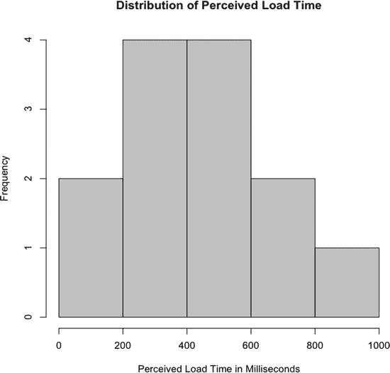

**图 5-14.** 感知加载时间直方图，频率代表访问次数

到目前为止还很简单。你只需将其包裹在 `pdf()` 函数调用中，即可保存为文件供后续引用：

```r
loadTimeDistrchart <- paste(chartDirectory, "loadtime_distribution.pdf", sep="")
pdf(loadTimeDistrchart, width=10, height=10)
  hist(perflogs$PerceivedLoadTime, main="感知加载时间分布", xlab="感知加载时间（毫秒）", col=c("#CCCCCC"))
dev.off()
```

## HTTP请求平均耗时分析

现在，让我们看看从完整的 HTTP 请求中收集到的所有数据，并分解出请求每个部分的平均耗时。这将让我们全面了解每个步骤所花费的时间。

首先创建一个新变量来保存下一个图表的路径，并创建一个名为 `avgTimeBreakdownInRequest` 的新函数来容纳这段代码：

```r
requestBreakdown <- paste(chartDirectory, "avgtime_inrequest.pdf", sep="")
avgTimeBreakdownInRequest <- function() {
}
```

在这个函数中，你需要做一些数据清理工作。如果数值较大，R 可能会用科学记数法存储它们。这对于引用大数字非常好，但为了便于一般性阅读，我们应该取消科学记数法，使其易于理解。为此，将 `scipen` 参数传递给 `options()` 函数。`options()` 函数允许我们设置 R 的全局选项，而 `scipen` 接受一个数值；传入的数值越大，R 以定点（非科学记数法）显示数字的可能性就越大：

```r
options(scipen=100)
```

接下来，处理数据中出现的那些负数。在这种情况下，负数没有实际意义。它们之所以出现，是因为有时 `window.performance` 对象返回值为 0，而我们在各值之间进行减法运算以推导出保存的性能数据。

您有以下几种选择：可以移除包含负数的行，或直接将负值归零。如果认为某个列的值异常会影响整行数据的可靠性，可以删除整行，但此处并非这种情况。为了避免丢失其他列中可能有效的值，建议仅将负值归零。

要将负值归零，只需检查每列中小于 0 的值，并将其设置为 0。对每个要绘图的列执行此操作：

```r
perflogs$PageRenderTime[perflogs$PageRenderTime < 0] <- 0
perflogs$RoundTripTime[perflogs$RoundTripTime < 0] <- 0
perflogs$TCPConnectionTime[perflogs$TCPConnectionTime < 0] <- 0
perflogs$DNSLookupTime[perflogs$DNSLookupTime < 0] <- 0
```

接下来，创建一个数据框，其中包含每列的平均值。为此，使用 `data.frame()` 函数，并对每个需要计算平均值的列调用 `mean()`。然后为这个新数据框设置列名：

```r
avgTimes <- data.frame(mean(perflogs$PageRenderTime), mean(perflogs$RoundTripTime), mean(perflogs$TCPConnectionTime), mean(perflogs$DNSLookupTime))
colnames(avgTimes) <- c("PageRenderTime", "RoundTripTime", "TCPConnectionTime", "DNSLookupTime")
```

最后，创建图表。这将是一个水平条形图，类似于我们在前几章中创建的那样，并将其保存为 PDF。

```r
pdf(requestBreakdown, width=10, height=10)
opar <- par(no.readonly=TRUE)
     par(las=1, mar=c(10,10,10,10))
     barplot(as.matrix(avgTimes), horiz=TRUE, main="Average Time Spent\nDuring HTTP Request", xlab="Milliseconds")
par(opar)
dev.off()
```

完整的函数应如下所示，生成的图表如图 Figure 5-15 所示。

```r
avgTimeBreakdownInRequest <- function(){
#expand exponential notation
options(scipen=100)

#set any negative values to 0
perflogs$PageRenderTime[perflogs$PageRenderTime < 0] <- 0
perflogs$RoundTripTime[perflogs$RoundTripTime < 0] <- 0
perflogs$TCPConnectionTime[perflogs$TCPConnectionTime < 0] <- 0
perflogs$DNSLookupTime[perflogs$DNSLookupTime < 0] <- 0

#capture avg times
avgTimes <- data.frame(mean(perflogs$PageRenderTime), mean(perflogs$RoundTripTime), mean(perflogs$TCPConnectionTime), mean(perflogs$DNSLookupTime))
colnames(avgTimes) <- c("PageRenderTime", "RoundTripTime", "TCPConnectionTime", "DNSLookupTime")

pdf(requestBreakdown, width=10, height=10)
opar <- par(no.readonly=TRUE)
     par(las=1, mar=c(10,10,10,10))
     barplot(as.matrix(avgTimes), horiz=TRUE, main="Average Time Spent\nDuring HTTP Request", xlab="Milliseconds")
par(opar)
dev.off()
}
```

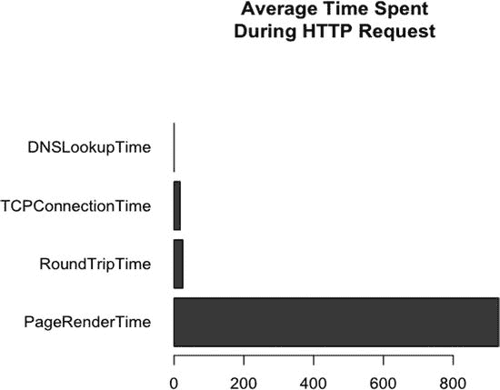

**图 5-15.** HTTP 请求中各步骤的平均耗时

这是一个有趣的结果。您可能已经想到，页面渲染花费的时间最长，因为它开销最大且要做的事情最多；它不仅是在传输消息，还要解析消息。但您可能没有料到 TCP 连接时间和往返时间会相同，或者它们会明显高于 DNS 查找时间。

## 按浏览器细分的感知加载时间

本章我们将看到的最后一个图表是按浏览器划分的感知加载时间细分。请注意，上面的示例数据存储了完整的用户代理字符串，它不仅提供浏览器名称，还包括版本、子版本、操作系统甚至渲染引擎。这很好，但如果您希望汇总到高层级的浏览器信息，而不考虑版本或操作系统，我们可以搜索用户代理字符串来查找特定的高层级浏览器名称。

您可以使用 `grep()` 在数据框列中搜索字符串。`grep()` 函数接受要搜索的字符串作为第一个参数，并将要搜索的向量或对象作为第二个参数。在我们的场景中，我们将 `grep()` 函数作为过滤选项传递到数据框中：

```r
data frame[grep([string to search for], [data frame column to search])]
```

创建一个名为 `getDFByBrowser()` 的函数，该函数允许您通过传入要搜索的数据框和要搜索的字符串来泛化搜索：

```r
getDFByBrowser<-function(data, browsername){
     return(data[grep(browsername, data$UserAgent),])
}
```

接下来创建一个变量来保存新图表的路径 `loadtime_bybrowser`：

```r
loadtime_bybrowser <- paste(chartDirectory, "loadtime_bybrowser.pdf", sep="")
```

接着创建一个函数来保存此图表的主要功能；将其命名为`printLoadTimebyBrowser()`：

```
printLoadTimebyBrowser <- function(){
}
```

此函数首先为要包含在图表中的每个浏览器创建数据框：

```
chrome <- getDFByBrowser(perflogs, "Chrome")
firefox <- getDFByBrowser(perflogs, "Firefox")
ie <- getDFByBrowser(perflogs, "MSIE")
```

接下来，创建一个数据框来保存每个浏览器的平均感知加载时间，就像你在前面示例中对 HTTP 请求步骤所做的那样。同时为数据框指定描述性列名：

```
meanTimes <- data.frame(mean(chrome$PerceivedLoadTime), mean(firefox$PerceivedLoadTime), mean(ie$PerceivedLoadTime))
colnames(meanTimes) <- c("Chrome", "Firefox", "Internet Explorer")
```

最后，创建条形图并将其保存为 PDF：

```
pdf(loadtime_bybrowser, width=10, height=10)
     barplot(as.matrix(meanTimes), main="Average Perceived Load Time\nBy Browser", ylim=c(0, 600), ylab="milliseconds")
dev.off()
```

完整的功能应如下所示，完成的图表应如图 Figure 5-16 所示。

```
getDFByBrowser<-function(data, browsername){
     return(data[grep(browsername, data$UserAgent),])
}

printLoadTimebyBrowser <- function(){
     chrome <- getDFByBrowser(perflogs, "Chrome")
     firefox <- getDFByBrowser(perflogs, "Firefox")
     ie <- getDFByBrowser(perflogs, "MSIE")
     meanTimes <- data.frame(mean(chrome$PerceivedLoadTime), mean(firefox$PerceivedLoadTime), mean(ie$PerceivedLoadTime))
     colnames(meanTimes) <- c("Chrome", "Firefox", "Internet Explorer")

     pdf(loadtime_bybrowser, width=10, height=10)
          barplot(as.matrix(meanTimes), main="Average Perceived Load Time\nBy Browser", ylim=c(0, 600), ylab="milliseconds")
     dev.off()
}
```


***图 5-16** 按浏览器划分的平均感知加载时间*

有趣的是，我们的测试结果显示，Firefox 的感知加载时间最佳，其次是 Chrome，最后是 Internet Explorer。这仅仅是比较的一小部分；如果需要，我们可以通过查看版本和子版本来扩展此分析。

完整更新的 R 文件现在应如下所示：

```
dataDirectory <- "/Applications/MAMP/htdocs/lab/log/"
chartDirectory <- "/Applications/MAMP/htdocs/lab/charts/"
testname = "page_render"

perflogs <- read.table(paste(dataDirectory, "runtimeperf_results.csv", sep=""), header=TRUE, sep=",")
perfchart <- paste(chartDirectory, "runtime_",testname, ".pdf", sep="")

loadTimeDistrchart <- paste(chartDirectory, "loadtime_distribution.pdf", sep="")
requestBreakdown <- paste(chartDirectory, "avgtime_inrequest.pdf", sep="")
loadtime_bybrowser <- paste(chartDirectory, "loadtime_bybrowser.pdf", sep="")
pagerender <- perflogs[perflogs$TestID == "page_render",]
df <- data.frame(pagerender$UserAgent, pagerender$RunTime)
df <- by(df$pagerender.RunTime, df$pagerender.UserAgent, mean)
df <- df[order(df)]

pdf(perfchart, width=10, height=10)
opar <- par(no.readonly=TRUE)
     par(las=1, mar=c(10,10,10,10))
     barplot(df, horiz=TRUE)
par(opar)
dev.off()

getDFByBrowser<-function(data, browsername){
     return(data[grep(browsername, data$UserAgent),])
}
```

```markdown