## 第 6 章


### Web 性能优化

上一章探讨了 W3C 在浏览器中标准化性能的第一步成果——`Performance` 对象。第 5 章详细考察了 `Performance` 对象中的各个 API；你了解了如何从 `Performance Timing` 对象收集和推导性能指标，如何使用 `Performance Navigation` 对象确定用户访问网站的方式，以及 `Performance` 对象如何提供高分辨率时间，使我们能够追踪毫秒级别以下的时序数据。

基于以上内容，你更新了 `perfLogger` 库，以集成 `Performance` 对象提供的所有优秀指标。你在 `perfLogger` 中构建了垫片（`shim`），以便在支持高分辨率时间的浏览器中使用该功能，并在不支持的浏览器中优雅降级。

接着，你利用所有这些新数据扩展了 `R` 脚本，以图表形式展示这些数据所揭示的用户、网络连接和浏览器状况。

现在，本章你将使用迄今为止创建的所有工具，以及我们在第 2 章中考察过的所有工具，来量化一些 Web 性能优化技巧可能带来的好处——具体来说，就是 `JavaScript` 如何阻塞页面渲染，以及如何利用 `JavaScript` 推迟加载更重的内容。请记住，Web 性能是指你的内容传递到最终用户所需的时间，包括网络延迟和浏览器渲染时间。

#### 优化页面渲染瓶颈

我们首先要优化的地方是浏览器中内容的渲染。这个问题与网络延迟无关；它仅仅指浏览器处理和渲染内容以呈现给最终用户的速度。让我们先来看看现代浏览器中内容绘制到屏幕上的工作原理。

如第 1 章所述，现代浏览器由多个相互交互的组件组成。有一个 UI 层负责绘制浏览器的客户端界面，包括地址栏、前进和后退按钮，以及浏览器可能拥有的其他界面元素（chrome）。最终用户与 UI 层交互，并通过 UI 层驱动应用程序的其余部分。

我们有一个网络层，负责处理网络连接、建立 `TCP` 连接和执行 `HTTP` 往返。网络层还向渲染引擎提供内容。

渲染引擎负责将内容绘制到屏幕上。当遇到 `JavaScript` 时，它会将其交给 `JavaScript` 解释器。请参见图 6-1，了解现代浏览器高级架构的标注视图。

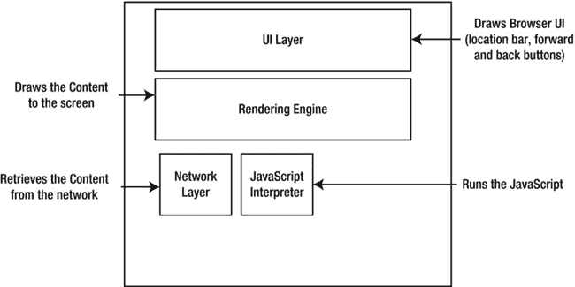

`图 6-1`. 带注释的浏览器架构

正如我所说，渲染引擎——无论是 `Gecko`、`WebKit` 还是其他——从网络层获取内容。它有一个有限的总线大小，因此它分块拉取数据，并将这些块传递到自己的工作流中。

该工作流是一个包含多个步骤的过程。首先，内容被解析，这意味着标记被读取为字符并进行*词法分析*，在词法分析中，字符与规则集进行比较并根据规则集转换为标记（`tokens`）。规则集是我们 `HTML` 文档中定义的 `DTD`；它指定了构成我们将要使用的语言版本的标签。标记只是被分解为有意义段的字符。

例如，网络层可能返回以下字符串：

`<!DOCTYPE html><html><head><meta charset="UTF-8"/>`

该字符串会被标记化为有意义的块：

`<!DOCTYPE html>`

`<html>`

`<head>`

`<meta charset="UTF-8"/>`

然后，渲染引擎获取这些标记并将其转换为 `DOM` 元素。这些 `DOM` 元素被排列成一棵渲染树，渲染引擎随后遍历这棵树。在第一次遍历中，渲染引擎布局 `DOM` 元素的位置，在第二次遍历中，将它们绘制到屏幕上。参见图 6-2 了解此工作流。

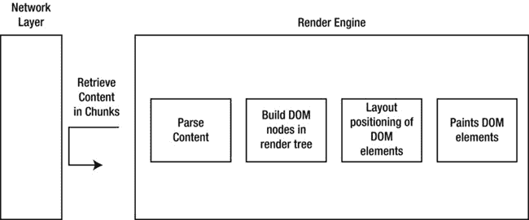

`图 6-2`. 渲染引擎工作流

通常在此过程中，如果渲染引擎在标记化期间识别出一个外部脚本，它会暂停解析内容并开始下载该脚本。渲染引擎只有在脚本下载并执行完毕后才会恢复解析。这会导致内容显示给最终用户的时间出现潜在瓶颈。参见图 6-3 了解此潜在瓶颈的流程图。

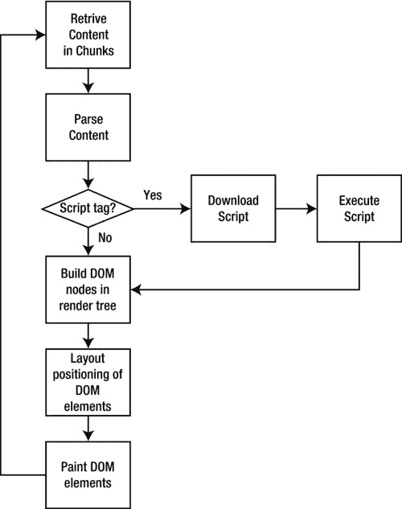

`图 6-3`. 解析过程中遇到的脚本标签

##### 本章摘要

本章探讨了 `window.performance` 对象，这是 W3C 提供的一种从浏览器收集性能指标的新标准化方式。我们将 `Performance` 对象整合到了现有的 `perfLogger` 项目中，在每次运行的测试中都包含了性能指标，并且如果浏览器支持，我们还构建了对 `window.performance` 高分辨率时间的支持。

我们利用这些新数据来审视网站的整体网络性能。

我们简要探讨了从浏览器查看客户端机器内存使用情况的新兴可能性，特别是 `Chrome` 的实现，并简单介绍了如何让 `Firefox` 暴露类似数据。

下一章将关注 Web 性能优化；你将使用我们已经开发的工具运行多变量测试，以观察优化效果。

```R
printLoadTimebyBrowser <- function(){
     chrome <- getDFByBrowser(perflogs, "Chrome")
     firefox <- getDFByBrowser(perflogs, "Firefox")
     ie <- getDFByBrowser(perflogs, "MSIE")

     meanTimes <- data.frame(mean(chrome$PerceivedLoadTime), mean(firefox$PerceivedLoadTime),
mean(ie$PerceivedLoadTime))
     colnames(meanTimes) <- c("Chrome", "Firefox", "Internet Explorer")
     pdf(loadtime_bybrowser, width=10, height=10)
          barplot(as.matrix(meanTimes), main="Average Perceived Load Time\nBy Browser",
ylim=c(0, 600), ylab="milliseconds")
     dev.off()
}

pdf(loadTimeDistrchart, width=10, height=10)
     hist(perflogs$PerceivedLoadTime, main="Distribution of Perceived Load Time", xlab="Perceived
Load Time in Milliseconds", col=c("#CCCCCC"))
dev.off()

avgTimeBreakdownInRequest <- function(){

#expand exponential notation
options(scipen=100, digits=3)

#set any negative values to 0
perflogs$PageRenderTime[perflogs$PageRenderTime < 0] <- 0
perflogs$RoundTripTime[perflogs$RoundTripTime < 0] <- 0
perflogs$TCPConnectionTime[perflogs$TCPConnectionTime < 0] <- 0
perflogs$DNSLookupTime[perflogs$DNSLookupTime < 0] <- 0

#capture avg times
avgTimes <- data.frame(mean(perflogs$PageRenderTime), mean(perflogs$RoundTripTime), mean(perflogs$T
CPConnectionTime), mean(perflogs$DNSLookupTime))
colnames(avgTimes) <- c("PageRenderTime", "RoundTripTime", "TCPConnectionTime", "DNSLookupTime")
pdf(requestBreakdown, width=10, height=10)
opar <- par(no.readonly=TRUE)
     par(las=1, mar=c(10,10,10,10))
     barplot(as.matrix(avgTimes), horiz=TRUE, main="Average Time Spent\nDuring HTTP Request",
xlab="Milliseconds")
par(opar)
dev.off()

}

#invoke our new functions
printLoadTimebyBrowser()
avgTimeBreakdownInRequest()
```

为了解决这个潜在问题，通常的最佳实践^(1)是将所有脚本标签放在 HTML 的底部，这样任何为了处理 JavaScript 而暂停渲染的过程都将在页面完全渲染后进行。

## 脚本加载

另一种方法是程序化地加载远程 JavaScript 文件，这被称为 *脚本加载*，它允许我们“欺骗”渲染引擎。让我们看看具体怎么做。

请记住，我们刚才探讨的渲染引擎暂停的工作流程适用于外部脚本。浏览器会查找脚本标签的 `src` 属性，该属性告诉它必须下载一个远程资源。如果遇到没有 `src` 属性的脚本标签，渲染引擎只会将代码传递给 JavaScript 解释器执行。

因此，我们可以创建内联 JavaScript，动态地向文档添加脚本标签，如下所示：

```
<script>
var script = window.document.createElement('SCRIPT');
script.src = src;
window.document.getElementsByTagName('HEAD')[0].appendChild(script);
</script>
```

这段代码使用 `document.createElement()` 函数创建一个新的脚本标签，并将其存储在名为 `script` 的变量中。它将新脚本标签的 `src` 属性设置为指向一个远程 JavaScript 文件，并将该新脚本标签追加到文档的 Head 部分。

这非常简单，接下来让我们将其充实成一个可用的实际示例。

首先，创建一个命名空间，您可以将其命名为 `remoteLoader`：

```
var remoteLoader = function remoteLoader(){

return{

}
}();
```

在 `remoteLoader` 内部，创建一个私有函数来构建脚本标签，其逻辑与上一段代码大致相同。将此函数命名为 `constructScriptTag()`，并传入一个 URL 作为脚本标签的源：

```
function constructScriptTag(src){
    var script = window.document.createElement('SCRIPT');
    script.src = src;
return script;
}
```

在返回的对象中，创建一个名为 `loadJS()` 的公共函数，带有一个参数 `script_url`：

```
loadJS: function(script_url){

}
```

> 1 至少自 Steve Souders 在其著作 *《高性能网站建设指南：前端工程师必备知识》*（O'Reilly 2007）中提及以来。

在 `loadJS` 内部，您将添加一些分支逻辑，用于判断传入的值是数组还是字符串。这将为使用我们的 API 加载单个 JavaScript 文件或多个 JavaScript 文件提供灵活性。

为了进行判断，请查看变量的 `typeof`。数组返回类型 `"object"`，字符串返回类型 `"string"`。为了能够区分数组和其他类型的对象，您需要对变量使用 `instanceof` 运算符。`instanceof` 运算符用于测试左侧的对象在其原型链中是否具有右侧构造函数的实例——换句话说，它是否是那个构造函数的实例？

```
if(typeof script_url === "object"){
if(script_url instanceof Array){
}
}else if(typeof script_url === "string"){

}
```

首先完善字符串分支，因为它是最简单的。只需调用 `constructScriptTag()` 函数并传入 `script_url`。然后将返回的元素追加到文档的 head 部分。

```
else if(typeof script_url === "string"){
window.document.getElementsByTagName('HEAD')[0].appendChild(constructScriptTag(script_url));
}
```

数组分支将遍历 URL 数组，为每个 URL 创建一个新的脚本标签，并使用文档片段来存储所有这些新元素。然后一次性将它们全部追加到 head 部分。我将在下一章详细讨论文档片段。

```
if(script_url instanceof Array){
var frag = document.createDocumentFragment();
     for(var ind = 0; ind < script_url.length; ind++){
          frag.appendChild(constructScriptTag(script_url[ind]));
     }
window.document.getElementsByTagName('HEAD')[0].appendChild(frag.cloneNode(true) );
}
```

您完成的代码应该如下所示：

```
var remoteLoader = function remoteLoader(){
     function constructScriptTag(src){
          var script = window.document.createElement('SCRIPT');
          script.src = src;
          return script;
     }

      return{
          loadJS: function(script_url){
               if(typeof script_url === "object"){
                    if(script_url instanceof Array){
                         var frag = document.createDocumentFragment();
                         for(var ind = 0; ind < script_url.length; ind++){
                              frag.appendChild(constructScriptTag(script_url[ind]));
                         }
                         window.document.getElementsByTagName('HEAD')[0].appendChild(frag.cloneNode(true) );
                    }
               }else if(typeof script_url === "string"){
                 window.document.getElementsByTagName('HEAD')[0].appendChild(constructScriptTag(script_url));
               }
          }
     }     
}();
```

使用它时，您可以传入一个字符串或一个数组，如下面的代码片段所示：

```
<script>
     remoteLoader.loadJS("/lab/perfLogger.js"); // 传入字符串
</script>
```

```
<script>
     remoteLoader.loadJS(["/lab/perfLogger.js", "jquery.js"]); // 传入数组
</script>
```

## async

另一个阻止渲染引擎阻塞的方法是使用脚本标签的 `async` 属性。`async` 选项是 HTML 5 引入的一个原生属性，它会告诉浏览器异步加载脚本。所有现代浏览器都支持它，甚至从版本 10 开始（Internet Explorer 版本 10 之前使用了一个名为 `defer` 的专有属性）。`async` 属性可选地接受一个布尔值；只需在脚本标签中包含它而不赋值，则默认为 `true`。

```
<script src="[URL]" async=true></script>
<script src="[URL]" async></script>
```

使用 `async` 时，您无法知道文件何时会被下载，因此可以在 `script` 标签上附加一个 `onload` 事件处理程序。这将允许您在文件下载完成后，调用或实例化任何需要运行的代码：

```
<script src="[URL]" async onload="init();"></script>
```

## 比较结果

读到这里，你应该已经猜到接下来要做什么了——让我们运行一个多变量测试，并比较刚刚介绍的每种方法的结果！

# 脚本加载方式对页面性能的影响测试

## 创建测试页面

在这个测试中，你将创建一个基线页面，即一个完全未对外部脚本进行优化的页面。在该基线文件的`<head>`中加载`perfLogger.js`。

```html
<head>
… [省略头部内容]
<script src="/lib/perfLogger.js"></script>
<script>
perfLogger.startTimeLogging("page_render", "timing page render", true, true);
</script>
</head>
```

现在，创建一个使用`remoteLoader`通过代码加载`perfLogger.js`的文件。你需要在`<head>`中加载`remoteLoader.js`，然后在`<body>`部分调用`loadJS`：

```html
<head>
…[省略头部内容]
<script src="/lib/remoteLoader.js"></script>
</head>
<body>
<script>
remoteLoader.loadJS("/lab/perfLogger.js");
</script>
… [省略正文内容]
<script>
perfLogger.showPerformanceMetrics();
</script>
</body>
```

最后，创建一个在`<script>`标签中使用`async`属性的页面：

```html
<head>
…[省略头部内容]
<script async src="/lab/perfLogger.js"></script>
</head>
<body>
… [省略正文内容]
<script>
perfLogger.showPerformanceMetrics();
</script>
</body>
```

## 运行测试与结果分析

现在，将每个页面通过 WebPagetest 运行测试。为每个页面使用相同的内容——来自我的网站 `tom-barker.com` 主页的一个快照。URL 如下：

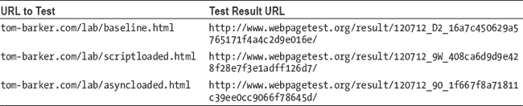

图 6-4 至 6-6 展示了每个测试的高级汇总时间。

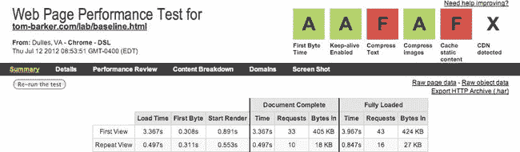

图 6-4. 基线的 WebPagetest 结果汇总

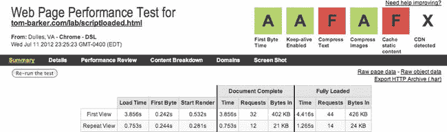

图 6-5. 动态加载脚本的 WebPagetest 结果汇总

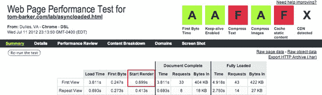

图 6-6. 异步脚本的 WebPagetest 结果汇总

从这些结果可以看出，整体加载时间的差异很小，但这里的一致差异在于首字节时间和开始渲染时间。`remoteLoader.js` 页面的开始渲染时间最佳，比基线快 350 毫秒以上，比 `async` 页面快 160 毫秒。这其中存在权衡；总加载时间更长，但页面渲染更快，因此对于最终用户来说，页面看起来加载得更快。

## 瀑布图分析

为了弄清楚为什么开始渲染更快，让我们看看瀑布图。图 6-7 至 6-9 展示了我们测试的瀑布图。

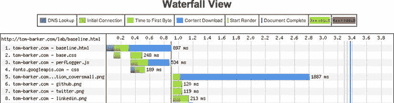

图 6-7. 基线文件的瀑布图

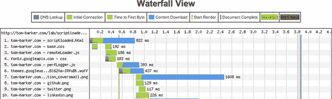

图 6-8. 脚本加载器文件的瀑布图

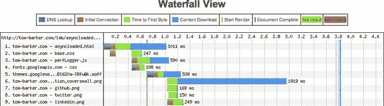

图 6-9. 异步文件的瀑布图

在这些瀑布图中，我们可以看到 `perfLogger.js` 如何影响序列中其下方的项目。

对于基线（图 6-7），我们可以看到，当浏览器连接 `perfLogger.js` 时，它同时也正在连接并下载我们的网络字体，但一旦浏览器开始下载 `perfLogger.js`，所有其他进程都会暂停，直到该下载完成。这在图 6-7 的第 5 到 8 行得到了证明，这些行上的每个 PNG 都一直等到大约 897 毫秒标记才开始加载，而这正是 `perfLogger.js` 完成下载的时刻。

对于我们的脚本加载测试（图 6-8），你可以看到浏览器没有被 `perfLogger.js` 的下载阻塞。在第 6 行，你可以看到我们的网络字体文件与 `perfLoader.js` 并行下载。这对于我们的 `async` 测试（图 6-9）也是如此，我们可以看到浏览器与我们 `perfLoader.js` 文件并行下载一个外部 CSS 文件和一个网络字体文件。我们在第 3 到 5 行可以看到这些。

## 查看性能指标

最后，让我们看看每个页面的 `perfLogger` 指标结果。

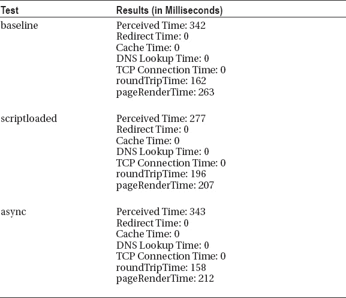

我们可以看到，在单次测试级别上，感知时间和页面渲染时间有所改善，但如果我们大规模运行这些测试，这些改善会被平均掉，还是反映了更大的性能提升？幸运的是，我们构建了 `perfLogger` 来保存所有结果，所以让我们查看我们的日志文件并在 R 中解析结果。

## 使用 R 语言分析数据

首先编写一个新的 R 函数，通过 URL 创建数据框：

```r
getDFByURL<-function(data,url){
     return(data[grep(,url, data$URL)])
}
```

接下来，创建一个名为 `comparePerfMetricsbyURL` 的新函数：

```r
comparePerfMetricsbyURL<-function(){
}
```

在这个函数内部，使用刚刚创建的 `getDFByURL()` 函数为每个测试创建变量：

```r
baseline <- getDFByURL(perflogs, "http://tom-barker.com/lab/baseline.html")
scripted <- getDFByURL(perflogs, "http://tom-barker.com/lab/scriptloaded.html")
async <- getDFByURL(perflogs, "http://tom-barker.com/lab/asyncloaded.html")
```

然后，创建一个数据框来保存每个测试 URL 的平均页面渲染时间，以及一个数据框来保存每个测试 URL 的平均加载时间。你还需要更新每个数据框的列名，以确保图表获得清晰且具描述性的 x 轴标签：

```r
meanRenderTimes <- data.frame(mean(baseline$PageRenderTime), mean(scripted$PageRenderTime),
mean(async$PageRenderTime))

colnames(meanRenderTimes) <- c("Baseline", "Script Loaded", "Async")

meanLoadTimes <- data.frame(mean(baseline$PerceivedLoadTime), mean(scripted$PerceivedLoadTime),
mean(async$PerceivedLoadTime))

colnames(meanLoadTimes) <- c("Baseline", "Script Loaded", "Async")
```

最后，使用这些数据框创建条形图：

```r
barplot(as.matrix(meanRenderTimes), main="Average Render Time\nBy Test Type", ylim=c(0, 400),
ylab="milliseconds")

barplot(as.matrix(meanLoadTimes), main="Average Load Time\nBy Test Type", ylim=c(0, 700),
ylab="milliseconds")
```

我们完成的函数应该如下所示：

# 性能测量与懒加载

## 懒加载

现在我们将探讨懒加载，这是一种以编程方式延迟加载资源的途径。我们将了解懒加载作为一种设计模式是什么，以及如何策略性地利用它来提升页面的 Web 性能。

### 懒加载的艺术

从很高的层次来看，懒加载是一种设计模式，在这种模式中，我们将某物的创建或初始化推迟到绝对必要时才进行（参见图 6-12）。

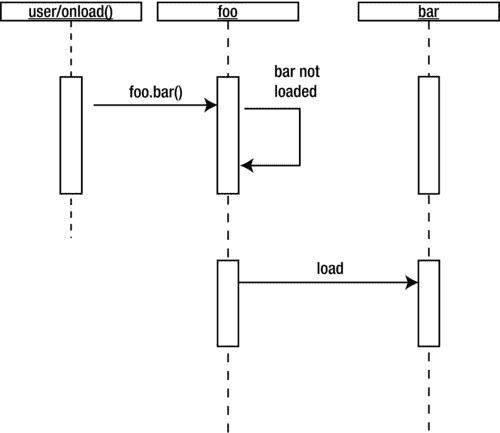

`图 6-12。懒加载序列图`

该模式有几种实现方式：

> *   虚拟代理模式

> *   懒初始化模式

> *   值持有者模式

在如图 6-13 所示的虚拟代理模式中，我们实例化一个存根，并在需要时加载实际实现，并通过组合方式将其暴露出来。这种模式通常用于那些并非总是需要或并非立即需要的模块或组件——就像那些在页面加载前可能不需要的 JavaScript 文件一样。

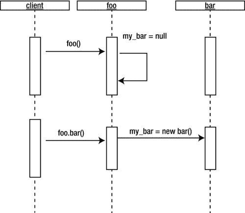

`图 6-13。虚拟代理模式`

在懒初始化模式中，我们会检查对象是否存在（是否为 `null`？），如果尚不存在，则实例化它。这很可能是大多数人用过却从未意识到这就是懒初始化的模式。此模式在 JavaScript 中声明对象或命名空间时最为常用。如果我们的命名空间存在，则使用它；如果不存在，则创建它。

```
if (obj == null){
     obj = new obj();
}
return obj;
```

最后是值持有者模式，在这种模式中，我们调用对象的公共函数来获取该对象的一个实例。该对象仅在函数首次被调用时才会被实例化。值持有者模式最常作为单例模式实现的一部分来使用。

 **注意** 设计模式是已被识别并命名的核心算法模式，它们创建了一种词汇表，用简单的语言描述解决常见问题所需的步骤。关于设计模式的开创性著作是原版书籍《设计模式：可复用面向对象软件的基础》（作者：Erich Gamma 等人，Addison-Wesley 1994）。

此后，反模式的概念也已被识别出来。反模式是设计模式的对立面，是常见的、系统性的、可重复的错误，一旦识别出来就可以避免。学习至少一部分设计模式和反模式是非常有用的。整个人类历史和科学都建立在记录以往学习成果并在此基础上发展的理念之上。我们避免重新发明轮子。这就是设计模式和反模式的思想：我们已经识别出了问题和最高效的解决方法；让我们转而专注于新的挑战并解决它们，并将我们的新发现保存给后代。

此外，将某物称为工厂（`factory`）要比将其称为一个生成其他对象的对象（`object`）简单得多，也更省文字。

## 懒加载脚本

当我们不需要 JavaScript 代码在页面加载后立即可用时，我们可以在 `window.onload` 事件之后通过脚本方式加载外部 JavaScript。这就是对脚本进行懒加载。让我们来看看如何懒加载脚本，以及由此能获得什么样的性能提升。然后我们将评估结果。

### 设置懒加载

首先，创建一个新的测试 URL 进行实验。你将使用前面例子中通过脚本加载的页面，并将其重命名为 `lazyloadscript.html`。你还需要更新 `remoteLoader` 对象。

在新的 `lazyloadscript.html` 页面中，你将添加一个 `<script>` 标签和一些 JavaScript 代码。这段代码将检查当前浏览器中 `window.attachEvent` 函数是否可用。`attachEvent` 函数接受两个参数：要附加的事件，以及事件发生时调用的函数。如果当前浏览器支持 `window.attachEvent`，你将传入 `onload` 事件和对 `remoteLoader.loadJS` 的调用，以加载远程脚本。

如果不支持 `attachEvent`，则改用 `window.addEventListener()` 来实现相同的效果。代码如下：

```
<script>
if (window.attachEvent)
     window.attachEvent('onload', remoteLoader.loadJS("/lab/perfLogger.js"));
else
     window.addEventListener('load', remoteLoader.loadJS("/lab/perfLogger.js"), false);
</script>
```

从技术上讲，你刚刚实现了远程脚本加载的懒加载——但这里有一个问题。目前我们不知道远程脚本何时完成加载。如果你尝试调用 `perfLogger.showPerformanceMetrics()`，而此时脚本不仅尚未加载，更未执行，那么你将收到一个错误。

因此，你需要做一些修改。你需要能够知道脚本何时加载完成，并在加载完成后运行性能测试。所以，你需要让 `remoteLoader.loadJS` 函数接受一个回调函数。

 **注意** 回调函数是作为变量传递给其他函数的函数。接受回调的函数随后可以执行该回调函数。这是函数式编程中非常美妙的一点，我们可以在函数或对象之间传递函数。这开启了无需继承即可改变功能的其他方式。

现在让我们进入 `remoteLoader`，更新 `constructScriptTag()` 和 `loadJS()` 函数。在它们的签名中添加第二个参数，这将是回调函数。

```
loadJS: function(script_url, f){
}

function constructScriptTag(src, func){
}
```

## 性能测量与懒加载

需要牢记的是，我们通过这些图表测量性能的方式看起来耗时差不多，甚至更长一些，因为我们在页面的 `onload` 事件时才开始计数。如果我们不需要外部的脚本在 `onload` 事件之前就可用，我们可以使用一种名为懒加载的设计模式，在 `onload` 之后加载脚本。

所以我们可以看到，这些好处有些难以量化。页面能更快地被最终用户看到，所以看起来加载更快，但根据我们的技术测量，它实际上并没有加载更快。事实上，在脚本加载器的情况下，看起来加载时间反而稍长，因为需要加载额外的资源。请记住，性能是一个动态目标，并且非常微妙。

```
comparePerfMetricsbyURL<-function(){
     baseline <- getDFByURL(perflogs, "http://tom-barker.com/lab/baseline.html")
     scripted <- getDFByURL(perflogs, "http://tom-barker.com/lab/scriptloaded.html")
     async <- getDFByURL(perflogs, "http://tom-barker.com/lab/asyncloaded.html")

     meanRenderTimes <- data.frame(mean(baseline$PageRenderTime), mean(scripted$PageRenderTime),
mean(async$PageRenderTime))
     colnames(meanRenderTimes) <- c("Baseline", "Script Loaded", "Async")
     meanLoadTimes <- data.frame(mean(baseline$PerceivedLoadTime), mean(scripted$PerceivedLoadTime), mean(async$PerceivedLoadTime))
     colnames(meanLoadTimes) <- c("Baseline", "Script Loaded", "Async")

     barplot(as.matrix(meanRenderTimes), main="Average Render Time\nBy Test Type", ylim=c(0,
400), ylab="milliseconds")
     barplot(as.matrix(meanLoadTimes), main="Average Load Time\nBy Test Type", ylim=c(0, 700),
ylab="milliseconds")
}
```

这段代码生成的图表可以在图 6-10 和 6-11 中看到。

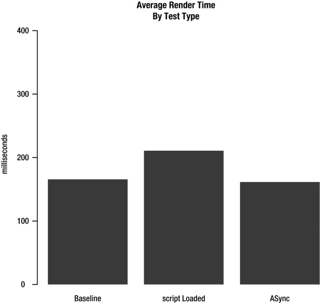

`图 6-10. 每个测试的平均渲染时间`

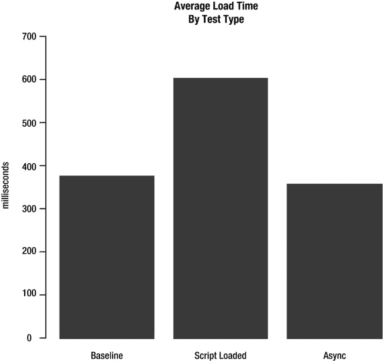

`图 6-11. 每个测试的平均加载时间`

在 `constructScriptTag()` 内部，你将检查是否传入了回调函数；如果传入了，则为脚本对象添加一个 `onload` 属性，并将回调函数赋值给该 `onload` 属性。这将使浏览器在脚本完成文件加载后执行此回调函数。实际上，根据浏览器的不同，其行为会有所差异。它可能会在连接状态每次改变时都调用回调函数，就像 AJAX 事务一样。因此，你需要在回调函数内部进行防御性编程：

```javascript
if(func){
     script.onload  = func;
}
```

你更新后的 `remoteLoader` 文件现在应该如下所示：

```javascript
var remoteLoader = function remoteLoader(){
     function constructScriptTag(src, func){
          var script = window.document.createElement('SCRIPT');
          script.src = src;
          if(func){
               script.onload  = func;
               }
          return script;
     }

     return{
          loadJS: function(script_url, f){
               if(typeof script_url === "object"){
                    if(script_url instanceof Array){
                         var frag = document.createDocumentFragment();
                         for(var ind = 0; ind < script_url.length; ind++){
                              frag.appendChild(constructScriptTag(script_url[ind]), f);
                         }
                         window.document.getElementsByTagName('HEAD')[0].appendChild(frag.cloneNode(true));
                    }
               }else if(typeof script_url === "string"){
               window.document.getElementsByTagName('HEAD')[0].appendChild(constructScriptTag(script_url, f))
               }
          }
     }     
}();
```

现在更新页面中的代码片段，传入一个回调函数。先搭建函数框架，并将其命名为 `init`：

```html
<script>
if (window.attachEvent)
     window.attachEvent('onload', remoteLoader.loadJS("/lab/perfLogger.js"), init);
else
     window.addEventListener('load', remoteLoader.loadJS("/lab/perfLogger.js", init), false);
</script>
```

接下来，我们来充实 `init` 函数。我们知道需要在这里调用 `perfLogger.showPerformanceMetrics()`，但由于浏览器有可能在脚本加载完成（但尚未执行）时调用此函数，然后在解释器执行完脚本时再次调用，因此需要检查 `perfLogger` 是否已经初始化。

```html
<script>
function init(){
     if(perfLogger){
          perfLogger.showPerformanceMetrics()
     }
}
</script>
```

完整的代码示例应如下所示：

```html
<script src="/lab/remoteLoader.js"></script>
<script>
function init(){
     if(perfLogger){
          perfLogger.showPerformanceMetrics()
     }
}

if (window.attachEvent)
     window.attachEvent('onload', remoteLoader.loadJS("/lab/perfLogger.js"), init);
else
     window.addEventListener('load', remoteLoader.loadJS("/lab/perfLogger.js", init), false);
</script>
```

## 分析并绘制结果图表

如果你将此方案部署到生产环境中，并从最终用户那里收集数据，就能将页面的指标可视化，并与我们的其他方法进行比较。

为此，让我们更新 R 脚本，将我们的懒加载示例与之前的示例进行对比。

在 `comparePerfMetricsbyURL()` 函数中，为新的 URL 添加一个新的数据框：

`lazy <- getDFByURL(perflogs, "http://tom-barker.com/lab/lazyloadscript.html")`

并将新变量包含在 `meanRenderTimes` 和 `meanLeadTimes` 数据框中：

```r
meanRenderTimes <- data.frame(mean(baseline$PageRenderTime), mean(scripted$PageRenderTime),
mean(async$PageRenderTime), mean(lazy$PageRenderTime))
```

`colnames(meanRenderTimes) <- c("Baseline", "Script Loaded", "Async", "Lazy Loaded")`

```r
meanLoadTimes <- data.frame(mean(baseline$PerceivedLoadTime), mean(scripted$PerceivedLoadTime),
mean(async$PerceivedLoadTime),mean(lazy$PerceivedLoadTime))
```

`colnames(meanLoadTimes) <- c("Baseline", "Script Loaded", "Async", "Lazy Loaded")`

更新后的 `comparePerfMetricsbyURL()` 函数现在应如下所示：

```
comparePerfMetricsbyURL`<-function(){
     baseline <- getDFByURL(perflogs, "http://tom-barker.com/lab/baseline.html")
     scripted <- getDFByURL(perflogs, "http://tom-barker.com/lab/scriptloaded.html")
     async <- getDFByURL(perflogs, "http://tom-barker.com/lab/asyncloaded.html")
     lazy <- getDFByURL(perflogs, "http://tom-barker.com/lab/lazyloadscript.html")

     meanRenderTimes <- data.frame(mean(baseline$PageRenderTime), mean(scripted$PageRenderTime),
mean(async$PageRenderTime), mean(lazy$PageRenderTime))
     colnames(meanRenderTimes) <- c("Baseline", "Script Loaded", "Async", "Lazy Loaded")
     meanLoadTimes <- data.frame(mean(baseline$PerceivedLoadTime), mean(scripted$PerceivedLoadTime), mean(async$PerceivedLoadTime),mean(lazy$PerceivedLoadTime))
     colnames(meanLoadTimes) <- c("Baseline", "Script Loaded", "Async", "Lazy Loaded")

     barplot(as.matrix(meanRenderTimes), main="Average Render Time\nBy Test Type", ylim=c(0,
400), ylab="milliseconds")
     barplot(as.matrix(meanLoadTimes), main="Average Load Time\nBy Test Type", ylim=c(0, 700),
ylab="milliseconds")
}
```

让我们来看看这段代码生成的图表，如图 6-14 和图 6-15 所示。

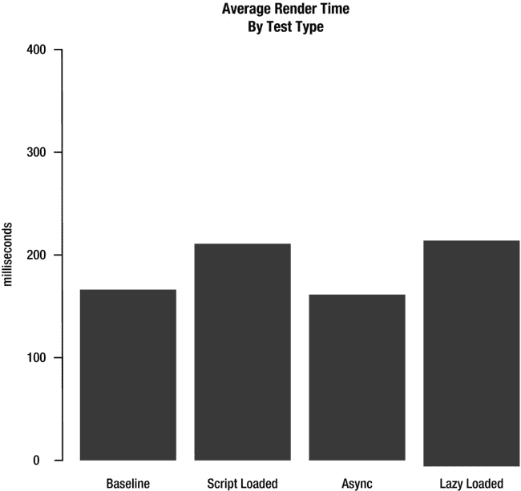

**图 6-14**。使用懒加载示例的平均渲染时间

图 6-14 显示的是平均渲染时间。回顾第 5 章，我们将渲染时间计算为 `Date.now()` 减去 `performance.timing.domLoading`，其中 `domLoading` 是文档开始加载的时间点。这意味着，当我们采用懒加载时，这个指标实际上就失去了意义，因为我们要等到文档加载完成之后才会开始懒加载，所以 `Date.now()` 会延迟到异步加载脚本文件完成时。

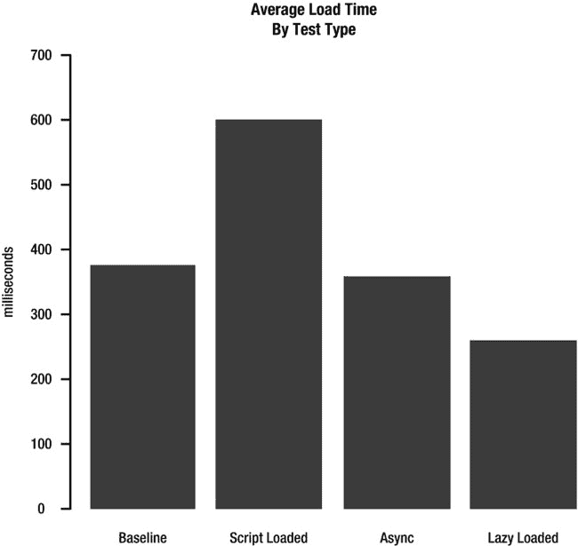

**图 6-15**。使用懒加载示例的平均加载时间

现在，图 6-15 开始揭示真实情况。它描绘了从导航请求开始，到页面加载完成、懒加载脚本加载完毕、以及 `init` 函数被调用所花费的时间。这是完整加载时间的真实体现，从中可以看出，通过懒加载我们获得了显著的性能提升。平均而言，其结果比我们的基准测试和 `async` 测试快 100 毫秒，比脚本加载测试平均快 350 毫秒。

 **注意** 我们并非机械地查看图表就宣布胜者。我们思考了图表所传达信息的上下文；我们考虑了图表中数据的全貌，并理解了它们的含义。

让我们看看这个测试在 WebPagetest 中的表现如何。我们的测试 URL 和测试结果 URL 如下：


在图 6-16 中，将原始数据与我们之前的测试进行比较，我们可以看到好处。我们的重复访问加载时间和重复访问文档完成时间在所有测试中是最快的。但真正的胜利在于重复访问文档完全加载时间，比我们的 `async` 时间快 2 秒，比脚本加载测试快 500 毫秒，比基准测试快 100 毫秒。


**图 6-16**。懒加载测试的 WebPagetest 摘要结果（注意首次访问和重复访问行）

你可以在图 6-17 中看到，就像我们的脚本加载示例一样，我们没有初始连接时间的开销，但我们的懒加载测试的下载时间要小得多，总时间仅为 113 毫秒，而基准测试为 534 毫秒，脚本加载示例为 393 毫秒。

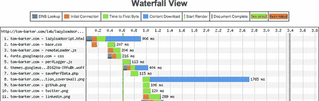

**图 6-17**。懒加载测试的 WebPagetest 瀑布图

很明显，懒加载脚本是实现最佳加载时间的途径；我们只需要确保在回调函数中触发后续使用这些脚本的代码。并且我们需要确保在页面加载之前不需要这些脚本。

#### 懒加载 CSS

我们正势如破竹，在懒加载方面取得了显著成果，所以继续前进吧！让我们在成功实现外部 JavaScript 懒加载的基础上，对 CSS 也进行懒加载。然后我们再来看看结果。

##### 设置 CSS 懒加载

首先，我们将懒加载页面另存为一个新文件，名为 `lazyloadcss.html`。我们将保留 JavaScript 文件的懒加载功能，同时增强该文件以及我们的 `remoteLoader.js` 文件，以处理 CSS 文件的懒加载。

在 `lazyloadcss.html` 中创建一个名为 `fetch()` 的函数。此函数将包含对 `remoteLoader.loadJS` 的调用。同时，为我们将要定义的名为 `loadCSS()` 的函数创建存根调用。你完整的 `fetch` 函数应如下所示：

```
<script>
function fetch(){
     remoteLoader.loadJS("/lab/perfLogger.js", init)
     remoteLoader.loadCSS(["/style/base.css", "http://fonts.googleapis.com/css?family=Metrophobic&amp;v2"])
}
</script>
```

接下来，更新将懒加载功能附加到窗口 `load` 事件的代码。将对 `remoteLoader` 的调用替换为对 `fetch` 函数的调用。我们将使用 `fetch()` 来懒加载所有 JavaScript 和所有 CSS（包括我们的网络字体）。

```
<script>
if (window.attachEvent)
     window.attachEvent('onload', fetch);
else
     window.addEventListener('load', fetch, false);
</script>
```

`lazyloadcss.html` 中更新后的 JavaScript 现在应如下所示：

```
<script>
function init(){
     if(perfLogger){
          perfLogger.showPerformanceMetrics()
     }
}

function fetch(){
     remoteLoader.loadJS("/lab/perfLogger.js", init)
     remoteLoader.loadCSS(["/style/base.css", "http://fonts.googleapis.com/css?family=Metrophobic&amp;v2"])
}

if (window.attachEvent)
     window.attachEvent('onload', fetch);
else
     window.addEventListener('load', fetch, false);
</script>
```

接下来，让我们更新 `remoteLoader` 文件。首先将 `constructScriptTag` 函数重命名为 `constructTag`，以使其更通用，并传入第三个参数来指定你将构建的标签类型：

```
function constructTag(src, func, type){
}
```

在 `constructTag` 内部，你首先要创建一个变量来保存你创建的任何标签，然后根据 `type` 的值进行逻辑分支，该值标识它是用于 JavaScript 还是用于 CSS。在 `if else if` 语句之后，返回 `el`。

# 分析与可视化

太好了！现在我们来看看 WebPagetest 中新的测试页面（参见图 6-18）。我们的网址如下：

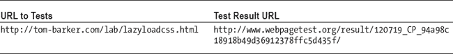

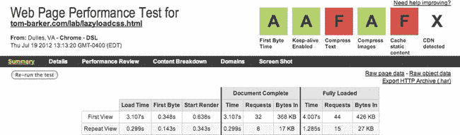

**图 6-18**. 懒加载的 WebPagetest 摘要结果

看看这些结果！首次视图和重复视图的加载时间和开始渲染时间都改善了约 200 毫秒。文档完成时间也有类似提升。图 6-19 中的瀑布图有助于我们了解原因。

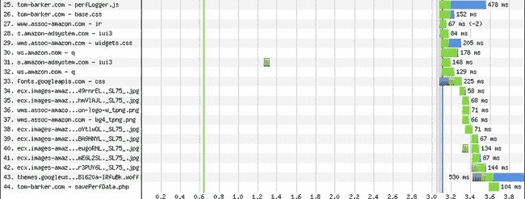

**图 6-19**. 懒加载测试的 WebPagetest 瀑布视图

从瀑布图中我们可以看到，`perfLogger.js`、`base.css` 以及我们的网页字体都被推迟到页面加载之后才下载，分别对应第 25、26、33 和 43 行。

这意味着页面的实际内容首先被加载，页面在加载最重的展示层内容之前就已经可用了，并且能够提供给我们的用户。这无疑是一个胜利。

接下来让我们看看导航性能是否也证实了这一点（参见图 6-20 和 6-21）。

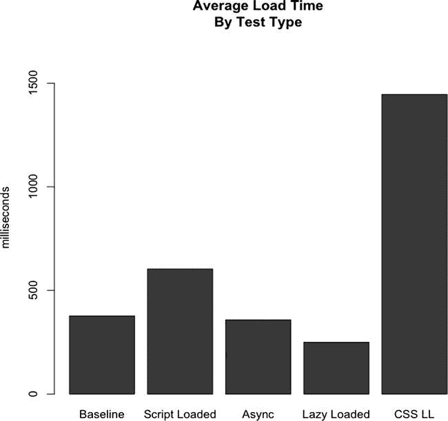

**图 6-20**. 各测试类型的平均加载时间对比

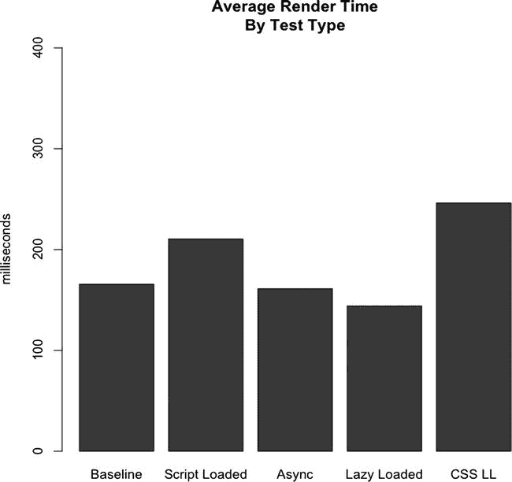

**图 6-21**. 各测试类型的平均页面渲染时间对比

这是怎么回事？显然，懒加载因为改变了事件的执行顺序，从而改变了我们的计时数据。但在这里我们看到，由于懒加载了 CSS 和用于收集指标的 JavaScript，甚至连渲染时间也受到了影响。

我们可以通过不懒加载 `perfLogger.js` 来调整这一点。如果我们将 `perfLogger` 重新内联，则会看到图 6-22 和图 6-23 中的数据：

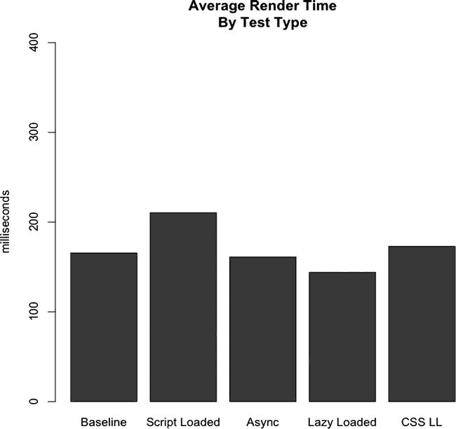

**图 6-22**. 调整后的平均页面渲染时间结果（`perfLogger` 未懒加载）

---

在 JavaScript 分支中，放入从 `constructScripTag` 继承的逻辑，但对其进行改造以使用新的 `el` 变量。记住，这意味着要构建一个 script 标签、设置 `src` 属性并分配回调函数：

```javascript
if(type === "JS"){
     el = window.document.createElement('SCRIPT');
     el.src = src;
     if(func){
          el.onload = func;
     }
}
```

在你的 CSS 分支中，构建一个 link 元素，设置 `type` 属性，设置 `rel`，最后设置 `href` 以指向传入的 CSS 文件：

```javascript
else if(type==="CSS"){
     el = document.createElement('link');
     el.type = 'text/css';
     el.rel = 'stylesheet';
     el.href = src
}
```

现在，你需要将 `loadJS` 中的所有功能提取出来，放到一个名为 `processURLs` 的函数中。传入相同的参数，并添加一个 `type` 参数，该参数将传入 `constructTag`：

```javascript
function processURLs(script_url, f, type){
     if(typeof script_url === "object"){
          if(script_url instanceof Array){
               var frag = document.createDocumentFragment();
               for(var ind = 0; ind < script_url.length; ind++){
                    frag.appendChild(constructTag(script_url[ind]), f, type);
               }
               window.document.getElementsByTagName('HEAD')[0].appendChild(frag.cloneNode(true));
          }
     }else if(typeof script_url === "string"){
          window.document.getElementsByTagName('HEAD')[0].appendChild(constructTag(script_url, f, type))
     }
}
```

最后，你将添加加载语句：

```javascript
loadCSS:function(script_url){
     processURLs(script_url, null, "CSS")
},

loadJS: function(script_url, f){
     processURLs(script_url, f, "JS")
}
```

你更新后的 `remoteLoader` 文件现在应如下所示：

```javascript
var remoteLoader = function remoteLoader(){
     function constructTag(src, func, type){
          var el;
          if(type === "JS"){
               el = window.document.createElement('SCRIPT');
               el.src = src;
               if(func){
                    el.onload = func;
               }
          }else if(type==="CSS"){
               el = document.createElement('link');
               el.type = 'text/css';
               el.rel = 'stylesheet';
               el.href = src
          }
          return el;
     }

     function processURLs(script_url, f, type){
          if(typeof script_url === "object"){
               if(script_url instanceof Array){
                    var frag = document.createDocumentFragment();
                    for(var ind = 0; ind < script_url.length; ind++){
                         frag.appendChild(constructTag(script_url[ind]), f, type);
                    }
                    window.document.getElementsByTagName('HEAD')[0].appendChild(frag.cloneNode(true));
               }
          }else if(typeof script_url === "string"){
               window.document.getElementsByTagName('HEAD')[0].appendChild(constructTag(script_url, f, type))
          }
     }

     return{
          loadCSS:function(script_url){
               processURLs(script_url, null, "CSS")
          },

          loadJS: function(script_url, f){
               processURLs(script_url, f, "JS")
          }
     }
}();
```

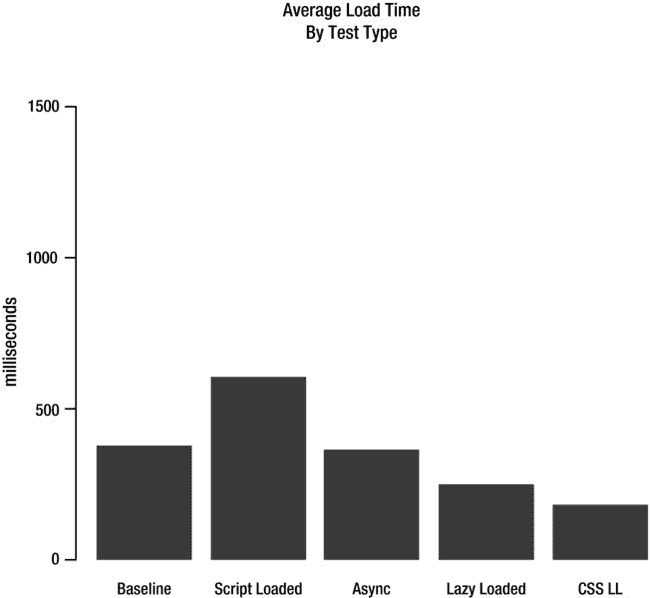

*图 6-23. 调整后的平均页面加载时间结果（`perfLogger` 未懒加载）*

这样好多了。通过内联 `perfLogger`，我们不再阻止其加载和执行，因此我们的方法不会干扰数据的记录。

这是一个宝贵的教训——务必小心，确保你的指标不会因为捕获方式而改变。做到这一点的唯一方法是对数据进行彻底分析；切勿仅凭表面结果就下结论。

### 为何不懒加载图片

经过本章的探索，你可能会倾向于尽可能多地使用懒加载。但懒加载并非万能灵药。你需要确保内容在页面加载时并非必需。同时，你还需了解在禁用 JavaScript 的情况下页面将如何运行。

我们对图片实现懒加载的方式是修改页面的 HTML，移除每个图片的 `src` 属性内容。我们可以将 `src` 属性的内容移到自定义的图片标签属性中，例如 `rel` 属性。这样可以阻止图片被下载：

```html

```

然后，在加载时，我们可以使用 JavaScript 遍历页面上的所有图片标签，并将每个标签的 `src` 属性设置为新属性的内容：

```javascript
<script>
function lazyloadImages(){
     var img = document.getElementsByTagName("img");
     for(var x = 0; x
```

但在很多情况或场景下，这并不是一个好主意，主要原因是某些问题会完全阻止我们的 JavaScript 加载图片。如果用户访问我们网站时禁用了 JavaScript，他们将无法加载任何图片。如果我们在网站上使用第三方广告，第三方 JavaScript 代码可能出现错误，从而阻止我们的所有图片加载。当搜索引擎蜘蛛来索引我们的页面时，它们可能无法看到我们的图片，因此会缓存无图片的页面，并显示无图片的页面预览。然而，最重要的原因是，使用 `rel` 属性来保存图片路径在语义上是不正确的标记用法。

请注意，在 HTML 上下文中，“语义正确”意味着我们在使用标签时保留了标签名称的含义；我们使用 HTML 标签，是因为这些标签所传达的关于其所包含数据的信息，而不是浏览器可能赋予该标签的视觉装饰效果。如果我们有意义地使用标签——例如，使用 `<p>` 标签表示段落，而不是用于视觉间隔——那么访问我们页面的外部应用（如搜索引擎或屏幕阅读器）就应该能够有意义地解析页面中的信息。这还允许我们将内容与表现分离。

### 总结

本章更详细地探讨了如何使用 JavaScript 来提升 Web 性能的各个方面，特别是浏览器如何解析和渲染我们的内容，以及在此过程中的潜在瓶颈。我们研究了防止外部 JavaScript 文件下载阻塞其他内容的方法，包括使用新的 `async` 属性以及通过编程方式创建脚本标签。

我们探索了懒加载设计模式，并在页面上所有其他内容加载完成后，使用该模式来下载外部 JavaScript。我们将这一概念扩展到了懒加载 CSS 文件，并思考了如何懒加载图片，以及我们可能不想这么做的原因。

在每个示例中，我们都使用了我们开发的工具和现有的工具来分析和可视化我们的结果。

第 7 章将探讨如何提升运行时性能。
