# 第 7 章


## 运行时性能

上一章探讨了通过 JavaScript 优化 Web 性能的各种方法。你学到了一些避免外部 JavaScript 阻塞页面其余部分解析的技巧。我们研究了 HTML 5 新增的 `async` 属性，以及使用 JavaScript 动态绘制 `<script>` 标签的方法。

你了解了懒加载模式，并将其应用到了示例中的 `<script>` 标签上，仅在页面加载完成后才将它们添加到页面中。我们将这一思路扩展到了 CSS 上：仅在文档加载完成后才懒加载我们的 CSS 文件。

你针对每种场景都运行了测试；为每次测试捕获了数据，并将结果进行了可视化对比。

在本章中，我们将关注浏览器中的运行时性能优化。我们将研究如何在作用域链中缓存引用，以减少查找时间。你将学习如何使用诸如 JQuery 之类的框架，并比较 JQuery 与纯 JavaScript 中操作的运行时性能。你甚至将尝试量化一个长期存在的观点——使用 `eval()` 会损害性能。最后，本章将探讨如何精简 DOM 交互，并量化嵌套循环的增量成本。

请记住，由于每个浏览器使用不同的 JavaScript 引擎，因此每个浏览器的运行时性能数据可能不同。因此，对于本章中的示例，你将首先使用我们的 `perfLogger` 库编写要测试的代码，然后在单个浏览器中查看 `perfLogger` 的结果，之后（理想情况下）将代码放在一个公共位置，以便可以对其进行众包流量测试，或者通过你自己的浏览器实验室进行测试——即从许多不同的浏览器多次访问该页面。我将在下一章中详细讨论如何在生产环境中实施这些更改。最后，我们按浏览器分组，绘制每个测试的汇总差异图表。

 **注意** 一些测试的结果在亚毫秒级范围内，因此为了获得最佳结果，我们将使用支持高精度时间的浏览器。同时请记住，你的结果可能会因你测试所使用的浏览器或你的客户所使用的浏览器而异。正如你将在本章的测试中看到的，每个浏览器在执行的不同方面都有不同程度的效率。本章的重点是学习如何自行创建测试并分析这些结果，随着浏览器和客户端配置的变化，根据你的最终用户，持续评估你自己的最佳实践。

### 跨作用域缓存变量和属性

首先要考虑的优化是缓存变量和对象属性。

让我们看看这意味着什么。通常，当你引用其他作用域中的变量时——例如全局级别、其他命名空间等——解释器需要遍历栈才能找到该变量。

以 `document.location` 为例。如果你从一个对象内部引用 `document.location`，解释器需要从引用该变量的函数开始，向上跳出命名空间到达全局 `window` 作用域，再向下到达 `document` 作用域，然后获取 `location` 的值。见图 7-1。

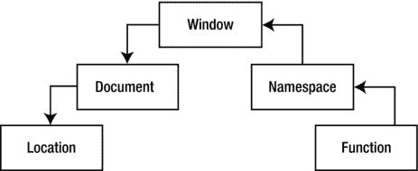

*图 7-1. 通过栈追踪以到达 `document.location`*

这取决于解释器的效率和你创建的继承层级——如果命名空间嵌套了 4、5 甚至 10 层之多，那么到达全局作用域再回到目标变量作用域所需的时间就会相应增加。

为了解决这个问题，你可以创建一个局部作用域变量来保存该值，并改为引用该变量。这允许你为变量引用创建一个快捷方式，并获得运行时性能的提升。见图 7-2。

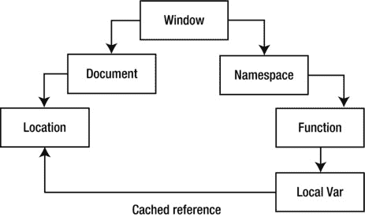

*图 7-2. 创建局部变量以缓存对 `document.location` 的引用*

让我们通过一个实际示例来量化这种性能提升。

#### 创建新文件

首先，创建一个名为 `cache_locationcomparison.html` 的新文件，并创建一个仅包含文档类型声明、`html`、`head`、`title`、字符集和 `body` 标签的 HTML 骨架结构。该结构将作为本章剩余部分每个测试的基础结构。

```html
<!DOCTYPE html>
<html>
<head>
<meta charset="UTF-8" />
<title>缓存位置比较</title>
</head>
<body>
</body>
</html>
```

在 `head` 中，添加我们的 `perfLogger` 和一个你可以调用的函数 `populateArray`，该函数创建并返回一个大小由传入参数指定的数组：

```html
<script src="/lab/perfLogger.js"></script>
<script>
function populateArray(len){
          var retArray = new Array(len)
          for(var i = 0; i < len; i++){
               retArray[i] = i;
          }
          return retArray
}
</script>
```

在 `body` 中，你将创建一个新的 `<script>` 标签，并实例化一个大小为 400 的新数组，你将在接下来的测试中使用它：

```html
<script>
tempArray = populateArray(400);
</script>
```

#### 创建测试

完成设置后，我们来创建第一个测试。在该测试中，你将捕获临时时间数据以引用 `document.location`。首先调用 `perfLogger.startTimeLogging`，传入 ID `"uncached_location"`，并提供测试描述，同时将测试设置为在屏幕上显示并保存到日志文件中。关于 `perfLogger` API，请参阅第 4 章。

# JavaScript 性能测试：缓存与未缓存 `document.location`

## 测试未缓存的 `document.location`

首先，我们捕获引用未缓存 `document.location` 的临时时间数据。

```javascript
// 捕获引用未缓存 document.location 的临时时间数据
perfLogger.startTimeLogging("uncached_location", "Capture ad hoc timing data for referencing document.location", true, true, true)
```

紧接着 `startTimeLogging` 调用之后，你将运行测试代码。创建一个 `for` 循环，利用 `tempArray` 的 `length` 属性遍历该数组，并在每次循环中将一个变量 `loc` 设置为 `document.location`：

```javascript
for(var i = 0; i < tempArray.length; i++){
     var loc = document.location;
}
```

最后，在循环结束后调用 `perfLogger.stopTimeLogging`，传入 `"uncached_location"` ID 以停止测试，将其显示在屏幕上，并记录到服务器：

```javascript
perfLogger.stopTimeLogging("uncached_location");
```

完成的测试应如下所示：

```javascript
// 捕获引用未缓存 document.location 的临时时间数据
perfLogger.startTimeLogging("uncached_location", "Capture ad hoc timing data for referencing document.location", true,true, true)
for(var i = 0; i < tempArray.length; i++){
     var loc = document.location;
}
perfLogger.stopTimeLogging("uncached_location");
```

如果你在浏览器中查看，将看到测试输出：

```
Capture ad hoc timing data for referencing document.location
run time: 0.2339999999749125ms
path: http://tom-barker.com/lab/cache_locationcomparison.html
useragent: Mozilla/5.0 (Macintosh; Intel Mac OS X 10_5_8) AppleWebKit/536.11 (KHTML, like Gecko) Chrome/20.0.1132.47 Safari/536.11
Perceived Time: 40370
Redirect Time: 0
Cache Time: 0
DNS Lookup Time: 0
tcp Connection Time: 0
roundTripTime: 12636
pageRenderTime: 107
```

我们再创建一个测试，这次对刚才展示的 `for` 循环进行基准测试。首先将循环封装到一个名为 `uncachedLoc()` 的函数中：

```javascript
//  未缓存 document.location 的基准测试时间数据
function uncachedLoc(){
     for(var i = 0; i < tempArray.length; i++) {
      var loc = document.location;
     }
}
```

然后调用 `perfLogger.logBenchmark`，传入 ID `"LocationUnCached_benchmark"`，指示其将函数运行 10 次，传入要基准测试的函数，并使其显示在页面和记录到服务器：

```javascript
perfLogger.logBenchmark("LocationUnCached_benchmark", 10, uncachedLoc, true, true);
```

完成的测试应如下所示：

```javascript
//  未缓存 document.location 的基准测试时间数据
function uncachedLoc(){
     for(var i = 0; i < tempArray.length; i++) {
      var loc = document.location;
     }
}
perfLogger.logBenchmark("LocationUnCached_benchmark", 10, uncachedLoc, true, true);
```

## 测试已缓存的 `document.location`

好了。这些测试是你的基线，它们直接引用 `document.location`。现在你要做的是再创建两个测试，优化以缓存对 `document.location` 的引用。

首先创建一个名为 `l` 的变量；它将保存对 `document.location` 的引用：

```javascript
var l = document.location;
```

然后重新创建基线临时测试中的逻辑，但在循环内部不再将 `loc` 设置为 `document.location`，而是将其设置为 `l`。

你完整的测试应如下所示：

```javascript
// 捕获引用已缓存 document.location 的临时时间数据
var l = document.location;
perfLogger.startTimeLogging("cached_location", "Capture ad hoc timing data for referencing document.location", true,true, true)
for(var i = 0; i < tempArray.length; i++){
     var loc = l;
}
perfLogger.stopTimeLogging("cached_location");
```

最后，你将基准测试已缓存的测试。像之前一样，创建一个名为 `cachedLoc` 的函数，在其中创建一个变量 `l` 来引用 `document.location`，并在循环中引用该变量。完成的测试如下所示：

```javascript
//  已缓存 document.location 的基准测试时间数据

function cachedLoc(){
     var l = document.location;
     for(var i = 0; i < tempArray.length; i++){
          var loc = l;
     }
}

perfLogger.logBenchmark("LocationCached_benchmark", 10, cachedLoc, true, true);
```

## 完整页面示例

现在，你完成后的 `cache_locationcomparison.html` 页面应如下所示：

# 缓存位置比较

以下是用于比较缓存与未缓存 `document.location` 性能的 HTML 页面代码。

```html
<!DOCTYPE html>
<html>
<head>
<meta charset="UTF-8" />
<title>缓存位置比较</title>
<script src="/lab/perfLogger.js"></script>
<script>
function populateArray(len){
          var retArray = new Array(len)
          for(var i = 0; i < len; i++){
               retArray[i] = i;
          }
          return retArray
}
</script>
</head>
<body>
<script>
tempArray = populateArray(400);

// 捕获引用未缓存 document.location 的临时时间数据
perfLogger.startTimeLogging("uncached_location", "Capture ad hoc timing data for referencing document.location", true,true, true)
for(var i = 0; i < tempArray.length; i++){
     var loc = document.location;
}
perfLogger.stopTimeLogging("uncached_location");

//  未缓存 document.location 的基准测试时间数据

function uncachedLoc(){
     for(var i = 0; i < tempArray.length; i++) {
      var loc = document.location;
     }
}

perfLogger.logBenchmark("LocationUnCached_benchmark", 10, uncachedLoc, true, true);

// 捕获引用已缓存 document.location 的临时时间数据
var l = document.location;
perfLogger.startTimeLogging("cached_location", "Capture ad hoc timing data for referencing document.location", true,true, true)
for(var i = 0; i < tempArray.length; i++){
     var loc = l;
}
perfLogger.stopTimeLogging("cached_location");

//  已缓存 document.location 的基准测试时间数据

function cachedLoc(){
     var l = document.location;
     for(var i = 0; i < tempArray.length; i++){
          var loc = l;
     }
}

perfLogger.logBenchmark("LocationCached_benchmark", 10, cachedLoc, true, true);

</script>
</body>
</html>
```

当你在浏览器中查看该页面时，应看到以下输出（为清晰起见，已裁剪性能导航数据）：

```
Capture ad hoc timing data for referencing document.location
run time: 0.23800000781193376ms
path: http://localhost:8888/lab/chapter7/cache_locationcomparison.html
useragent: Mozilla/5.0 (Macintosh; Intel Mac OS X 10_5_8) AppleWebKit/536.11 (KHTML, like Gecko) Chrome/20.0.1132.47 Safari/536.11

Benchmarking function uncachedLoc(){ for(var i = 0; i < tempArray.length; i++) { var loc = document.location; }  }
average run time: 0.08210000523831695ms
path: http://localhost:8888/lab/chapter7/cache_locationcomparison.html
useragent: Mozilla/5.0 (Macintosh; Intel Mac OS X 10_5_8) AppleWebKit/536.11 (KHTML, like Gecko) Chrome/20.0.1132.47 Safari/536.11

Capture ad hoc timing data for referencing document.location
run time: 0.027000001864507794ms
path: http://localhost:8888/lab/chapter7/cache_locationcomparison.html
useragent: Mozilla/5.0 (Macintosh; Intel Mac OS X 10_5_8) AppleWebKit/536.11 (KHTML, like Gecko) Chrome/20.0.1132.47 Safari/536.11

Benchmarking function cachedLoc(){      var l = document.location; for(var i = 0; i < tempArray.length; i++){ var loc = l; }  }
average run time: 0.012399995466694236ms
path: http://localhost:8888/lab/chapter7/cache_locationcomparison.html
useragent: Mozilla/5.0 (Macintosh; Intel Mac OS X 10_5_8) AppleWebKit/536.11 (KHTML, like Gecko) Chrome/20.0.1132.47 Safari/536.11
```

太棒了！从临时测试和基准测试中都可以看出，通过缓存作用域链引用，我们获得了显著的性能提升。

## 可视化我们的结果

现在让我们用 R 来绘制结果图表。打开 `perfLogger` 项目中的 `runtimePerformance.R` 文件。请记住，在这个文件中，你已经将 `runtimeperf_results` 平面文件读取到了一个名为 `perflogs` 的变量中。

首先，创建一个函数，该函数接受一个测试的 ID，并返回 `perflogs` 中 `TestID` 与传入值匹配的子集。将此函数命名为 `ParseResultsbyTestID()`。稍后你将使用它来创建变量，这些变量将保存你运行的每个测试的数据框：

```r
ParseResultsbyTestID <- function(testname){
     return(perflogs[perflogs$TestID == testname,])
}
```

`runtimePerformance.R` 文件中已经有一个 `getDFByBrowser()` 函数；你将同样使用它。记住，这个函数会返回传入的数据框中 `UserAgent` 列包含浏览器名称（该名称也作为参数传入）的子集。

```r
getDFByBrowser<-function(data, browsername){
     return(data[grep(browsername, data$UserAgent),])
}
```

接下来，创建一个你将命名为 `avg_loc_uncache_chrome` 的变量，它将保存 Chrome 浏览器中未缓存位置测试的平均运行时间。要获取这个值，你需要调用 `ParseResultsbyTestID` 并传入测试 ID `"LocationUnCached_benchmark"`。然后将该函数调用的结果和字符串 `"Chrome"` 一起传入 `getDFByBrowser`：

```r
avg_loc_uncache_chrome <- mean(getDFByBrowser(ParseResultsbyTestID("LocationUnCached_benchmark"), "Chrome")$RunTime)
```

如果你在控制台打印这个值，会看到类似下面的结果。

```
> avg_loc_unucache_chrome
[1] 1.75
```

太好了！接下来，对 Firefox 浏览器做同样的操作，然后对 Chrome 和 Firefox 浏览器（以及你想跟踪的任何其他浏览器）的 `"LocationCached_benchmark"` 测试重复相同的操作。

```r
avg_loc_cache_chrome <- mean(getDFByBrowser(ParseResultsbyTestID("LocationCached_benchmark"), "Chrome")$RunTime)

avg_loc_uncache_firefox <- mean(getDFByBrowser(ParseResultsbyTestID("LocationUnCached_benchmark"), "Firefox")$RunTime)

avg_loc_cache_firefox <- mean(getDFByBrowser(ParseResultsbyTestID("LocationCached_benchmark"), "Firefox")$RunTime)
```

太棒了。你现在已经得到了每个浏览器中每个测试的算术平均值。现在创建一个数据框来保存所有这些值，并为数据框的列赋予有意义的名称：

```r
location_comparison <- data.frame(avg_loc_uncache_chrome, avg_loc_cache_chrome, avg_loc_uncache_firefox, avg_loc_cache_firefox)

colnames(location_comparison) <- c("Chrome\nUncached", "Chrome\nCached", "Firefox\nUncached", "Firefox\nCached")
```

最后，根据这个数据框创建一个条形图：

```r
barplot(as.matrix(location_comparison), main="Comparison of average benchmark time in milliseconds")
```

此示例所需的完整 R 代码如下所示：

```r
ParseResultsbyTestID <- function(testname){
     return(perflogs[perflogs$TestID == testname,])
}

getDFByBrowser<-function(data, browsername){
     return(data[grep(browsername, data$UserAgent),])
}

avg_loc_uncache_chrome <- mean(getDFByBrowser(ParseResultsbyTestID("LocationUnCached_benchmark"), "Chrome")$RunTime)

avg_loc_cache_chrome <- mean(getDFByBrowser(ParseResultsbyTestID("LocationCached_benchmark"), "Chrome")$RunTime)

avg_loc_uncache_firefox <- mean(getDFByBrowser(ParseResultsbyTestID("LocationUnCached_benchmark"), "Firefox")$RunTime)

avg_loc_cache_firefox <- mean(getDFByBrowser(ParseResultsbyTestID("LocationCached_benchmark"), "Firefox")$RunTime)

location_comparison <- data.frame(avg_loc_uncache_chrome, avg_loc_cache_chrome, avg_loc_uncache_firefox, avg_loc_cache_firefox)
colnames(location_comparison) <- c("Chrome\nUncached", "Chrome\nCached", "Firefox\nUncached", "Firefox\nCached")

barplot(as.matrix(location_comparison), main="Comparison of average benchmark time in milliseconds")
```

根据这段 R 代码，你可以生成了图 7-3 中所示的条形图。

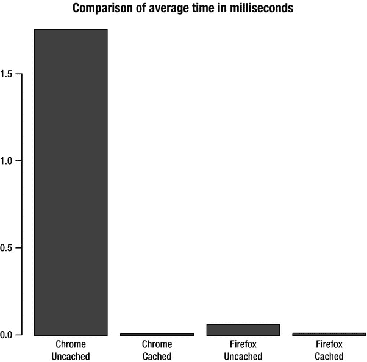

**图 7-3**. 按浏览器分组的已缓存和未缓存作用域链引用的基准测试结果对比

因此，通过这个示例和我们自己的样本数据可以看出，对于所使用的客户端浏览器，Chrome 和 Firefox 的性能都有所提升。Chrome 的提升最为显著，平均提高了近 2 毫秒。这本身并不显著，但在更大规模的数据中，我们就可以开始看到其价值了。

## 属性引用示例

前面你已经了解了在不同栈中缓存变量的方法，现在来看看如何缓存属性引用。测试这种技巧的方法是：遍历一个数组，将数组的长度作为循环终止条件——这将作为你的基准测试。然后遍历另一个数组，将数组长度存储在一个局部变量中，并使用这个局部变量作为循环终止条件。如果比较这两种技巧的结果，你应该能够量化缓存属性引用带来的性能提升。

```html
<!DOCTYPE html>
<html>
<head>
<meta charset="UTF-8" />
<title>循环比较</title>
<script src="/lab/perfLogger.js"></script>
<script>
function populateArray(len){
          var retArray = new Array(len)
          for(var i = 0; i < len; i++){
               retArray[i] = i;
          }
          return retArray
}
</script>
</head>
<body>
<script>
tempArray = populateArray(400);

// 为未缓存长度变量的 JavaScript for 循环捕获即时计时数据

perfLogger.startTimeLogging("js_forloop_uncached", "为未缓存长度变量的 JavaScript for 循环捕获即时计时数据", true,true, true)
for(var i = 0; i < tempArray.length; i++) {

}
perfLogger.stopTimeLogging("js_forloop_uncached");

// 为已缓存长度变量的 JavaScript for 循环捕获即时计时数据

perfLogger.startTimeLogging("js_forloop_cached", "为已缓存长度变量的 JavaScript for 循环捕获即时计时数据", true,true, true)
var l = tempArray.length
for(var i = 0; i < l; i++) {

}
perfLogger.stopTimeLogging("js_forloop_cached");

// 未缓存长度变量的基准计时数据

function uncachedLen(){
     for(var i = 0; i < tempArray.length; i++) {

     }
}
perfLogger.logBenchmark("JSForLoopUnCached_benchmark", 10, uncachedLen, true, true);

// 已缓存长度变量的基准计时数据

function cachedLen(){
     for(var i = 0; i < l; i++) {

     }
}

perfLogger.logBenchmark("JSForLoopCached_benchmark", 10, cachedLen, true, true);

</script>
</body>
</html>
```

上述代码产生以下结果：

# JavaScript for 循环性能测试

## 测试结果

为未缓存长度变量的 JavaScript for 循环捕获即时计时数据
运行时间: 41.936000023270026ms
路径: `http://localhost:8888/lab/chapter7/loopcomparison.html`
用户代理: Mozilla/5.0 (Macintosh; Intel Mac OS X 10_5_8) AppleWebKit/536.11 (KHTML, like Gecko) Chrome/20.0.1132.47 Safari/536.11

为已缓存长度变量的 JavaScript for 循环捕获即时计时数据
运行时间: 14.304999989690259ms
路径: `http://localhost:8888/lab/chapter7/loopcomparison.html`
用户代理: Mozilla/5.0 (Macintosh; Intel Mac OS X 10_5_8) AppleWebKit/536.11 (KHTML, like Gecko) Chrome/20.0.1132.47 Safari/536.11

基准测试函数 `uncachedLen(){ for(var i = 0; i < tempArray.length; i++) {  }      }`
平均运行时间: 29.685899993637577ms
路径: `http://localhost:8888/lab/chapter7/loopcomparison.html`
用户代理: Mozilla/5.0 (Macintosh; Intel Mac OS X 10_5_8) AppleWebKit/536.11 (KHTML, like Gecko) Chrome/20.0.1132.47 Safari/536.11

基准测试函数 `cachedLen(){      for(var i = 0; i < l; i++) { }      }`
平均运行时间: 19.58730000187643ms
路径: `http://localhost:8888/lab/chapter7/loopcomparison.html`
用户代理: Mozilla/5.0 (Macintosh; Intel Mac OS X 10_5_8) AppleWebKit/536.11 (KHTML, like Gecko) Chrome/20.0.1132.47 Safari/536.11

这个单独测试再次显示，缓存属性引用带来了显著的性能提升。现在尝试在多种浏览器中运行，并在 R 语言中将结果绘制成图表。

为每个测试/浏览器的组合创建一个变量。在每个变量中，存储调用你的函数 `getDFByBrowser` 后的平均结果：

```r
avg_loop_uncache_chrome <- mean(getDFByBrowser(ParseResultsbyTestID("JSForLoopUnCached_benchmark"), "Chrome")$RunTime)

avg_loop_uncache_firefox <- mean(getDFByBrowser(ParseResultsbyTestID("JSForLoopUnCached_benchmark"), "Firefox")$RunTime)

avg_loop_cache_chrome <- mean(getDFByBrowser(ParseResultsbyTestID("JSForLoopCached_benchmark"), "Chrome")$RunTime)

avg_loop_cache_firefox <- mean(getDFByBrowser(ParseResultsbyTestID("JSForLoopCached_benchmark"), "Firefox")$RunTime)
```

接下来创建一个数据框来汇总你刚刚创建的变量，并根据这个数据框生成一个条形图：

```r
loop_comparison <- data.frame(avg_loop_uncache_chrome, avg_loop_cache_chrome, avg_loop_uncache_firefox, avg_loop_cache_firefox)

colnames(loop_comparison) <- c("Chrome\n 未缓存", "Chrome\n 已缓存", "Firefox\n 未缓存", "Firefox\n 已缓存")

barplot(as.matrix(loop_comparison), main="缓存与未缓存属性的平均基准时间比较（毫秒）")
```

上述代码生成如图 7-4 所示的图表。

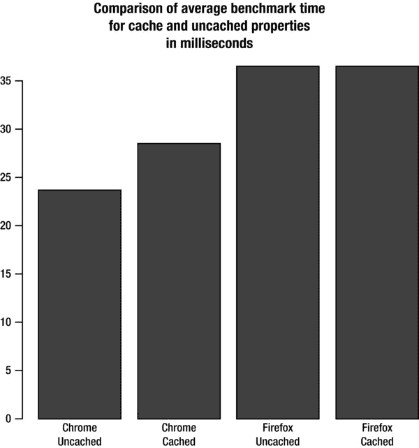

**图 7-4**。各浏览器下缓存与未缓存属性引用的基准测试结果对比

这很有意思——虽然在 Firefox 的单个测试层面你可能看到了性能提升，但当将基准测试扩展到多次测试时，你会发现 Firefox 中的提升被平均化了，而在这个测试中，Chrome 的提升超过了五毫秒。我们可以将其归纳为在 Chrome 中观察到了 16.6% 的性能提升：

```r
> (1 - (avg_loop_uncache_chrome / avg_loop_cache_chrome)) * 100
[1] 16.6
```

## 核心 JavaScript 与框架的对比

多年来，无论是在课堂上接触的新学员，还是来应聘空缺职位的面试者，我注意到这两类人群都倾向于知道如何使用框架（通常是 jQuery），而不了解核心 JavaScript。

这存在问题，因为并非所有任务都应该使用框架来完成。框架提供的是“编写时效率”，意味着它们通过抽象化完成任务所需的实际工作，使编码任务变得简单得多。这样做的好处是，除了将大量功能封装在少量 API 中外，它们通常还封装了大量的错误检查和跨浏览器支持。但所有这些封装的功能在核心语言中同样可用，而且有时在核心语言中运行得更快，因为我们只需完成我们需要的操作，而无需支持框架的每一位用户。如果我们只了解框架，就会丧失自行编写功能、复刻现有项目并根据自身需求进行更新以及创造新东西的能力。简而言之，我们变成了功能的消费者和聚合者，而非创造者。

这就引出一个问题：在运行时的性能方面，核心 JavaScript 是否比使用框架更高效？逻辑上看似乎如此，但让我们通过一些示例来对框架最常见的用途进行基准测试，并以 jQuery 作为对比点。

 **注意** jQuery 是一个 JavaScript 框架，由约翰·雷西格于 2006 年创建。jQuery 的维护工作自 2009 年起由 jQuery 项目接手。截至本书写作时，jQuery 是使用最广泛的 JavaScript 框架。

### jQuery 与 JavaScript：循环对比

首先，我们来比较一下不同循环方式的耗时：JavaScript 的 `for` 循环与 jQuery 的 `.each` 方法。创建一个名为 `jquerycomparison.html` 的新页面。在 `jquerycomparison.html` 中，你需要从一个空的 HTML 骨架文档开始，并引入 `jQuery` 和 `perfLogger`。同时，还要包含我们的 `populateArray` 函数：

```html
<!DOCTYPE html>
<html>
<head>
<meta charset="UTF-8" />
<title>框架对比</title>
<script src="jquery.js"></script>
<script src="/lab/perfLogger.js"></script>
<script>
function populateArray(len){
          var retArray = new Array(len)
          for(var i = 0; i < len; i++){
               retArray[i] = i;
          }
          return retArray
}
</script>
</head>
<body>
</body>
</html>
```

接下来，创建一个名为 `JQueryEach` 的函数，它使用 `jQuery.each` 来遍历 `tempArray`。然后，将该函数传递给 `perfLogger.logBenchmark` 进行基准测试。

```javascript
function JQueryEach(){
     jQuery.each(tempArray, function(i, val) {
     });
}
perfLogger.logBenchmark("JQueryEach_benchmark", 10, JQueryEach, true, true);
```

最后，创建一个名为 `JSForLoop` 的函数，它利用之前优化的方法（缓存迭代的 `length` 属性）来执行 `for` 循环，并将该函数传递给 `perfLogger.logBenchmark`：

```markdown
现在，你的完整页面应该如下所示：

```html
<!DOCTYPE html>
<html>
<head>
<meta charset="UTF-8" />
<title>框架对比</title>
<script src="jquery.js"></script>
<script src="/lab/perfLogger.js"></script>
<script>
function populateArray(len){
          var retArray = new Array(len)
          for(var i = 0; i < len; i++){
               retArray[i] = i;
          }
          return retArray
}
</script>
</head>
<body>
<script>
tempArray = populateArray(400);

// JQuery .each 循环的基准测试耗时数据
function JQueryEach(){
     jQuery.each(tempArray, function(i, val) {
     });
}
perfLogger.logBenchmark("JQueryEach_benchmark", 10, JQueryEach, true, true);

// JS for 循环的基准测试耗时数据

function JSForLoop(){
     var l = tempArray.length
     for(var i = 0; i < l; i++) {
     }
}
perfLogger.logBenchmark("JSForLoop_benchmark", 10, JSForLoop, true, true);

</script>

</body>
</html>
```

当你在浏览器中查看该测试页面时，应该会看到类似如下的输出：

```
benchmarking function JQueryEach(){ jQuery.each(tempArray, function(i, val) { });      }
average run time: 0.10279999987687916ms
path: http://tom-barker.com/lab/jquerycomparison.html
useragent: Mozilla/5.0 (Macintosh; Intel Mac OS X 10_5_8) AppleWebKit/536.11 (KHTML, like Gecko)
Chrome/20.0.1132.47 Safari/536.11
benchmarking function JSForLoop(){ var l = tempArray.length for(var i = 0; i < l; i++) { } }
average run time: 0.0035999983083456755ms
path: http://tom-barker.com/lab/jquerycomparison.html
useragent: Mozilla/5.0 (Macintosh; Intel Mac OS X 10_5_8) AppleWebKit/536.11 (KHTML, like Gecko)
Chrome/20.0.1132.47 Safari/536.11
```

哇！性能差距达到了几个数量级。让我们用 R 语言将这些数据绘制成图表。

与之前的测试一样，创建变量来存储每个浏览器中各测试的平均值：

```r
avg_jquery_loop_chrome <- mean(getDFByBrowser(ParseResultsbyTestID("JQueryEach_benchmark"),
"Chrome")$RunTime)

avg_for_loop_chrome <- mean(getDFByBrowser(ParseResultsbyTestID("JSForLoop_benchmark"),
"Chrome")$RunTime)

avg_jquery_loop_firefox <- mean(getDFByBrowser(ParseResultsbyTestID("JQueryEach_benchmark"),
"Firefox")$RunTime)

avg_for_loop_firefox <- mean(getDFByBrowser(ParseResultsbyTestID("JSForLoop_benchmark"),
"Firefox")$RunTime)
```

再次创建一个数据框来存储这些平均值，并为数据框分配列名。

```r
jquery_comparison <- data.frame(avg_jquery_loop_chrome, avg_for_loop_chrome, avg_jquery_loop_firefox, avg_for_loop_firefox)

colnames(jquery_comparison) <- c("Chrome\nJQuery", "Chrome\nJavascript", "Firefox\nJQuery", "Firefox\nJavaScript")
```

最后，将数据框绘制成图表：

```r
barplot(as.matrix(jquery_comparison), main="Comparison of average benchmark time \nfor looping in JQuery vs core JavaScript \nin milliseconds")
```

完整的 R 代码应如下所示：

```r
avg_jquery_loop_chrome <- mean(getDFByBrowser(ParseResultsbyTestID("JQueryEach_benchmark"), "Chrome")$RunTime)

avg_for_loop_chrome <- mean(getDFByBrowser(ParseResultsbyTestID("JSForLoop_benchmark"), "Chrome")$RunTime)

avg_jquery_loop_firefox <- mean(getDFByBrowser(ParseResultsbyTestID("JQueryEach_benchmark"), "Firefox")$RunTime)

avg_for_loop_firefox <- mean(getDFByBrowser(ParseResultsbyTestID("JSForLoop_benchmark"), "Firefox")$RunTime)

jquery_comparison <- data.frame(avg_jquery_loop_chrome, avg_for_loop_chrome, avg_jquery_loop_firefox, avg_for_loop_firefox)

colnames(jquery_comparison) <- c("Chrome\nJQuery", "Chrome\nJavascript", "Firefox\nJQuery", "Firefox\nJavaScript")

barplot(as.matrix(jquery_comparison), main="Comparison of average benchmark time \nfor looping in JQuery vs core JavaScript \nin milliseconds")
```

这便生成了我们在图 7-5 中看到的图表。

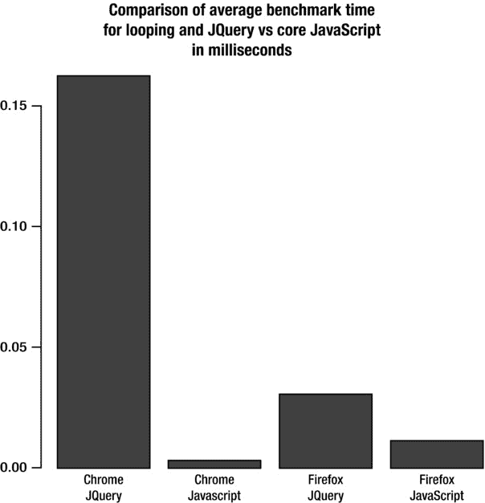

**图 7-5**。 按浏览器划分的 JQuery 循环与核心 JavaScript 循环基准测试结果对比

Firefox 的性能提升了 63.4%：

```r
> (1 - (avg_for_loop_firefox / avg_jquery_loop_firefox)) * 100
[1] 63.4
```

而 Chrome 的性能提升了 98.2%：

```r
> (1 - (avg_for_loop_chrome / avg_jquery_loop_chrome)) * 100
[1] 98.2
```

##### 遵循 DRY 原则
```

我们暂且岔开话题。不知道你作何感想，但我是厌倦了一再编写几乎相同、仅微调获取和绘制基准测试结果的 R 代码。在软件工程中，有一个概念称为 DRY 原则：不要重复自己（Don't Repeat Yourself）。这是一个基本的、固有的概念：任何需要做多次的事情，我们都应该实现自动化。这个概念由安迪·亨特和戴夫·托马斯在《程序员修炼之道》（Addison-Wesley 1999 年出版）中提出并推广。

因此，让我们遵循 DRY 原则，将这段为了适应每次测试而反复编写和修改的 R 代码自动化。

创建一个名为 `PlotResultsofTestsByBrowser` 的函数，并传入三个值：`testList`（测试名称向量）、`browserList`（浏览器名称向量）以及 `descr`（作为图表标题的字符串）：

```r
PlotResultsofTestsByBrowser <- function(testList, browserList, descr){

}
```

在该函数内部，声明一个空的数据框（用于存储平均值）和一个空的列表（用于构建数据框的列名）：

```r
df <- data.frame()

colnameList <- c()
```

接下来，函数遍历 `browserList` 中的每个浏览器名称，并在该循环内遍历 `testList` 中的每个测试名称。在内层循环中，代码为当前所处的特定测试/浏览器组合构建列名，并将该值推入 `colnameList` 中。为确保测试名称适合图表，将名称截断为仅保留十个字符。

调用 `ParseResultsbyTestID` 并传入当前测试名称；然后将该值连同当前浏览器名称一起传给 `getDFByBrowser`，获取返回值的平均值并存储在一个名为 `tmp` 的临时变量中。最后将 `tmp` 添加到数据框 `df` 中：

```r
for(browser in browserList){
    for(test in testList){
        colnameList <- c(colnameList, paste(browser, "\n", substr(test, 1,10)))
        tmp <- mean(getDFByBrowser(ParseResultsbyTestID(test), browser)$RunTime)
        df <- rbind(df , tmp)
    }
}
```

此功能将遍历每种测试和浏览器的组合，直到构建出一个类似如下的数据框：

```
> df
  X0.0050476189047619
1             0.00505
2             0.02979
3             0.00125
4             0.00716
```

非常好，这正是我们想要的。接下来，只需对数据框进行转置：

```r
df <- t(df)
```

转置数据会将其侧向放置，结果如下所示：

```
> df
                         1      2       3       4
X0.0050476189047619 0.00505 0.0298 0.00125 0.00716
```

然后只需将数据框的列名设置为你一直在构建的列名列表，并创建图表：

```r
colnames(df) <- colnameList
barplot(as.matrix(df), main=descr)
```

完成后的函数如下所示。从现在开始，你将使用它来生成图表以展示测试结果。

```r
PlotResultsofTestsByBrowser <- function(testList, browserList, descr){
    df <- data.frame()
    colnameList <- c()
    for(browser in browserList){
        for(test in testList){
            colnameList <- c(colnameList, paste(browser, "\n", test))
            tmp <- mean(getDFByBrowser(ParseResultsbyTestID(test), browser)$RunTime)
            df <- rbind(df , tmp)
        }
    }
    df <- t(df)
    colnames(df) <- colnameList
    barplot(as.matrix(df), main=descr)
}
```

## JQuery vs JavaScript：DOM 访问

接下来，我们比较使用 jQuery 和纯 JavaScript 进行 DOM 交互的成本。你将创建一个测试，比较使用 jQuery 和 JavaScript 遍历数组并将数组中的值写入页面上的 `div` 所需的时间。

首先，创建页面的骨架结构，在 `head` 中包含 jQuery、`perfLogger` 和我们的 `populateArray` 函数：

```html
<!DOCTYPE html>
<html>
<head>
<meta charset="UTF-8" />
<title>Framework Comparison</title>
<script src="jquery.js"></script>
<script src="/lab/perfLogger.js"></script>
<script>
function populateArray(len){
          var retArray = new Array(len)
          for(var i = 0; i < len; i++){
               retArray[i] = i;
          }
          return retArray
}
</script>
</head>
<body>
</body>
</html>
```

接下来，在页面中包含两个 `div`：一个具有 `id` 为 `DOMtest`，用于 JavaScript 测试写入；另一个具有 `id` 为 `JQueryDomtest`，用于 jQuery 测试写入。

```html
<div id="DOMtest"><p>Dom Test</p></div>
<div id="JQueryDomtest"><p>JQuery Dom Test</p></div>
```

然后添加一个 `script` 标签，在其中创建一个大小为 400 的 `tempArray`。同时添加一个名为 `JQueryDOM` 的函数，该函数将遍历数组并将索引号追加到 `JQueryDomtest` 的 `div` 中。最后，使用 `perfLogger.logBenchmark` 对该函数进行基准测试。

```html
<script>
tempArray = populateArray(400);

function JQueryDOM(){
     var l = tempArray.length
     for(var i = 0; i < l; i++) {
          $("#JQueryDomtest").append(i);
     }
}
perfLogger.logBenchmark("JQueryDOM_benchmark", 10, JQueryDOM, true, true);
```

接下来创建一个名为 `JSDOM` 的函数，该函数遍历 `tempArray`，使用 `document.getElementById` 访问 `div`，并使用 `innerHTML` 将内容追加到 `div`。最后，使用 `perfLogger.logBenchmark` 对该函数进行基准测试：

```javascript
function JSDOM(){
     var l = tempArray.length
     for(var i = 0; i < l; i++) {
          document.getElementById("DOMtest").innerHTML += i;
     }
}
perfLogger.logBenchmark("JSDOM_benchmark", 10, JSDOM, true, true);

</script>
```

完整的页面如下所示：

# jQuery 与 JavaScript DOM 交互性能对比

在浏览器中查看时，你会看到以下内容：

```
benchmarking function JQueryDOM(){ var l = tempArray.length for(var i = 0; i < l; i++) {
$("#JQueryDomtest").append(i); } }
average run time: 0.4493000014917925ms
path: http://tom-barker.com/lab/jquery_dom_compare.html
useragent: Mozilla/5.0 (Macintosh; Intel Mac OS X 10_5_8) AppleWebKit/536.11 (KHTML, like Gecko)
Chrome/20.0.1132.47 Safari/536.11

benchmarking function JSDOM(){ var l = tempArray.length for(var i = 0; i < l; i++) { document.
getElementById("DOMtest").innerHTML += i; } }
average run time: 0.19499999471008778ms
path: http://tom-barker.com/lab/jquery_dom_compare.html
useragent: Mozilla/5.0 (Macintosh; Intel Mac OS X 10_5_8) AppleWebKit/536.11 (KHTML, like Gecko)
Chrome/20.0.1132.47 Safari/536.11
```

请注意，与所有测试结果一样，你的具体结果可能会因使用的浏览器和系统而异。

## 在 R 中绘制图表

让我们在 R 中绘制图表。使用我们的新函数，只需一行代码即可完成，方法是传入我们想要测试的名称列表：`JQueryDOM_benchmark` 和 `JSDOM_benchmark`。

```r
PlotResultsofTestsByBrowser(c("JQueryDOM_benchmark", "JSDOM_benchmark"), c("Chrome","Firefox"),
"Comparison of average benchmark time \nfor using JQuery to access the DOM versus pure
JavaScript \nin milliseconds")
```

这将创建如图 7-6 所示的条形图。

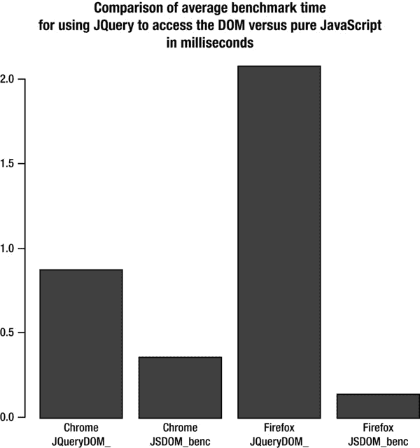

*图 7-6. 按浏览器划分的 jQuery 与 JavaScript DOM 交互基准测试结果对比*

仅通过使用核心 JavaScript 而非 jQuery，Chrome 的性能提升了 60%，Firefox 的性能提升了 93%。

## `eval` 的真实代价

如果你不熟悉 `eval`，它是一个 JavaScript 原生函数，接受一个字符串并将其作为 JavaScript 代码执行。它本质上会启动解释器，允许传入的字符串在调用时被解析和执行。

我们听过 `eval` 是邪恶的，应该不惜一切代价避免使用^(1)。理由是其具有潜在危险性，因为它本质上是在向解释器直接注入代码，并且由于需要访问解释器，会导致性能下降。多年来，避免使用 `eval` 已经成为一种良好的编程实践。即使是在那些曾经被接受且普遍使用的场景中，比如将 JSON 反序列化，现在我们也有了不使用 `eval` 的标准解决方案。

我认为，*有时*代码注入是一种完全合理的解决方案，其历史可追溯到在 C 代码中内联汇编语言以提高性能和实现底层控制。浏览器中拥有一个允许我们在客户端执行临时代码的控制台，也削弱了反对 `eval` 的这一论点。

但让我们亲自量化一下这个长期信条对性能的影响。我们来运行一个测试，比较将包含函数的字符串传递给 `eval` 与直接调用函数的运行时性能。

与之前的测试一样，从带有 `perfLogger` 的基本 HTML 骨架结构开始：

```html
<!DOCTYPE html>
<html>
<head>
<meta charset="UTF-8" />
<title>缓存位置比较</title>
<script src="/lab/perfLogger.js"></script>
</head>
<body>
</body>
</html>
```

接下来在 `<body>` 中创建一个 `<script>` 标签和一个名为 `getAvg` 的函数。`getAvg` 函数从 0 迭代到 200，累加每个连续的数字，然后计算平均值。

```javascript
<script>
function getAvg(){
     var avg = 0;
     for(var x = 0; x < 200; x++){
          avg += x;
     }
     return(avg/200);
}
```

创建两个函数：一个会将 `getAvg` 函数转换为字符串并传递给 `eval`，将返回值存储在一个变量中；另一个则直接调用 `getAvg` 函数并存储结果：

```javascript
function evalAverage(){
     var average = eval(getAvg.toString());
}

function invokeAverage(){
     var average = getAvg()
}
```

最后对每个测试调用 `perfLogger.logBenchmark`，让每个测试运行 1000 次：

```javascript
perfLogger.logBenchmark("EvalTime", 1000, evalAverage, true, true);

perfLogger.logBenchmark("InvokeTime", 1000, invokeAverage, true, true);
```

完整的页面如下：

```html
<!DOCTYPE html>
<html>
<head>
<meta charset="UTF-8" />
<title>Framework Comparison</title>
<script src="jquery.js"></script>
<script src="/lab/perfLogger.js"></script>
<script>
function populateArray(len){
          var retArray = new Array(len)
          for(var i = 0; i < len; i++){
               retArray[i] = i;
          }
          return retArray
}
</script>
</head>
<body>
<div id="DOMtest"><p>Dom Test</p></div>
<div id="JQueryDomtest"><p>JQuery Dom Test</p></div>
<script>
tempArray = populateArray(400);

//benchmark timing data for JQuery DOM access

function JQueryDOM(){
     var l = tempArray.length
     for(var i = 0; i < l; i++) {
          $("#JQueryDomtest").append(i);
     }
}
perfLogger.logBenchmark("JQueryDOM_benchmark", 10, JQueryDOM, true, true);

//benchmark timing data for JS DOM access

function JSDOM(){
     var l = tempArray.length
     for(var i = 0; i < l; i++) {
          document.getElementById("DOMtest").innerHTML += i;
     }
}
perfLogger.logBenchmark("JSDOM_benchmark", 10, JSDOM, true, true);

</script>
</body>
</html>
```

^(1) [`http://blogs.msdn.com/b/ericlippert/archive/2003/11/01/53329.aspx`](http://blogs.msdn.com/b/ericlippert/archive/2003/11/01/53329.aspx)

# 缓存位置比较

```html
<!DOCTYPE html>
<html>
<head>
<meta charset="UTF-8" />
<title>缓存位置比较</title>
<script src="/lab/perfLogger.js"></script>
</head>
<body>
<script>
function getAvg(){
     var avg = 0;
     for(var x = 0; x < 200; x++){
          avg += x;
     }
     return(avg/200);
}

function evalAverage(){
     var average = eval(getAvg.toString());
}

function invokeAverage(){
     var average = getAvg()
}

perfLogger.logBenchmark("EvalTime", 1000, evalAverage, true, true);

perfLogger.logBenchmark("InvokeTime", 1000, invokeAverage, true, true);
</script>
</body>
</html>
```

在浏览器中你会看到以下结果：

```
benchmarking function evalAverage(){ var average = eval(getAvg.toString()); }
average run time: 0.03299599998717895ms
path: http://tom-barker.com/lab/eval_comparison.html
useragent: Mozilla/5.0 (Macintosh; Intel Mac OS X 10_5_8) AppleWebKit/536.11 (KHTML, like Gecko)
Chrome/20.0.1132.47 Safari/536.11

benchmarking function invokeAverage(){ var average = getAvg() }
average run time: 0.004606999973475467ms
path: http://tom-barker.com/lab/eval_comparison.html
useragent: Mozilla/5.0 (Macintosh; Intel Mac OS X 10_5_8) AppleWebKit/536.11 (KHTML, like Gecko)
Chrome/20.0.1132.47 Safari/536.11
```

很好！让我们将一些用户引导到该页面，或通过测试实验室运行它，并在 R 中将数据绘制成图表（参见图 7-7）：

```r
PlotResultsofTestsByBrowser(c("EvalTime", "InvokeTime"), c("Chrome","Firefox"), "比较使用 Eval 与函数调用\n 的平均基准时间（毫秒）")
```

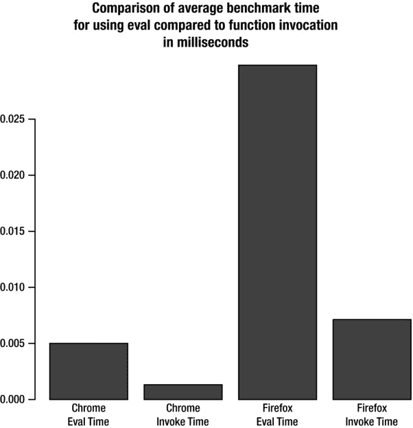

**图 7.7**. 各浏览器使用 `eval` 与直接函数调用的基准测试结果比较

## DOM 访问

浏览器厂商一直在努力提高 DOM 访问的效率^(2)，但事实仍然是，DOM 访问涉及到与 JavaScript 解释器之外的浏览器组件（渲染引擎）进行交互，这使其从根本上成为 JavaScript 开发中最慢的一环。

不过，有一些方法可以优化与 DOM 的交互。让我们来看看其中的一些。

### 对 DOM 元素的批量写入操作

当我们需要对某个 DOM 元素的内容进行多次修改时，可以将这些修改操作进行排队，然后一次性追加到该元素中。下面通过一个例子来说明。

首先构建一个基础的 HTML 结构，并引入之前测试中用到的`perfLogger`库和`populateArray`函数。在页面正文中，添加一个`id`为`DOMtest`的`div`元素和一个`script`标签。在`script`标签中，创建`tempArray`。

```html
<div id="DOMtest"><p>Dom Test</p></div>
<script>
tempArray = populateArray(400);
</script>
```

完成所有准备工作后，创建一个名为`sequentialWrites()`的函数。该函数会遍历`tempArray`，并在每次迭代中更新`DOMtest`的`innerHTML`属性。接下来，对这个函数进行性能基准测试：

```javascript
function sequentialWrites(){
     var l = tempArray.length
     for(var i = 0; i < l; i++) {
          document.getElementById("DOMtest").innerHTML += i;
     }
}
perfLogger.logBenchmark("SequentialWrites", 10, sequentialWrites, true, true);
```

接着，创建一个名为`queueWrites`的函数。该函数同样会遍历`tempArray`，但在每次迭代中，它将变更内容拼接到一个字符串变量中。循环结束后，函数会将更新后的字符串变量插入到`div`元素中。最后，对`queueWrites`函数进行性能基准测试：

```javascript
function queueWrites(){
     var l = tempArray.length,
          writeVal = "";
     for(var i = 0; i < l; i++) {
          writeVal += i
     }
     document.getElementById("DOMtest").innerHTML += writeVal;
}
perfLogger.logBenchmark("QueueWrites", 10, queueWrites, true, true);
```

完整的测试脚本应如下所示：

```html
<div id="DOMtest"><p>Dom Test</p></div>
<script>
tempArray = populateArray(400);
//benchmark timing data for JS DOM access
function sequentialWrites(){
     var l = tempArray.length
     for(var i = 0; i < l; i++) {
          document.getElementById("DOMtest").innerHTML += i;
     }
}
perfLogger.logBenchmark("SequentialWrites", 10, sequentialWrites, true, true);

//benchmark timing data for JS DOM access
function queueWrites(){
     var l = tempArray.length,
          writeVal = "";
     for(var i = 0; i < l; i++) {
          writeVal += i
     }
     document.getElementById("DOMtest").innerHTML += writeVal;
}
perfLogger.logBenchmark("QueueWrites", 10, queueWrites, true, true);

</script>
```

[`http://updates.html5rocks.com/2012/04/Big-boost-to-DOM-performance---WebKit-s-innerHTML-is-240-faster`](http://updates.html5rocks.com/2012/04/Big-boost-to-DOM-performance---WebKit-s-innerHTML-is-240-faster)

在浏览器中，您应该能看到类似如下的结果：

## 队列式添加新节点

我们将在向 DOM 添加新节点时应用相同的原则。当需要向页面添加多个 DOM 元素时，可以将这些元素的创建过程排入队列，先将它们添加到一个 `DocumentFragment` 中，然后将该 `DocumentFragment` 追加到页面。正如 W3C 页面 [`http://www.w3.org/TR/DOM-Level-2-Core/core.html#ID-B63ED1A3`](http://www.w3.org/TR/DOM-Level-2-Core/core.html#ID-B63ED1A3) 所述，`DocumentFragment` 是一个轻量级的 `Document` 对象。其预期用途是作为 `Document` 变更的暂存环境，一旦所有变更都暂存到 `DocumentFragment` 中，我们只需将 `DocumentFragment` 中的节点复制到 `Document` 中即可。让我们通过一个测试来探讨这个概念。

我们将使用与“队列式写入 vs. 顺序写入 DOM 测试”相同的页面，并添加一些新测试来进行基准测试。

首先创建一个名为 `useAppendChild` 的函数。该函数将遍历 `tempArray`，在每次循环中创建一个新的 `script` 元素并将其追加到文档的头部。然后对该函数进行基准测试：

```javascript
function useAppendChild(){
     var l = tempArray.length,
          writeVal = "";
     for(var i = 0; i < l; i++) {
          window.document.getElementsByTagName('HEAD')[0].appendChild(window.document.
createElement('SCRIPT'));
     }
}
perfLogger.logBenchmark("AppendChildWrites", 10, useAppendChild, true, true);
```

最后，创建一个函数 `useDocFragments` 来执行相同的操作，区别在于它不追加到 `Document`，而是追加到一个 `DocumentFragment`。循环完成后，将变更从 `DocumentFragment` 合并到 `Document`：

```javascript
//针对多次更新：documentfragment 与 append child 的比较
function useDocFragments(){
     var l = tempArray.length,
          writeVal = "",
          frag = document.createDocumentFragment();
     for(var i = 0; i < l; i++) {
               frag.appendChild(window.document.createElement('SCRIPT'));
          }
     window.document.getElementsByTagName('HEAD')[0].appendChild(frag.cloneNode(true));
}
perfLogger.logBenchmark("DocFragmentWrites", 10, useDocFragments, true, true);
```

这些测试的完整代码如下：

```javascript
function useAppendChild(){
     var l = tempArray.length,
          writeVal = "";
     for(var i = 0; i < l; i++) {
          window.document.getElementsByTagName('HEAD')[0].appendChild(window.document.
createElement('SCRIPT'));
     }
}
perfLogger.logBenchmark("AppendChildWrites", 10, useAppendChild, true, true);
```

当你在浏览器中查看这些测试时，应该会看到类似如下的输出：

```
benchmarking function sequentialWrites(){ var l = tempArray.length for(var i = 0; i < l; i++) {
document.getElementById("DOMtest").innerHTML += i; } }
average run time: 146.904400002677ms
path: http://tom-barker.com/lab/dom_interactions.html
useragent: Mozilla/5.0 (Macintosh; Intel Mac OS X 10_5_8) AppleWebKit/536.11 (KHTML, like Gecko)
Chrome/20.0.1132.47 Safari/536.11

benchmarking function queueWrites(){ var l = tempArray.length, writeVal = ""; for(var i = 0; i < l;
i++) { writeVal += i } document.getElementById("DOMtest").innerHTML += writeVal; }
average run time: 2.8286000015214086ms
path: http://tom-barker.com/lab/dom_interactions.html
useragent: Mozilla/5.0 (Macintosh; Intel Mac OS X 10_5_8) AppleWebKit/536.11 (KHTML, like Gecko)
Chrome/20.0.1132.47 Safari/536.11
```

顺序写入与排队写入之间存在显著差异——146 毫秒对比 2.8 毫秒。但这只是单次测试的结果。接下来，我们使用 R 语言将这些结果绘制成按比例缩放的图表。

如果您在 R 控制台中输入以下代码，将得到图 7-8 所示的图表。两种测试方法之间量级的差异如此之大，以至于当与大数值进行对比时，我们几乎丢失了较小数值的所有细节。

```r
PlotResultsofTestsByBrowser(c("SequentialWrites", "QueueWrites"), c("Chrome","Firefox"),
"Comparison of average benchmark time \n Sequential DOM element updates versus Queued DOM
element updates \nin milliseconds")
```

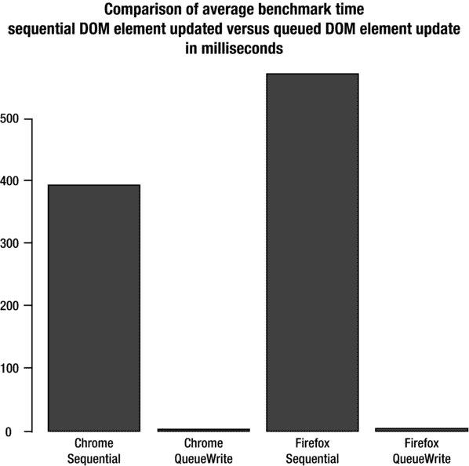

图 7-8. 单次 DOM 写入操作与单次批量写入操作的对比结果

```
benchmarking function `useDocFragments()` { var l = `tempArray.length`, writeVal = "", frag =
`document.createDocumentFragment()`; for(var i = 0; i < l; i++) { frag.appendChild(window.
`document.createElement('SCRIPT')`); } window.`document.getElementsByTagName('HEAD')[0]`.
appendChild(frag.cloneNode(true));      }
average run time: 2.3462999932235107ms
path: http://localhost:8888/lab/chapter7/dom_interactions.html
useragent: Mozilla/5.0 (Macintosh; Intel Mac OS X 10_5_8) AppleWebKit/536.11 (KHTML, like Gecko)
Chrome/20.0.1132.47 Safari/536.11

benchmarking function `useAppendChild()` { var l = `tempArray.length`, writeVal = ""; for(var i = 0;
i < l; i++) { window.`document.getElementsByTagName('HEAD')[0]`.appendChild(window.`document.
createElement('SCRIPT')`); }      }
average run time: 2.593400003388524ms
path: http://localhost:8888/lab/chapter7/dom_interactions.html
useragent: Mozilla/5.0 (Macintosh; Intel Mac OS X 10_5_8) AppleWebKit/536.11 (KHTML, like Gecko)
Chrome/20.0.1132.47 Safari/536.11
```

为了以图表形式展示此次大规模测试运行的结果，请使用以下对 `PlotResultsofTestsByBrowser` 的调用来生成 图 7-9 所示的图表。你可以看到，使用 `DocumentFragment` 在 Chrome 中获得了 9.6% 的性能提升，在 Firefox 中获得了 10% 的提升。

```javascript
PlotResultsofTestsByBrowser(c("AppendChildWrites","DocFragmentWrites"), c("Chrome","Firefox"),
"Comparison of average benchmark time \n Individual append child calls vs document fragment \nin
milliseconds")
```

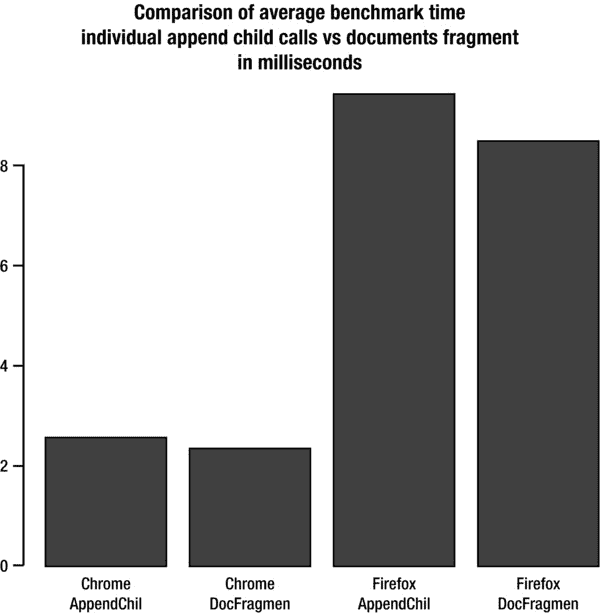

`图 7-9. 各浏览器中多次添加至 DOM 与通过 DocumentFragment 单次交互 DOM 的基准测试结果对比`

#### 嵌套循环的代价

我们知道，循环通常比展开代码并顺序执行会消耗更多性能。这是因为每个循环都是同步的，会阻塞应用程序其余部分的执行，直到循环完成。正如你在第 2 章中看到的，这是 `Google Closure Compiler` 的优化之一，而第 8 章将深入探讨这一概念。但比普通循环更消耗性能的是嵌套循环。

有多种方法可以避免嵌套循环，例如像 `Closure Compiler` 那样进行循环展开，或者进行循环融合，即把子循环的执行合并到一个循环中。但为了理解我们为何要这么做，让我们先来探究一下嵌套循环的代价。

创建一个新页面，从基础的 HTML 骨架结构开始，并引入 `perfLogger` 库和 `populateArray` 函数。在页面主体中，创建一个 `script` 标签和我们的 `tempArray` 变量。

在 `script` 标签内，你将创建多个函数，每个函数的嵌套循环深度依次递增。`twoLoopsDeep` 函数包含一个嵌套循环，`threeLoopsDeep` 包含两个嵌套循环，以此类推，直到 `fiveLoopsDeep`。

最后，你将测试每个函数的性能。为了能在浏览器中测试这些函数，你需要控制函数运行的次数，否则可能会出现脚本运行缓慢的警告，甚至导致浏览器崩溃。

```html
<script>
tempArray = populateArray(20);

function twoLoopsDeep(){
     var l = tempArray.length;
     for(var a = 0; a < l; a++){
          for(var b = 0; b < l; b++){
          }
     }
}

function threeLoopsDeep(){
     var l = tempArray.length;
     for(var a = 0; a < l; a++){
          for(var b = 0; b < l; b++){
               for(var c = 0; c < l; c++){
               }
          }
     }
}

function fourLoopsDeep(){
     var l = tempArray.length;
     for(var a = 0; a < l; a++){
          for(var b = 0; b < l; b++){
               for(var c = 0; c < l; c++){
                    for(var d = 0; d < l; d++){
                    }
               }
          }
     }
}

function fiveLoopsDeep(){
     var l = tempArray.length;
     for(var a = 0; a < l; a++){
          for(var b = 0; b < l; b++){
               for(var c = 0; c < l; c++){
                    for(var d = 0; d < l; d++){
                         for(var e = 0; e < l; e++){
                         }
                    }
               }
          }
     }
}

perfLogger.logBenchmark("TwoLoops", 10, twoLoopsDeep, true, true);
perfLogger.logBenchmark("ThreeLoops", 10, threeLoopsDeep, true, true);
perfLogger.logBenchmark("FourLoops", 10, fourLoopsDeep, true, true);
perfLogger.logBenchmark("FiveLoops", 10, fiveLoopsDeep, true, true);
</script>
```

在浏览器中查看页面时，你应该会看到以下内容：

# 基准测试结果

```
benchmarking function `oneLoop()`{ var `l` = `tempArray`.length; for(var `a` = 0; `a` < `l`; `a`++){ } }
average run time: 0.008299996261484921ms
path: `http://tom-barker.com/lab/cyclomaticcomplexity.html`
useragent: Mozilla/5.0 (Macintosh; Intel Mac OS X 10_5_8) AppleWebKit/536.11 (KHTML, like Gecko)
Chrome/20.0.1132.47 Safari/536.11

benchmarking function `twoLoopsDeep()`{ var `l` = `tempArray`.length; for(var `a` = 0; `a` < `l`; `a`++){
for(var `b` = 0; `b` < `l`; `b`++){ } } }
average run time: 0.012399998377077281ms
path: `http://tom-barker.com/lab/cyclomaticcomplexity.html`
useragent: Mozilla/5.0 (Macintosh; Intel Mac OS X 10_5_8) AppleWebKit/536.11 (KHTML, like Gecko)
Chrome/20.0.1132.47 Safari/536.11

benchmarking function `threeLoopsDeep()`{ var `l` = `tempArray`.length; for(var `a` = 0; `a` < `l`; `a`++){
for(var `b` = 0; `b` < `l`; `b`++){ for(var `c` = 0; `c` < `l`; `c`++){ } } } }
average run time: 0.06290000164881349ms
path: `http://tom-barker.com/lab/cyclomaticcomplexity.html`
useragent: Mozilla/5.0 (Macintosh; Intel Mac OS X 10_5_8) AppleWebKit/536.11 (KHTML, like Gecko)
Chrome/20.0.1132.47 Safari/536.11

benchmarking function `fourLoopsDeep()`{ var `l` = `tempArray`.length; for(var `a` = 0; `a` < `l`; `a`++){
for(var `b` = 0; `b` < `l`; `b`++){ for(var `c` = 0; `c` < `l`; `c`++){ for(var `d` = 0; `d` < `l`; `d`++){ } } } } }
average run time: 1.022299993201159ms
path: `http://tom-barker.com/lab/cyclomaticcomplexity.html`
useragent: Mozilla/5.0 (Macintosh; Intel Mac OS X 10_5_8) AppleWebKit/536.11 (KHTML, like Gecko)
Chrome/20.0.1132.47 Safari/536.11

benchmarking function `fiveLoopsDeep()`{ var `l` = `tempArray`.length; for(var `a` = 0; `a` < `l`; `a`++){
for(var `b` = 0; `b` < `l`; `b`++){ for(var `c` = 0; `c` < `l`; `c`++){ for(var `d` = 0; `d` < `l`; `d`++){ for(var `e` =
0; `e` < `l`; `e`++){ } } } } } }
average run time: 6.273999999393709ms
path: `http://tom-barker.com/lab/cyclomaticcomplexity.html`
useragent: Mozilla/5.0 (Macintosh; Intel Mac OS X 10_5_8) AppleWebKit/536.11 (KHTML, like Gecko)
Chrome/20.0.1132.47 Safari/536.11
```

## 现在，让我们用 R 语言来绘制图表！

如果我们将二到五层循环绘制在一张图表中，会失去每次递增之间的视角对比。因此，我们首先绘制二到三层以及四到五层循环的对比图。最后，我们再在一张图表中观察二到五层循环的完整情况。

### 首先，观察二到三层循环之间的延迟增长：

```
PlotResultsofTestsByBrowser(c("TwoLoops","ThreeLoops"), c("Chrome","Firefox"), "Comparison of
average benchmark time \n For Increasing Depth of Nested Loops \nin milliseconds")
```

这将生成我们在图 7-10 中看到的图表。

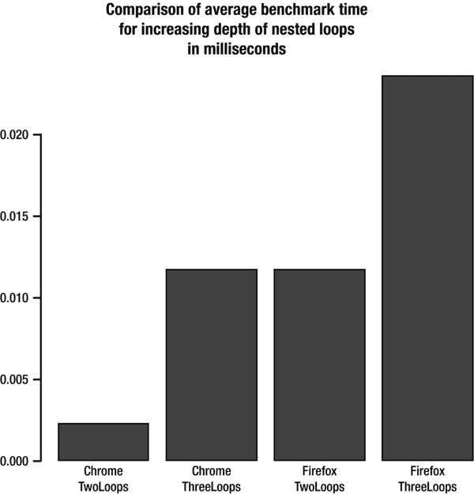

图 7-10. 不同浏览器中循环嵌套深度从两层增加到三层时的性能影响对比

Chrome 的延迟增加了 420%，Firefox 增加了 103%。

### 接下来，绘制四到五层嵌套循环之间的延迟增长：

```
PlotResultsofTestsByBrowser(c("FourLoops","FiveLoops"), c("Chrome","Firefox"), "Comparison of
average benchmark time \n For Increasing Depth of Nested Loops \nin milliseconds")
```

这将生成我们在图 7-11 中看到的图表。

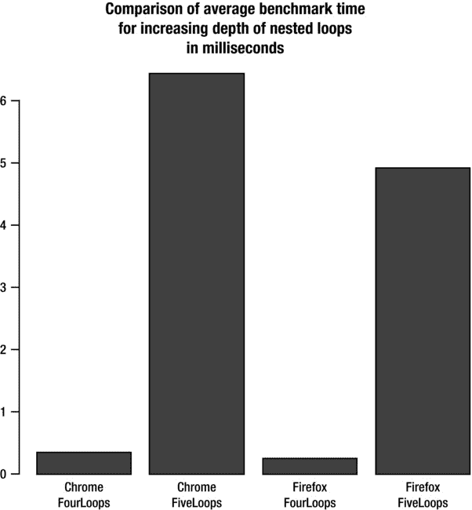

图 7-11. 不同浏览器中循环嵌套深度从四层增加到五层时的性能影响对比

Chrome 的延迟增加了 1774%，而 Firefox 增加了 1868%！

### 最后，你可以从整体角度观察二到五层循环

以全面了解对性能的影响程度：

```
PlotResultsofTestsByBrowser(c("TwoLoops", "ThreeLoops", "FourLoops","FiveLoops"), c("Chrome"),
"Comparison of average benchmark time \n For Increasing Depth of Nested Loops \nin milliseconds")
```

这将生成图 7-12 所示的图表。

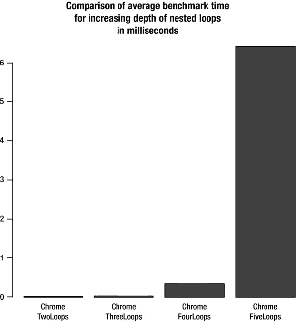

图 7-12. Chrome 浏览器中嵌套 for 循环的基准测试结果对比

延迟增加了 285677%！

因此，我们能够看到逐步增加循环嵌套深度所带来的真实代价。从我们的发现中可以看出，一旦我们从两层循环跃升到三层，性能影响就变得非常显著，并且随着嵌套更深，这种影响呈指数级增长。

## 总结

本章深入探讨了运行时性能，介绍了诸如将其他作用域链中的变量和属性存储在本地，以避免跨作用域栈检索所造成的性能损失等概念。

你了解到了在所有场景下都使用纯 JavaScript 而非框架的好处，并通过比较使用 JQuery 和 JavaScript 进行循环和 DOM 访问的基准测试结果，证明了这样做带来的性能提升。

其中一个示例量化了使用 `eval` 与直接调用函数的成本。这说明了我们使用函数作为参数，而不是传递字符串给 `eval` 所能获得的性能优势。同时，你也看到 `eval` 可能并不像长久以来人们认为的那样邪恶。

你看到了将写入操作队列化到 DOM 所带来的性能优势，这包括更新 DOM 元素以及使用 `DocumentFragment` 对象来排队添加新的 DOM 元素。

最后，我们量化了因增加嵌套循环深度而导致的延迟增加。

第 8 章将讨论性能与可读性、模块化之间的平衡。
