## 第 8 章


### 平衡性能与软件工程最佳实践及生产环境运行

第 7 章探讨了提升运行时性能的方法。你使用 `perfLogger` 库作为示例量化了这些改进，并用 R 语言将结果绘制成图表。这是贯穿本书的一个主题——用数据来衡量和证明观点。如果让我选一句话作为本书的论点，那一定是我在第一章说过且值得重复的话：任何一个熟练工都能按照规格说明做出东西，但大师级工匠却能以卓越技艺进行创作，并用实证数据来证明其卓越性。

迄今为止，我们一直遵循这个原则，创建了自己的工具来检测代码并监控网站的网络性能。我们还制作了数据可视化图表，以便更容易地理解数据。

但本章稍有不同。我们仍会关注原始数据和性能优化，但重点将放在平衡优化需求与其他需求之间的关系上，例如遵循编码标准和最佳实践、保证可读性，以及让代码模块化以便在更大的团队中使用。

我们还将更深入地探讨如何大规模生成测试数据，无论是通过使用虚拟机搭建自己的测试实验室，还是将代码部署到生产网站以众包方式收集数据。

## 平衡性能与可读性、模块化和良好设计

在撰写本文时，我领导的团队规模大约有 20 到 25 名工程师、经理和技术主管。要在仅仅两三个代码仓库中进行更改，这双手可不少。我像老鹰追踪田鼠一样密切关注我们的性能。我根据 `WebPagetest` 的数据，为数十个 URL 绘制出网站性能图表。我定期与团队开会讨论这些报告的输出，仔细审查首次访问和重复访问的数据，确保我们有效地利用了缓存。我们审视性能的各个方面，并设法挤出尽可能多的优化空间。

但我也会追踪其他事项，其中包括：我们的缺陷密度是多少？每个产品在生产环境中的事故率是多少？这些问题可能会损害产品品牌，根据问题的严重程度，其危害性甚至可能超过性能问题。

在我看来，在审视缺陷和生产事故时，最主要的根本原因之一是沟通。工程师是否与 `QA` 人员沟通了功能更新？工程师是否与生产运维人员讨论了如何支持这些功能？工程师之间是否相互沟通？但沟通问题不止于此。面对数百万行代码，每个人都知道所有代码的功能吗？是否有用于模块化功能的库？每个人都知道这些库吗？如果我去阅读一段代码，我能知道它的用途以及如何使用它吗？代码的可读性如何？

当代码在生产环境中出现问题时，对我来说，让我的 20 名工程师都知道如何使用他们可用的所有代码和功能，比多挤出那么一两毫秒的性能更为重要。

这就是为什么我们追求模块化、可重用性和可读性。

我们尝试践行模块化代码设计，即将代码编写成小巧、独立且可互换的模块。以模块方式编写代码可以最大限度地减少变更可能带来的潜在危害——因为模块通过其接口相互通信，我们可以轻松地对接口进行单元测试，并围绕它们之间的交互创建集成测试。

通过追求可重用性，我们降低了产生新 Bug 的可能性。理想情况下，我们重用的代码已经过测试和验证。

让我们的代码具有可读性，意味着我们努力让代码的功能一目了然。这包括：

> - 将复杂的逻辑抽象成命名清晰且有意义的函数、或自包含的对象和模块（这是一脉相承的）。

> - 使用我们一致同意作为标准的统一格式。

> - 为变量名使用良好且清晰的命名模式。

虽然这些都是良好的实践，但它们通常与尽可能编写最精简、性能最高的代码的目标相悖。长而含义明确的变量名占用字符，增加了文件大小，从而增加了页面的有效负载。同样的原则也适用于编写函数和构造函数所需的额外代码行，更不用说解释器在堆中创建这些对象、管理其垃圾回收以及遍历其作用域链所带来的额外开销了。

但是，将代码组织成对象和函数，可以将我们的逻辑抽象成命名有意义、原子化的部分，这些部分可以在不对系统其他部分造成太大影响的情况下进行更新和维护。

这一切都关乎视角和寻找平衡。这正是本章要讨论的部分内容。

## 焦土式性能优化

在前面的章节中，我提到过术语 *焦土式性能优化*。这是我自创的一个术语，指为了最终追求性能而牺牲其他一切。在本节中，我们将审视一些焦土式的做法，量化其好处，同时也讨论其代价，以便全面了解情况。

### 内联函数

首先，我们来看看内联函数所带来的运行时性能提升。在前几章中，我们探讨了拥有和遍历内存结构的开销。上一章我们在不同内存作用域的背景下讨论了这一点，但同样的概念也适用于我们创建的对象层级结构。

表面上，通过将所有功能合并到单个函数中，而不是将功能抽象到不同的函数甚至对象中，我们可以获得运行时性能的提升。让我们来看看这一点。

在下一个示例中，你将创建一个单页面，在其中对以下情况的基准测试结果进行比较：将功能合并到单个函数、将代码分解为不同函数、以及创建对象来包含功能。让我们开始吧！

### 创建示例

首先，创建一个包含基本 HTML 骨架结构的新页面，并引入 `perfLogger.js` 库：

```html
<!DOCTYPE html>
<html>
<head>
<meta charset="UTF-8" />
<title>方法比较</title>
<script src="/lab/perfLogger.js"></script>
</head>
<body>
</body>
</html>
```

接下来，在页面的 `<body>` 中创建一个 `<script>` 标签，并创建一个函数，该函数将整合我们想要执行的所有操作。将此函数命名为 `unwoundfunction()`：

```html
<script>
function unwoundfunction(){

}
</script>
```

在 `unwoundfunction()` 中，创建一个名为 `sum` 的变量，通过 `for` 循环迭代 300 次，并将每次循环的增量值累加：

```javascript
var sum = 0;
for(var x = 0; x < 300; x++){
     sum += x;
}
```

然后，创建一个名为 `average` 的变量，迭代 300 次，累加增量值，并将总和除以 300。这样你就得到了两个需要计算的操作——对一系列数字求和以及计算平均值。

```javascript
var average = 0;
for(var x = 0; x < 300; x++){
     average += x;
}
average = average/300;
```

完成后的函数应如下所示。你将对这个函数进行基准测试，以获取整合功能所需的时间：

```javascript
function unwoundfunction(){
     var sum = 0;
     for(var x = 0; x < 300; x++){
          sum += x;
     }

     var avgerage = 0;
     for(var x = 0; x < 300; x++){
          avgerage += x;
     }
     avgerage = avgerage/300;
}
```

接下来，创建两个新的函数，一个负责对数字求和，另一个负责对结果求平均值：

```javascript
function getAvg(p){
     var avg = 0;
     for(var x = 0; x < p; x++){
          avg += x;
     }
     return(avg/p);
}

function getSum(a){
     var sum = 0;
     for(var x = 0; x < a; x++){
          sum += x;
     }
     return(sum);
}
```

然后，创建一个将调用 `getSum()` 和 `getAvg()` 的第三个函数。你将对此函数进行基准测试，作为使用**函数**的示例：

```javascript
function usingfunctions(){
     var average = getAvg(300);
     var sum = getSum(300)
}
```

现在，创建一个对象构造函数来处理此功能。你可以将此对象命名为 `simpleMath`，并赋予它两个公共方法 `sum()` 和 `avg()`：

```javascript
function simpleMath(){
     this.sum = function(a){
          var sum = 0;
          for(var x = 0; x < a; x++){
               sum += x;
          }
          return(sum);
     }

     this.avg = function(p){
          var avg = 0;
          for(var x = 0; x < p; x++){
               avg += x;
          }
          return(avg/p);
     }
}
```

接着，创建一个名为 `usingobjects` 的函数，它将实例化一个新的 `simpleMath` 对象，并调用其 `sum` 和 `avg` 方法。你将对此函数进行基准测试，以获取使用对象的相关指标。

```javascript
function usingobjects(){
     var m = new simpleMath();
     var average = m.avg(300);
     var sum = m.sum(300);
}
```

最后，你将对这些函数进行基准测试，让 `perfLogger` 将每个函数执行 100 次：

## 分析结果

对于图表绘制，你可以重用上一章中的 `PlotResultsofTestsByBrowser()` 函数，并传入每个测试的 ID。这将创建如图 8-1 所示的图表。

```r
PlotResultsofTestsByBrowser(c("unwoundfunction", "UsingFunctions", "UsingObjects"), 
c("Firefox"), "比较不同编码方法的\n 平均基准测试时间（单位：毫秒）")
```

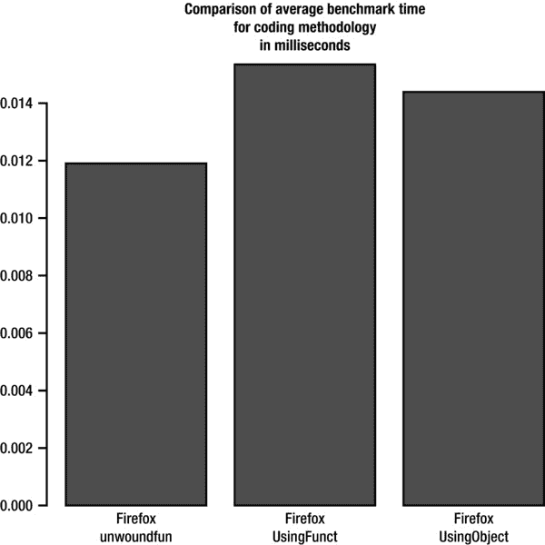

**图 8-1.** 比较整合功能、使用函数和使用对象的运行时性能

因此，你可以看到，通过剥离所有额外开销，并将代码编写为逐行命令式语句，性能得到了提升。在这个简单的示例中，差异范围不到一毫秒，但百分比差异是显著的。从最小值到最大值，整合功能的性能比使用函数提高了 23%，比使用对象提高了 18%。在性能至关重要的情况下（例如金融交易），这是一个显著的差异。

但是，将我们的功能拆分成函数可以使代码更易于阅读。像 `average = getAvg` 或 `sum = getSum` 这样的代码，其作用是一目了然的。

创建对象则进一步提升了这种可读性。你可以在项目之间重用对象，在应用程序之间传递对象，将对象扩展为新的对象，或者装饰原型链以重用功能。

在大多数情况下，为了获得可重用性和可读性的提升，额外的开销是值得的。

### Closure Compiler

另一个焦土性能的案例是 Google 的 `Closure Compiler` 在高级模式下对 JavaScript 的处理。我在第二章中简单提及了 `Closure Compiler`，现在让我们来看一个更详细的示例。

`Closure Compiler` 可以在以下两种模式之一下运行：

- 在简单模式下，它大多表现得像其他大多数压缩工具一样，移除空白、换行符和注释。
- 在高级模式下，它通过将变量和函数从较长的描述性名称重命名为单个字母以节省文件大小来重写 JavaScript，并且它会内联函数，在其判定可以合并的地方将其合并为单个函数。

我认为高级模式才是焦土策略。让我们来看一个示例。

#### 创建示例

首先创建一个名为 `benchmarkobjects.html` 的基础文件。在此页面上，你将创建两个对象：`user` 对象和 `video` 对象。用户将能够将视频添加到其收藏列表中。你将在函数中执行此功能，并对该函数进行基准测试。

从熟悉的基本骨架 HTML 结构开始，并包含 `perfLogger` 库：

```javascript
perfLogger.logBenchmark("UsingObjects", 100, usingobjects, true, true);
perfLogger.logBenchmark("UsingFunctions", 100, usingfunctions, true, true);
perfLogger.logBenchmark("unwoundfunction", 100, unwoundfunction, true, true);
```

完整的测试页面应如下所示：

```html
<!DOCTYPE html>
<html>
<head>
<meta charset="UTF-8" />
<title>方法比较</title>
<script src="/lab/perfLogger.js"></script>
<script>
function getAvg(p){
     var avg = 0;
     for(var x = 0; x < p; x++){
          avg += x;
     }
     return(avg/p);
}

function getSum(a){
     var sum = 0;
     for(var x = 0; x < a; x++){
          sum += x;
     }
     return(sum);
}

function simpleMath(){
     this.sum = function(a){
          var sum = 0;
          for(var x = 0; x < a; x++){
               sum += x;
          }
          return(sum);
     }

     this.avg = function(p){
          var avg = 0;
          for(var x = 0; x < p; x++){
               avg += x;
          }
          return(avg/p);
     }
}
</script>
</head>
<body>
<script>

function usingfunctions(){
     var average = getAvg(300);
     var sum = getSum(300)
}

function usingobjects(){
     var m = new simpleMath();
     var average = m.avg(300);
     var sum = m.sum(300);
}

function unwoundfunction(){
     var sum = 0;
     for(var x = 0; x < 300; x++){
          sum += x;
     }

     var average = 0;
     for(var x = 0; x < 300; x++){
          average += x;
     }
     average = average/300;
}
perfLogger.logBenchmark("UsingObjects", 100, usingobjects, true, true);
perfLogger.logBenchmark("UsingFunctions", 100, usingfunctions, true, true);
perfLogger.logBenchmark("unwoundfunction", 100, unwoundfunction, true, true);

</script>
</body>
</html>
```

在浏览器中查看此页面，你应该会看到如下结果：

```
benchmarking function usingobjects() { var m = new simpleMath; var average = m.avg(300); var sum = m.sum(300); }
average run time: 0.025260580000000914ms
path: http://tom-barker.com/lab/useFunctions.html
useragent: Mozilla/5.0 (Macintosh; Intel Mac OS X 10.5; rv:16.0) Gecko/16.0 Firefox/16.0

benchmarking function usingfunctions() { var average = getAvg(300); var sum = getSum(300); }
average run time: 0.020855050000000687ms
path: http://tom-barker.com/lab/useFunctions.html
useragent: Mozilla/5.0 (Macintosh; Intel Mac OS X 10.5; rv:16.0) Gecko/16.0 Firefox/16.0

benchmarking function unwoundfunction() { var sum = 0; for (var x = 0; x < 300; x++) { sum += x; } var avgerage = 0; for (var x = 0; x < 300; x++) { avgerage += x; } avgerage = avgerage / 300; }
average run time: 0.01648929999999666ms
path: http://tom-barker.com/lab/useFunctions.html
useragent: Mozilla/5.0 (Macintosh; Intel Mac OS X 10.5; rv:16.0) Gecko/16.0 Firefox/16.0
```

同样，你可以将此代码部署到生产环境或测试实验室，以便让流量指向该代码，从而在日志文件中获得更广泛的结果。

让我们获取这些结果，并在 R 环境中绘制图表！

# Loop Comparison

在 `body` 中，创建一个 `script` 标签，并开始创建对象构造函数。首先创建 `video` 对象的构造函数；它将接受一个参数作为视频标题，并拥有一个名为 `printInfo()` 的公共方法，该方法仅返回视频标题。

```html
<script>
function video(title){
          this.title = title;
          this.printInfo = function(){
               return this.title;
          }
     }
</script>
```

接下来创建 `user` 对象的构造函数。`user` 对象接受一个参数作为用户名，并拥有两个公共方法：`addToFavorite()`，该方法将传入的对象推送到用户的 `favoriteList` 中；以及 `showFavorites()`，该方法遍历 `favoriteList`。然后 `user` 对象通过调用 `favoriteList` 中每个视频的 `printInfo` 的返回值输出到控制台：

```javascript
function user(uname){
     this.username = uname;
     this.favoriteList = [];
     this.addToFavorite = function(a){
          this.favoriteList[this.favoriteList.length] = a;
     }
     this.showFavorites = function(){
          for(var f = 0; f < this.favoriteList.length; f++){
               var t = this.favoriteList[f].printInfo();
               console.log(t);
          }
     }
}
```

最后，创建一个函数来执行你刚刚创建的功能，并对其执行基准测试。它将创建一个 `new user` 对象，并迭代 20 次，每次创建一个 `new video` 对象并将该 `new video` 添加到用户的 `favoriteList` 中：

```javascript
function testUserObject(){
     var u1 = new user("tom");
     for(var i = 0; i < 20; i++){
          u1.addToFavorite(new video("video "+ i));
     }
     u1.showFavorites();     
}
perfLogger.logBenchmark("benchmarkObject", 10, testUserObject, true, true);
```

你完成的页面应如下所示：

```html
<!DOCTYPE html>
<html>
<head>
<meta charset="UTF-8" />
<title>Loop Comparison</title>
<script src="/lab/perfLogger.js"></script>
</head>
<body>
     <script>
     function user(uname){
          this.username = uname;
          this.favoriteList = [];
          this.addToFavorite = function(a){
               this.favoriteList[this.favoriteList.length] = a;
          }

          this.showFavorites = function(){
               for(var f = 0; f < this.favoriteList.length; f++){
                    var t = this.favoriteList[f].printInfo();
                    console.log(t);
               }
          }
     }

     function video(title){
          this.title = title;
          this.printInfo = function(){
               return this.title;
          }
     }

     function testUserObject(){
          var u1 = new user("tom");
          for(var i = 0; i < 20; i++){
               u1.addToFavorite(new video("video "+ i));
          }
          u1.showFavorites();     
     }

     perfLogger.logBenchmark("benchmarkObject", 10, testUserObject, true, true);
     </script>
</body>
</html>
```

当你在浏览器中查看页面时，应该会看到类似以下内容：

```text
benchmarking function testUserObject(){ var u1 = new user("tom"); for(var i = 0; i < 20; i++){
u1.addToFavorite(new video("video "+ i)); } u1.showFavorites();      }
average run time: 0.6119000026956201ms
path: http://tom-barker.com/lab/benchmarkobjects.html
useragent: Mozilla/5.0 (Macintosh; Intel Mac OS X 10_5_8) AppleWebKit/536.11 (KHTML, like Gecko)
Chrome/20.0.1132.47 Safari/536.11
```

## 运行 Closure Compiler

现在你已经准备好通过 Closure Compiler 运行代码了。最简单的方式是使用 Closure Compiler UI，访问地址：[`http://closure-compiler.appspot.com/home`](http://closure-compiler.appspot.com/home)。

Closure Compiler UI 是一个 Web 应用程序（参见 图 8-2）。在左侧你可以输入 JavaScript 代码并选择多种选项，右侧则显示 Closure Compiler 的输出结果。

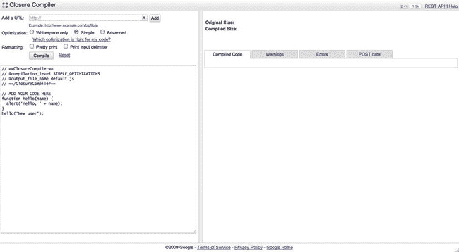

**图 8-2.** Closure Compiler UI

左上角的选项包括：

-   一个文本框，用于输入要包含在编译中的远程 JavaScript 文件的 URL。使用时，只需输入 URL 并点击 **添加** 按钮。你会看到该 URL 显示在下方的大型文本区域中，格式如下：

    ```
    // @code_url http://tom-barker.com/lib/perfLogger.js
    ```

-   一组单选按钮，用于指定 Closure Compiler 的运行模式。选项包括 **仅空白**、**简易** 或 **高级**。**仅空白** 如其名所示，仅移除注释、换行符和不必要的空白。**简易** 编译会移除空白、换行符和注释，同时将局部变量重命名为更短的名称。如你所见，**高级** 编译则会彻底重写 JavaScript 代码。

-   输出格式的选择。**美化打印** 会保留换行和缩进以便阅读；**打印输入分隔符** 允许你传入一个字符串，该字符串将作为传入代码块之间的边界——如果我们传入多个远程文件，输入分隔符会在每个文件的代码之间打印（以注释形式），以便我们识别每个代码块来自哪个文件。

-   一个 **编译** 按钮，以及最后的大型文本区域，你可以在其中输入选项和任何需要编译的附加代码。

在右侧是一个大型文本区域，用于显示编译后的代码。此外还有标签页，用于查看编译过程中产生的任何警告或错误。

## 测试步骤

对于此次测试，如果你将 `perfLogger.js` 作为文件包含并编译，尝试使用结果时会遇到一个 JavaScript 错误，因为 Closure Compiler 重命名了 `performance.now()` 的 shim；参见 图 8-3。

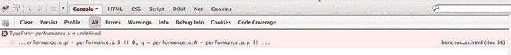

***图 8-3.** 通过 Closure Compiler 高级编译运行 `perfLogger` 时抛出的 JavaScript 错误*

为了让测试正常进行，你可以直接将 `perfLogger` 的内容复制粘贴到右侧的文本区域，并将所有 `performance.now` 引用改为 `Date.now()`。然后将 `benchmarkobjects.html` 中 `script` 标签的内容复制到 `perfLogger` 内容下方的文本区域。参见 图 8-4。

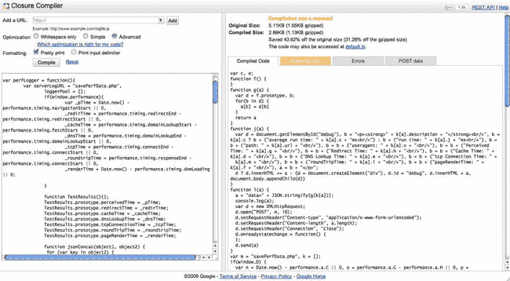

***图 8-4.** 通过 Closure Compiler UI 运行 `perfLogger`*

然后创建一个仅包含基本 HTML 骨架结构的新页面，在 `<body>` 中放置一个 `<script>` 标签，并将编译后的 JavaScript 代码复制粘贴到该 `<script>` 标签中。测试文件应如下所示：

```html
<!DOCTYPE html>
<html>
<head>
<meta charset="UTF-8" />
<title>Closure Compiler 基准测试</title>
</head>
<body>
<script>
var c, e;
function f() {
}
function g(a) {
 var d = f.prototype, b;
 for(b in d) {
   a[b] = d[b]
 }
 return a
}
function j(a) {
 var d = document.getElementById("debug"), b = "<p><strong>" + k[a].description + "</strong><br/>", b = k[a].c ? b + ("平均运行时间: " + k[a].c + "ms<br/>") : b + ("运行时间: " + k[a].j + "ms<br/>"), b = b + ("路径: " + k[a].url + "<br/>"), b = b + ("用户代理: " + k[a].v + "<br/>"), b = b + ("感知时间: " + k[a].g + "<br/>"), b = b + ("重定向时间: " + k[a].h + "<br/>"), b = b + ("缓存时间: " + k[a].d + "<br/>"), b = b + ("DNS 查询时间: " + k[a].e + "<br/>"), b = b + ("TCP 连接时间: " + k[a].m + "<br/>"), b = b + ("往返时间: " + k[a].i + "<br/>"), b = b + ("页面渲染时间: " + k[a].f + "<br/>"), a = b + "</p>";
 d ? d.innerHTML += a : (d = document.createElement("div"), d.id = "debug", d.innerHTML = a, document.body.appendChild(d))
}
function l(a) {
 a = "data=" + JSON.stringify(g(k[a]));
 console.log(a);
 var d = new XMLHttpRequest;
 d.open("POST", m, !0);
 d.setRequestHeader("Content-type", "application/x-www-form-urlencoded");
 d.setRequestHeader("Content-length", a.length);
 d.setRequestHeader("Connection", "close");
 d.onreadystatechange = function() {
 };
 d.send(a)
}
var m = "savePerfData.php", k = [];
if(window.D) {
 var n = Date.now() - performance.a.C || 0, o = performance.a.G - performance.a.H || 0, p = performance.a.p - performance.a.B || 0, q = performance.a.A - performance.a.p || 0, r = performance.a.w - performance.a.o || 0, t = performance.a.I - performance.a.o || 0, u = Date.now() - performance.a.z || 0
}
c = f.prototype;
c.g = n;
c.h = o;
c.d = p;
c.e = q;
c.m = r;
c.i = t;
c.f = u;
e = {k:function(a, d, b, h) {
 k[a] = new f;
 k[a].id = a;
 k[a].startTime = Date.now();
 k[a].description = d;
 k[a].q = b;
 k[a].s = h
}, l:function(a) {
 k[a].u = Date.now();
 k[a].j = k[a].u - k[a].startTime;
 k[a].url = window.location.href;
 k[a].v = navigator.userAgent;
 k[a].q && j(a);
 k[a].s && l(a)
}, r:function(a, d, b, h, v) {
 for(var i = 0, s = 0;s < d;s++) {
   e.k(a, "基准测试 " + b, !1, !1), b(), e.l(a), i += k[a].j
 }
 k[a].c = i / d;
 h && j(a);
 v && l(a)
}, g:function() {
 return n
}, h:function() {
 o
}, d:function() {
 return p
}, e:function() {
 return q
}, m:function() {
 return r
}, i:function() {
 return t
}, f:function() {
 return u
}, J:function() {
 this.k("no_id", "将性能数据绘制到页面", !0, !0);
 this.l("no_id")
}};
function w() {
 this.K = "tom";
 this.b = [];
 this.n = function(a) {
     this.b[this.b.length] = a
 };
 this.t = function() {
   for(var a = 0;a < this.b.length;a++) {
     console.log(this.b[a].title)
   }
 }
}
function x(a) {
 this.title = a;
 this.F = function() {
     return this.title
 }
}
e.r("benchmarkClosureCompiler", 10, function() {
 for(var a = new w, d = 0;20 > d;d++) {
   a.n(new x("视频 " + d))
 }
 a.t()
}, !0, !0);
</script>
</body>
</html>
```

## 浏览器输出

如果在浏览器中查看此页面，你应该会看到以下内容：

```
基准测试 function () { for(var a = new w, d = 0;20 > d;d++) { a.n(new x("视频 " + d)) } a.t() }
平均运行时间: 0.9ms
路径: http://tom-barker.com/lab/benchmarkclosurecompiler.html
用户代理: Mozilla/5.0 (Macintosh; Intel Mac OS X 10_5_8) AppleWebKit/536.11 (KHTML, like Gecko) Chrome/20.0.1132.47 Safari/536.11
```

检查日志文件时，你会发现经 Closure Compiler 重写的代码并没有将所有字段都保存到日志文件中。这是因为 Closure Compiler 重命名了大部分变量，包括运行时变量。如果你 `console.log` 序列化后的数据，可以看到正在发送的数据格式如下：

```
data={"id":"benchmarkClosureCompiler","startTime":1344114475936,"description":"benchmarking
function () {\n      for (var a = new w, d = 0; 20 > d; d++) {\n          a.n(new x(\"video \" +
d));\n      }\n      a.t();\n}","q":false,"s":false,"u":1344114475943,"j":7,"url":"http://tom-
barker.com/lab/benchmarkclosurecompiler.html","v":"Mozilla/5.0 (Macintosh; Intel Mac OS X 10.5;
rv:16.0) Gecko/16.0 Firefox/16.0","c":18.6}
```

运行时的变量就是末尾那个小小的`"c"`值。要想从当前编译后的源码那团乱麻中把它解析出来，祝你好运。公平地说，确实有方法可以保留属性名，比如使用带引号的字符串属性名——例如，用`using testResult["runtime"]`代替`obj.runTime`。有关此问题的更多信息，请参阅谷歌的文档：[`https://developers.google.com/closure/compiler/docs/api-tutorial3`](https://developers.google.com/closure/compiler/docs/api-tutorial3)。

当你把数据传回`savePerfData.php`时，那段代码期望接收的变量是`runTime`或`avgRunTime`，而不是`c`，所以运行时数据永远无法被检索到。

但这没关系；我们关心的好处在于网页性能，因此我们将通过 WebPagetest 来比较这两个页面。

### 比较与分析

让我们访问`webpagetest.com`，对我们的两个 URL 运行测试。下表列出了测试所用的 URL 以及我所运行测试的测试结果 URL。

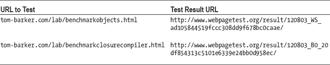

汇总结果如图 8-5 和 8-6 所示。

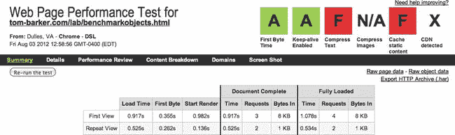

***图 8-5.** benchmarkobject.html 的网页性能汇总结果*

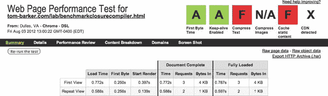

***图 8-6.** benchmarkclosurecompiler.html 的网页性能汇总结果*

从刚刚展示的结果截图中可以看到，由 Closure Compiler 生成的测试页面，其加载时间快了 200 毫秒，首字节时间快了 100 毫秒，开始渲染时间快了近 600 毫秒，文档完成时间快了 145 毫秒，完全加载时间快了 291 毫秒。显然，使用 Closure Compiler 的高级模式能带来显著的性能提升。

但此时你也能看出其弊端。为了让编译后的代码能在浏览器中无错误运行，必须修改原始代码。当它在浏览器中能运行后，你会发现一些与后端连接的接口失效了。

而这一切仅仅是一个自包含的小测试例子。想象一下，如果页面中嵌入了第三方广告代码。想象一下，如果我们的 JavaScript 与插件有交互。

再想象一下，在原始代码中添加新功能，并反复进行这一流程。每周如此。而且有 20 个人同时在代码库中工作。

我们不得不改变工作流程，并至少引入一个额外的调试步骤，以测试所有内容在编译后是否正常工作。这增加了一层复杂性，为代码失效引入了一个新的断点。而且，在所有代码都被混淆之后，在这个层面进行调试，比调试我们已编写的原生代码要困难好几个数量级。

为了维护和更新编译后的代码，我们所付出的额外努力和增加的复杂性，是否值得换来我们所看到的性能提升呢？

## 下一步：从实践到实际应用

在本书中，到目前为止，我们一直在创建测试，讨论并审视通过这些测试大规模生成的数据。现在我们来看看如何在工作中实际执行这些策略。

### 监控网页性能

这相当简单直接。你只需要选择一组你想监控的 URL，将它们接入`WPTRunner`，然后开始追踪这些 URL 随时间的变化。

在收集数据的过程中，你应该与你的团队一起审查这些数据。找出可以改进的地方——你的图片是否未优化，你的内容是否未启用 Gzip 压缩，如何尽量减少 HTTP 请求？设定性能目标，并与团队一起朝着这些目标努力。

### 为你的站点添加监控埋点

如果你还没有这样做，那么下一件要做的事情就是为你的站点添加监控埋点——将基准测试代码部署到生产环境中，以收集线上真实页面实际的性能数据。

要做到这一点，你只需要选择你想监控的页面，选择一组你想收集的指标——可能是页面的感知加载时间，也可能是更复杂功能模块的运行时间——然后将`perfLogger`集成到这些页面中来捕获这些数据。请注意，你可能不想使用`perfLogger`的基准测试功能，因为那会影响页面性能，而应使用`startTimeLogging`和`stopTimeLogging`函数来捕获计时信息。

我就在自己的网站上这么做了。在图 8-7 中，你可以看到我主页的截图，页面右侧显示了`perfLogger`的调试信息。

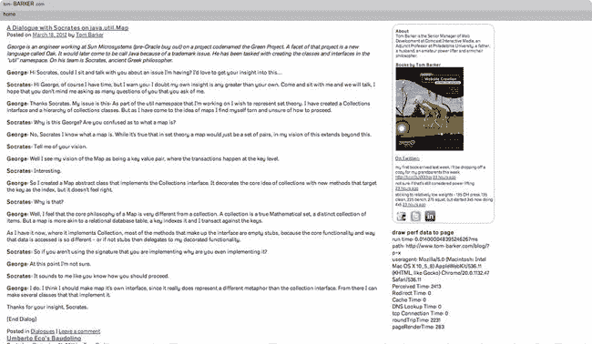

***图 8-7.** tom-barker.com 站点，屏幕上绘制了性能数据*

在线上站点添加监控埋点的好处在于，我们可以从真实用户那里获取真实的数据。我们持续追踪这些数据，并在条件变化时（例如，新的浏览器和浏览器版本发布、新功能上线到生产环境等）寻找问题。问题可能表现为性能指标的突然飙升，表明某些功能突然运行缓慢；也可能表现为性能指标的意外下降，这可能意味着你的站点对用户来说变得不可用。

为你的站点添加监控埋点，应作为站点日常维护的一部分来执行。

### 在测试实验室中进行基准测试

因此，我们对生产环境的代码进行监测，并定期监控网页性能，但在代码发布之前，我们如何确保其性能良好呢？我们在测试实验室中进行基准测试。

测试实验室可以是一个满是工作站的物理实验室，也可以是一两台运行着虚拟机的机器。

如果你有规模、预算和人员来建立一个物理测试实验室，那真是太棒了！真正的世界级网络应用就是这样做的。但是，在我最近工作过的 12 家公司中，有 7 家公司的这种情况简直是白日梦。我和我的开发人员不得不在自己的机器上测试和验证我们自己的代码。在某些情况下，这可能就是你所需要的全部。

无论哪种情况，你的首要任务是建立浏览器支持矩阵——如果你没有明确的列表知道要支持哪些浏览器和客户端，又怎能知道该准备哪些来进行测试呢？浏览器支持矩阵至少是一份浏览器及其版本的清单，以及你将为这些浏览器提供的支持级别。根据我的经验，通常有三个支持级别——我们是否会为使用此浏览器的最终用户提供支持（`生产环境支持`），我们的 QA 团队是否应在常规测试中使用此浏览器进行测试（`QA 测试`），以及我们的工程师是否应使用这些浏览器进行开发人员测试，至少确保在这些浏览器中功能正常（`开发人员测试`）？参见图 8-8 以了解这种浏览器矩阵的示例。

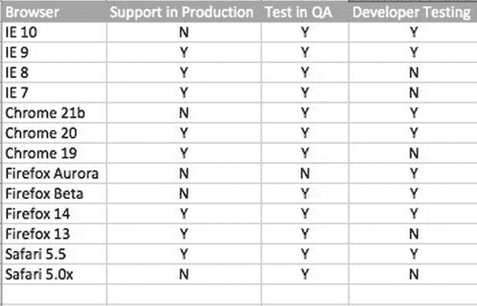

**图 8-8.** 一个最基本的浏览器支持矩阵

不过，理想情况下并最终，你的浏览器支持矩阵应包含插件等信息，以及功能的细分，因为并非所有功能在每个浏览器中都能正常工作。有关更全面的浏览器支持矩阵，请参见图 8-9。

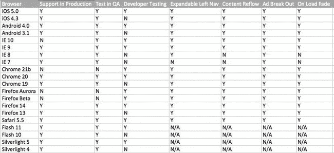

**图 8-9.** 一个更详细的浏览器支持矩阵

开始选择浏览器矩阵的方法是查看日志——你的客户最常使用哪些浏览器？确保至少考虑那些最活跃的浏览器，这些浏览器并不总是最吸引人的。（有多少年你需要支持 IE 6，仅仅因为你的用户群受限于企业升级政策而只能使用它？）但不要因为某组浏览器被用于访问你的网站，就认为你只需关注这些浏览器。可能只是你的网站在这些浏览器上运行效果最佳。同时，确保在你的矩阵中也包含测试版和早期版本的浏览器，这样你就可以为未来编写代码。

一旦你有了浏览器支持矩阵，就可以开始收集工作站或虚拟机来在这些浏览器上进行测试。即使你有负责测试的 QA 团队，作为 Web 开发人员，我们有责任确保我们创建的内容在移交给 QA 之前是功能正常且状态良好的。这包括根据我们的浏览器矩阵对代码进行基准测试。

如果你打算使用虚拟机（VM），我最喜欢的选择是使用 Oracle 的 `Virtual Box`，可以从 [`https://www.virtualbox.org/`](https://www.virtualbox.org/) 获得。它是一个完全免费、开源、轻量级、专业级的虚拟机运行解决方案。参见图 8-10 查看 `Virtual Box` 主页。


**图 8-10.** `Virtual Box` 主页

你只需前往下载部分，为你的原生操作系统选择正确的二进制文件。参见图 8-11 查看 `Virtual Box` 下载页面。


**图 8-11.** `Virtual Box` 下载页面

下载并安装 `Virtual Box` 后，你可以按照应用程序中的说明简单地添加新的虚拟机。请注意，你需要为要运行的每个操作系统准备安装盘或磁盘映像。一旦你设置好所有虚拟机，你的 `Virtual Box` 安装应该类似于图 8-12。


**图 8-12.** 安装了多个虚拟机的 `Virtual Box`

在后 PC 时代，不要忘记将移动浏览器包含在你的矩阵中。当然，最好的做法是手头有设备进行测试，但如果不行，你可以通过在你的笔记本电脑上运行模拟器/仿真器，或者使用像 `Keynote Device Anywhere` 这样的第三方服务，它提供一个装满设备的完整测试中心，可用于远程手动或脚本化测试。更多关于 `Keynote Device Anywhere` 的信息可以在其网站 [`http://www.keynotedeviceanywhere.com/`](http://www.keynotedeviceanywhere.com/) 上找到。

iOS 模拟器随 `XCode` 捆绑提供，但获取和安装 Android 模拟器则稍微复杂一些。你必须首先从 [`http://developer.android.com/sdk/index.html`](http://developer.android.com/sdk/index.html) 下载 Android SDK。图 8-13 显示了下载页面。


**图 8-13.** Android SDK 下载页面

下载完成后，你需要解压压缩文件并导航到 `tools` 目录以打开 SDK Manager。在 Windows 机器上，你只需双击 `tools` 目录中的 SDK Manager 可执行文件。在 Mac 或 Linux 机器上，你需要进入终端，`cd` 到该目录，然后启动 `android sdk`：

```
> cd /android-sdk-macosx/tools
> ./android sdk
```

这会打开 SDK Manager，如图 8-14 所示。从 SDK Manager，你可以下载并安装一个 Android 平台和一组平台工具。你下载的平台将成为你加载的设备映像。

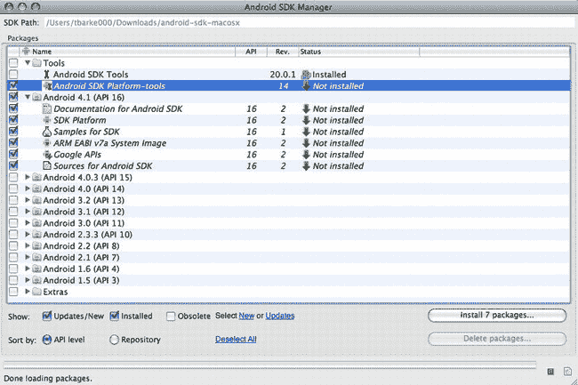

**图 8-14.** Android SDK Manager

一旦你下载了一个平台和平台工具，接下来你需要通过运行 `tools` 目录中的 `android avd` 来启动 Android 虚拟设备管理器：

```
./android avd
```

Android 设备管理器，与 `Virtual Box` 非常相似，允许你创建和运行虚拟机。参见图 8-15 查看 Android 虚拟设备管理器。


**图 8-15.** 在 Mac 上运行的 Android 虚拟设备管理器

在 Android 虚拟设备管理器中，你可以从刚刚下载的平台创建一个新的虚拟设备。为此，只需点击 `New` 按钮，调出如图 8-16 所示的界面。在这里你可以配置你的新虚拟设备。


**图 8-16.** 添加一个 Android 虚拟设备

完成后，你可以启动设备并加载浏览器。参见图 8-17 查看运行中的模拟器。

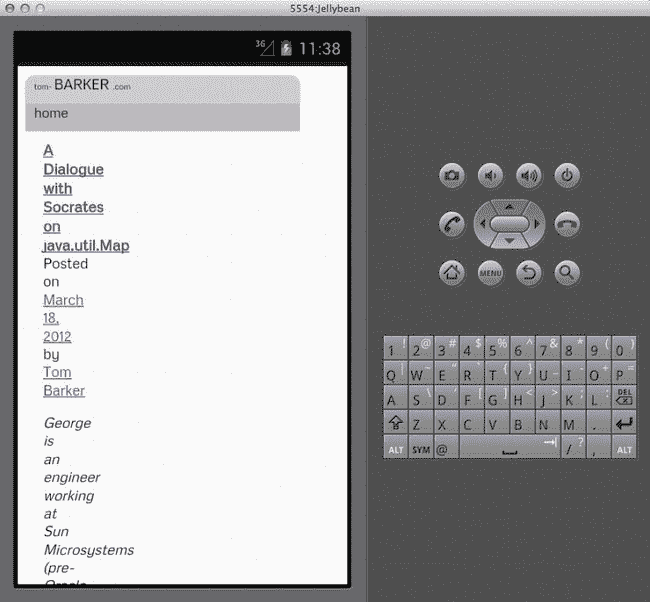

**图 8-17.** `tom-barker.com` 在 Android 模拟器上运行

好了。你正在对生产代码进行检测，监控页面在生产环境中的 Web 性能，并在测试实验室中根据你的浏览器支持矩阵对代码进行基准测试。接下来呢？

## 分享你的发现

基准测试、工具检测和监控都很棒，但如果你不告诉任何人，那又有什么意义呢？请与你的团队分享你的发现。但首先要分析你的数据——我是指真正理解你的数据，这样你才能解释每个数据点，并对每个发现的原因或影响有所了解。

运用你在本书中不断磨练的数据可视化技能来生成图表，将图表汇编成报告，并分享你的分析。尝试不同类型的图表，看看哪些能更好地传达你的观点。

保持开放的心态，并考虑上下文背景。你是否遗漏了某些可以解释更宏观图景的因素？寻求他人的意见，并反复检查你的测试。也许你正在进行基准测试的测试在某些方面存在缺陷，比如一个作用域不正确的变量扰乱了你的结果。

一旦你反复核查了发现、完成了分析并创建了图表，你就应该将结果汇编成一份报告——可能是一封电子邮件、一份 PDF 文件，或是一个 Wiki 条目。只要这份报告不仅能包含你的图表，还能包含你的分析和上下文背景，并且可以分发即可。

与你的团队一起审阅报告，讨论根本原因，并制定一个行动计划来应对需要改进的领域。最重要的是，始终要努力改进。

## 总结

在本章中，我们探讨了一些关于性能的总结性思考。

我们讨论了在性能与保持可读性、可复用性和模块化最佳实践之间取得平衡。我们研究了“焦土式”性能优化实践。我们考察了内联函数的实践，即将其合并为单个函数，以减少 JavaScript 解释器在构建和执行函数及对象层次结构时必须经历的额外开销。我们创建了一个测试，来比较内联函数、使用函数和使用对象在运行时性能上的差异。

虽然我们通过这种“焦土式”性能优化实践获得了性能提升，但我们同时也失去了良好软件设计所带来的模块化、可读性和可复用性方面的优势。

我们还研究了通过 Google Closure Compiler 运行代码。我们看到了显著的 Web 性能提升。但我们也发现，将 JavaScript 代码编译到最精简的程度，也让我们的代码更难调试，并且会为维护和更新增加一个更困难的抽象层。

这两个例子的重点不仅仅在于原始数据，而是我们做所有事情时都必须努力寻找平衡。性能非常重要，但质量的其他方面也同样重要，甚至可能更重要。

我们还讨论了如何实践我们所学到的东西。我们讨论了使用 `WPTRunner` 监控生产环境的 Web 性能。我们讨论了使用 `perfLogger` 在生产环境中对代码进行实时检测。我们讨论了如何构建浏览器支持矩阵并创建测试实验室，以便在我们的测试环境中对代码进行基准测试。

最后，我们讨论了分享数据的重要性；利用我们的发现作为一个反馈循环，在我们不断追求卓越的过程中，识别需要改进的领域。


