# 目录

 作者简介
 技术审校简介
 致谢
 第 1 章：什么是性能
Web 性能
解析与渲染
渲染引擎
JavaScript 引擎
运行时性能
性能为何重要？
检测与可视化
本书目标
所用技术及延伸阅读
总结
 第 2 章：衡量与影响性能的工具与技术
Firebug
如何安装
如何使用
YSlow
如何安装
如何使用
WebPagetest
代码压缩
Minify
YUI Compressor
Closure Compiler
结果对比
分析与可视化
R 语言入门
安装与运行 R
R 语言初探
使用 R 绘制简单图表
R 语言实践案例
使用 `apply()` 函数
总结
 第 3 章：WPTRunner——基于 WebPagetest 的自动化性能监控与可视化
架构
创建共享配置文件
访问 WebPagetest API
解析测试结果
完整示例
使用 R 绘制图表
数据解析
绘制加载时间
绘制有效载荷与 HTTP 请求数
开源
总结
专访 WebPagetest 创始人 Patrick Meenan
创建 WebPagetest 的初衷是什么？
将项目开源是否困难？
在项目开发过程中遇到了哪些挑战？
WebPagetest LLC 的目标是什么？
测试结果会存储多久？
测试平均运行时间是多长？
在使用 API 时，您是否推荐采用轮询之外的方式检查测试完成状态？
测试在队列中的处理流程是怎样的？
您听说过人们用 WebPagetest 做的最有趣的事情是什么？
能简单介绍一下代理（Agent）架构吗？
您在您自己的应用程序中是如何使用 WebPagetest 的？
WebPagetest 近期和远期的功能规划是什么？就我个人而言，我很想要一个内存分析工具。
 第 4 章：perfLogger——JavaScript 基准测试与日志记录
架构
开始编码！
计算测试结果
设置测试结果元数据
显示测试结果
保存数据
构建公开 API
远程日志记录
保存测试结果
示例页面
绘制结果图表
开源
总结
 第 5 章：展望未来——性能标准
W3C Web 性能工作组
`Performance` 对象
性能计时（`Performance Timing`）
将 `Performance` 对象集成到 `perfLogger`
更新日志记录功能
性能导航（`Performance Navigation`）
性能内存（`Performance Memory`）
高精度时间（High-Resolution Time）
可视化新数据
总结
 第 6 章：Web 性能优化
优化页面渲染瓶颈
脚本加载
`async` 属性
结果对比
懒加载
懒加载的艺术
懒加载脚本
懒加载 CSS
为何不懒加载图片
总结
 第 7 章：运行时性能
跨作用域缓存变量与属性
创建新文件
创建测试
可视化结果
属性引用示例
核心 JavaScript 与框架的对比
jQuery vs JavaScript：循环
jQuery vs JavaScript：DOM 访问
`Eval` 的真正代价
DOM 访问
对 DOM 元素的变更进行排队
对新添加节点进行排队
嵌套循环的代价
总结
 第 8 章：在软件工程最佳实践与生产环境运行之间平衡性能
在性能与可读性、模块化和良好设计之间寻求平衡
极端性能优化（Scorched-Earth Performance）
函数内联
Closure Compiler
下一步：从实践到实际应用
监控 Web 性能
在你的站点中植入检测代码
在测试实验室中进行基准测试
分享你的发现
总结
 索引

## 作者简介

  **汤姆·巴克**（Tom Barker）自 90 年代起便是一名软件工程师，专注于 Web 开发的全栈技术。他目前是康卡斯特（Comcast）的 Web 开发高级经理，费城大学的兼职教授，同时也是一位丈夫、父亲、业余力量举重爱好者和“沙发哲学家”。他痴迷于优雅的软件解决方案、持续改进、流程优化、数据分析以及可视化。

## 关于技术审校者

  **阿尼鲁德·普拉布**是 Xoriant 公司的一名软件工程师，拥有四年网页设计与开发经验。他负责项目中的 JavaScript 开发与维护。其专业领域涵盖`HTML`、`CSS`、`JavaScript`和`jQuery`。工作之余，阿尼鲁德热爱阅读、听音乐和摄影。

## 第 1 章


### 什么是性能

*性能*是指应用程序运行的速度。它是质量的一个多层面属性。当我们谈论 Web 应用程序时，应用程序呈现给用户所花费的时间，我们称之为*Web 性能*。而应用程序响应用户交互的速度，我们称之为*运行时性能*。这就是我们将要探讨的性能的两个方面。

在 Web（尤其是移动 Web）开发语境下，性能是一个相对较新的课题，但它绝对值得获得如今所受到的关注。

在本书中，我们将探讨如何在 Web 性能和运行时性能的背景下量化和优化 JavaScript 性能。这一点至关重要，因为在尝试解决网站整体性能问题时，JavaScript 可能具有最大的改进空间。Web 性能领域的先驱、YSlow 和 PageSpeed 的架构师史蒂夫·索德斯通过一项实验证明了这一点：他在从一组样本网站中移除 JavaScript 后，平均性能提升了 31%。¹ 我们可以像史蒂夫在实验中那样完全移除网站中的 JavaScript，也可以优化 JavaScript 的编写方式，并学会衡量所写代码的效率。

完全从前端移除 JavaScript 并不现实，因此让我们专注于提升 JavaScript 的效率。可以说更为重要的是，让我们探讨如何创建自动化工具来追踪这些效率，并将其可视化以用于报告和分析。

#### Web 性能

无论是使用笔记本电脑还是手持设备，当你打开浏览器、输入 URL 并按下回车键，然后等待页面传输并由浏览器渲染时，这段等待页面可用的时间跨度就取决于 Web 性能。就本书而言，我们将 Web 性能定义为页面传输并可供最终用户使用的总体时间指标。

影响 Web 性能的因素有很多，网络延迟是首要因素。你的网络有多快？提供内容需要多少次往返和服务器响应？

为了更好地理解网络延迟，我们先来看 HTTP 事务中的步骤（图 1.1）。

当浏览器请求一个 URL 时——无论是网页的 URL 还是网页上某个资源的 URL——它会启动一个线程来处理该请求，并在远程 DNS 服务器上发起 DNS 查询。这样浏览器就能获取所输入 URL 的 IP 地址。

__________

¹ [`http://www.stevesouders.com/blog/2012/01/13/javascript-performance/`](http://www.stevesouders.com/blog/2012/01/13/javascript-performance/)

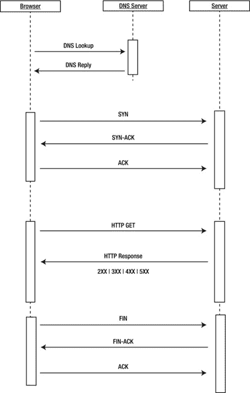

***图 1-1.** 请求一个网页时网络事务的时序图，该过程会针对网页中包含的每个远程对象重复*

 **注：** *线程*是应用程序中受控执行的顺序单元。每当应用程序执行任何操作时，它都会使用一个线程。有些应用程序是多线程的，这意味着它们可以同时处理多件事务。通常，浏览器至少为每个标签页使用一个线程。这意味着线程执行的步骤——即我们概述的连接、下载和渲染过程中的步骤——是顺序处理的。

接下来，浏览器与远程 Web 服务器协商 TCP 三次握手，以建立 TCP/IP 连接。此握手包括在浏览器和远程服务器之间传递同步（SYN）、同步确认（SYN-ACK）和确认（ACK）消息。此握手允许客户端尝试通信，服务器确认并接受该尝试，然后客户端确认尝试已被接受。

这种握手很像双向无线电通信中的军事语音程序。想象一下双向无线电两端的双方——他们如何知道对方何时说完，如何避免互相打断，以及如何确保一方理解了另一方的信息？这些在语音程序中已经标准化，其中某些关键短语具有细微的含义；例如，“Over”表示一方已说完并等待回应，“Roger”表示信息已被理解。

与所有通信协议一样，TCP 握手只是一种定义多方之间通信的标准化方式。

# TCP/IP 模型

`TCP`代表传输控制协议。它是 TCP/IP 模型中使用的协议，定义了客户端和服务器之间的通信方式，具体包括将数据分割成段，以及处理我们之前描述的握手（图 1.1）。

TCP/IP 模型是一个四层模型，代表了定义数据如何在互联网上共享的不同协议之间的关系。TCP/IP 模型的规范由互联网工程任务组（IETF）维护，收录于两份 RFC（请求评议）文档中，地址如下：[`http://tools.ietf.org/html/rfc1122`](http://tools.ietf.org/html/rfc1122) 和 [`http://tools.ietf.org/html/rfc1123`](http://tools.ietf.org/html/rfc1123)。

TCP/IP 模型的四层，按照从距离最终用户最远到最近顺序排列，依次为：网络访问层、互联网层、传输层和应用层。

## TCP/IP 模型概述

网络接入层控制着网络中硬件之间的通信。

互联网层负责网络寻址和路由，获取 IP 地址和 MAC 地址。

传输层是 TCP（或 UDP）通信发生的地方。

应用层处理客户端和服务器使用的高级通信，例如用于电子邮件客户端的 HTTP 和 SMTP。

如果将 TCP/IP 模型与我们的时序图进行比较，我们会看到浏览器如何在模型中上下穿梭以提供页面，如下所示。

一旦建立了 TCP/IP 连接，浏览器就会通过该连接向远程服务器发送一个 HTTP GET 请求。远程服务器找到资源，并通过 HTTP 响应将其返回，状态码为 200 表示正常响应。如果服务器找不到资源，或者在尝试解释资源时发生错误，或者请求被重定向，HTTP 响应的状态码也会反映这些情况。完整的状态码列表可以在 [`http://www.w3.org/Protocols/rfc2616/rfc2616-sec10.html`](http://www.w3.org/Protocols/rfc2616/rfc2616-sec10.html) 找到，但最常见的状态码如下：

*   200 表示来自服务器的成功响应。
*   404 表示服务器未能找到请求的资源。
*   500 表示在尝试完成请求时发生错误。

正是在此处，Web 服务器提供资源，而客户端开始下载它。也正是在此处，页面的总负载（包括所有图片、CSS 和 JavaScript 的文件大小）开始发挥作用。

页面的总大小很重要，不仅因为下载所需的时间，还因为 IPv4 和 IPv6 的 IP 数据包最大大小为 65535 个八位组。如果将页面总大小转换为字节，然后除以最大数据包大小，你将得到提供总负载所需的服务器响应次数。

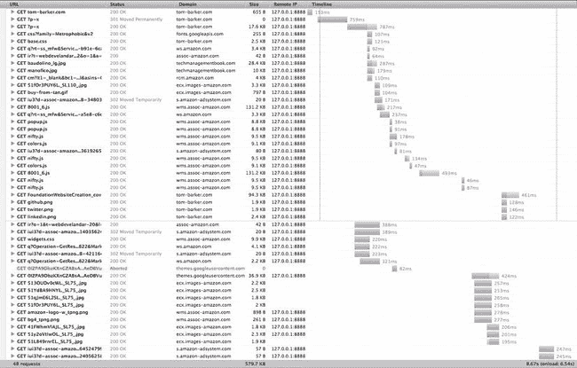

**图 1-2.** 浏览器架构

导致网络延迟的另一个因素是页面加载所有对象所需的 HTTP 请求数量。页面中包含的每个资源——每张图片以及每个外部 JavaScript 和 CSS 文件——都需要一次与服务器的往返。每一个都会启动一个新线程和 图 1-1 中所示流程的一个新实例，这再次包含了 DNS 查询、TCP 连接、HTTP 请求和响应的开销，以及传输每个资源本身文件大小的时间开销。

参见 图 1-2，了解这个简单概念如何呈指数级增长，并在规模上导致性能问题。

瀑布图是一种工具，用于展示请求一个页面及其包含的所有资源所需的时间。它们显示了构建页面所需的每个资源的 HTTP 事务，包括每个资源的大小、每个资源的下载时间以及下载顺序。从高层次来看，瀑布图中的每个条形代表我们正在下载的一个资源。条形的长度对应于一个项目连接和下载所需的时间。图表按时间顺序运行，因此最顶部的条形是第一个被下载的项目，最底部的条形是最后一个项目，时间线的最左侧是连接开始的时间，最右侧是连接结束的时间。我们将在 第 2 章 讨论衡量和影响性能的工具时，更详细地讨论瀑布图。

## 解析与渲染

除了网络问题之外，Web 性能的另一个影响因素是浏览器的解析与渲染过程。浏览器的解析与渲染受到多种因素的影响。为了更好地理解这个概念，我们首先看一下与解析和渲染网页相关的浏览器架构概览（图 1-3）。

大多数现代浏览器具有以下架构：用于处理 UI（包括地址栏和历史按钮）的代码；用于解析和绘制页面中所有对象的渲染引擎；用于解释 JavaScript 的 JavaScript 引擎；以及用于处理 HTTP 请求的网络层。

由于浏览器从上到下读取内容，因此资源放置的位置会影响用户感知到的网站速度。例如，如果将 JavaScript 标签放在 HTML 内容之前，浏览器将启动 JavaScript 解释器并在完成渲染剩余 HTML 内容之前解析 JavaScript，这可能会延迟页面供最终用户使用。

浏览器是 Web 开发者的饭碗，因此你应该对每个渲染引擎和 JavaScript 引擎了如指掌。花时间下载那些开源的引擎（参见下一节获取相关网址）并通读一些源代码是非常值得的。如果你更加大胆，还可以向源代码中添加自己的检测或日志记录，并在你分叉的引擎中自动化运行你自己的性能测试。

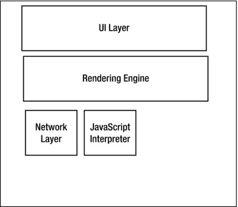

**图 1-3.** 我的举重日志时间序列

### 渲染引擎

让我们来看一些目前在外部广泛使用的渲染引擎。重要的是，不要仅仅将渲染引擎视为浏览器的一部分。通过将浏览器的架构模块化，浏览器制造商得以将其组件联合起来。不仅仅是浏览器，包括电子邮件客户端和其他应用程序中的 Web 组件在内的更多工具都会渲染 HTML。通过拥有可分发的渲染引擎，浏览器制造商可以重用他们自己的引擎，或将其许可给其他公司使用。这也通常使开发人员仅通过了解软件包使用的渲染引擎就能预知其表现。

Firefox 及其所有衍生产品和同类产品（如 Thunderbird，Mozilla 的电子邮件客户端）都使用 `Gecko`，可在 [`https://developer.mozilla.org/en/Gecko`](https://developer.mozilla.org/en/Gecko) 获取。`Gecko` 最初由 Netscape 开发，早在 1997 年，在 Mozilla 项目作为独立实体分离出来之前，它作为原始 Netscape 渲染引擎的继任者被推出。

`Webkit` 是 Chrome 和 Safari 使用的引擎，也是大多数移动 Web 开发的目标引擎，因为它被用作 Android 设备、iOS 设备上的移动 Safari 以及 Kindle Fire 上的 Silk 浏览器的布局或渲染引擎。`Webkit` 可在 [`http://www.webkit.org/`](http://www.webkit.org/) 获取。`WebKit` 始于 2001 年，由 Apple 基于之前的渲染引擎 `KHTML`（来自 `KDE`）分叉而来。`WebKit` 于 2005 年公开开源。

桌面端、移动端，甚至所有任天堂游戏机（NDS, Wii）上的 Opera 都使用 `Presto`，它于 2003 年随 Opera 7 一起推出。关于 `Presto` 的更多信息可在 [`http://dev.opera.com/articles/view/presto-2-1-web-standards-supported-by/`](http://dev.opera.com/articles/view/presto-2-1-web-standards-supported-by/) 找到。

最后，Internet Explorer 以及其他微软产品（如 Outlook）使用 `MSHTML`，代号为 `Trident`。微软于 1997 年在 Internet Explorer 4 中首次引入了 `Trident`，此后一直在迭代该引擎。`Trident` 的文档可在此处找到：[`http://msdn.microsoft.com/en-us/library/bb508515`](http://msdn.microsoft.com/en-us/library/bb508515)。

### JavaScript 引擎

接下来，我们来看看最流行的浏览器所使用的 JavaScript 引擎。将 JavaScript 解释器模块化，与将渲染引擎模块化或任何代码模块化一样有意义。解释器可以与其他属性共享，也可以嵌入到其他工具中。开源解释器甚至可以在你自己的项目中使用，例如用于构建你自己的静态代码分析工具，或者仅仅是为了提供 JavaScript 支持，让你的用户能够在你的应用程序中通过脚本实现某些功能。

# JavaScript 引擎与性能

`SpiderMonkey` 是 Mozilla 制作的 JavaScript 引擎，用于 Firefox。JavaScript 的创建者 Brendan Eich 于 1996 年创建了 `SpiderMonkey`，它自此成为 Netscape 及随后的 Firefox 的 JavaScript 解释器。`SpiderMonkey` 的文档可在此处获取：[`https://developer.mozilla.org/en/SpiderMonkey`](https://developer.mozilla.org/en/SpiderMonkey)。Mozilla 还提供了文档，展示如何将 `SpiderMonkey` 嵌入到我们自己的应用程序中：[`https://developer.mozilla.org/en/How_to_embed_the_JavaScript_engine`](https://developer.mozilla.org/en/How_to_embed_the_JavaScript_engine)。

Opera 使用 `Carakan`，该引擎于 2010 年推出。关于 `Carakan` 的更多信息可在此处找到：[`http://my.opera.com/dragonfly/blog/index.dml/tag/Carakan`](http://my.opera.com/dragonfly/blog/index.dml/tag/Carakan)。

Chrome 使用的 Google 开源 JavaScript 引擎可在此处获取：[`http://code.google.com/p/v8/`](http://code.google.com/p/v8/)。其文档可在此处获取：[`https://developers.google.com/v8/intro`](https://developers.google.com/v8/intro)。

Safari 使用 `JavaScriptCore`，有时也称为 `Nitro`。关于 `JavaScriptCore` 的更多信息可在此处找到：[`http://www.webkit.org/projects/javascript/index.html`](http://www.webkit.org/projects/javascript/index.html)。

最后，Internet Explorer 使用 `Chakra` 作为其 `JScript` 引擎。请记住，正如 Douglas Crockford 在 [`http://www.yuiblog.com/blog/2007/01/24/video-crockford-tjpl/`](http://www.yuiblog.com/blog/2007/01/24/video-crockford-tjpl/) 中详述的那样，`JScript` 最初是微软自己对 JavaScript 进行逆向工程后的版本。此后，微软在整体生态系统中赋予了 `JScript` 自己的地位。它是 ECMAScript 规范的一个合法实现，而且 `Chakra` 甚至支持大多数其他 JavaScript 引擎不支持的某些方面，特别是条件编译（请参见随附的条件编译讨论）。

在讨论和优化你网站的整体 Web 性能时，所有这些细微差别都是需要考虑的因素。

Mozilla 的 JavaScript 团队还维护了一个网站 [`http://arewefastyet.com/`](http://arewefastyet.com/)，该网站比较了 `V8` 和 `SpiderMonkey` 的基准测试时间，对比了两个引擎各自运行基准测试套件的结果。

## 条件编译

条件编译是某些语言的一项功能，传统上允许语言编译器根据在编译时指定的条件生成不同的可执行代码。这对于 JavaScript 来说有点用词不当，因为 JavaScript 是解释执行的，而不是编译的（它不在内核级别运行，而是在浏览器中运行），但概念是相通的。

条件编译允许编写只有在满足特定条件时才会被解释的 JavaScript 代码。默认情况下，`JScript` 的条件编译是关闭的；我们需要提供一个解释器级别的标志来启用它：`@cc_on`。如果我们要编写条件编译的 JavaScript，我们应该将其包裹在注释中，这样我们的代码就不会在不支持条件编译的其他 JavaScript 解释器中出错。

`JScript` 条件编译的一个示例如下：

```
<script>
var useAX = false; //默认使用 ActiveX 控件，设为 false
/*@cc_on
@if (@_win32)
     useAX = true;
@end
*/
</script>
```

## 运行时性能

运行时是指应用程序执行或运行的时间段。运行时性能关乎你的应用程序在运行时响应用户输入的速度——例如，在保存偏好设置时，或访问 DOM 中的元素时。

运行时性能受许多因素影响——从特定功能所采用算法的效率，到解释器或浏览器渲染引擎的优化或不足，再到有效的内存管理和 CPU 使用率，以及同步或异步操作之间的设计选择。

虽然运行时性能是对应用程序整体响应速度的主观感受，但你可以构建检测机制来追踪用户整体体验的形态和趋势，并分析异常值。你还可以进行多变量测试实验，看看哪种方法能在规模化条件下，以及在你特定用户群使用的浏览器中产生最大的性能提升。

我们将在第 4 章中探讨这些概念。

## 为什么性能至关重要？

首要原因显而易见——更快的网站意味着为终端用户带来更出色的整体体验。理论上，更好的体验应能带来更高的用户满意度。

更快的体验还意味着用户能更快地访问你的功能，理想情况下能在他们放弃会话之前完成操作。会话或网站放弃可能由多种原因导致：页面加载时间过长、用户失去兴趣、浏览器崩溃，或任何其他数不胜数的原因。

计算自己网站的放弃率其实很简单。只需将完成你预期操作的用户总数——例如购买商品、注册新账户、升级服务、浏览其他版块页面、点击首页特定按钮，或任何你为网站设定的高层目标——除以总访问次数。然后用 1 减去这个比值，再乘以 100，就能得到未达成目标前放弃你网站的用户百分比：

`[放弃率] = (1 - ([达成目标数] \ [总访问次数])) * 100`

举例来说，假设我们有一个网页表单，可能是客户注册页面。该页面的核心目标是让用户创建账户——一旦拥有账户，我们就能根据个人偏好定制内容，针对购物习惯投放广告，并根据过往购买和浏览记录给出推荐。无论具体目的如何，我们期望用户登录，并以此衡量页面成功与否。当用户点击表单的提交按钮后，系统会跳转至一个 PHP 脚本，该脚本更新数据库，在`User`表中创建新条目，然后重定向至首页。

现在我们查看该页面的浏览量指标，发现共有 10 万次独立页面浏览；在我们的算法中，这就是总访问次数。再查看数据库中已创建的用户数量，发现有 3 万个用户。此时应用算法即可得出 70%的放弃率：

`(1 - (30,000 \ 100,000)) * 100 = 70`

通过降低放弃率，提升性能能为你的利润带来显著效益。已有多个知名案例研究表明，糟糕的网站性能会带来切实损害（表现为放弃率上升）。

Keynote 提供了 Alberto Savoia 的一篇文章，详细阐述了性能对放弃率的影响，可参见 [`http://www.keynote.com/downloads/articles/tradesecrets.pdf`](http://www.keynote.com/downloads/articles/tradesecrets.pdf)。在其白皮书《为何网站性能至关重要》（[`http://www.gomez.com/pdfs/wp_why_web_performance_matters.pdf`](http://www.gomez.com/pdfs/wp_why_web_performance_matters.pdf)）中，Gomez 详细说明了仅通过增加页面负载的延迟，放弃率就可能从 8%飙升至 38%。

你可以利用上述计算方法自行开展实验，量化并推断优化网站性能的投资回报率。

## 工具化与可视化

本书的一个重要部分是在代码中引入工具，并利用数据可视化来展示结果。事实上，这正是本书的核心主旨。性能优化没有一劳永逸的银弹。某个人看到的结果可能与他人不同，因为他们可能拥有完全不同的用户群体，并使用截然不同的浏览器。

也许你的用户因企业政策限制只能使用 Internet Explorer，或者你的受众主要由早期采用者构成，其中大量用户使用浏览器测试版，这些版本的解析器或渲染引擎可能存在不同的优化，甚至可能包含缺陷。

无论何种情况，你的结果都会有所差异。而且差异会随规模扩大而显现，原因包括一天中不同时段的连接速度（用户在工作与在家中）、连接方式（有线宽带与拨号上网），或任何其他因素。

但通过测量自身结果并对其进行可视化，以审视数据的整体形态，你将能够基于自己的真实数据和趋势，精准调优网站。

## 数据可视化与性能优化

数据可视化作为一门学科近年来蓬勃发展。它不再局限于数学、理论或制图领域。我还记得自己第一次隐约意识到数据可视化潜力的时刻。那是在圣克拉拉举办的 Velocity 大会上，我与同行们聚在一起。我观看了 John Rauser 的演讲，内容是关于他和亚马逊团队如何通过分析生产日志来调试生产环境问题。他在演讲中提到，有时需要提取单个用户级别的细粒度数据，将其打印在纸上，然后眯起眼睛观察数据的整体形态——正是这种形态揭示了问题的本质。

这让我深受触动，自那以后，我在自己生活的几乎每个方面都践行了这一理念。

在工作中，我将数据可视化作为管理工具来运营我的团队。本书中我们将要创建的一些图表，正是源于我定期为自己的团队制作的图表。

在闲暇时，我会追踪自己的力量举训练日志，观察力量增长、重置以及平台期的情况（参见图 1-4）。通过交叉比时间序列中的日期，我可以看到生活中其他事务如何影响我的力量增长。数据分析实际上是力量举的核心概念之一，它通过测量恢复时间来管理重量增长。进阶到更高训练水平的标志，便是从大重量训练中恢复所需的时间以及举重量的增加。初学者进步迅速，因为他们远未达到潜在重量上限；但中级和高级训练者的肌肉承受极大负荷，工作强度接近其潜在上限，因此他们需要更长的时间来恢复并增加举重量。²

在家中，我还追踪每个房间的湿度水平，并调节控制旋钮。我观察开启暖气、填缝地板与墙壁之间的缝隙，甚至每个房间开门与关门对湿度的影响。通过这种方式，我可以在不开启除湿机的情况下，力求让房屋自然保持尽可能低的湿度水平。

将数据可视化，使我能够更宏观地审视整体情况，并清晰识别原始数据中可能不明显的任何峰值、异常值或趋势。

__________

² 参见 Mark Rippetoe 所著 `《起始力量》`（Aasgard Press）

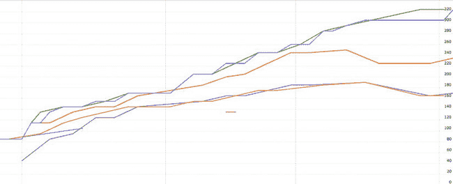

***图 1-4** 我的训练日志时间序列*

### 本书目标

关于当前性能最佳实践的信息，在网上和其他书籍中并不少见——但性能是一个动态的目标。由于每个浏览器都使用不同的 JavaScript 解释器和渲染引擎，因此你在不同浏览器及其版本中获得的结果也会不同。由于解释器层面的变化和优化、系统配置的差异以及网络速度的不同，最佳实践也在不断变化或重新定义。大多数浏览器采用的加快发布节奏更是加剧了这种变化速度。

然而，遵循最佳实践同样重要的是衡量自身性能的能力，这样你才能随着时代变迁做出调整，才能注意到自己代码中的细微差别，并通过自己的观察来定义属于你的最佳实践。

本书的目标是为你提供从多个角度随时间观察和追踪 Web 应用程序性能的工具，让你始终了解性能的方方面面。这里所说的工具，不仅指我们将在本书开发过程中编写的代码，也指我们将讨论甚至实现自动化的现有应用程序。更关键的是，我希望赋予你关注这些指标的洞察力，以及将此类工具化和可视化融入你所有工作中的心智模型。

从许多方面来看，分析并优化事物运行和运作的效率，是迈向卓越下一步的一部分。任何熟练工都能按照规格创造出东西，但大师以卓越技艺精雕细琢，并用经验数据证明这种卓越。

### 所用技术及延伸阅读

正如书名所示，本书将大量使用 JavaScript。我们还使用 PHP 来自动化某些工具、抓取结果并格式化数据。如果你还不熟悉 PHP，它的语法和词汇与 JavaScript 相当相似，因此你在两种语言之间切换上下文应该没有问题。对 PHP 的全面介绍超出了本书的范围。如果你想对该语言有更多了解，可以查阅 W. Jason Gilmore 的 `Beginning PHP and MySQL`（Apress, 2005）；如果你想更深入地了解现代 PHP，请查阅 Peter MacIntyre、Brian Danchilla 和 Mladen Gogala 合著的 `Pro PHP Programming`（Apress, 2011）。

我们将大量使用的另一种语言是 R，它既是一种语言，也是运行该语言的环境，用于运行统计计算和对你导入或衍生的数据进行图表化。它是一种非常有趣的语言，具有非常特定的用途。

如果你不熟悉其语法，甚至不了解像不同数据类型这样基础的概念，R 起初可能会让人望而生畏。别担心；我会解释你理解我们将用 R 编写的代码所需的一切。如果你想更深入地了解 R——考虑到顶尖公司的大多数统计信息都是用 R 推导得出的³，并且数据科学是未来几年增长最大的领域之一⁴，你难道不想多了解 R 吗？——那么我推荐 Robert Kabicoff 的 `R in Action`（Manning, 2011）和 Norman Matloff 的 `The Art of R Programming: A Tour of Statistical Design`（No Starch Press, 2011）。这两本书都将 R 视为一种编程语言，而非数学环境，这使得开发者更容易掌握。

学习 R 非常有用，你用得越多，就越会发现它的用途。而且它是完全可扩展的，拥有丰富的插件架构和庞大的社区来构建插件；几乎找不到 R 做不到的事情——至少在统计学和数据可视化领域是如此。

正如我之前所说，关于整体 Web 性能优化的主题，有大量资源可供进一步阅读和探索。我已经提及了 Steve Souders 的著作；他是 Web 性能领域的杰出人物。他的网站是 [`http://www.stevesouders.com/`](http://www.stevesouders.com/)，他撰写了两本书，深入探讨了 Web 性能的许多方面。他还运行着 [`http://httparchive.org/`](http://httparchive.org/)，其目标是成为 Web 性能指标和统计数据的档案库。在这里可以找到各种有趣的东西，从使用 jQuery 的网站百分比到 Flash 使用量的长期趋势。这对于查看整体趋势以及在开发新功能或应用程序时进行竞争分析非常有用。

万维网联盟（W3C）有一个专门致力于 Web 性能的工作组。该小组正在努力为当前标准创建规范和扩展，以公开功能，使开发者能够更原生地在浏览器中跟踪性能。他们的章程位于：[`http://www.w3.org/2010/webperf/`](http://www.w3.org/2010/webperf/)。我们将在第 5 章中讨论该小组取得的进展和制定的规范。

由于本书的重点不仅在于性能，还在于信息可视化，我推荐 Nathan Yau 的著作 `Visualize This: The FlowingData Guide to Design, Visualization, and Statistics`（Wiley, 2011）作为数据可视化这门手艺的绝佳入门读物。Nathan 还维护着 [`http://flowingdata.com/`](http://flowingdata.com/)。

### 本章小结

本章探讨了围绕性能的一些入门概念。我们定义了 Web 应用程序的两个性能方面：**Web 性能** 指的是向最终用户提供内容所需的时间，而**运行时性能**则指最终用户在使用应用程序时，应用程序的响应速度。

我们简要探讨了将 Web 连接起来的一些协议，例如 TCP/IP 模型，并追踪了从浏览器发起内容请求，向上经过 TCP/IP 模型的过程，将每个操作与它在模型中发生的位置关联起来。我们研究了 TCP 往返的架构，并看到了浏览器为我们请求的每段内容所需经历的步骤——有时在遇到 HTTP 重定向的情况下，每段内容需要多次请求。

______

³ [`http://www.revolutionanalytics.com/what-is-open-source-r/companies-using-r.php`](http://www.revolutionanalytics.com/what-is-open-source-r/companies-using-r.php) 和 [`http://www.nytimes.com/2009/01/07/technology/business-computing/07program.html`](http://www.nytimes.com/2009/01/07/technology/business-computing/07program.html)

⁴ [`http://mashable.com/2012/01/13/career-of-the-future-data-scientist-infographic/`](http://mashable.com/2012/01/13/career-of-the-future-data-scientist-infographic/)

我们研究了现代浏览器的架构，发现浏览器不再是巨大的黑盒单体，而是模块化的，有些甚至是开源的。我们讨论了这种模块化架构的好处，指出随着 Web 变得无处不在，渲染引擎正被用于其他应用程序，例如解析和渲染电子邮件客户端中的标记，或嵌入到自定义应用程序中，我们甚至可以将浏览器的部分组件嵌入到自己的应用程序中。

我们探讨了性能为何对企业至关重要，从客户满意度到关注用户流失率。

最后，我们开始讨论收集、分析和可视化数据。这最后一点是本书中反复出现的主题——用经验数据进行度量和量化，然后将这些数据可视化以展示数据的整体形态。数据的形态是关键；它能揭示原始数据中不明显的趋势和模式。我们看一眼可视化图表，就能大致明白它在表达什么。

在接下来的章节中，我们将更深入地探讨这些概念。下一章我们将从探索可用于跟踪和改进性能的工具开始。

## 第 2 章


### 用于度量和影响性能的工具与技术

第一章 概述了 Web 性能和运行时性能的概念，并讨论了各自的影响因素。本章将介绍一些可用于跟踪性能并帮助改进性能的工具。

在未来的章节中，我们将探讨如何以编程方式使用其中一些工具，并将它们组合起来创建图表和报告应用程序，因此首先熟悉它们是必不可少的。其他工具，如 Firebug 和 YSlow，则是开发和维护高性能网站的基本工具。

#### Firebug

2006 年是 Web 开发领域精彩的一年。首先，微软发布了 Internet Explorer 7，它原生支持 `XMLHttpRequest` 对象的 JavaScript 支持——在此之前，Web 开发人员必须编写分支代码。如果浏览器的 JavaScript 引擎支持 XHR，我们就使用它；否则，我们就知道正在使用早期版本的 IE，并实例化 XHR ActiveX 控件。

2006 年还涌现出了一系列新的框架，包括 jQuery、MooTools 和 YUI，它们的共同目标是加速和简化开发。

可以说，这一年最重要的里程碑是来自 Joe Hewitt 和 Mozilla 团队发布的 Firebug。Firebug 是一个浏览器内置工具，使得 Web 开发人员能够完成许多以前无法完成的任务。我们现在可以通过控制台命令行调用函数或运行代码，动态修改 CSS，以及——在谈论性能时让我们最感兴趣的一点——监控构成页面的网络资源在下载过程中的情况。如果你目前还没有在计算机上运行 Firebug，请按照以下步骤进行安装。

##### 如何安装

首先，我们来安装 Firebug。你可以从这里获取最新版本的 Firebug：[`https://getfirebug.com/downloads/`](https://getfirebug.com/downloads/)。它最初是作为 Firefox 扩展发布的，但此后也有了适用于大多数其他浏览器的 Firebug 精简版。由于 Firebug 精简版不包含网络监控选项卡，因此本节我们将使用 Firefox，以便能够使用 Firebug 的所有功能。

导航到刚才显示的 URL，你会看到一个页面，其中提供了可供下载的不同版本的 Firebug，如图 2-1 所示。


图 2-1. Firebug 下载界面

选择你想要的 Firebug 版本后，会跳转到下载页面（图 2-2）。点击“添加到 Firefox”，扩展程序将自行下载并安装。重新启动浏览器以完成安装。

安装好 Firebug 后，点击浏览器右上角的 Firebug 图标，或者在“文件”菜单中点击“Web 开发者” “Firebug”，即可打开 Firebug 控制台，如图 2-3 所示。

这个控制台既美观又非常实用。在这里，你可以查看插入到代码中的调试信息、查看错误信息、输出对象以查看其结构和值、调用页面作用域内的函数，甚至运行临时的 JavaScript 代码。如果你在 Firebug 出现之前没有从事过 Web 开发，你可能无法体会它最终能在浏览器中完成这些事情是一个多么重要的分水岭。那时，如果你已经习惯了用于编译型语言的集成开发环境（IDE），习惯了内存分析、能够在运行时调试代码、查看变量内部值并单步执行逻辑，你可能会对 Web 开发缺乏这些工具而感到相当沮丧。


图 2-2. 点击“添加到 Firefox”按钮以安装该插件。


图 2-3. Firebug 控制台

尽管控制台既美观又实用，但我们目前关注的是“网络”选项卡。

##### 使用方法

Firebug 中的网络监控是一个被动工具；你只需点击 `Net` 标签（Network Monitoring 的缩写）（如果是首次点击该标签，则需要启用此面板），然后导航至一个网页（以下示例中是我的 `tom-barker.com`）。在页面加载过程中，你会看到所有网络资源开始加载。此显示是一个瀑布图（参见图 2-4）。

如第 1 章所述，瀑布图是一种数据可视化工具，用于演示系统中依次添加和移除元素所产生的效果。在网页性能监控领域，瀑布图被用来展示页面的有效载荷和加载时间如何受构成页面的各个组件的影响。

瀑布图中的每个长条都是你页面中的一个远程内容片段，无论是图片、JavaScript 文件、SWF 文件还是网络字体。这些长条按行堆叠，从上到下依次表示最先下载到最后下载的条目。这向我们展示了每个条目在下载过程中的位置——图片 A 在图片 B 之前下载，外部 JS 文件最后下载，以此类推——以及每个内容片段需要多长时间才能下载完成。除了图表中的长条，每一行还有若干列，用于显示对应内容片段的 URL、HTTP 状态、源域名、文件大小和远程 IP 地址。蓝色垂直线表示文档解析已完成，红色垂直线表示文档加载已完成。这些竖直长条的颜色编码表示在给定时间点，连接特定资源所处的过程阶段：蓝色部分表示 DNS 查找，黄色部分表示连接，红色部分表示发送，紫色部分表示等待数据，绿色部分表示接收数据。

`Net` 标签下方有一个子导航栏，允许你在瀑布图中过滤结果。你可以显示所有内容、仅 HTML 内容、仅 JavaScript、仅 Ajax 请求（称为 `XHR`，即 `XML Http Request` 对象）、仅图片、仅 Flash 内容或仅媒体文件。参见图 2-5 中按 JavaScript 过滤后的结果。

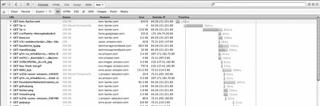

图 2-4. 网络监控标签中的瀑布图

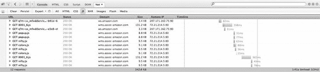

图 2-5. 按资源类型过滤结果

通常情况下，你可以使用 Firebug 来了解开发或生产支持中可能存在的问题。你可以主动监控有效载荷的大小和总体加载时间，还可以检查以确保你的页面加载时间不会过长。我的页面总体大小是多少？哪些资源最大？哪个资源加载时间最长？你可以回答诸如此类的问题。你可以使用过滤器重点关注某些方面，例如查看外部 JavaScript 文件有多大。甚至还可以按域名对行进行排序，以查看按域名分组的内容，或者按 HTTP 状态排序，以快速找出任何报错的调用。

由于 Firebug 是一个仅报告当前情况而不提供改进建议的被动工具，它最适合用作开发工具或用于调试出现的问题。

#### YSlow

若要更深入地分析页面的网页性能，你可以使用 YSlow。

YSlow 由 Steve Souders 和雅虎团队开发，于 2007 年发布。它最初是作为 Firefox 扩展发布的，但后来也移植到了大多数其他浏览器。与 Firebug 类似，YSlow 也是一个浏览器内工具，并且同样不支持太多自动化操作，但它是评估页面网页性能并获取改进性能步骤反馈的宝贵工具。

改进步骤是 YSlow 的真正与众不同之处。它使用一套标准来评估给定页面的性能，并提供针对你网站特定需求的反馈。最棒的是，这些标准是动态更新的，YSlow 团队会随着最佳实践的变化和旧标准变得不再适用而对其进行更新。

让我们来试试 YSlow。

##### 安装方法

要安装 YSlow，只需导航至 [`http://yslow.org/`](http://yslow.org/) 并选择你想运行的平台。图 2-6 展示了 YSlow 网站上当前可用的所有不同浏览器和平台。

由于我们已经在使用 Firebug 的 Firefox 浏览器，让我们继续使用该浏览器来运行 YSlow。选择 Firefox 版本后，安装该扩展并重启浏览器，你就可以开始使用 YSlow 了。


图 2-6. 访问 YSlow 的不同方式

##### 使用方法

在 Firefox 中打开 Firebug，可以看到它新增了一个名为 `YSlow` 的选项卡。点击该选项卡后，会显示如图 2-7 所示的启动画面。在此画面中，你可以对浏览器当前加载的页面运行 `YSlow` 测试，或选择在每次加载新页面时自动运行测试。

你还可以选择用于评估页面的规则集。正如我一直强调的，最佳实践是不断变化的，不同的规则集反映了这一点。规则集包括：`YSlow` 最初发布时附带的一组经典规则；一个更新后的规则集（`V2`），它改变了某些规则（如将 CSS 和 JavaScript 外部化）的权重，并添加了许多新规则；以及一组适用于小型站点和博客的规则子集，在这些场景下，某些规则可能显得过于严苛。

运行测试后，你将看到如图 2-8 所示的结果界面。结果界面分为两个区域：左侧是各项规则及其相应的评级，右侧是对规则的说明。

关于 `YSlow` 所用规则的详细分类，请参阅 [`http://developer.yahoo.com/performance/rules.html`](http://developer.yahoo.com/performance/rules.html)。

结果下方有一个子导航栏，可进一步细分结果，显示页面组件、页面统计信息以及可用于进一步优化性能的工具。

**组件**部分与 Firebug 中的**网络监视**选项卡非常相似；它列出了页面中的各个资源，以及每个组件的文件大小、`URL`、响应头、响应时间、过期头和 `etag`。


**提示：** 实体标签（简称 `etag`）是由 Web 服务器生成的指纹，通过 HTTP 事务发送并存储在客户端。这是一种缓存机制：客户端通过在其事务中发送存储的 `etag` 来请求内容，服务器则进行比较，看发送的 `etag` 是否与其存储的 `etag` 匹配。如果匹配，客户端将使用缓存的版本。


***图 2-7.** YSlow 扩展*

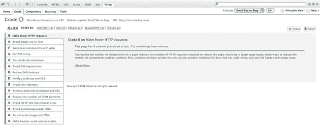

***图 2-8.** YSlow 结果界面*

但请注意：`etag` 对生成它的服务器是唯一的。如果你的内容由服务器集群（而非单台服务器）提供，那么当客户端从不同的服务器请求内容时，`etag` 将不匹配，你也无法获得内容被缓存的优势。

**统计信息**部分，如图 2-9 所示，显示两个饼图，展示了页面组件的分解情况。左侧图表显示未缓存任何内容时的结果，右侧显示后续缓存后的视图。这对于识别能够带来最大性能提升的领域非常有用。

通过比较图 2-9 中的两个图表，你可以看到，在缓存之前，JavaScript 和图片是页面中占比最大的两部分。缓存可以缓解图片方面的问题，但我相信，通过使用我们即将讨论的工具 `Minify`，我们可以进一步减少 JavaScript 的占用空间。

还有其他与 `YSlow` 类似的产品。谷歌随后推出了 `Page Speed`，作为一个独立站点，地址为：[`https://developers.google.com/speed/pagespeed/insights`](https://developers.google.com/speed/pagespeed/insights)。`Page Speed` 也可作为 Chrome 或 Firefox 的浏览器扩展使用，下载地址为：[`https://developers.google.com/speed/pagespeed/insights_extensions`](https://developers.google.com/speed/pagespeed/insights_extensions)。

`YSlow` 与 `Page Speed` 之间的差异可以忽略不计，主要取决于个人在风格和呈现方式上的偏好。

图 2-10 展示了在 Chrome 开发者工具中运行的 `Page Speed` 测试结果。

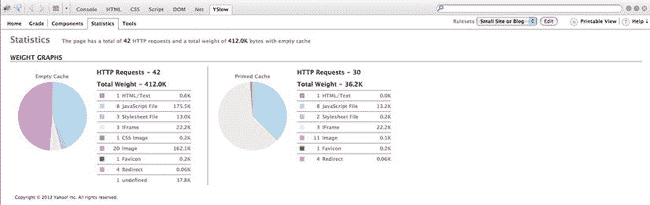

***图 2-9.** YSlow 结果界面——统计信息*

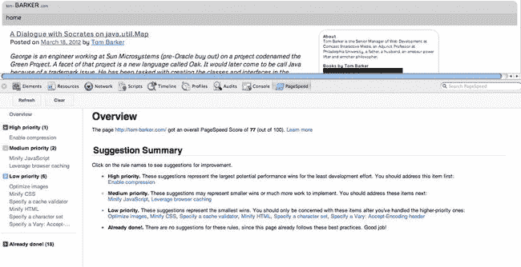

***图 2-10.** Page Speed 结果*

另一个类似的产品是 `WebPagetest`。由于其丰富的功能集和潜在的自动化能力，`WebPagetest` 将是我们接下来要详细讨论的产品。

### WebPagetest

`WebPagetest` 最初由 AOL 创建，并于 2008 年开源供公众使用和贡献。它既可以作为公共网站，也可以作为开源项目使用，还可以下载后运行私有实例。其代码仓库位于 [`http://code.google.com/p/webpagetest/`](http://code.google.com/p/webpagetest/)。公共网站地址为 [`http://www.webpagetest.org/`](http://www.webpagetest.org/)，如图 2-11 所示。该公共站点由 Pat Meenan 通过其公司 WebPagetest LLC 维护和运营。

`WebPagetest` 是一个 Web 应用程序，它以 URL 和一组配置参数作为输入，并对该 URL 运行性能测试。我们可以为 `WebPagetest` 配置的参数数量和范围非常强大。

如果您需要对非公开可用的网站（例如 QA 或开发环境）运行测试，或者由于法律或其他原因只能将测试结果存储在自己的服务器上，那么安装您自己的 `WebPagetest` 私有实例是可行的方法。否则，没有理由不使用公共实例。

您可以从全球各地的一组位置中选择测试运行的地点。每个地点都配备了一个或多个可用于在该地点进行测试的浏览器。您还可以指定连接速度和要运行的测试次数。

在“高级”（Advanced）面板中，您可以在文档加载完成时停止测试运行。这将在 `document.onload` 事件被触发时通知我们，而不是在页面上的所有资源都加载完毕时。这很有用，因为页面加载后可能发生的 XHR 通信会被注册为新活动，从而影响测试结果。您还可以让测试忽略 SSL 证书错误，否则这些错误会阻止测试，因为需要与最终用户交互才能允许事务继续、查看证书或取消事务。

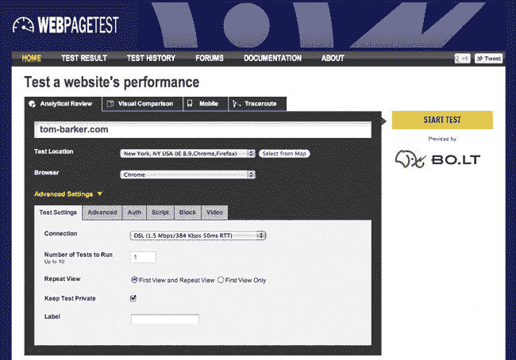

***图 2-11.** Webpagetest.org*

在“高级”选项卡中还有许多其他选项；您可以让测试捕获数据包跟踪和网络日志，提供测试中涉及的网络事务的详细细节，或者选择“保留原始用户代理字符串”（Preserve original User Agent string）选项，让测试保留运行测试的浏览器的用户代理字符串，而不是附加一个字符串来将访问标识为 `WebPagetest` 测试。

在“身份验证”（Auth）选项卡中，如果网站使用 HTTP 身份验证进行访问，您可以指定要使用的凭据；但请务必谨慎。绝不建议使用真实的生产环境用户名和密码来测试和存储数据于公共服务器上。更可取的做法是为此目的创建具有受限权限的测试凭据。

有时您需要测试非常特定的条件。也许您正在对某个功能集进行多变量测试，其中您只在特定的客户端配置上提供特定功能，例如 iPhone 特定功能。或者，您需要针对根据推断的使用习惯分组的目标用户测试某些功能。那么您就需要对这些仅由特殊事件触发的功能运行性能测试。

“脚本”（Script）选项卡正可让您实现这一点。您可以运行更复杂的测试，包括多个步骤，例如导航到多个 URL、向 DOM 发送点击和按键事件、提交表单数据、执行临时 JavaScript 以及更新 DOM。您甚至可以更改 HTTP 请求设置，以执行诸如设置特定 Cookie、设置主机 IP 或更改用户代理等操作。

例如，要让客户端显示为 iPhone，只需添加以下脚本：

```
setUserAgent          Mozilla/5.0 (iPhone; U; CPU iPhone OS 4_0 like Mac OS X; en-us)
AppleWebKit/532.9 (KHTML, like Gecko) Version/4.0.5 Mobile/8A293 Safari/6531.22.7
navigate http://tom-barker.com
```

`setUserAgent` 命令会模拟客户端用户代理，而 `navigate` 命令则会指示测试访问指定的 URL。您可以在此处阅读更多关于语法以及使用脚本控制 `WebPagetest` 所能实现的一些出色功能：[`https://sites.google.com/a/webpagetest.org/docs/using-webpagetest/scripting`](https://sites.google.com/a/webpagetest.org/docs/using-webpagetest/scripting)。

“阻止”（Block）选项卡允许我们阻止请求中的内容。这对于比较有广告和无广告、有 JavaScript 和无 JavaScript、有图片和无图片时的结果非常有用。除了使用“阻止”选项卡，我们也可以将阻止命令作为脚本的一部分集成到“脚本”选项卡中。如果我们想通过脚本阻止网站中的所有 PNG，脚本如下所示：

```
block .png
navigate http://www.tom-barker.com
```

最后，“视频”（Video）选项卡允许您在页面加载时捕获屏幕截图，并将其作为视频查看。这对于观察页面加载时的外观非常有用，尤其是当您有异步加载的内容时；您可以查看在流程的哪个时间点页面看起来可用了。

因此，一旦您设置了所有配置选项，就可以运行测试了。您可以在图 2-12 中看到我的结果屏幕。

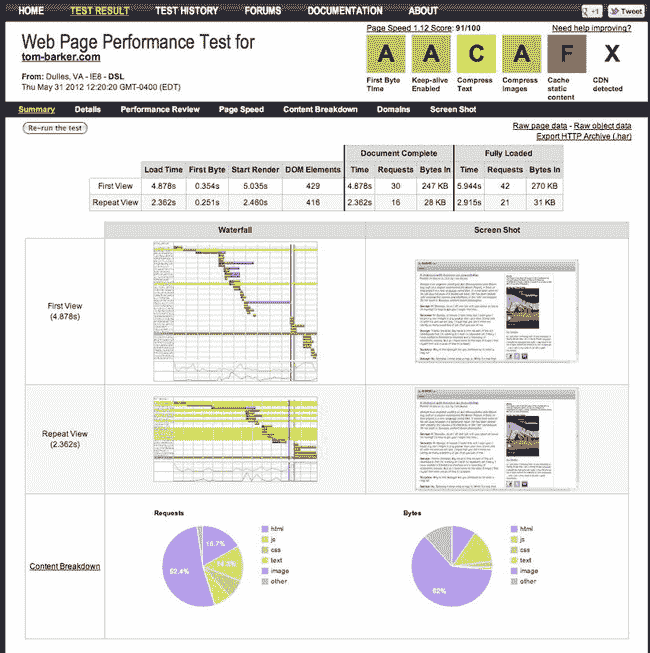

*图 2-12. 网页测试结果页面*

首先，“摘要”（Summary）屏幕为您汇总了所有关键相关信息。右上角是我们页面的“页面速度”（Page Speed）结果摘要。这是以 YSlow 的字母评分格式展示的、与我们在“页面速度”中运行测试时将呈现的相同信息的高级表示。

在瀑布图和屏幕截图上方有一个表格，其中包含页面级指标，例如：整个页面的加载时间、首字节加载耗时、第一块内容绘制到屏幕上所花时间、页面上的 DOM 元素数量、`document.onload` 事件触发所花时间、页面上所有元素加载完成所花时间，以及绘制页面所需的 HTTP 请求数量。

请记下这些数据。它们构成了基本的量化指标，您将在下一章中使用这些指标来绘制 Web 性能图表。它们是一个网站 Web 性能的真正核心。

在此表格下方有两列。左侧是首次访问和缓存后重复访问的瀑布图，右侧是对应的屏幕截图。我们已经详细讨论过瀑布图的巨大作用了。

再下面是两个饼图。左侧的饼图显示了按内容类型划分的请求百分比。右侧的饼图显示了按内容类型划分的字节数百分比，这对于识别可以优化的最大领域非常有用。如果您的 `JavaScript` 仅占总负载的 5%，而图片占了 70%，那么优先优化图片会效果更好。

此摘要页面以高级别汇总了您可以通过其子导航栏访问的页面中的所有数据。单击此栏中的“详细信息”（Details）、“性能审核”（Performance Review）、“页面速度”（Page Speed）、“内容分解”（Content Breakdown）、“域”（Domains）和“屏幕截图”（Screen Shot）链接，可以深入了解每一项。“内容分解”部分如图 2-13 所示。它显示了每一块内容在列名中列出的标准（保持连接、Gzip 文本、压缩图片、缓存静态资源、合并、检测到 CDN、压缩 JS 和 Cookie）下的表现。绿色勾号表示满足标准，带感叹号的黄色三角形表示警告，红色 X 表示错误。

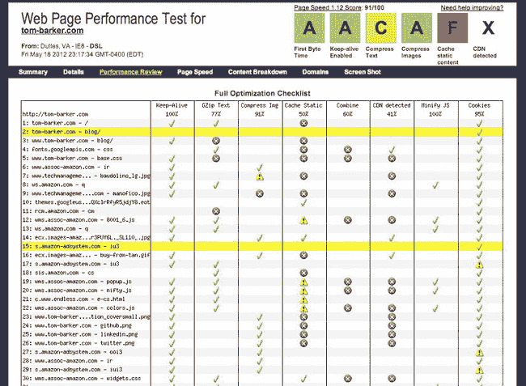

*图 2-13. Webpagetest 性能优化检查清单*

正如您所见，WebPagetest 提供了关于网站 Web 性能的丰富信息，但最重要的是，它是完全可编程的。它提供了一个 API，您可以调用它来获取所有这些信息。下一章我们将探索该 API，并构建我们自己的应用程序来跟踪和报告 Web 性能。

### 代码压缩

通常，人们会花费大量精力来优化缓存。这是一件好事，因为尽可能多地缓存内容不仅可以为后续访问带来更好的用户体验，还可以节省带宽以及对源服务器的请求次数。

但当用户首次访问网站时，缓存是空的。因此，为了确保首次访问尽可能流畅，我们需要压缩 `JavaScript`。

代码压缩的核心理念是：`JavaScript` 解释器会忽略空格、换行符以及注释，因此我们可以通过删除这些不必要的字符来减小 `.js` 文件的总体积。

有很多工具可以对 `JavaScript` 进行代码压缩。一些优秀的工具还在此基础上增加了新的功能。

#### Minify

首先，我们来看一下 `Minify`，可在 [`http://code.google.com/p/minify/`](http://code.google.com/p/minify/) 获取。`Minify` 代理了 `JavaScript` 文件；页面上的 `script` 标签指向 `Minify`，它是一个 `PHP` 文件（在下面的代码中，我们直接指向 `/min` 目录，因为 `PHP` 文件是 `index.php`）。该 `script` 标签如下所示：

```html
<script type="text/javascript" src="/min/?f=lib/perfLogger.js"></script>
```

`注意`：Web 代理是一种代码，它接受一个 URL，读取并处理该 URL 的内容，然后使这些内容可用于其他场景，无论是原样提供还是附加了额外的功能或格式。通常，我们使用代理来使一个域名上的内容可供另一个域名的客户端代码使用。`Minify` 读取内容，通过删除多余字符来修饰它，并对响应进行 gzip 压缩。

`Minify` 读取 `JavaScript` 文件，对其进行压缩，并在响应时设置 HTTP 头 `Accept-Encoding` 为 `gzip, deflate`。实际上，它内置了 HTTP 静态压缩功能。当您的网站托管商不允许对静态内容进行 gzip 压缩时（不幸的是，就像我使用的网站托管商一样），这尤其有用。请参见图 2-14 了解 `Minify` 工作的高级架构。

要使用 `Minify`，只需从 [`http://code.google.com/p/minify/`](http://code.google.com/p/minify/) 下载项目，将解压缩后的 `/min` 文件夹放置在您网站的根目录下，然后导航至 `Minify` 控制面板，其路径为 `/min/builder/`。

在此控制面板中，您可以添加希望包含在压缩结果中的 `JavaScript` 文件，页面会生成一个 `script` 标签，您可以使用该标签来链接到压缩后的结果。非常简单。

*图 2-14. Minify 的序列图。`script` 标签指向 `Minify`，并传入 `JavaScript` 文件的 URL。`Minify` 删除不必要的字符，将响应头设置为 gzip 编码，并将结果返回给 `script` 标签，该标签在浏览器中加载此脚本。*

#### YUI Compressor

另一个代码压缩工具是雅虎的 `YUI Compressor`，可在此处获取： [`http://yuilibrary.com/download/yuicompressor/`](http://yuilibrary.com/download/yuicompressor/)。`YUI Compressor` 是一个 `jar` 文件，可以通过命令行运行。因此，它可以很容易地集成到构建过程中。其使用方式如下：

```bash
java -jar yuicompressor-[version].jar [options] [file name]
```

与 `Minify` 一样，`YUI Compressor` 会从您的 `JavaScript` 中删除所有不必要的字符，包括空格、换行符和注释。要更详细地了解 `YUI Compressor` 的可用选项，请参见 [`http://developer.yahoo.com/yui/compressor`](http://developer.yahoo.com/yui/compressor)。

#### Closure Compiler

最后，我们来看一下谷歌的 `Closure Compiler`，可在 [`https://developers.google.com/closure/compiler/`](https://developers.google.com/closure/compiler/) 获取。`Closure Compiler` 也可以从命令行运行并集成到自动化流程中，但它更进一步，不仅对 `JavaScript` 进行压缩，还会进行重写。为了重写我们的 `JavaScript`，`Closure Compiler` 会执行一系列“焦土”优化——它会展开函数、重写变量名、删除从未被调用的函数（就它所能判断的而言）。这些被称为“焦土”优化，因为它们会剥离所有内容，包括最佳实践，以追求尽可能精简的载荷。这种方法非常成功。我们永远不会用这种风格来编写代码，因此我们会保留原始版本，并通过 `Closure Compiler` 将它们“编译”成最优化代码。我们将这种“编译”后的代码保存为单独的文件，以便保留原始代码进行更新。

为了解 `Closure Compiler` 如何重写我们的 `JavaScript`，让我们看一段代码在运行 `Closure Compiler` 前后的对比。对于“之前”的代码，我们使用一个小例子，该例子将在第 7 章中使用。

```markdown
# JavaScript 性能测试与代码压缩

```javascript
<script src="/lib/perfLogger.js"></script>
<script>
     function populateArray(len){
          var retArray = new Array(len)
          for(var i = 0; i < len; i++){
               retArray[i] = 1;
          }
          return retArray
     }
perfLogger.startTimeLogging("page_render", "timing page render", true, true)
/* ***
7.1
Compare timing for loop against for in loop
****/
var stepTest = populateArray(40);
perfLogger.startTimeLogging("for_loop", "timing for loop", true,true, true)
for(var x = 0; x < stepTest.length; x++){
}
perfLogger.stopTimeLogging("for_loop");
perfLogger.startTimeLogging("for_in_loop", "timing for in loop", true, true)
for(ind in stepTest){
}
perfLogger.stopTimeLogging("for_in_loop")
/** end 7.1 ***/
/* ***
7.1.1
Benchmark for loop and for in loop
****/
function useForLoop(){
     var stepTest = populateArray(40);
     for(var x = 0; x < stepTest.length; x++){
     }
}
function useForInLoop(){
     var stepTest = populateArray(40);
     for(ind in stepTest){
     }
}
perfLogger.logBenchmark("f", 1, useForLoop, true, true);
perfLogger.logBenchmark("fi", 1, useForInLoop, true, true);
perfLogger.stopTimeLogging("page_render")
</script>
```

`Closure Compiler` 将该代码重写为：

```javascript
<script>
var b=[];function e(a,c){b[a]={};b[a].id=a;b[a].startTime=new Date;b[a].description=c;b[a].a=!0}
function f(a){b[a].d=new Date;b[a].c=b[a].d-b[a].startTime;b[a].url=window.location;b[a].
e=navigator.userAgent;b[a].a&&g(a)}function h(a,c){for(var d=0,j=0;10>j;j++)e(a,"benchmarking"
+c),c(),f(a),d+=b[a].c;b[a].a=drawToPage;b[a].b=d/10;b[a].a&&g(a)}
function g(a){var c=document.getElementById("debug"),d="<p><strong>"+b[a].description+"</strong>
<br/>",d=b[a].b?d+("average run time: "+b[a].b+"ms<br/>"):d+("run time: "+b[a].
c+"ms<br/>"),d=d+("path: "+b[a].url+"<br/>"),d=d+("useragent: "+b[a].e+"<br/>"),a=d+"</p>";c?c.
innerHTML+=a:(c=document.createElement("div"),c.id="debug",c.innerHTML=a,document.body.
appendChild(c))}function i(){for(var a=Array(4E4),c=0;4E4>c;c++)a[c]=1;return a}e("page_
render","timing page render");var k=i();e("for_loop","timing for loop");
for(var l=0;l<k.length;l++);f("for_loop");e("for_in_loop","timing for in loop");for(ind in
k);f("for_in_loop");h("f",function(){for(var a=i(),c=0;c<a.length;c++);});h("fi",function(){var
a=i();for(ind in a);});f("page_render");
</script>
```

在所有性能指标上都有了显著改善，但代价是牺牲了可读性和与原始代码的抽象层次。

## 结果比较

为了确定在特定情况下使用的最佳工具，我们将采用科学方法！我们来实现刚刚讨论过的工具，并运行一个多变量测试，亲自看看哪个工具能给我们带来最佳效果。

首先，我们来看一个未压缩代码样本的瀑布图，如图 2-15 所示。我们看到，未压缩和未精简的 JavaScript 文件大小为 2.1 KB，页面总大小为 3.3 KB。该样本可在 [`http://tom-barker.com/lab/perfLogger_example.html`](http://tom-barker.com/lab/perfLogger_example.html) 找到。

现在，让我们使用 `Minify` 并测试其结果。从图 2-16 的瀑布图中可以看到，由 `Minify` 提供的 JavaScript（经过精简和 Gzip 压缩）仅为 573 字节，页面总大小为 1.9 KB。

当我在同样的文件上使用 `YUI Compressor` 和 `Closure Compiler`（选择简单选项，仅精简文件而不重写代码）时，得到了相同的结果；JavaScript 文件大小均缩减至 1.6 KB，页面总大小为 2.9 KB。参见图 2-17。

请注意，我使用的 Web 主机不支持全局范围内的 HTTP 压缩，因此这些结果仅为精简后的结果，并未进行 Gzip 压缩。因此，这不是对压缩算法进行的公平比较，而只是对工具开箱即用效果的比较。

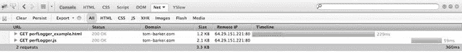

**图 2-15.** 未压缩 JavaScript 的瀑布图，我们的基准线

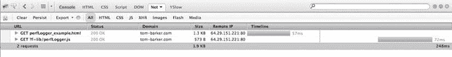

**图 2-16.** 使用 `Minify` 压缩后的页面

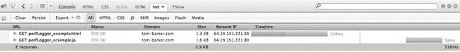

**图 2-17.** 使用 `Closure Compiler`（简单模式）压缩后的页面

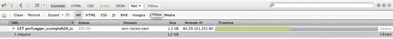

**图 2-18.** 使用 `Closure Compiler`（高级模式）压缩并内联后的页面

最后的比较是，将原始 JavaScript 文件通过启用 `Advanced` 选项的 `Closure Compiler` 运行，使其尽可能精简地重写代码。执行此操作时，请确保包含页面上的所有 JavaScript；也就是说，不仅包括远程的 `.js` 文件，还包括页面上实例化对象的 JavaScript。这样做是必要的，因为 `Closure Compiler` 会消除所有它认为未被执行的代码。所以，如果你在远程 JS 文件中有一个带命名空间的对象，但在 HTML 页面中有实例化它的代码，你需要将实例化该对象的代码包含在同一个文件中，这样 `Closure Compiler` 才能看到它被使用了，并将其包含在输出中。

我将把 `Closure Compiler` 的最终输出嵌入到 HTML 页面中，而不是外部链接。你可以在图 2-18 中看到结果。

现在我们有了一些数据，让我们将其可视化并进行评估。

### 分析与可视化

我们将打开 `R`，输入我们的精简结果、工具名称、每个工具输出文件的新大小以及每个文件的百分比差异。然后，我们将编写一些 `R` 代码，创建一个水平条形图来比较差异。

别担心，为此我们将深入探索 `R`，并且我会解释每一行代码的作用。现在，让我们先来看看你最终将生成的图表，如图 2-19 所示。
```

从图 2-19 中可以看出，`Closure Compiler` 开箱即用提供了最大的尺寸缩减，而 `Minify` 结合了精简和 Gzip 压缩，紧随其后，位列第二。`YUI` 和 `Closure Compiler` 提供的简单精简并列第三，但差距较大。

再次强调，这个比较是开箱即用的性能——如果我们对排名第三的结果进行 Gzip 压缩，它们会获得与 `Minify` 相似的结果，但 `Minify` 本身就提供了 Gzip 压缩。

单纯的文件尺寸缩减只是我们整体评估的一个方面。正如你在前面的例子中所见，`Closure Compiler` 高级模式的输出与原始代码大相径庭。如果生产环境出现问题，调试可能会非常困难，尤其是当你的页面中有第三方代码与你的代码交互时。

你的网站是否有第三方代码，例如广告代码？你是托管自己的服务器，还是受限于某个 Web 主机？与追求极致速度体验相比，生产环境支持对你来说有多重要？在确定自己偏好的工具时，最好像我们刚才做的那样进行评估，看看哪种工具最适合你自己的情况、环境和业务规则。例如，你是否有一个构建环境，可以在其中集成此工具并控制 Web 主机的配置？如果是这样，那么 `YUI` 或 `Closure Compiler` 可能是你的最佳选择。你是否能接受 `Closure Compiler` 高级设置那种“焦土”式的做法？如果是这样，它确实能带来最大的性能提升——但在生产环境中尝试调试其输出可就要祝你好运了。

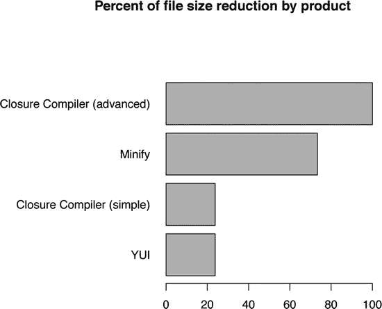

**图 2-19.** 在 `R` 中生成的比较图表，展示各产品的文件缩减百分比

## 开始使用 R

`R` 由 Ross Ihaka 和 Robert Gentleman 于 1993 年创建。它是 `S` 语言的扩展和继承者，而 `S` 语言本身是由 John Chambers 于 1976 年在贝尔实验室创建的一种统计语言。

`R` 既是一个开源环境，也是在该环境中运行的语言，用于进行统计计算。这是一个非常宽泛的描述。我既不是统计学家，也不是数据分析师。我是一名 Web 开发人员，并且管理着一个 Web 开发团队。如果你正在阅读本书，你很可能也是一名 Web 开发人员。那么，作为 Web 开发人员，我们用 `R` 做什么呢？

通常，我使用 `R` 来导入数据、解析数据、处理数据，然后将其可视化，用于报告目的。图 2-20 展示了这个工作流程。这不是我在这个流程中使用的唯一语言，但它是我最新的最爱。我通常需要其他语言来访问数据源或从其他应用程序抓取数据。在下一章中，我们将使用 `PHP` 作为我们的“胶水语言”来完成这项工作，但我们几乎可以使用任何其他语言——`Ruby`、Shell 脚本、`Perl`、`Python` 等等。

在使用胶水语言收集数据后，我将数据写入一个逗号分隔的文件，然后读入 `R`。在 `R` 中，我处理数据：拆分、求平均值、聚合、叠加两个或多个数据集，然后，在 `R` 内部，我将数据绘制成图表，以讲述我看到的故事。

一旦我创建了图表（通常保存为 `PDF` 格式以保持矢量和字体），我从 `R` 中将图表导入 `Adobe Illustrator` 或任何其他类似程序中，在那里我可以清理诸如字体一致性之类的问题，并确保长名称的轴标签清晰可见。


**图 2-20.** 使用 `R` 准备数据可视化的工作流程

我通常用 `R` 处理什么样的数据？各种类型的数据。在本书中，我们研究如何使用 `R` 来可视化性能数据，但我也会使用 `R` 报告我的部门指标，例如代码库的缺陷密度或代码覆盖率。

作为一种语言，它小巧、独立、可扩展，并且使用起来很有趣。话虽如此，它确实有自己的理念和特性，我们将在本书中探讨其中一部分。

### 安装与运行 R

要安装 `R`，首先需要从 [`http://cran.r-project.org/`](http://cran.r-project.org/) 下载预编译的 `R` 二进制文件。对于 Mac 和 PC，这是一个标准安装程序，会引导你完成安装过程。PC 安装程序有三种版本：`Base` 是基础安装版，`Contrib` 包含已编译的第三方包，`Rtools` 则包含用于自行构建 `R` 包的工具。就本书而言，我们将使用基础安装版。`R` 安装程序的截图请参见图 2-21。

对于 Linux 用户，则需要根据其特定的 Linux 发行版，在终端中执行相应的命令行来安装。

安装完成后，即可打开 `R Console`，这是我们将要运行 `R` 语言的交互环境。该控制台的界面如图 2-22 所示。

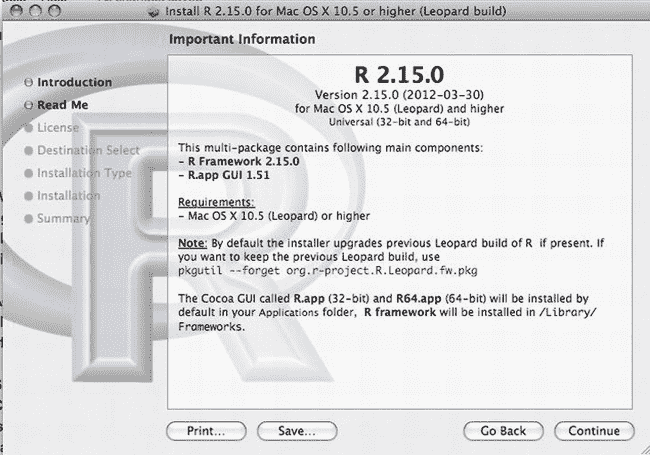

**图 2-21.** Mac 上的 `R` 安装程序

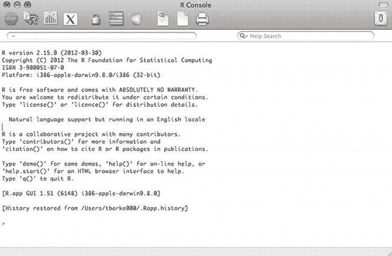

**图 2-22.** `R` 控制台

控制台的工具栏允许我们执行各种任务，例如中断正在运行的 `R` 进程、运行独立的 `.R` 文件、调整控制台的外观、创建新的独立 `.R` 文件等。

`R Console` 是一个用于执行临时 `R` 命令的命令行环境。我通常使用控制台来构思想法，并反复调整直到得到预期的结果，然后将这些可用的表达式转移到独立的 `R` 文件中。

你可以创建外部文件来保存 `R` 代码，这些文件通常以 `.R` 为扩展名。

`R` 还具有高度的可扩展性，并拥有一个活跃的社区，社区成员会构建各种包来扩展 `R` 的功能。尽管如此，本书中所有 `R` 代码将不会使用任何包，仅依赖 `R` 的基础安装功能。

### R 入门指南

既然你已经了解了 `R` 是什么，那么如何使用 `R` 呢？首先要注意的是，你随时可以输入 `?[关键字]` 来打开特定主题的帮助窗口。如果你不确定要查找的内容是否有独立主题，只需输入 `??[关键字]` 进行更广泛的搜索。例如，输入 `?hist` 搜索关于创建直方图的帮助。

```
> ?hist
starting httpd help server ... done
```

同样重要的是，`R` 支持单行注释，但不支持多行注释。井号 (`#`) 用于开始注释，`R` 解释器会忽略从井号到行尾的所有内容。

```
#this is a comment
```

#### 变量与数据类型

声明变量非常简单，只需为其赋值即可。赋值运算符是左箭头 `<-`，因此创建和声明变量如下所示：

```
foo <- bar
```

`R` 是弱类型语言，它支持所有你期望的标量数据类型：字符串、数字和布尔值。

```
myString <- “This is a string”
myNumber <- 23
myBool <- TRUE
```

它还支持列表，但这也是该语言的一个特殊之处。`R` 有一种叫做 `vector` 的数据类型，其功能几乎像一个严格类型的一维数组。它是一个所有元素均为相同数据类型（字符串、数字或布尔值）的列表。要声明 `vector`，请使用组合函数 `c()`，向 `vector` 添加元素也同样使用 `c()` 函数。使用方括号访问 `vector` 中的元素。与大多数语言中的数组不同，`vector` 的索引不是从零开始的；第一个元素被引用为元素 `[1]`。

```
myVector <- c(12,343,564) # 声明一个向量
myVector <- c(myVector, 545) # 将数字 545 追加到 myVector
myVector[3] # 返回 564
```

`R` 还有另一种列表类型，称为 `matrix`。`矩阵`类似于严格类型的二维数组。你使用 `matrix` 函数创建`矩阵`，该函数接受五个参数：用作内容的 `vector`，将内容塑形的行数，将内容塑形的列数，一个可选的布尔值，用于指示是否按行或按列塑形内容（默认值为按列塑形，即 `FALSE`），以及一个包含行名和列名向量的列表：

```
matrix([*内容向量*], nrow=[*行数*], ncol=[*列数*], byrow=[*排序方式*],
dimnames=[*行名向量*, *列名向量*])
```

同样使用方括号访问`矩阵`中的索引，但必须在方括号内同时指定行和列。

```
m <- matrix(c(11,12,13,14,15,16,17,18), nrow=4, ncol=2, dimnames=list(c("row1", "row2", "row3",
"row4"), c("col1", "col2")))
```

```
> m
    col1 col2
row1   11   15
row2   12   16
row3   13   17
row4   14   18
```

```
>m[1,1]  # 将返回 11
[1]11
```

```
> m[4,2]   # 将返回 18
[1] 18
```

# 数据框与数据操作

到目前为止，`matrices` 和 `vectors` 都只能包含单一数据类型。`R` 支持另一种列表类型，称为 `data frame`。`数据框`是多维列表，可以包含多种数据类型——但也不完全是。更简单的理解方式是将`数据框`视为 `vectors` 的集合。`向量`仍然只能保存一种数据类型，但`数据框`可以保存多种类型的`向量`。

你可以使用 `data.frame()` 函数创建`数据框`，该函数接受多个 `vector` 作为内容，以及以下参数：`row.names` 用于指定作为行标识符的 `vector`，`check.rows` 用于检查行数据的一致性，`check.names` 用于检查重复等其他语法检查。

```
userid <- c(1,2,3,4,5,6,7,8,9)
    username <- c("user1", "user2", "user3", "user4", "user5", "user6", "user7", "user8",
"user9")
    admin <- c(FALSE, FALSE, TRUE, FALSE, TRUE, FALSE, FALSE, TRUE, TRUE)
```

```
users <- data.frame(username, admin, row.names=userid)
> users
   username admin
1    user1 FALSE
2    user2 FALSE
3    user3  TRUE
4    user4 FALSE
5    user5  TRUE
6    user6 FALSE
7    user7 FALSE
8    user8  TRUE
9    user9  TRUE
```

使用方括号访问`数据框`中的单个 `vectors`：

```
> users[1]
   username
1    user1
2    user2
3    user3
4    user4
5    user5
6    user6
7    user7
8    user8
9    user9
```

使用 `$` 符号来隔离列，使用方括号来指定这些列的单个索引。`R` 中的 `$` 类似于大多其他语言中的点符号。

```
> users$admin[3]
[1] TRUE
```

# 导入外部数据

既然你已经了解了如何存储数据，现在我们来看看如何导入数据。你可以使用 `read.table()` 函数从平面文件读取数据。该函数接受四个参数：要读取的平面文件的路径，一个布尔值，指示平面文件的第一行是否包含列名，作为列分隔符的字符，以及作为行标识符的列。`read.table()` 函数返回一个 `data frame`。

```
read.table([文件路径], [是否将第一行视为列名],[列分隔符],[用作行标识符的列])
```

例如，假设你有以下平面文件，其中包含 bug 积压工作的细分：

```
Section,Resolved,UnResolved,Total
Regression,71,32,103
Compliance,4,2,6
Development,19,8,27
```

你可以使用以下代码读取此文件：

```
bugData <- read.table("/bugsbyUS.txt", header=TRUE, sep=",", row.names="Section")
```

如果你检查生成的 `bugData` 对象，应该会看到以下内容：

```
> bugData
            Resolved UnResolved Total
Regression        71         32   103
Compliance         4          2     6
Development       19          8    27
```

## 循环

`R` 同时支持 `for` 循环和 `while` 循环，它们的结构与你的预期非常相似：

```
for(n in list){}
while ([条件为真]){}
```

要遍历 `users` 数据框，你可以简单地执行以下操作：

```
for(i in users){
print(users$admin[i])
}
[1] FALSE FALSE  TRUE FALSE FALSE
[1] TRUE
```

同样适用于 bug 数据：

```
> for(x in bugData$UnResolved){
+      print(x)
+ }
32
2
8
```

### 函数

R 中的函数也与您预期的一样工作；我们可以传入参数，函数将其作为参数接收，并能从函数中返回数据。请注意，在 R 中所有数据都是按值传递的。

我们按如下方式构建函数：

```
functionName <- function([parameters]){

}
```

### 使用 R 进行简单绘图

现在开始，R 会变得真正有趣。您已经知道如何导入数据、存储数据以及遍历数据；接下来，让我们将数据可视化！

R 原生支持多种绘图函数。我们首先要看的是 `plot()` 函数。

`plot()` 函数会根据您传入的参数显示不同类型的图表。它接受以下参数：一个支持绘图功能的 R 对象；一个可选参数，当第一个参数不包含 y 轴值时，可作为 y 轴值的补充；数量可变的命名图形参数；一个用于确定图表绘制类型的字符串（稍后会详细说明）；图表的标题；图表的副标题；x 轴的标签；y 轴的标签；以及一个用于表示图表纵横比（纵横比即 y/x 的数值结果）的数字。

让我们看看一些绘图类型选项是如何在图表显示中体现的。请注意，当您绘制 `users` 数据框时，x 轴是用户名列的数值表示，y 轴是管理员列，但其显示范围是 0 到 1（而不是 TRUE 和 FALSE）。图 2-23 显示了结果。

```
plot(users, main="绘制用户数据框\n 未指定类型")
plot(users, type="p", main="绘制用户数据框\ntype=p 表示点图")
plot(users, type="l", main="绘制用户数据框\ntype=l 表示线图")
plot(users, type="b", main="绘制用户数据框\ntype=b 表示点线图")
plot(users, type="c", main="绘制用户数据框\ntype=c 表示线图（不含点）")
plot(users, type="o", main="绘制用户数据框\ntype=o 表示叠加图")
plot(users, type="h", main="绘制用户数据框\ntype=h 表示直方图")
plot(users, type="s", main="绘制用户数据框\ntype=s 表示阶梯图")
plot(users, type="n", main="绘制用户数据框\ntype=n 表示不绘图")
```

R 的基础安装也支持条形图，使用的是 `barplot()` 函数。`barplot()` 函数接受的一些最常用参数包括：一个用于表示条形高度的向量或矩阵；一个可选的 `width` 参数；每个条形前的间距；一个用于列出每个条形名称的向量；用作图例的文本；一个名为 `beside` 的布尔值，用于指示条形图是否堆叠；另一个布尔值，若设为 TRUE 则表示条形应为水平而非垂直；一个用于填充条形颜色的向量；一个用于设置每个条形边框颜色的向量；以及图表的标题和副标题。如需完整列表，只需在控制台中输入 `?barplot`。

图 2-24 显示了 `users` 数据框以条形图形式呈现的效果。

```
barplot(users$admin, names.arg=users$username, main="管理员用户条形图")
```

您还可以在 R 中原生创建气泡图。为此，请使用 `symbols()` 函数，传入您想要表示的 R 对象，并将 `circles` 参数设置为一个代表每个圆圈半径的列。

 注意：气泡图用于表示三维数据。它们与散点图非常相似，通过点在 x 轴和 y 轴上的位置来表示数值，但在气泡图中，点的半径也表示数值。

图 2-25 显示了结果。

```
symbols(users, circles=users$admin, bg="red", main="管理员用户气泡图")
```

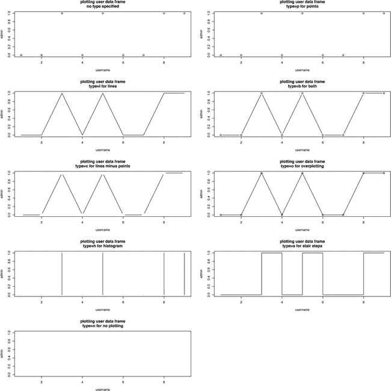

*图 2-23. 使用 plot 函数绘制的不同图表类型*

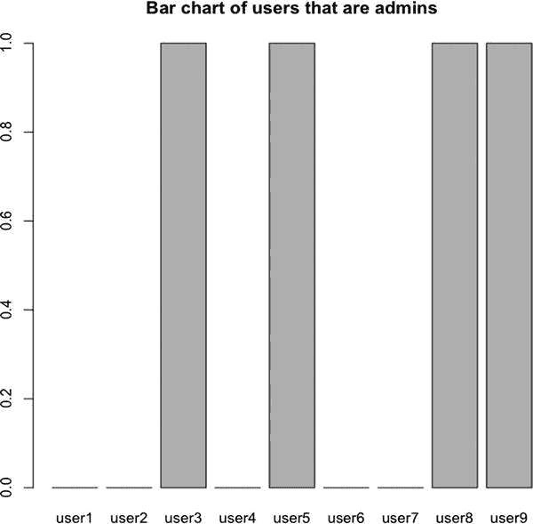

*图 2-24. 管理员用户条形图*

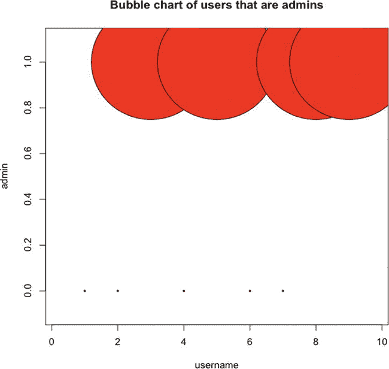

*图 2-25. 管理员用户气泡图*

`symbols()` 函数可用于在图表上绘制其他形状；有关此类型的更多信息，请在 R 控制台中输入 `?symbols`。

您可以通过调用与所需文件类型对应的函数来保存生成的图表。请注意，在输出完成后需要调用 `dev.off`。例如，要创建条形图的 JPEG 文件，您可以调用：

```
jpeg("test.jpg")
barplot(users$admin)
dev.off()
```

可用的函数如下：

```
pdf([filename]) #将图表保存为 PDF 文件
win.metafile([filename]) #将图表保存为 Windows 图元文件
png([filename]) #将图表保存为 PNG 文件
jpeg([filename]) #将图表保存为 JPG 文件
bmp([filename]) #将图表保存为 BMP 文件
postscript([filename]) #将图表保存为 PS 文件
```

## R 语言的实际示例

以上只是对 R 语言的初步体验，但既然你已经了解了它的基本构成要素，我们就来构建之前在图 2-19 中看到的图表。

首先，你将创建四个变量：一个用于保存未压缩 JavaScript 文件大小的数值，一个用于保存工具名称的向量，一个用于保存经过工具处理后的 JavaScript 文件大小的向量，以及最后一个用于保存压缩后大小与原始大小之间百分比差异的向量。

稍后你将对最后一个变量进行重构，但现在先让它保持硬编码状态，这样你就能看到我们用于计算百分比的模式——100 减去新大小除以总大小再乘以 100 的结果。

```
originalSize <- 2150
tool <- c("YUI", "Closure Compiler (simple)", "Minify", "Closure Compiler (advanced)")
size <- c(1638, 1638, 573, 0)
diff <- c((100 - (1638 / 2150)*100), (100 - (1638 / 2150)*100), (100 - (573 / 2150)*100), (100 - (0 / 2150)*100))
```

接下来，从这些向量创建一个数据框，并将工具名称的向量作为行标识符。

```
mincompare <- data.frame(diff, size, row.names=tool)
```

如果你在控制台中输入 `mincompare`，你会看到它的结构如下：

```
>mincompare
                                diff size
YUI                          23.81395 1638
Closure Compiler (simple)    23.81395 1638
Minify                       73.34884  573
Closure Compiler (advanced) 100.00000    0
```

完美！至此，你可以开始构建图表了。使用 `barplot` 函数绘制 `diff` 列。将图表设置为水平，显式地将 y 轴名称设为数据框的行名，并为图表添加标题“各产品文件大小缩减百分比”：

```
barplot(mincompare$diff, horiz=TRUE, names.arg =row.names(mincompare), main="Percent of file size reduction by product")
```

如果在控制台中运行此代码，你会发现已经接近目标了。结果应该类似于图 2-26。

你可以看到第一个和第三个 y 轴名称缺失了；这是因为当前文本太大，无法垂直显示。你可以通过将文本设置为与条形图一样的水平方向来修正这个问题。

为此，使用 `par` 函数设置图表的图形参数。但首先，保存现有参数，以便在创建图表后能恢复它们：

```
opar <- par(no.readonly=TRUE)
```

这会将现有参数保存到名为 `opar` 的变量中，以便在完成后恢复它们。

接下来，使用 `par()` 函数将文本设置为水平方向：

```
par(las=1, mar=c(10,10,10,10))
```

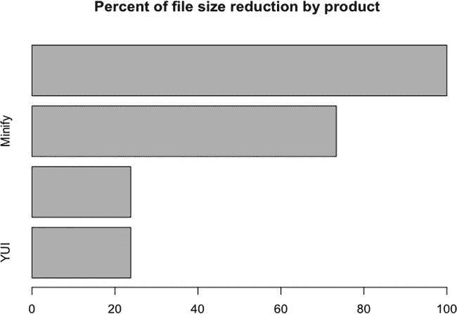

`par()` 函数可以接受多个参数。这段代码传入了 `las` 参数（用于更改坐标轴标签样式）并将其设置为 1，这使得坐标轴标签始终水平显示，同时传入了 `mar` 参数来设置图表的边距。

在调用 `barplot` 绘制图表后，你可以通过以下代码恢复原始的图形参数：

```
par(opar)
```

要保存此图表，你需要将其导出。你可以将对 `barplot` 和 `par` 的调用封装在对 `pdf` 函数的调用中，并传入要保存图表的文件名。本示例将导出为 PDF 格式，以保留矢量线条和原始文本，这样我们可以在后期使用 Illustrator 或其他类似程序进行编辑和优化：

```
pdf("Figure 2-19.pdf")
```

在恢复图形参数后，通过调用 `dev.off()` 关闭文件。

到目前为止，代码应该如下所示：

```
originalSize <- 2150
tool <- c("YUI", "Closure Compiler (simple)", "Minify", "Closure Compiler (advanced)")
size <- c(1638, 1638, 573, 0)
diff <- c((100 - (1638 / 2150)*100), (100 - (1638 / 2150)*100), (100 - (573 / 2150)*100), (100 - (0 / 2150)*100))
mincompare <- data.frame(diff, size, row.names=tool)

pdf("Figure 2-19.pdf")
opar <- par(no.readonly=TRUE)
     par(las=1, mar=c(10,10,10,10))
     barplot(mincompare$diff, horiz=TRUE, names.arg =row.names(mincompare), main="Percent of file size reduction by product")
par(opar)
dev.off()
```

但有些事情让我困扰。我不喜欢 `diff` 变量硬编码的方式，而且我们一遍又一遍地重复相同的算法来设置这些值。让我们把它抽象成一个函数。

将函数命名为 `getPercentImproved`，并让它接受两个参数：一个数值向量和一个数值：

```
getPercentImproved <- function(sourceVector, totalSize){}
```

在函数内部，创建一个空向量；这个向量将保存我们函数的结果，并且我们会在函数末尾返回这个向量：

```
percentVector <- c()
```

然后遍历传入的向量：

```
for(i in sourceVector){}
```

在迭代过程中，我们运行算法来计算每个元素中数值的差异。记住，公式是

(100–([新文件大小] / [原始文件大小])*100)

将结果保存到我们新的向量 `percentVector` 中：

```
percentVector <- c(percentVector,(100 - (i / totalSize)*100))
```

循环完成后，我们返回新的向量。

```
return(percentVector)
```

我们最终的函数应该如下所示：

```
getPercentImproved <- function(sourceVector, totalSize){
    percentVector <- c()
    for(i in sourceVector){
       percentVector <- c(percentVector,(100 - (i / totalSize)*100))
    }
    return(percentVector)
}
```

最后，将向量 `diff` 设置为 `getPercentImproved` 函数的结果，并传入名为 `size` 的向量和变量 `originalSize`：

```
diff <- getPercentImproved(size, originalSize)
```

你的最终代码应该如下所示：

### 使用 `apply()`

`apply()` 函数允许我们对列表中的元素应用一个函数。它接受多个参数：第一个是值列表，接下来是一个数字向量，用于指示我们如何对列表应用函数（`1` 代表行，`2` 代表列，`c(1, 2)` 代表行和列），最后一个参数是要应用于列表的函数：

`apply([列表], [应用函数的方式], [要应用的函数])`

我们可以去掉 `getPercentImproved` 函数，改用以下代码：

`diff <- apply(as.matrix(size), 1, function(x) 100 - (x / 2150) * 100)`

请注意，这会在将 `size` 变量传递给 `apply()` 时将其转换为矩阵。这是因为 `apply()` 期望接收矩阵、数组或数据框。`apply()` 函数还有一个衍生函数 `lapply()`，你也可以使用。

使用 `apply` 时，你的代码更精简，并且更符合语言的原本设计意图；它遵循语言的核心理念，即更侧重于结合统计分析的逻辑编程，而非命令式编程。更新后的代码现在应如下所示：

```r
originalSize <- 2150
tool <- c("YUI", "Closure Compiler (simple)", "Minify", "Closure Compiler (advanced)")
size <- c(1638, 1638, 573, 0)
diff <- apply(as.matrix(size), 1, function(x) 100 - (x / originalSize) * 100)
mincompare <- data.frame(diff, size, row.names = tool)

pdf("Figure 2-19.pdf")
opar <- par(no.readonly = TRUE)
   par(las = 1, mar = c(10, 10, 10, 10))
   barplot(mincompare$diff, horiz = TRUE, names.arg = row.names(mincompare), main = "Percent of file size reduction by product")
par(opar)
dev.off()
```

构建图表的最后一步是将其导入 Adobe Illustrator 或其他矢量绘图程序中进行精修，例如调整文本对齐方式或字体大小。虽然这种格式调整在 R 中也能实现，但在专门的应用程序中操作要强大得多。

## 总结

在本章中，我们学习了几种对我们创建和维护高性能网站至关重要的工具。我们了解到 Firebug 的网络监控标签是追踪构成页面的网络依赖关系及其对页面速度影响的绝佳工具。其被动特性使其成为我们在开发页面或调试已知问题时可用的优秀工具。

我们使用 YSlow 的不同过滤器测试了网站的当前性能，还获得了针对性地优化网站性能的定制化建议。

借助 WebPagetest，我们还能看到外部资源的影响并获得性能建议，并且能够查看重复访问的结果，以及获取多个数据维度的高级聚合数据。我们了解了 WebPagetest 强大的配置集，包括用于测试更复杂场景的脚本功能。我们还看到 WebPagetest 提供了一个 API，我们将在下一章使用它来自动化性能监控。

我们探索了几种用于压缩 JavaScript 的工具。我们实现了每个工具，并通过可视化每个工具带来的文件大小差异来比较结果。我们也开始关注一些抽象细节，这些细节表明性能不仅仅是数据那么简单。

随后，我们初步涉足了 R 语言。我们安装了 R 控制台，探索了 R 的一些入门概念，并用 R 编写了我们的第一个图表——也就是用来比较不同压缩工具结果的同一张图表。

在接下来的章节中，我们将运用并扩展 R 语言的知识，同时也会使用本章探讨的许多工具和概念。

## 第 3 章


### WPTRunner——使用 WebPagetest 实现自动化性能监控与可视化

上一章为我们奠定了坚实的基础，我们将在本书的其余部分继续以此为基础进行构建。我们学习了如何使用 Firebug 和 YSlow 生成瀑布图，并将其作为调试工具。我们探索了 WebPagetest 的一些广泛特性和功能。我们讨论了压缩 JavaScript 的概念，并进行了一次多变量测试来比较几种压缩工具的结果。本章通过学习和编写 R 脚本来可视化多变量测试结果作为结尾。

本章将扩展这些概念。你将连接到 WebPagetest 提供的 API 来自动化监控多个 URL，并使用 R 来可视化这些结果。

你将本质上创建一个框架，使你能够监控网站的 Web 性能。通过接入特定的 URL，你还可以跨 URL 运行多变量测试，并比较功能更新或广告选择对网站性能产生的影响。

#### 架构

让我们首先来完善一个架构。我通常会在开始一个项目时，站在白板前，使用 UML 来梳理高层概念和用例。或者，我会打开 Omnigraffle、Visio 或其他流程图应用程序，制作一份架构文档。为此，你将创建一个 UML 序列图来展示系统中对象或流程之间的交互。

正如你在上一章所见，WebPagetest 是一个强大的 Web 应用程序，可以提供详细的 Web 性能信息。它还公开了一个 API，你可以调用它来触发测试。基于此，你知道需要一个东西来调用 API 并接收响应。

你也知道需要解析从 WebPagetest 返回的响应，所以让我们在架构文档中创建三个流程：一个代表 WebPagetest，一个用于调用 API，一个用于处理响应。

我们将调用分页测试 API 的流程称为 `run_wpt`，将处理结果的流程称为 `process_wpt_response`。到目前为止，我们的序列图应如图 Figure 3-1 所示。

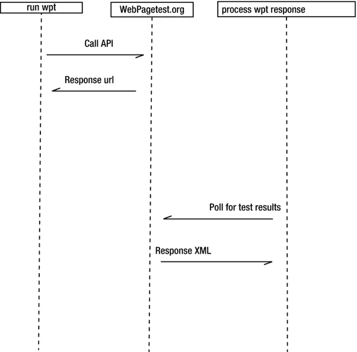

***图 3-1.** 序列图的第一次迭代*

这是一个很好的开端。根据上一章使用 WebPagetest 的经验，我们知道 WPT 中的测试通常不是即时完成的。你需要排队，即使排到队列最前面，测试本身也需要一些时间。这是可以预料的，因为测试并非模拟体验，而是真实地在你选择的代理中加载网站。

从策略上讲，这意味着当你调用 API 时，它会返回一个 URL，你可以轮询该 URL 以了解测试何时完成。这一点很重要，因为你需要保存返回的 URL，并能够反复引用它们，直到测试完成，因此你需要将它们存储在一个平面文件中。你将把值追加到该平面文件中；也就是说，你将最新的值添加到文件末尾。为了保持简单，你可以使用一个名为 `webpagetest_responses.txt` 的平面文件。

测试完成后，你还需要使用一个平面文件来存储测试结果。你将把这个平面文件命名为 `wpo_log.txt`。最后，你还需要一个 R 脚本来读取 `wpo_log.txt` 并生成图表。

如果你将这些附加部分添加到序列图中，完成的架构文档应如图 Figure 3-2 所示。

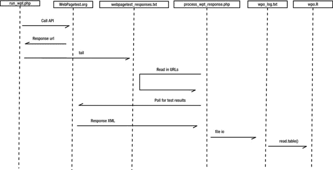

***图 3-2.** 完整的 WPTRunner 序列图*

在本示例中，你将创建 PHP 文件来自动化 `run_wpt` 和 `process_wpt_response` 流程，但实际上，你可以使用几乎任何语言来实现。

为此项目创建以下目录结构：

`/data` - 存放平面文件

`/util` - 存放共享文件和工具

`/charts` - 存放我们用 R 生成的图表

好的，作为一名高级文档工程师和翻译员，我将严格遵循您提供的注意事项和示例格式，将给定的英文文本翻译成高质量的中文。

## 创建共享配置文件

在开始之前，你需要一个密钥来访问 WebPagetest API。根据 [`https://sites.google.com/a/webpagetest.org/docs/advanced-features/webpagetest-restful-apis`](https://sites.google.com/a/webpagetest.org/docs/advanced-features/webpagetest-restful-apis) 上的 API 文档，你可以通过给网站所有者 Pat Meenan 发送电子邮件至 `pmeenan@webpagetest.org` 来获取密钥。可能需要一两天或更长时间才能收到你的密钥。一旦你获得 API 密钥，就应该创建一个单独的文件来存放所有需要在进程之间共享的配置信息。

你将把密钥存储为字符串：

`$key = "[你的密钥在此]";`

你知道你会想在这个共享文件中存储 API 密钥，但还有一些其他东西也需要存储。

由于此框架的目的是通过编程方式随时间测试一系列 URL，因此你应该创建一个用于存储 URL 的机制。无论是包含实验性功能或配置的 URL，还是常规的网站监控，你都需要将所有 URL 存储在一个数组中：

`$urls_to_benchmark = array("tom-barker.com", "apress.com/", "amazon.com", "apple.com", "google.com");`

最后，你需要存储所有需要引用的平面文件的路径：

`$csvFiles = "/WPTRunner/data/webpagetest_responses.txt";`

`$wpologfile = "/WPTRunner/data/wpo_log.txt";`

你可以将这个共享文件命名为 `wpt_credentials_urls.php`。它应该位于 `/util` 目录中，内容如下所示：

```php
<?php
$key = "xxxx"; // 我们的 API 密钥
$urls_to_benchmark = array("tom-barker.com", "apress.com/", "amazon.com", "apple.com", "google.com"); // 我们用于监控的 URL 列表
$csvFiles = "/WPTRunner/data/webpagetest_responses.txt";  // 用于存储响应 URL 的平面文件
$wpologfile = "/WPTRunner/data/wpo_log.txt"; // 用于存储测试结果的平面文件
?>
```

从架构文档中你也了解到，你将需要写入几个平面文件。创建一个至少用于处理文件写入的共享文件可能是个好主意。因此，让我们创建一个名为 `fileio.php` 的文件，也放在 `/util` 目录下。

在 `fileio.php` 中，你将创建一个名为 `appendToFile()` 的函数，传入文件路径和数据。该函数将检查传入的文件是否存在，如果存在，则将传入的数据追加到文件中；如果不存在，则会创建该文件并将传入的数据写入其中。

```php
<?php
function appendToFile($data, $file){
     echo "正在写入文件 $file\n";
     $writeFlag = "w";
     if(file_exists($file)){
            $writeFlag = "a";
     }
     $fh = fopen($file, $writeFlag) or die("无法打开文件");
     fwrite($fh, $data . "\n");
     fclose($fh);
}

?>
```

到目前为止，你已经规划了系统的架构，并创建了用于存放配置信息和通用功能的外部文件。接下来，让我们开始充实系统本身。

## 访问 WebPagetest API

好的，让我们从编写初始测试请求的代码开始。访问 WebPagetest 的 URL 是 [`http://www.webpagetest.org/runtest.php.`](http://www.webpagetest.org/runtest.php.) 该 API 接受许多参数，其中包括：

> `url`：你想要测试的 URL。

> `location`：指定测试所用的代理位置、网速和浏览器，格式为 *`location.browser:location`*。例如，使用 Chrome 浏览器的 Dulles 位置可以写成 `Dulles.Chrome`。IE 浏览器略有不同，例如 IE 8 的格式为 `Dulles_IE8`。

 **注意** 文档没有明确说明为什么 Internet Explorer 使用下划线字符，但这种变体值得牢记。

> `runs`：指定要运行的测试次数。

> `fvonly`：如果将 `fvonly` 设置为 1，则只获取首次渲染的结果，不运行重复渲染测试。

> `private`：将 `private` 标志设置为 1，可确保测试结果不会显示在公开测试列表中。

> `block`：此参数允许你设置一个逗号分隔的屏蔽选项列表。还记得上一章的内容，你可以指定 URL 以及文件类型。

> `f`：指定测试结果的格式。它接受 `xml` 和 `json` 两种格式。

> `k`：在此处指定公共 API 密钥。

一个调用 API 的示例类似这样：

[`http://www.webpagetest.org/runtest.php?f=xml&private=1&k=111 &url=tom-barker.com`](http://www.webpagetest.org/runtest.php?f=xml&private=1&k=111&url=tom-barker.com)

你将创建一个名为 `run_wpt.php` 的新 PHP 文件。首先需要构建 URL。你需要引入共享配置文件，以确保能够访问 API 密钥和 URL 数组：

`require("util/wpt_credentials_urls.php");`

然后，你将创建一些变量来保存 API 参数。在这个示例中，你只关心输出格式，将其设置为 XML，并确保测试保持私有状态。

`$outputformat = "xml";`

`$private = 1;`

最后，你将创建一个新变量 `$wpt_url`，用于存储 API 的 URL，并将参数（除了 URL 参数）拼接上去。URL 参数将在下一步处理：

`$wpt_url = "http://www.webpagetest.org/runtest.php?f=$outputformat&private=private&k=$key&url=";`

要设置 URL 参数，你需要遍历在 `wpt_credentials_urls.php` 中设置的 URL 数组。

```php
for($x=0;$x<count($urls_to_benchmark); $x++){

}
```

当你遍历这个循环时，将逐个取出每个元素，并将其拼接到 `$wpt_url` 上。你将使用 PHP 的原生函数 `file_get_contents()` 来访问该 URL，并将服务器的响应读入变量 `$wpt_response`：

`$wpt_response = file_get_contents($wpt_url . $urls_to_benchmark[$x]);`

请记住，API 将返回一个需要解析的 XML 结构。这个 XML 看起来像这样：

```xml
<response>
<statusCode>200</statusCode>
<statusText>Ok</statusText>
<data>
<testId></testId>
<ownerKey></ownerKey>
<xmlUrl></xmlUrl>
<userUrl></userUrl>
<summaryCSV></summaryCSV>
<detailCSV></detailCSV>
</data>
</response>
```

因此，你将使用 `SimpleXMLElement()` 将 API 返回的字符串转换为 XML 对象，并将结果存储在 `$xml` 中。

`$wpt_response = file_get_contents($wpt_url . $urls_to_benchmark[$x]);`

`$xml = new SimpleXMLElement($wpt_response);`

这将允许你解析结果并提取必要的数据。你想要检查的第一个数据是 `statusCode` 节点。它包含了响应的 HTTP 状态码。如果是 200，表示响应成功，然后你提取 `xmlURL` 节点的值（该值包含测试完成后的测试结果 URL），并将其写入平面文件 `webpagetest_responses.txt`。

```
if($xml->statusCode == 200){
    appendToFile($xml->data->xmlUrl, $csvFiles);
}
```

你完成的 `run_wpt.php` 文件应该如下所示：

```php
require("util/wpt_credentials_urls.php");
require("util/fileio.php");
$outputformat = "xml";
$private = 1;
$wpt_url = "http://www.webpagetest.org/runtest.php?f=$outputformat&private=private&k=$key&url=";

for($x=0;$x<count($urls_to_benchmark); $x++){
    $wpt_response = file_get_contents($wpt_url . $urls_to_benchmark[$x]);
    $xml = new SimpleXMLElement($wpt_response);
    if($xml->statusCode == 200){
        appendToFile($xml->data->xmlUrl, $csvFiles);
    }
}
?>
```

 **注意** 务必在命令行中运行 `run_wpt.php`，而不是通过浏览器。要在命令行中运行 PHP 文件，只需调用 PHP 二进制文件并指定 `-f` 选项以及文件路径。`-f` 选项指示解释器读取文件、解析并执行它。因此，要运行 `run_wpt.php`，请在控制台中输入：

```
>php -f run_wpt.php
```

这应该会生成一个格式如下的纯文本文件：

```
http://www.webpagetest.org/xmlResult/120528_SK_db5196c3143a1b81aacc30b2426cec71/
http://www.webpagetest.org/xmlResult/120528_TB_0ca4cfaa17613b0c2213b4e701c5a9dd/
http://www.webpagetest.org/xmlResult/120529_TN_8c20efe8c82a663917456f56aae7c235/
http://www.webpagetest.org/xmlResult/120529_6P_253e58b1cda284b9cf9a80becd19ef9f/
```

### 解析测试结果

到目前为止，你有一个包含 URL 列表的纯文本文件，这些 URL 指向 WebPagetest 测试结果。这些测试并非瞬间完成，因此你需要等待它们完成才能开始解析结果。

你可以开始轮询测试结果 URL，以检查它们是否已完成。测试结果的格式如下：

```
<response>
<statusCode></statusCode>
<statusText></statusText>
<data>
<startTime></startTime>
</data>
</response>
```

要检查测试是否完成，需要检查 `statusCode` 节点。100 状态表示测试等待中，101 表示测试已开始，200 表示测试完成。任何 400 状态码都表示错误。

考虑到这一点，让我们开始解析结果！

首先，你需要包含共享文件，以便能够访问 `fileio()` 函数和纯文本文件的路径：

```php
require("util/wpt_credentials_urls.php");
require("util/fileio.php");
```

接下来，你需要创建一个函数来检查测试结果。将此函数命名为 `readCSVurls()`，并让它接受两个参数：`$csvFiles`（将引用包含测试结果 URL 的纯文本文件 `webpagetest_responses.txt`）和 `$file`（将引用用于存储从测试结果中提取的值的纯文本文件 `wpo_log.txt`）：

```php
function readCSVurls($csvFiles, $file){

}
```

在函数内部，如果 `wpo_log` 存在则将其删除。这只是出于整理目的，因为简单地重新写入结果比检查上次中断位置并插入更加简单且不易出错。然后检查 `webpagetest_responses` 是否存在且是否可读。如果是，则打开该文件并开始循环遍历：

```php
unlink($file); //删除 wpo_log
if (file_exists($csvFiles) && is_readable ($csvFiles)) { //如果文件存在且可读
       $fh = fopen($csvFiles, "r") or die("\n 无法打开文件 $csvFiles");
       while (!feof($fh)) {}
}
```

因此，在这个不断循环直至文件末尾的 `while` 循环中，你将提取文件的每一行，该行包含测试结果 URL。获取该 URL，从服务器获取响应，并将其存储在 `$tailEntry` 中：

```php
$line = fgets($fh);
$tailEntry = file_get_contents(trim($line));
```

如果收到响应，则将其从字符串值转换为名为 `$xml` 的 XML 对象：

```php
if($tailEntry){
$xml = new SimpleXMLElement($tailEntry);
```

响应 XML 的结构如下：

```
<response>
     <statusCode></statusCode>
     <statusText></statusText>
     <requestId></requestId>
     <data>
          <runs></runs>
          <average>
               <firstView>
               </firstView>
               <repeatView>
               </repeatView>
          </average>
          <run>
               <id></id>
               <firstView>
                     <results>
                     </results>
                     <pages>
                     </pages>
                     <thumbnails>
                     </thumbnails>
                     <images>
                     </images>
                     <rawData>
                     </rawData>
               </firstView>
               <repeatView>
                    <results>
                    </results>
                    <pages>
                    </pages>
                    <thumbnails>
                    </thumbnails>
                    <images>
                    </images>
                    <rawData>
                    </rawData>
               </repeatView>
          </run>
     </data>
</response>
```

在这个结构中，你首先关注的是 `statusCode` 节点。如果 `statusCode` 等于 200，说明你收到了一个有效的响应，可以开始解析 XML。如果不是 200，则说明测试尚未完成，应停止进一步处理：

```php
if($xml->statusCode == 200){

}else{
die("webpagetest 上的报告尚未就绪。\n");
}
```

从这个 XML 对象中，你将提取运行测试的页面 URL，以便将其用作行标识符。然后你将提取测试完成的日期、页面的加载时间、页面的总文件大小以及构成页面所需的 HTTP 请求数量。

然后将所有这些值连接成一个由逗号分隔的单个字符串，命名为`$newline`：

```php
$url = $xml->data->run->firstView->results->URL;
$date = $xml->data->completed;
$loadtime = $xml->data->run->firstView->results->loadTime;
$bytes = $xml->data->run->firstView->results->bytesInDoc;
$httprequests = $xml->data->run->firstView->results->requests;
$newline = "$url, $date, $loadtime, $bytes, $httprequests";
```

 **注意** 你正在从`firstView`节点提取结果数据。这样做是为了测试未缓存页面的情况。如果你想测试页面的缓存版本，请从`repeatView`节点提取数据。

然后你检查`wpo_log`是否存在。如果不存在——并且在循环第一次运行时它不会存在，因为你在函数开始时删除了它——你需要格式化该纯文本文件以包含必要的表头。

让我们将其抽象成一个函数。现在你可以在其中放一个名为`formatWPOLog()`的存根函数调用。完成当前函数后，你将回去定义其实现。

然后，你将`$newline`变量和`wpo_log`的路径传递给共享函数`appendToFile`：

```php
if(!file_exists($file)){
formatWPOLog($file);
}
appendToFile($newline, $file);
```

最后，当你从`webpagetest_responses`中提取完每一行后，关闭文件：

```php
fclose($fh);
```

只剩下一件事要做——为`formatWPOLog()`函数定义实现。它应该接受一个文件路径，并将文本“url,day,date,loadtime,bytes,httprequests”作为第一行追加。这第一行将是列标题：

```php
function formatWPOLog($file){
   $headerline = "url, day, date, loadtime, bytes, httprequests";
   appendToFile($headerline, $file);
}
```

### 完整示例

你完成的 `process_wpt_response` 文件应如下所示：

```php
<?php

require("util/wpt_credentials_urls.php");
require("util/fileio.php");

function readCSVurls($csvFiles, $file){
    unlink($file);
    if (file_exists($csvFiles) && is_readable ($csvFiles)) {
        $fh = fopen($csvFiles, "r") or die("\n can't open file $csvFiles");
        while (!feof($fh)) {
            $line = fgets($fh);
            $tailEntry = file_get_contents(trim($line));
            if($tailEntry){
               $xml = new SimpleXMLElement($tailEntry);
               if($xml->statusCode == 200){
                  $url = $xml->data->run->firstView->results->URL;
                  $date = $xml->data->completed;
                  $loadtime = $xml->data->run->firstView->results->loadTime;
                  $bytes = $xml->data->run->firstView->results->bytesInDoc;
                  $httprequests = $xml->data->run->firstView->results->requests;
                  $newline = "$url, $date, $loadtime, $bytes, $httprequests";
                  if(!file_exists($file)){
                      formatWPOLog($file);
                  }
                  appendToFile($newline, $file);

               }else{
                   die("report not ready at webpagetest yet.\n");
               }
           }
        }
      }
      fclose($fh);
}

function formatWPOLog($file){
  $headerline = "url, day, date, loadtime, bytes, httprequests";
  appendToFile($headerline, $file);
}

readCSVurls($csvFiles, $wpologfile);

?>
```

`process_wpt_response` 的输出是一个名为 `wpo_log` 的平面文件，现在它看起来应类似于这样：

```
url, day, date, loadtime, bytes, httprequests
http://tom-barker.com, Tue, 29 May 2012 20:12:21 +0000, 10786, 255329, 42
http://apress.com/, Tue, 29 May 2012 20:12:47 +0000, 4761, 714655, 57
http://amazon.com, Tue, 29 May 2012 20:13:07 +0000, 2504, 268549, 94
http://apple.com, Tue, 29 May 2012 20:12:41 +0000, 3436, 473678, 38
http://google.com, Tue, 29 May 2012 20:12:50 +0000, 763, 182802, 13
```

### 使用 R 绘制图表

每天运行 `run_wpt` 会生成一份每日日志，其中包含逗号分隔的列表，记录了每个你想跟踪的 URL 的加载时间、总负载以及 HTTP 请求数量。这很不错，但这只是其中的一部分。你不能直接把这份数据分发出去，还指望观众能理解全部情况。你需要通过可视化方式来呈现这些数据。

那么，让我们使用 R 来构建一个时间序列图表，以展示性能的变化。首先，创建一个新的 R 文件。根据架构图，你应该将其命名为 `wpo.R`。

首先创建变量，用于保存数据和图表目录的路径：

```r
dataDirectory <- "/Users/tbarke000/WPTRunner/data/"
chartDirectory <- "/Users/tbarke000/WPTRunner/charts/"
```

然后读取 `wpo_log` 的内容，并将其存储为一个名为 `wpologs` 的数据框：

```r
wpologs <- read.table(paste(dataDirectory, "wpo_log.txt", sep=""), header=TRUE, sep=",")
```

 **注意** 这段代码使用 `paste()` 函数将存储的数据目录与文件名拼接起来，以构建文件的完整路径。在 R 中，不像大多数其他语言那样有字符串拼接运算符。你必须使用 `paste()` 函数来代替。该函数接受 *N* 个要拼接的字符串，以及一个 `sep` 参数，用于指定字符串之间粘贴的内容——例如，如果你想在每个字符串之间插入逗号或其他分隔符。在示例中，你指定了一个空字符串。

同样，你应该创建一个变量来保存将为图表创建的文件的路径。将此变量命名为 `wpochart`，并将 `bytes` 列中的数据从字节转换为千字节。

```markdown
## 解析数据

此时，你已经加载了数据，并为要绘制的图表设置了路径。让我们来看看数据的结构。在控制台中输入 `wpologs`，数据应该如下所示：

```r
> wpologs
                     url  day                        date loadtime   bytes httprequests
1  http://tom-barker.com  Tue  29 May 2012 20:12:21 +0000    10786 255.329           42
2     http://apress.com/  Tue  29 May 2012 20:12:47 +0000     4761 714.655           57
3      http://amazon.com  Tue  29 May 2012 20:13:07 +0000     2504 268.549           94
4       http://apple.com  Tue  29 May 2012 20:12:41 +0000     3436 473.678           38
5      http://google.com  Tue  29 May 2012 20:12:50 +0000      763 182.802           13
6  http://tom-barker.com  Wed  30 May 2012 16:28:09 +0000     5890 256.169           42
7     http://apress.com/  Wed  30 May 2012 16:27:56 +0000     4854 708.577           57
8      http://amazon.com  Wed  30 May 2012 16:28:14 +0000     3045 338.276          112
9       http://apple.com  Wed  30 May 2012 16:27:58 +0000     3810 472.700           38
10     http://google.com  Wed  30 May 2012 16:28:09 +0000     1524 253.984           15
```

思考一下时间序列图是什么——你想要为每个 URL 绘制性能指标随时间变化的折线图。这意味着你需要分离出每个 URL 的数据。为此，创建一个名为 `createDataFrameByURL()` 的函数。你可以传入 `wpologs` 数据和想要分离的 URL：

```r
createDataFrameByURL <- function(wpologs, url){
}
```

在这个函数中，你将创建一个空的数据框；这个数据框将在函数中填充并返回：

```r
df <- data.frame()
```

接下来，你将循环遍历传入的 `wpologs` 数据：

```r
for (i in 1:nrow(wpologs)){}
```

在循环内部，你将检查 `url` 列是否与传入的 URL 值匹配。如果匹配，则将其添加到你在函数开头创建的新数据框中：

```r
if(wpologs$url[i] == url){
    df <- rbind(df , wpologs[i,])
}
```

然后设置新数据框的行名称，并将其从函数中返回：

```r
row.names(df) <- df$date
return(df)
```

现在你有了按 URL 分离 WebPagetest 结果的函数，接下来你需要为每个想要绘图的唯一 URL 创建新的数据框。

```r
tbdotcom <- createDataFrameByURL(wpologs, "http://tom-barker.com")
apr <- createDataFrameByURL(wpologs, "http://apress.com/")
amz <- createDataFrameByURL(wpologs, "http://amazon.com")
aapl <- createDataFrameByURL(wpologs, "http://apple.com")
ggl <- createDataFrameByURL(wpologs, "http://google.com")
```

如果在控制台中检查这些新数据框之一，你应该会看到：

```r
> tbdotcom
                                              url  day         date  loadtime    bytes
httprequests
29 May 2012 20:12:21 +0000 http://tom-barker.com  Tue  29 May 2012     10786  255.329
42
30 May 2012 16:28:09 +0000 http://tom-barker.com  Wed  30 May 2012      5890  256.169
42
31 May 2012 12:33:52 +0000 http://tom-barker.com  Thu  31 May 2012      5877  249.528
42
01 Jun 2012 17:58:19 +0000 http://tom-barker.com  Fri  01 Jun 2012      3671  255.337
42
03 Jun 2012 14:41:38 +0000 http://tom-barker.com  Sun  03 Jun 2012      5729  249.590
42
```

## 绘制加载时间

很好！现在我们来绘制其中一列数据。最重要的列是页面加载时间，所以我们先处理它。你将使用 `plot()` 函数并传入 `tbdotcom$loadtime`。你需要为 `plot()` 设置以下选项：

-   `type="l"` 以绘制线条
-   `xaxt="n"` 以不绘制 x 轴
-   `col="#ff0000"` 以将线条颜色设置为红色
-   `ylab = "Load Time in Milliseconds"` 以将其设置为 y 轴上显示的标签。

对 `plot()` 函数的调用应如下所示：

```r
plot(tbdotcom$loadtime, ylim=c(2000,10000), type="l", xaxt="n", xlab="", col="#ff0000",
ylab="Load Time in Milliseconds")
```

如果你没有隐藏 x 轴，它将以一系列数字的形式出现，因为当 R 将 x 轴名称识别为名义有序因子时，默认会将其显示为递增的整数。要让日期显示在 x 轴上，你需要绘制一个自定义坐标轴。使用 `axis()` 函数来实现这一点。`axis` 函数接受的第一个参数是一个数字，指示要绘制哪个坐标轴：1 表示底部，2 表示左侧，3 表示顶部，4 表示右侧。其余参数是命名值，包括以下这些：

> `at`：刻度线应绘制的位置点
> `lab`：作为轴标签显示的值，可以是布尔值，也可以是字符串向量
> `tick`：一个布尔值，用于显示或隐藏刻度标记
> `lty`：线条类型
> `lwd`：线条宽度

你还可以传入图形参数。有关更多详细信息，请在控制台输入 `?axis` 或 `?par`。

因此，你将使用 `axis()` 函数绘制一个 x 轴来显示所有日期，如下所示：

```r
axis(1, at=1: length(row.names(tbdotcom)), lab= rownames(tbdotcom), cex.axis=0.3)
```

有关图表的当前外观，请参见图 3-3。

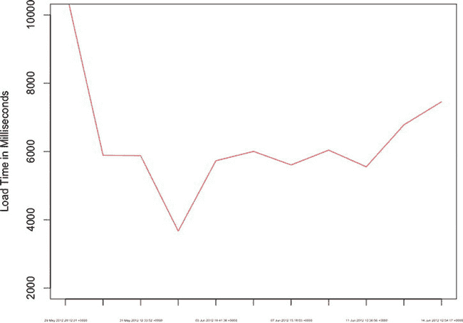

**图 3-3.** tom-barker.com 随时间变化的加载时间

非常好！现在让我们叠加上其他 URL 的加载时间。你可以使用 `line()` 函数绘制线条。它的用法与 `plot()` 函数非常相似；你可以传入一个 R 对象来绘图，并选择线条类型和颜色。

让我们为你一直在跟踪的每个额外 URL 绘制加载时间的线条。
```

综合起来，加载时间图现在应该看起来像图 3-4。

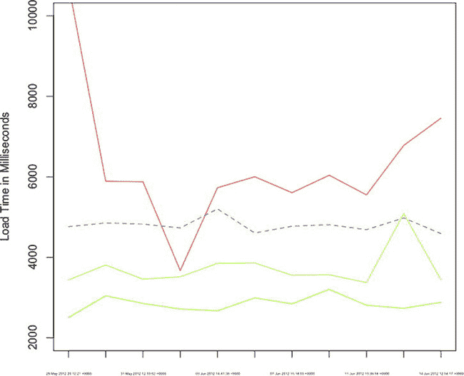

`图 3-4.` 加载时间时间序列图

这令人兴奋，并且最终是从 WebPagetest 获取的数据中最重要的部分。但你也想绘制从测试结果中提取的性能的其他方面，因为它们会影响最终的页面加载时间。如果你绘制出页面大小和 HTTP 请求数量，你将描绘出一个更大的画面，显示页面速度的指标。

## 绘制有效负载和 HTTP 请求数量

下一个图表添加了这些元素。每个指标之间的量纲不同——页面速度是数千毫秒，HTTP 请求数量是数十个，文件大小是数百字节。你可以规范化所有这些数据并以标准差的形式显示，但这会使数据脱离实际数字，而你需要这些数字来调试任何问题。

相反，你将针对每个质量方面创建一个时间序列图。但你会将这些时间序列图放在一个图形中。这样做的原因是为了遵循爱德华·塔夫特（Edward Tufte）良好数据设计的原则之一——使我们的图形尽可能密集地包含数据。

这段代码绘制了数据框中剩余的列，即 `bytes` 和 `httprequests` 列，方式与你绘制 `loadtime` 列基本相同：

```
plot(tbdotcom$bytes, ylim=c(0, 1000), type ="l", col="#ff0000", ylab="Page Size in KB", xlab="",
xaxt="n")
axis(1, at=1: length(row.names(tbdotcom)), lab= rownames(tbdotcom), cex.axis=0.3)
lines(apr$bytes, type="l", lty = 2, col="#0000ff")
lines(amz$bytes, type="l", col="#00ff00")
lines(aapl$bytes, type="l", col="#ffff00")
lines(ggl$bytes, type="l", col="#ff6600")
```

```
plot(tbdotcom$httprequests, ylim=c(10, 150), type ="l", col="#ff0000", ylab="HTTP Requests",
xlab="", xaxt="n")
axis(1, at=1: length(row.names(tbdotcom)), lab= rownames(tbdotcom), cex.axis=0.3)
lines(apr$httprequests, type="l", lty = 2, col="#0000ff")
lines(amz$httprequests, type="l", col="#00ff00")
lines(aapl$httprequests, type="l", col="#ffff00")
lines(ggl$httprequests, type="l", col="#ff6600")
```

现在添加一个图例，以便你知道什么颜色对应什么 URL。首先，你将创建向量来保存每个 URL 的标签以及相应的颜色。

```
WebSites <- c("tom-barker.com", "apress.com/", "amazon.com", "apple.com", "google.com")
WebSiteColors <- c("#ff0000", "#0000ff", "#00ff00", "#ffff00", "#ff6600")
```

然后使用 `plot` 创建一个新图表，但将 `"n"` 传递给 `type` 参数，以便不向图表绘制线条，并将 `xaxt` 和 `yaxt` 设置为 `"n"`，以便不绘制坐标轴。但在这个图表中，你将使用 `legend()` 函数添加一个图例，并传入刚刚创建的标签和颜色向量：

```
plot(tbdotcom$httprequests, type ="n", xlab="", ylab="", xaxt="n", yaxt="n", frame=FALSE)
legend("topright", inset=.05, title="图例", WebSites, lty=c(1,2,1,1,1,1,1,1,1,1,1,1,1,1,1,2),
col= WebSiteColors)
```

要将所有这些图表绘制到同一个图形中，请将对 `plot()` 函数的所有这些调用包装在对 `par()` 的调用中，并向其传递命名参数 `mfrow`。`mfrow` 参数接受一个向量，指定应绘制多少行和多少列，因此传入 `c(2,2)` 表示两行和两列：

```
par(mfrow=c(2,2))
```

这将生成如图 3-5 所示的图形。

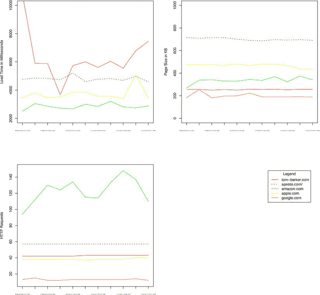

`图 3-5.` 完成的时间序列图形

你完成的 R 代码应如下所示：

```
dataDirectory <- "/Users/tbarke000/WPTRunner/data/"
chartDirectory <- "/Users/tbarke000/WPTRunner/charts/"
wpologs <- read.table(paste(dataDirectory, "wpo_log.txt", sep=""), header=TRUE, sep=",")
wpochart <- paste(chartDirectory, "WPO_timeseries.pdf", sep="")

createDataFrameByURL <- function(wpologs, url){
df <- data.frame()
for (i in 1:nrow(wpologs)){
   if(wpologs$url[i] == url){
       df <- rbind(df , wpologs[i,])
   }
}
row.names(df) <- df$date
return(df)
}

wpologs$bytes <- wpologs$bytes / 1000 #将字节转换为千字节

tbdotcom <- createDataFrameByURL(wpologs, "http://tom-barker.com")
apr <- createDataFrameByURL(wpologs, "http://apress.com/")
amz <- createDataFrameByURL(wpologs, "http://amazon.com")
aapl <- createDataFrameByURL(wpologs, "http://apple.com")
ggl <- createDataFrameByURL(wpologs, "http://google.com")
```

```markdown
## 重构与优化

和往常一样，重构和优化这段代码的方法有很多种。你可以将时间序列数据的绘图逻辑抽象为一个函数，以减少重复代码。我保留原样是为了强化你在创建时间序列时所做的事情。你也可以使用 R 原生的 `apply()` 函数，而不是在 `createDataFrameByURL()` 函数中循环遍历数据。我保留原样是为了尽可能详细地描述代码对数据进行的处理。

## 开源项目

我已经将这个项目命名为 `WPTRunner`，并将其源代码放到了 Github 上的一个独立开源项目中，网址是 [`https://github.com/tomjbarker/WPTRunner`](https://github.com/tomjbarker/WPTRunner)。欢迎各位下载并用于自己的目的，将其分支以启动您自己的项目，或者贡献回馈，使其成为一个对大家都有益的更好项目。

## 总结

本章探讨了一种使用 **WebPagetest、PHP 和 R** 来自动化跟踪一组 URL 网页性能的方法。这种方法有很多用途。当然，您可以用它来跟踪网站性能随时间的变化，但也可以用于跟踪您计划添加到网站的实验性功能的性能，甚至可以跟踪页面在投入生产前的开发阶段性能。

您可以将此报告的结果用作您期望的性能标准，并建立流程来确保新功能不会影响该性能。您可以生成内部、外部以及面向高管的报告，将这些数据与其他数据（如发布日期、用户访问量或任何其他相关和关键数据）关联起来。

下一章，您将创建一个 **JavaScript** 库来基准测试您 JavaScript 代码的运行时性能，并将这些数据绘制成图表，以提取有用的指标。这些指标不仅可以用于形成您自己的代码标准，还可以影响产品决策和浏览器支持矩阵。作为额外福利，我们将在本章结束时采访 **WebPagetest** 的创建者 **Patrick Meenan**，讨论这个工具及其未来。

## 采访 WebPagetest 的 Patrick Meenan

Patrick Meenan 非常友好地为 *Pro JavaScript Performance* 的读者回答了关于 WebPagetest 的广泛问题。

### 最初是什么启发了您创建 WebPagetest？

在 2006–2007 年创建它时，我们遇到了几个困难的情况：

> 1.  我们的大多数开发人员都在使用 Firefox（因为 Firebug）。

> 2.  我们的办公室就在数据中心街对面，因此开发人员与服务器之间的连接具有高带宽和低延迟。

结果就是，页面在开发人员看来总是很快，因此很难启动关于性能优化的讨论。我们的监控服务都是从骨干网节点进行测试的，所以也好不到哪去。因此，我们需要一个工具，让开发人员能够看到用户眼中的性能表现（使用更具代表性的浏览器和更接近真实的网络连接）。

### 将这个项目开源是否困难？

完全不难。**AOL** 非常支持，并且充分理解向社区开放这个工具的好处，特别是因为它对业务而言并非战略性的。

### 在项目开发过程中，您遇到了一些什么挑战？

最大的挑战是获取浏览器接口以获取有用信息。现在一些较新的浏览器让信息更易获取，但当时在 **IE** 中没有扩展或浏览器 API 可以获取请求链。我尝试了许多不同的技术和 API 拦截点，才最终找到一个有用的方案（并且这个方案仍在演进，即使是当前的注入点仍有局限，尤其是在 HTTPS 方面）。

另一个重大挑战是找到时间进行开发。它实际上并不是我在 AOL 日常工作的一部分，所以我主要是在有空的时候才去构建它。我非常感激 **Google** 现在能让我全职从事这项工作（尽管工作似乎总是超出可用时间）。

### WebPagetest LLC 的目标是什么？

它最初是作为一个壳公司创建的，用来持有 **WebPagetest** 的资产并为其提供一个归属地。2012 年初，我与几位其他网页性能开发者合作，共同成立了 **WPO Foundation**。我们仍在申请非营利组织身份的过程中，但其目标是建立一个致力于投资开源网页性能工作和免费数据研究的基金会。**WebPagetest** 正在被迁移到 **WPO Foundation** 中，并帮助为部分工作提供资金。

### 测试结果会存储多久？

理论上永久存储。我仍然保留着服务器上自 2008 年首次启动以来的测试数据。目前大约有 2TB，但考虑到存储系统的发展，我认为在可预见的将来不会有问题。**WebPagetest** 内置了自动归档支持，可以在一定时间后将测试数据归档到外部存储或云端，并且在访问测试时知道如何自动恢复归档，因此长期存储并不是大问题。话虽如此，我目前没有维护异地备份，因此如果站点发生灾难，数据将会丢失（我在本地维护了冗余副本）。

### 测试平均需要多长时间运行？

我不确定是否存在“平均时间”——这完全取决于运行次数以及测试是否包含首次查看和重复查看数据。每次运行在公共实例上有 60 秒的强制时间限制，因此最坏情况下，进行 10 次运行可能需要 20 分钟才能完成单个测试。由于一台特定的测试机器一次只能运行一个测试，这使得扩展成本非常高昂（这就是为什么通过 API 进行大量测试的支持并不广泛的原因）。

### 在使用 API 时，您是否推荐采用轮询以外的其他方法来检测测试完成？

**API** 支持一种回调方法，服务器会向您提供的信标 URL 发送请求（请参阅 `pingback` 测试参数），但您可能仍然需要轮询，以防回调因某种原因丢失。因此，您可以出于效率考虑使用回调，但这样做并不会使代码更简单。

### 测试在队列中处理的流程是怎样的？
```

# WebPagetest 问答

每个地点都有独立的队列，因此它们互不影响，但基本流程如下：

> 1. `runtest.php` 将任务文件写入指定地点的队列目录，并将其加入内存队列（以确保测试按顺序执行）。实际上，每个地点有 10 个不同的优先级队列，测试会根据情况被放入对应队列（用户发起的测试享有最高优先级，API 测试为中等优先级，还有其他几个明确的分类）。
> 2. 测试代理向服务器轮询获取任务，并在请求中指定其地点（`work/getwork.php`）。
> 3. 服务器按优先级顺序遍历队列，并返回为指定地点找到的第一个任务。
> 4. 测试代理解析测试请求并执行指定的测试（所有轮次，包括首次访问和重复访问）。
> 5. 每轮测试完成后，测试代理将结果上传至 `work/workdone.php`。
> 6. 当测试完全结束时，测试代理会随测试数据发送一个“完成”标记。

### 您听说人们用 WebPagetest 做过哪些最有趣的事情？

我很高兴看到大家在它之上构建的系统。HTTP Archive（`httparchive.org`）是一个很好的公开示例，但很多公司已经通过 API 将其集成到内部系统中。

### 您能简单介绍一下代理架构吗？

如今实际上有好几种不同的代理。有传统的 IE 代理、支持 Chrome 和 Firefox 的新版 Windows 代理，还有 Akamai 开源的 iOS 和 Android 代理。此外，我们正在开发一个实验性的 WebDriver/NodeJS 代理，它提供跨平台支持，可用于 Chrome 浏览器的测试。WebPagetest 为测试代理提供了标准 API，这使得开发新的代理并将其接入变得非常简单。

从架构上看，Windows 代理可能是最有趣的一类，因为它们会采用一些非常规手段来获取所需数据。例如，新版 Windows 代理：

> * 启动指定的浏览器进程（Chrome、Firefox 或 IE）。
> * 使用代码注入技术在浏览器的上下文中注入并运行代码。
> * 注入的代码会安装 `winsock`、`wininet` 和 SSL API 函数的拦截器，并拦截所有 API 调用以记录瀑布图数据。
> * 注入的代码还会在本地主机（浏览器内部）运行一个 Web 服务器，供我们的浏览器扩展与其通信。
> * 我们的浏览器扩展（每个支持的浏览器对应一个）通过 Ajax 轮询本地主机，获取需要执行的命令（例如导航浏览器）。
> * 浏览器扩展还会在事件发生时将事件（例如页面加载完成事件）发布给注入的浏览器代码。

想到浏览器内部竟然进行着如此复杂的设置，仅仅是为了控制浏览器和记录网络活动，实在令人称奇。

### 您如何在开发的应用程序中使用 WebPagetest？

WebPagetest 本身就是我开发的应用程序 ;-)。不过，在与开发人员讨论网站问题时，我经常使用它，因此我既能从用户角度也能从开发者角度来审视它。我主要做的是查看瀑布图。我无论如何强调都不为过：我认为所有 Web 开发人员都应该懂得如何解读瀑布图，而不是依赖清单或评分。了解网站的实际加载过程至关重要。

### WebPagetest 短期和长期内有哪些功能规划？我个人很希望有内存分析器。

移动端可能是目前最大的关注领域。这方面的工具还相当原始，要获取像桌面端那样的数据也困难得多，但我们正在取得进展。从浏览器获取更多信息也一直是优先事项。我们最近增加了从 Chrome 代理捕获 Chrome 开发者工具时间线数据的功能，并且正在探索其他可用的选项。

# 第四章


## perfLogger——JavaScript 基准测试与日志记录

上一章，我们编写了一个自动化解决方案，用于随时间跟踪和可视化 URL 的 Web 性能。我们使用 WebPagetest 生成指标，用 PHP 聚合和清洗数据，再用 R 语言从这些数据中创建数据可视化图表。我们将这个项目命名为 `WPTRunner`，它可用于评估我们未来想要实施的优化方案的效果，以及我们将要开发的新功能的性能。

`WPTRunner` 涵盖了 Web 性能的跟踪；在本章中，我们将创建一个用于跟踪运行时性能的工具。

我们将创建一个 JavaScript 库，用于对几乎任何内容进行运行时基准测试——从临时代码片段、函数，到模块的渲染时间。延续我们的主题，我们随后将对这些测试结果进行可视化。

我们将利用这些工具来分析一些性能最佳实践的结果，这些实践将在后续章节中讨论。但更重要的是，我希望你能将这些工具以及用经验数据量化结果的渴望，运用到你所做的每一件事中。

### 架构

我们再次从架构阶段开始。在开始任何工作之前，思考所有涉及的组件以及它们应该如何交互。

基准测试代码有几种方式——要么通过计时，要么计算执行期间执行的操作数量。对于我们的示例，为了尽可能减少观察者效应^(1)，我们将计算代码执行期间的毫秒时间。为此，我们会在开始运行代码之前捕获一个时间戳，并在代码运行之后捕获一个时间戳，将它们的差值称为运行时间结果。

```
[结束时间] - [开始时间] = [运行时间]
```

这是一个很好的起点。到目前为止，我们的流程图如图 4-1 所示。

__________

1 *观察者效应*指出，仅仅观察一个行为就会影响其结果。在我们的测试中，在计时的操作期间执行额外操作，可能会增加被基准测试代码的延迟。

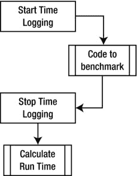

**图 4-1.** 计算运行时间的工作流程

结果可能因多种不同原因而异，包括客户端机器可用资源、JavaScript 引擎和浏览器渲染引擎。因此，我们希望在整个用户群中通过对多次执行进行平均来基准测试。为此，我们将把基准测试代码投入生产环境，并记录所有结果，以便进行分析和绘图。

所以下一步是暴露我们的数据。我们已经设计了一个计算运行时间的工作流程；让我们扩展它，要么将运行时间信息展示给最终用户，要么将其记录到服务器。

假设有些时候我们不想暴露数据，因此我们应该让这一点依赖于一个决策树。这个逻辑的添加反映在图 4-2 的流程图中。

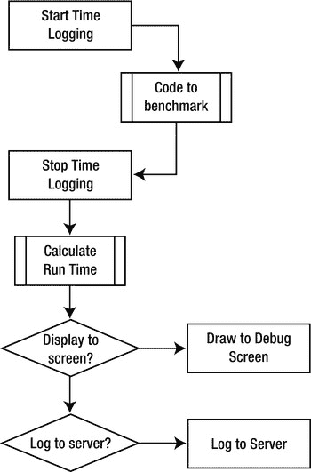

**图 4-2.** 运行时间记录流程图

至此，我们对基准测试引擎的工作原理有了一个高层描述。我们将这个功能称为 `perfLogger`。我们仍然需要与其他进程交互以保存数据并可视化，因此让我们创建一个序列图来详细描述这些进程的交互。

我们的基准测试进程 `perfLogger` 将调用一个外部进程 `savePerfData`。我们将使用 XHR 对象将数据发送到 `savePerfData`。进程 `savePerfData` 应将测试结果保存在一个平面文件中。我们将这个平面文件称为 `runtimeperf_results`。

正是这个平面文件，我们将从 R 中读取并生成图表。这个工作流的图示见图 4-3。

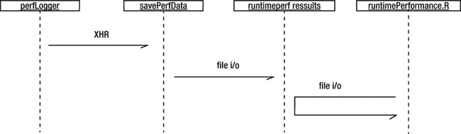

**图 4-3.** 高层序列图

到目前为止，你已经了解了如何为要基准测试的代码生成运行时间数值，以及如何保存数据的流程。现在让我们思考库的 API。

最终，`perfLogger` 是供外部代码使用的，所以务必考虑其公共签名是什么，它将具有哪些方法和属性，以及哪些应该公开暴露。

基于图 4-2，我们知道需要 `startTimeLogging()` 和 `stopTimeLogging()` 函数。我们将在临时代码之前和之后调用它们以获取开始和结束时间。图 4-2 还表明需要一个 `drawToDebugScreen()` 函数在页面上绘制测试结果，以及一个 `logToServer()` 函数将测试结果发送到 `savePerfData`。

但正如我所说，这个逻辑只是捕获临时代码的运行时间。基准测试不仅仅是捕获运行时间，它还涉及获取多次执行的平均值，因为系统差异可能会引入结果集的偏差。因此，让我们创建一个 `logBenchmark()` 函数，该函数将对多次调用 `startTimeLogging()` 和 `stopTimeLogging()` 的结果进行平均。

我们还应该暴露一个属性来保存 `savePerfData` 的 URL，我们将其称为 `serverLogURL`。

最后，我们需要一种方法能在单个页面上运行多个测试。为此，我们将创建一个关联数组，该数组以字符串作为标识符保存一组测试。我们将这个关联数组称为 `loggerPool`。

在这些方法和属性中，哪些我们想要公开暴露？我们不希望公开暴露任何属性；如果这样做，外部代码有可能更改它们。如果我们确实希望允许从外部设置它们，应该创建一个 setter 函数，但目前我们不需要。

函数 `drawToDebugScreen()`、`logToServer()` 和 `calculateResults()` 也不应该公开暴露。基于流程图，我们将传入布尔值来确定测试是否应该显示或保存，因此最有可能的是，我们会让 `stopTimeLogging()` 函数根据测试结果对象的属性来调用这些函数。

因此，我们将作为 API 暴露的唯一函数是 `startTimeLogging()`、`stopTimeLogging()` 和 `logBenchmark()`。使用 `startTimeLogging()` 和 `stopTimeLogging()` 将允许用户获取临时代码的运行时间，而使用 `logBenchmark()` 将实现真正的基准测试——对传入函数的多次执行结果进行平均。

这个架构的对象图见图 4-4。我们将列出所有属性和方法，但仅用粗体标记公共部分。

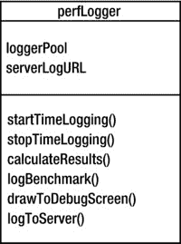

**图 4-4.** `perfLogger` 对象图

谈到使用 `loggerPool` 维护一个测试字典或列表，我们需要设计一个测试对象来保存与测试相关的所有信息。它应该包含 `startTime`、`endTime`，以及用于 `drawToPage` 和 `logtoserver` 的布尔值。我们还应该给它一个标识符，以便从字典中检索它，以及一个保存运行时间的变量，这样我们就不必在每次要引用它时重新计算。

为了我们自己的追踪目的，我们将包含运行测试的页面 URL 和一个用户代理字符串。这些元数据对于对我们收集的数据运行报告非常有用。想想看——有了这个结构，我们将能够按用户代理或任何我们以后可能想要添加的其他元数据来报告每个测试的性能。

基于此，我们应该重构 `perfLogger` 图，包含另一个私有函数 `setResultsMetaData()`。

我们的测试结果对象的对象图见图 4-5。

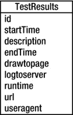

**图 4-5.** `TestResults` 对象图

## 让我们编码！

首先创建 `perfLogger` 对象。由于我们将保持某些属性和方法为私有，我们将从自执行函数中返回 `perfLogger` 对象作为对象字面量，并在自执行函数中声明我们的私有变量：

```javascript
var perfLogger = function(){
   var serverLogURL = "savePerfData.php",
   loggerPool = [];

   return {};
}()
```

接下来开始编写私有函数。既然我们已经勾勒出所需函数以及将用于测试结果的对象结构，就可以开始编写对应的代码了。让我们从 `calculateResults()` 开始。

### 计算测试结果

我们知道将通过 ID 引用测试结果对象，因此 `calculateResults()` 函数将接收一个 ID 参数：

```javascript
function calculateResults(id){
}
```

在 `calculateResults()` 函数内部，我们将通过传入的 ID 引用 `loggerPool` 中的测试结果，并执行我们在架构阶段讨论的计算——结束时间减去开始时间：

```javascript
function calculateResults(id){
    loggerPool[id].runtime = loggerPool[id].stopTime - loggerPool[id].startTime;
}
```

### 设置测试结果元数据

在处理上述功能的同时，对 `setResultsMetaData()` 也进行同样的操作。传入一个 ID，并在 `loggerPool` 中引用该测试。将 `url` 属性设置为当前窗口的位置，将 `useragent` 属性设置为 `navigator` 对象的 `userAgent` 属性。这些数据将为我们提供有趣的指标来比较结果，特别是用于比较不同渲染引擎和 JavaScript 解释器在处理特定功能时的差异。

```javascript
function setResultsMetaData(id){
    loggerPool[id].url = window.location.href;
    loggerPool[id].useragent = navigator.userAgent;
}
```

### 显示测试结果

接下来，添加私有函数 `drawToDebugScreen()`。要绘制调试屏幕，页面上需要有一个已命名的 div 用于写入。因此，首先创建一个对页面上 ID 为 "debug" 的元素的引用，并将该引用存储在名为 `debug` 的变量中。

然后格式化调试信息——但为了保持格式的模块化，我们将其抽象成自己的函数，并暂时仅插入一个函数调用。将格式化后的输出存储在名为 `output` 的变量中：

```javascript
function drawToDebugScreen(id){
    var debug = document.getElementById("debug")
    var output = formatDebugInfo(id)
}
```

现在变得有点意思了。你将测试 `debug` 变量是否有值；这可以判断页面上是否已存在一个可用于写入的命名元素。如果 `debug` 没有值，则创建一个新的 div，赋予其 ID 为 "debug"，将其 `innerHTML` 设置为我们格式化后的输出，并将其追加到页面中。

但如果 `debug` 已经存在，则直接将当前格式化后的输出信息追加到其 `innerHTML` 中。

```javascript
function drawToDebugScreen(id){
    var debug = document.getElementById("debug")
    var output = formatDebugInfo(id)
    if(!debug){
        var divTag = document.createElement("div");
        divTag.id = "debug";
        divTag.innerHTML = output
        document.body.appendChild(divTag);
    }else{
        debug.innerHTML += output
    }
}
```

现在完善 `formatDebugInfo()` 函数。就我们目前而言，保持简单即可。只需在一个段落中格式化一个字符串，描述部分加粗显示，运行时间和 useragent 在其下方各自独占一行。唯一复杂之处在于——基准测试会有平均运行时间，而临时测试则只有运行时间，因此你需要检查测试结果对象是否具有 `avgRunTime` 属性，如果有则使用该属性；如果没有，则默认使用 `runtime` 属性：

```javascript
function formatDebugInfo(id){
    var debuginfo = "<p><strong>" + loggerPool[id].description + "</strong><br/>";
    if(loggerPool[id].avgRunTime){
        debuginfo += "平均运行时间: " + loggerPool[id].avgRunTime + "ms<br/>";
    }else{
        debuginfo += "运行时间: " + loggerPool[id].runtime + "ms<br/>";
    }
    debuginfo += "路径: " + loggerPool[id].url + "<br/>";
    debuginfo += "用户代理: " + loggerPool[id].useragent + "<br/>";
    debuginfo += "</p>";
    return debuginfo
}
```

### 保存数据

最后一个私有函数是 `logToServer()`。同样，你将传入一个 ID 来引用 `loggerPool` 数组中的结果对象。但这次使用原生函数 `JSON.stringify()` 将对象字面量序列化为字符串值。在该字符串值前加上 `"data="` 前缀，将数据封装在一个名称中，以便你可以在服务器端从 POST 变量中提取出来：

```javascript
function logToServer(id){
    var params = "data=" + (JSON.stringify(loggerPool[id]));
}
```

接下来，该函数创建一个新的 XHR 对象，将传送方法设置为 POST，并指向我们保存的 `serverLogURL` 变量（该变量指向 `savePerfData`）。由于这些数据并非任务关键，`logToServer()` 不处理 `readystatechange` 事件，仅将我们的数据 POST 到等待它的脚本：

## 构建公共 API

现在，你将开始创建返回的对象字面量中的公共函数。首先处理 `startTimeLogging()`。我们将让它接受一个 ID（用作测试结果的 ID）、一个测试描述，以及两个布尔值 `drawToPage` 和 `logToServer`。在该函数内部，你将在 `loggerPool` 中创建一个新对象，并设置传入的属性，以及 `startTime` 值，该值仅为一个新的 `Date` 对象。

```javascript
startTimeLogging: function(id, descr, drawToPage, logToServer){
   loggerPool[id] = {};
   loggerPool[id].id = id;
   loggerPool[id].startTime = new Date;
   loggerPool[id].description = descr;
   loggerPool[id].drawtopage = drawToPage;
   loggerPool[id].logtoserver = logToServer
}
```

如果你想进一步优化，可以创建一个构造函数并在此处直接调用它。这将封装当前已有的功能，并允许你在其他地方重用，而无需重写。

接下来，编写 `stopTimeLogging()` 函数的实现。再次强调，你可以依赖上述架构，因此 `stopTimeLogging()` 只需设置停止时间，然后调用私有函数来计算运行时间并为测试结果设置元数据：

```javascript
loggerPool[id].stopTime = new Date;
calculateResults(id);
setResultsMetaData(id);
```

最后，`stopTimeLogging()` 会检查布尔值，以确定是否应将测试绘制到屏幕上以及是否应将其记录到服务器：

```javascript
if(loggerPool[id].drawtopage){
   drawToDebugScreen(id);
}
if(loggerPool[id].logtoserver){
   logToServer(id);
}
```

完整的函数应如下所示：

```javascript
stopTimeLogging: function(id){
   loggerPool[id].stopTime = new Date;
   calculateResults(id);
   setResultsMetaData(id);
   if(loggerPool[id].drawtopage){
      drawToDebugScreen(id);
   }
   if(loggerPool[id].logtoserver){
      logToServer(id);
   }
}
```

你需要实现的最后一个函数是 `logBenchmark()`。这是目前库中最复杂的函数。从高层次看，该函数将对传入的函数使用 `startTimeLogging()` 和 `stopTimeLogging()` 执行指定次数，然后获取结果的平均值。

我们一步步来。首先，你需要传入一个 ID、测试运行的次数、要测试的函数，以及是否将结果绘制到页面并记录到服务器：

```javascript
logBenchmark: function(id, timestoIterate, func, debug, log){
}
```

接下来，创建一个变量来保存每次测试运行的总和，并根据 `timestoIterate` 变量开始迭代：

```javascript
var timeSum = 0;
for(var x = 0; x < timestoIterate; x++){
}
```

在该循环中，调用 `startTimeLogging()`，执行传入的函数，调用 `stopTimeLogging()`，最后将每次迭代的运行时间添加到 `timeSum` 变量中：

```javascript
for(var x = 0; x < timestoIterate; x++){
   perfLogger.startTimeLogging(id, "benchmarking "+ func, false, false);
   func();
   perfLogger.stopTimeLogging(id)
   timeSum += loggerPool[id].runtime
}
```

请注意，循环中的每次迭代都使用相同的 ID 来标识正在运行的测试；你只是在每次迭代时覆盖测试结果。另外请注意，代码传入了 `false` 以避免绘制到调试屏幕或记录每个单独的测试。

循环结束后，通过将总运行时间除以次数来计算平均运行时间：

```javascript
loggerPool[id].avgRunTime = timeSum/timestoIterate
if(debug){
   drawToDebugScreen(id)
}
if(log){
   logToServer(id)
}
```

完成的函数现在应如下所示：

```javascript
logBenchmark: function(id, timestoIterate, func, debug, log){
   var timeSum = 0;
   for(var x = 0; x < timestoIterate; x++){
      perfLogger.startTimeLogging(id, "benchmarking "+ func, false, false);
      func();
      perfLogger.stopTimeLogging(id)
      timeSum += loggerPool[id].runtime
   }
   loggerPool[id].avgRunTime = timeSum/timestoIterate
   if(debug){
         drawToDebugScreen(id)
   }
   if(log){
         logToServer(id)
   }
}
```

你完成的库应如下所示：

```javascript
function logToServer(id){
    var params = "data=" + (JSON.stringify(loggerPool[id]));
    var xhr = new XMLHttpRequest();
    xhr.open("POST", serverLogURL, true);
    xhr.setRequestHeader("Content-type", "application/x-www-form-urlencoded");
    xhr.setRequestHeader("Content-length", params.length);
    xhr.setRequestHeader("Connection", "close");
    xhr.onreadystatechange = function(){};
    xhr.send(params);
}
```

### 性能日志记录器

```javascript
var perfLogger = function(){
   var serverLogURL = "savePerfData.php",
      loggerPool = [];

      function calculateResults(id){
         loggerPool[id].runtime = loggerPool[id].stopTime - loggerPool[id].startTime;
      }

      function setResultsMetaData(id){
         loggerPool[id].url = window.location.href;
         loggerPool[id].useragent = navigator.userAgent;
      }

      function drawToDebugScreen(id){
         var debug = document.getElementById("debug")
         var output = formatDebugInfo(id)
         if(!debug){
            var divTag = document.createElement("div");
            divTag.id = "debug";
            divTag.innerHTML = output
            document.body.appendChild(divTag);
         }else{
            debug.innerHTML += output
         }
      }
      function logToServer(id){
         var params = "data=" + (JSON.stringify(loggerPool[id]));
         var xhr = new XMLHttpRequest();
         xhr.open("POST", serverLogURL, true);
         xhr.setRequestHeader("Content-type", "application/x-www-form-urlencoded");
         xhr.setRequestHeader("Content-length", params.length);
         xhr.setRequestHeader("Connection", "close");
         xhr.onreadystatechange = function(){};
         xhr.send(params);
      }

      function formatDebugInfo(id){
         var debuginfo = "<p><strong>" + loggerPool[id].description + "</strong><br/>";
         if(loggerPool[id].avgRunTime){
            debuginfo += "average run time: " + loggerPool[id].avgRunTime + "ms<br/>";
         }else{
            debuginfo += "run time: " + loggerPool[id].runtime + "ms<br/>";
         }
         debuginfo += "path: " + loggerPool[id].url + "<br/>";
         debuginfo += "useragent: " +  loggerPool[id].useragent + "<br/>";
         debuginfo += "</p>";
         return debuginfo
      }

   return {
   startTimeLogging: function(id, descr,drawToPage,logToServer){
      loggerPool[id] = {};
      loggerPool[id].id = id;
      loggerPool[id].startTime = new Date;
      loggerPool[id].description = descr;
      loggerPool[id].drawtopage = drawToPage;
      loggerPool[id].logtoserver = logToServer
   },

   stopTimeLogging: function(id){
      loggerPool[id].stopTime = new Date;
      calculateResults(id);
      setResultsMetaData(id);
      if(loggerPool[id].drawtopage){
         drawToDebugScreen(id);
      }
      if(loggerPool[id].logtoserver){
         logToServer(id);
      }
   },

   logBenchmark: function(id, timestoIterate, func, debug, log){
      var timeSum = 0;
      for(var x = 0; x < timestoIterate; x++){
         perfLogger.startTimeLogging(id, "benchmarking "+ func, false, false);
         func();
         perfLogger.stopTimeLogging(id)
         timeSum += loggerPool[id].runtime
      }
      loggerPool[id].avgRunTime = timeSum/timestoIterate
      if(debug){
            drawToDebugScreen(id)
      }
      if(log){
            logToServer(id)
      }
   }
}
}()
```

 **注意：** 由于现代解释器和系统的高速运行，较小的临时测试可能得到 0 毫秒的结果。进行基准测试时，请确保测试的功能块足够大，以便产生可测量的结果。这意味着，如果要对数组循环进行基准测试，需要将数组设置得足够大，使其遍历耗时超过 1 毫秒。在后续章节中，当我们对零散的小段代码进行基准测试时，我会进一步讨论这一点；我们将以足够大的规模运行测试，以观察其实际隐含收益。我们还会在下一章探讨高分辨率时间的概念，该功能使我们能够以亚毫秒级精度获取时间测量值。

### 远程日志

好的，`perfLogger.js` 正在调用 `savePerfData`，并将测试结果序列化为字符串形式。现在我们来完善 `savePerfData` 的具体实现。

你可以复用上一章 WPTRunner 示例中的 `fileio.php` 共享文件，并创建两个变量：`$logfile` 用于保存平面文件的路径，`$benchmarkResults` 用于保存测试结果。从 `$_POST` 数组中取出结果；请注意，你曾将序列化对象的前缀设为 `"data="`，因此现在可以通过字符串 `"data"` 来引用它。预留一个 `formatResults` 函数调用，传入对 `$_POST` 的引用，并将返回值赋给 `$benchmarkResults`。最后，将 `$benchmarkResults` 和 `$logfile` 传递给预留的函数 `saveLog()`：

```php
<?php
require("util/fileio.php");

$logfile = "log/runtimeperf_results.txt";
$benchmarkResults = formatResults($_POST["data"]);

saveLog($benchmarkResults, $logfile);
?>
```

现在我们来完善 `formatResults()` 函数。它应接受一个参数 `$r`：

```php
function formatResults($r){}
```

请记住，由于数据经过序列化和编码以便通过 HTTP 传输，其格式大致如下：

## 保存测试结果

接下来我们来完善 `saveLog()` 函数。它接受一个字符串参数，即日志文件的路径。与上一章相同，它应检查文件是否存在，如果不存在，则创建并格式化新日志文件。为此，先预留一个名为 `formatNewLog()` 的函数调用。

```php
function saveLog($obj, $file){
   if(!file_exists($file)){
      formatNewLog($file);
   }
}
```

某些用户代理字符串包含逗号。由于平面文件中字段的分隔符将是逗号，因此需要从用户代理中去除逗号。将该功能抽象为独立的 `cleanCommas()` 函数，并暂时预留调用：

```php
$obj->useragent = cleanCommas($obj->useragent);
```

接下来，你将根据所有属性值构建一个逗号分隔的字符串，并将其传递给共享文件 `fileio.php` 中的 `appendToFile()` 函数。为增加数据维度，还需在该行前添加一个 IP 地址。添加此数据将使你能够以各种有趣的方式推断信息并对结果进行分类，例如，将 IP 地址转换为地理位置信息，并按区域或 ISP 对结果进行排序。

```php
$newLine = $_SERVER["REMOTE_ADDR"] . "," . $obj->id .",". $obj->startTime . "," . $obj->stopTime . "," . $obj->runtime . "," . $obj->url . "," . $obj->useragent;
appendToFile($newLine, $file);
```

完整的函数应如下所示：

```php
function saveLog($obj, $file){
   if(!file_exists($file)){
      formatNewLog($file);
   }
   $obj->useragent = cleanCommas($obj->useragent);
   $newLine = $_SERVER["REMOTE_ADDR"] . "," . $obj->id .",". $obj->startTime . "," . $obj->stopTime . "," . $obj->runtime . "," . $obj->url . "," . $obj->useragent;
   appendToFile($newLine, $file);
}
```

我们来快速完善预留的 `cleanCommas()` 函数。该函数将接受一个参数 `$data`。你可以使用一个小技巧：调用 `explode()` 函数——PHP 中与 `split()` 函数等价的函数，它会根据定义的分隔符（此处为逗号）分割字符串，并返回一个数组，每个字符串部分作为一个独立元素。将该数组传递给 `implode()` 函数，它是 PHP 中与 `join()` 函数等价的函数，接受一个数组并将所有元素连接成一个字符串。通过将这两个函数结合使用，便创建了一个单行的查找替换功能。

```php
function cleanCommas($data){
   return implode("", explode(",", $data));
}
```

 **注意：** 让我们稍微停留在这个查找替换技巧上，思考它是如何工作的。根据分隔符进行分割，会在每个分隔符出现的位置将字符串拆分。因此，如果我们将字符串“the quick brown fox jumps over the lazy dog”按分隔符“the”进行分割，会得到数组：

```json
["quick", "brown", "fox", "jumps", "over", "lazy", "dog"]
```

然后，如果我们对该数组使用 `implode` 函数，并传入字符串 `"a"` 作为粘合剂，会得到以下结果：

```json
"a quick brown fox jumps over a lazy dog"
```

最后，我们快速完善 `formatNewLog()` 函数。该函数将向新日志文件添加第一行，包含文件的所有标题：

```php
function formatNewLog($file){
   $headerline = "IP, TestID, StartTime, StopTime, RunTime, URL, UserAgent";
   appendToFile($headerline, $file);
}
```

完整的 `savePerfData.php` 文件应如下所示。

```php
<?php
require("util/fileio.php");

$logfile = "log/runtimeperf_results.txt";
$benchmarkResults = formatResults($_POST["data"]);

saveLog($benchmarkResults, $logfile);

function formatResults($r){
   $r = stripcslashes($r);
   $r = json_decode($r);
   if(json_last_error() > 0){
      die("invalid json");
   }
   return($r);
}

function formatNewLog($file){
   $headerline = "IP, TestID, StartTime, StopTime, RunTime, URL, UserAgent";
   appendToFile($headerline, $file);
}
```

`function saveLog($obj, $file) {

    if (!file_exists($file)) {

        formatNewLog($file);

    }

## 示例页面

太棒了！现在你可以快速创建一个页面，使用该库获取一些数据。创建一个 HTML 页面的基本结构，将标题设为 `perfLogger 示例`，并在页面的 `<head>` 部分链接 `perfLogger.js`。然后，同样在页面的 `<head>` 部分，放入另一个 `<script>` 标签，调用 `perfLogger.startTimeLogging()`。传入一个 ID `"page_render"`，一个描述“页面渲染计时”，以及 `true`（用于将结果显示在页面上），和 `true`（用于将结果也记录在服务器端）：

```html
<!DOCTYPE html>
<html>
<head>
    <title>perfLogger 示例</title>
    <script src="perfLogger.js"></script>
    <script>
    perfLogger.startTimeLogging("page_render", "页面渲染计时", true, true)
    </script>
</head>
<body>
<script>
perfLogger.stopTimeLogging("page_render")
</script>
</body>
</html>
```

你把这个函数调用放在 `<head>` 部分，是为了让它在页面可见部分开始渲染之前就开始计时。在 `<body>` 部分，我们将放入一个新的 `<script>` 标签，其中调用 `perfLogger.stopTimeLogging("page_render")`。

将此文件保存为 `perfLogger_example.html`。如果在浏览器中打开，它应该看起来像 图 4-6。

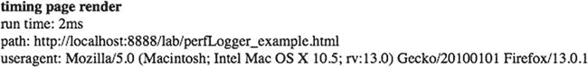

**图 4-6.** perfLogger_example.html 的屏幕截图

而 `runtimeperf_results.txt` 文件应如下所示：

```
IP, TestID, StartTime, StopTime, RunTime, URL, UserAgent
71.225.152.145,page_render,2012-06-19T23:52:52.448Z,2012-06-19T23:52:52.448Z,0,http://tom-
barker.com/lab/perfLogger_example.html,Mozilla/5.0 (Macintosh; Intel Mac OS X 10_5_8)
AppleWebKit/536.5 (KHTML like Gecko) Chrome/19.0.1084.52 Safari/536.5
71.225.152.145,page_render,2012-06-19T23:52:52.452Z,2012-06-19T23:52:52.452Z,0,http://tom-
barker.com/lab/perfLogger_example.html,Mozilla/5.0 (Macintosh; Intel Mac OS X 10_5_8)
AppleWebKit/536.5 (KHTML like Gecko) Chrome/19.0.1084.52 Safari/536.5
```

 **注释：** 根据浏览器的不同，此项测试可能得到 0 毫秒的结果，因为页面上没有任何内容。真实的测试中会包含内容。或者，你可以构建自己的测试套件来进行基准测试，类似于 SunSpider，地址为 [`http://www.webkit.org/perf/sunspider/sunspider.html`](http://www.webkit.org/perf/sunspider/sunspider.html)。

我们会把这个页面投入生产环境，以便为所有访问它的用户收集指标。你可以在 [`http://tom-barker.com/lab/perfLogger_example.html`](http://tom-barker.com/lab/perfLogger_example.html) 看到这个页面。

## 将结果绘制成图表

既然我们已经有了数据，不妨尝试将其可视化。我们将按用户代理查看 `page_render` 测试结果的运行时间。创建一个名为 `runtimePerformance.R` 的新 R 文档，并创建以下变量：`dataDirectory` 用于存放日志目录的路径，`chartDirectory` 用于存放图表输出目录的路径，以及 `testname` 用于存放要绘制图表的测试名称：

```r
dataDirectory <- "/Applications/MAMP/htdocs/lab/log/"
chartDirectory <- "/Applications/MAMP/htdocs/lab/charts/"
testname = "page_render"
```

读取日志文件，并将其存储为数据框，赋值给变量 `perflogs`；同时为要绘制的图表创建路径，赋值给变量 `perfchart`：

```r
perflogs <- read.table(paste(dataDirectory, "runtimeperf_results.txt", sep=""), header=TRUE,
sep=",")
perfchart <- paste(chartDirectory, "runtime_",testname, ".pdf", sep="")
```

接下来，我们进行一些分析。目前日志中只有 `page_render` 测试的结果，但随着未来运行不同的测试，你会得到不同命名的结果，因此我们只提取 `TestID` 列值为 `"page_render"` 的结果：

```r
pagerender <- perflogs[perflogs$TestID == "page_render",]
```

然后，创建一个仅包含我们想要绘制图表的列（`UserAgent` 列和 `RunTime` 列）的新数据框。

```r
df <- data.frame(pagerender$UserAgent, pagerender$RunTime)
```

接下来，我们将使用 R 的 `by()` 函数。该函数将一个函数应用于数据框，并根据传入的分组因子进行分组。在我们的示例中，我们将按 `UserAgent` 列进行分组，并对每个元素应用 `mean()` 函数。

```r
df <- by(df$pagerender.RunTime, df$pagerender.UserAgent, mean)
```

如果在控制台中再次输入 `df`，你会看到以下内容：

```
> df
df$pagerender.UserAgent
Mozilla/5.0 (Macintosh; U; Intel Mac OS X 10_5_8; en-us) AppleWebKit/533.21.1 (KHTML like Gecko)
Version/5.0.5 Safari/533.21.1

6.00000
Mozilla/5.0 (Macintosh; Intel Mac OS X 10_5_8) AppleWebKit/536.5 (KHTML like Gecko)
Chrome/19.0.1084.52 Safari/536.5

20.75000
Mozilla/5.0 (Macintosh; Intel Mac OS X 10.5; rv:13.0) Gecko/20100101 Firefox/13.0.1

55.63158
Mozilla/5.0 (Macintosh; Intel Mac OS X 10.5; rv:13.0) Gecko/20100101 Firefox/13.0

144.00000
Mozilla/4.0 (compatible; MSIE 8.0; Windows NT 5.1; Trident/4.0; .NET CLR 2.0.50727; .NET CLR
3.0.4506.2152; .NET CLR 3.5.30729)

511.00000
```

这个数据框现在包含了按原始用户代理分组的平均运行时间。它是按用户代理对每次测试的运行时间结果计算出的算术平均值。

最后，我们对数据框进行排序，并以条形图的形式生成图表。

```
df <- df[order(df)]
pdf(perfchart, width=10, height=10)
opar <- par(no.readonly=TRUE)
    par(las=1, mar=c(10,10,10,10))
    barplot(df, horiz=TRUE, main="页面渲染运行时间性能（毫秒）\n 按用户代理分")
par(opar)
dev.off()
```

结果图表请参见 图 4-7。

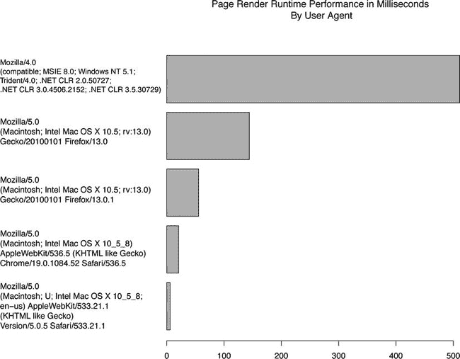

**图 4-7.** 按用户代理划分的页面渲染测试结果（毫秒）

完整的 R 脚本应如下所示：

```
dataDirectory <- "/Applications/MAMP/htdocs/lab/log/"
chartDirectory <- "/Applications/MAMP/htdocs/lab/charts/"
testname = "page_render"

perflogs <- read.table(paste(dataDirectory, "runtimeperf_results.txt", sep=""), header=TRUE,
sep=",")
perfchart <- paste(chartDirectory, "runtime_",testname, ".pdf", sep="")

pagerender <- perflogs[perflogs$TestID == "page_render",]
df <- data.frame(pagerender$UserAgent, pagerender$RunTime)
df <- by(df$pagerender.RunTime, df$pagerender.UserAgent, mean)
df <- df[order(df)]

pdf(perfchart, width=10, height=10)
opar <- par(no.readonly=TRUE)
    par(las=1, mar=c(10,10,10,10))
    barplot(df, horiz=TRUE)
par(opar)
dev.off()
```

#### 开放源代码

正如我对 `WPTRunner` 所做的那样，我已经将 `perfLogger` 的源代码上传到了 Github，可以在此处获取：[`https://github.com/tomjbarker/perfLogger`](https://github.com/tomjbarker/perfLogger)。

#### 总结

在本章中，你创建了一个工具，用于收集临时代码块的运行时间，或者通过聚合多次代码迭代的运行时间，对传入的函数进行基准测试。你创建了一个 PHP 服务器端脚本，我们的库可以将测试结果发送给它。最后，你创建了一个 R 脚本，用于提取我们的测试结果并将其绘制成图表。

在接下来的章节中，我们将探讨一些性能最佳实践。为了证明这些实践为何更高效，我们将使用你刚刚开发的这些工具，用实证数据支持这些论点，并将结果可视化以供广泛参考。

但首先，第 5 章将探讨浏览器性能的未来，以及 Web 性能标准的到来。

## 第 5 章


### 展望未来：性能标准

在第 4 章中，我们构建了一个 JavaScript 库，用于追踪临时代码并对函数进行基准测试。正如你将在后续章节中看到的，这是一个收集时间度量指标并通过编码风格推断性能提升的绝佳工具。

到目前为止，我们已经了解了如何构建自己的工具，或使用现有工具来收集衡量性能所需的数据。但接下来，我们将关注 W3C 为制定浏览器性能追踪标准所做的工作。

需要注意的是，其中部分功能目前才刚刚开始在主流浏览器中得到支持；还有一些功能仅适用于浏览器的测试版或预测试版。因此，我将在本章的相关示例中指明所使用的浏览器发布版本。也正因如此，我可能会展示同一内容在不同浏览器中的屏幕截图，以说明这些功能支持程度的差异。

#### W3C Web 性能工作组

2010 年底，W3C 成立了一个新的工作组——Web 性能工作组。根据其使命页面的说明，该工作组的使命是*提供衡量用户代理功能和 API 的应用程序性能各方面的方法*。从实际意义上来说，这意味着该工作组开发了一套浏览器可以（也将会）暴露给 JavaScript 的 API，其中包含了关键的性能指标。

这一功能通过一个新的 `performance` 对象来实现，该对象是原生 `window` 对象的一部分：

```
>>window.performance
```

#### Performance 对象

如果你在 JavaScript 控制台中输入 `window.performance`，会发现它返回一个 `Performance` 类型的对象，其中包含多个可能暴露的对象和方法。图 5-1 展示了 Chrome 20 beta 版中的 `Performance` 对象结构。

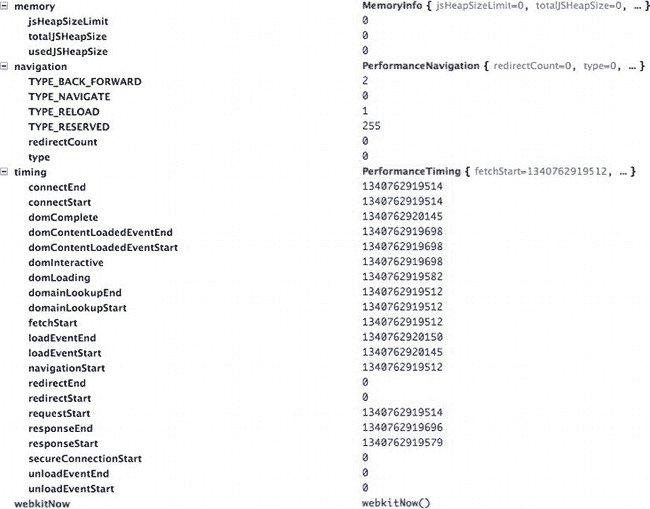

**图 5-1.** Chrome 20 beta 中的 `Window.performance`

在 Chrome 中输入该命令，我们会看到它支持一个 `PerformanceNavigation` 类型的 `navigation` 对象，以及一个 `PerformanceTiming` 类型的 `timing` 对象。Chrome 还支持一个 `memory` 对象，以及 `webkitNow`——这是高精度时间（High Resolution Time）的一个浏览器特定版本（我将在本章末尾介绍高精度时间）。

让我们逐一查看这些对象，并了解如何将它们用于我们自己的性能追踪。

##### Performance Timing

`timing` 对象具有以下属性，所有这些属性都包含事件发生时的毫秒级时间快照，这与上一章我们自己的 `startTimeLogging()` 函数非常相似。请参见图 5-2，其中按顺序列出了每个时间度量指标的流程图。

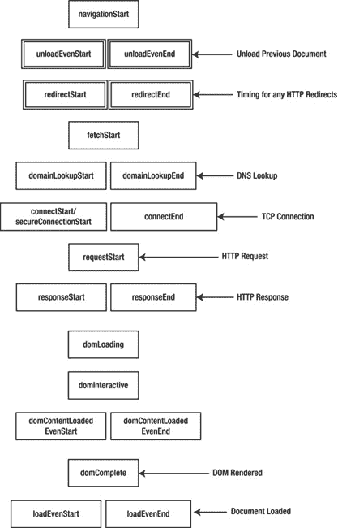

**图 5-2.** 性能指标的时序顺序

> **`navigationStart`**：这是导航开始的时间快照，无论浏览器是开始卸载上一个页面（如果有），还是开始获取内容。该值要么包含 `unloadEventStart` 数据，要么包含 `fetchStart` 数据。如果我们想追踪端到端的时间，通常会从这个值开始。

>

> **`unloadEventStart`**：这是浏览器开始卸载上一个页面（如果存在同一域名的上一个页面需要卸载）的时间快照。

>

> **`unloadEventEnd`**：这是浏览器完成卸载上一个页面的时间快照。

>

> **`redirectStart`**：这是浏览器开始任何 HTTP 重定向的时间快照。

>

> **`redirectEnd`**：这是所有 HTTP 重定向完成的时间快照。

要计算 HTTP 重定向总共花费的时间，只需用 `redirectEnd` 减去 `redirectStart`：

```
var http_redirect_time = performance.timing.redirectEnd - performance.timing.redirectStart;
```

> **`fetchStart`**：这是浏览器首次开始检查请求资源的缓存的时间快照。

要计算加载缓存总共花费的时间，用 `domainLookupStart` 减去 `fetchStart`：

```
var cache_time = performance.timing.domainLookupStart - performance.timing.fetchStart;
```

> **`domainLookupStart`**：这是浏览器开始对请求内容进行 DNS 查询的时间快照。

>

> **`domainLookupEnd`**：这是浏览器完成对请求内容进行 DNS 查询的时间快照。

要计算 DNS 查询总共花费的时间，用 `domainLookupEnd` 减去 `domainLookupStart`：

```
var dns_time = performance.timing.domainLookupEnd - performance.timing.domainLookupStart;
```

> **`connectStart`**：这是浏览器开始与远程服务器建立当前页面的 TCP 连接的时间快照。

>

> **`secureConnectionStart`**：当页面通过 HTTPS 加载时，该属性捕获 HTTPS 通信开始的时间快照。

>

> **`connectEnd`**：这是浏览器完成与远程服务器建立当前页面的 TCP 连接的时间快照。

要计算建立 TCP 连接总共花费的时间，用 `connectEnd` 减去 `connectStart`：

## 将 Performance 对象集成到 perfLogger 中

首先，你需要在 `perfLogger` 的自执行函数中创建私有变量。为感知时间、重定向时间、缓存时间、DNS 查找时间、TCP 连接时间、总往返时间和页面渲染时间创建值：

```javascript
var perfLogger = function(){
    var serverLogURL = "savePerfData.php",
    loggerPool = [];
    if(window.performance){
    var _pTime = Date.now() - performance.timing.navigationStart || 0,
    _redirTime = performance.timing.redirectEnd - performance.timing.redirectStart || 0,
    _cacheTime = performance.timing.domainLookupStart - performance.timing.fetchStart || 0,
    _dnsTime = performance.timing.domainLookupEnd - performance.timing.domainLookupStart || 0,
    _tcpTime = performance.timing.connectEnd - performance.timing.connectStart || 0,
    _roundtripTime = performance.timing.responseEnd - performance.timing.connectStart || 0,
    _renderTime = performance.timing.domComplete - performance.timing.domLoading || 0;
    }
}
```

首先，这段代码将变量赋值包裹在 `if` 语句中，以确保仅在当前浏览器支持时才调用 `window.performance`。然后注意，我们在赋值这些变量时使用了短路求值。这种技术在变量赋值中使用了逻辑运算符（在本例中为逻辑 OR）。如果第一个值不可用、为 `null` 或 `undefined`，则使用第二个值进行赋值。

接下来，仍然在自执行函数内，你将显式创建一个 `TestResults` 构造函数。请记住，我们在上一章架构了 `TestResults` 对象，但最终并没有使用它，而是让 `loggerPool` 持有通用对象。现在你将使用 `TestResults`，并利用原型继承来确保每个 `TestResults` 对象都内置了新的性能指标。

首先创建 `TestResults` 构造函数。

```javascript
function TestResults(){};
```

然后，为每个 `window.performance` 指标向 `TestResults` 的原型添加一个属性：

```javascript
TestResults.prototype.perceivedTime = _pTime;
TestResults.prototype.redirectTime = _redirTime;
TestResults.prototype.cacheTime = _cacheTime;
TestResults.prototype.dnsLookupTime = _dnsTime;
TestResults.prototype.tcpConnectionTime = _tcpTime;
TestResults.prototype.roundTripTime = _roundtripTime;
TestResults.prototype.pageRenderTime = _renderTime;
```

太好了！现在让我们编辑公共方法 `startTimeLogging()`。目前该函数的第一行将一个空对象赋值给 `loggerPool`：

```javascript
loggerPool[id] = {};
```

将其改为实例化一个新的 `TestResults` 实例：

```javascript
loggerPool[id] = new TestResults();
```

此时，如果你对 `TestResults` 对象执行 `console.log`，它应该看起来像 图 5-3。

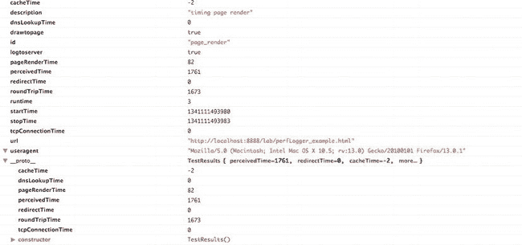

**图 5-3.** `TestResults` 对象

你可以看到，现在我们创建的每个 `TestResults` 对象都具有 `cacheTime`、`dnsLookupTime`、`pageRenderTime`、`perceivedTime`、`redirectTime`、`roundTripTime` 和 `tcpConnectionTime` 属性。你还可以看到这些属性存在于原型上。

这是一个重要的点，因为如果你在 `logToServer()` 中对序列化对象执行 `console.log`，你会看到这些属性并未与对象的其余部分一起被序列化。这是因为 `JSON.stringify` 不会序列化对象中未定义的值或函数。

不过，这没问题。要解决这个问题，你只需要创建一个小的私有函数来连接两个对象。回到顶部的自执行函数，在那里你将添加一个新函数 `jsonConcat()`，并让它接受两个对象：

```javascript
function jsonConcat(object1, object2) {}
```

接下来，遍历第二个对象中的每个属性，并将这些属性添加到第一个对象中。最后，返回第一个对象：

```javascript
for (var key in object2) {
object1[key] = object2[key];
}
return object1;
```

请注意，这也会覆盖两个对象可能共有的任何属性在第一个对象中的值。

完成的函数应该如下所示：

```
function jsonConcat(object1, object2) {
    for (var key in object2) {
        object1[key] = object2[key];
    }
    return object1;
}
```

现在，为了使其工作，回到 `logToServer()`。回想一下，在函数开头，我们这样序列化 `TestResults` 对象：

```
var params = "data=" + (JSON.stringify(loggerPool[id]));
```

将其改为将 `TestResults` 对象及其原型传递给 `jsonConcat()`，并将返回的对象传递给 `JSON.stringify`：

```
var params = "data=" + JSON.stringify(jsonConcat(loggerPool[id], TestResults.prototype));
```

如果你对 `params` 变量执行 `console.log`，它应该看起来像这样：

```
data={"id":"page_render","startTime":1341152573075,"description":"timing page render","drawtopag
e":true,"logtoserver":true,"stopTime":1341152573077,"runtime":2,"url":"http://localhost:8888/
lab/perfLogger_example.html","useragent":"Mozilla/5.0 (Macintosh; Intel Mac OS X 10.5; rv:13.0)
Gecko/20100101 Firefox/13.0.1","perceivedTime":78,"redirectTime":0,"cacheTime":-2,"dnsLookupTime
":0,"tcpConnectionTime":0,"roundTripTime":2,"pageRenderTime":72}
```

接下来，你将通过公共方法公开这些私有性能变量，以便通过 `perfLogger` 命名空间暴露它们，而无需运行任何测试。如果你不在对象级别暴露这些变量，你将需要创建一个测试并从测试对象中提取它们；回想一下，我们将这些 `Performance` 对象的数字添加到了每个测试对象的原型上。

```
//expose derived performance data
perceivedTime: function(){
    return _pTime;
},
redirectTime: function(){
    _redirTime;
},
cacheTime: function(){
    return _cacheTime;
},
dnsLookupTime: function(){
    return _dnsTime;
},
tcpConnectionTime: function(){
    return _tcpTime;
},
roundTripTime: function(){
    return _roundtripTime;
},
pageRenderTime: function(){
    return _renderTime;
}
```

太好了！这些公共函数如下所示暴露来自 `perfLogger` 对象的数据：

```
>>> perfLogger.perceivedTime()
78
```

所以现在你更新后的 `perfLogger.js` 应该如下所示：

```
var perfLogger = function(){
    var serverLogURL = "savePerfData.php",
        loggerPool = [],
        _pTime = Date.now() - performance.timing.navigationStart || 0,
        _redirTime = performance.timing.redirectEnd - performance.timing.redirectStart || 0,
        _cacheTime = performance.timing.domainLookupStart - performance.timing.fetchStart || 0,
        _dnsTime = performance.timing.domainLookupEnd - performance.timing.domainLookupStart || 0,
        _tcpTime = performance.timing.connectEnd - performance.timing.connectStart || 0,
        _roundtripTime = performance.timing.responseEnd - performance.timing.connectStart || 0,
        _renderTime = Date.now() - performance.timing.domLoading || 0;

    function TestResults(){};
    TestResults.prototype.perceivedTime = _pTime;
    TestResults.prototype.redirectTime = _redirTime;
    TestResults.prototype.cacheTime = _cacheTime;
    TestResults.prototype.dnsLookupTime = _dnsTime;
    TestResults.prototype.tcpConnectionTime = _tcpTime;
    TestResults.prototype.roundTripTime = _roundtripTime;
    TestResults.prototype.pageRenderTime = _renderTime;

    function jsonConcat(object1, object2) {
        for (var key in object2) {
            object1[key] = object2[key];
        }
        return object1;
    }

    function calculateResults(id){
        loggerPool[id].runtime = loggerPool[id].stopTime - loggerPool[id].startTime;
    }

    function setResultsMetaData(id){
        loggerPool[id].url = window.location.href;
        loggerPool[id].useragent = navigator.userAgent;
    }
```

```markdown
# 性能日志记录工具

```javascript
function drawToDebugScreen(id){
    var debug = document.getElementById("debug")
    var output = formatDebugInfo(id)
    if(!debug){
        var divTag = document.createElement("div");
        divTag.id = "debug";
        divTag.innerHTML = output
        document.body.appendChild(divTag);
    }else{
        debug.innerHTML += output
    }
}

function logToServer(id){
    var params = "data=" + JSON.stringify(jsonConcat(loggerPool[id],TestResults.prototype));
    var xhr = new XMLHttpRequest();
    xhr.open("POST", serverLogURL, true);
    xhr.setRequestHeader("Content-type", "application/x-www-form-urlencoded");
    xhr.setRequestHeader("Content-length", params.length);
    xhr.setRequestHeader("Connection", "close");
    xhr.onreadystatechange = function() {
        if (xhr.readyState==4 && xhr.status==200) {}
    };
    xhr.send(params);
}

function formatDebugInfo(id){
    var debuginfo = "<p><strong>" + loggerPool[id].description + "</strong><br/>";
    if(loggerPool[id].avgRunTime){
        debuginfo += "average run time: " + loggerPool[id].avgRunTime + "ms<br/>";
    }else{
        debuginfo += "run time: " + loggerPool[id].runtime + "ms<br/>";
    }
    debuginfo += "path: " + loggerPool[id].url + "<br/>";
    debuginfo += "useragent: " +  loggerPool[id].useragent + "<br/>";
    debuginfo += "</p>";
    return debuginfo
}

return {
    startTimeLogging: function(id, descr,drawToPage,logToServer){
        loggerPool[id] = new TestResults();
        loggerPool[id].id = id;
        loggerPool[id].startTime =  Date.now();
        loggerPool[id].description = descr;
        loggerPool[id].drawtopage = drawToPage;
        loggerPool[id].logtoserver = logToServer
    },
    stopTimeLogging: function(id){
        loggerPool[id].stopTime =  Date.now();
        calculateResults(id);
        setResultsMetaData(id);
        if(loggerPool[id].drawtopage){
            drawToDebugScreen(id);
        }
        if(loggerPool[id].logtoserver){
            logToServer(id);
        }
    },
    logBenchmark: function(id, timestoIterate, func, debug, log){
        var timeSum = 0;
        for(var x = 0; x < timestoIterate; x++){
            perfLogger.startTimeLogging(id, "benchmarking "+ func, false, false);
            func();
            perfLogger.stopTimeLogging(id)
            timeSum += loggerPool[id].runtime
        }
        loggerPool[id].avgRunTime = timeSum/timestoIterate
        if(debug){
            drawToDebugScreen(id)
        }
        if(log){
            logToServer(id)
        }
    },
    //expose derived performance data
    perceivedTime: function(){
        return _pTime;
    },
    redirectTime: function(){
        _redirTime;
    },
    cacheTime: function(){
        return _cacheTime;
    },
    dnsLookupTime: function(){
        return _dnsTime;
    },
    tcpConnectionTime: function(){
        return _tcpTime;
    },
    roundTripTime: function(){
        return _roundtripTime;
    },
    pageRenderTime: function(){
        return _renderTime;
    }
}
}();
```

## 更新日志记录功能

接下来，我们来更新 `savePerfData.php` 文件。首先在 `formatNewLog()` 函数中添加新的表头，以便每个新创建的日志文件都包含这些新数据点的列标题：

```php
function formatNewLog($file){
    $headerline = "IP, TestID, StartTime, StopTime, RunTime, URL, UserAgent, PerceivedLoadTime, PageRenderTime, RoundTripTime, TCPConnectionTime, DNSLookupTime, CacheTime, RedirectTime";
    appendToFile($headerline, $file);
}
```

然后更新 `saveLog()` 函数，使其包含我们现在传入的额外值：
```

### 保存日志函数

```php
function saveLog($obj, $file){
    if(!file_exists($file)){
        formatNewLog($file);
    }
    $obj->useragent = cleanCommas($obj->useragent);
    $newLine = $_SERVER["REMOTE_ADDR"] . "," . $obj->id .",". $obj->startTime . "," . $obj->stopTime . "," . $obj->runtime . "," . $obj->url . "," . $obj->useragent . "," . $obj->perceivedTime . "," . $obj->pageRenderTime . "," . $obj->roundTripTime . "," . $obj->tcpConnectionTime . "," . $obj->dnsLookupTime . "," . $obj->cacheTime . "," . $obj->redirectTime;
    appendToFile($newLine, $file);
}
```

更新后的日志文件现在应如下所示：

```
IP, TestID, StartTime, StopTime, RunTime, URL, UserAgent, PerceivedLoadTime, PageRenderTime, RoundTripTime, TCPConnectionTime, DNSLookupTime, CacheTime, RedirectTime
127.0.0.1,page_render,1.34116648339,1.3411664834,2,http://localhost:8888/lab/perfLogger_example.html,Mozilla/5.0 (Macintosh; Intel Mac OS X 10.5; rv:13.0) Gecko/20100101 Firefox/13.0.1115,86,21,1,1,-4,0
127.0.0.1,page_render,345.173000009,345.331000019,0.158000009833,http://localhost:8888/lab/perfLogger_example.html,Mozilla/5.0 (Macintosh; Intel Mac OS X 10_5_8) AppleWebKit/536.11 (KHTML like Gecko) Chrome/20.0.1132.43 Safari/536.11495,261,79,0,0,0,0
```

### 导航性能

现在让我们来看一下导航性能对象。如果你在控制台中输入 `performance.navigation`，将会看到类似图 5-4 的内容。

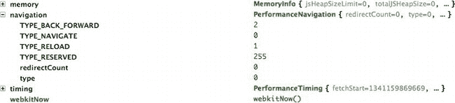

*图 5-4. 导航性能对象*

请注意，`navigation`对象有两个只读属性：`redirectCount`和`type`。`redirectCount`属性顾名思义，表示浏览器为到达当前页面所跟随的 HTTP 重定向次数。

 **注意：** HTTP 重定向很重要，因为每次重定向都会导致一次完整的往返。原始请求会从 Web 服务器返回为 301 或 302 状态码，并附带新位置的路径。然后，浏览器必须初始化一个新的 TCP 连接并为新位置发送新请求。请参见图 5-5 以了解单个 HTTP 重定向的序列图。请注意，DNS 查找、TCP 握手和 HTTP 请求都会为重定向的资源重复执行。这种重复使单次重定向的网络连接时间加倍。

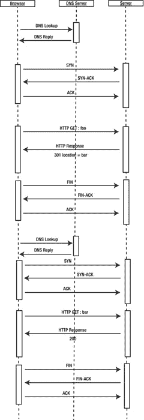

*图 5-5. HTTP 重定向*

我们可以这样访问 `redirectCount` 属性：

```
>>> performance.navigation.redirectCount
0
```

导航对象的另一个属性是 `type`。`navigation.type` 属性将是由以下常量表示的四个值之一：

> `TYPE_NAVIGATE`：值为 0，表示当前页面是通过点击链接、提交表单或直接在地址栏中输入 URL 导航而来的。

> `TYPE_RELOAD`：值为 1，表示当前页面是通过刷新操作到达的。

> `TYPE_BACK_FORWARD`：值为 2，表示页面是通过浏览器历史记录导航到的，无论是使用后退或前进按钮，还是通过浏览器的历史对象以编程方式实现的。

> `TYPE_RESERVED`：值为 255，是一个总括值，用于表示上述未定义的任何导航类型。

### 性能内存

`memory`对象是 Chrome 的一个特性，它允许我们查看 Chrome 在运行页面时占用的内存使用情况。请注意，在之前的图 5-1 中，所有值都返回 0——这是因为我们需要先启用内存信息标志才能利用此功能。

启用方式因平台略有不同，但本质上你需要向 Chrome 传递`--enable-memory-info`命令行参数。在 Windows 平台上，右键点击 Chrome 图标，进入“属性”，在可执行文件路径的末尾添加标志`--enable-memory-info`。可执行文件应如下所示：

`[path to exe]\chrome.exe --enable-memory-info`

对于 Mac OS，不是更新快捷方式，而是进入终端并像这样调用 Chrome 应用程序：

`/Applications/Google\ Chrome.app/Contents/MacOS/Google\ Chrome --enable-memory-info`

有关更多信息，请参阅[`http://www.chromium.org/developers/how-tos/run-chromium-with-flags`](http://www.chromium.org/developers/how-tos/run-chromium-with-flags)。

一旦你启用该标志启动 Chrome，你应该能在`memory`对象中看到数据，如图 5-6 所示。

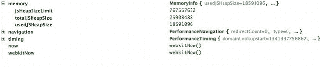

*图 5-6. 包含数据的 Performance Memory 对象*

```
>>> performance.memory. jsHeapSizeLimit
767557632
```

作为参考，*堆*是解释器在常驻内存中维护的 JavaScript 对象集合。在堆中，每个对象都是一个相互连接的节点，通过属性（如原型链或组合对象）连接。在浏览器中运行的 JavaScript 通过对象引用来引用堆中的对象，如图 5-7 所示。当我们在 JavaScript 中销毁一个对象时，我们实际上是在销毁对象引用。当解释器看到堆中一个没有任何引用的对象时，它会将该对象从堆中移除。这被称为*垃圾回收*。

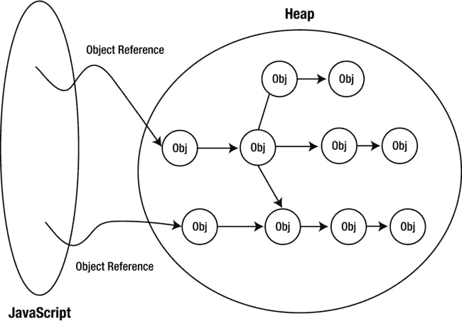

*图 5-7. JavaScript 堆*

图 5-6 中显示的`usedJsHeapSize`属性是堆中所有当前对象正在使用的内存量。`totalJsHeapSize`是堆的大小，包括对象未使用的空闲空间。

因为我们需要通过命令行参数启动浏览器才能获取这些属性，所以我们无法将其包含在我们的库中，并部署到生产环境中期望获取真实数据。相反，它是一个我们可以在自己的实验室中监控和运行的工具，用于性能分析目的。

 **注意：** 性能分析允许我们监控内存使用情况。这对于检测内存泄漏（即创建了从未被销毁的对象）非常有用。在 JavaScript 中，这通常发生在我们以编程方式为 DOM 对象分配事件处理器，却忘记移除它们时。性能分析不仅比单纯检测泄漏更加细致，它还有助于随时间优化我们应用程序的内存使用。我们应该智能地创建、销毁或重用对象，并始终留意作用域，以避免性能分析图表呈现出不断增长的持续上升尖峰形态。一个更好的性能分析图表应显示出可控的增长和平台期。

Firefox 也开始提供对其内存使用情况的洞察。在地址栏中输入`about:memory`，会显示一个页面，提供内存使用情况的高级细分；要获得更细粒度的洞察，请输入`about:memory?verbose`。请参见图 5-8 了解 Firefox 中内存使用的细粒度细分结果。

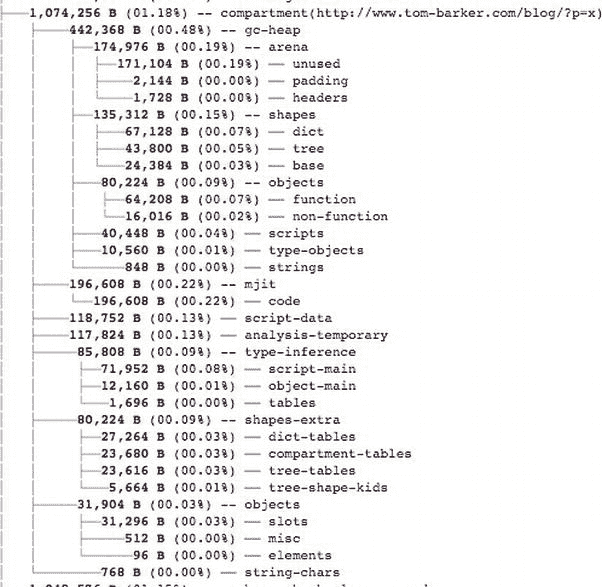

*图 5-8. Firefox 内存窗口*

### 高分辨率时间

我们将讨论的下一个变化是一个称为*高分辨率时间*的特性——以亚毫秒值记录的时间。这对于捕获在不到 1 毫秒内发生的计时数据非常有用。在下一章中，我们将广泛使用高分辨率时间来捕获运行时性能指标。

# Web 性能工作组详细描述了`performance`对象的一个公共方法：`performance.now()`。

正如你在上一章中所见，在计时代码执行时，我们遇到了结果为 0 毫秒的情况。这是因为从`Date()`对象返回的值精度只到 1 毫秒。在 JavaScript 控制台中输入以下内容来查看`Date()`对象：

```
>>> new Date().getMilliseconds()
603
>>> Date.now()
1340722684122
```

由于 JavaScript 解释器和浏览器渲染引擎性能的优化，我们的一些操作可能在微秒内完成。这就是我们测试得到 0 毫秒结果的原因。

这类测试的一个更微妙的危险在于，`Date`对象中的值基于系统日期，理论上在测试过程中可能会被更改，从而导致结果出现偏差。从夏令时调整到企业同步系统时间的策略，任何情况都可能在未经我们输入的情况下更改系统日期。其中任何一种情况都会改变我们的计时结果，甚至可能导致负数结果。

`performance.now()`方法返回的结果以毫秒的分数为单位。它还相对于`navigationStart`事件，而非系统日期，因此不会受到系统时间变化的影响。Chrome 从 Chrome 20 开始通过浏览器特定的前缀函数`webkitNow()`支持高分辨率时间，如下所示：

```
Google Chrome 20
>>> performance.webkitNow()
290117.4699999974
```

Firefox 从 Firefox 15 Aurora 版本开始支持高分辨率时间：

```
Firefox 15 aurora
>>> performance.now()
56491.447434
```

这很棒，但我们如何从现在开始使用它，以及如何确保我们现在编写的代码在将来所有浏览器都支持它时仍然有效？为了使我们的`perfLogger`库面向未来，我们可以针对`performance.now()`方法进行编码，并构建一个回退的 shim，以备浏览器尚未支持它时使用。

 `注意：` Shim 是一个抽象层，它拦截 API 调用或事件，要么更改调用的签名并传递调用以适应更新的 API 签名，要么自行处理 API 的功能。图 5-9 描述了 shim 在重新发布消息之前拦截事件或消息分发的原理，可能是为了执行某些逻辑。图 5-10 描述了 shim 覆盖函数或对象、处理信息，然后通过组合方式将数据传递给原始对象或函数，或者直接调用原始对象或函数。

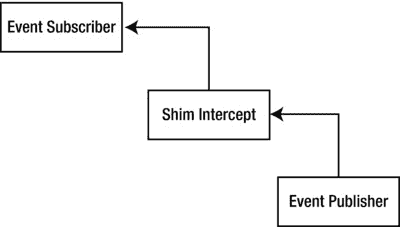

`图 5-9.` 拦截

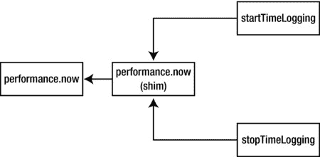

`图 5-10.` 覆盖

在这种情况下，你将覆盖`performance.now()`函数调用，并在将其传递出去或自行处理之前添加一层功能。

在`perfLogger.js`中，在 perfLogger 自执行函数之后，添加一个函数声明来覆盖对`performance.now`的原生调用：

```
performance.now = (function() {
})();
```

如果支持`performance.now`，此函数应返回它；如果不支持，代码会遍历可能的浏览器特定实现，如果这些都不支持，则默认使用旧的`Date()`功能。

```
performance.now = (function() {
return performance.now       ||
          performance.webkitNow ||
          function() { return new Date().getTime(); };
})();
```

接下来，更新 perfLogger 的`startTimeLogging()`和`stopTimeLogging()`函数以使用`performance.now()`：

```javascript
startTimeLogging: function(id, descr, drawToPage, logToServer) {
  loggerPool[id] = {};
  loggerPool[id].id = id;
  loggerPool[id].startTime = performance.now(); // 支持高精度时间
  loggerPool[id].description = descr;
  loggerPool[id].drawtopage = drawToPage;
  loggerPool[id].logtoserver = logToServer;
}

stopTimeLogging: function(id) {
  loggerPool[id].stopTime = performance.now(); // 支持高精度时间
  calculateResults(id);
  setResultsMetaData(id);
  if (loggerPool[id].drawtopage) {
    drawToDebugScreen(id);
  }
  if (loggerPool[id].logtoserver) {
    logToServer(id);
  }
}
```

现在，让我们来看看上一章的页面渲染基准测试结果在不同浏览器下的表现。在图 5-11 中，我们将观察 Chrome 19 下的结果，了解浏览器在缺乏高精度时间支持时的表现。在图 5-12 中，我们将查看 Firefox 15 Aurora 发行版下的结果；而在图 5-13 中，我们将看到 Chrome 20 下的结果，因为这两个浏览器都支持高精度时间。

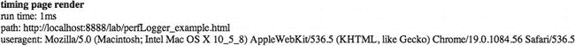

`图 5-11.` Chrome 19 默认使用 Date 对象

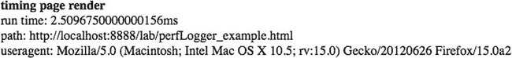

`图 5-12.` Firefox 15 Aurora 发行版支持 `performance.now`

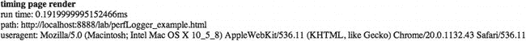

`图 5-13.` Chrome 20 支持 `performance.webkitNow`

至此，你已经将新的 `Performance` 对象集成到 `perfLogger` 库中，并为日志文件添加了几个新列。这些新数据点为分析数据增加了额外的维度。凭借我们新获得的高精度时间捕获能力，我们已经为下一章开始收集运行时指标做好了充分准备。

## 可视化新数据

现在，让我们从这些新数据中找点乐趣！我们可以分析一些重要的数据点：平均加载时间用户代理是多少？HTTP 事务处理过程的哪个部分平均耗时最长？以及总体加载时间分布情况如何？那么，我们开始吧。

我们的数据样本如下所示：

```
IP, TestID, StartTime, StopTime, RunTime, URL, UserAgent, PerceivedLoadTime, PageRenderTime,
RoundTripTime, TCPConnectionTime, DNSLookupTime, CacheTime, RedirectTime
75.149.106.130,page_render,1341243219599,1341243220218,619,http://www.tom-barker.com/
blog/?p=x,Mozilla/5.0 (Macintosh; Intel Mac OS X 10.5; rv:13.0) Gecko/20100101 Firef
ox/13.0.1790,261,-2,36,0,-4,0
75.149.106.130,page_render,633.36499998695,973.8049999869,340.43999999994,http://www.tom-barker.
com/blog/?p=x,Mozilla/5.0 (Macintosh; Intel Mac OS X 10_5_8) AppleWebKit/536.11 (KHTML like
Gecko) Chrome/20.0.1132.43 Safari/536.11633,156,-1341243238576,30,0,0,0
75.149.106.130,page_render,1498.2289999898,2287.9749999847,789.74599999492,http://www.tom-
barker.com/blog/?p=x,Mozilla/5.0 (Macintosh; Intel Mac OS X 10_5_8) AppleWebKit/536.11 (KHTML
like Gecko) Chrome/20.0.1132.43 Safari/536.111497,979,788,0,0,0,0
```

# 性能数据分析与可视化

## 感知加载时间分布

首先，让我们看一下感知加载时间的频率分布。在足够大的样本规模下，这将帮助我们很好地了解大多数用户的一般体验。我们已经从第 3 章开始一直在构建的 R 脚本中，将性能数据读入 `perflogs` 变量，现在我们就用该变量绘制一个直方图：

```r
hist(perflogs$PerceivedLoadTime, main="感知加载时间分布", xlab="感知加载时间（毫秒）", col=c("#CCCCCC"))
```

这将生成我们在图 5-14 中看到的图表。

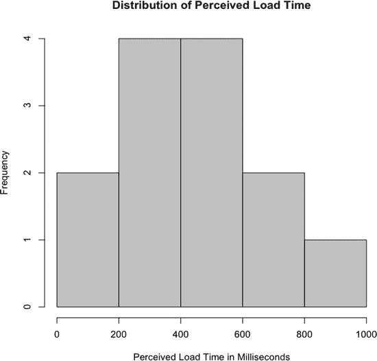

**图 5-14.** 感知加载时间直方图，频率代表访问次数

到目前为止还很简单。你只需将其包裹在 `pdf()` 函数调用中，即可保存为文件供后续引用：

```r
loadTimeDistrchart <- paste(chartDirectory, "loadtime_distribution.pdf", sep="")
pdf(loadTimeDistrchart, width=10, height=10)
  hist(perflogs$PerceivedLoadTime, main="感知加载时间分布", xlab="感知加载时间（毫秒）", col=c("#CCCCCC"))
dev.off()
```

## HTTP请求平均耗时分析

现在，让我们看看从完整的 HTTP 请求中收集到的所有数据，并分解出请求每个部分的平均耗时。这将让我们全面了解每个步骤所花费的时间。

首先创建一个新变量来保存下一个图表的路径，并创建一个名为 `avgTimeBreakdownInRequest` 的新函数来容纳这段代码：

```r
requestBreakdown <- paste(chartDirectory, "avgtime_inrequest.pdf", sep="")
avgTimeBreakdownInRequest <- function() {
}
```

在这个函数中，你需要做一些数据清理工作。如果数值较大，R 可能会用科学记数法存储它们。这对于引用大数字非常好，但为了便于一般性阅读，我们应该取消科学记数法，使其易于理解。为此，将 `scipen` 参数传递给 `options()` 函数。`options()` 函数允许我们设置 R 的全局选项，而 `scipen` 接受一个数值；传入的数值越大，R 以定点（非科学记数法）显示数字的可能性就越大：

```r
options(scipen=100)
```

接下来，处理数据中出现的那些负数。在这种情况下，负数没有实际意义。它们之所以出现，是因为有时 `window.performance` 对象返回值为 0，而我们在各值之间进行减法运算以推导出保存的性能数据。

您有以下几种选择：可以移除包含负数的行，或直接将负值归零。如果认为某个列的值异常会影响整行数据的可靠性，可以删除整行，但此处并非这种情况。为了避免丢失其他列中可能有效的值，建议仅将负值归零。

要将负值归零，只需检查每列中小于 0 的值，并将其设置为 0。对每个要绘图的列执行此操作：

```r
perflogs$PageRenderTime[perflogs$PageRenderTime < 0] <- 0
perflogs$RoundTripTime[perflogs$RoundTripTime < 0] <- 0
perflogs$TCPConnectionTime[perflogs$TCPConnectionTime < 0] <- 0
perflogs$DNSLookupTime[perflogs$DNSLookupTime < 0] <- 0
```

接下来，创建一个数据框，其中包含每列的平均值。为此，使用 `data.frame()` 函数，并对每个需要计算平均值的列调用 `mean()`。然后为这个新数据框设置列名：

```r
avgTimes <- data.frame(mean(perflogs$PageRenderTime), mean(perflogs$RoundTripTime), mean(perflogs$TCPConnectionTime), mean(perflogs$DNSLookupTime))
colnames(avgTimes) <- c("PageRenderTime", "RoundTripTime", "TCPConnectionTime", "DNSLookupTime")
```

最后，创建图表。这将是一个水平条形图，类似于我们在前几章中创建的那样，并将其保存为 PDF。

```r
pdf(requestBreakdown, width=10, height=10)
opar <- par(no.readonly=TRUE)
     par(las=1, mar=c(10,10,10,10))
     barplot(as.matrix(avgTimes), horiz=TRUE, main="Average Time Spent\nDuring HTTP Request", xlab="Milliseconds")
par(opar)
dev.off()
```

完整的函数应如下所示，生成的图表如图 Figure 5-15 所示。

```r
avgTimeBreakdownInRequest <- function(){
#expand exponential notation
options(scipen=100)

#set any negative values to 0
perflogs$PageRenderTime[perflogs$PageRenderTime < 0] <- 0
perflogs$RoundTripTime[perflogs$RoundTripTime < 0] <- 0
perflogs$TCPConnectionTime[perflogs$TCPConnectionTime < 0] <- 0
perflogs$DNSLookupTime[perflogs$DNSLookupTime < 0] <- 0

#capture avg times
avgTimes <- data.frame(mean(perflogs$PageRenderTime), mean(perflogs$RoundTripTime), mean(perflogs$TCPConnectionTime), mean(perflogs$DNSLookupTime))
colnames(avgTimes) <- c("PageRenderTime", "RoundTripTime", "TCPConnectionTime", "DNSLookupTime")

pdf(requestBreakdown, width=10, height=10)
opar <- par(no.readonly=TRUE)
     par(las=1, mar=c(10,10,10,10))
     barplot(as.matrix(avgTimes), horiz=TRUE, main="Average Time Spent\nDuring HTTP Request", xlab="Milliseconds")
par(opar)
dev.off()
}
```

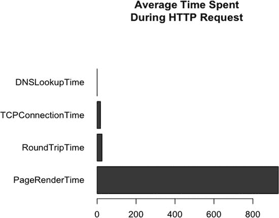

**图 5-15.** HTTP 请求中各步骤的平均耗时

这是一个有趣的结果。您可能已经想到，页面渲染花费的时间最长，因为它开销最大且要做的事情最多；它不仅是在传输消息，还要解析消息。但您可能没有料到 TCP 连接时间和往返时间会相同，或者它们会明显高于 DNS 查找时间。

## 按浏览器细分的感知加载时间

本章我们将看到的最后一个图表是按浏览器划分的感知加载时间细分。请注意，上面的示例数据存储了完整的用户代理字符串，它不仅提供浏览器名称，还包括版本、子版本、操作系统甚至渲染引擎。这很好，但如果您希望汇总到高层级的浏览器信息，而不考虑版本或操作系统，我们可以搜索用户代理字符串来查找特定的高层级浏览器名称。

您可以使用 `grep()` 在数据框列中搜索字符串。`grep()` 函数接受要搜索的字符串作为第一个参数，并将要搜索的向量或对象作为第二个参数。在我们的场景中，我们将 `grep()` 函数作为过滤选项传递到数据框中：

```r
data frame[grep([string to search for], [data frame column to search])]
```

创建一个名为 `getDFByBrowser()` 的函数，该函数允许您通过传入要搜索的数据框和要搜索的字符串来泛化搜索：

```r
getDFByBrowser<-function(data, browsername){
     return(data[grep(browsername, data$UserAgent),])
}
```

接下来创建一个变量来保存新图表的路径 `loadtime_bybrowser`：

```r
loadtime_bybrowser <- paste(chartDirectory, "loadtime_bybrowser.pdf", sep="")
```

接着创建一个函数来保存此图表的主要功能；将其命名为`printLoadTimebyBrowser()`：

```
printLoadTimebyBrowser <- function(){
}
```

此函数首先为要包含在图表中的每个浏览器创建数据框：

```
chrome <- getDFByBrowser(perflogs, "Chrome")
firefox <- getDFByBrowser(perflogs, "Firefox")
ie <- getDFByBrowser(perflogs, "MSIE")
```

接下来，创建一个数据框来保存每个浏览器的平均感知加载时间，就像你在前面示例中对 HTTP 请求步骤所做的那样。同时为数据框指定描述性列名：

```
meanTimes <- data.frame(mean(chrome$PerceivedLoadTime), mean(firefox$PerceivedLoadTime), mean(ie$PerceivedLoadTime))
colnames(meanTimes) <- c("Chrome", "Firefox", "Internet Explorer")
```

最后，创建条形图并将其保存为 PDF：

```
pdf(loadtime_bybrowser, width=10, height=10)
     barplot(as.matrix(meanTimes), main="Average Perceived Load Time\nBy Browser", ylim=c(0, 600), ylab="milliseconds")
dev.off()
```

完整的功能应如下所示，完成的图表应如图 Figure 5-16 所示。

```
getDFByBrowser<-function(data, browsername){
     return(data[grep(browsername, data$UserAgent),])
}

printLoadTimebyBrowser <- function(){
     chrome <- getDFByBrowser(perflogs, "Chrome")
     firefox <- getDFByBrowser(perflogs, "Firefox")
     ie <- getDFByBrowser(perflogs, "MSIE")
     meanTimes <- data.frame(mean(chrome$PerceivedLoadTime), mean(firefox$PerceivedLoadTime), mean(ie$PerceivedLoadTime))
     colnames(meanTimes) <- c("Chrome", "Firefox", "Internet Explorer")

     pdf(loadtime_bybrowser, width=10, height=10)
          barplot(as.matrix(meanTimes), main="Average Perceived Load Time\nBy Browser", ylim=c(0, 600), ylab="milliseconds")
     dev.off()
}
```


***图 5-16** 按浏览器划分的平均感知加载时间*

有趣的是，我们的测试结果显示，Firefox 的感知加载时间最佳，其次是 Chrome，最后是 Internet Explorer。这仅仅是比较的一小部分；如果需要，我们可以通过查看版本和子版本来扩展此分析。

完整更新的 R 文件现在应如下所示：

```
dataDirectory <- "/Applications/MAMP/htdocs/lab/log/"
chartDirectory <- "/Applications/MAMP/htdocs/lab/charts/"
testname = "page_render"

perflogs <- read.table(paste(dataDirectory, "runtimeperf_results.csv", sep=""), header=TRUE, sep=",")
perfchart <- paste(chartDirectory, "runtime_",testname, ".pdf", sep="")

loadTimeDistrchart <- paste(chartDirectory, "loadtime_distribution.pdf", sep="")
requestBreakdown <- paste(chartDirectory, "avgtime_inrequest.pdf", sep="")
loadtime_bybrowser <- paste(chartDirectory, "loadtime_bybrowser.pdf", sep="")
pagerender <- perflogs[perflogs$TestID == "page_render",]
df <- data.frame(pagerender$UserAgent, pagerender$RunTime)
df <- by(df$pagerender.RunTime, df$pagerender.UserAgent, mean)
df <- df[order(df)]

pdf(perfchart, width=10, height=10)
opar <- par(no.readonly=TRUE)
     par(las=1, mar=c(10,10,10,10))
     barplot(df, horiz=TRUE)
par(opar)
dev.off()

getDFByBrowser<-function(data, browsername){
     return(data[grep(browsername, data$UserAgent),])
}
```

```markdown
## 第 6 章


### Web 性能优化

上一章探讨了 W3C 在浏览器中标准化性能的第一步成果——`Performance` 对象。第 5 章详细考察了 `Performance` 对象中的各个 API；你了解了如何从 `Performance Timing` 对象收集和推导性能指标，如何使用 `Performance Navigation` 对象确定用户访问网站的方式，以及 `Performance` 对象如何提供高分辨率时间，使我们能够追踪毫秒级别以下的时序数据。

基于以上内容，你更新了 `perfLogger` 库，以集成 `Performance` 对象提供的所有优秀指标。你在 `perfLogger` 中构建了垫片（`shim`），以便在支持高分辨率时间的浏览器中使用该功能，并在不支持的浏览器中优雅降级。

接着，你利用所有这些新数据扩展了 `R` 脚本，以图表形式展示这些数据所揭示的用户、网络连接和浏览器状况。

现在，本章你将使用迄今为止创建的所有工具，以及我们在第 2 章中考察过的所有工具，来量化一些 Web 性能优化技巧可能带来的好处——具体来说，就是 `JavaScript` 如何阻塞页面渲染，以及如何利用 `JavaScript` 推迟加载更重的内容。请记住，Web 性能是指你的内容传递到最终用户所需的时间，包括网络延迟和浏览器渲染时间。

#### 优化页面渲染瓶颈

我们首先要优化的地方是浏览器中内容的渲染。这个问题与网络延迟无关；它仅仅指浏览器处理和渲染内容以呈现给最终用户的速度。让我们先来看看现代浏览器中内容绘制到屏幕上的工作原理。

如第 1 章所述，现代浏览器由多个相互交互的组件组成。有一个 UI 层负责绘制浏览器的客户端界面，包括地址栏、前进和后退按钮，以及浏览器可能拥有的其他界面元素（chrome）。最终用户与 UI 层交互，并通过 UI 层驱动应用程序的其余部分。

我们有一个网络层，负责处理网络连接、建立 `TCP` 连接和执行 `HTTP` 往返。网络层还向渲染引擎提供内容。

渲染引擎负责将内容绘制到屏幕上。当遇到 `JavaScript` 时，它会将其交给 `JavaScript` 解释器。请参见图 6-1，了解现代浏览器高级架构的标注视图。


`图 6-1`. 带注释的浏览器架构

正如我所说，渲染引擎——无论是 `Gecko`、`WebKit` 还是其他——从网络层获取内容。它有一个有限的总线大小，因此它分块拉取数据，并将这些块传递到自己的工作流中。

该工作流是一个包含多个步骤的过程。首先，内容被解析，这意味着标记被读取为字符并进行*词法分析*，在词法分析中，字符与规则集进行比较并根据规则集转换为标记（`tokens`）。规则集是我们 `HTML` 文档中定义的 `DTD`；它指定了构成我们将要使用的语言版本的标签。标记只是被分解为有意义段的字符。

例如，网络层可能返回以下字符串：

`<!DOCTYPE html><html><head><meta charset="UTF-8"/>`

该字符串会被标记化为有意义的块：

`<!DOCTYPE html>`

`<html>`

`<head>`

`<meta charset="UTF-8"/>`

然后，渲染引擎获取这些标记并将其转换为 `DOM` 元素。这些 `DOM` 元素被排列成一棵渲染树，渲染引擎随后遍历这棵树。在第一次遍历中，渲染引擎布局 `DOM` 元素的位置，在第二次遍历中，将它们绘制到屏幕上。参见图 6-2 了解此工作流。


`图 6-2`. 渲染引擎工作流

通常在此过程中，如果渲染引擎在标记化期间识别出一个外部脚本，它会暂停解析内容并开始下载该脚本。渲染引擎只有在脚本下载并执行完毕后才会恢复解析。这会导致内容显示给最终用户的时间出现潜在瓶颈。参见图 6-3 了解此潜在瓶颈的流程图。


`图 6-3`. 解析过程中遇到的脚本标签

##### 本章摘要

本章探讨了 `window.performance` 对象，这是 W3C 提供的一种从浏览器收集性能指标的新标准化方式。我们将 `Performance` 对象整合到了现有的 `perfLogger` 项目中，在每次运行的测试中都包含了性能指标，并且如果浏览器支持，我们还构建了对 `window.performance` 高分辨率时间的支持。

我们利用这些新数据来审视网站的整体网络性能。

我们简要探讨了从浏览器查看客户端机器内存使用情况的新兴可能性，特别是 `Chrome` 的实现，并简单介绍了如何让 `Firefox` 暴露类似数据。

下一章将关注 Web 性能优化；你将使用我们已经开发的工具运行多变量测试，以观察优化效果。

```R
printLoadTimebyBrowser <- function(){
     chrome <- getDFByBrowser(perflogs, "Chrome")
     firefox <- getDFByBrowser(perflogs, "Firefox")
     ie <- getDFByBrowser(perflogs, "MSIE")

     meanTimes <- data.frame(mean(chrome$PerceivedLoadTime), mean(firefox$PerceivedLoadTime),
mean(ie$PerceivedLoadTime))
     colnames(meanTimes) <- c("Chrome", "Firefox", "Internet Explorer")
     pdf(loadtime_bybrowser, width=10, height=10)
          barplot(as.matrix(meanTimes), main="Average Perceived Load Time\nBy Browser",
ylim=c(0, 600), ylab="milliseconds")
     dev.off()
}

pdf(loadTimeDistrchart, width=10, height=10)
     hist(perflogs$PerceivedLoadTime, main="Distribution of Perceived Load Time", xlab="Perceived
Load Time in Milliseconds", col=c("#CCCCCC"))
dev.off()

avgTimeBreakdownInRequest <- function(){

#expand exponential notation
options(scipen=100, digits=3)

#set any negative values to 0
perflogs$PageRenderTime[perflogs$PageRenderTime < 0] <- 0
perflogs$RoundTripTime[perflogs$RoundTripTime < 0] <- 0
perflogs$TCPConnectionTime[perflogs$TCPConnectionTime < 0] <- 0
perflogs$DNSLookupTime[perflogs$DNSLookupTime < 0] <- 0

#capture avg times
avgTimes <- data.frame(mean(perflogs$PageRenderTime), mean(perflogs$RoundTripTime), mean(perflogs$T
CPConnectionTime), mean(perflogs$DNSLookupTime))
colnames(avgTimes) <- c("PageRenderTime", "RoundTripTime", "TCPConnectionTime", "DNSLookupTime")
pdf(requestBreakdown, width=10, height=10)
opar <- par(no.readonly=TRUE)
     par(las=1, mar=c(10,10,10,10))
     barplot(as.matrix(avgTimes), horiz=TRUE, main="Average Time Spent\nDuring HTTP Request",
xlab="Milliseconds")
par(opar)
dev.off()

}

#invoke our new functions
printLoadTimebyBrowser()
avgTimeBreakdownInRequest()
```

为了解决这个潜在问题，通常的最佳实践^(1)是将所有脚本标签放在 HTML 的底部，这样任何为了处理 JavaScript 而暂停渲染的过程都将在页面完全渲染后进行。

## 脚本加载

另一种方法是程序化地加载远程 JavaScript 文件，这被称为 *脚本加载*，它允许我们“欺骗”渲染引擎。让我们看看具体怎么做。

请记住，我们刚才探讨的渲染引擎暂停的工作流程适用于外部脚本。浏览器会查找脚本标签的 `src` 属性，该属性告诉它必须下载一个远程资源。如果遇到没有 `src` 属性的脚本标签，渲染引擎只会将代码传递给 JavaScript 解释器执行。

因此，我们可以创建内联 JavaScript，动态地向文档添加脚本标签，如下所示：

```
<script>
var script = window.document.createElement('SCRIPT');
script.src = src;
window.document.getElementsByTagName('HEAD')[0].appendChild(script);
</script>
```

这段代码使用 `document.createElement()` 函数创建一个新的脚本标签，并将其存储在名为 `script` 的变量中。它将新脚本标签的 `src` 属性设置为指向一个远程 JavaScript 文件，并将该新脚本标签追加到文档的 Head 部分。

这非常简单，接下来让我们将其充实成一个可用的实际示例。

首先，创建一个命名空间，您可以将其命名为 `remoteLoader`：

```
var remoteLoader = function remoteLoader(){

return{

}
}();
```

在 `remoteLoader` 内部，创建一个私有函数来构建脚本标签，其逻辑与上一段代码大致相同。将此函数命名为 `constructScriptTag()`，并传入一个 URL 作为脚本标签的源：

```
function constructScriptTag(src){
    var script = window.document.createElement('SCRIPT');
    script.src = src;
return script;
}
```

在返回的对象中，创建一个名为 `loadJS()` 的公共函数，带有一个参数 `script_url`：

```
loadJS: function(script_url){

}
```

> 1 至少自 Steve Souders 在其著作 *《高性能网站建设指南：前端工程师必备知识》*（O'Reilly 2007）中提及以来。

在 `loadJS` 内部，您将添加一些分支逻辑，用于判断传入的值是数组还是字符串。这将为使用我们的 API 加载单个 JavaScript 文件或多个 JavaScript 文件提供灵活性。

为了进行判断，请查看变量的 `typeof`。数组返回类型 `"object"`，字符串返回类型 `"string"`。为了能够区分数组和其他类型的对象，您需要对变量使用 `instanceof` 运算符。`instanceof` 运算符用于测试左侧的对象在其原型链中是否具有右侧构造函数的实例——换句话说，它是否是那个构造函数的实例？

```
if(typeof script_url === "object"){
if(script_url instanceof Array){
}
}else if(typeof script_url === "string"){

}
```

首先完善字符串分支，因为它是最简单的。只需调用 `constructScriptTag()` 函数并传入 `script_url`。然后将返回的元素追加到文档的 head 部分。

```
else if(typeof script_url === "string"){
window.document.getElementsByTagName('HEAD')[0].appendChild(constructScriptTag(script_url));
}
```

数组分支将遍历 URL 数组，为每个 URL 创建一个新的脚本标签，并使用文档片段来存储所有这些新元素。然后一次性将它们全部追加到 head 部分。我将在下一章详细讨论文档片段。

```
if(script_url instanceof Array){
var frag = document.createDocumentFragment();
     for(var ind = 0; ind < script_url.length; ind++){
          frag.appendChild(constructScriptTag(script_url[ind]));
     }
window.document.getElementsByTagName('HEAD')[0].appendChild(frag.cloneNode(true) );
}
```

您完成的代码应该如下所示：

```
var remoteLoader = function remoteLoader(){
     function constructScriptTag(src){
          var script = window.document.createElement('SCRIPT');
          script.src = src;
          return script;
     }

      return{
          loadJS: function(script_url){
               if(typeof script_url === "object"){
                    if(script_url instanceof Array){
                         var frag = document.createDocumentFragment();
                         for(var ind = 0; ind < script_url.length; ind++){
                              frag.appendChild(constructScriptTag(script_url[ind]));
                         }
                         window.document.getElementsByTagName('HEAD')[0].appendChild(frag.cloneNode(true) );
                    }
               }else if(typeof script_url === "string"){
                 window.document.getElementsByTagName('HEAD')[0].appendChild(constructScriptTag(script_url));
               }
          }
     }     
}();
```

使用它时，您可以传入一个字符串或一个数组，如下面的代码片段所示：

```
<script>
     remoteLoader.loadJS("/lab/perfLogger.js"); // 传入字符串
</script>
```

```
<script>
     remoteLoader.loadJS(["/lab/perfLogger.js", "jquery.js"]); // 传入数组
</script>
```

## async

另一个阻止渲染引擎阻塞的方法是使用脚本标签的 `async` 属性。`async` 选项是 HTML 5 引入的一个原生属性，它会告诉浏览器异步加载脚本。所有现代浏览器都支持它，甚至从版本 10 开始（Internet Explorer 版本 10 之前使用了一个名为 `defer` 的专有属性）。`async` 属性可选地接受一个布尔值；只需在脚本标签中包含它而不赋值，则默认为 `true`。

```
<script src="[URL]" async=true></script>
<script src="[URL]" async></script>
```

使用 `async` 时，您无法知道文件何时会被下载，因此可以在 `script` 标签上附加一个 `onload` 事件处理程序。这将允许您在文件下载完成后，调用或实例化任何需要运行的代码：

```
<script src="[URL]" async onload="init();"></script>
```

## 比较结果

读到这里，你应该已经猜到接下来要做什么了——让我们运行一个多变量测试，并比较刚刚介绍的每种方法的结果！

# 脚本加载方式对页面性能的影响测试

## 创建测试页面

在这个测试中，你将创建一个基线页面，即一个完全未对外部脚本进行优化的页面。在该基线文件的`<head>`中加载`perfLogger.js`。

```html
<head>
… [省略头部内容]
<script src="/lib/perfLogger.js"></script>
<script>
perfLogger.startTimeLogging("page_render", "timing page render", true, true);
</script>
</head>
```

现在，创建一个使用`remoteLoader`通过代码加载`perfLogger.js`的文件。你需要在`<head>`中加载`remoteLoader.js`，然后在`<body>`部分调用`loadJS`：

```html
<head>
…[省略头部内容]
<script src="/lib/remoteLoader.js"></script>
</head>
<body>
<script>
remoteLoader.loadJS("/lab/perfLogger.js");
</script>
… [省略正文内容]
<script>
perfLogger.showPerformanceMetrics();
</script>
</body>
```

最后，创建一个在`<script>`标签中使用`async`属性的页面：

```html
<head>
…[省略头部内容]
<script async src="/lab/perfLogger.js"></script>
</head>
<body>
… [省略正文内容]
<script>
perfLogger.showPerformanceMetrics();
</script>
</body>
```

## 运行测试与结果分析

现在，将每个页面通过 WebPagetest 运行测试。为每个页面使用相同的内容——来自我的网站 `tom-barker.com` 主页的一个快照。URL 如下：


图 6-4 至 6-6 展示了每个测试的高级汇总时间。


图 6-4. 基线的 WebPagetest 结果汇总


图 6-5. 动态加载脚本的 WebPagetest 结果汇总


图 6-6. 异步脚本的 WebPagetest 结果汇总

从这些结果可以看出，整体加载时间的差异很小，但这里的一致差异在于首字节时间和开始渲染时间。`remoteLoader.js` 页面的开始渲染时间最佳，比基线快 350 毫秒以上，比 `async` 页面快 160 毫秒。这其中存在权衡；总加载时间更长，但页面渲染更快，因此对于最终用户来说，页面看起来加载得更快。

## 瀑布图分析

为了弄清楚为什么开始渲染更快，让我们看看瀑布图。图 6-7 至 6-9 展示了我们测试的瀑布图。


图 6-7. 基线文件的瀑布图


图 6-8. 脚本加载器文件的瀑布图


图 6-9. 异步文件的瀑布图

在这些瀑布图中，我们可以看到 `perfLogger.js` 如何影响序列中其下方的项目。

对于基线（图 6-7），我们可以看到，当浏览器连接 `perfLogger.js` 时，它同时也正在连接并下载我们的网络字体，但一旦浏览器开始下载 `perfLogger.js`，所有其他进程都会暂停，直到该下载完成。这在图 6-7 的第 5 到 8 行得到了证明，这些行上的每个 PNG 都一直等到大约 897 毫秒标记才开始加载，而这正是 `perfLogger.js` 完成下载的时刻。

对于我们的脚本加载测试（图 6-8），你可以看到浏览器没有被 `perfLogger.js` 的下载阻塞。在第 6 行，你可以看到我们的网络字体文件与 `perfLoader.js` 并行下载。这对于我们的 `async` 测试（图 6-9）也是如此，我们可以看到浏览器与我们 `perfLoader.js` 文件并行下载一个外部 CSS 文件和一个网络字体文件。我们在第 3 到 5 行可以看到这些。

## 查看性能指标

最后，让我们看看每个页面的 `perfLogger` 指标结果。


我们可以看到，在单次测试级别上，感知时间和页面渲染时间有所改善，但如果我们大规模运行这些测试，这些改善会被平均掉，还是反映了更大的性能提升？幸运的是，我们构建了 `perfLogger` 来保存所有结果，所以让我们查看我们的日志文件并在 R 中解析结果。

## 使用 R 语言分析数据

首先编写一个新的 R 函数，通过 URL 创建数据框：

```r
getDFByURL<-function(data,url){
     return(data[grep(,url, data$URL)])
}
```

接下来，创建一个名为 `comparePerfMetricsbyURL` 的新函数：

```r
comparePerfMetricsbyURL<-function(){
}
```

在这个函数内部，使用刚刚创建的 `getDFByURL()` 函数为每个测试创建变量：

```r
baseline <- getDFByURL(perflogs, "http://tom-barker.com/lab/baseline.html")
scripted <- getDFByURL(perflogs, "http://tom-barker.com/lab/scriptloaded.html")
async <- getDFByURL(perflogs, "http://tom-barker.com/lab/asyncloaded.html")
```

然后，创建一个数据框来保存每个测试 URL 的平均页面渲染时间，以及一个数据框来保存每个测试 URL 的平均加载时间。你还需要更新每个数据框的列名，以确保图表获得清晰且具描述性的 x 轴标签：

```r
meanRenderTimes <- data.frame(mean(baseline$PageRenderTime), mean(scripted$PageRenderTime),
mean(async$PageRenderTime))

colnames(meanRenderTimes) <- c("Baseline", "Script Loaded", "Async")

meanLoadTimes <- data.frame(mean(baseline$PerceivedLoadTime), mean(scripted$PerceivedLoadTime),
mean(async$PerceivedLoadTime))

colnames(meanLoadTimes) <- c("Baseline", "Script Loaded", "Async")
```

最后，使用这些数据框创建条形图：

```r
barplot(as.matrix(meanRenderTimes), main="Average Render Time\nBy Test Type", ylim=c(0, 400),
ylab="milliseconds")

barplot(as.matrix(meanLoadTimes), main="Average Load Time\nBy Test Type", ylim=c(0, 700),
ylab="milliseconds")
```

我们完成的函数应该如下所示：

# 性能测量与懒加载

## 懒加载

现在我们将探讨懒加载，这是一种以编程方式延迟加载资源的途径。我们将了解懒加载作为一种设计模式是什么，以及如何策略性地利用它来提升页面的 Web 性能。

### 懒加载的艺术

从很高的层次来看，懒加载是一种设计模式，在这种模式中，我们将某物的创建或初始化推迟到绝对必要时才进行（参见图 6-12）。


`图 6-12。懒加载序列图`

该模式有几种实现方式：

> *   虚拟代理模式

> *   懒初始化模式

> *   值持有者模式

在如图 6-13 所示的虚拟代理模式中，我们实例化一个存根，并在需要时加载实际实现，并通过组合方式将其暴露出来。这种模式通常用于那些并非总是需要或并非立即需要的模块或组件——就像那些在页面加载前可能不需要的 JavaScript 文件一样。


`图 6-13。虚拟代理模式`

在懒初始化模式中，我们会检查对象是否存在（是否为 `null`？），如果尚不存在，则实例化它。这很可能是大多数人用过却从未意识到这就是懒初始化的模式。此模式在 JavaScript 中声明对象或命名空间时最为常用。如果我们的命名空间存在，则使用它；如果不存在，则创建它。

```
if (obj == null){
     obj = new obj();
}
return obj;
```

最后是值持有者模式，在这种模式中，我们调用对象的公共函数来获取该对象的一个实例。该对象仅在函数首次被调用时才会被实例化。值持有者模式最常作为单例模式实现的一部分来使用。

 **注意** 设计模式是已被识别并命名的核心算法模式，它们创建了一种词汇表，用简单的语言描述解决常见问题所需的步骤。关于设计模式的开创性著作是原版书籍《设计模式：可复用面向对象软件的基础》（作者：Erich Gamma 等人，Addison-Wesley 1994）。

此后，反模式的概念也已被识别出来。反模式是设计模式的对立面，是常见的、系统性的、可重复的错误，一旦识别出来就可以避免。学习至少一部分设计模式和反模式是非常有用的。整个人类历史和科学都建立在记录以往学习成果并在此基础上发展的理念之上。我们避免重新发明轮子。这就是设计模式和反模式的思想：我们已经识别出了问题和最高效的解决方法；让我们转而专注于新的挑战并解决它们，并将我们的新发现保存给后代。

此外，将某物称为工厂（`factory`）要比将其称为一个生成其他对象的对象（`object`）简单得多，也更省文字。

## 懒加载脚本

当我们不需要 JavaScript 代码在页面加载后立即可用时，我们可以在 `window.onload` 事件之后通过脚本方式加载外部 JavaScript。这就是对脚本进行懒加载。让我们来看看如何懒加载脚本，以及由此能获得什么样的性能提升。然后我们将评估结果。

### 设置懒加载

首先，创建一个新的测试 URL 进行实验。你将使用前面例子中通过脚本加载的页面，并将其重命名为 `lazyloadscript.html`。你还需要更新 `remoteLoader` 对象。

在新的 `lazyloadscript.html` 页面中，你将添加一个 `<script>` 标签和一些 JavaScript 代码。这段代码将检查当前浏览器中 `window.attachEvent` 函数是否可用。`attachEvent` 函数接受两个参数：要附加的事件，以及事件发生时调用的函数。如果当前浏览器支持 `window.attachEvent`，你将传入 `onload` 事件和对 `remoteLoader.loadJS` 的调用，以加载远程脚本。

如果不支持 `attachEvent`，则改用 `window.addEventListener()` 来实现相同的效果。代码如下：

```
<script>
if (window.attachEvent)
     window.attachEvent('onload', remoteLoader.loadJS("/lab/perfLogger.js"));
else
     window.addEventListener('load', remoteLoader.loadJS("/lab/perfLogger.js"), false);
</script>
```

从技术上讲，你刚刚实现了远程脚本加载的懒加载——但这里有一个问题。目前我们不知道远程脚本何时完成加载。如果你尝试调用 `perfLogger.showPerformanceMetrics()`，而此时脚本不仅尚未加载，更未执行，那么你将收到一个错误。

因此，你需要做一些修改。你需要能够知道脚本何时加载完成，并在加载完成后运行性能测试。所以，你需要让 `remoteLoader.loadJS` 函数接受一个回调函数。

 **注意** 回调函数是作为变量传递给其他函数的函数。接受回调的函数随后可以执行该回调函数。这是函数式编程中非常美妙的一点，我们可以在函数或对象之间传递函数。这开启了无需继承即可改变功能的其他方式。

现在让我们进入 `remoteLoader`，更新 `constructScriptTag()` 和 `loadJS()` 函数。在它们的签名中添加第二个参数，这将是回调函数。

```
loadJS: function(script_url, f){
}

function constructScriptTag(src, func){
}
```

## 性能测量与懒加载

需要牢记的是，我们通过这些图表测量性能的方式看起来耗时差不多，甚至更长一些，因为我们在页面的 `onload` 事件时才开始计数。如果我们不需要外部的脚本在 `onload` 事件之前就可用，我们可以使用一种名为懒加载的设计模式，在 `onload` 之后加载脚本。

所以我们可以看到，这些好处有些难以量化。页面能更快地被最终用户看到，所以看起来加载更快，但根据我们的技术测量，它实际上并没有加载更快。事实上，在脚本加载器的情况下，看起来加载时间反而稍长，因为需要加载额外的资源。请记住，性能是一个动态目标，并且非常微妙。

```
comparePerfMetricsbyURL<-function(){
     baseline <- getDFByURL(perflogs, "http://tom-barker.com/lab/baseline.html")
     scripted <- getDFByURL(perflogs, "http://tom-barker.com/lab/scriptloaded.html")
     async <- getDFByURL(perflogs, "http://tom-barker.com/lab/asyncloaded.html")

     meanRenderTimes <- data.frame(mean(baseline$PageRenderTime), mean(scripted$PageRenderTime),
mean(async$PageRenderTime))
     colnames(meanRenderTimes) <- c("Baseline", "Script Loaded", "Async")
     meanLoadTimes <- data.frame(mean(baseline$PerceivedLoadTime), mean(scripted$PerceivedLoadTime), mean(async$PerceivedLoadTime))
     colnames(meanLoadTimes) <- c("Baseline", "Script Loaded", "Async")

     barplot(as.matrix(meanRenderTimes), main="Average Render Time\nBy Test Type", ylim=c(0,
400), ylab="milliseconds")
     barplot(as.matrix(meanLoadTimes), main="Average Load Time\nBy Test Type", ylim=c(0, 700),
ylab="milliseconds")
}
```

这段代码生成的图表可以在图 6-10 和 6-11 中看到。


`图 6-10. 每个测试的平均渲染时间`


`图 6-11. 每个测试的平均加载时间`

在 `constructScriptTag()` 内部，你将检查是否传入了回调函数；如果传入了，则为脚本对象添加一个 `onload` 属性，并将回调函数赋值给该 `onload` 属性。这将使浏览器在脚本完成文件加载后执行此回调函数。实际上，根据浏览器的不同，其行为会有所差异。它可能会在连接状态每次改变时都调用回调函数，就像 AJAX 事务一样。因此，你需要在回调函数内部进行防御性编程：

```javascript
if(func){
     script.onload  = func;
}
```

你更新后的 `remoteLoader` 文件现在应该如下所示：

```javascript
var remoteLoader = function remoteLoader(){
     function constructScriptTag(src, func){
          var script = window.document.createElement('SCRIPT');
          script.src = src;
          if(func){
               script.onload  = func;
               }
          return script;
     }

     return{
          loadJS: function(script_url, f){
               if(typeof script_url === "object"){
                    if(script_url instanceof Array){
                         var frag = document.createDocumentFragment();
                         for(var ind = 0; ind < script_url.length; ind++){
                              frag.appendChild(constructScriptTag(script_url[ind]), f);
                         }
                         window.document.getElementsByTagName('HEAD')[0].appendChild(frag.cloneNode(true));
                    }
               }else if(typeof script_url === "string"){
               window.document.getElementsByTagName('HEAD')[0].appendChild(constructScriptTag(script_url, f))
               }
          }
     }     
}();
```

现在更新页面中的代码片段，传入一个回调函数。先搭建函数框架，并将其命名为 `init`：

```html
<script>
if (window.attachEvent)
     window.attachEvent('onload', remoteLoader.loadJS("/lab/perfLogger.js"), init);
else
     window.addEventListener('load', remoteLoader.loadJS("/lab/perfLogger.js", init), false);
</script>
```

接下来，我们来充实 `init` 函数。我们知道需要在这里调用 `perfLogger.showPerformanceMetrics()`，但由于浏览器有可能在脚本加载完成（但尚未执行）时调用此函数，然后在解释器执行完脚本时再次调用，因此需要检查 `perfLogger` 是否已经初始化。

```html
<script>
function init(){
     if(perfLogger){
          perfLogger.showPerformanceMetrics()
     }
}
</script>
```

完整的代码示例应如下所示：

```html
<script src="/lab/remoteLoader.js"></script>
<script>
function init(){
     if(perfLogger){
          perfLogger.showPerformanceMetrics()
     }
}

if (window.attachEvent)
     window.attachEvent('onload', remoteLoader.loadJS("/lab/perfLogger.js"), init);
else
     window.addEventListener('load', remoteLoader.loadJS("/lab/perfLogger.js", init), false);
</script>
```

## 分析并绘制结果图表

如果你将此方案部署到生产环境中，并从最终用户那里收集数据，就能将页面的指标可视化，并与我们的其他方法进行比较。

为此，让我们更新 R 脚本，将我们的懒加载示例与之前的示例进行对比。

在 `comparePerfMetricsbyURL()` 函数中，为新的 URL 添加一个新的数据框：

`lazy <- getDFByURL(perflogs, "http://tom-barker.com/lab/lazyloadscript.html")`

并将新变量包含在 `meanRenderTimes` 和 `meanLeadTimes` 数据框中：

```r
meanRenderTimes <- data.frame(mean(baseline$PageRenderTime), mean(scripted$PageRenderTime),
mean(async$PageRenderTime), mean(lazy$PageRenderTime))
```

`colnames(meanRenderTimes) <- c("Baseline", "Script Loaded", "Async", "Lazy Loaded")`

```r
meanLoadTimes <- data.frame(mean(baseline$PerceivedLoadTime), mean(scripted$PerceivedLoadTime),
mean(async$PerceivedLoadTime),mean(lazy$PerceivedLoadTime))
```

`colnames(meanLoadTimes) <- c("Baseline", "Script Loaded", "Async", "Lazy Loaded")`

更新后的 `comparePerfMetricsbyURL()` 函数现在应如下所示：

```
comparePerfMetricsbyURL`<-function(){
     baseline <- getDFByURL(perflogs, "http://tom-barker.com/lab/baseline.html")
     scripted <- getDFByURL(perflogs, "http://tom-barker.com/lab/scriptloaded.html")
     async <- getDFByURL(perflogs, "http://tom-barker.com/lab/asyncloaded.html")
     lazy <- getDFByURL(perflogs, "http://tom-barker.com/lab/lazyloadscript.html")

     meanRenderTimes <- data.frame(mean(baseline$PageRenderTime), mean(scripted$PageRenderTime),
mean(async$PageRenderTime), mean(lazy$PageRenderTime))
     colnames(meanRenderTimes) <- c("Baseline", "Script Loaded", "Async", "Lazy Loaded")
     meanLoadTimes <- data.frame(mean(baseline$PerceivedLoadTime), mean(scripted$PerceivedLoadTime), mean(async$PerceivedLoadTime),mean(lazy$PerceivedLoadTime))
     colnames(meanLoadTimes) <- c("Baseline", "Script Loaded", "Async", "Lazy Loaded")

     barplot(as.matrix(meanRenderTimes), main="Average Render Time\nBy Test Type", ylim=c(0,
400), ylab="milliseconds")
     barplot(as.matrix(meanLoadTimes), main="Average Load Time\nBy Test Type", ylim=c(0, 700),
ylab="milliseconds")
}
```

让我们来看看这段代码生成的图表，如图 6-14 和图 6-15 所示。


**图 6-14**。使用懒加载示例的平均渲染时间

图 6-14 显示的是平均渲染时间。回顾第 5 章，我们将渲染时间计算为 `Date.now()` 减去 `performance.timing.domLoading`，其中 `domLoading` 是文档开始加载的时间点。这意味着，当我们采用懒加载时，这个指标实际上就失去了意义，因为我们要等到文档加载完成之后才会开始懒加载，所以 `Date.now()` 会延迟到异步加载脚本文件完成时。


**图 6-15**。使用懒加载示例的平均加载时间

现在，图 6-15 开始揭示真实情况。它描绘了从导航请求开始，到页面加载完成、懒加载脚本加载完毕、以及 `init` 函数被调用所花费的时间。这是完整加载时间的真实体现，从中可以看出，通过懒加载我们获得了显著的性能提升。平均而言，其结果比我们的基准测试和 `async` 测试快 100 毫秒，比脚本加载测试平均快 350 毫秒。

 **注意** 我们并非机械地查看图表就宣布胜者。我们思考了图表所传达信息的上下文；我们考虑了图表中数据的全貌，并理解了它们的含义。

让我们看看这个测试在 WebPagetest 中的表现如何。我们的测试 URL 和测试结果 URL 如下：


在图 6-16 中，将原始数据与我们之前的测试进行比较，我们可以看到好处。我们的重复访问加载时间和重复访问文档完成时间在所有测试中是最快的。但真正的胜利在于重复访问文档完全加载时间，比我们的 `async` 时间快 2 秒，比脚本加载测试快 500 毫秒，比基准测试快 100 毫秒。


**图 6-16**。懒加载测试的 WebPagetest 摘要结果（注意首次访问和重复访问行）

你可以在图 6-17 中看到，就像我们的脚本加载示例一样，我们没有初始连接时间的开销，但我们的懒加载测试的下载时间要小得多，总时间仅为 113 毫秒，而基准测试为 534 毫秒，脚本加载示例为 393 毫秒。


**图 6-17**。懒加载测试的 WebPagetest 瀑布图

很明显，懒加载脚本是实现最佳加载时间的途径；我们只需要确保在回调函数中触发后续使用这些脚本的代码。并且我们需要确保在页面加载之前不需要这些脚本。

#### 懒加载 CSS

我们正势如破竹，在懒加载方面取得了显著成果，所以继续前进吧！让我们在成功实现外部 JavaScript 懒加载的基础上，对 CSS 也进行懒加载。然后我们再来看看结果。

##### 设置 CSS 懒加载

首先，我们将懒加载页面另存为一个新文件，名为 `lazyloadcss.html`。我们将保留 JavaScript 文件的懒加载功能，同时增强该文件以及我们的 `remoteLoader.js` 文件，以处理 CSS 文件的懒加载。

在 `lazyloadcss.html` 中创建一个名为 `fetch()` 的函数。此函数将包含对 `remoteLoader.loadJS` 的调用。同时，为我们将要定义的名为 `loadCSS()` 的函数创建存根调用。你完整的 `fetch` 函数应如下所示：

```
<script>
function fetch(){
     remoteLoader.loadJS("/lab/perfLogger.js", init)
     remoteLoader.loadCSS(["/style/base.css", "http://fonts.googleapis.com/css?family=Metrophobic&amp;v2"])
}
</script>
```

接下来，更新将懒加载功能附加到窗口 `load` 事件的代码。将对 `remoteLoader` 的调用替换为对 `fetch` 函数的调用。我们将使用 `fetch()` 来懒加载所有 JavaScript 和所有 CSS（包括我们的网络字体）。

```
<script>
if (window.attachEvent)
     window.attachEvent('onload', fetch);
else
     window.addEventListener('load', fetch, false);
</script>
```

`lazyloadcss.html` 中更新后的 JavaScript 现在应如下所示：

```
<script>
function init(){
     if(perfLogger){
          perfLogger.showPerformanceMetrics()
     }
}

function fetch(){
     remoteLoader.loadJS("/lab/perfLogger.js", init)
     remoteLoader.loadCSS(["/style/base.css", "http://fonts.googleapis.com/css?family=Metrophobic&amp;v2"])
}

if (window.attachEvent)
     window.attachEvent('onload', fetch);
else
     window.addEventListener('load', fetch, false);
</script>
```

接下来，让我们更新 `remoteLoader` 文件。首先将 `constructScriptTag` 函数重命名为 `constructTag`，以使其更通用，并传入第三个参数来指定你将构建的标签类型：

```
function constructTag(src, func, type){
}
```

在 `constructTag` 内部，你首先要创建一个变量来保存你创建的任何标签，然后根据 `type` 的值进行逻辑分支，该值标识它是用于 JavaScript 还是用于 CSS。在 `if else if` 语句之后，返回 `el`。

# 分析与可视化

太好了！现在我们来看看 WebPagetest 中新的测试页面（参见图 6-18）。我们的网址如下：


**图 6-18**. 懒加载的 WebPagetest 摘要结果

看看这些结果！首次视图和重复视图的加载时间和开始渲染时间都改善了约 200 毫秒。文档完成时间也有类似提升。图 6-19 中的瀑布图有助于我们了解原因。


**图 6-19**. 懒加载测试的 WebPagetest 瀑布视图

从瀑布图中我们可以看到，`perfLogger.js`、`base.css` 以及我们的网页字体都被推迟到页面加载之后才下载，分别对应第 25、26、33 和 43 行。

这意味着页面的实际内容首先被加载，页面在加载最重的展示层内容之前就已经可用了，并且能够提供给我们的用户。这无疑是一个胜利。

接下来让我们看看导航性能是否也证实了这一点（参见图 6-20 和 6-21）。


**图 6-20**. 各测试类型的平均加载时间对比


**图 6-21**. 各测试类型的平均页面渲染时间对比

这是怎么回事？显然，懒加载因为改变了事件的执行顺序，从而改变了我们的计时数据。但在这里我们看到，由于懒加载了 CSS 和用于收集指标的 JavaScript，甚至连渲染时间也受到了影响。

我们可以通过不懒加载 `perfLogger.js` 来调整这一点。如果我们将 `perfLogger` 重新内联，则会看到图 6-22 和图 6-23 中的数据：


**图 6-22**. 调整后的平均页面渲染时间结果（`perfLogger` 未懒加载）

---

在 JavaScript 分支中，放入从 `constructScripTag` 继承的逻辑，但对其进行改造以使用新的 `el` 变量。记住，这意味着要构建一个 script 标签、设置 `src` 属性并分配回调函数：

```javascript
if(type === "JS"){
     el = window.document.createElement('SCRIPT');
     el.src = src;
     if(func){
          el.onload = func;
     }
}
```

在你的 CSS 分支中，构建一个 link 元素，设置 `type` 属性，设置 `rel`，最后设置 `href` 以指向传入的 CSS 文件：

```javascript
else if(type==="CSS"){
     el = document.createElement('link');
     el.type = 'text/css';
     el.rel = 'stylesheet';
     el.href = src
}
```

现在，你需要将 `loadJS` 中的所有功能提取出来，放到一个名为 `processURLs` 的函数中。传入相同的参数，并添加一个 `type` 参数，该参数将传入 `constructTag`：

```javascript
function processURLs(script_url, f, type){
     if(typeof script_url === "object"){
          if(script_url instanceof Array){
               var frag = document.createDocumentFragment();
               for(var ind = 0; ind < script_url.length; ind++){
                    frag.appendChild(constructTag(script_url[ind]), f, type);
               }
               window.document.getElementsByTagName('HEAD')[0].appendChild(frag.cloneNode(true));
          }
     }else if(typeof script_url === "string"){
          window.document.getElementsByTagName('HEAD')[0].appendChild(constructTag(script_url, f, type))
     }
}
```

最后，你将添加加载语句：

```javascript
loadCSS:function(script_url){
     processURLs(script_url, null, "CSS")
},

loadJS: function(script_url, f){
     processURLs(script_url, f, "JS")
}
```

你更新后的 `remoteLoader` 文件现在应如下所示：

```javascript
var remoteLoader = function remoteLoader(){
     function constructTag(src, func, type){
          var el;
          if(type === "JS"){
               el = window.document.createElement('SCRIPT');
               el.src = src;
               if(func){
                    el.onload = func;
               }
          }else if(type==="CSS"){
               el = document.createElement('link');
               el.type = 'text/css';
               el.rel = 'stylesheet';
               el.href = src
          }
          return el;
     }

     function processURLs(script_url, f, type){
          if(typeof script_url === "object"){
               if(script_url instanceof Array){
                    var frag = document.createDocumentFragment();
                    for(var ind = 0; ind < script_url.length; ind++){
                         frag.appendChild(constructTag(script_url[ind]), f, type);
                    }
                    window.document.getElementsByTagName('HEAD')[0].appendChild(frag.cloneNode(true));
               }
          }else if(typeof script_url === "string"){
               window.document.getElementsByTagName('HEAD')[0].appendChild(constructTag(script_url, f, type))
          }
     }

     return{
          loadCSS:function(script_url){
               processURLs(script_url, null, "CSS")
          },

          loadJS: function(script_url, f){
               processURLs(script_url, f, "JS")
          }
     }
}();
```


*图 6-23. 调整后的平均页面加载时间结果（`perfLogger` 未懒加载）*

这样好多了。通过内联 `perfLogger`，我们不再阻止其加载和执行，因此我们的方法不会干扰数据的记录。

这是一个宝贵的教训——务必小心，确保你的指标不会因为捕获方式而改变。做到这一点的唯一方法是对数据进行彻底分析；切勿仅凭表面结果就下结论。

### 为何不懒加载图片

经过本章的探索，你可能会倾向于尽可能多地使用懒加载。但懒加载并非万能灵药。你需要确保内容在页面加载时并非必需。同时，你还需了解在禁用 JavaScript 的情况下页面将如何运行。

我们对图片实现懒加载的方式是修改页面的 HTML，移除每个图片的 `src` 属性内容。我们可以将 `src` 属性的内容移到自定义的图片标签属性中，例如 `rel` 属性。这样可以阻止图片被下载：

```html

```

然后，在加载时，我们可以使用 JavaScript 遍历页面上的所有图片标签，并将每个标签的 `src` 属性设置为新属性的内容：

```javascript
<script>
function lazyloadImages(){
     var img = document.getElementsByTagName("img");
     for(var x = 0; x
```

但在很多情况或场景下，这并不是一个好主意，主要原因是某些问题会完全阻止我们的 JavaScript 加载图片。如果用户访问我们网站时禁用了 JavaScript，他们将无法加载任何图片。如果我们在网站上使用第三方广告，第三方 JavaScript 代码可能出现错误，从而阻止我们的所有图片加载。当搜索引擎蜘蛛来索引我们的页面时，它们可能无法看到我们的图片，因此会缓存无图片的页面，并显示无图片的页面预览。然而，最重要的原因是，使用 `rel` 属性来保存图片路径在语义上是不正确的标记用法。

请注意，在 HTML 上下文中，“语义正确”意味着我们在使用标签时保留了标签名称的含义；我们使用 HTML 标签，是因为这些标签所传达的关于其所包含数据的信息，而不是浏览器可能赋予该标签的视觉装饰效果。如果我们有意义地使用标签——例如，使用 `<p>` 标签表示段落，而不是用于视觉间隔——那么访问我们页面的外部应用（如搜索引擎或屏幕阅读器）就应该能够有意义地解析页面中的信息。这还允许我们将内容与表现分离。

### 总结

本章更详细地探讨了如何使用 JavaScript 来提升 Web 性能的各个方面，特别是浏览器如何解析和渲染我们的内容，以及在此过程中的潜在瓶颈。我们研究了防止外部 JavaScript 文件下载阻塞其他内容的方法，包括使用新的 `async` 属性以及通过编程方式创建脚本标签。

我们探索了懒加载设计模式，并在页面上所有其他内容加载完成后，使用该模式来下载外部 JavaScript。我们将这一概念扩展到了懒加载 CSS 文件，并思考了如何懒加载图片，以及我们可能不想这么做的原因。

在每个示例中，我们都使用了我们开发的工具和现有的工具来分析和可视化我们的结果。

第 7 章将探讨如何提升运行时性能。

# 第 7 章


## 运行时性能

上一章探讨了通过 JavaScript 优化 Web 性能的各种方法。你学到了一些避免外部 JavaScript 阻塞页面其余部分解析的技巧。我们研究了 HTML 5 新增的 `async` 属性，以及使用 JavaScript 动态绘制 `<script>` 标签的方法。

你了解了懒加载模式，并将其应用到了示例中的 `<script>` 标签上，仅在页面加载完成后才将它们添加到页面中。我们将这一思路扩展到了 CSS 上：仅在文档加载完成后才懒加载我们的 CSS 文件。

你针对每种场景都运行了测试；为每次测试捕获了数据，并将结果进行了可视化对比。

在本章中，我们将关注浏览器中的运行时性能优化。我们将研究如何在作用域链中缓存引用，以减少查找时间。你将学习如何使用诸如 JQuery 之类的框架，并比较 JQuery 与纯 JavaScript 中操作的运行时性能。你甚至将尝试量化一个长期存在的观点——使用 `eval()` 会损害性能。最后，本章将探讨如何精简 DOM 交互，并量化嵌套循环的增量成本。

请记住，由于每个浏览器使用不同的 JavaScript 引擎，因此每个浏览器的运行时性能数据可能不同。因此，对于本章中的示例，你将首先使用我们的 `perfLogger` 库编写要测试的代码，然后在单个浏览器中查看 `perfLogger` 的结果，之后（理想情况下）将代码放在一个公共位置，以便可以对其进行众包流量测试，或者通过你自己的浏览器实验室进行测试——即从许多不同的浏览器多次访问该页面。我将在下一章中详细讨论如何在生产环境中实施这些更改。最后，我们按浏览器分组，绘制每个测试的汇总差异图表。

 **注意** 一些测试的结果在亚毫秒级范围内，因此为了获得最佳结果，我们将使用支持高精度时间的浏览器。同时请记住，你的结果可能会因你测试所使用的浏览器或你的客户所使用的浏览器而异。正如你将在本章的测试中看到的，每个浏览器在执行的不同方面都有不同程度的效率。本章的重点是学习如何自行创建测试并分析这些结果，随着浏览器和客户端配置的变化，根据你的最终用户，持续评估你自己的最佳实践。

### 跨作用域缓存变量和属性

首先要考虑的优化是缓存变量和对象属性。

让我们看看这意味着什么。通常，当你引用其他作用域中的变量时——例如全局级别、其他命名空间等——解释器需要遍历栈才能找到该变量。

以 `document.location` 为例。如果你从一个对象内部引用 `document.location`，解释器需要从引用该变量的函数开始，向上跳出命名空间到达全局 `window` 作用域，再向下到达 `document` 作用域，然后获取 `location` 的值。见图 7-1。


*图 7-1. 通过栈追踪以到达 `document.location`*

这取决于解释器的效率和你创建的继承层级——如果命名空间嵌套了 4、5 甚至 10 层之多，那么到达全局作用域再回到目标变量作用域所需的时间就会相应增加。

为了解决这个问题，你可以创建一个局部作用域变量来保存该值，并改为引用该变量。这允许你为变量引用创建一个快捷方式，并获得运行时性能的提升。见图 7-2。


*图 7-2. 创建局部变量以缓存对 `document.location` 的引用*

让我们通过一个实际示例来量化这种性能提升。

#### 创建新文件

首先，创建一个名为 `cache_locationcomparison.html` 的新文件，并创建一个仅包含文档类型声明、`html`、`head`、`title`、字符集和 `body` 标签的 HTML 骨架结构。该结构将作为本章剩余部分每个测试的基础结构。

```html
<!DOCTYPE html>
<html>
<head>
<meta charset="UTF-8" />
<title>缓存位置比较</title>
</head>
<body>
</body>
</html>
```

在 `head` 中，添加我们的 `perfLogger` 和一个你可以调用的函数 `populateArray`，该函数创建并返回一个大小由传入参数指定的数组：

```html
<script src="/lab/perfLogger.js"></script>
<script>
function populateArray(len){
          var retArray = new Array(len)
          for(var i = 0; i < len; i++){
               retArray[i] = i;
          }
          return retArray
}
</script>
```

在 `body` 中，你将创建一个新的 `<script>` 标签，并实例化一个大小为 400 的新数组，你将在接下来的测试中使用它：

```html
<script>
tempArray = populateArray(400);
</script>
```

#### 创建测试

完成设置后，我们来创建第一个测试。在该测试中，你将捕获临时时间数据以引用 `document.location`。首先调用 `perfLogger.startTimeLogging`，传入 ID `"uncached_location"`，并提供测试描述，同时将测试设置为在屏幕上显示并保存到日志文件中。关于 `perfLogger` API，请参阅第 4 章。

# JavaScript 性能测试：缓存与未缓存 `document.location`

## 测试未缓存的 `document.location`

首先，我们捕获引用未缓存 `document.location` 的临时时间数据。

```javascript
// 捕获引用未缓存 document.location 的临时时间数据
perfLogger.startTimeLogging("uncached_location", "Capture ad hoc timing data for referencing document.location", true, true, true)
```

紧接着 `startTimeLogging` 调用之后，你将运行测试代码。创建一个 `for` 循环，利用 `tempArray` 的 `length` 属性遍历该数组，并在每次循环中将一个变量 `loc` 设置为 `document.location`：

```javascript
for(var i = 0; i < tempArray.length; i++){
     var loc = document.location;
}
```

最后，在循环结束后调用 `perfLogger.stopTimeLogging`，传入 `"uncached_location"` ID 以停止测试，将其显示在屏幕上，并记录到服务器：

```javascript
perfLogger.stopTimeLogging("uncached_location");
```

完成的测试应如下所示：

```javascript
// 捕获引用未缓存 document.location 的临时时间数据
perfLogger.startTimeLogging("uncached_location", "Capture ad hoc timing data for referencing document.location", true,true, true)
for(var i = 0; i < tempArray.length; i++){
     var loc = document.location;
}
perfLogger.stopTimeLogging("uncached_location");
```

如果你在浏览器中查看，将看到测试输出：

```
Capture ad hoc timing data for referencing document.location
run time: 0.2339999999749125ms
path: http://tom-barker.com/lab/cache_locationcomparison.html
useragent: Mozilla/5.0 (Macintosh; Intel Mac OS X 10_5_8) AppleWebKit/536.11 (KHTML, like Gecko) Chrome/20.0.1132.47 Safari/536.11
Perceived Time: 40370
Redirect Time: 0
Cache Time: 0
DNS Lookup Time: 0
tcp Connection Time: 0
roundTripTime: 12636
pageRenderTime: 107
```

我们再创建一个测试，这次对刚才展示的 `for` 循环进行基准测试。首先将循环封装到一个名为 `uncachedLoc()` 的函数中：

```javascript
//  未缓存 document.location 的基准测试时间数据
function uncachedLoc(){
     for(var i = 0; i < tempArray.length; i++) {
      var loc = document.location;
     }
}
```

然后调用 `perfLogger.logBenchmark`，传入 ID `"LocationUnCached_benchmark"`，指示其将函数运行 10 次，传入要基准测试的函数，并使其显示在页面和记录到服务器：

```javascript
perfLogger.logBenchmark("LocationUnCached_benchmark", 10, uncachedLoc, true, true);
```

完成的测试应如下所示：

```javascript
//  未缓存 document.location 的基准测试时间数据
function uncachedLoc(){
     for(var i = 0; i < tempArray.length; i++) {
      var loc = document.location;
     }
}
perfLogger.logBenchmark("LocationUnCached_benchmark", 10, uncachedLoc, true, true);
```

## 测试已缓存的 `document.location`

好了。这些测试是你的基线，它们直接引用 `document.location`。现在你要做的是再创建两个测试，优化以缓存对 `document.location` 的引用。

首先创建一个名为 `l` 的变量；它将保存对 `document.location` 的引用：

```javascript
var l = document.location;
```

然后重新创建基线临时测试中的逻辑，但在循环内部不再将 `loc` 设置为 `document.location`，而是将其设置为 `l`。

你完整的测试应如下所示：

```javascript
// 捕获引用已缓存 document.location 的临时时间数据
var l = document.location;
perfLogger.startTimeLogging("cached_location", "Capture ad hoc timing data for referencing document.location", true,true, true)
for(var i = 0; i < tempArray.length; i++){
     var loc = l;
}
perfLogger.stopTimeLogging("cached_location");
```

最后，你将基准测试已缓存的测试。像之前一样，创建一个名为 `cachedLoc` 的函数，在其中创建一个变量 `l` 来引用 `document.location`，并在循环中引用该变量。完成的测试如下所示：

```javascript
//  已缓存 document.location 的基准测试时间数据

function cachedLoc(){
     var l = document.location;
     for(var i = 0; i < tempArray.length; i++){
          var loc = l;
     }
}

perfLogger.logBenchmark("LocationCached_benchmark", 10, cachedLoc, true, true);
```

## 完整页面示例

现在，你完成后的 `cache_locationcomparison.html` 页面应如下所示：

# 缓存位置比较

以下是用于比较缓存与未缓存 `document.location` 性能的 HTML 页面代码。

```html
<!DOCTYPE html>
<html>
<head>
<meta charset="UTF-8" />
<title>缓存位置比较</title>
<script src="/lab/perfLogger.js"></script>
<script>
function populateArray(len){
          var retArray = new Array(len)
          for(var i = 0; i < len; i++){
               retArray[i] = i;
          }
          return retArray
}
</script>
</head>
<body>
<script>
tempArray = populateArray(400);

// 捕获引用未缓存 document.location 的临时时间数据
perfLogger.startTimeLogging("uncached_location", "Capture ad hoc timing data for referencing document.location", true,true, true)
for(var i = 0; i < tempArray.length; i++){
     var loc = document.location;
}
perfLogger.stopTimeLogging("uncached_location");

//  未缓存 document.location 的基准测试时间数据

function uncachedLoc(){
     for(var i = 0; i < tempArray.length; i++) {
      var loc = document.location;
     }
}

perfLogger.logBenchmark("LocationUnCached_benchmark", 10, uncachedLoc, true, true);

// 捕获引用已缓存 document.location 的临时时间数据
var l = document.location;
perfLogger.startTimeLogging("cached_location", "Capture ad hoc timing data for referencing document.location", true,true, true)
for(var i = 0; i < tempArray.length; i++){
     var loc = l;
}
perfLogger.stopTimeLogging("cached_location");

//  已缓存 document.location 的基准测试时间数据

function cachedLoc(){
     var l = document.location;
     for(var i = 0; i < tempArray.length; i++){
          var loc = l;
     }
}

perfLogger.logBenchmark("LocationCached_benchmark", 10, cachedLoc, true, true);

</script>
</body>
</html>
```

当你在浏览器中查看该页面时，应看到以下输出（为清晰起见，已裁剪性能导航数据）：

```
Capture ad hoc timing data for referencing document.location
run time: 0.23800000781193376ms
path: http://localhost:8888/lab/chapter7/cache_locationcomparison.html
useragent: Mozilla/5.0 (Macintosh; Intel Mac OS X 10_5_8) AppleWebKit/536.11 (KHTML, like Gecko) Chrome/20.0.1132.47 Safari/536.11

Benchmarking function uncachedLoc(){ for(var i = 0; i < tempArray.length; i++) { var loc = document.location; }  }
average run time: 0.08210000523831695ms
path: http://localhost:8888/lab/chapter7/cache_locationcomparison.html
useragent: Mozilla/5.0 (Macintosh; Intel Mac OS X 10_5_8) AppleWebKit/536.11 (KHTML, like Gecko) Chrome/20.0.1132.47 Safari/536.11

Capture ad hoc timing data for referencing document.location
run time: 0.027000001864507794ms
path: http://localhost:8888/lab/chapter7/cache_locationcomparison.html
useragent: Mozilla/5.0 (Macintosh; Intel Mac OS X 10_5_8) AppleWebKit/536.11 (KHTML, like Gecko) Chrome/20.0.1132.47 Safari/536.11

Benchmarking function cachedLoc(){      var l = document.location; for(var i = 0; i < tempArray.length; i++){ var loc = l; }  }
average run time: 0.012399995466694236ms
path: http://localhost:8888/lab/chapter7/cache_locationcomparison.html
useragent: Mozilla/5.0 (Macintosh; Intel Mac OS X 10_5_8) AppleWebKit/536.11 (KHTML, like Gecko) Chrome/20.0.1132.47 Safari/536.11
```

太棒了！从临时测试和基准测试中都可以看出，通过缓存作用域链引用，我们获得了显著的性能提升。

## 可视化我们的结果

现在让我们用 R 来绘制结果图表。打开 `perfLogger` 项目中的 `runtimePerformance.R` 文件。请记住，在这个文件中，你已经将 `runtimeperf_results` 平面文件读取到了一个名为 `perflogs` 的变量中。

首先，创建一个函数，该函数接受一个测试的 ID，并返回 `perflogs` 中 `TestID` 与传入值匹配的子集。将此函数命名为 `ParseResultsbyTestID()`。稍后你将使用它来创建变量，这些变量将保存你运行的每个测试的数据框：

```r
ParseResultsbyTestID <- function(testname){
     return(perflogs[perflogs$TestID == testname,])
}
```

`runtimePerformance.R` 文件中已经有一个 `getDFByBrowser()` 函数；你将同样使用它。记住，这个函数会返回传入的数据框中 `UserAgent` 列包含浏览器名称（该名称也作为参数传入）的子集。

```r
getDFByBrowser<-function(data, browsername){
     return(data[grep(browsername, data$UserAgent),])
}
```

接下来，创建一个你将命名为 `avg_loc_uncache_chrome` 的变量，它将保存 Chrome 浏览器中未缓存位置测试的平均运行时间。要获取这个值，你需要调用 `ParseResultsbyTestID` 并传入测试 ID `"LocationUnCached_benchmark"`。然后将该函数调用的结果和字符串 `"Chrome"` 一起传入 `getDFByBrowser`：

```r
avg_loc_uncache_chrome <- mean(getDFByBrowser(ParseResultsbyTestID("LocationUnCached_benchmark"), "Chrome")$RunTime)
```

如果你在控制台打印这个值，会看到类似下面的结果。

```
> avg_loc_unucache_chrome
[1] 1.75
```

太好了！接下来，对 Firefox 浏览器做同样的操作，然后对 Chrome 和 Firefox 浏览器（以及你想跟踪的任何其他浏览器）的 `"LocationCached_benchmark"` 测试重复相同的操作。

```r
avg_loc_cache_chrome <- mean(getDFByBrowser(ParseResultsbyTestID("LocationCached_benchmark"), "Chrome")$RunTime)

avg_loc_uncache_firefox <- mean(getDFByBrowser(ParseResultsbyTestID("LocationUnCached_benchmark"), "Firefox")$RunTime)

avg_loc_cache_firefox <- mean(getDFByBrowser(ParseResultsbyTestID("LocationCached_benchmark"), "Firefox")$RunTime)
```

太棒了。你现在已经得到了每个浏览器中每个测试的算术平均值。现在创建一个数据框来保存所有这些值，并为数据框的列赋予有意义的名称：

```r
location_comparison <- data.frame(avg_loc_uncache_chrome, avg_loc_cache_chrome, avg_loc_uncache_firefox, avg_loc_cache_firefox)

colnames(location_comparison) <- c("Chrome\nUncached", "Chrome\nCached", "Firefox\nUncached", "Firefox\nCached")
```

最后，根据这个数据框创建一个条形图：

```r
barplot(as.matrix(location_comparison), main="Comparison of average benchmark time in milliseconds")
```

此示例所需的完整 R 代码如下所示：

```r
ParseResultsbyTestID <- function(testname){
     return(perflogs[perflogs$TestID == testname,])
}

getDFByBrowser<-function(data, browsername){
     return(data[grep(browsername, data$UserAgent),])
}

avg_loc_uncache_chrome <- mean(getDFByBrowser(ParseResultsbyTestID("LocationUnCached_benchmark"), "Chrome")$RunTime)

avg_loc_cache_chrome <- mean(getDFByBrowser(ParseResultsbyTestID("LocationCached_benchmark"), "Chrome")$RunTime)

avg_loc_uncache_firefox <- mean(getDFByBrowser(ParseResultsbyTestID("LocationUnCached_benchmark"), "Firefox")$RunTime)

avg_loc_cache_firefox <- mean(getDFByBrowser(ParseResultsbyTestID("LocationCached_benchmark"), "Firefox")$RunTime)

location_comparison <- data.frame(avg_loc_uncache_chrome, avg_loc_cache_chrome, avg_loc_uncache_firefox, avg_loc_cache_firefox)
colnames(location_comparison) <- c("Chrome\nUncached", "Chrome\nCached", "Firefox\nUncached", "Firefox\nCached")

barplot(as.matrix(location_comparison), main="Comparison of average benchmark time in milliseconds")
```

根据这段 R 代码，你可以生成了图 7-3 中所示的条形图。


**图 7-3**. 按浏览器分组的已缓存和未缓存作用域链引用的基准测试结果对比

因此，通过这个示例和我们自己的样本数据可以看出，对于所使用的客户端浏览器，Chrome 和 Firefox 的性能都有所提升。Chrome 的提升最为显著，平均提高了近 2 毫秒。这本身并不显著，但在更大规模的数据中，我们就可以开始看到其价值了。

## 属性引用示例

前面你已经了解了在不同栈中缓存变量的方法，现在来看看如何缓存属性引用。测试这种技巧的方法是：遍历一个数组，将数组的长度作为循环终止条件——这将作为你的基准测试。然后遍历另一个数组，将数组长度存储在一个局部变量中，并使用这个局部变量作为循环终止条件。如果比较这两种技巧的结果，你应该能够量化缓存属性引用带来的性能提升。

```html
<!DOCTYPE html>
<html>
<head>
<meta charset="UTF-8" />
<title>循环比较</title>
<script src="/lab/perfLogger.js"></script>
<script>
function populateArray(len){
          var retArray = new Array(len)
          for(var i = 0; i < len; i++){
               retArray[i] = i;
          }
          return retArray
}
</script>
</head>
<body>
<script>
tempArray = populateArray(400);

// 为未缓存长度变量的 JavaScript for 循环捕获即时计时数据

perfLogger.startTimeLogging("js_forloop_uncached", "为未缓存长度变量的 JavaScript for 循环捕获即时计时数据", true,true, true)
for(var i = 0; i < tempArray.length; i++) {

}
perfLogger.stopTimeLogging("js_forloop_uncached");

// 为已缓存长度变量的 JavaScript for 循环捕获即时计时数据

perfLogger.startTimeLogging("js_forloop_cached", "为已缓存长度变量的 JavaScript for 循环捕获即时计时数据", true,true, true)
var l = tempArray.length
for(var i = 0; i < l; i++) {

}
perfLogger.stopTimeLogging("js_forloop_cached");

// 未缓存长度变量的基准计时数据

function uncachedLen(){
     for(var i = 0; i < tempArray.length; i++) {

     }
}
perfLogger.logBenchmark("JSForLoopUnCached_benchmark", 10, uncachedLen, true, true);

// 已缓存长度变量的基准计时数据

function cachedLen(){
     for(var i = 0; i < l; i++) {

     }
}

perfLogger.logBenchmark("JSForLoopCached_benchmark", 10, cachedLen, true, true);

</script>
</body>
</html>
```

上述代码产生以下结果：

# JavaScript for 循环性能测试

## 测试结果

为未缓存长度变量的 JavaScript for 循环捕获即时计时数据
运行时间: 41.936000023270026ms
路径: `http://localhost:8888/lab/chapter7/loopcomparison.html`
用户代理: Mozilla/5.0 (Macintosh; Intel Mac OS X 10_5_8) AppleWebKit/536.11 (KHTML, like Gecko) Chrome/20.0.1132.47 Safari/536.11

为已缓存长度变量的 JavaScript for 循环捕获即时计时数据
运行时间: 14.304999989690259ms
路径: `http://localhost:8888/lab/chapter7/loopcomparison.html`
用户代理: Mozilla/5.0 (Macintosh; Intel Mac OS X 10_5_8) AppleWebKit/536.11 (KHTML, like Gecko) Chrome/20.0.1132.47 Safari/536.11

基准测试函数 `uncachedLen(){ for(var i = 0; i < tempArray.length; i++) {  }      }`
平均运行时间: 29.685899993637577ms
路径: `http://localhost:8888/lab/chapter7/loopcomparison.html`
用户代理: Mozilla/5.0 (Macintosh; Intel Mac OS X 10_5_8) AppleWebKit/536.11 (KHTML, like Gecko) Chrome/20.0.1132.47 Safari/536.11

基准测试函数 `cachedLen(){      for(var i = 0; i < l; i++) { }      }`
平均运行时间: 19.58730000187643ms
路径: `http://localhost:8888/lab/chapter7/loopcomparison.html`
用户代理: Mozilla/5.0 (Macintosh; Intel Mac OS X 10_5_8) AppleWebKit/536.11 (KHTML, like Gecko) Chrome/20.0.1132.47 Safari/536.11

这个单独测试再次显示，缓存属性引用带来了显著的性能提升。现在尝试在多种浏览器中运行，并在 R 语言中将结果绘制成图表。

为每个测试/浏览器的组合创建一个变量。在每个变量中，存储调用你的函数 `getDFByBrowser` 后的平均结果：

```r
avg_loop_uncache_chrome <- mean(getDFByBrowser(ParseResultsbyTestID("JSForLoopUnCached_benchmark"), "Chrome")$RunTime)

avg_loop_uncache_firefox <- mean(getDFByBrowser(ParseResultsbyTestID("JSForLoopUnCached_benchmark"), "Firefox")$RunTime)

avg_loop_cache_chrome <- mean(getDFByBrowser(ParseResultsbyTestID("JSForLoopCached_benchmark"), "Chrome")$RunTime)

avg_loop_cache_firefox <- mean(getDFByBrowser(ParseResultsbyTestID("JSForLoopCached_benchmark"), "Firefox")$RunTime)
```

接下来创建一个数据框来汇总你刚刚创建的变量，并根据这个数据框生成一个条形图：

```r
loop_comparison <- data.frame(avg_loop_uncache_chrome, avg_loop_cache_chrome, avg_loop_uncache_firefox, avg_loop_cache_firefox)

colnames(loop_comparison) <- c("Chrome\n 未缓存", "Chrome\n 已缓存", "Firefox\n 未缓存", "Firefox\n 已缓存")

barplot(as.matrix(loop_comparison), main="缓存与未缓存属性的平均基准时间比较（毫秒）")
```

上述代码生成如图 7-4 所示的图表。


**图 7-4**。各浏览器下缓存与未缓存属性引用的基准测试结果对比

这很有意思——虽然在 Firefox 的单个测试层面你可能看到了性能提升，但当将基准测试扩展到多次测试时，你会发现 Firefox 中的提升被平均化了，而在这个测试中，Chrome 的提升超过了五毫秒。我们可以将其归纳为在 Chrome 中观察到了 16.6% 的性能提升：

```r
> (1 - (avg_loop_uncache_chrome / avg_loop_cache_chrome)) * 100
[1] 16.6
```

## 核心 JavaScript 与框架的对比

多年来，无论是在课堂上接触的新学员，还是来应聘空缺职位的面试者，我注意到这两类人群都倾向于知道如何使用框架（通常是 jQuery），而不了解核心 JavaScript。

这存在问题，因为并非所有任务都应该使用框架来完成。框架提供的是“编写时效率”，意味着它们通过抽象化完成任务所需的实际工作，使编码任务变得简单得多。这样做的好处是，除了将大量功能封装在少量 API 中外，它们通常还封装了大量的错误检查和跨浏览器支持。但所有这些封装的功能在核心语言中同样可用，而且有时在核心语言中运行得更快，因为我们只需完成我们需要的操作，而无需支持框架的每一位用户。如果我们只了解框架，就会丧失自行编写功能、复刻现有项目并根据自身需求进行更新以及创造新东西的能力。简而言之，我们变成了功能的消费者和聚合者，而非创造者。

这就引出一个问题：在运行时的性能方面，核心 JavaScript 是否比使用框架更高效？逻辑上看似乎如此，但让我们通过一些示例来对框架最常见的用途进行基准测试，并以 jQuery 作为对比点。

 **注意** jQuery 是一个 JavaScript 框架，由约翰·雷西格于 2006 年创建。jQuery 的维护工作自 2009 年起由 jQuery 项目接手。截至本书写作时，jQuery 是使用最广泛的 JavaScript 框架。

### jQuery 与 JavaScript：循环对比

首先，我们来比较一下不同循环方式的耗时：JavaScript 的 `for` 循环与 jQuery 的 `.each` 方法。创建一个名为 `jquerycomparison.html` 的新页面。在 `jquerycomparison.html` 中，你需要从一个空的 HTML 骨架文档开始，并引入 `jQuery` 和 `perfLogger`。同时，还要包含我们的 `populateArray` 函数：

```html
<!DOCTYPE html>
<html>
<head>
<meta charset="UTF-8" />
<title>框架对比</title>
<script src="jquery.js"></script>
<script src="/lab/perfLogger.js"></script>
<script>
function populateArray(len){
          var retArray = new Array(len)
          for(var i = 0; i < len; i++){
               retArray[i] = i;
          }
          return retArray
}
</script>
</head>
<body>
</body>
</html>
```

接下来，创建一个名为 `JQueryEach` 的函数，它使用 `jQuery.each` 来遍历 `tempArray`。然后，将该函数传递给 `perfLogger.logBenchmark` 进行基准测试。

```javascript
function JQueryEach(){
     jQuery.each(tempArray, function(i, val) {
     });
}
perfLogger.logBenchmark("JQueryEach_benchmark", 10, JQueryEach, true, true);
```

最后，创建一个名为 `JSForLoop` 的函数，它利用之前优化的方法（缓存迭代的 `length` 属性）来执行 `for` 循环，并将该函数传递给 `perfLogger.logBenchmark`：

```markdown
现在，你的完整页面应该如下所示：

```html
<!DOCTYPE html>
<html>
<head>
<meta charset="UTF-8" />
<title>框架对比</title>
<script src="jquery.js"></script>
<script src="/lab/perfLogger.js"></script>
<script>
function populateArray(len){
          var retArray = new Array(len)
          for(var i = 0; i < len; i++){
               retArray[i] = i;
          }
          return retArray
}
</script>
</head>
<body>
<script>
tempArray = populateArray(400);

// JQuery .each 循环的基准测试耗时数据
function JQueryEach(){
     jQuery.each(tempArray, function(i, val) {
     });
}
perfLogger.logBenchmark("JQueryEach_benchmark", 10, JQueryEach, true, true);

// JS for 循环的基准测试耗时数据

function JSForLoop(){
     var l = tempArray.length
     for(var i = 0; i < l; i++) {
     }
}
perfLogger.logBenchmark("JSForLoop_benchmark", 10, JSForLoop, true, true);

</script>

</body>
</html>
```

当你在浏览器中查看该测试页面时，应该会看到类似如下的输出：

```
benchmarking function JQueryEach(){ jQuery.each(tempArray, function(i, val) { });      }
average run time: 0.10279999987687916ms
path: http://tom-barker.com/lab/jquerycomparison.html
useragent: Mozilla/5.0 (Macintosh; Intel Mac OS X 10_5_8) AppleWebKit/536.11 (KHTML, like Gecko)
Chrome/20.0.1132.47 Safari/536.11
benchmarking function JSForLoop(){ var l = tempArray.length for(var i = 0; i < l; i++) { } }
average run time: 0.0035999983083456755ms
path: http://tom-barker.com/lab/jquerycomparison.html
useragent: Mozilla/5.0 (Macintosh; Intel Mac OS X 10_5_8) AppleWebKit/536.11 (KHTML, like Gecko)
Chrome/20.0.1132.47 Safari/536.11
```

哇！性能差距达到了几个数量级。让我们用 R 语言将这些数据绘制成图表。

与之前的测试一样，创建变量来存储每个浏览器中各测试的平均值：

```r
avg_jquery_loop_chrome <- mean(getDFByBrowser(ParseResultsbyTestID("JQueryEach_benchmark"),
"Chrome")$RunTime)

avg_for_loop_chrome <- mean(getDFByBrowser(ParseResultsbyTestID("JSForLoop_benchmark"),
"Chrome")$RunTime)

avg_jquery_loop_firefox <- mean(getDFByBrowser(ParseResultsbyTestID("JQueryEach_benchmark"),
"Firefox")$RunTime)

avg_for_loop_firefox <- mean(getDFByBrowser(ParseResultsbyTestID("JSForLoop_benchmark"),
"Firefox")$RunTime)
```

再次创建一个数据框来存储这些平均值，并为数据框分配列名。

```r
jquery_comparison <- data.frame(avg_jquery_loop_chrome, avg_for_loop_chrome, avg_jquery_loop_firefox, avg_for_loop_firefox)

colnames(jquery_comparison) <- c("Chrome\nJQuery", "Chrome\nJavascript", "Firefox\nJQuery", "Firefox\nJavaScript")
```

最后，将数据框绘制成图表：

```r
barplot(as.matrix(jquery_comparison), main="Comparison of average benchmark time \nfor looping in JQuery vs core JavaScript \nin milliseconds")
```

完整的 R 代码应如下所示：

```r
avg_jquery_loop_chrome <- mean(getDFByBrowser(ParseResultsbyTestID("JQueryEach_benchmark"), "Chrome")$RunTime)

avg_for_loop_chrome <- mean(getDFByBrowser(ParseResultsbyTestID("JSForLoop_benchmark"), "Chrome")$RunTime)

avg_jquery_loop_firefox <- mean(getDFByBrowser(ParseResultsbyTestID("JQueryEach_benchmark"), "Firefox")$RunTime)

avg_for_loop_firefox <- mean(getDFByBrowser(ParseResultsbyTestID("JSForLoop_benchmark"), "Firefox")$RunTime)

jquery_comparison <- data.frame(avg_jquery_loop_chrome, avg_for_loop_chrome, avg_jquery_loop_firefox, avg_for_loop_firefox)

colnames(jquery_comparison) <- c("Chrome\nJQuery", "Chrome\nJavascript", "Firefox\nJQuery", "Firefox\nJavaScript")

barplot(as.matrix(jquery_comparison), main="Comparison of average benchmark time \nfor looping in JQuery vs core JavaScript \nin milliseconds")
```

这便生成了我们在图 7-5 中看到的图表。


**图 7-5**。 按浏览器划分的 JQuery 循环与核心 JavaScript 循环基准测试结果对比

Firefox 的性能提升了 63.4%：

```r
> (1 - (avg_for_loop_firefox / avg_jquery_loop_firefox)) * 100
[1] 63.4
```

而 Chrome 的性能提升了 98.2%：

```r
> (1 - (avg_for_loop_chrome / avg_jquery_loop_chrome)) * 100
[1] 98.2
```

##### 遵循 DRY 原则
```

我们暂且岔开话题。不知道你作何感想，但我是厌倦了一再编写几乎相同、仅微调获取和绘制基准测试结果的 R 代码。在软件工程中，有一个概念称为 DRY 原则：不要重复自己（Don't Repeat Yourself）。这是一个基本的、固有的概念：任何需要做多次的事情，我们都应该实现自动化。这个概念由安迪·亨特和戴夫·托马斯在《程序员修炼之道》（Addison-Wesley 1999 年出版）中提出并推广。

因此，让我们遵循 DRY 原则，将这段为了适应每次测试而反复编写和修改的 R 代码自动化。

创建一个名为 `PlotResultsofTestsByBrowser` 的函数，并传入三个值：`testList`（测试名称向量）、`browserList`（浏览器名称向量）以及 `descr`（作为图表标题的字符串）：

```r
PlotResultsofTestsByBrowser <- function(testList, browserList, descr){

}
```

在该函数内部，声明一个空的数据框（用于存储平均值）和一个空的列表（用于构建数据框的列名）：

```r
df <- data.frame()

colnameList <- c()
```

接下来，函数遍历 `browserList` 中的每个浏览器名称，并在该循环内遍历 `testList` 中的每个测试名称。在内层循环中，代码为当前所处的特定测试/浏览器组合构建列名，并将该值推入 `colnameList` 中。为确保测试名称适合图表，将名称截断为仅保留十个字符。

调用 `ParseResultsbyTestID` 并传入当前测试名称；然后将该值连同当前浏览器名称一起传给 `getDFByBrowser`，获取返回值的平均值并存储在一个名为 `tmp` 的临时变量中。最后将 `tmp` 添加到数据框 `df` 中：

```r
for(browser in browserList){
    for(test in testList){
        colnameList <- c(colnameList, paste(browser, "\n", substr(test, 1,10)))
        tmp <- mean(getDFByBrowser(ParseResultsbyTestID(test), browser)$RunTime)
        df <- rbind(df , tmp)
    }
}
```

此功能将遍历每种测试和浏览器的组合，直到构建出一个类似如下的数据框：

```
> df
  X0.0050476189047619
1             0.00505
2             0.02979
3             0.00125
4             0.00716
```

非常好，这正是我们想要的。接下来，只需对数据框进行转置：

```r
df <- t(df)
```

转置数据会将其侧向放置，结果如下所示：

```
> df
                         1      2       3       4
X0.0050476189047619 0.00505 0.0298 0.00125 0.00716
```

然后只需将数据框的列名设置为你一直在构建的列名列表，并创建图表：

```r
colnames(df) <- colnameList
barplot(as.matrix(df), main=descr)
```

完成后的函数如下所示。从现在开始，你将使用它来生成图表以展示测试结果。

```r
PlotResultsofTestsByBrowser <- function(testList, browserList, descr){
    df <- data.frame()
    colnameList <- c()
    for(browser in browserList){
        for(test in testList){
            colnameList <- c(colnameList, paste(browser, "\n", test))
            tmp <- mean(getDFByBrowser(ParseResultsbyTestID(test), browser)$RunTime)
            df <- rbind(df , tmp)
        }
    }
    df <- t(df)
    colnames(df) <- colnameList
    barplot(as.matrix(df), main=descr)
}
```

## JQuery vs JavaScript：DOM 访问

接下来，我们比较使用 jQuery 和纯 JavaScript 进行 DOM 交互的成本。你将创建一个测试，比较使用 jQuery 和 JavaScript 遍历数组并将数组中的值写入页面上的 `div` 所需的时间。

首先，创建页面的骨架结构，在 `head` 中包含 jQuery、`perfLogger` 和我们的 `populateArray` 函数：

```html
<!DOCTYPE html>
<html>
<head>
<meta charset="UTF-8" />
<title>Framework Comparison</title>
<script src="jquery.js"></script>
<script src="/lab/perfLogger.js"></script>
<script>
function populateArray(len){
          var retArray = new Array(len)
          for(var i = 0; i < len; i++){
               retArray[i] = i;
          }
          return retArray
}
</script>
</head>
<body>
</body>
</html>
```

接下来，在页面中包含两个 `div`：一个具有 `id` 为 `DOMtest`，用于 JavaScript 测试写入；另一个具有 `id` 为 `JQueryDomtest`，用于 jQuery 测试写入。

```html
<div id="DOMtest"><p>Dom Test</p></div>
<div id="JQueryDomtest"><p>JQuery Dom Test</p></div>
```

然后添加一个 `script` 标签，在其中创建一个大小为 400 的 `tempArray`。同时添加一个名为 `JQueryDOM` 的函数，该函数将遍历数组并将索引号追加到 `JQueryDomtest` 的 `div` 中。最后，使用 `perfLogger.logBenchmark` 对该函数进行基准测试。

```html
<script>
tempArray = populateArray(400);

function JQueryDOM(){
     var l = tempArray.length
     for(var i = 0; i < l; i++) {
          $("#JQueryDomtest").append(i);
     }
}
perfLogger.logBenchmark("JQueryDOM_benchmark", 10, JQueryDOM, true, true);
```

接下来创建一个名为 `JSDOM` 的函数，该函数遍历 `tempArray`，使用 `document.getElementById` 访问 `div`，并使用 `innerHTML` 将内容追加到 `div`。最后，使用 `perfLogger.logBenchmark` 对该函数进行基准测试：

```javascript
function JSDOM(){
     var l = tempArray.length
     for(var i = 0; i < l; i++) {
          document.getElementById("DOMtest").innerHTML += i;
     }
}
perfLogger.logBenchmark("JSDOM_benchmark", 10, JSDOM, true, true);

</script>
```

完整的页面如下所示：

# jQuery 与 JavaScript DOM 交互性能对比

在浏览器中查看时，你会看到以下内容：

```
benchmarking function JQueryDOM(){ var l = tempArray.length for(var i = 0; i < l; i++) {
$("#JQueryDomtest").append(i); } }
average run time: 0.4493000014917925ms
path: http://tom-barker.com/lab/jquery_dom_compare.html
useragent: Mozilla/5.0 (Macintosh; Intel Mac OS X 10_5_8) AppleWebKit/536.11 (KHTML, like Gecko)
Chrome/20.0.1132.47 Safari/536.11

benchmarking function JSDOM(){ var l = tempArray.length for(var i = 0; i < l; i++) { document.
getElementById("DOMtest").innerHTML += i; } }
average run time: 0.19499999471008778ms
path: http://tom-barker.com/lab/jquery_dom_compare.html
useragent: Mozilla/5.0 (Macintosh; Intel Mac OS X 10_5_8) AppleWebKit/536.11 (KHTML, like Gecko)
Chrome/20.0.1132.47 Safari/536.11
```

请注意，与所有测试结果一样，你的具体结果可能会因使用的浏览器和系统而异。

## 在 R 中绘制图表

让我们在 R 中绘制图表。使用我们的新函数，只需一行代码即可完成，方法是传入我们想要测试的名称列表：`JQueryDOM_benchmark` 和 `JSDOM_benchmark`。

```r
PlotResultsofTestsByBrowser(c("JQueryDOM_benchmark", "JSDOM_benchmark"), c("Chrome","Firefox"),
"Comparison of average benchmark time \nfor using JQuery to access the DOM versus pure
JavaScript \nin milliseconds")
```

这将创建如图 7-6 所示的条形图。


*图 7-6. 按浏览器划分的 jQuery 与 JavaScript DOM 交互基准测试结果对比*

仅通过使用核心 JavaScript 而非 jQuery，Chrome 的性能提升了 60%，Firefox 的性能提升了 93%。

## `eval` 的真实代价

如果你不熟悉 `eval`，它是一个 JavaScript 原生函数，接受一个字符串并将其作为 JavaScript 代码执行。它本质上会启动解释器，允许传入的字符串在调用时被解析和执行。

我们听过 `eval` 是邪恶的，应该不惜一切代价避免使用^(1)。理由是其具有潜在危险性，因为它本质上是在向解释器直接注入代码，并且由于需要访问解释器，会导致性能下降。多年来，避免使用 `eval` 已经成为一种良好的编程实践。即使是在那些曾经被接受且普遍使用的场景中，比如将 JSON 反序列化，现在我们也有了不使用 `eval` 的标准解决方案。

我认为，*有时*代码注入是一种完全合理的解决方案，其历史可追溯到在 C 代码中内联汇编语言以提高性能和实现底层控制。浏览器中拥有一个允许我们在客户端执行临时代码的控制台，也削弱了反对 `eval` 的这一论点。

但让我们亲自量化一下这个长期信条对性能的影响。我们来运行一个测试，比较将包含函数的字符串传递给 `eval` 与直接调用函数的运行时性能。

与之前的测试一样，从带有 `perfLogger` 的基本 HTML 骨架结构开始：

```html
<!DOCTYPE html>
<html>
<head>
<meta charset="UTF-8" />
<title>缓存位置比较</title>
<script src="/lab/perfLogger.js"></script>
</head>
<body>
</body>
</html>
```

接下来在 `<body>` 中创建一个 `<script>` 标签和一个名为 `getAvg` 的函数。`getAvg` 函数从 0 迭代到 200，累加每个连续的数字，然后计算平均值。

```javascript
<script>
function getAvg(){
     var avg = 0;
     for(var x = 0; x < 200; x++){
          avg += x;
     }
     return(avg/200);
}
```

创建两个函数：一个会将 `getAvg` 函数转换为字符串并传递给 `eval`，将返回值存储在一个变量中；另一个则直接调用 `getAvg` 函数并存储结果：

```javascript
function evalAverage(){
     var average = eval(getAvg.toString());
}

function invokeAverage(){
     var average = getAvg()
}
```

最后对每个测试调用 `perfLogger.logBenchmark`，让每个测试运行 1000 次：

```javascript
perfLogger.logBenchmark("EvalTime", 1000, evalAverage, true, true);

perfLogger.logBenchmark("InvokeTime", 1000, invokeAverage, true, true);
```

完整的页面如下：

```html
<!DOCTYPE html>
<html>
<head>
<meta charset="UTF-8" />
<title>Framework Comparison</title>
<script src="jquery.js"></script>
<script src="/lab/perfLogger.js"></script>
<script>
function populateArray(len){
          var retArray = new Array(len)
          for(var i = 0; i < len; i++){
               retArray[i] = i;
          }
          return retArray
}
</script>
</head>
<body>
<div id="DOMtest"><p>Dom Test</p></div>
<div id="JQueryDomtest"><p>JQuery Dom Test</p></div>
<script>
tempArray = populateArray(400);

//benchmark timing data for JQuery DOM access

function JQueryDOM(){
     var l = tempArray.length
     for(var i = 0; i < l; i++) {
          $("#JQueryDomtest").append(i);
     }
}
perfLogger.logBenchmark("JQueryDOM_benchmark", 10, JQueryDOM, true, true);

//benchmark timing data for JS DOM access

function JSDOM(){
     var l = tempArray.length
     for(var i = 0; i < l; i++) {
          document.getElementById("DOMtest").innerHTML += i;
     }
}
perfLogger.logBenchmark("JSDOM_benchmark", 10, JSDOM, true, true);

</script>
</body>
</html>
```

^(1) [`http://blogs.msdn.com/b/ericlippert/archive/2003/11/01/53329.aspx`](http://blogs.msdn.com/b/ericlippert/archive/2003/11/01/53329.aspx)

# 缓存位置比较

```html
<!DOCTYPE html>
<html>
<head>
<meta charset="UTF-8" />
<title>缓存位置比较</title>
<script src="/lab/perfLogger.js"></script>
</head>
<body>
<script>
function getAvg(){
     var avg = 0;
     for(var x = 0; x < 200; x++){
          avg += x;
     }
     return(avg/200);
}

function evalAverage(){
     var average = eval(getAvg.toString());
}

function invokeAverage(){
     var average = getAvg()
}

perfLogger.logBenchmark("EvalTime", 1000, evalAverage, true, true);

perfLogger.logBenchmark("InvokeTime", 1000, invokeAverage, true, true);
</script>
</body>
</html>
```

在浏览器中你会看到以下结果：

```
benchmarking function evalAverage(){ var average = eval(getAvg.toString()); }
average run time: 0.03299599998717895ms
path: http://tom-barker.com/lab/eval_comparison.html
useragent: Mozilla/5.0 (Macintosh; Intel Mac OS X 10_5_8) AppleWebKit/536.11 (KHTML, like Gecko)
Chrome/20.0.1132.47 Safari/536.11

benchmarking function invokeAverage(){ var average = getAvg() }
average run time: 0.004606999973475467ms
path: http://tom-barker.com/lab/eval_comparison.html
useragent: Mozilla/5.0 (Macintosh; Intel Mac OS X 10_5_8) AppleWebKit/536.11 (KHTML, like Gecko)
Chrome/20.0.1132.47 Safari/536.11
```

很好！让我们将一些用户引导到该页面，或通过测试实验室运行它，并在 R 中将数据绘制成图表（参见图 7-7）：

```r
PlotResultsofTestsByBrowser(c("EvalTime", "InvokeTime"), c("Chrome","Firefox"), "比较使用 Eval 与函数调用\n 的平均基准时间（毫秒）")
```


**图 7.7**. 各浏览器使用 `eval` 与直接函数调用的基准测试结果比较

## DOM 访问

浏览器厂商一直在努力提高 DOM 访问的效率^(2)，但事实仍然是，DOM 访问涉及到与 JavaScript 解释器之外的浏览器组件（渲染引擎）进行交互，这使其从根本上成为 JavaScript 开发中最慢的一环。

不过，有一些方法可以优化与 DOM 的交互。让我们来看看其中的一些。

### 对 DOM 元素的批量写入操作

当我们需要对某个 DOM 元素的内容进行多次修改时，可以将这些修改操作进行排队，然后一次性追加到该元素中。下面通过一个例子来说明。

首先构建一个基础的 HTML 结构，并引入之前测试中用到的`perfLogger`库和`populateArray`函数。在页面正文中，添加一个`id`为`DOMtest`的`div`元素和一个`script`标签。在`script`标签中，创建`tempArray`。

```html
<div id="DOMtest"><p>Dom Test</p></div>
<script>
tempArray = populateArray(400);
</script>
```

完成所有准备工作后，创建一个名为`sequentialWrites()`的函数。该函数会遍历`tempArray`，并在每次迭代中更新`DOMtest`的`innerHTML`属性。接下来，对这个函数进行性能基准测试：

```javascript
function sequentialWrites(){
     var l = tempArray.length
     for(var i = 0; i < l; i++) {
          document.getElementById("DOMtest").innerHTML += i;
     }
}
perfLogger.logBenchmark("SequentialWrites", 10, sequentialWrites, true, true);
```

接着，创建一个名为`queueWrites`的函数。该函数同样会遍历`tempArray`，但在每次迭代中，它将变更内容拼接到一个字符串变量中。循环结束后，函数会将更新后的字符串变量插入到`div`元素中。最后，对`queueWrites`函数进行性能基准测试：

```javascript
function queueWrites(){
     var l = tempArray.length,
          writeVal = "";
     for(var i = 0; i < l; i++) {
          writeVal += i
     }
     document.getElementById("DOMtest").innerHTML += writeVal;
}
perfLogger.logBenchmark("QueueWrites", 10, queueWrites, true, true);
```

完整的测试脚本应如下所示：

```html
<div id="DOMtest"><p>Dom Test</p></div>
<script>
tempArray = populateArray(400);
//benchmark timing data for JS DOM access
function sequentialWrites(){
     var l = tempArray.length
     for(var i = 0; i < l; i++) {
          document.getElementById("DOMtest").innerHTML += i;
     }
}
perfLogger.logBenchmark("SequentialWrites", 10, sequentialWrites, true, true);

//benchmark timing data for JS DOM access
function queueWrites(){
     var l = tempArray.length,
          writeVal = "";
     for(var i = 0; i < l; i++) {
          writeVal += i
     }
     document.getElementById("DOMtest").innerHTML += writeVal;
}
perfLogger.logBenchmark("QueueWrites", 10, queueWrites, true, true);

</script>
```

[`http://updates.html5rocks.com/2012/04/Big-boost-to-DOM-performance---WebKit-s-innerHTML-is-240-faster`](http://updates.html5rocks.com/2012/04/Big-boost-to-DOM-performance---WebKit-s-innerHTML-is-240-faster)

在浏览器中，您应该能看到类似如下的结果：

## 队列式添加新节点

我们将在向 DOM 添加新节点时应用相同的原则。当需要向页面添加多个 DOM 元素时，可以将这些元素的创建过程排入队列，先将它们添加到一个 `DocumentFragment` 中，然后将该 `DocumentFragment` 追加到页面。正如 W3C 页面 [`http://www.w3.org/TR/DOM-Level-2-Core/core.html#ID-B63ED1A3`](http://www.w3.org/TR/DOM-Level-2-Core/core.html#ID-B63ED1A3) 所述，`DocumentFragment` 是一个轻量级的 `Document` 对象。其预期用途是作为 `Document` 变更的暂存环境，一旦所有变更都暂存到 `DocumentFragment` 中，我们只需将 `DocumentFragment` 中的节点复制到 `Document` 中即可。让我们通过一个测试来探讨这个概念。

我们将使用与“队列式写入 vs. 顺序写入 DOM 测试”相同的页面，并添加一些新测试来进行基准测试。

首先创建一个名为 `useAppendChild` 的函数。该函数将遍历 `tempArray`，在每次循环中创建一个新的 `script` 元素并将其追加到文档的头部。然后对该函数进行基准测试：

```javascript
function useAppendChild(){
     var l = tempArray.length,
          writeVal = "";
     for(var i = 0; i < l; i++) {
          window.document.getElementsByTagName('HEAD')[0].appendChild(window.document.
createElement('SCRIPT'));
     }
}
perfLogger.logBenchmark("AppendChildWrites", 10, useAppendChild, true, true);
```

最后，创建一个函数 `useDocFragments` 来执行相同的操作，区别在于它不追加到 `Document`，而是追加到一个 `DocumentFragment`。循环完成后，将变更从 `DocumentFragment` 合并到 `Document`：

```javascript
//针对多次更新：documentfragment 与 append child 的比较
function useDocFragments(){
     var l = tempArray.length,
          writeVal = "",
          frag = document.createDocumentFragment();
     for(var i = 0; i < l; i++) {
               frag.appendChild(window.document.createElement('SCRIPT'));
          }
     window.document.getElementsByTagName('HEAD')[0].appendChild(frag.cloneNode(true));
}
perfLogger.logBenchmark("DocFragmentWrites", 10, useDocFragments, true, true);
```

这些测试的完整代码如下：

```javascript
function useAppendChild(){
     var l = tempArray.length,
          writeVal = "";
     for(var i = 0; i < l; i++) {
          window.document.getElementsByTagName('HEAD')[0].appendChild(window.document.
createElement('SCRIPT'));
     }
}
perfLogger.logBenchmark("AppendChildWrites", 10, useAppendChild, true, true);
```

当你在浏览器中查看这些测试时，应该会看到类似如下的输出：

```
benchmarking function sequentialWrites(){ var l = tempArray.length for(var i = 0; i < l; i++) {
document.getElementById("DOMtest").innerHTML += i; } }
average run time: 146.904400002677ms
path: http://tom-barker.com/lab/dom_interactions.html
useragent: Mozilla/5.0 (Macintosh; Intel Mac OS X 10_5_8) AppleWebKit/536.11 (KHTML, like Gecko)
Chrome/20.0.1132.47 Safari/536.11

benchmarking function queueWrites(){ var l = tempArray.length, writeVal = ""; for(var i = 0; i < l;
i++) { writeVal += i } document.getElementById("DOMtest").innerHTML += writeVal; }
average run time: 2.8286000015214086ms
path: http://tom-barker.com/lab/dom_interactions.html
useragent: Mozilla/5.0 (Macintosh; Intel Mac OS X 10_5_8) AppleWebKit/536.11 (KHTML, like Gecko)
Chrome/20.0.1132.47 Safari/536.11
```

顺序写入与排队写入之间存在显著差异——146 毫秒对比 2.8 毫秒。但这只是单次测试的结果。接下来，我们使用 R 语言将这些结果绘制成按比例缩放的图表。

如果您在 R 控制台中输入以下代码，将得到图 7-8 所示的图表。两种测试方法之间量级的差异如此之大，以至于当与大数值进行对比时，我们几乎丢失了较小数值的所有细节。

```r
PlotResultsofTestsByBrowser(c("SequentialWrites", "QueueWrites"), c("Chrome","Firefox"),
"Comparison of average benchmark time \n Sequential DOM element updates versus Queued DOM
element updates \nin milliseconds")
```


图 7-8. 单次 DOM 写入操作与单次批量写入操作的对比结果

```
benchmarking function `useDocFragments()` { var l = `tempArray.length`, writeVal = "", frag =
`document.createDocumentFragment()`; for(var i = 0; i < l; i++) { frag.appendChild(window.
`document.createElement('SCRIPT')`); } window.`document.getElementsByTagName('HEAD')[0]`.
appendChild(frag.cloneNode(true));      }
average run time: 2.3462999932235107ms
path: http://localhost:8888/lab/chapter7/dom_interactions.html
useragent: Mozilla/5.0 (Macintosh; Intel Mac OS X 10_5_8) AppleWebKit/536.11 (KHTML, like Gecko)
Chrome/20.0.1132.47 Safari/536.11

benchmarking function `useAppendChild()` { var l = `tempArray.length`, writeVal = ""; for(var i = 0;
i < l; i++) { window.`document.getElementsByTagName('HEAD')[0]`.appendChild(window.`document.
createElement('SCRIPT')`); }      }
average run time: 2.593400003388524ms
path: http://localhost:8888/lab/chapter7/dom_interactions.html
useragent: Mozilla/5.0 (Macintosh; Intel Mac OS X 10_5_8) AppleWebKit/536.11 (KHTML, like Gecko)
Chrome/20.0.1132.47 Safari/536.11
```

为了以图表形式展示此次大规模测试运行的结果，请使用以下对 `PlotResultsofTestsByBrowser` 的调用来生成 图 7-9 所示的图表。你可以看到，使用 `DocumentFragment` 在 Chrome 中获得了 9.6% 的性能提升，在 Firefox 中获得了 10% 的提升。

```javascript
PlotResultsofTestsByBrowser(c("AppendChildWrites","DocFragmentWrites"), c("Chrome","Firefox"),
"Comparison of average benchmark time \n Individual append child calls vs document fragment \nin
milliseconds")
```


`图 7-9. 各浏览器中多次添加至 DOM 与通过 DocumentFragment 单次交互 DOM 的基准测试结果对比`

#### 嵌套循环的代价

我们知道，循环通常比展开代码并顺序执行会消耗更多性能。这是因为每个循环都是同步的，会阻塞应用程序其余部分的执行，直到循环完成。正如你在第 2 章中看到的，这是 `Google Closure Compiler` 的优化之一，而第 8 章将深入探讨这一概念。但比普通循环更消耗性能的是嵌套循环。

有多种方法可以避免嵌套循环，例如像 `Closure Compiler` 那样进行循环展开，或者进行循环融合，即把子循环的执行合并到一个循环中。但为了理解我们为何要这么做，让我们先来探究一下嵌套循环的代价。

创建一个新页面，从基础的 HTML 骨架结构开始，并引入 `perfLogger` 库和 `populateArray` 函数。在页面主体中，创建一个 `script` 标签和我们的 `tempArray` 变量。

在 `script` 标签内，你将创建多个函数，每个函数的嵌套循环深度依次递增。`twoLoopsDeep` 函数包含一个嵌套循环，`threeLoopsDeep` 包含两个嵌套循环，以此类推，直到 `fiveLoopsDeep`。

最后，你将测试每个函数的性能。为了能在浏览器中测试这些函数，你需要控制函数运行的次数，否则可能会出现脚本运行缓慢的警告，甚至导致浏览器崩溃。

```html
<script>
tempArray = populateArray(20);

function twoLoopsDeep(){
     var l = tempArray.length;
     for(var a = 0; a < l; a++){
          for(var b = 0; b < l; b++){
          }
     }
}

function threeLoopsDeep(){
     var l = tempArray.length;
     for(var a = 0; a < l; a++){
          for(var b = 0; b < l; b++){
               for(var c = 0; c < l; c++){
               }
          }
     }
}

function fourLoopsDeep(){
     var l = tempArray.length;
     for(var a = 0; a < l; a++){
          for(var b = 0; b < l; b++){
               for(var c = 0; c < l; c++){
                    for(var d = 0; d < l; d++){
                    }
               }
          }
     }
}

function fiveLoopsDeep(){
     var l = tempArray.length;
     for(var a = 0; a < l; a++){
          for(var b = 0; b < l; b++){
               for(var c = 0; c < l; c++){
                    for(var d = 0; d < l; d++){
                         for(var e = 0; e < l; e++){
                         }
                    }
               }
          }
     }
}

perfLogger.logBenchmark("TwoLoops", 10, twoLoopsDeep, true, true);
perfLogger.logBenchmark("ThreeLoops", 10, threeLoopsDeep, true, true);
perfLogger.logBenchmark("FourLoops", 10, fourLoopsDeep, true, true);
perfLogger.logBenchmark("FiveLoops", 10, fiveLoopsDeep, true, true);
</script>
```

在浏览器中查看页面时，你应该会看到以下内容：

# 基准测试结果

```
benchmarking function `oneLoop()`{ var `l` = `tempArray`.length; for(var `a` = 0; `a` < `l`; `a`++){ } }
average run time: 0.008299996261484921ms
path: `http://tom-barker.com/lab/cyclomaticcomplexity.html`
useragent: Mozilla/5.0 (Macintosh; Intel Mac OS X 10_5_8) AppleWebKit/536.11 (KHTML, like Gecko)
Chrome/20.0.1132.47 Safari/536.11

benchmarking function `twoLoopsDeep()`{ var `l` = `tempArray`.length; for(var `a` = 0; `a` < `l`; `a`++){
for(var `b` = 0; `b` < `l`; `b`++){ } } }
average run time: 0.012399998377077281ms
path: `http://tom-barker.com/lab/cyclomaticcomplexity.html`
useragent: Mozilla/5.0 (Macintosh; Intel Mac OS X 10_5_8) AppleWebKit/536.11 (KHTML, like Gecko)
Chrome/20.0.1132.47 Safari/536.11

benchmarking function `threeLoopsDeep()`{ var `l` = `tempArray`.length; for(var `a` = 0; `a` < `l`; `a`++){
for(var `b` = 0; `b` < `l`; `b`++){ for(var `c` = 0; `c` < `l`; `c`++){ } } } }
average run time: 0.06290000164881349ms
path: `http://tom-barker.com/lab/cyclomaticcomplexity.html`
useragent: Mozilla/5.0 (Macintosh; Intel Mac OS X 10_5_8) AppleWebKit/536.11 (KHTML, like Gecko)
Chrome/20.0.1132.47 Safari/536.11

benchmarking function `fourLoopsDeep()`{ var `l` = `tempArray`.length; for(var `a` = 0; `a` < `l`; `a`++){
for(var `b` = 0; `b` < `l`; `b`++){ for(var `c` = 0; `c` < `l`; `c`++){ for(var `d` = 0; `d` < `l`; `d`++){ } } } } }
average run time: 1.022299993201159ms
path: `http://tom-barker.com/lab/cyclomaticcomplexity.html`
useragent: Mozilla/5.0 (Macintosh; Intel Mac OS X 10_5_8) AppleWebKit/536.11 (KHTML, like Gecko)
Chrome/20.0.1132.47 Safari/536.11

benchmarking function `fiveLoopsDeep()`{ var `l` = `tempArray`.length; for(var `a` = 0; `a` < `l`; `a`++){
for(var `b` = 0; `b` < `l`; `b`++){ for(var `c` = 0; `c` < `l`; `c`++){ for(var `d` = 0; `d` < `l`; `d`++){ for(var `e` =
0; `e` < `l`; `e`++){ } } } } } }
average run time: 6.273999999393709ms
path: `http://tom-barker.com/lab/cyclomaticcomplexity.html`
useragent: Mozilla/5.0 (Macintosh; Intel Mac OS X 10_5_8) AppleWebKit/536.11 (KHTML, like Gecko)
Chrome/20.0.1132.47 Safari/536.11
```

## 现在，让我们用 R 语言来绘制图表！

如果我们将二到五层循环绘制在一张图表中，会失去每次递增之间的视角对比。因此，我们首先绘制二到三层以及四到五层循环的对比图。最后，我们再在一张图表中观察二到五层循环的完整情况。

### 首先，观察二到三层循环之间的延迟增长：

```
PlotResultsofTestsByBrowser(c("TwoLoops","ThreeLoops"), c("Chrome","Firefox"), "Comparison of
average benchmark time \n For Increasing Depth of Nested Loops \nin milliseconds")
```

这将生成我们在图 7-10 中看到的图表。


图 7-10. 不同浏览器中循环嵌套深度从两层增加到三层时的性能影响对比

Chrome 的延迟增加了 420%，Firefox 增加了 103%。

### 接下来，绘制四到五层嵌套循环之间的延迟增长：

```
PlotResultsofTestsByBrowser(c("FourLoops","FiveLoops"), c("Chrome","Firefox"), "Comparison of
average benchmark time \n For Increasing Depth of Nested Loops \nin milliseconds")
```

这将生成我们在图 7-11 中看到的图表。


图 7-11. 不同浏览器中循环嵌套深度从四层增加到五层时的性能影响对比

Chrome 的延迟增加了 1774%，而 Firefox 增加了 1868%！

### 最后，你可以从整体角度观察二到五层循环

以全面了解对性能的影响程度：

```
PlotResultsofTestsByBrowser(c("TwoLoops", "ThreeLoops", "FourLoops","FiveLoops"), c("Chrome"),
"Comparison of average benchmark time \n For Increasing Depth of Nested Loops \nin milliseconds")
```

这将生成图 7-12 所示的图表。


图 7-12. Chrome 浏览器中嵌套 for 循环的基准测试结果对比

延迟增加了 285677%！

因此，我们能够看到逐步增加循环嵌套深度所带来的真实代价。从我们的发现中可以看出，一旦我们从两层循环跃升到三层，性能影响就变得非常显著，并且随着嵌套更深，这种影响呈指数级增长。

## 总结

本章深入探讨了运行时性能，介绍了诸如将其他作用域链中的变量和属性存储在本地，以避免跨作用域栈检索所造成的性能损失等概念。

你了解到了在所有场景下都使用纯 JavaScript 而非框架的好处，并通过比较使用 JQuery 和 JavaScript 进行循环和 DOM 访问的基准测试结果，证明了这样做带来的性能提升。

其中一个示例量化了使用 `eval` 与直接调用函数的成本。这说明了我们使用函数作为参数，而不是传递字符串给 `eval` 所能获得的性能优势。同时，你也看到 `eval` 可能并不像长久以来人们认为的那样邪恶。

你看到了将写入操作队列化到 DOM 所带来的性能优势，这包括更新 DOM 元素以及使用 `DocumentFragment` 对象来排队添加新的 DOM 元素。

最后，我们量化了因增加嵌套循环深度而导致的延迟增加。

第 8 章将讨论性能与可读性、模块化之间的平衡。

## 第 8 章


### 平衡性能与软件工程最佳实践及生产环境运行

第 7 章探讨了提升运行时性能的方法。你使用 `perfLogger` 库作为示例量化了这些改进，并用 R 语言将结果绘制成图表。这是贯穿本书的一个主题——用数据来衡量和证明观点。如果让我选一句话作为本书的论点，那一定是我在第一章说过且值得重复的话：任何一个熟练工都能按照规格说明做出东西，但大师级工匠却能以卓越技艺进行创作，并用实证数据来证明其卓越性。

迄今为止，我们一直遵循这个原则，创建了自己的工具来检测代码并监控网站的网络性能。我们还制作了数据可视化图表，以便更容易地理解数据。

但本章稍有不同。我们仍会关注原始数据和性能优化，但重点将放在平衡优化需求与其他需求之间的关系上，例如遵循编码标准和最佳实践、保证可读性，以及让代码模块化以便在更大的团队中使用。

我们还将更深入地探讨如何大规模生成测试数据，无论是通过使用虚拟机搭建自己的测试实验室，还是将代码部署到生产网站以众包方式收集数据。

## 平衡性能与可读性、模块化和良好设计

在撰写本文时，我领导的团队规模大约有 20 到 25 名工程师、经理和技术主管。要在仅仅两三个代码仓库中进行更改，这双手可不少。我像老鹰追踪田鼠一样密切关注我们的性能。我根据 `WebPagetest` 的数据，为数十个 URL 绘制出网站性能图表。我定期与团队开会讨论这些报告的输出，仔细审查首次访问和重复访问的数据，确保我们有效地利用了缓存。我们审视性能的各个方面，并设法挤出尽可能多的优化空间。

但我也会追踪其他事项，其中包括：我们的缺陷密度是多少？每个产品在生产环境中的事故率是多少？这些问题可能会损害产品品牌，根据问题的严重程度，其危害性甚至可能超过性能问题。

在我看来，在审视缺陷和生产事故时，最主要的根本原因之一是沟通。工程师是否与 `QA` 人员沟通了功能更新？工程师是否与生产运维人员讨论了如何支持这些功能？工程师之间是否相互沟通？但沟通问题不止于此。面对数百万行代码，每个人都知道所有代码的功能吗？是否有用于模块化功能的库？每个人都知道这些库吗？如果我去阅读一段代码，我能知道它的用途以及如何使用它吗？代码的可读性如何？

当代码在生产环境中出现问题时，对我来说，让我的 20 名工程师都知道如何使用他们可用的所有代码和功能，比多挤出那么一两毫秒的性能更为重要。

这就是为什么我们追求模块化、可重用性和可读性。

我们尝试践行模块化代码设计，即将代码编写成小巧、独立且可互换的模块。以模块方式编写代码可以最大限度地减少变更可能带来的潜在危害——因为模块通过其接口相互通信，我们可以轻松地对接口进行单元测试，并围绕它们之间的交互创建集成测试。

通过追求可重用性，我们降低了产生新 Bug 的可能性。理想情况下，我们重用的代码已经过测试和验证。

让我们的代码具有可读性，意味着我们努力让代码的功能一目了然。这包括：

> - 将复杂的逻辑抽象成命名清晰且有意义的函数、或自包含的对象和模块（这是一脉相承的）。

> - 使用我们一致同意作为标准的统一格式。

> - 为变量名使用良好且清晰的命名模式。

虽然这些都是良好的实践，但它们通常与尽可能编写最精简、性能最高的代码的目标相悖。长而含义明确的变量名占用字符，增加了文件大小，从而增加了页面的有效负载。同样的原则也适用于编写函数和构造函数所需的额外代码行，更不用说解释器在堆中创建这些对象、管理其垃圾回收以及遍历其作用域链所带来的额外开销了。

但是，将代码组织成对象和函数，可以将我们的逻辑抽象成命名有意义、原子化的部分，这些部分可以在不对系统其他部分造成太大影响的情况下进行更新和维护。

这一切都关乎视角和寻找平衡。这正是本章要讨论的部分内容。

## 焦土式性能优化

在前面的章节中，我提到过术语 *焦土式性能优化*。这是我自创的一个术语，指为了最终追求性能而牺牲其他一切。在本节中，我们将审视一些焦土式的做法，量化其好处，同时也讨论其代价，以便全面了解情况。

### 内联函数

首先，我们来看看内联函数所带来的运行时性能提升。在前几章中，我们探讨了拥有和遍历内存结构的开销。上一章我们在不同内存作用域的背景下讨论了这一点，但同样的概念也适用于我们创建的对象层级结构。

表面上，通过将所有功能合并到单个函数中，而不是将功能抽象到不同的函数甚至对象中，我们可以获得运行时性能的提升。让我们来看看这一点。

在下一个示例中，你将创建一个单页面，在其中对以下情况的基准测试结果进行比较：将功能合并到单个函数、将代码分解为不同函数、以及创建对象来包含功能。让我们开始吧！

### 创建示例

首先，创建一个包含基本 HTML 骨架结构的新页面，并引入 `perfLogger.js` 库：

```html
<!DOCTYPE html>
<html>
<head>
<meta charset="UTF-8" />
<title>方法比较</title>
<script src="/lab/perfLogger.js"></script>
</head>
<body>
</body>
</html>
```

接下来，在页面的 `<body>` 中创建一个 `<script>` 标签，并创建一个函数，该函数将整合我们想要执行的所有操作。将此函数命名为 `unwoundfunction()`：

```html
<script>
function unwoundfunction(){

}
</script>
```

在 `unwoundfunction()` 中，创建一个名为 `sum` 的变量，通过 `for` 循环迭代 300 次，并将每次循环的增量值累加：

```javascript
var sum = 0;
for(var x = 0; x < 300; x++){
     sum += x;
}
```

然后，创建一个名为 `average` 的变量，迭代 300 次，累加增量值，并将总和除以 300。这样你就得到了两个需要计算的操作——对一系列数字求和以及计算平均值。

```javascript
var average = 0;
for(var x = 0; x < 300; x++){
     average += x;
}
average = average/300;
```

完成后的函数应如下所示。你将对这个函数进行基准测试，以获取整合功能所需的时间：

```javascript
function unwoundfunction(){
     var sum = 0;
     for(var x = 0; x < 300; x++){
          sum += x;
     }

     var avgerage = 0;
     for(var x = 0; x < 300; x++){
          avgerage += x;
     }
     avgerage = avgerage/300;
}
```

接下来，创建两个新的函数，一个负责对数字求和，另一个负责对结果求平均值：

```javascript
function getAvg(p){
     var avg = 0;
     for(var x = 0; x < p; x++){
          avg += x;
     }
     return(avg/p);
}

function getSum(a){
     var sum = 0;
     for(var x = 0; x < a; x++){
          sum += x;
     }
     return(sum);
}
```

然后，创建一个将调用 `getSum()` 和 `getAvg()` 的第三个函数。你将对此函数进行基准测试，作为使用**函数**的示例：

```javascript
function usingfunctions(){
     var average = getAvg(300);
     var sum = getSum(300)
}
```

现在，创建一个对象构造函数来处理此功能。你可以将此对象命名为 `simpleMath`，并赋予它两个公共方法 `sum()` 和 `avg()`：

```javascript
function simpleMath(){
     this.sum = function(a){
          var sum = 0;
          for(var x = 0; x < a; x++){
               sum += x;
          }
          return(sum);
     }

     this.avg = function(p){
          var avg = 0;
          for(var x = 0; x < p; x++){
               avg += x;
          }
          return(avg/p);
     }
}
```

接着，创建一个名为 `usingobjects` 的函数，它将实例化一个新的 `simpleMath` 对象，并调用其 `sum` 和 `avg` 方法。你将对此函数进行基准测试，以获取使用对象的相关指标。

```javascript
function usingobjects(){
     var m = new simpleMath();
     var average = m.avg(300);
     var sum = m.sum(300);
}
```

最后，你将对这些函数进行基准测试，让 `perfLogger` 将每个函数执行 100 次：

## 分析结果

对于图表绘制，你可以重用上一章中的 `PlotResultsofTestsByBrowser()` 函数，并传入每个测试的 ID。这将创建如图 8-1 所示的图表。

```r
PlotResultsofTestsByBrowser(c("unwoundfunction", "UsingFunctions", "UsingObjects"), 
c("Firefox"), "比较不同编码方法的\n 平均基准测试时间（单位：毫秒）")
```


**图 8-1.** 比较整合功能、使用函数和使用对象的运行时性能

因此，你可以看到，通过剥离所有额外开销，并将代码编写为逐行命令式语句，性能得到了提升。在这个简单的示例中，差异范围不到一毫秒，但百分比差异是显著的。从最小值到最大值，整合功能的性能比使用函数提高了 23%，比使用对象提高了 18%。在性能至关重要的情况下（例如金融交易），这是一个显著的差异。

但是，将我们的功能拆分成函数可以使代码更易于阅读。像 `average = getAvg` 或 `sum = getSum` 这样的代码，其作用是一目了然的。

创建对象则进一步提升了这种可读性。你可以在项目之间重用对象，在应用程序之间传递对象，将对象扩展为新的对象，或者装饰原型链以重用功能。

在大多数情况下，为了获得可重用性和可读性的提升，额外的开销是值得的。

### Closure Compiler

另一个焦土性能的案例是 Google 的 `Closure Compiler` 在高级模式下对 JavaScript 的处理。我在第二章中简单提及了 `Closure Compiler`，现在让我们来看一个更详细的示例。

`Closure Compiler` 可以在以下两种模式之一下运行：

- 在简单模式下，它大多表现得像其他大多数压缩工具一样，移除空白、换行符和注释。
- 在高级模式下，它通过将变量和函数从较长的描述性名称重命名为单个字母以节省文件大小来重写 JavaScript，并且它会内联函数，在其判定可以合并的地方将其合并为单个函数。

我认为高级模式才是焦土策略。让我们来看一个示例。

#### 创建示例

首先创建一个名为 `benchmarkobjects.html` 的基础文件。在此页面上，你将创建两个对象：`user` 对象和 `video` 对象。用户将能够将视频添加到其收藏列表中。你将在函数中执行此功能，并对该函数进行基准测试。

从熟悉的基本骨架 HTML 结构开始，并包含 `perfLogger` 库：

```javascript
perfLogger.logBenchmark("UsingObjects", 100, usingobjects, true, true);
perfLogger.logBenchmark("UsingFunctions", 100, usingfunctions, true, true);
perfLogger.logBenchmark("unwoundfunction", 100, unwoundfunction, true, true);
```

完整的测试页面应如下所示：

```html
<!DOCTYPE html>
<html>
<head>
<meta charset="UTF-8" />
<title>方法比较</title>
<script src="/lab/perfLogger.js"></script>
<script>
function getAvg(p){
     var avg = 0;
     for(var x = 0; x < p; x++){
          avg += x;
     }
     return(avg/p);
}

function getSum(a){
     var sum = 0;
     for(var x = 0; x < a; x++){
          sum += x;
     }
     return(sum);
}

function simpleMath(){
     this.sum = function(a){
          var sum = 0;
          for(var x = 0; x < a; x++){
               sum += x;
          }
          return(sum);
     }

     this.avg = function(p){
          var avg = 0;
          for(var x = 0; x < p; x++){
               avg += x;
          }
          return(avg/p);
     }
}
</script>
</head>
<body>
<script>

function usingfunctions(){
     var average = getAvg(300);
     var sum = getSum(300)
}

function usingobjects(){
     var m = new simpleMath();
     var average = m.avg(300);
     var sum = m.sum(300);
}

function unwoundfunction(){
     var sum = 0;
     for(var x = 0; x < 300; x++){
          sum += x;
     }

     var average = 0;
     for(var x = 0; x < 300; x++){
          average += x;
     }
     average = average/300;
}
perfLogger.logBenchmark("UsingObjects", 100, usingobjects, true, true);
perfLogger.logBenchmark("UsingFunctions", 100, usingfunctions, true, true);
perfLogger.logBenchmark("unwoundfunction", 100, unwoundfunction, true, true);

</script>
</body>
</html>
```

在浏览器中查看此页面，你应该会看到如下结果：

```
benchmarking function usingobjects() { var m = new simpleMath; var average = m.avg(300); var sum = m.sum(300); }
average run time: 0.025260580000000914ms
path: http://tom-barker.com/lab/useFunctions.html
useragent: Mozilla/5.0 (Macintosh; Intel Mac OS X 10.5; rv:16.0) Gecko/16.0 Firefox/16.0

benchmarking function usingfunctions() { var average = getAvg(300); var sum = getSum(300); }
average run time: 0.020855050000000687ms
path: http://tom-barker.com/lab/useFunctions.html
useragent: Mozilla/5.0 (Macintosh; Intel Mac OS X 10.5; rv:16.0) Gecko/16.0 Firefox/16.0

benchmarking function unwoundfunction() { var sum = 0; for (var x = 0; x < 300; x++) { sum += x; } var avgerage = 0; for (var x = 0; x < 300; x++) { avgerage += x; } avgerage = avgerage / 300; }
average run time: 0.01648929999999666ms
path: http://tom-barker.com/lab/useFunctions.html
useragent: Mozilla/5.0 (Macintosh; Intel Mac OS X 10.5; rv:16.0) Gecko/16.0 Firefox/16.0
```

同样，你可以将此代码部署到生产环境或测试实验室，以便让流量指向该代码，从而在日志文件中获得更广泛的结果。

让我们获取这些结果，并在 R 环境中绘制图表！

# Loop Comparison

在 `body` 中，创建一个 `script` 标签，并开始创建对象构造函数。首先创建 `video` 对象的构造函数；它将接受一个参数作为视频标题，并拥有一个名为 `printInfo()` 的公共方法，该方法仅返回视频标题。

```html
<script>
function video(title){
          this.title = title;
          this.printInfo = function(){
               return this.title;
          }
     }
</script>
```

接下来创建 `user` 对象的构造函数。`user` 对象接受一个参数作为用户名，并拥有两个公共方法：`addToFavorite()`，该方法将传入的对象推送到用户的 `favoriteList` 中；以及 `showFavorites()`，该方法遍历 `favoriteList`。然后 `user` 对象通过调用 `favoriteList` 中每个视频的 `printInfo` 的返回值输出到控制台：

```javascript
function user(uname){
     this.username = uname;
     this.favoriteList = [];
     this.addToFavorite = function(a){
          this.favoriteList[this.favoriteList.length] = a;
     }
     this.showFavorites = function(){
          for(var f = 0; f < this.favoriteList.length; f++){
               var t = this.favoriteList[f].printInfo();
               console.log(t);
          }
     }
}
```

最后，创建一个函数来执行你刚刚创建的功能，并对其执行基准测试。它将创建一个 `new user` 对象，并迭代 20 次，每次创建一个 `new video` 对象并将该 `new video` 添加到用户的 `favoriteList` 中：

```javascript
function testUserObject(){
     var u1 = new user("tom");
     for(var i = 0; i < 20; i++){
          u1.addToFavorite(new video("video "+ i));
     }
     u1.showFavorites();     
}
perfLogger.logBenchmark("benchmarkObject", 10, testUserObject, true, true);
```

你完成的页面应如下所示：

```html
<!DOCTYPE html>
<html>
<head>
<meta charset="UTF-8" />
<title>Loop Comparison</title>
<script src="/lab/perfLogger.js"></script>
</head>
<body>
     <script>
     function user(uname){
          this.username = uname;
          this.favoriteList = [];
          this.addToFavorite = function(a){
               this.favoriteList[this.favoriteList.length] = a;
          }

          this.showFavorites = function(){
               for(var f = 0; f < this.favoriteList.length; f++){
                    var t = this.favoriteList[f].printInfo();
                    console.log(t);
               }
          }
     }

     function video(title){
          this.title = title;
          this.printInfo = function(){
               return this.title;
          }
     }

     function testUserObject(){
          var u1 = new user("tom");
          for(var i = 0; i < 20; i++){
               u1.addToFavorite(new video("video "+ i));
          }
          u1.showFavorites();     
     }

     perfLogger.logBenchmark("benchmarkObject", 10, testUserObject, true, true);
     </script>
</body>
</html>
```

当你在浏览器中查看页面时，应该会看到类似以下内容：

```text
benchmarking function testUserObject(){ var u1 = new user("tom"); for(var i = 0; i < 20; i++){
u1.addToFavorite(new video("video "+ i)); } u1.showFavorites();      }
average run time: 0.6119000026956201ms
path: http://tom-barker.com/lab/benchmarkobjects.html
useragent: Mozilla/5.0 (Macintosh; Intel Mac OS X 10_5_8) AppleWebKit/536.11 (KHTML, like Gecko)
Chrome/20.0.1132.47 Safari/536.11
```

## 运行 Closure Compiler

现在你已经准备好通过 Closure Compiler 运行代码了。最简单的方式是使用 Closure Compiler UI，访问地址：[`http://closure-compiler.appspot.com/home`](http://closure-compiler.appspot.com/home)。

Closure Compiler UI 是一个 Web 应用程序（参见 图 8-2）。在左侧你可以输入 JavaScript 代码并选择多种选项，右侧则显示 Closure Compiler 的输出结果。


**图 8-2.** Closure Compiler UI

左上角的选项包括：

-   一个文本框，用于输入要包含在编译中的远程 JavaScript 文件的 URL。使用时，只需输入 URL 并点击 **添加** 按钮。你会看到该 URL 显示在下方的大型文本区域中，格式如下：

    ```
    // @code_url http://tom-barker.com/lib/perfLogger.js
    ```

-   一组单选按钮，用于指定 Closure Compiler 的运行模式。选项包括 **仅空白**、**简易** 或 **高级**。**仅空白** 如其名所示，仅移除注释、换行符和不必要的空白。**简易** 编译会移除空白、换行符和注释，同时将局部变量重命名为更短的名称。如你所见，**高级** 编译则会彻底重写 JavaScript 代码。

-   输出格式的选择。**美化打印** 会保留换行和缩进以便阅读；**打印输入分隔符** 允许你传入一个字符串，该字符串将作为传入代码块之间的边界——如果我们传入多个远程文件，输入分隔符会在每个文件的代码之间打印（以注释形式），以便我们识别每个代码块来自哪个文件。

-   一个 **编译** 按钮，以及最后的大型文本区域，你可以在其中输入选项和任何需要编译的附加代码。

在右侧是一个大型文本区域，用于显示编译后的代码。此外还有标签页，用于查看编译过程中产生的任何警告或错误。

## 测试步骤

对于此次测试，如果你将 `perfLogger.js` 作为文件包含并编译，尝试使用结果时会遇到一个 JavaScript 错误，因为 Closure Compiler 重命名了 `performance.now()` 的 shim；参见 图 8-3。


***图 8-3.** 通过 Closure Compiler 高级编译运行 `perfLogger` 时抛出的 JavaScript 错误*

为了让测试正常进行，你可以直接将 `perfLogger` 的内容复制粘贴到右侧的文本区域，并将所有 `performance.now` 引用改为 `Date.now()`。然后将 `benchmarkobjects.html` 中 `script` 标签的内容复制到 `perfLogger` 内容下方的文本区域。参见 图 8-4。


***图 8-4.** 通过 Closure Compiler UI 运行 `perfLogger`*

然后创建一个仅包含基本 HTML 骨架结构的新页面，在 `<body>` 中放置一个 `<script>` 标签，并将编译后的 JavaScript 代码复制粘贴到该 `<script>` 标签中。测试文件应如下所示：

```html
<!DOCTYPE html>
<html>
<head>
<meta charset="UTF-8" />
<title>Closure Compiler 基准测试</title>
</head>
<body>
<script>
var c, e;
function f() {
}
function g(a) {
 var d = f.prototype, b;
 for(b in d) {
   a[b] = d[b]
 }
 return a
}
function j(a) {
 var d = document.getElementById("debug"), b = "<p><strong>" + k[a].description + "</strong><br/>", b = k[a].c ? b + ("平均运行时间: " + k[a].c + "ms<br/>") : b + ("运行时间: " + k[a].j + "ms<br/>"), b = b + ("路径: " + k[a].url + "<br/>"), b = b + ("用户代理: " + k[a].v + "<br/>"), b = b + ("感知时间: " + k[a].g + "<br/>"), b = b + ("重定向时间: " + k[a].h + "<br/>"), b = b + ("缓存时间: " + k[a].d + "<br/>"), b = b + ("DNS 查询时间: " + k[a].e + "<br/>"), b = b + ("TCP 连接时间: " + k[a].m + "<br/>"), b = b + ("往返时间: " + k[a].i + "<br/>"), b = b + ("页面渲染时间: " + k[a].f + "<br/>"), a = b + "</p>";
 d ? d.innerHTML += a : (d = document.createElement("div"), d.id = "debug", d.innerHTML = a, document.body.appendChild(d))
}
function l(a) {
 a = "data=" + JSON.stringify(g(k[a]));
 console.log(a);
 var d = new XMLHttpRequest;
 d.open("POST", m, !0);
 d.setRequestHeader("Content-type", "application/x-www-form-urlencoded");
 d.setRequestHeader("Content-length", a.length);
 d.setRequestHeader("Connection", "close");
 d.onreadystatechange = function() {
 };
 d.send(a)
}
var m = "savePerfData.php", k = [];
if(window.D) {
 var n = Date.now() - performance.a.C || 0, o = performance.a.G - performance.a.H || 0, p = performance.a.p - performance.a.B || 0, q = performance.a.A - performance.a.p || 0, r = performance.a.w - performance.a.o || 0, t = performance.a.I - performance.a.o || 0, u = Date.now() - performance.a.z || 0
}
c = f.prototype;
c.g = n;
c.h = o;
c.d = p;
c.e = q;
c.m = r;
c.i = t;
c.f = u;
e = {k:function(a, d, b, h) {
 k[a] = new f;
 k[a].id = a;
 k[a].startTime = Date.now();
 k[a].description = d;
 k[a].q = b;
 k[a].s = h
}, l:function(a) {
 k[a].u = Date.now();
 k[a].j = k[a].u - k[a].startTime;
 k[a].url = window.location.href;
 k[a].v = navigator.userAgent;
 k[a].q && j(a);
 k[a].s && l(a)
}, r:function(a, d, b, h, v) {
 for(var i = 0, s = 0;s < d;s++) {
   e.k(a, "基准测试 " + b, !1, !1), b(), e.l(a), i += k[a].j
 }
 k[a].c = i / d;
 h && j(a);
 v && l(a)
}, g:function() {
 return n
}, h:function() {
 o
}, d:function() {
 return p
}, e:function() {
 return q
}, m:function() {
 return r
}, i:function() {
 return t
}, f:function() {
 return u
}, J:function() {
 this.k("no_id", "将性能数据绘制到页面", !0, !0);
 this.l("no_id")
}};
function w() {
 this.K = "tom";
 this.b = [];
 this.n = function(a) {
     this.b[this.b.length] = a
 };
 this.t = function() {
   for(var a = 0;a < this.b.length;a++) {
     console.log(this.b[a].title)
   }
 }
}
function x(a) {
 this.title = a;
 this.F = function() {
     return this.title
 }
}
e.r("benchmarkClosureCompiler", 10, function() {
 for(var a = new w, d = 0;20 > d;d++) {
   a.n(new x("视频 " + d))
 }
 a.t()
}, !0, !0);
</script>
</body>
</html>
```

## 浏览器输出

如果在浏览器中查看此页面，你应该会看到以下内容：

```
基准测试 function () { for(var a = new w, d = 0;20 > d;d++) { a.n(new x("视频 " + d)) } a.t() }
平均运行时间: 0.9ms
路径: http://tom-barker.com/lab/benchmarkclosurecompiler.html
用户代理: Mozilla/5.0 (Macintosh; Intel Mac OS X 10_5_8) AppleWebKit/536.11 (KHTML, like Gecko) Chrome/20.0.1132.47 Safari/536.11
```

检查日志文件时，你会发现经 Closure Compiler 重写的代码并没有将所有字段都保存到日志文件中。这是因为 Closure Compiler 重命名了大部分变量，包括运行时变量。如果你 `console.log` 序列化后的数据，可以看到正在发送的数据格式如下：

```
data={"id":"benchmarkClosureCompiler","startTime":1344114475936,"description":"benchmarking
function () {\n      for (var a = new w, d = 0; 20 > d; d++) {\n          a.n(new x(\"video \" +
d));\n      }\n      a.t();\n}","q":false,"s":false,"u":1344114475943,"j":7,"url":"http://tom-
barker.com/lab/benchmarkclosurecompiler.html","v":"Mozilla/5.0 (Macintosh; Intel Mac OS X 10.5;
rv:16.0) Gecko/16.0 Firefox/16.0","c":18.6}
```

运行时的变量就是末尾那个小小的`"c"`值。要想从当前编译后的源码那团乱麻中把它解析出来，祝你好运。公平地说，确实有方法可以保留属性名，比如使用带引号的字符串属性名——例如，用`using testResult["runtime"]`代替`obj.runTime`。有关此问题的更多信息，请参阅谷歌的文档：[`https://developers.google.com/closure/compiler/docs/api-tutorial3`](https://developers.google.com/closure/compiler/docs/api-tutorial3)。

当你把数据传回`savePerfData.php`时，那段代码期望接收的变量是`runTime`或`avgRunTime`，而不是`c`，所以运行时数据永远无法被检索到。

但这没关系；我们关心的好处在于网页性能，因此我们将通过 WebPagetest 来比较这两个页面。

### 比较与分析

让我们访问`webpagetest.com`，对我们的两个 URL 运行测试。下表列出了测试所用的 URL 以及我所运行测试的测试结果 URL。


汇总结果如图 8-5 和 8-6 所示。


***图 8-5.** benchmarkobject.html 的网页性能汇总结果*


***图 8-6.** benchmarkclosurecompiler.html 的网页性能汇总结果*

从刚刚展示的结果截图中可以看到，由 Closure Compiler 生成的测试页面，其加载时间快了 200 毫秒，首字节时间快了 100 毫秒，开始渲染时间快了近 600 毫秒，文档完成时间快了 145 毫秒，完全加载时间快了 291 毫秒。显然，使用 Closure Compiler 的高级模式能带来显著的性能提升。

但此时你也能看出其弊端。为了让编译后的代码能在浏览器中无错误运行，必须修改原始代码。当它在浏览器中能运行后，你会发现一些与后端连接的接口失效了。

而这一切仅仅是一个自包含的小测试例子。想象一下，如果页面中嵌入了第三方广告代码。想象一下，如果我们的 JavaScript 与插件有交互。

再想象一下，在原始代码中添加新功能，并反复进行这一流程。每周如此。而且有 20 个人同时在代码库中工作。

我们不得不改变工作流程，并至少引入一个额外的调试步骤，以测试所有内容在编译后是否正常工作。这增加了一层复杂性，为代码失效引入了一个新的断点。而且，在所有代码都被混淆之后，在这个层面进行调试，比调试我们已编写的原生代码要困难好几个数量级。

为了维护和更新编译后的代码，我们所付出的额外努力和增加的复杂性，是否值得换来我们所看到的性能提升呢？

## 下一步：从实践到实际应用

在本书中，到目前为止，我们一直在创建测试，讨论并审视通过这些测试大规模生成的数据。现在我们来看看如何在工作中实际执行这些策略。

### 监控网页性能

这相当简单直接。你只需要选择一组你想监控的 URL，将它们接入`WPTRunner`，然后开始追踪这些 URL 随时间的变化。

在收集数据的过程中，你应该与你的团队一起审查这些数据。找出可以改进的地方——你的图片是否未优化，你的内容是否未启用 Gzip 压缩，如何尽量减少 HTTP 请求？设定性能目标，并与团队一起朝着这些目标努力。

### 为你的站点添加监控埋点

如果你还没有这样做，那么下一件要做的事情就是为你的站点添加监控埋点——将基准测试代码部署到生产环境中，以收集线上真实页面实际的性能数据。

要做到这一点，你只需要选择你想监控的页面，选择一组你想收集的指标——可能是页面的感知加载时间，也可能是更复杂功能模块的运行时间——然后将`perfLogger`集成到这些页面中来捕获这些数据。请注意，你可能不想使用`perfLogger`的基准测试功能，因为那会影响页面性能，而应使用`startTimeLogging`和`stopTimeLogging`函数来捕获计时信息。

我就在自己的网站上这么做了。在图 8-7 中，你可以看到我主页的截图，页面右侧显示了`perfLogger`的调试信息。


***图 8-7.** tom-barker.com 站点，屏幕上绘制了性能数据*

在线上站点添加监控埋点的好处在于，我们可以从真实用户那里获取真实的数据。我们持续追踪这些数据，并在条件变化时（例如，新的浏览器和浏览器版本发布、新功能上线到生产环境等）寻找问题。问题可能表现为性能指标的突然飙升，表明某些功能突然运行缓慢；也可能表现为性能指标的意外下降，这可能意味着你的站点对用户来说变得不可用。

为你的站点添加监控埋点，应作为站点日常维护的一部分来执行。

### 在测试实验室中进行基准测试

因此，我们对生产环境的代码进行监测，并定期监控网页性能，但在代码发布之前，我们如何确保其性能良好呢？我们在测试实验室中进行基准测试。

测试实验室可以是一个满是工作站的物理实验室，也可以是一两台运行着虚拟机的机器。

如果你有规模、预算和人员来建立一个物理测试实验室，那真是太棒了！真正的世界级网络应用就是这样做的。但是，在我最近工作过的 12 家公司中，有 7 家公司的这种情况简直是白日梦。我和我的开发人员不得不在自己的机器上测试和验证我们自己的代码。在某些情况下，这可能就是你所需要的全部。

无论哪种情况，你的首要任务是建立浏览器支持矩阵——如果你没有明确的列表知道要支持哪些浏览器和客户端，又怎能知道该准备哪些来进行测试呢？浏览器支持矩阵至少是一份浏览器及其版本的清单，以及你将为这些浏览器提供的支持级别。根据我的经验，通常有三个支持级别——我们是否会为使用此浏览器的最终用户提供支持（`生产环境支持`），我们的 QA 团队是否应在常规测试中使用此浏览器进行测试（`QA 测试`），以及我们的工程师是否应使用这些浏览器进行开发人员测试，至少确保在这些浏览器中功能正常（`开发人员测试`）？参见图 8-8 以了解这种浏览器矩阵的示例。


**图 8-8.** 一个最基本的浏览器支持矩阵

不过，理想情况下并最终，你的浏览器支持矩阵应包含插件等信息，以及功能的细分，因为并非所有功能在每个浏览器中都能正常工作。有关更全面的浏览器支持矩阵，请参见图 8-9。


**图 8-9.** 一个更详细的浏览器支持矩阵

开始选择浏览器矩阵的方法是查看日志——你的客户最常使用哪些浏览器？确保至少考虑那些最活跃的浏览器，这些浏览器并不总是最吸引人的。（有多少年你需要支持 IE 6，仅仅因为你的用户群受限于企业升级政策而只能使用它？）但不要因为某组浏览器被用于访问你的网站，就认为你只需关注这些浏览器。可能只是你的网站在这些浏览器上运行效果最佳。同时，确保在你的矩阵中也包含测试版和早期版本的浏览器，这样你就可以为未来编写代码。

一旦你有了浏览器支持矩阵，就可以开始收集工作站或虚拟机来在这些浏览器上进行测试。即使你有负责测试的 QA 团队，作为 Web 开发人员，我们有责任确保我们创建的内容在移交给 QA 之前是功能正常且状态良好的。这包括根据我们的浏览器矩阵对代码进行基准测试。

如果你打算使用虚拟机（VM），我最喜欢的选择是使用 Oracle 的 `Virtual Box`，可以从 [`https://www.virtualbox.org/`](https://www.virtualbox.org/) 获得。它是一个完全免费、开源、轻量级、专业级的虚拟机运行解决方案。参见图 8-10 查看 `Virtual Box` 主页。


**图 8-10.** `Virtual Box` 主页

你只需前往下载部分，为你的原生操作系统选择正确的二进制文件。参见图 8-11 查看 `Virtual Box` 下载页面。


**图 8-11.** `Virtual Box` 下载页面

下载并安装 `Virtual Box` 后，你可以按照应用程序中的说明简单地添加新的虚拟机。请注意，你需要为要运行的每个操作系统准备安装盘或磁盘映像。一旦你设置好所有虚拟机，你的 `Virtual Box` 安装应该类似于图 8-12。


**图 8-12.** 安装了多个虚拟机的 `Virtual Box`

在后 PC 时代，不要忘记将移动浏览器包含在你的矩阵中。当然，最好的做法是手头有设备进行测试，但如果不行，你可以通过在你的笔记本电脑上运行模拟器/仿真器，或者使用像 `Keynote Device Anywhere` 这样的第三方服务，它提供一个装满设备的完整测试中心，可用于远程手动或脚本化测试。更多关于 `Keynote Device Anywhere` 的信息可以在其网站 [`http://www.keynotedeviceanywhere.com/`](http://www.keynotedeviceanywhere.com/) 上找到。

iOS 模拟器随 `XCode` 捆绑提供，但获取和安装 Android 模拟器则稍微复杂一些。你必须首先从 [`http://developer.android.com/sdk/index.html`](http://developer.android.com/sdk/index.html) 下载 Android SDK。图 8-13 显示了下载页面。


**图 8-13.** Android SDK 下载页面

下载完成后，你需要解压压缩文件并导航到 `tools` 目录以打开 SDK Manager。在 Windows 机器上，你只需双击 `tools` 目录中的 SDK Manager 可执行文件。在 Mac 或 Linux 机器上，你需要进入终端，`cd` 到该目录，然后启动 `android sdk`：

```
> cd /android-sdk-macosx/tools
> ./android sdk
```

这会打开 SDK Manager，如图 8-14 所示。从 SDK Manager，你可以下载并安装一个 Android 平台和一组平台工具。你下载的平台将成为你加载的设备映像。


**图 8-14.** Android SDK Manager

一旦你下载了一个平台和平台工具，接下来你需要通过运行 `tools` 目录中的 `android avd` 来启动 Android 虚拟设备管理器：

```
./android avd
```

Android 设备管理器，与 `Virtual Box` 非常相似，允许你创建和运行虚拟机。参见图 8-15 查看 Android 虚拟设备管理器。


**图 8-15.** 在 Mac 上运行的 Android 虚拟设备管理器

在 Android 虚拟设备管理器中，你可以从刚刚下载的平台创建一个新的虚拟设备。为此，只需点击 `New` 按钮，调出如图 8-16 所示的界面。在这里你可以配置你的新虚拟设备。


**图 8-16.** 添加一个 Android 虚拟设备

完成后，你可以启动设备并加载浏览器。参见图 8-17 查看运行中的模拟器。


**图 8-17.** `tom-barker.com` 在 Android 模拟器上运行

好了。你正在对生产代码进行检测，监控页面在生产环境中的 Web 性能，并在测试实验室中根据你的浏览器支持矩阵对代码进行基准测试。接下来呢？

## 分享你的发现

基准测试、工具检测和监控都很棒，但如果你不告诉任何人，那又有什么意义呢？请与你的团队分享你的发现。但首先要分析你的数据——我是指真正理解你的数据，这样你才能解释每个数据点，并对每个发现的原因或影响有所了解。

运用你在本书中不断磨练的数据可视化技能来生成图表，将图表汇编成报告，并分享你的分析。尝试不同类型的图表，看看哪些能更好地传达你的观点。

保持开放的心态，并考虑上下文背景。你是否遗漏了某些可以解释更宏观图景的因素？寻求他人的意见，并反复检查你的测试。也许你正在进行基准测试的测试在某些方面存在缺陷，比如一个作用域不正确的变量扰乱了你的结果。

一旦你反复核查了发现、完成了分析并创建了图表，你就应该将结果汇编成一份报告——可能是一封电子邮件、一份 PDF 文件，或是一个 Wiki 条目。只要这份报告不仅能包含你的图表，还能包含你的分析和上下文背景，并且可以分发即可。

与你的团队一起审阅报告，讨论根本原因，并制定一个行动计划来应对需要改进的领域。最重要的是，始终要努力改进。

## 总结

在本章中，我们探讨了一些关于性能的总结性思考。

我们讨论了在性能与保持可读性、可复用性和模块化最佳实践之间取得平衡。我们研究了“焦土式”性能优化实践。我们考察了内联函数的实践，即将其合并为单个函数，以减少 JavaScript 解释器在构建和执行函数及对象层次结构时必须经历的额外开销。我们创建了一个测试，来比较内联函数、使用函数和使用对象在运行时性能上的差异。

虽然我们通过这种“焦土式”性能优化实践获得了性能提升，但我们同时也失去了良好软件设计所带来的模块化、可读性和可复用性方面的优势。

我们还研究了通过 Google Closure Compiler 运行代码。我们看到了显著的 Web 性能提升。但我们也发现，将 JavaScript 代码编译到最精简的程度，也让我们的代码更难调试，并且会为维护和更新增加一个更困难的抽象层。

这两个例子的重点不仅仅在于原始数据，而是我们做所有事情时都必须努力寻找平衡。性能非常重要，但质量的其他方面也同样重要，甚至可能更重要。

我们还讨论了如何实践我们所学到的东西。我们讨论了使用 `WPTRunner` 监控生产环境的 Web 性能。我们讨论了使用 `perfLogger` 在生产环境中对代码进行实时检测。我们讨论了如何构建浏览器支持矩阵并创建测试实验室，以便在我们的测试环境中对代码进行基准测试。

最后，我们讨论了分享数据的重要性；利用我们的发现作为一个反馈循环，在我们不断追求卓越的过程中，识别需要改进的领域。


## 索引

### A

Android Virtual Device Manager（安卓虚拟设备管理器），198，199

`apply()` 函数，61

`axis()` 函数，55

### B

平衡性能

实际应用

监控 Web 性能，192

分享发现，201–202

站点检测，192–193

测试实验室基准测试（*参见* 测试实验室基准测试）可读性、模块化和设计，175–176

“焦土式”性能优化（参见 “焦土式”性能优化）

### C

Carakan，6

Chakra，7

`comparePerfMetricsbyURL()` 函数，126

条件编译，7

`constructScriptTag()` 函数，112，113，124

`createDataFrameByURL()` 函数，54，61

### D, E

数据可视化，9，10

`document.createElement()` 函数，112

### F

Firebug

过滤结果，15，16

浏览器内工具，13

安装，13

网络监控，15

瀑布图，15

Firefox 内存窗口，98

### G, H, I

垃圾回收，97

Gecko，6

`getDFByBrowser()` 函数，145

### J, K

JavaScript 基准测试与日志记录，65

`appendToFile()` 函数，77

# 架构

- 临时代码，67
- 关联数组，67
- 代码执行，65
- 决策树，66
- 高层序列图，67
- 元数据，68
- 对象图，68
- `perfLogger`，67
- `savePerfData` 流程，67
- `stopTimeLogging()` 函数，67
- `testresult` 对象，68
- 工作流，运行时计算，65，66

`by()` 函数，80
`calculateResults()` 函数，69
`cleanCommas()` 函数，77
完整 R 脚本，82
数据框，80，81
数据保存，70
调试信息，69
`formatDebugInfo()` 函数，70
`formatNewLog()` 函数，78
开源，82
`page_render`，79，81
公共 API 打造完成的库函数，73–75
- `logBenchmark()` 函数，72
- 传入的属性，71
- `startTimeLogging()` 函数，71
- `stopTimeLogging()` 函数，71
远程日志记录，75
`runtimePerformance.R` 文档，80
`runtimeperf_results.txt` 文件，79
`saveLog()` 函数，76
`savePerfData.php` 文件，78
自执行函数，68
`setResultsMetaData()` 方法，69
`JavaScriptCore`，6
JQuery *vs*. Javascript 编写时效率，151

## DOM 访问

- 基准测试结果，160
- 基准测试计时数据，159
- `JQueryDOM` 函数，158，160
- `JSDOM` 函数，158
- `populateArray` 函数，157–158

## 循环

- 平均基准测试结果图表，154，155
- 创建变量，153
- 数据框创建，153
- DRY 原则概念，155–157
- `jquerycomparison.html` 页面，151
- `JQueryEach` 函数，152
- `JSForLoop` 函数，152，153
- `populateArray` 函数，151–152
- R 代码，154

# L

## 懒加载

- 反模式，122
- 核心算法模式，122

### CSS

- 平均加载时间，133
- 平均页面加载时间（使用 `perfLogger`），135
- 平均页面渲染时间，134
- 平均页面渲染时间（使用 `perfLogger`），135
- `constructTag` 函数，129–130
- `fetch` 函数，129
- `lazyloadcss.html`，129
- `processURLs` 函数，130–131
- WebPagetest 摘要结果，132
- WebPagetest 瀑布视图，132
- 定义，121
- 图片，136
- 实现，121
- 惰性初始化模式，122

### 脚本

- 平均加载时间，127
- 平均渲染时间，126
- 回调函数，123–124
- `comparePerfMetricsbyURL()` 函数，125
- `lazyloadscript.html`，123
- `meanRenderTimes` 和 `meanLeadTimes` 数据框，125–126
- `perfLogger.showPerformanceMetrics()` 函数，123，125
- `remoteLoader.loadJS` 函数，123
- WebPagetest 摘要结果，128
- WebPagetest 瀑布视图，128
- `window.addEventListener()`，123
- `window.attachEvent` 函数，123
- 序列图，121
- 值持有者模式，122
- 虚拟代理模式，122

`legend()` 函数，58
`line()` 函数，56
`loadtime` 列，57–58

# M, N, O

## Meenan, Patrick (WebPagetest)

- 代理架构，63–64
- 应用场景，64
- 平均测试时间，62
- 回调方法，63
- 挑战，62
- 创建灵感，61
- WebPagetest LLC 的目标，62
- HTTP 归档，63
- 内存分析器，64
- 开源项目，62
- 测试流程，63
- 测试结果存储时间，62

## 压缩

- 分析与可视化，27，28
- Closure Compiler，24–27
- 定义，23
- Minify，23–24，26
- 瀑布图，26
- YUI 压缩器，24

# P, Q

## 页面渲染瓶颈

- 带注解的浏览器架构，109, 110
- `async` 属性，114, 115
- 瀑布图，117, 118
- WebPagetest 结果，115, 116
- 平均加载计时器，119, 120
- 平均渲染时间，119, 120
- 基准文件，114
- 瀑布图，117
- WebPagetest 结果，115, 116
- 面向客户端的接口，109
- `comparePerfMetricsbyURL`，118
- 数据帧，119
- DOM 元素，110
- `getDFByURL()` 函数，118
- 网络层，109–110
- `perfLogger` 指标，118
- 渲染引擎工作流程，110, 111
- R 函数，118
- 脚本加载
  - 数组，113
  - `constructScriptTag()` 函数，112, 113
  - `document.createElement()` 函数，112
  - `instanceof` 操作符，113
  - `loadJS()` 函数，112
  - `remoteLoader` 函数，112–114
  - `src` 属性，112
  - 瀑布图，117
  - WebPagetest 结果，116
- 脚本标签，解析，111
- 分词，111
- UI 层，109
- 解析与渲染
  - 浏览器架构，4, 5
  - JavaScript 引擎，6–7
  - 渲染引擎，6
- `paste()` 函数，53
- Perflogger
  - `jsonConcat()` 函数，89, 90
  - `logToServer()`，89–91
  - 公有函数，90–91
  - 自执行函数，88
  - `TestResults` 对象，88, 89
  - 更新，90
- `perfLogger` 库，109
- `plot()` 函数，55, 58
- `PlotResultsofTestsByBrowser` 函数，156
- Presto，6

# R

## `R`

- `apply()` 函数，41
- `barplot` 函数，38
- 图表绘制，34–37
- 数据帧，38
- `dev.off()`，39
- `getPercentImproved` 函数，40–41
- 图形参数，38
- 安装与运行，29–30
- `mincompare`，38
- `opar` 变量，38
- `par()` 函数，38–39
- 传入向量，40
- `percentVector`，40
- 入门
  - 缺陷积压，33
  - 函数，33
  - 循环，33
  - `read.table()` 函数，32
  - 变量与数据类型，31–32
- 统计计算，28
- 工作流程，28

`rel` 属性，136
R 语言，11
运行时性能，139

## 缓存变量与属性

- 临时计时数据捕获，141, 144
- 基准测试结果，145–147, 150
- `cache_locationcomparison.html`，140, 143
- `cacheLoc` 函数，143
- 数据帧，150
- 文档位置，140
- 全局作用域，140
- 局部变量创建，140
- 循环终止条件，147, 148
- `perfLogger.logBenchmark`，142
- `perfLogger.startTimeLogging`，148
- `perfLogger.stopTimeLogging`，141
- `populateArray`，141
- `tempArray`，141
- 测试输出，142
- 测试结果，149
- `uncachedLoc()` 函数，142, 145

## DOM 访问

- 节点添加，队列，166–168
- 队列变化，DOM 元素，164–166

## S

- `eval` 的真实代价，161
  - 基准测试函数，162, 163
  - 代码注入，161
  - `evalAverage()` 函数，162
  - `getAvg` 函数，161
  - HTML 骨架结构，161
  - 解释器，161
  - `perfLogger.logBenchmark`，162
- JQuery `vs.` Javascript（参见 JQuery `vs.` Javascript）
- 嵌套循环基准测试函数结果，170
  - 代码执行，168
  - 递增深度图表，171–173
  - 脚本标签与 `tempArray` 变量创建，168
  - 慢脚本警告，169–170
- 数字，139

### 焦土性能

- Closure 编译器
  - `Advanced` 模式, 183, 191
  - `basic skeletal HTML structure`, 183
  - `benchmarkobjects.html`, 183
  - `completed page`, 184–185
  - `debugging`, 191
  - `favoriteList`, 184
  - `JavaScript error`, 187
  - `printInfo()`, 183
  - `running perfLogger`, 187
  - `Simple` 模式, 183
  - `test file`, 187–190
  - `testUserObject` 函数, 184
  - `UI`, 185, 186
  - `URLs` 测试, 190
  - `user object`, 183
  - `video` 函数, 183
  - `web performance results`, 191

### `内联函数`

- `basic skeletal HTML structure`, 177
- `coalescing functionality`, 182
- `getAvg()` 函数, 178
- `getSum()` 函数, 178
- `PlotResultsofTestsByBrowser()` 函数, 181
- `simpleMath` 函数, 178
- `test page`, 179–181
- `unwoundfunction()` 函数, 177
- `usingfunctions()` 函数, 178
- `usingobjects` 函数, 179

### `会话/网站放弃`, 8

### `SpiderMonkey`, 6

### `src` 属性, 136

### `statusCode` 节点, 48

## T

### 测试实验室基准

- `Android SDK`
  - `Device Manager`, 198–200
  - `download page`, 196, 197
  - `emulator`, 200, 201
  - `Manager`, 197, 198
- `browser support matrix`, 193, 194
- `iOS simulator`, 196
- `Keynote Device Anywhere`, 196
- `Virtual Box` 下载页面, 195
- `homepage`, 194, 195
- `with multiple VMs`, 195, 196

### `线程`, 3

### `传输控制协议 (TCP)`, 3

### `Trident`, 6

## U, V

### `useAppendChild` 函数, 166

## W, X

### `W3C 网络性能`, 83

### `Webkit`, 6

### `WebPagetest`

- `Auth` 标签, 20
- `Block` 标签, 21
- `code repository`, 19
- `document.onload` 事件, 19
- `performance optimization checklist`, 22
- `pie charts`, 22
- `Preserve original User Agent string` 选项, 20
- `public web site`, 19
- `results page`, 21
- `Script` 标签, 20
- `setUserAgent` 命令, 21
- `SSL certification errors`, 19
- `Video` 标签, 21
- `waterfall charts`, 22

### `网络性能`

- `definition`, 1
- `network transactions diagram`, 2
- `optimizations lazy loading` (参见 懒加载)
- `page render bottlenecks` (参见 页面渲染瓶颈)
- `parsing and rendering` (参见 解析与渲染)
- `runtime performance`, 8
- `site abandonment`, 8

### `TCP/IP 模型`

- `Application layer`, 3
- `communication`, 3
- `HTTP requests`, 5
- `HTTP Response`, 4
- `Internet layer`, 3
- `Network Access layer`, 3
- `specification`, 3
- `total page size`, 4
- `Transport layer`, 3
- `user experience`, 8

### `Window 性能`

### `数据可视化`

- `average perceived load time`, 浏览器, 106
- `avgTimeBreakdownInRequest`, 102
- `Avg time`, HTTP 请求, 103, 104
- `data.frame()` 函数, 103
- `exponential notation`, 103
- `frequency distribution`, 102
- `getDFByBrowser()`, 105
- `grep()` 函数, 105
- `HTTP transaction process`, 101
- `loadtime_bybrowser`, 105
- `negative numbers`, 103
- `updated R file`, 106
- `high-resolution time`, 98–101
- `logging functionality updation`, 93
- `memory object`, 96–98
- `Navigation object`, 94–96

### `对象`

- `Chrome` 20 测试版, 84
- `JavaScript console`, 83
- `perfLogger` (参见 Perflogger)
- `timing`, 84
- `W3C web performance`, 83

### `万维网联盟 (W3C)`, 11

### `wpochart` 变量, 53

### `wpologs` 数据框, 53

### `wpt_credentials_urls.php`, 47

### `$wpt_response` 变量, 47

### `WPTRunner`

#### 架构

- `directory structure`, 45
- `finished sequence diagram`, 44, 45
- `first iteration sequence diagram`, 44
- `process_wpt_response`, 43
- `sequence diagram`, 43
- `webpagetest_responses.txt`, 44
- `wpo_log.txt`, 44

#### `charting with R`, 53

#### `completed process_wpt_response` 文件, 52–53

#### `data parsing`, 54–55

#### `interview (Meenan, Patrick)` (参见 Meenan, Patrick (WebPagetest))

#### `parsing test results`

- `appendToFile`, 51
- `fileio()` 函数, 49
- `firstView` 节点, 51
- `formatted result`（格式化结果），49
- `formatWPOLog()` 函数，51–52
- 循环（looping），50–51
- `$newline`，51
- `readCSVurls()` 函数，49
- `repeatView` 节点，51
- `statusCode` 节点，49–51
- `$xml` 对象转换，50

#### 绘图（plotting）

- 加载时间，55–57
- 有效负载与 HTTP 请求数量，57–61

#### 共享配置文件 API 密钥，45

`appendToFile()` 函数，46

`fileio.php`，46

URL 存储，45

WebPagetest API 访问，46–49

`wpt_credentials_urls.php`，46

###  Y, Z

YSlow

- 组件部分，17
- 实体标签（etags），17
- 浏览器内工具，16
- 安装，16，17
- 与页面速度测试，18，19
- 结果屏幕，17，18
- 规则集，17
- 屏幕——统计信息，18
- 启动屏幕，17
- 子导航栏，17