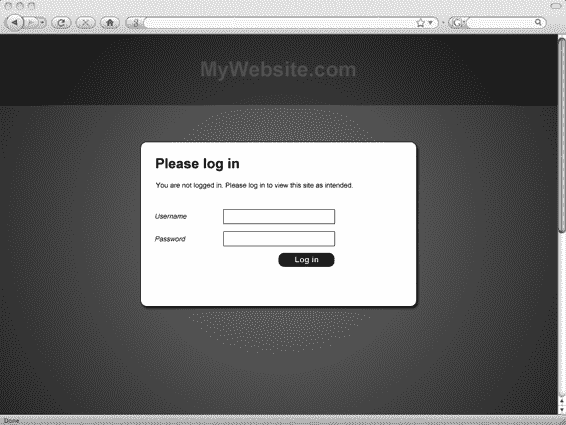
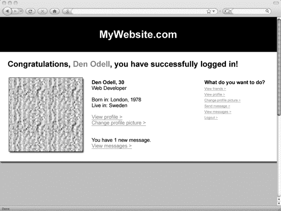
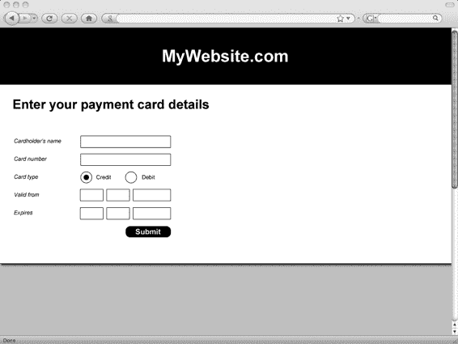
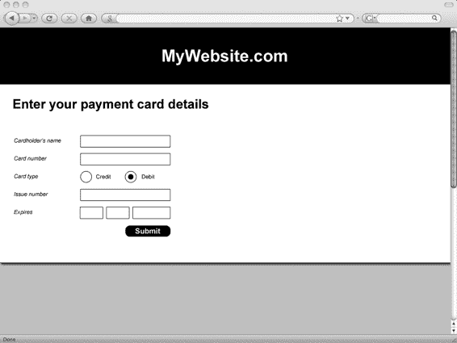

## 第 1 章：奠定坚实基础

如果你正在阅读本书，很可能你曾体验过构建并发布网站所带来的成就感。也许你是独自完成了这个项目；也许你是作为团队的一员构建了它。它可能是一个简单的网站，只有几个页面，用于在互联网上为自己建立一个面向少数朋友的形象；或者它可能是一个前沿的富互联网应用程序（RIA），具有社交网络功能，面向数百万潜在用户。无论如何，祝贺你完成了项目！你值得感到自豪。

回想项目开始之时，结合你后来获得的知识和经验，我打赌你至少能想到一件事——如果当初采用不同的做法，就能让你免于撞墙般的痛苦。如果你刚刚进入 Web 开发行业，你可能会后悔没有保留文件早期版本的备份，因为一次意外的断电让你花费了宝贵的时间来恢复修改。或者，你可能会后悔当初决定依赖那个第三方软件库——它在项目开始时看似能胜任任务，但很快就被证明是浪费时间和精力。在我自己的职业生涯中，我恰好经历过这些情况，并从中走出来，变得稍微明智了一些。我从这些错误中吸取了教训，并将这些新知识反馈到下一个项目中。

基于我的经验以及我从他人那里学到的东西，我开发了一套有效且明智的 Web 开发方法。这套方法，再加上一些巧妙的技巧，应该能将那些“撞墙”时刻降到最低，并确保从项目一开始到你的下一个网站或应用程序上线，一切都能顺利推进。

### 最佳实践概述

首先，我们来思考一下“最佳实践”这个术语的含义。如果你从事开发行业时间较长，你肯定经常听到这个词被用来为某种特定的编码技术或方法辩护。然而，这是一个有点沉重的短语，应谨慎对待。我来解释一下原因。

#### 谁给“最佳实践”加上了“最佳”？

# Web 开发格局

Web 开发的格局正在不断变化。浏览器的流行度此消彼长，它们之间的功能采纳也并非总是同步，而我们用于构建网站在此类浏览器中显示的技术仍相当不成熟，不断经历着修订和更新。在一个不断变化的环境中，我们现在可能认为是最佳实践解决方案的东西，六个月后可能就会被淘汰。

使用*最佳*一词，意味着存在用于比较的基准，或者已经采用了某种科学测试来进行区分。然而，此类测试很少进行。您应谨慎考虑任何被标榜为*最佳实践*的技术、技术和组件。请自行评估，判断它们是否符合一套标准，这套标准能惠及作为开发人员的您、网站的最终用户，以及（如果相关的话）您为之开展工作的客户。

我在本章中阐述的指南、规则和技术，都是我亲身尝试过，并能证明其适用于真实世界 Web 开发的。我认为它们是当前我们所能拥有的最好方法。当然，当您读到本书时，其中一些可能已变得无关紧要，因此我给您的建议是及时了解行业的变化。阅读杂志、订阅博客、与其他开发者交流，并在网络上搜寻知识。我会在我的个人[网站 http://www.denodell.com/](http://www.denodell.com/) 上维护一份我推荐的全面资源列表，为您提供一个起点。

通过紧跟这些最佳实践的变化，您应该能够保持在 Web 开发行业的前沿，拥有一套工具和技术，帮助您提高日常工作的效率、建设性和回报。

最后，在构建网站时，不要害怕审查、重写或重构您编写的代码。没有人能在无需修改代码的情况下从零开始构建一个网站。千万不要相信您在网络上，或本书或其他任何书籍中看到的任何代码示例是一次就能完美工作的。话虽如此，知识和经验能让事情变得更容易，所以抓住每一次机会练习，成为您能做到的最好的 Web 开发者。

## 谁将从最佳实践中受益？

事实是，每个人都应该能从您的代码中应用的最佳实践中受益。

请看下面的列表，并使用这些标准来评估您遇到的任何指南、技术或技术，判断它们是否适合您的网站。

### Web 开发者

最佳实践从自身做起。一个对您和您的 Web 开发者同事都有效的网站结构和代码，将使您们的工作变得轻松许多，并减少因编码不良可能带来的痛苦。

-   我的代码是否遵循万维网联盟的建议？

-   如果专有技术或插件不可用，我的网站是否仍可使用？

-   我的代码能否通过测试和验证？

-   我的代码是否易于理解、结构良好且易于维护？

-   是否可以在无需大量不必要工作的情况下，向网站添加额外页面、部分和资源？

-   我的代码能否在不增加大量额外工作的情况下，针对不同语言和地区进行本地化？

### 搜索引擎和其他自动化系统

信不信由你，很大一部分网站流量来自自动化机器和脚本，例如搜索引擎、屏幕抓取工具和网站分析工具。为这些机器人进行设计与为任何其他用户群体一样重要。

-   根据用于查找它的合理搜索词，我的代码能否在搜索引擎结果中恰当地显示？

-   我的代码能否被出于任何原因希望读取或解析其内容的机器或脚本简单而容易地读取？

### 最终用户

您代码最重要的用户是您的网站访问者，因此让您的代码为他们有效工作是第一要务。

-   我的代码是否能在任何 Web 浏览器或设备上使用和访问，无论其年代、屏幕尺寸或输入方式如何？

-   如果我的网站由屏幕阅读器软件朗读，其内容和顺序对听众来说是否有意义？

-   我能否确信，当以我未预料到的某种方式使用时，我的代码不会表现出错误行为或显示错误消息？

-   使用合适的搜索词时，我的网站能否通过搜索引擎或其他在线工具被找到？

-   我的用户能否轻松访问网站的本地化版本（如果提供的话）？

## 通用最佳实践

如果您和大多数开发者一样，您可能希望尽可能多的时间用于构建吸引人的用户界面组件和外观精美的网站，而不是因为一个糟糕的架构决策而重构您的代码库。保持代码的良好维护非常重要。如果没有合理的结构和可读性，随着时间的推移，维护代码将变得越来越困难。请记住，本章的所有指南都是为了尽可能让您（即开发者）的工作变得轻松而制定的。

### 明确项目目标

以下是在编码网页时需要牢记的两件最重要的事情：

-   最终用户会想如何使用它？

-   其他开发者会想如何对其进行更改？

请记住，最终用户可能不是人类。如果您检查现有网站的服务器请求日志，您会发现许多网站访问者实际上是搜索引擎蜘蛛、RSS 阅读器或其他能够读取原始页面内容并将其转换为其他内容的在线服务。

随着诸如 RSS 馈送等自动内容联合变得越来越普遍，这种基于机器的访问在未来几年可能会变得更加广泛。例如，来自流行的知识共享站点[维基百科 (http://www.wikipedia.org/)](http://www.wikipedia.org/) 的内容已经被用于网络的其他地方，包括在[谷歌地图 (http://maps.google.com/)](http://maps.google.com/) 中，根据每篇文章所描述内容的地理位置放置文章。

雅虎！和其他搜索引擎公司一段时间以来一直在推动 Web 开发者在页面中加入额外的上下文特定标记，以便他们能更好地理解内容，并可能在搜索引擎中以不同方式呈现结果。例如，食谱可以附带图片和食材一起呈现；电影相关结果可以包含评论和您附近上映该电影的影院列表。像这样将您的代码与其他开发者的代码在线连接起来的可能性是巨大的。通过以正确的方式标记您的内容，您能确保整个系统以合理、连贯、互联的方式组合在一起，这有助于用户更快地找到他们正在寻找的信息。

至于确保其他开发者（包括您自己，在长时间中断后重新回到项目时，仅为了保持思路清晰）能理解您的代码，您需要考虑通常的网站维护任务可能是什么。这些通常分为以下四类：

-   对现有页面进行修改

-   添加新页面

-   重新设计或修改页面布局

-   为需要其他语言页面或特定区域/国家版本的最终用户提供支持

通过预先思考这些任务，您可以减少需要重构代码或重新排列、拆分文件的可能性，从而使维护工作变得更加容易。欢迎回到清晰的思路！

### 了解基本规则

# 打好坚实基础

那么，我们如何从一开始就确保做对呢？以下七条经验法则似乎可以简洁地概括：

- 始终遵循成熟、开放且支持良好的网络标准。
- 了解 `HTML`、`CSS` 和 `JavaScript` 实现之间的跨浏览器差异，并学习如何处理它们。
- 假定浏览器支持 `HTML`，但无论浏览器中是否存在其他技术（如 `CSS`、`JavaScript` 或任何插件），都应确保你的网站可正常使用。
- 一致地命名你的文件夹和文件，并考虑根据用途、网站结构和/或语言将文件分组。
- 定期清除冗余代码、文件和文件夹，以保持代码库干净整洁。
- 为性能而设计代码。
- 不要为了使用技术而过度使用技术。

让我们逐一审视这些基本规则。

## 遵循成熟、开放且支持良好的网络标准

早在 20 世纪 90 年代初，一位在技术研究组织 `CERN`（欧洲核子研究组织，[`www.cern.ch/`](http://www.cern.ch/)）工作的非常聪明的人——蒂姆·伯纳斯-李，发明了我们今天所知的万维网。他提出了主页、超文本标记语言（`HTML`）以及互联超链接的概念，这些构成了网页浏览的基础。他还创建了世界上第一个网页浏览器来展示他的发明。

这个项目变得非常庞大，最终占用了 `CERN` 的大量资源。当决定将资金和人才转向建设最近完成的大型强子对撞机项目时，蒂姆·伯纳斯-李决定创建一个独立的组织来管理 `HTML` 及其相关技术标准的持续发展。这个新组织——万维网联盟（`W3C`，[`www.w3.org/`](http://www.w3.org/)）——于 1994 年 10 月成立。

自成立以来，`W3C` 组织已记录了超过 110 项与网络相关的推荐标准与实践。其中对本书读者最有用的是与 `HTML`（包括 `XHTML`）、层叠样式表（`CSS`）和使用 `JavaScript`（也称为 `ECMAScript`，因为 `JavaScript` 名称由 `Sun Microsystems` 公司注册商标）进行的文档对象模型（`DOM`）脚本编写相关的标准。

在互联网早期，出现了两款流行的浏览器：1994 年 12 月发布的 `Netscape Navigator` 和 1995 年 8 月发布的微软 `Internet Explorer`（`IE`）。这两款浏览器基于相似的基础源代码，并以类似的方式渲染网页。当然，当时的网页在视觉上与今天我们所见的截然不同，因此两者要实现这一点并非特别困难。

时间快进到 1996 年，情况变得有趣起来。微软在 `IE` 3 中引入了对 `W3C` 新推荐标准——`CSS` 第 1 级——的基本支持。该推荐标准定义了一种方式，让网页开发者能够对大多数页面元素应用字体和颜色格式、文本对齐、边距、边框和内边距。`Netscape` 很快跟进，两家浏览器制造商之间的竞争开始加剧。它们都试图实施新的、即将推出的 `W3C` 推荐标准，往往在这些标准尚未为大众应用做好准备之前就开始了。

自然，浏览器对标准支持的这种差异给网页开发者带来了困惑，他们常常倾向于为“非此即彼”的场景进行设计。这导致最终用户看到的网站显示着“此网站仅适用于 `Internet Explorer`。请升级您的浏览器。”这样的信息。

当然，`W3C` 的推荐标准仅仅是推荐而已：供浏览器制造商和开发者遵循。作为开发者，我们必须认识到，这些标准只有在其在通用网络浏览器中的实际实现才具有价值。随着时间的推移，浏览器在趋同于这些网络标准的实现方面确实取得了长足进步。不幸的是，那些在渲染网页时标准采纳质量较差的旧版本浏览器仍然存在，网页开发者必须将这些情况考虑在内。

此处原则是确保你了解浏览器中通用的标准支持情况，而不仅仅是关注 `W3C` 发布的最新推荐标准。如果该标准得到了良好支持，你就应该使用它。如果没有，则最好避免使用。

## 处理跨浏览器问题

网络浏览器会定期更新，并且通常对现有的 `W3C` 推荐标准提供更好的支持，同时也会对即将推出的推荐标准进行初步实现尝试。

从历史上看，不同浏览器对现有推荐标准的实现存在差异。对于较新推荐标准的浏览器支持也是如此。这意味着开发者必须随时了解浏览器软件的变化，并知晓不同浏览器的特性和限制。

另一方面，大多数浏览器用户并不像开发者期望的那样及时更新到新的浏览器版本。即使是能够自动更新到最新版本的浏览器，也通常需要用户先授权升级。许多用户实际上觉得这些通知会干扰他们当时试图在浏览器中完成的任务，因此他们往往会推迟升级。

作为开发者，我们必须意识到并承认，世界上存在许多不同的网络浏览器及其版本（总计约一万种不同的版本，并且还在增加）。我们无法控制最终用户使用哪个特定的软件来浏览我们的页面，也不应该去控制。

从浏览器统计数据网站（例如 `Net Applications` 的市场份额报告 [`marketshare.hitslink.com/`](http://marketshare.hitslink.com/)）中，我们可以了解到，当今世界上的五款主要网络浏览器是微软的 `IE`、`Mozilla` 的 `Firefox`、苹果的 `Safari`、`Opera` 软件公司的 `Opera` 以及谷歌的 `Chrome`。这五款浏览器占据了桌面端网页访问量的大约 99%。

然而，仅依赖在这些浏览器中进行测试，会忽略掉例如移动网页浏览这一蓬勃发展的市场，因此随时了解浏览器市场的最新进展是值得的。

在多种浏览器和操作系统上测试你的页面，可以让你定位到那些导致不同浏览器以不同方式解释你代码的部分。最大限度地减少这些差异是任何网页开发者面临的最艰巨任务之一，这也将这个角色与大多数其他软件相关职业区分开来。这项任务需要从一个新项目一开始就着手处理，因为如果拖得太晚，可能会导致深夜疯狂编码和错过截止日期——这绝非乐事！

最明智的方法是，在编写任何特定于页面的代码之前，先构建构成网站基本模板或轮廓的 `HTML`、`CSS` 和 `JavaScript` 代码。然后，在尽可能多的不同操作系统上的各种浏览器中，以及尽可能多样化的显示器和窗口尺寸下，测试这个基本框架。在添加任何页面特定的代码或内容之前，调整代码以确保模板正确显示。

一个特别的差异来源是浏览器中对颜色的不同解释。有些浏览器支持从图像文件中读取颜色配置文件信息；有些则不支持。有些应用伽马校正值；有些则不应用。因此，同一张图片或同一种颜色在不同浏览器中可能会略有不同，因此值得检查你的设计是否会导致页面上的对象之间出现颜色不匹配。

你应该在尽可能多的浏览器中逐个构建和测试各个页面组件。

尽可能在开发过程中进行测试。同样，通过将大部分测试提前到开发阶段，你将在后期遇到更少的问题，并减少需要修复的 `bug`。

到了项目末尾，开发者通常会感受到客户最后时刻索求变更的压力，因此在项目进行到这一阶段时最小化 `bug` 是一个明智的想法。

### 假设只支持 HTML

你的 `HTML` 标记必须在任何可用的浏览器、设备或用户代理中可见且功能正常运行，无需依赖 `CSS`、`JavaScript` 或插件。当 `CSS`、`JavaScript` 或插件提供了 `HTML` 之外的附加内容、布局或功能时，最终用户应能够以一种合理的方式访问这些内容以及行为的等效功能，而无需依赖这些技术。例如，如果你使用 `Flash` 电影为你的网站提供动画导航菜单，你需要确保通过 `HTML` 也能获得相同的导航；否则，你将阻止一整群用户访问你的网站。

显然，这对你开发网页的方式有着巨大的影响。你将从 `HTML` 基础开始向上构建，确保当某些浏览器功能被关闭或不存在时，没有功能会丢失。每一层代码都应该是“无侵入的”；也就是说，在 `HTML` 标记中不应该存在 `CSS` 样式规则或 `JavaScript` 代码——每一层都应该位于独立的文件中，并且自成一体。

在如今现代 `Web` 应用的背景下（这些应用通常以浏览器和服务器之间的通信通过 `JavaScript` 来处理的方式编写），这意味着当浏览器中的 `JavaScript` 被关闭时，这些通信点必须存在。例如，现代的 `JavaScript` 允许数据发送到 `Web` 服务器或从 `Web` 服务器接收，而无需在发送表单时刷新页面。在这种情况下，你必须确保表单可以在没有 `JavaScript` 的情况下提交——将其视为一个可选的附加功能，而不是一个必要条件。

你可能会听到这个原则被称为渐进增强，指的是在 `HTML` 之上添加或分层额外功能，或者优雅降级，指的是从浏览器中移除功能总能得到一个正常工作的网页这一事实。它是所谓的无障碍性的核心原则，指的是无论使用何种浏览器或设备，都能提供对网页的访问。

通过现实生活中的例子最能理解这一原则，那么我们现在来看两个例子。

首先，假设在你的 `Web` 应用中，有一个按钮，单击它会在页面内启动一个登录模式对话框，如图 1-1 所示。用户填写表单并点击提交按钮后，`JavaScript` 被用来将提供的登录凭据发送到服务器，然后根据用户的登录状态，对某些页面元素（而不是整个页面）进行刷新，如图 1-2 所示。





**10**

第 1 章 ■ 构建坚实基础

**图 1-1.** *模式风格的登录框*

**图 1-2.** *登录成功，如果启用了 JavaScript 则无需刷新页面*



第 1 章 ■ 构建坚实基础

**11**

但如果`JavaScript`被禁用了呢？你需要确保你的 HTML 代码结构能使用户被带到一个包含登录表单的独立页面。提交这个表单会将数据回发到服务器，导致页面刷新，而服务器端代码会根据用户状态（成功登录或未登录）来决定发送哪个页面。通过这种方式，两种场景在功能上是等效的，尽管它们的用户流程和创意处理可能不同。

再举一个例子，假设你有一个页面，其中包含一个用于收集在线预订系统付款信息的表单。在这个表单中，根据所选信用卡的类型，你可能希望某些字段仅在用户选择信用卡（如图 1-3 所示）时显示，而不是借记卡（如图 1-4 所示）。例如，“发卡行号”字段仅适用于借记卡，也许你还想仅对某些发卡机构的卡片显示“有效起始日期”字段。你可能还希望让用户无法提交不正确的日期，例如 2 月 30 日。

作为 Web 开发者，我们使用`JavaScript`来实现这一点。当用户在浏览器中执行某些操作时，`JavaScript`会触发事件，我们能够分配代码在这些事件触发时执行。我们甚至有能力取消事件，这意味着，例如，如果用户试图提交一个表单，如果我们认为该表单因未通过某些验证测试而不适合提交，我们可以取消该提交。

我们使用`JavaScript`来“监听”卡类型字段的变化。当用户选择一个不同的单选按钮选项时，此事件被触发。当此事件被触发时，我们可以执行一段代码，根据所选的卡类型显示或隐藏所需的字段。

`图 1-3.` 显示信用卡字段的支付卡表单



**12**

第 1 章 ■ 构建坚实基础

`图 1-4.` 显示借记卡字段的支付卡表单

我们还会监听表单的`submit`事件，当它触发时，我们会运行一个小型的`JavaScript`程序来检查日期字段是否包含有效值。如果我们认为输入的值不合格，我们可以强制表单提交失败。

现在，如果有人使用不支持`JavaScript`的浏览器访问你的网页会发生什么？她使用单选按钮选择了卡类型，但页面没有任何变化。实际上，为了实现对页面外观的改变，表单必须提交到服务器，以让服务器执行你之前使用`JavaScript`进行的那种处理。

在可用性方面，你可能会觉得要求用户在选择了卡类型后立即提交表单很奇怪，因为字段已经显示在下方了。在这种情况下，组织页面的理想方式可能是让所有字段都存在于页面的 HTML 中，并简单地允许用户填写其卡上可用的信息。当他们最终提交表单时，服务器上的处理程序可以验证他们的卡数据，检查他们是否输入了有效日期，如果存在错误，则重新加载页面并显示错误消息。

### 一致地命名和组织文件夹与文件

通过建立关于文件夹、文件及其内容命名的规则和约定，你为自己和其他开发者查找文件和代码简化了任务。一致的命名约定使维护和添加新功能的工作更加简单，确保开发者始终知道如何命名他们的资产。请参阅本章后面的“结构化你的文件夹、文件和资产”一节，了解一些你可能采用的目录结构示例。

### 维护整洁的代码库

你应该确保与项目关联的文件和代码恰好是网站工作所需的——不多不少。随着时间的推移，某些文件可能被其他文件取代，某些 CSS 样式规则或`JavaScript`文件也可能被其他规则或文件取代。

我建议你在开发过程中定期从代码库中清除所有冗余的文件、文件夹和代码。这可以减小项目规模，有助于其他开发者理解代码，并确保你网站的最终用户不会下载从未使用过的文件，从而消耗他们可能需要付费的带宽。

# 避免意外删除导致的问题

为避免文件被意外删除，或因之后需要已删除文件而陷入困境，您应考虑使用源代码管理系统。此类系统会为项目文件的更改保留备份，并确保您可以随时恢复到特定文件夹或文件的先前版本——即使是已删除的文件。有关更多信息，请参阅本章后面的“存储文件：版本控制系统”一节。

# 为性能而设计代码

您的网站访问者，无论他们是否意识到这一点，都期望在网页上获得响应迅速的用户界面。如果点击了一个按钮，用户期望看到某种反应，以表明他们的操作已被识别并正在处理中。

`HTML`、`CSS` 和 `JavaScript` 代码在浏览器中运行，并依赖于最终用户机器或设备的性能。您的代码需要轻量且高效，以便快速下载、正确显示并即时响应。本书第 2 部分将重点介绍性能，并解释如何让您的代码变得更轻、更精、更快，从而造福最终用户。

# 不要为技术而技术

在更广泛的 Web 开发社区中，您经常会听到关于新技术的炒作，声称它们能以某种方式让您的网页变得更好。最近，这种炒作主要集中在异步 JavaScript 和 XML（`Ajax`）技术上，该技术是指在浏览器中使用 `JavaScript` 与服务器通信，从而减少页面刷新频率。这成为了 Web 开发人员在任何新项目中都喜欢使用的技术。

问题在于，构建的网站仅能通过 `Ajax` 技术工作，完全依赖于 `JavaScript`。那些浏览器不具备此功能的用户——例如使用移动网页浏览器的用户、在办公环境中受限制的用户、因残疾而有特殊浏览器需求的用户，以及搜索引擎爬虫等外部机器人——将无法访问通常通过超链接和按钮连接在一起的 `HTML` 页面提供的信息。相反，一些拥有功能强大的浏览器的用户发现，如果他们长时间停留在某些严重依赖 `Ajax` 技术的网站上，他们的浏览器最终会变慢或失去响应。一些急于赶上新潮流的 Web 开发人员，忘记以防止浏览器内存泄漏的方式进行编码。

将您的网站建立在可靠的基础和稳固的原则之上，在决定新技术是否适合您的项目之前，确保对其进行测试并将其推向可用的极限。

您将在第 2 章中了解 `Ajax` 技术，并在第 4 章中了解如何处理浏览器中的内存泄漏。

# 标记最佳实践：语义化 HTML

`HTML` 或 `XHTML` 构成了每个网页的基本基础。从技术上讲，这些是唯一需要被所有网络浏览器和用户代理支持的 Web 标准。在这里，*语义* 一词指的是应用正确的标签来匹配内容背后的含义（根据字典，*语义* 一词的字面意思是 *意义*）。

尽可能多地了解 `HTML`/`XHTML` 标签和属性将使您处于有利位置。确保您的内容使用完全适合其涵盖内容的标签进行标记：表格数据使用表格标签，章节标题使用标题标签，依此类推。

您能给内容赋予的意义越多，Web 浏览器、搜索引擎爬虫和其他软件就越能按照预期的方式解释您的内容。

建议您在页面的标记中包含所有语义信息，即使您选择使用 CSS 样式规则在浏览器中视觉上隐藏某些元素。一个有用的指导原则是，您应该根据如果大声朗读时的效果来编写标记。想象一下，标签名称被朗读出来，然后是标签的内容。事实上，这正是大多数屏幕阅读器浏览器的工作方式，它们为有视觉障碍的人提供网页的音频描述。

例如，假设您为电影评论建立了一个网站，并且想要显示一张图片来表示该电影获得了五颗星中的四颗。现在考虑一下您希望如何大声朗读这些信息——比如，“评为五颗星中的四颗星”。假设您将此文本放在 HTML 中，以便所有人都能访问。但您不希望此文本显示在页面上；您只想显示四颗星的图片。这就是 CSS 发挥作用的地方。您可以向包含此文本的标签应用一个 `class` 属性，并使用 CSS 定位这个 `class`，以指定隐藏文本并根据指定大小显示图像。以适用于所有浏览器（包括屏幕阅读器）的方式隐藏部分文本的样式规则，将在本章后面的“格式最佳实践：CSS”部分中介绍。页面此部分的 HTML 可能如下所示：

```
<div class="rated-four-out-of-five">
  这部电影被评为五颗星中的四颗星。
</div>
```

## 学习 HTML 标签

如果您是一位经验丰富的 Web 开发人员，曾参与过多个网站项目，并且一直以语义化的方式标记内容，那么您应该已经熟悉了大量的标签：`<h1>`、`<h2>`、`<p>`、``、`<ul>` 和 `<li>`，仅举几例。然而，一些不太常见的标签很少出现在开发人员的脑海中。缺少这些标签，您将面临以错误方式标记文档的风险，从而错失为用户、搜索引擎和其他人增加内容意义的机会。

以下是一些为浏览器或最终用户增加重要含义，但经常被遗忘的标签：

-   `<abbr>`：缩写，用于将内联文本标记为缩写。在许多浏览器中，将鼠标悬停在文本上会显示完整的版本。

    `<abbr title="等">etc.</abbr>`

-   `<acronym>`：首字母缩写词，用于将内联文本标记为首字母缩写词。在许多浏览器中，将鼠标悬停在文本上会显示完整的版本。

    `<acronym title="万维网">WWW</acronym>`

-   `<address>`：页面的联系信息。乍一看，您可能认为此标签应用于标记页面上列出的邮政地址。然而，这是对该标签的错误使用。它只应用于标记页面作者的联系信息。（当然，邮政地址可以是该信息的一部分。）

    ```
    <address>
      作者：Den Odell<br />
      <a href="mailto:me@denodell.com">给作者发送电子邮件</a>
    </address>
    ```

-   `<blockquote>`：长引用。关于块引用经常被忽略的一个重要点是，该标签只能包含块级元素。因此，引用本身至少必须用段落或其他块级元素括起来。

    ```
    <blockquote>
      <p>如果音乐是爱情的食粮，那就继续演奏吧，<br />
      给我过量，直到饱足，<br />
      让食欲反胃，然后消亡。</p>
    </blockquote>
    ```

-   `<ins>` 和 `<del>`：插入和删除的副本。`<del>` 用于显示一段内容已被删除。`<ins>` 用于显示另一段内容已被插入到页面中。例如，这些标签可能用于博客文章，其中作者在发表后返回文章并对其进行编辑以更改特定句子。这些标签可以以语义化的方式显示这一点。通常，`<del>` 标签内的内容在浏览器中会显示为带有删除线。

    ```
    英国有 <del>5000</del> <ins>6000</ins> 万居民
    ```

在编写页面代码时，请牢记这些标签。看看您是否能发现将它们融入标记中，以表达内容正确含义的机会。

# 夯实基础

`提示：` 开发时请手边备一份标签和属性参考列表，并定期复习。

一个优秀的 XHTML 标签和属性在线资源可访问 [`www.w3schools.com/tags/`](http://www.w3schools.com/tags/)。

# 第 1 章：夯实基础

## 从文档类型定义开始

每个 HTML 或 XHTML 页面都应从文档类型定义（DTD，即 DOCTYPE）开始。它必须出现在页面中任何其他 HTML 标签之前。DTD 指明了页面内容所遵循的 HTML 标准，这对任何解析页面内容的软件都是至关重要的信息。例如，如果浏览器知道文档其余内容是 XHTML，它就会假设每个标签都已闭合，标签和属性的大小写保持一致，且标签嵌套正确，因为这些正是 XHTML 文档的规则。

DTD 并非标准标签，因此无需闭合。示例如下：

```
<!DOCTYPE html PUBLIC "-//W3C//DTD XHTML 1.0 Transitional//EN"
"http://www.w3.org/TR/xhtml1/DTD/xhtml1-transitional.dtd">
```

此 DTD 声明页面其余内容为 XHTML 1.0 过渡版格式，并告知内容阅读器可访问哪个 URL 以获取相应的规范。

如果省略 DTD，浏览器就可能自行猜测使用何种标准，这可能会导致一些奇怪的渲染错误。

### DOCTYPE 切换

微软 IE 浏览器早期版本（包括 5.5 版本及之前）引发的一大严重投诉是，它不会按照 W3C 推荐的规范来渲染某些样式。具体来说，`盒模型`（它决定了浏览器应如何将 CSS 宽度和高度属性应用于同时包含内边距的块级元素）就与 W3C 推荐规范及其他浏览器的实现不一致。

在 IE 6 发布时，微软开发人员面临一个困境：要么采用正确的实现，但这会破坏所有为旧版浏览器设计的现有页面渲染；要么维持原状，迫使所有开发者为 IE 使用与其他浏览器不同的样式表。显然，两种选择都不理想。作为解决方案，他们内置了两种渲染方法，并提出一种方式，通过文档开头的 DTD 在这两种方法之间进行切换。

如果开发者在 DTD 中省略了 URL 部分，浏览器就会进入`怪异模式`——即 IE 中最初不正确的盒模型渲染方式。如果提供了包含完整 URL 的 DTD，浏览器则进入`标准模式`，遵循 W3C 规范。这样，开发者就可以为自己的网站选择使用哪种渲染方法。

### DTD 的选择

作为开发者，我们希望推动整个网络对标准的使用，无论是在我们的代码中，还是在用于解释代码的软件中。然而，我们必须认识到，仅仅采用 W3C 的最新推荐并不总是最明智之举。我们必须考虑当前支持该推荐的浏览器所占的比例。

在本书出版之时，以下 DTD 选择获得了全面的跨浏览器支持，并受到推荐：

- HTML 4.01 严格版
- HTML 4.01 过渡版
- HTML 4.01 框架版
- XHTML 1.0 严格版
- XHTML 1.0 过渡版
- XHTML 1.0 框架版

HTML 4.01 是 HTML 4 的精简版本，强调结构而非表现。除非有充分的理由使用其他版本，否则应将 HTML 4.01 严格版作为默认 DTD。它将以最严格、最符合标准的方式渲染文档。

HTML 4.01 过渡版包含 HTML 4.01 严格版的所有元素和属性，但额外增加了表现性属性、已废弃的元素和链接目标。如果需要与遗留代码集成，则应使用 HTML 4.01 过渡版。

HTML 4.01 框架版包含 HTML 4.01 过渡版的所有元素和属性，但增加了对框架集的支持。除非在无法避免使用框架集的情况下，否则不应使用。

稍后将讨论到，XHTML 本质上是采用 XML 格式的 HTML。它可以被 XML 解析器读取，并可使用可扩展样式表语言转换（XSLT）转换为任何其他基于文本的形式。

### DTD 验证

选择了一个 DTD 来描述你的文档，并不意味着你编写的标记就符合该 DTD 中包含的规范。为避免错误，你应该通过 HTML 验证器运行你的页面，它会检查页面是否符合你指定的 DTD。

最好的验证器之一是 W3C 提供的在线工具，网址为 [`validator.w3.org/`](http://validator.w3.org/)。你可以通过公开可访问的 URL 运行验证，上传你的 HTML 文件，或直接将标记输入到网站上的文本字段中。在 W3C 验证器网站上点击 `Check` 按钮即可运行验证。任何生成的错误都会按照文档源代码顺序列出。

## XHTML 中的“X”从何而来？

由于 XHTML 本质上是应用了 XML 规则的 HTML，因此其规则与 XML 相同：

- 所有标签必须格式良好。
- 所有元素和属性名称应统一采用小写或大写，因为 XML 是区分大小写的。许多人发现小写更容易阅读。
- 属性值必须用引号括起来并提供。即使是简单的数值也必须加引号。在属性作为布尔型开/关值的情况下（例如，`<input>` 元素的 `checked` 和 `disabled` 属性），该值应设置为与属性名相同，如下例所示：

```
<input checked="checked" type="checkbox" name="item1" id="item1" value="1" />
```

与 HTML 不同，XHTML 是格式良好的——每个打开的标签都必须关闭。这意味着浏览器解析 XHTML 比解析 HTML 更简单，因此它也适合用于处理器速度慢、内存小的移动应用。专门针对移动用途，有 XHTML 移动版概要（现在称为 XHTML Basic），它是完整 XHTML 的一个子集。

事实上，XHTML 的通用可转换性和可读性使其也适合其他 Web 服务和计算机程序访问和解析，这意味着它具有令人难以置信的多功能性，因此强烈推荐使用。本书其余部分的所有示例都将优先使用 XHTML 而非 HTML。

### 格式良好的文档

当所有元素都有闭合标签或自闭合，并且所有元素都相对于其他元素正确嵌套时，XHTML 文档就是格式良好的。也就是说，任何被打开的标签都必须在其父标签闭合之前闭合。

以下是正确嵌套标签的示例：

```
<p>
这是一个包含<em>强调</em>文本的段落。
</p>
```

以下示例展示了错误的嵌套：

```
<p>
这是一个包含<em>强调</p>文本的段落。
</em>
```

在 XHTML 文档中，没有内部内容的元素，如 `<br />` 和 ``，必须自闭合。在标签名的最后一个字符和标签末尾的斜杠之间应放置一个空格。已知省略此空格会导致某些旧版浏览器（包括 Netscape 4）出现渲染问题。

### 元素限制

XHTML 对元素的嵌套确实施加了一些限制。例如，行内元素不能直接放置在 `<body>` 元素内部，而必须完全嵌套在块级元素内部。块级元素不能放置在行内元素内部。某些元素（如 `<ins>` 和 `<del>`）根据其内部内容被视为既是块级又是行内元素。值得通过查阅你的 HTML 来注意这些元素具体是哪些。

# 参考指南

请注意，某些元素不能包含其他元素，例如表 1-1 中列出的那些。

**表 1-1.** *部分具有内容限制的标签*

| **标签** | **限制** |
| --- | --- |
| `<a>` | 不能包含其他 `<a>` 标签 |
| `<pre>` | 不能包含 ``、`<object>`、`<big>`、`<small>`、`<sub>` 或 `<sup>` 元素 |
| `<button>` | 不能包含 `<input>`、`<select>`、`<textarea>`、`<label>`、`<button>`、`<form>`、`<fieldset>`、`<iframe>` 或 `<isindex>` 元素 |
| `<label>` | 不能包含其他 `<label>` 元素 |
| `<form>` | 不能包含其他 `<form>` 元素 |

## 将最佳实践付诸实践

所以，你正坐在电脑前，准备按照最佳实践编写一个 HTML 页面。那么，你该如何着手呢？

请记住，你的目标是编写一致且易于其他开发者理解的代码，并最终构建出一个标记正确、可供最终用户访问的网页。

让我们一起来看看一些指导原则和规则，它们应该能帮助你遵循最佳实践。

### 编写整洁有序的代码

代码缩进能增强代码的可读性。根据代码的分组或嵌套层级对代码段进行缩进，会使你的代码更易于阅读和理解。请记住，这里的目标之一就是便于其他开发者进行维护。就像你在客人到来前会整理客厅一样，你也应该保持代码整洁，以备不时之需。

应使用制表符（Tab）来进行缩进，而不是空格。这既能提高可维护性和可读性，又能减少页面的整体体积。在你的开发环境中，你可以配置制表符的间距，使其映射到特定数量的字符空格。

通常情况下，两个、四个或八个字符的空格对于可读性来说已经足够。

位于其他标签内部的代码块应该进行缩进。每嵌套一层，代码就应该向内缩进一个制表符。那些仅包含显示文本内容或内联元素的标签，其内容无需相对于父级进行缩进。请看下面的示例，它展示了一些典型的间距设置。

```
<div id="container">
    <p>A paragraph of content</p>
    <table>
        <tr>
            <th>Name</th>
            <th>Value</th>
        </tr>
        <tr>
            <td>Red</td>
            <td>ff0000</td>
        </tr>
    </table>
</div>
```

### 减少注释

我相信你见过很多网站上散落着 HTML 注释的例子。它们遵循以下格式：

```
<!-- comment goes here -->
```

通常，它们被用来标记页面中特定标签或部分的开始和结束。

虽然这在试图确定后端生成的代码对你的前端输出做了什么时可能有用，但大多数开发环境和内置的浏览器开发工具都允许你定位内容块和部分的起始点与结束点，因此这种注释的使用方式有些多余。

在 HTML 中包含大量注释意味着终端用户必须先通过网络下载更多的标记数据到他们的浏览器，然后才能看到可与之交互的页面。我建议尽量避免使用 HTML 注释，以下情况除外：

- 当某些标记的使用方式在日后可能会让查看你代码的其他开发者感到困惑时。注释可以提供解释并避免混淆。

- 当它能使特定浏览器产生特定行为时。比如在 IE 中的条件注释，我们接下来就会看到。

### 为 IE 使用条件注释

从 IE 5 及以上版本（仅限 Windows）开始，微软添加了一个非常有用的功能，称为`条件注释`。其思路是，如果开发者需要编写专门针对某个特定 IE 版本或针对 IE 本身的代码，可以通过一种特殊格式的注释标签来实现，而无需使用 JavaScript 或服务器端浏览器检测。对于所有其他浏览器而言，此标签的内容显示为标准注释，因此会被忽略。

以下是一个针对 IE 6 及以上版本的条件注释示例：

```
<!--[if gte IE 6]>
<p>You are browsing with Internet Explorer version 6 or above.</p>
<![endif]-->
```

下面这个条件注释仅针对 IE 用户：

```
<!--[if IE]>
<p>You are using Internet Explorer browser.</p>
<![endif]-->
```

最后一个示例，这个条件注释针对的是版本低于 7 的 IE：

```
<!--[if lt IE 7]>
<p>You are using a version of Internet Explorer older than version 7.</p>
<![endif]-->
```

在条件注释中，`lt` 表示小于，`gt` 表示大于，`lte` 表示小于或等于，`gte` 表示大于或等于。

这项技术在导入外部样式表时发挥了重要作用。考虑以下代码，它通常位于 XHTML 文档的 `<head>` 块内。它有条件地为 IE 6 用户加载一个外部样式表。

```
<link rel="stylesheet" href="master.css" type="text/css" />
<!--[if IE 6]>
<link rel="stylesheet" href="master.ie6.css" type="text/css" />
<![endif]-->
```

大多数浏览器在读取这段代码时，会看到一个指向单个样式表 `master.css` 的引用，后面跟着一条注释（位于 `<!--` 和 `-->` 注释标记之间），它们会忽略这条注释。IE 6 是个例外。因为它识别出一个条件注释块的开始，该块指定其中的代码应仅由该特定 IE 版本读取，因此它会选择读取并解析该注释内的代码。

这使得开发者可以为所有符合标准的浏览器维护一个主样式表。但是，对于那些特定 IE 版本不配合的情况，他们可以包含一个指向较小样式表的引用，该样式表只包含针对那些出现问题的元素进行样式修复的代码。将来，当 IE 6 成为遥远的记忆时，开发者只需删除该条件注释及其内部的代码，即可从他们的网站中移除所有特定于版本的代码或样式。

### 正确设置 `<html>` 标签

在每个 HTML 文档的 DTD 声明之后，是 `<html>` 标签，它包裹着文档的其余内容。

对于 HTML 文档，可以只保留标签本身，不指定任何属性；但在 XHTML 的情况下，必须包含某些属性。请看这个来自 XHTML 文档的示例：

```
<html xmlns="http://www.w3.org/1999/xhtml" xml:lang="en-GB" lang="en-GB" dir="ltr">
```

这个示例包含以下组成部分：

`xmlns`：该属性定义了文档中自定义标签的命名空间（这是必需的，尽管目前在实际应用中很少使用）。

`xml:lang` 和 `lang`：这些属性指定了整个文档的语言，例如 `en` 代表英语（通常还包括地区区域设置，如 `en-GB` 代表大不列颠）。当文档中特定内容的语言发生变化时，例如使用了法语表达 *c'est la vie*，则此文本必须用标签包裹起来进行标记。在许多情况下，你会使用 `<span>` 标签，并为该元素设置 `xml:lang` 和 `lang` 属性。在前面的例子中，这个属性的值将是 `fr-FR`。

`dir`：这指定了文档内内容的文本方向。对于大多数西方语言，该值将为 `ltr`（从左到右）。但是，如果内容的文本方向发生变化，你应该通过在包裹该内容的标签上设置 `dir` 属性来注明这一点。唯一可能的另一个值是 `rtl`（从右到左）。

### 指定内容类型

建议向浏览器或用户代理指定文档的内容类型，以防其无法直接从文件本身读取该信息，因为这可以减少假设，并确保内容以其编写时的格式可读。使用 HTML 文件 `<head>` 部分中的 `<meta>` 标签来完成此操作，如下例所示。

```html
<meta http-equiv="Content-Type" content="text/html; charset=utf-8" /> 在这行代码中，浏览器被告知内容类型采用`UTF-8`字符集。

这一特定字符集非常灵活，因为全世界大多数字符都可以直接插入到文档中，而无需转换为 HTML 实体代码。这对于标准英文字母以外的字符尤其有用。

## 第 1 章 ▸ 夯实基础

### 设置页面标题

`<title>`标签是任何文档必不可少的组成部分。它应是一个用尽可能少的词语描述文档的单一标题。该标题在搜索引擎结果中用作页面链接的文本，并在浏览器窗口顶部显示。

考虑到这一点，你可能决定在页面标题中透露一些关于页面在网站结构中位置的其他信息，为那些通过谷歌搜索偶然发现你页面的人提供一些上下文。以下格式在可读且相当简洁的同时，似乎足以传达这些信息：

`<title>`页面标题` - `章节名称` - `网站名称`</title>`

在此示例中，`页面标题`几乎总是与页面的主标题（通常包含在文档的`<h1>`标签中）一致。当然，你可以在各值之间使用任何你喜欢的分隔符；顺序才是关键部分。

明智的做法是确保网站中每个不同的页面在其章节内都有一个唯一的页面标题，这样在搜索引擎结果或站点地图中就不会出现同名的重复结果。

### 分离表现、内容和行为

将文档内容与实现其设计和布局的代码分离开来非常重要。这种分离程度让你能够轻松进行样式更改，而无需修改标记。你甚至可以相当简单地用另一种布局替换网站的整体布局，而不会影响其内容。

你应该避免在标记中使用内联样式（通过许多标签的`style`属性设置），因为这会使页面的维护变得极其困难。开发人员应知道在样式表文件中查找与样式和布局相关的所有内容，而在 HTML 文档中查找与内容相关的所有内容。两者绝不应混杂。你还应将所有 JavaScript 代码放在 HTML 文档之外。

相反，在 HTML 中，应通过使用`<link>`标签引用样式表，使用`<script>`标签引用 JavaScript 代码。在 HTML 标签中添加`class`和`id`属性应是连接这些文件的唯一方法；`style`属性和 JavaScript 事件处理程序不应与你的内容混杂。

你可以根据你希望这些样式在哪种设备上显示来引用样式表文件。例如，你可能希望为打印机和屏幕包含单独的样式表，如下例所示：

```html
<link rel="stylesheet" href="master.css" media="screen" />
<link rel="stylesheet" href="master-print.css" media="print" />
```

当在`<link>`标签上指定了`media`属性时，只有当该属性包含值`print`时，打印机才会读取样式表；只有当该属性包含值`screen`时，屏幕才会读取样式表。这使你能够根据呈现介质不同地设置内容样式。例如，在打印机上，你可能只需要页面基本内容。你可以创建隐藏导航、页眉和页脚的样式，只保留主要内容体，这通常是大多数打印你页面的人离开浏览器时想要阅读的内容。

### 为整个文档添加包装元素

在页面的`<body>`标签内，你通常希望为整个页面添加某些布局样式。你很快会发现，仅将样式应用于`<body>`标签不足以完成你想要执行的所有定位和布局。作为解决方案，我建议你在页面内容周围添加一个“包装”元素（通常是一个`<div>`标签），并将额外的布局样式放在该元素内，而不是直接使用`<body>`标签本身。

`<div>`标签仅定义了一个内容块，不会为其中的内容增加额外含义。使用`id`属性为该元素设置一个合适的名称，以便关联 CSS 样式，如下所示：

```html
<body>
    <div id="page">
        ...
    </div>
</body>
```

如果你的设计非常简单，也许可以仅使用`<body>`标签。不过还是建议添加一个包装元素，因为你永远不知道你的设计将来会如何变化。

### 帮助 CSS 和 JavaScript 定位特定页面

我提倡的一种做法是：为网站中每个页面的`<body>`标签添加一个唯一的`id`属性。

假设你为一个多页面网站创建了通用样式，并且你希望在一个特定页面上略微不同地应用某一特定样式。在这种情况下，你需要创建一个例外规则。如果网站上的每个页面都有一个唯一的`id`属性，你就可以创建一个仅针对这一个页面的样式。

想象一下，你希望网站上所有段落文本都以白底黑字显示，但在首页上，你希望它反转：黑底白字。首页将拥有一个唯一的`id`属性，如下所示：

```html
<body id="homepage">
```

而段落文本的样式将如下所示：

```css
p {
    background:white;
    color:black;
}
#homepage p {
    background:black;
    color:white;
}
```

此外，通过以这种方式使用`id`属性，你可以使用 JavaScript 的`document.getElementById`方法轻松获取对特定页面的引用：

```javascript
var homepage = document.getElementById("homepage");
```

### 保持一致地命名 ID 和 Class 属性

你应该将正文内容的每个逻辑部分或块包装在各自的`<div>`标签中，并使用合理的、与上下文相关的值作为它们的`id`属性。某些元素在大多数页面和网站中是通用的，包括导航、页眉和页脚。在可能的情况下，这些类型的元素应在页面和项目间保持一致，以利于未来的维护。这使开发人员即使处理不熟悉的页面也能识别元素。

考虑使用类似以下的`id`属性值：

```html
<div id="header">
<div id="content">
<div id="aside">
<div id="footer">
<div id="navigation">
```

你应该根据`id`或`class`属性所包含的内容类型来命名它们的值，而不是根据它们使用的任何样式。例如，这种形式：

```html
<p class="error">
```

比这种形式更好：

```html
<p class="red-text">
```

> **提示：** 在`id`和`class`属性值中使用连字符（`-`）分隔单词使它们更易于阅读。

用与内容相关的信息标记`class`属性意味着，当你的网站设计师更改页面的特定部分时，你无需更改标记；只需要修改样式表即可。这也意味着 HTML 文档本身仅作为对其中内容的描述而独立存在，而不是依赖于任何外部文件、样式或代码。

### 正确排列内容顺序

确保文档中内容的顺序正确与确保内容被正确的标签标记同样重要。请记住，你需要确保当页面被朗读时，最重要的页面内容——页面的主体或主题——被首先朗读，而不那么重要的内容——例如导航链接和版权信息——被最后朗读。屏幕阅读器软件严格按照源代码顺序朗读文档内容，这意味着标记中先出现的内容会被首先朗读。

# 构建坚实基础

为了让屏幕阅读器用户以最有意义的方式获取内容，你应按以下顺序组织标记语言的 `<body>` 内容：

-   页面标题
-   简短跳转链接列表（页面内锚点链接），帮助读者直接跳至页面后续内容
-   主体内容
-   侧边内容（边栏、相关内容或上下文相关链接）
-   主导航
-   页脚与版权信息

你可以使用 CSS 修改页面的视觉布局，使其符合设计需求。本章后续的“样式无障碍指南”部分将对此进行说明。

## 将前景图像与背景图像分离

区分页面中与内容直接相关的图像和与布局或模板相关的图像非常重要。与页面内容直接相关的图像——如图表、图示、宠物照片等——应使用 `` 标签进行标记。所有其他图像，包括公司徽标和图标，则应在样式表文件中通过背景图片引用。这提供了另一种区分页面布局与相关内容的方式。

问问自己：“如果我只打印页面的主体内容，这张图像会显得格格不入吗？还是与内容上下文相关？”实践中，你会发现大多数图像文件将通过 CSS 引用，而非使用 `` 标签标记。

在确实使用 `` 标签的情况下，请记得使用 `alt` 属性，为因故无法在浏览器中查看图像的用户描述图像内容。如果图像较为复杂（如曲线图或图表），可能需要更详细的说明。此时可考虑使用 `longdesc` 属性，指向包含图像所传达信息深度描述的页面 URL。

## 正确使用表格

直到几年前，使用 HTML `<table>` 标签进行页面组件定位仍属常见做法。`<table>` 标签应仅用于表示表格数据，绝不可用于定位页面内容；CSS 完全足以胜任内容定位和页面布局的任务。

你可以通过多种方式为表格数据添加额外的语义信息，所有这些方法都能提升表格内信息的可访问性，因此值得实施。简而言之，这些方法包括：

-   在起始 `<table>` 标签后使用 `<caption>` 标签为表格添加标题。请注意，如果不希望显示标题内容，可随时通过样式表隐藏此标签内容，但为页面添加尽可能多的语义数据始终是明智之举。
-   使用 `<table>` 标签的 `summary` 属性，提供表格内容及其目标的简要概述。该属性可被朗读出来，以概括表格内容。
-   使用 `<thead>`、`<tbody>` 和 `<tfoot>` 标签，将表格的头部、主体和底部区域分组。请注意这些标签必须按特定顺序放置：先放 `<thead>` 和 `<tfoot>`，再放 `<tbody>`。这样浏览器可以在其余内容仍在加载时，先显示表格的头部行和底部行。
-   使用 `<th>` 标签标记表头单元格，使用 `<td>` 标记实际数据单元格。
-   为每个表头单元格赋予唯一的 `id` 属性值。然后，为每个数据单元格将其 `headers` 属性值设为关联表头单元格 `id` 值的逗号分隔列表。

以下是运用所有这些标记技术的表格示例：

```html
<table summary="表格显示本课程学生的平均年龄为 26 岁">
  <caption>本课程注册学生及其年龄表</caption>
  <thead>
    <tr>
      <th id="student-name">学生姓名</th>
      <th id="age">年龄</th>
    </tr>
  </thead>
  <tfoot>
    <tr>
      <th id="average-age">平均年龄</th>
      <td headers="age, average-age">26</td>
    </tr>
  </tfoot>
  <tbody>
    <tr>
      <td headers="student-name">约翰·刘易斯</td>
      <td headers="age">24</td>
    </tr>
    ...
    <tr>
      <td headers="student-name">彼得·琼斯</td>
      <td headers="age">28</td>
    </tr>
  </tbody>
</table>
```

## 优化表单

你应使用 `<fieldset>` 标签将逻辑上相关的表单区域分组，每个 `<fieldset>` 内包含一个 `<legend>` 标签，为该字段组提供标题。例如，信用卡申请表可能包含个人信息、信用记录和银行详情等部分。在这种情况下，可以创建三个 `<fieldset>` 标签，并分别设置 `<legend>` 标签为“个人信息”、“信用记录”和“银行详情”，示例如下：

```html
<form method="get" action="/">
  <fieldset>
    <legend>个人信息</legend>
    ...
  </fieldset>
  <fieldset>
    <legend>信用记录</legend>
    ...
  </fieldset>
  <fieldset>
    <legend>银行详情</legend>
    ...
  </fieldset>
  <input type="submit" value="保存" />
</form>
```

确保表单中每个具有关联文本标签的字段都已使用 `<label>` 标签标记。该标签需使用 `for` 属性，其值应与关联字段的 `id` 属性值一致。在默认浏览器行为下，该设置可使 `<label>` 标签变为可点击区域，从而将表单焦点移至关联字段，用户在选择标签时即可与相应字段交互。为了更灵活地对表单字段及其关联标签应用样式规则，请在每个字段周围添加 `<div>` 包装标签，以便通过样式表定位字段并设置间距及其他视觉属性。示例如下：

```html
<div class="field">
  <label for="first-name">名字</label>
  <input type="text" id="first-name" name="first-name" />
</div>
```

# 关于快捷键与网页可访问性的注意事项

需特别关注 `<fieldset>` 内 `<legend>` 和 `<label>` 标签中使用的文字。当这些字段标签被某些屏幕阅读软件朗读时，`<legend>` 标签内的文字会作为前缀附加到 `<label>` 标签的文字前，为听众提供额外上下文。你必须确保朗读时这些内容对听众而言是清晰合理的。

## 避免使用框架

你应不惜一切代价避免使用框架集。它们会使网站的内容和布局难以维护，在小屏幕设备（如手机）上使用起来很麻烦，并且给不使用鼠标作为主要输入方式的终端用户浏览内容造成困难。

内联框架（使用 `<iframe>` 标签）应尽量少用，甚至不用。它们可能让终端用户感到困惑，且缺乏单页 HTML 文档固有的无障碍特性。

## 网页内容无障碍指南

如果你不熟悉网页内容无障碍指南（WCAG），请阅读 W3C 的推荐标准，访问 [`www.w3.org/TR/WCAG20/`](http://www.w3.org/TR/WCAG20/)。这些指南定义了网页无障碍合规性的三个不同等级：A、AA 和 AAA，其中 AAA 代表最高级别的无障碍内容。

无障碍指南不仅涉及技术层面，还涉及创意设计、文案撰写和信息架构，这些共同为终端用户提供完整的体验。AAA 合规性是任何网站开发者追求的终极目标，应始终努力达成。然而，AA 合规性通常可以实现，对于受时间或设计限制的开发者来说是一个理想的中间标准。遵循本章指南，你将通过技术手段为提供最优质的无障碍体验迈出坚实一步，但你必须了解不同用户如何与网页交互，因此我鼓励你阅读 WCAG 文档。

## 别被访问键迷惑

### 避免使用 `accesskey`

曾被誉为网页绝佳增强功能的 `accesskey` 是键盘快捷键，允许用户跳转到页面上的特定内容或外部页面。然而，现代观点已将其否定，你应该避免使用 `accesskey`。

键盘快捷键对不使用鼠标的最终用户非常有用。事实上，这些用户通常已在操作系统中设置了他们自己的快捷键。不幸的是，`accesskey` 常常与用户定义的键盘快捷键冲突。当用户认为他们正在使用自己的快捷键，但实际上却触发了 `accesskey` 快捷键，或反之亦然时，他们会感到困惑。

`accesskey` 也可能令人困惑，因为不同网站通常使用不同的键来执行相同的操作。这意味着最终用户必须为每个访问的网站熟悉一套不同的快捷键。这在计算机软件世界中是不被期望的，因为在软件中，某些键盘快捷键通常执行相同的操作，无论程序是什么。

可访问性的黄金法则之一是减少最终用户的困惑。因此，我们必须认为 `accesskey` 理论虽好，但实践不佳。

### 不要被 `tabindex` 迷惑

另一个你应该避免的所谓可访问性增强是 `tabindex`。它设置当用户按下键盘上的 `Tab` 键时，链接、表单字段等元素变为活跃的顺序。不幸的是，无法仅为单个字段添加 `tabindex`。如果你为一个元素指定了 `tabindex`，则必须为每个元素都指定；否则，你将无法控制 `Tab` 键的跳转顺序。维护的艰巨任务及其对可访问性的有限影响，使这一特性成为败笔。

更好的解决方案是确保你的文档结构良好，将重要内容放在页面顶部，并在源代码中按你希望的 `Tab` 键跳转顺序指定链接和表单字段。然后，你可以使用样式表将这些元素定位到屏幕上所需的视觉位置或顺序。

### 不要依赖插件

从定义上讲，浏览器插件本身并不具备可访问性。由于它不是浏览器的一部分，绝不能假设用户拥有任何特定插件。如果最终用户没有特定的插件（例如 Adobe 的 Flash Player），则应提供替代内容，如本章前面所述。

将整个网页封装在 Flash 影片中是不明智的，尽管这在网络上很常见。影片中的内容对某些浏览器的用户以及没有插件的用户来说是不可访问的，并且对大多数搜索引擎不可见。相反，考虑在页面上使用 Flash 组件——例如在 Flash 影片容器中显示的电影预告片，或对导航栏进行特殊的创意处理。然后确保没有插件的用户能够通过其他方式访问内容。例如，你可以包含电影预告片的文字转录，或一个没有创意处理的纯文本导航栏。通过这种方式，你可以在不牺牲可访问性的前提下创建美观、智能的网页。

### 尽可能添加额外语义

一些开放标准正在兴起，用于为文档标记中的某些内容块添加额外含义。其中一种标准称为 *微格式*（microformats）。微格式是在网页中表示人、事件、标签等内容的 HTML 代码块。它们既可供人类阅读，也可供机器阅读，并且只需为某些属性分配某些值即可。

例如，`hCard` 微格式用于标记地址卡片信息，类似于常用于在计算机软件之间交换地址信息的 `vCard` 格式。以下是一个使用 `hCard` 微格式标记姓名、网站 URL 和移动电话号码的示例：

```html
<div class="vcard">
```

# 第一章：夯实基础

丹·奥德尔

手机：+441234567890

实际使用的标签并不重要。真正起作用的，是那些能被专门构建的软件（包括某些现有网页浏览器）识别的属性名称。利用样式表规则，可以隐藏页面上不想显示的任何内容片段，并将其作为标记中的纯语义数据保留下来。

**提示** 还有其他微格式可用于标记日历事件（`hCalendar`）、内容评论（`hReview`）等。在本书撰写期间，新的微格式也在不断被推荐。请关注最新进展，并查看更多示例，详情请访问 `http://microformats.org/`。

## 最佳格式化实践：CSS

作为开发者，你很可能打开过别人编写的样式表文件，并在心里嘀咕：“这让我怎么理解？”一旦你将所有布局样式与文档的标记分离，你就会发现，构建一个页面或网站所需的样式定义数量有多庞大！

正是由于布局页面所需的样式定义数量庞大，如果不遵循一些明智的 CSS 文件和样式结构指南，维护布局很快就会变得繁琐。

## 关于设计的像素级完美还原

作为开发者，我们应当始终努力将页面构建得与源创意设计尽可能像素级匹配。然而，有时为了这种像素级一致性所付出的努力，并不值得从中获得的视觉提升。

以表单字段为例。我已经记不清遇到过多少份创意设计，其中展示了带有自定义设计手柄的 `<select>` 下拉框（*手柄*是指下拉框边缘向下的箭头）。过去尝试对这些下拉框进行样式设计的同仁们——相信我，我也试过——都发现了浏览器之间巨大的差异。

似乎浏览器越现代化，我们对原生控件的控制权就越大。但这对于大多数人来说并无帮助。许多人仍然需要支持像 IE 6 这样的老旧浏览器——无论其表单控件看起来多么古老。

解决方案是采取“尽力而为”的方法。对于支持控件样式的浏览器，提供自定义样式的表单控件；对于无法渲染出预期效果的老旧浏览器，则需要务实对待。

所有主流浏览器都允许你设置背景色、文字颜色、字体和行高（不过高度设置在不同浏览器中可能产生不同效果，因此需要一些实验）。但并非所有浏览器都允许你指定边框样式或颜色，或自定义下拉框手柄的外观。你应提前让客户知晓这一点。否则，你将不得不相应调整设计，以在不同浏览器上实现完全一致的外观。

根据经验以及充分的常识，我们知道大多数终端用户只在机器上运行一个浏览器。此外，大多数用户并不会仔细审视设计元素。通常，他们不会发现某个 `<select>` 框的边框与页面上其他表单字段不匹配。终端用户主要关心的是，能否快速从你的页面获取所需信息。

以下是几条经验法则，用于判断在使用相同 CSS 时，跨浏览器差异应在何处划定界限：

- 如果为某种设计效果花费的开发时间与视觉提升不成比例，你可以舍弃该页面的某些设计元素。
- 如果未来为支持该布局而对代码库进行修改所需的维护工作过于繁重，你可以舍弃该页面的某些设计元素。

## W3C CSS 标准

早在 1996 年，W3C 就向开发者推荐了 `CSS 1.0`。目前大约 99%的常用浏览器都普遍支持该标准。

`CSS 2.1` 是当前的推荐标准，虽然它尚未在所有浏览器中得到普遍支持（目前仅限于最常用浏览器中的 `Firefox 3`、`Safari 3`、`IE 8`、`Opera 9.5` 和 `Google Chrome` 版本），但这 99%的浏览器中都能找到部分支持。CSS 定位（在 `CSS 2.1` 成为推荐标准之前也称为 CSS-P）功能已得到支持，可以实现元素在页面上的绝对定位（相对于浏览器窗口左上角）和相对定位（相对于其包含元素）。

目前正在寻求推荐的是 `CSS 3`（尽管它已经处于这个阶段很长时间，因为不断有新的增补建议被提出）。迄今为止，`Safari 3` 对 `CSS 3` 的支持最好，但 `Firefox` 和 `Opera` 的最新版本对其支持程度也在不断提高。只要你能确保在尽可能多的浏览器中充分呈现你的设计，就不必害怕使用 `CSS 2.1` 和 `CSS 3` 的样式规则。

## 样式表指南

通过遵循 CSS 最佳实践，你可以实现使网页完全可访问且代码易于维护的主要目标。本节介绍的指南将帮助你为未来可能需要的任何变更准备好样式表，同时确保满足最终用户的需求。

### 分离通用样式规则

最好在每个页面中只包含渲染该页面所需的 CSS 样式规则。包含未使用的额外样式规则会导致浏览器在识别并丢弃这些数据之前，需要下载和解析额外的数据。然而，必须牢记两点：可维护性和对浏览器工作原理的理解。

考虑一个致力于提供最新体育比分的网站，它由四个页面组成。首页向访问者介绍网站宗旨，并提供指向其他页面的链接。其他页面包括体育比分页面、新闻更新页面和常见问题解答（FAQ）页面。根据上述指南，每个页面上的样式规则应仅包含渲染该特定页面所需的规则。

现在考虑这些网页在屏幕上的外观。大多数网站都有跨页面存在的组件，例如包含网站徽标和导航的页眉部分，以及包含版权信息的页脚。此外，大多数网站设计都基于布局模板，因此每个页面都符合同样的大致尺寸，并采用设计者指定的网格布局。

试想一下，如果网站的四个页面各自对应一个样式表文件，且页眉、页脚和通用页面布局的样式在这四个文件中重复，那么维护这些样式将是一场噩梦。

需要一种更合理的方法来确保可维护性并避免样式规则重复。

所有主流网络浏览器都力求为用户提供最快、最愉悦的浏览体验，并为此采用了许多方法。其中一种方法称为*缓存*，它涉及将用于显示网页的所有 HTML、图像、样式表、JavaScript 文件和其他静态资源的副本，本地存储在最终用户的硬盘上。这意味着当用户点击浏览器的后退按钮或重新访问某个页面时，浏览器只需在硬盘上查找即可检索显示页面所需的数据。这避免了通过相对较慢的互联网连接再次下载这些资源，从而使页面显示速度比以前快得多。

在简单情况下，例如网站徽标图片，当用户访问首页时会被下载一次。只要每个页面都指向网络服务器上相同的图片文件，并且该图片在此期间未更新，网络浏览器就会从其硬盘缓存中获取该图片，而不是浪费时间重新下载。我们可以将同样的原理应用于样式表。

假设你为网站创建了一个样式表，其中仅包含通用页面布局和所有页面共有的通用组件的样式。你在每个页面中都引用这个相同的文件。当最终用户首次访问网站上的某个页面（通常是首页）时，网络浏览器会下载此文件一次；之后在后续页面访问中，浏览器将使用已下载的文件。这加快了页面的渲染速度，因为无需花费时间下载不必要的文件。这还有一个额外的好处，即将所有整个网站通用的页面样式集中在一个文件中，从而避免了页面间样式规则的重复。

你可以将特定页面的样式规则放置在各自独立的文件中，这样每个页面将引用两个外部样式表：一个网站通用，一个页面独有。

### 理解层叠与优先级

讨论样式表时，有两个重要的术语：*层叠*和*优先级*。层叠（CSS 缩写中的字母 C）用于描述样式以叠加方式应用的过程。优先级则描述了特定样式在页面上应用的实例级别。

组织样式规则最合理的方式是从编写通用样式开始，然后随着进度逐渐增加样式的优先级。通常，样式越通用，样式表文件就越高效。尽量避免过度指定样式规则。没有必要列出应用于你所设样式元素的每个标签、ID 或类——保持简洁明了。

例如，考虑一个 HTML 页面，其 `<body>` 标签包含以下标记：

```html
<body>
  <div id="page">
    <div id="header">
      <h1>我的页面标题</h1>
    </div>
    ...
  </div>
</body>
```

与其对标题标签应用样式时指定如下：

```css
body #page #header h1 {
}
```

不如指定更简单的样式：

```css
#header h1 {
}
```

由于你知道 HTML 中所有 `id` 属性值必须是唯一的，因此页面上只能有一个 `id` 值为 `header` 的元素，所以在样式规则中指定其父级元素是多余的。你也不需要指定 `body` 标签选择器，因为根据定义，你能够应用样式的唯一标签都在 `<body>` 标签内。此外，在前面的新样式规则中，你可以将 `header` 保留为页面的一个独立组件，不受其父元素的限制。如果你决定将 `<div id="header">` 标签在标记中移动，并将其放置在不同的父元素内，你知道样式规则会以相同的方式应用于它。

让我们考虑另一个例子。假设你想要两个文本段落以相同的字体显示，仅在大小和颜色上有所不同。以下是 HTML：

```html
<body>
  <div id="page">
    <p>那只敏捷的棕色狐狸跳过了懒狗。</p>
    <div class="alternative">
      <p>五个拳击巫师快速跳跃。</p>
    </div>
  </div>
</body>
```

现在来看样式规则：

```css
```

#page p {
  font-family: Verdana, Arial, Helvetica, sans-serif;
  font-size: 1.3em;
  color: #000;
}

#page div.alternative p {
  color: #f00;
  font-size: 1em;
}

最通用的样式规则（即前面代码中两个规则中的前者）中描述的样式将应用于`<div id="page">`标签内的所有段落标签。而后一个样式规则则应用于`<div class="alternative">`标签内更具体的段落标签。

这种叠加效应就是我们所说的*层叠*。

## 同样值得关注的 `!important` 关键字

同样值得关注的是 `!important` 关键字。你可以将其添加至任意样式的末尾，强制该规则在更具体的层面上优先于其他所有规则。你可以在前面的示例中添加这个关键字，如下所示：

```css
#page p {
  font-family: Verdana, Arial, Helvetica, sans-serif;
  font-size: 1.3em;
  color: #000 !important;
}

#page div.alternative p {
  color: #f00;
  font-size: 1em;
}
```

由于更通用样式的颜色已被标记为 `!important`，其样式将优先于该样式更具体的实例。在此例中，颜色 `#000` 会应用于示例页面中的所有段落文本。

在许多情况下，使用 `!important` 关键字来强制执行错误的优先级是不恰当的，这通常是样式表结构设计不佳的迹象。日后需要返回样式表文件找出为什么指定样式未能生效，既浪费时间又令人头疼。如果你发现需要频繁使用 `!important` 关键字，请考虑重构你的样式，以确保正确的规则能应用于目标元素。在某些情况下，这可能意味着需要在页面上添加一点额外标记，以确保样式能够以正确的方式应用。但这总比拥有一个结构糟糕、样式规则混乱的样式表要好。

## 考虑打印机

在构建网站样式表时，大多数开发者（虽然很少是故意的）会忽略打印机。当用户点击浏览器工具栏上的打印按钮时，了解哪些内容会被打印、哪些不会是很重要的。有三点你需要考虑：

-   **宽幅内容**：宽度超过打印页面宽度的内容通常会被截断——根本不会打印出来。有些浏览器允许按比例缩放内容以适应打印页面，但这可能导致文本难以阅读，具体取决于你网站布局的宽度。
-   **背景图像和颜色**：由于你只应将与该页面内容直接相关的图形作为前景图像包含进来，所有其他图像（例如标志）都应该作为背景图像。在很多情况下，页面上的所有图像实际上都是背景图像，通过外部 CSS 样式表文件指定。大多数浏览器不会打印这些背景图像和颜色。这是浏览器厂商为节省墨水、只打印必要内容（即页面文本内容）所采取的明智举措。如前所述，在大多数情况下，用户打印网页是为了阅读其主要正文内容——无论是火车时刻表、书评还是银行对账单。很少有网站访问者希望打印出的页面与屏幕显示完全一致。对于那些希望如此的人，通常可以在浏览器的隐藏首选项设置中启用打印背景图像和颜色，但这些选项默认很少是开启的。
-   **文本颜色**：大多数办公室环境中的用户只能使用激光打印机，通常只能打印黑白内容。大多数家庭用户拥有能够进行全彩、照片级打印的喷墨打印机。考虑到最低共同标准，如果你有黑白打印机，请用它测试打印你的页面；或者选择只用黑色墨水在喷墨打印机上打印。当考虑背景图像时，文本颜色也会发挥作用。假设你的网页在深色背景上使用白色文本。由于背景颜色不会打印，你将得到打印在洁白纸张上的白色文本。当然，打印机没有白色墨水可打印，因此用户实际上会得到一张空白页！

打印出来的网页通常会显示大片的空白区域，那里曾经是背景图像和颜色，有时还会有些内容被切掉，一些浅色文本完全丢失。这几乎不可能是用户希望在打印页面上看到的结果。

你不想成为用户沮丧的源头，因此应该通过指定一个仅供打印机读取的样式表来规避这些限制，使用以下标记：

```html
<link rel="stylesheet" href="master-print.css" media="print" />
```

在这个仅用于打印的样式表中，你需要最小化打印页面上可能出现的空白区域，移除不必要的组件，并确保最终打印的文章中没有内容被截断或隐藏。例如，你可以通过应用以下样式规则来移除导航：

```css
#navigation {
  display: none;
}
```

你可能需要指定一个字体颜色，例如黑色，以覆盖页面上所有其他的文本颜色。这可以通过以下样式规则实现：

```css
* {
  color: #000 !important;
}
```

这会将黑色（十六进制表示为 `#000000`，简写为 `#000`）应用于页面上的所有元素（`*` 通配符用于定位页面上所有元素）。

请注意样式规则末尾使用的 `!important` 关键字。正如我前面提到的，这是一个危险的关键字，因为它强制该样式比文档中的任何其他样式都更重要。然而，它在打印机样式表中非常有用，因为它允许你覆盖由主样式表指定的页面上任何元素的字体颜色，而无需考虑其特异性级别。

## 格式化你的样式规则

以下示例展示了一种久经考验、可读性良好的样式规则布局：

```css
.module-heading,
.module-subheading {
  background: #333;
  color: #f00;
  float: left; /* 内联注释 */
}
```

在这个样式规则中，使用了多个样式选择器，将该样式规则应用于具有两个不同 CSS 类的页面元素。样式选择器被放在单独的行上，而不是放在同一行（这可能会造成混淆）。样式规则在最后一个 CSS 类名所在行的末尾开始，并在所有样式规则之后另起一行结束。样式规则本身相对于样式定义缩进一个制表位。在每个样式属性名称后的冒号与其对应值之间有一个空格。

每个样式属性独占一行，并且每行以分号结束。

如果需要为某个样式规则提供注释以协助未来的开发或维护，此注释应紧跟在规则本身所在行的分号之后。

为了保持样式规则的一致性，你可以选择按样式属性名称的字母顺序排序，或者根据样式属性的类型（文本、颜色、布局等）排序，或者根据适合你的应用的任何其它分组方式排序。

## 为单个页面元素应用多个类名

正如本章前面提到的，在 HTML 标记中指定的 CSS 类名应该描述元素内容所代表的信息，而不是该内容应如何显示。

你可能希望对同一元素应用多个类名，以避免重复你的样式规则。在你的标记中，这可以通过简单地用空格字符分隔每个 CSS 类来实现，如下例所示：

```html
<div class="article main-article">
  <p>Hello, world.</p>
</div>
```

为 `article` 和 `main-article` 类编写的样式规则将从左到右应用于 `<div>` 标签，因此 `main-article` 样式规则中指定的样式将优先于 `article` 样式规则中的样式。

如果你需要为以这种方式包含多个类的元素应用特殊样式，以下 CSS 选择器语法将允许你做到这一点：

```css
div.article.main-article p {
  color: #0f0;
}
```

此样式规则应用于其父标签为 `<div class="article main-article">` 的 `<p>` 标签。请注意 CSS 类名之间没有空格字符。

## 重置浏览器的默认样式

默认情况下，网页浏览器会自带一组默认的样式规则，用于对未设置样式的页面进行渲染。这包括字体、字号、行高、颜色，以及在不同元素和标签上程度各异的填充（`padding`）和外边距（`margin`）。

为了让自己的样式有一个公平的起点，我建议你重置浏览器的默认样式。这样可以将对每个元素的精确控制权移交给自己的样式表，从而在不同浏览器之间提供更高的一致性。

在最简单的情况下，以下样式规则会将所有页面元素的外边距和填充都归零，以便你在样式规则中为每个需要指定间距的元素单独设置自己的外边距和填充间距：

```css
* {
  margin: 0;
  padding: 0;
}
```

CSS 样式大师 Eric Meyer 提供了一份非常全面的重置样式表，它能彻底消除不同浏览器默认样式规则之间的差异（`http://meyerweb.com/eric/tools/css/reset/`）。其当前版本如清单 1-1 所示。

## 打下坚实基础

**清单 1-1.** Eric Meyer 的通用跨浏览器样式重置

```css
/* v1.0 | 20080212 */
html, body, div, span, applet, object, iframe,
h1, h2, h3, h4, h5, h6, p, blockquote, pre,
a, abbr, acronym, address, big, cite, code,
```

# CSS 重置与样式优化

## CSS 重置

```css
del, dfn, em, font, img, ins, kbd, q, s, samp,
small, strike, strong, sub, sup, tt, var,
b, u, i, center,
dl, dt, dd, ol, ul, li,
fieldset, form, label, legend,
table, caption, tbody, tfoot, thead, tr, th, td {
  margin: 0;
  padding: 0;
  border: 0;
  outline: 0;
  font-size: 100%;
  vertical-align: baseline;
  background: transparent;
}

body {
  line-height: 1;
}

ol, ul {
  list-style: none;
}

blockquote, q {
  quotes: none;
}

blockquote:before, blockquote:after,
q:before, q:after {
  content: '';
  content: none;
}

/* 记住要定义焦点样式！ */
:focus {
  outline: 0;
}

/* 记住要以某种方式突出显示插入的内容！ */
ins {
  text-decoration: none;
}

del {
  text-decoration: line-through;
}

/* 表格在标记中仍需 cellspacing="0" */
table {
  border-collapse: collapse;
  border-spacing: 0;
}
```

Eric Meyer 花费了大量时间研究和测试每个主流浏览器对 CSS 的支持，他的重置样式就是这项辛勤劳动所结出的备受赞誉的果实。

无论你选择使用本节开头展示的简单外边距/填充重置代码，清单 1-1 中 Eric Meyer 的完整“重置一切”代码，还是通过快速搜索网络找到的其他替代方案，你都应该在主站点 CSS 文件的最开始、在应用任何其他样式规则之前，指定这些重置样式。

## 掌握简写样式规则

某些样式可以合并或缩短，在可能的情况下，你应该使用这些版本来减小 CSS 文件的体积，并减少从 Web 服务器到浏览器通过网络传输的数据量。

举一个简单的例子，元素上的某些外边距和填充值可以使用冗长的方式指定：

```css
p {
  margin-top: 5px;
  margin-right: 7px;
  margin-bottom: 5px;
  margin-left: 7px;
  padding-top: 6px;
  padding-right: 3px;
  padding-bottom: 6px;
  padding-left: 3px;
}
```

或者使用简写方式：

```css
p {
  margin: 5px 7px 5px 7px;
  padding: 6px 3px 6px 3px;
}
```

请注意，`margin`、`padding` 和 `border` 的简写值顺序始终如下：

- 上
- 右
- 下
- 左

当 `margin-top` 和 `margin-bottom` 的值相同，并且 `margin-left` 和 `margin-right` 的值也相同时，可以应用进一步的简写形式，如下所示：

```css
p {
  margin: 5px 7px; /* 上下 5px，左右 7px */
  padding: 6px 3px;
}
```

其他样式——例如 `font`、`color` 和 `background`——也有各自的简写形式。第四章（专注于提升 CSS 文件性能）提供了关于这些样式简写形式的更多细节。

## 样式无障碍指南

到目前为止，你应该知道，作为 Web 开发者，我们主要关注点之一是无障碍性——确保我们的内容对所有人都可用，无论他们使用何种浏览器、设备或输入方式。主要重点是确保语义化标记，正如本章前面所讨论的，但你还必须确保样式表支持这一原则。不同尺寸和分辨率显示器的用户应该能够清晰地查看你的页面内容。

### 向支持 CSS 的浏览器隐藏内容

如果你不希望某些标记中的标签内容显示在屏幕上，可以使用样式表在视觉上隐藏这些内容。回想一下本章前面的电影评论网站示例，当时你希望确保文本出现在 HTML 中，这样当内容被朗读出来或在没有应用样式的情况下被阅读时，用户能理解评论者对那部电影的评分。现在是时候应用你的 CSS 了。你希望显示一个代表五星好评中四颗星的图片，而不是显示那段文本。

以这种方式隐藏文本应使用 `text-indent` 样式属性，选择能将文本定位到浏览器视口左边缘之外的值，使其不再可见，如下所示：

```css
div#hide-me {
  text-indent: -9999px;
}
```

使用任何其他样式属性来隐藏文本都会产生不幸的副作用，即通过 Freedom Scientific 公司（`http://www.freedomscientific.com/`）制造的流行 JAWS 屏幕阅读器软件，该文本将变得无法阅读。

### 移动内容块以保持正确的标记源码顺序

在本章前面，你了解到标记中内容块的顺序应该是：当页面被朗读时，最相关的页面内容排在前面，次要内容（包括导航和版权信息）排在最后。当然，这种顺序可能不符合你网站的视觉外观，在视觉上你很可能希望导航链接出现在主体内容上方。

如果你的标记中有两个块级元素按顺序排列，而你更希望后一个内容先出现在浏览器中，你可以使用样式属性 `float` 来重新排列这两个内容块。请看以下 HTML 代码片段：

```html
<div id="body">
  ...
</div>
<div id="navigation">
  ...
</div>
```

默认情况下，`<div id="body">` 标签会出现在 `<div id="navigation">` 标签之前，但你可以使用 `float` 样式属性反转此顺序，如下所示：

```css
#body {
  float: right;
}
#navigation {
  float: left;
}
```

你可能还需要考虑使用绝对定位和相对定位的组合，在页面内重新定位内容块，以实现你需要的布局。

### 使用相对字体大小

有些网站访问者——可能是视力受损者，或者只是将屏幕分辨率设置得较高——可能会调整浏览器中的基础字体大小，以便以最佳方式查看网站。所有主流浏览器都具备此功能。作为开发者，除了考虑网页的设计标准，我们还必须考虑最终用户的需求。

为了应对字体大小调整的可能性，你应该在样式表中使用相对单位。这样，当浏览器的基础字体大小改变时，页面文本也会按比例改变。`em` 单位就是这样一个相对单位，`%`（百分比）也是。你绝对不应该在样式表中使用 `px`（像素）或 `pt`（点）值来指定字体大小，因为这些值不会根据最终用户的需求进行缩放。

为了在使用相对字体大小单位时更简便地计算字号，可以尝试将 `<body>` 标签元素的默认字体大小设置为 `62.5%`。在默认浏览器设置下，此比例会使 `1em` 在视觉上等同于 `10px`。这样一来，每个 `0.1em` 的增量就对应着 `1px` 的视觉增加，因此 `1.1em` 视觉上等于 `11px`，`1.2em` 相当于 `12px`。在处理那些通常以像素为单位计量字体大小的创意设计时，这个技巧极为实用。以下是一些示例：

```css
body {
  font-size: 62.5%; /* 重置字体大小，使 1em 在视觉上等同于 10px */
}
ul li {
  font-size: 1.1em; /* 视觉上等同于 11px */
}
h2 {
  font-size: 1.5em; /* 视觉上等同于 15px */
}
```

## 注释块

为了便于维护并帮助其他开发者理解你的样式表，明智的做法是将逻辑相关的样式规则分组并组织在样式表文件中。在每组规则前添加一个注释，描述这组样式的用途，并使用一致的符号格式，例如：

```css
/* ---------------------------------------------------------------- --
   表单样式
   根据商定设计，用于显示表单控件的样式组
*/
```

应仅在必要时添加内联注释，置于样式规则本身旁边以澄清特定规则。例如，当某个样式规则是为了处理特定浏览器中的边缘情况而添加时，有必要注明这一点，这样未来的开发者就不会认为该规则多余，并在不了解其初衷的情况下将其删除。

在每个样式表文件的最顶部，可以考虑包含一个开头的注释部分，详细说明该文件的作者、文件中样式规则的目的，并按照它们出现的顺序列出文件中的所有逻辑组，使用一致的格式。以下是一个描述整个样式表文件及其用途的注释块格式示例：

```css
```

/* ---------------------------------------------------------------- --

   文件名 `common.css`

   作者 Den Odell me@denodell.com

   描述 网站基本页面布局和默认样式

   内容

   - 重置样式

   - 页面分栏布局

   - 表单控件样式

   调色板

   `#777` 中灰色

   `#aaa` 浅灰色

   `#a3d60a` 网站通用绿色

*/

```

包含这样一个注释块可以让开发者一目了然地查看文件是否包含他们正在寻找的代码。对于你的通用网站样式表来说，列出网站中使用的一些关键颜色可能是个明智之举。这样开发者就能轻松找到这些颜色，并在需要时复制粘贴这些值。

## 浏览器兼容性解决方案

如果需要包含额外的样式来定位特定版本的 `IE`，应该使用本章前面描述的条件注释技术，为这些样式包含一个单独的样式表文件。

**注意** 请避免使用那些设置异常样式值，或使用反斜杠、注释和其他奇怪字符组合来混淆和迷惑某些浏览器的 hack。如果无法避免使用某个 hack，务必添加清晰的注释，说明为什么选择保留它以及它的用途，以警告未来可能查看该样式表文件的其他开发者。

在 `IE 6` 或更早版本中使用 `PNG-24` 图像时，图像文件的透明部分会显示为灰色/浅蓝色，而不是透明。不幸的是，微软直到 `IE 7` 版本才引入对此文件格式透明度的支持。不过，你可以使用一个变通方案，使简单的 `PNG-24` 图像能够在页面上作为背景或前景图像显示。

假设你在主样式表中定义了以下样式规则：

```
#header {
  background: url(my-image.png) no-repeat;
}
```

在使用条件注释引用的 `IE 6` 专用样式表文件中，可以包含类似如下的样式规则：

```
#header {
  background: transparent none;
  filter: progid:DXImageTransform.Microsoft.AlphaImageLoader(src='my-image.png', sizingMethod='scale');
}
```

这条 `IE 6` 专用的样式规则会隐藏原始样式表中指定的背景图像，转而使用微软特定的 DirectX 滤镜来引用同一个图像文件。该滤镜能够正确显示图像的透明部分，并将其放置在原背景图像所在的位置。然而，这项技术存在若干限制，包括不支持背景定位和平铺，因此使用时需谨慎。

## 本地化考量

网站面向未来设计的最重要的一个方面，就是要考虑到网站可能需要以其他语言或针对特定国家/地区的版本呈现。不仅网站的文字内容会有所不同，而且样式表的部分内容也极有可能需要作出一些调整。例如，你可能需要替换包含某种语言内嵌文本的图像文件，或者调整其他特定于地区的样式，甚至可能意味着需要为某些文字改变文本方向。

为了确保这种面向未来的设计，从一开始就应该在主要样式表文件中包含所有与地区无关的样式，并包含一个单独的样式表文件来提供特定于区域设置的样式规则，这些规则会按区域覆盖主样式表。这样一来，添加对新语言和区域设置的支持就变得很容易，因为这只是一个从现有区域特定文件创建新样式表文件，并替换其中样式以适应新区域和/或语言的问题。

## 组织文件夹、文件和资源

一个简单但可扩展的文件夹结构为将来添加内容和资源提供了良好的基础，而不会给开发者的维护工作带来更多负担。以下部分提供了一些组织文件夹、文件和资源的指南。

### 可读的 URL

应创建与项目站点地图相对应的文件夹，这样 `HTML` 页面和服务器端脚本存储在文件夹中，其 URL 就会变得合理、可读且有意义。通常，每个文件夹中的默认页面或索引页面可以在 Web 服务器配置中指定，这样仅通过文件夹名称即可请求 URL，并默认加载该索引文件。

还应该尝试以类似的方式用文件夹反映站点地图的层次结构，这样 URL 本身也呈现出层次结构。某些搜索引擎可能会将 URL 中的文本以及页面内容作为搜索条件。

例如，这个 URL：

`http://www.mywebsite.com/news/`

比这个更简洁、更易读且更易于记忆：

`http://www.mywebsite.com/news.php`

同样，URL 的各个部分应反映站点地图和合理的层次结构，如下例所示：

`http://www.mywebsite.com/music/rock/`

### 文件和文件夹命名

命名文件夹和文件时，应使用小写字母数字字符，并每个单词使用连字符分隔以提高可读性。避免使用英文字母、数字或连字符以外的字符。在代码中引用这些文件夹和文件时，请确保大小写一致为小写，因为某些 Web 服务器操作系统（如 `Unix`、`Linux` 和 `Mac OS X`）是区分大小写的。此外，切勿使用空格字符或为 URL 保留的字符（包括 `&`、`#` 或 `?`）来命名文件夹或文件，否则您可能会发现它们无法在不同 Web 浏览器中一致引用。

一个经常出现的需求是向最终用户提供本地化到其语言的网站内容。如果在构建网站之后才执行此本地化任务，可能会造成严重破坏，因为它可能需要您重写或重构 `HTML`、`CSS` 和 `JavaScript` 文件来支持它。您应该将与特定区域、语言或区域设置相关的资源分组到各自的文件夹中，并以区域设置命名（例如，指定为语言和位置，如美国英语使用 `en-us`）。将非特定区域设置的资源存储在此文件夹结构的同一级别。

> **提示**：考虑使用 `XML` 文件、内容管理服务器或服务器端资源文件，将本地化内容直接提供给脚本生成的标记。这将使维护任务比编辑静态 `HTML` 页面的副本更简单。

#### 文件编码

所有基于文本的文件都应使用 `UTF-8` 编码类型，因为这允许在文件中直接使用扩展字符和非英文字符集，无需特殊的控制字符和 `ASCII` 代码。

在实践中，从一开始就以 `UTF-8` 格式创建文件要比以后转换它们容易得多。如果您需要将文件从其他编码格式转换为 `UTF-8`，请备份现有文件，并使用开发环境的文件属性对话框将文档格式设置为适当的编码类型。这可能会影响文件中已有某些字符的编码，因此请使用备份文件将字符从备份复制并粘贴到新编码的 `UTF-8` 文件中。

在某些情况下，`UTF-8` 编码文件开头的字节顺序标记（`BOM`）可能会导致服务器端技术（如 `PHP`）出现问题。在对要由这些技术处理的文件进行编码时，如果开发环境的文件属性对话框中存在此选项，请确保移除 `BOM`。

#### 组织资源

考虑是否将所有静态资源文件（样式表、图像、脚本、音频和视频，不包括 `HTML`）放在一个公共文件夹中是值得的。这在逻辑上将客户端代码与网站的结构及其内容分开，避免了网站文档树根目录的混乱。以下目录结构是遵循此方法的示例，并且也考虑到了本地化：

```
/assets
  /images
    /en-gb
    /fr-fr
  /scripts
    /third-party
  /styles
    /en-gb
    /fr-fr
  /flash
  /documents
    /en-gb
    /fr-fr
  /video
    /en-gb
    /fr-fr
  /audio
    /en-gb
    /fr-fr
```

```
## 图像指南

将上下文相关的图像分组到具有有意义名称的文件夹中，以便更容易找到它们。这些名称可能与项目的站点地图或它们在页面上的内容或用途相关联。

选择文件大小最小且同时保持最佳质量的图像格式。谨慎使用压缩。理想的结果是，在距离屏幕约 0.5 米（约 1.5 英尺）处，图像与人眼几乎无法区分。

对于某些类型的图像，`PNG`文件格式通常会产生更小的文件大小。`PNG`是一种无损格式，并允许为支持该功能的 Web 浏览器提供 Alpha 透明度（不幸的是，`IE 6`默认不支持，但您可以尝试应用本章前面描述的工作区）。然而，许多图像处理程序在图像文件中包含额外的伽马信息。不幸的是，此伽马信息在不同浏览器中的解释方式不同，这意味着可能会出现奇怪的图像伪影和颜色。

幸运的是，有几种工具可以在不影响最终图像质量的情况下从`PNG`文件中移除这些伽马信息，这还有一个额外的好处是减少了图像的文件大小（因为移除了额外信息）。`Smush it`（[`www.smushit.com/`](http://www.smushit.com/)）就是这样一种基于 Web 的工具，用于移除这些额外信息。

有关选择最佳图像格式以实现最忠实再现图形并确保最小文件大小的更多详细信息，请参见第 4 章。

## 多媒体指南

应使用无处不在的`Adobe Flash Player`插件来显示视频，直到所有浏览器都包含自己的内置编解码器。提供所显示电影文件的下载链接，最好是多种格式，以便没有`Flash`插件的用户可以下载电影文件以供离线观看。

对所有音频使用`MP3`存储类型，并利用`Adobe`的`Flash Player`将其呈现给最终用户。应为没有`Flash`插件的用户提供`MP3`文件的下载链接。

第 7 章提供了关于在页面中包含多媒体组件的更多细节。

### 设置开发环境

考虑如何开展项目也很重要，无论您是单独工作还是作为团队的一部分。在本节中，我们将了解可以使用哪些工具以现代、有效的方式编写文件、存储文件和测试页面。

#### 编写文件：集成开发环境

使用 Windows 的`Notepad`或 Mac OS X 的`TextEdit`为 Web 编写客户端代码的日子已经一去不复返了。现代网站需要大量分布在多个文件和文件夹中的代码，因此需要一种有效的方法来导航这些文件夹和编辑这些文件。桌面应用程序开发人员长期以来一直使用集成开发环境（`IDE`）来编写、维护和调试代码。现在，Web 开发人员也到了效仿的时候了。每个`IDE`都略有不同，选择最适合您个人需求的`IDE`确实是一个品味问题。

在 Web 开发社区中越来越受欢迎的一个`IDE`，也是我的个人最爱，是`Aptana Studio`（[`www.aptana.com/`](http://www.aptana.com/)）。此`IDE`建立在`Eclipse`之上，`Eclipse`是 Java 开发人员最流行、最成熟的开发环境之一。它允许您将项目文件存储在一起；支持`HTML`、`CSS`和`JavaScript`文件的语法高亮；甚至包含一个内置的 Web 服务器，用于测试代码而无需部署到单独的 Web 托管基础设施。文件可以在您的计算机和`FTP`或`SFTP`服务器之间同步，并且`Aptana`确保在执行同步时不会在不应覆盖的情况下覆盖文件。`Eclipse`中相同的插件架构受支持，因此已为该`IDE`开发的大量扩展和附件可在`Aptana`中使用，使其不仅仅是一个基本软件包。

其他在开发者中流行的`IDE`包括：

*   适用于 Windows 系统的`Notepad++`（[`notepad-plus.sourceforge.net/`](http://notepad-plus.sourceforge.net/)）
*   适用于 Windows 系统的`Microsoft Visual Web Developer`（[`www.microsoft.com/express/vwd/`](http://www.microsoft.com/express/vwd/)）
*   适用于 Mac OS X 系统的`TextMate`（[`macromates.com/`](http://macromates.com/)）
*   适用于 Mac OS X 系统的`Coda`（[`www.panic.com/coda/`](http://www.panic.com/coda/)）
*   适用于 Windows 和 Mac OS X 系统的`Adobe Dreamweaver`（[`www.adobe.com/products/dreamweaver/`](http://www.adobe.com/products/dreamweaver/)）

研究这些集成开发环境，尝试使用它们，然后找出最适合你的那一款。

> **注意** 要警惕任何试图自动为你编写代码的集成开发环境。作为开发者，你需要对自己的技能充满信心，并有意识地关注项目中添加的所有代码。

#### 存储文件：版本控制系统

我在本章前面提出的指导原则之一是，定期清理文件夹结构和文件中不再相关或不再需要的内容。这样做的结果是得到一个整洁、精简的项目，其中只包含构建网站所需的代码。这固然很好，但如果你不小心删除了以后需要的某些代码或文件怎么办？这时版本控制系统就派上用场了。

版本控制系统会存储文件和文件夹的修订版本及备份，让你能够回退到之前的某个时间点并恢复丢失的代码。此类系统还能管理团队协作，因此多名开发者可以同时处理同一个文件。版本控制系统会管理将每位开发者所做的更改合并到一个文件或中央存储位置的过程。

`Subversion`（[`subversion.tigris.org/`](http://subversion.tigris.org/)）是一个流行的开源版本控制系统，广泛应用于个人和专业开发环境。你将系统的服务器部分部署在可通过 URL 访问的 Web 服务器上，开发者则使用 Subversion 客户端工具访问该 Web 服务器，将代码的本地副本下载到自己的计算机上进行处理。修改文件就像编辑文件一样简单。当开发者确信他们已完成正在开发的功能后，便会将代码 `commit`（提交）回服务器，服务器会处理文件的合并以及备份副本的创建。

Subversion 对于开发者来说似乎出奇地简单，这大概就是为什么它在相对较短的时间内被如此迅速地采用的原因。当然，免费的特性也使其对个人用户和专业人士都触手可及。

如果你想利用 Subversion，不一定非要自己搭建服务器。有几家公司提供在线存储代码的服务，每次更改都会安全地备份。例如，[`Beanstalk`](http://beanstalkapp.com/) 会根据你的需求提供不同的定价模式，但也提供有限的免费存储方案（撰写本文时最高为 20MB），如果你正在处理一个相对较小的项目，这可能就足够了。谷歌有自己的 Subversion 托管系统，称为`Google Code`（[`code.google.com/hosting/`](http://code.google.com/hosting/)），它是免费的，并且还包含一个维基和错误跟踪系统。另一个开源在线存储库是[`GitHub`](http://github.com/)，它提供各种定价方案，包括针对较小项目的免费服务。该服务使用`GIT`技术，而非 Subversion，但这两种版本控制系统在结构和设置上实际上非常相似。

同样，研究这些系统，看看哪个最适合你。请记住，无论项目规模大小，如果你不使用版本控制系统，随时都面临着丢失宝贵代码的风险。

#### 测试页面：浏览器与开发工具

既然你已经决定了要使用哪个集成开发环境和版本控制系统来处理文件，现在需要考虑你的测试环境了。测试和代码验证对作为专业 Web 开发者的你至关重要。

你需要确保你构建的网站在所有主流的桌面 Web 浏览器（目前包括`IE 6`、`7`、`8`；`Firefox 2`和`3`；`Opera 9.5`及以上版本；`Safari 3`及以上版本；以及`Google Chrome`）以及尽可能多的移动设备上都能正常运行。当然，我在本章认可的原则应该意味着你的网站在这些浏览器以及更多环境中都能工作。但要确切地知道并解决 HTML、CSS 和 JavaScript 实现中的细微差异，唯一的方法就是在尽可能多的浏览器和系统中彻底测试你编写的所有代码。

请确保在你的机器上安装了所有你能获取的 Web 浏览器。有些浏览器不支持在同一台机器上运行多个版本，因此你可能会考虑使用虚拟机技术，在内存中运行操作系统的第二个副本。对于 Windows 用户，[`Microsoft Virtual PC`](http://www.microsoft.com/windows/products/winfamily/virtualpc/) 是理想的选择。它是免费的，而且微软甚至通过其网站提供定期更新的、预装了不同版本 IE 的虚拟机镜像，以辅助你的测试。对于 Mac OS X 用户，[`VMware`](http://www.vmware.com/) 和 [`Parallels`](http://www.parallels.com/) 是你的最佳选择。

如果你无法运行此类虚拟化系统，或许可以使用浏览器测试网站的服务，例如 [`BrowserShots`](http://www.browsershots.org/)。该网站会使用不同机器上的各种 Web 浏览器运行你提供的 URL，并将结果截图发送给你以供对比。这种替代方案当然不理想，但作为后备或次要选择还是不错的。

不同的浏览器拥有不同的开发工具供你在页面的 HTML、CSS 和 JavaScript 输出中探查调试。有些工具甚至允许你即时修改代码并立即看到结果。黄金标准是 [`Mozilla Firefox` 的 `Firebug` 插件](http://getfirebug.com/)。我见过的每一位 Web 开发者都对其推崇备至，用它来检查哪些样式应用到了页面元素上，以及在任意时刻其 JavaScript 中变量的值是多少。当页面出现错误时，`Firebug` 控制台会指出这些错误，并显示这些错误在代码中发生在哪一行。如果你在调试 JavaScript 错误，可以查看错误发生之前的函数调用列表，这有助于你追踪错误。

`Internet Explorer Developer Toolbar` 插件可用于`IE 6`和`7`。与`Firebug`相比，该工具相形见绌，但它确实能让你看到哪些样式应用到了哪些页面元素上。`IE 8`有自己内置的开发工具，其功能介于`Developer Toolbar`和`Firebug`之间。对于调试`IE`中的 JavaScript 问题，微软的`Visual Web Developer` IDE 是一个非常实用的工具。它能够连接到 Windows 机器上运行`IE`的内部进程。当 JavaScript 错误发生时，`Visual Web Developer` 允许你查看错误发生之前调用的所有操作和代码的完整列表，包括指向错误发生位置的链接。这对于探查变量值和调试问题非常有帮助。

`Opera`、`Safari`和`Google Chrome`都有各自内置的开发工具。在撰写本文时，这些工具中的大多数似乎尚未完全具备完整功能，但它们正在逐步变得像`Firebug`一样强大。

你应该下载每个浏览器及其相关的开发工具，并学习如何使用它们。这样一来，当那些难以捉摸的浏览器特定 Bug 冒头时，你就能快速有效地定位问题根源并将其扼杀在摇篮里。

关于测试，最后一点提醒：不要拖到最后一刻才进行。那些能按时交付且不让开发者痛苦的项目，都是从一开始，并贯穿整个开发过程，就在多种不同浏览器中进行测试的，以确保最终产品是最佳、兼容性最强的网站。

## 小结

本章阐述了使用经过验证的、行之有效的当前理念（即**最佳实践**）的重要性，以及如何在选择适用于自身项目的指导方针时运用判断力。我们探讨了 HTML、CSS、文件结构和开发环境，回顾了编写和维护代码的智能、现代且高效的技术。现在你知道了，采用这些最佳实践的全部目的，是为了确保你创建的页面能够被任何人完全无障碍地访问，无论他们使用何种浏览器、设备或输入方式。你还需要确保你编写的代码在未来易于阅读、理解和更新。

下一章将引导你学习 JavaScript 的最佳实践。内容涵盖如何构建你的客户端代码，使其同样易于阅读、理解和更新，无论代码库的规模大小如何。这将帮助你基于可靠、可扩展的代码规范，构建强大的富互联网应用（RIA）。
