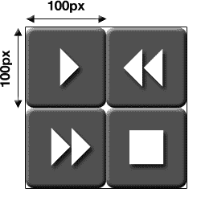

## 第 4 章：性能调优

上一章解释了浏览器和 Web 服务器如何通过消息相互通信，以及这些消息如何在网络中寻路到达正确的目的地。你还了解到，不同 Web 浏览器的性能因其渲染引擎和 JavaScript 引擎的不同而各异。

在本章中，我们将探讨如何让网页尽快“活起来”，以便访客能在他们的浏览器中使用它。研究表明，用户不会注意到良好的性能，但他们确实会因糟糕的性能而感到不快。人们期望网页在发出请求后就能立即加载。我们凭什么给他们低于预期的体验呢？这里的关键是效率——在最短的时间内将最多的数据下载到浏览器。

### 性能真的是一个问题吗？

# 性能调优

在当今这个通信速度不断提高、宽带和光纤连接日益普及、家用电脑性能不断增强的时代，你可能会问自己，我们是否还需要注重效率。毕竟，如果你家里的宽带速度现在是 4 Mbps，而去年是 2 Mbps，那么一个 12 个月前构建的网页现在加载速度肯定会是当时的两倍。虽然性能确实会有所提升，但不幸的是，这种提升并不总是与连接速度的增长成正比。将下载速度翻倍并不能将交付时间减半。基于这种假设来构建`RIA`（富互联网应用）会忽视更宏观的全球通信图景，并可能对某些用户产生负面影响。

前一章指出了某些瓶颈，这些瓶颈会阻碍网页及其资源被最高效地交付到浏览器进行显示：
-   用户的上传速度，通常远低于其下载速度
-   网络浏览器施加的并行连接数限制，这限制了在任意时间内从任何单一服务器加载的数据量
-   图片的文件格式选择
-   包含不必要的内容
-   低效的缓存设置
-   文本文件中包含被浏览器忽略的空白字符数据

这些因素中的任何一个或它们的任意组合，都会限制网页在浏览器中渲染的速度。

例如，考虑一个 20KB 的`HTML`页面，它引用了一个 10KB 的`CSS`文件、一个 15KB 的`JavaScript`文件以及 25 个每个 5KB 的外部图片。总计下来，需要下载到浏览器的数据量为 170KB。一条 2 Mbps 的家庭`ISP`连接理论上可以在大约 1.5 秒内下载 170KB 的数据，但在实际测试中，这样一个页面所需的下载时间要长得多，乐观估计也要 3 到 4 秒。

每个文件都需要被单独请求，每个请求都包括浏览器形成一个`HTTP`请求消息，将其发送到服务器，并等待服务器执行任何脚本，然后返回包含所请求数据的`HTTP`响应消息。在这个例子中，这个过程会发生 28 次。

你已经知道浏览器会施加一个并行连接数限制，根据浏览器的不同，会同时下载两到八个文件。假设最坏的情况，即`IE` 6 和 7 中存在的情况，在接收到第一个文件（即包含所有其他文件请求的`HTML`文件）之后，文件将分多达 14 个独立的批次进行下载，每个批次都伴随着请求/响应连接的时间开销，这个开销通常约为 150 毫秒。因此，在这些浏览器中，这会给页面的总加载时间增加大约 2 秒。所以，看似只需 1.5 秒就能到达最终用户的内容，实际花费的时间可能是这个数字的两倍还多。

因此，性能和效率是非常相关的主题，尤其是对于那些使用受限浏览器或网络连接缓慢的用户而言。这些用户包括在移动设备上运行浏览器的用户，以及使用拨号连接的用户。

近来，移动设备所具备的原始计算能力的提升，使得许多制造商能够提供功能完备的网页浏览器。这些浏览器显示的网页几乎与它们在台式电脑上的显示效果一模一样。流行的移动浏览器包括`Opera`、`IE`，以及基于`WebKit`渲染引擎的特定变种，例如苹果 iPhone 上的`Safari`和谷歌 Android 设备上的`Google Chrome`。

尽管移动设备可能能够像台式电脑一样显示网站，但它们确实存在一些限制。例如，iPhone 的本地缓存只能存储大小不超过 25KB 的项目。如果你网站的所有页面都包含一个`JavaScript`文件，并且该文件大于 25KB，那么 iPhone 将被迫在每次请求页面时都重新下载该文件。

# 性能优化

通常，设备越小，其提供给浏览器缓存的内存和磁盘空间就越有限。在台式电脑上，可以在多个页面请求之间下载和存储的文件，在移动设备上需要随每个页面重新下载。因此，你需要考虑效率，以惠及这些设备上的用户。

同时也要认识到，虽然在许多西方国家，宽带连接的数量已经超过了拨号调制解调器连接，但在世界其他许多地区，拨号连接仍然占主导地位。在拨号速度下，一个`100KB`网页和一个`1024KB`网页的加载差异是几秒钟。考虑到全球仍有数百万用户在使用拨号连接，你需要让你的代码更高效。

既然你已经理解了为什么让你的网页更精简、更高效如此重要，那么让我们来看看如何实现这一目标。

## 调整 Web 服务器以提升性能

有三个部分协同工作，将网站交付给最终用户：Web 服务器、Web 浏览器以及两者之间的物理连接。物理连接几乎不受你的控制，但在大多数情况下，你可以控制另外两个组件。因此，你需要对两者进行调优，以为网站访问者提供最佳性能。让我们首先看看 Web 服务器，以及在幕后可以做些什么来让网站加载更快。

> **提示** 关于此处介绍的指南的更多信息，请参阅雅虎关于加速网站的最佳实践指南，网址为：`http://developer.yahoo.com/performance/rules.html`。

## 为外部资源使用独立的域名

如果你打算在你的网站中使用 HTTP Cookie，那么你应该考虑为你的 Web 应用程序设置第二个域名。

Cookie——保存到用户计算机的小型文本文件——随着每个页面请求发送到 Web 服务器，正如你在前一章中所见。这些对于页面请求很重要，这样 Web 服务器就可以根据 Cookie 中的数据组装自定义的 HTML。例如，如果你登录到一个网站，Cookie 可能包含你的登录标识符，服务器随后可以使用它向你显示一个个性化的主页。

通常，你只根据 Cookie 数据自定义 HTML，但问题在于数据会随每种文件类型的请求（无论是 HTML 还是其他类型）一起发送。这意味着在绝大多数情况下，Cookie 数据由浏览器发送，然后被服务器忽略。Cookie 数据是基于正在访问的网站的域名由浏览器自动发送的；你无法根据文件类型覆盖此行为。

一个解决方案是使用不同的域名。通过为一个网站创建两个独立的域名，你可以选择从一个域名托管所有图片、样式表、JavaScript 文件和其他外部资源，而从另一个域名托管所有 HTML 文件。通过将 Cookie 数据仅保存到托管 HTML 文件的域名，你可以确保在请求任何其他文件类型时，Cookie 数据不会发送到服务器。这使得 HTTP 请求消息中发送的数据更小，从而使其能更快地到达 Web 服务器。

此技术仅推荐在你依赖 Cookie 数据存储在用户浏览器中的情况下使用。在其他情况下，为了定位第二个域名的 IP 地址而进行的额外 DNS 查找，实际上会导致最终用户性能变差，因此应谨慎使用此技术。

## 使用内容分发网络（CDN）

互联网是一个复杂的庞然大物——一个由节点连接而成的巨大且不断扩展的网络——有时很难相信数据在你的计算机和远程服务器之间远距离传输的速度。然而，通常来说，数据需要传输的距离越远，它必须经过的计算机和路由器就越多，才能到达目的地。旅程中的每一站都可能增加传输时间。连接这些点的电缆的质量和类型也会影响从浏览器请求页面到 Web 服务器在响应中发送数据之间的时间。这种速度差异意味着，从世界各地连接到你的 RIA 的用户，无法以相同的速度访问数据。

有几家公司在全球多个地点建立了自己的服务器，并提供了一项服务，将你的代码复制到所有这些地点。这缩短了浏览器与 Web 服务器之间的距离，从而显著提高了响应时间。这些本地服务器安装通常被称为 **内容分发网络**（CDN）。

通过将你的文件托管在其中一个 CDN 上，你可以在物理上让文件更接近最终用户，从而真正提升性能。谷歌广泛采用了这种方法，其网站的运行速度充分证明了其优势。该技术也大量应用于视频和媒体文件的托管，在这些场景中，即时播放对网站所有者来说至关重要。

[EdgeCast (`http://www.edgecast.com/`)](http://www.edgecast.com/) 和 [Akamai (`http://www.akamai.com/`)](http://www.akamai.com/) 等公司为中小型及大型企业提供此服务。对于规模较小、更具个人色彩的网站来说，它们的成本可能有点令人望而却步。谷歌为个人用户提供了几个选择，允许他们在其网络上免费托管某些文件。视频文件可以通过谷歌的 YouTube 服务 (`http://www.youtube.com/`) 托管；小型页面组件可以通过 iGoogle (`http://www.google.com/ig/`) 小部件托管服务托管；而某些流行的 JavaScript 库则可以通过谷歌的 Ajax APIs 服务托管，稍后在“通过 CDN 访问 JavaScript 库”部分会有更详细的描述。这三种解决方案都是免费的，并允许你利用谷歌全球分布的服务器网络。

## 分块向浏览器发送 HTML

大多数 Web 服务器并非向最终用户提供静态的 HTML 文件。通常，用户请求一个文件，这会导致服务器执行某些操作。该操作的结果是拼装出一个最终的 HTML 文件，然后发送给用户。这些操作通常使用服务器端脚本语言编写，例如 `PHP`、`ASP.NET` 或 `JSP`（Java Server Pages）。

在向服务器发出查看页面的请求后，浏览器在服务器拼装要发回的 HTML 代码时会处于等待状态。如果你能尽快获取到最终 HTML 的某一部分，那么浏览器就可以在等待服务器发送剩余 HTML 页面的同时，开始加载外部资源（例如样式表）。这意味着，与浏览器必须等待整个 HTML 页面作为一个大块一次性发送相比，整个页面能更早地准备好供最终用户交互。

当 HTML 页面被组装时，它被存储在服务器的内存缓冲区中，直到页面组装完成，然后缓冲区中的内容被清空到 HTTP 响应消息中。

可以在服务器端代码中按需将此缓冲区中的内容刷新到 HTTP 响应流中，这会导致到目前为止已生成的 HTML 被发送到浏览器。如果你在页面的战术性节点执行此缓冲区刷新操作，浏览器就能更早地获得要渲染的 HTML，最终用户也能更早地在屏幕上看到内容。换句话说，你获得了性能提升。

其中一个清空内存缓冲区的战术性节点是在页面 `<head>` 标签的结束位置之后，即在包含了样式表和脚本引用之后。

# 性能调优

## 将 `<head>` 部分抢先发送给浏览器

`<head>`标签和`<body>`标签开始之前。由于服务器上的大部分繁重工作通常是在页面`<body>`中的元素上执行的，`<head>`部分在页面形成阶段通常会更早地准备好发送。通过提前将`<head>`部分交给浏览器，它可以在浏览器接收其余 HTML 页面的同时加载样式表和其他外部资源。

服务器默认不执行此操作的原因很简单：服务器不知道您何时希望在页面上执行此操作。如果在页面中错误的位置执行命令——例如在标签中间或在结束标签之前——可能会导致渲染错误。在选择使用此技术时请谨慎，但我强烈建议您尽可能使用它。

> `注意`：某些版本的 IE 浏览器存在一个已知限制：浏览器在接收到前 256 字节的页面数据之前不会显示任何输出。如果正在写入的`<head>`部分中字符少于 256 个，则在页面开始处刷新缓冲区不会对此浏览器产生性能提升效果。

让我们看看如何使用三种常见语言（`PHP`、`C#`和`JSP`）实现此技术。

### 使用 PHP 刷新缓冲区

如果您的服务器端代码是用`PHP`编写的，您可以在页面中调用一个指令来在您选择的位置刷新缓冲区。只需在页面的`<head>`部分结束和`<body>`部分开始之间执行以下代码：

```html
</head>
<?php flush(); ?>
<body>
```

### 使用 ASP.NET/C#刷新缓冲区

如果您的服务器运行的是微软的`ASP.NET`和`C#`语言，有一个指令可以按需刷新缓冲区。在页面的`<head>`结束和`<body>`开始之间执行以下代码：

```html
</head>
<% Response.Flush(); %>
<body>
```

### 使用 JSP 刷新缓冲区

如果您的服务器端脚本语言是`JSP`，有一个等效的命令可以在您选择的位置刷新缓冲区。在页面的`<head>`部分结束和`<body>`部分开始之间执行以下代码：

```html
</head>
<% response.flushBuffer(); %>
<body>
```

## 自定义 HTTP 标头以强制浏览器缓存

在任何性能讨论中，缓存主题都会多次出现。一旦某些资源已下载到最终用户的浏览器，您不希望该浏览器在后续页面请求或再次访问站点时再次下载这些资源，除非它们已更改。

除了直接从用户计算机获取文件（而不是重新下载）带来的明显性能优势外，这还减轻了 Web 服务器的负载，如果某天突然出现意外的流量增长（这通常被称为*Digg 效应*，来源于流行的链接提交和评分网站`http://www.digg.com/`），这会非常有用。

您可以通过在 Web 服务器的 HTTP 响应中随文件一起发送特定的标头内容，来强制浏览器保留已下载文件的副本。您可以利用以下两个标头：

- `Expires`：明确告知浏览器下载的文件在某个日期和时间之前有效，因此在此日期之前无需重新下载。

- `Cache-Control`：可用于告知浏览器以及位于 Web 服务器和浏览器之间的任何代理服务器缓存特定文件。

`Expires`标头值是一个完整日期，标志着在此日期之后，浏览器的任何后续请求都应直接发送到服务器以获取新副本：

```
Expires: Thu, 15 Apr 2010 20:00:00 GMT
Cache-Control: Public
```

使用`Cache-Control`允许您将数据存储在更靠近最终用户的位置。这意味着，例如，如果通过某个特定`ISP`访问您页面的一个用户请求了您的页面，数据可以缓存到代理服务器上，这样来自同一`ISP`的第二个用户将从物理上更近的代理服务器获取数据（假设两者共享同一代理服务器）。您已经看到浏览器和服务器之间的物理距离会影响性能，因此在可能的情况下，这是期望的效果。

`Cache-Control`标头值包含四个可能的值之一：

- `Private`：代理服务器不应缓存此文件，但可以存储在浏览器缓存中。此值通常设置在某些包含针对特定用户个性化内容的 HTML 文件上。

- `Public`：共享缓存（包括代理服务器上的缓存）将保留所请求文件的副本。代理服务器随后会将后续请求发送给浏览器，而无需直接从 Web 服务器发出请求。这是尽可能多的文件的理想值，因为它为最终用户带来了最佳性能。

- `No-cache`：响应中发送的文件不应在当前会话之外被缓存。在另一个会话中将从服务器下载新副本。

- `No-store`：响应中发送的文件绝不应被缓存。同一会话中的后续请求将导致服务器发回整个全新的页面副本。

理想情况下，您希望为静态组件（如`JavaScript`文件、样式表和其他外部资源）设置`Expires`标头，同时将`Cache-Control`值设置为`Public`。某些动态 HTML 文件或为`Ajax`请求返回数据的页面应将其`Cache-Control`标头值设置为更合适的值，例如`No-cache`。

一个技巧是为所有静态组件将`Expires`标头设置为未来很远的日期，比如几年后，这样一旦下载，这些文件将永远不会再从服务器请求，从而显著提升后续页面访问的性能。当然，当您进行更改时，仍然需要一种将文件更新发送给最终用户的方法。这可以通过在被请求文件的`URL`的文件名、域名或文件夹名中添加版本号来实现。这个新的`URL`不会与浏览器缓存中的任何内容匹配，从而强制浏览器从服务器获取新版本。然后，您将新文件的`Expires`标头设置为未来足够远的时间，这样一旦下载，就永远不会再从服务器请求该文件。

要使用此技术，请为每个 Web 应用程序版本创建一个文件夹或文件，每次向服务器发送新代码版本时递增版本号。在这里，您可以看到以两种不同方式嵌入到文件请求中的版本号，两者都执行请求全新文件的任务：

```
/v1.0.1/assets/styles/mysite.css
/assets/styles/mysite-v1.0.1.css
```

您会发现，通过巧妙使用此功能，可以对性能产生巨大影响。此功能正越来越受欢迎，并被许多大型网站（包括`Yahoo!`）使用。请查阅您的特定 Web 服务器的手册，了解如何为您的站点设置`Expires`和`Cache-Control`标头。

## 压缩服务器输出

可能最大的单一 Web 服务器性能提升可以通过在将基于文本的内容（`HTML`、样式表和`JavaScript`文件）发送到浏览器之前对其进行压缩来实现，让浏览器在显示数据之前解压缩数据。压缩涉及以不同、更高效的方式编码数据。在某些情况下，压缩可以将文件大小减少多达原始大小的 70%。两种流行的压缩算法是`gzip`和`deflate`，这些在前一章中提到过。

# 性能调优

这项技术的妙处在于，在服务器上启用它非常简单。几乎所有现代网页浏览器都支持它。不支持压缩技术的浏览器将从服务器接收未压缩的数据，因此数据绝不会丢失。

如果您的网络服务器默认未启用此功能，应尽快启用它。您会立即注意到它的效果，最终用户也会有所感受。

在服务器上压缩数据，与直接返回未压缩文件相比，确实会增加服务器的 CPU 负载。这种增加通常不足以引起任何问题，但如果您的服务器硬件资源有限，则值得注意。

**注意：** 某些非常古老的浏览器会向服务器宣称它们支持压缩内容，但实际上并不支持。一些压缩服务器组件足够智能，不会向这些浏览器发送压缩数据。在实践中，这并不足以构成值得真正担忧的问题。

让我们来看看如何在三种主流服务器上启用压缩：Apache、微软 Internet 信息服务 (IIS) 和 Tomcat。

## 在 Apache 网络服务器中启用压缩

如果您运行的是 Apache 网络服务器 1.3 版本，则应安装并启用 `mod_gzip` 模块，该模块可在 [`sourceforge.net/projects/mod-gzip/`](http://sourceforge.net/projects/mod-gzip/) 在线获取。如果您运行的是 Apache 2.*x* 版本，则应配置 `mod_deflate` 模块，该模块已包含在 Apache 安装包中。关于 `mod_deflate` 的完整说明可以在线查阅 [`httpd.apache.org/docs/2.0/mod/mod_deflate.html`](http://httpd.apache.org/docs/2.0/mod/mod_deflate.html)。基本配置非常简单，只需在您的 `apache.confd` 文件中输入以下内容：

```
AddOutputFilterByType DEFLATE text/html text/plain text/xml text/javascript text/json
```

## 在 IIS 中启用压缩

如果您运行的是微软 IIS 7 版本，某些文件会默认压缩。但是，您应该通过执行以下命令（从服务器命令行）为所有文件启用压缩：

```
appcmd set config -section:urlCompression /doDynamicCompression:true
```

不幸的是，在微软 IIS 6 版本中启用 gzip 压缩并非如此简单。这里不列出所有详尽步骤，而是请您参考以下说明来启用这个出色的性能特性：[`www.wwwcoder.com/main/parentid/170/site/3669/68/default.aspx`](http://www.wwwcoder.com/main/parentid/170/site/3669/68/default.aspx)。

## 在 Tomcat 中启用压缩

在 Tomcat 中启用同类型的压缩与其他技术一样简单。以下是将要添加到您的 `server.xml` 文件中的一行代码：

```
compression="on"
```

现在，我们已经了解了一些重要的网络服务器更改，用以提高内容进入浏览器时的速度。接下来，让我们看看在前端（浏览器本身内部）可以做些什么，以确保您的页面尽可能快地加载。

# 为性能调整 HTML

您可以实现的大部分性能改进都可以通过更改前端代码来完成。我们将从每个网页的基础部分开始讨论前端性能：即标记文档的 HTML。

您可能想知道如何精简一个可能已经是应用程序中最小的文件之一，但请相信我，这是可行的，而且是值得的。HTML 页面是下载所有其他资源的关键。它包含了所有用于布局和行为的外部文件的引用，因此，HTML 加载得越快，它就越不会成为下载其他资源的瓶颈。除此之外，您还可以调整 HTML 以利用某些浏览器行为，从而更快地将页面显示在屏幕上。

在本书的第 1 部分，我建议了一些 HTML 的最佳实践，其中一些本身就对性能友好。这些包括：编写格式良好的 XHTML，以防止浏览器猜测每个标签的结束位置；以及分别使用 `<link href="">` 和 `<script src="">` 标签引用外部的样式表和 JavaScript 文件，以利用浏览器缓存。在此，我们将探讨通过更改 HTML 内容来提高浏览器性能的其他方法。

## 使用 HTML Tidy 缩减 HTML 文件大小

当您的网页浏览器读取您的 HTML 文件时，它会解析文件中包含的标签，并将其转换为内部对象，然后根据您的样式表对这些对象应用布局和设计。请注意，此解析步骤只关注 HTML 中的标签，而忽略这些标签周围的任何格式或间距，但标签内部（如段落标签内的文本）除外。尽管看起来是空白，每个空白字符（单个空格、制表符或换行符）在您的 HTML 文件中都代表一个字节的数据。对于一个大型 HTML 文档，将所有冗余空格加起来，可能会发现总文件大小的 25% 左右都被浏览器实际上会忽略的冗余数据占据。如果您能够移除这些空格字符，就可以减小文件大小，从而使 HTML 文件更快地加载到浏览器中。

您并不希望从您日常工作的原始 HTML 中移除空白字符，因为那样会使维护变得极其困难（您将无法确定标签的嵌套关系）。您应该将没有空白的文件副本部署到在线网络服务器上，同时保留完整的 HTML 源代码用于开发。

一个能够自动剥离这些不必要空白字符以及 HTML 注释（对最终用户无益）的工具叫做 HTML Tidy。它最初由 W3C 组织的 Dave Raggett 开发，现在由开源社区维护并持续改进。您可以在自己的电脑上运行这个工具，或者，如果您与其他开发人员一起工作并设置了自动化构建环境，则可以自动化运行该工具处理源代码 HTML，并覆盖生成的用于部署的 zip 或包文件中的同名文件。关于这个优秀工具的更多细节，可以在 [`tidy.sourceforge.net/`](http://tidy.sourceforge.net/) 找到。

## 在 HTML 末尾引用 JavaScript 文件

常见的网站开发实践和大多数教程都告诉您，应该在 HTML 文档的 `<head>` 部分引用外部的 JavaScript 文件。但是，通过在标记的最后、即 `</body>` 标签之前引用这些文件，您可以提高页面的性能。

在正常情况下，当您的网页被加载和渲染时，浏览器会同时下载多个文件，例如样式表和图片。但当浏览器遇到引用的外部 JavaScript 文件时，情况并非如此。在这种情况下，浏览器通常会阻塞任何其他页面组件的下载，直到该 JavaScript 代码被加载并执行完毕。由于 JavaScript 可以通过 DOM 动态改变网页内容，因此这条规则对于确保这些操作按照开发者指定的顺序发生非常重要。如果两个外部 JavaScript 文件被读取，并且下载速度较快的第二个脚本在第一个之前执行，这是不可接受的。

请查看以下代码，它展示了一个简单 HTML 页面的 `<body>` 内容：

```html
<body>
<h1>JavaScript 内容阻塞测试</h1>

<script type="text/javascript">
document.write((new Date()).toString());
</script>

</body>
```

当典型的浏览器遇到这段代码时，它会开始逐个标签地渲染页面。

时间，从 `<h1>` 标签开始。当遇到 `` 标签时，浏览器开始下载所引用的图片文件，并按照源代码顺序继续处理下一个标签。下一个标签是 `<script>` 标签，因此浏览器暂时停止解析，读取并执行该标签的内容，然后才继续加载下一个标签中引用的图片。

由于 JavaScript 在操作 HTML 页面布局和内容方面非常强大，如果在脚本执行期间页面其余部分继续渲染，你可能会遇到基于页面下载速度以及浏览器渲染和 JavaScript 引擎性能的意外行为。你永远无法保证脚本在你每次刷新页面时都会在同一时间执行。为了让编写脚本时获得预期的可靠行为，浏览器在解释和执行脚本时暂停渲染页面的剩余部分几乎是必不可少的。

假设为了便于维护并利用浏览器对这些文件的本地磁盘缓存，你已经将所有脚本移入外部文件。如果你在 HTML 文档的 `<head>` 中引用这些外部文件，浏览器将在读取和执行这些脚本时暂停下载和渲染页面的任何其他部分。由于浏览器在处理 `<body>` 标签之前会先读取 `<head>` 标签的内容，这将减慢页面向用户渲染的速度。显然，脚本越大，用户等待访问页面的时间就越长。只需将外部脚本引用移到 HTML 文件的末尾，即紧邻 `</body>` 标签之前，你就可以避免阻碍页面其余部分的下载和渲染，从而为最终用户提升性能。

**注意** 一些较新版本的浏览器在等待 JavaScript 文件下载时不再暂停下载其他资源，但这些脚本的执行始终按照 HTML 文档中指定的顺序进行。

## 减少 HTTP 请求数量

由于网络几乎总是网页性能的最大瓶颈，因此从任何网页引用的组件和外部文件越少，浏览器与服务器之间用于获取这些文件的通信就越少。你可以使用两种主要技术来实现减少来自服务器的文件请求数量的目标：合理规划项目结构和尽可能合并文件。

### 良好的划分与结构

首先，你需要确保外部样式表、脚本和资源具有合理的结构，确保在每个页面上只加载渲染该页面所必需的代码。例如，你可能希望将所有通用样式规则分组到一个样式表文件中，然后再为任何页面或组件特定的样式规则准备额外的样式表文件。通用样式表文件将在第一次被请求时下载并缓存，而来自网站内不同页面的对该文件的后续请求将使用本地缓存的副本，从而在后续页面上节省下载时间。

### 合并文件

根据基本经验，文件越少，HTTP 请求越少，页面渲染速度越快。每个文件除了 HTTP 头部（隐藏在文件开头）之外，还有自己的头部部分。对于文本文件（如 HTML 文件、样式表或 JavaScript 文件），这个头部部分通常不包含太多信息；但对于其他类型的文件，它可能包含大量额外信息。例如，摄影图片文件的隐藏头部可能包含版权信息和相机设置。找到合并相关文件的方法将减少文件头部的大小以及浏览器与服务器通信的请求次数。这可能会增加首次请求时下载单个文件所需的时间，但会减少总体下载的数据量。如果你的脚本是分散的，你可以将多个独立的 JavaScript 文件合并成一个文件。同样的方法也适用于样式表文件。

这也会减少 HTML 文件中的代码量，因为你需要引用的外部文件会更少。如果你与其他开发人员合作，并且可以使用自动化发布管理工具，你应该能够将其配置为自动将所有 CSS 文件和所有 JavaScript 文件分别合并成两个单一文件。

关于此技术的一个警告是，它可能与上一节中关于确保文件可缓存的建议相矛盾。你不想在每个不同的页面请求时都向浏览器重复下载相同的代码，因为这会导致从服务器请求比必要更多的数据。请记住选择一条路径，这条路径能够实现最少的浏览器与服务器通信，并最大程度地使用本地缓存文件。通常，我会引用以下文件：

-   两个外部样式表文件：一个全站通用文件和一个页面特定文件
-   两个外部 JavaScript 文件：一个用于平滑跨浏览器不一致性并添加有用实用方法的 JavaScript 库文件，以及一个站点特定代码文件

如果你在网站中引用了多个第三方 JavaScript 文件，请将它们全部合并到一个文件中，以便在首次下载后从缓存中加载它们。

## 不要从首页加载所有资源

你的首页通常是访问者访问你网站时看到的第一个页面。你需要通过页面布局和性能给访客留下良好的印象。如果渲染你的首页到可用状态需要 10 秒钟，访客很可能不想继续浏览你的网站，因为他们可能会认为每个页面都需要那么长时间才能加载。理想情况下，一旦服务器开始发送第一个响应，你的网页应在大约 4 秒内加载完毕。为 Akamai 进行的一项近期研究（[`www.akamai.com/`](http://www.akamai.com/)）表明，75% 的用户不会返回加载时间超过 4 秒的网站，并且页面加载时间是他们在网上遇到的主要挫折来源之一——这恰恰是你试图避免的情况。

通常，首页是网站上访问最频繁的页面，并且通常只有相当小比例的用户会从该页面进入网站深处。这些用户可能已经失去兴趣、意外访问了错误页面，或者希望他们已经从首页获取了所有需要的信息，因此无需进一步深入网站。

# 性能调优

你可能会决定，为了加速网站其他页面的加载速度，从首页加载整个网站的所有 CSS 和 JavaScript 文件。这些文件随后会存储在浏览器缓存中，因此后续页面请求会更快。不幸的是，用这种方式加重网站入口页的负担，会导致下载大量不必要的数据，从而拖慢网站最重要页面的渲染速度。在首页上，只引用你绝对需要的内容即可，因为从性能角度来看，首页比其他任何页面都更需要做到完美。

## 减少域名查询次数

如前一章所述，DNS 数据库将常见的域名（例如 `www.google.com`）与 IP 地址（例如 `216.239.51.99`）关联起来，网络设备使用这些 IP 地址将数据从你浏览器所在的位置，路由到你想访问的网络服务器所在的另一个位置。

每当你的 HTML、CSS 或 JavaScript 中引用的某个文件，向位于不同域名的文件发出请求时，你的浏览器都需要执行一次 DNS 查询，以找到新域名的 IP 地址并访问它。每次这样的查询都需要时间，大约在 20 到 120 毫秒之间。因此，在最坏的情况下，如果你从八个不同的域名请求文件，仅查询本身就可能需要 1 秒钟才能完成。考虑到你试图在约 4 秒内下载所有资源并让页面正常运行，这已经是非常长的时间了。

实际上，浏览器会将 DNS 查询结果缓存一段时间，以帮助提高后续文件请求的性能。然而，这个缓存信息的有效时长因浏览器而异。例如，在 IE 中，这个查询结果通常会被缓存 30 分钟。在 Firefox 中，查询结果仅缓存 1 分钟。这些数值都是名义上的、完全任意的，由浏览器制造商自行决定。

通过跨多个域名引用文件，你会给页面带来性能开销。另一方面，为了避免 HTTP cookie 随所有文件请求一起发送，将某些资产放在与 HTML 代码本身不同的域名下是有利的。因此，你需要找到一个折中方案。建议用于文件托管的独立域名不要超过两到四个。超过这个数量，DNS 查询的开销相对于其本意带来的性能提升而言，就成了过重的性能负担。

> **注意：** 你可以将所有文件引用指向多个域名的已解析 IP 地址，以避免执行 DNS 查询。这种技术的缺点是不够灵活或难以维护——如果你想将服务器迁移到其他 ISP 或位置，就需要更新所有页面。DNS 提供了一种便捷且必要的重定向服务。你只需更新域名数据库中的指针，而不必更新和重新部署所有页面。

## 跨域名拆分组件

HTTP 1.1 规范中有一项建议，涉及浏览器从同一域名同时并行下载文件的数量：建议限制为两个并发文件。一些浏览器严格遵守这一限制；另一些浏览器则允许从同一域名同时下载超过两个文件。表 4-1 显示了最常见浏览器中每个域名允许的并发下载数以及允许的总并发下载数。

**表 4-1.** *各浏览器并发文件下载数量*

| 浏览器 | 每个域名并发下载数 | 最大并发下载数 |
|---------|---------------------------------------|--------------------------------|
| Internet Explorer 6 | | |
| Internet Explorer 7 | | |
| Internet Explorer 8 | | |
| Firefox 2 | | |
| Firefox 3 | | |
| Opera 9.6 | | |
| Google Chrome | | |
| Safari 3 | | |
| Safari 4 Beta | | |

你可以看到，浏览器在*每个域名*的并发请求数量上是有限制的。因此，我们可以设置另一个域名，将其 DNS 记录指向与第一个域名相同的 IP 地址——因为限制是按域名而非 IP 地址来的——这样两个域名都引用同一台服务器上的相同代码。

通过以这种方式在可用域名之间分配资源，你可以为页面带来潜在的巨大性能提升。但不要忘了前一节讨论的建议限制：使用两到四个独立域名，以避免 DNS 查询带来的性能负担。

> **提示：** 你的域名不必是顶级域名，可以是子域名（例如 `http://assets.mydomain.com/`），这样你无需向域名注册商购买新的域名。

## 避免链接重定向

如前一章所述，HTTP 重定向通常发生在浏览器请求一个在服务器上已不存在的文件时。在这种情况下，Web 服务器通常会提供一个重定向消息，指向所请求文件的新位置。

在这种场景下，浏览器与服务器的通信量翻倍。首先，浏览器请求缺失的文件，服务器返回正确的位置。然后，浏览器向正确的 URL 再次请求该文件，服务器返回文件内容。

由于 Web 应用程序中最大的性能瓶颈之一是浏览器与服务器之间的通信网络，因此增加特定文件请求的流量相当于降低了应用程序的性能。此外，大多数浏览器不会缓存服务器提供的重定向信息，因此，如果你请求的路径例如是 `http://google.com/`，而该服务器将所有流量重定向到 `http://www.google.com/`，那么该页面的所有外部文件引用都会发生一次重定向，这可能会给页面加载时间带来巨大的性能损耗。如果你知道服务器上某个文件的位置已经改变，并且你正在通过旧 URL 访问该文件，请务必修改链接以指向文件的新位置。

你可能在不知情的情况下链接到了重定向。许多开发者添加链接时，末尾没有包含斜杠字符（`/`），例如 `http://www.google.com`。省略这个尾部斜杠会导致许多 Web 服务器发出 HTTP 重定向消息，指向包含该斜杠的 URL：`http://www.google.com/`。为了提高链接的响应速度，请在所有不直接指向文件名的链接末尾添加斜杠字符。

## 减少 HTML 元素数量

页面上的 HTML 元素数量不仅影响 HTML 下载到浏览器所需的时间，还会影响 JavaScript 代码的性能，以及浏览器渲染引擎将 CSS 应用到页面上的速度。

对性能尤其造成负担的是 HTML 结构的嵌套层级。嵌套越复杂、越深，浏览器的渲染引擎就需要做更多工作来理解结构。一个轻量级的结构，嵌套深度仅有三到四层，相比深层结构会提供更好的性能。

页面中的每个 HTML 元素都会通过 DOM 呈现给 JavaScript。浏览器自身会根据页面上的元素创建 DOM 引用，并且这些引用被组织成与 HTML 结构相匹配的层级结构。

文档的结构越复杂，或元素越多，浏览器生成 `DOM` 的过程就越长，通过 `JavaScript` 访问单个元素所需的时间也越长。

在构建 `HTML` 时，请仔细考虑每个标签。思考它是否真的有必要存在。如果你引入它仅仅是为了实现布局效果，应尽可能尝试通过 `CSS` 达到相同的目的。如果你引入了稍后要用 `JavaScript` 填充的虚拟元素，请考虑使用 `JavaScript` 创建这些元素并通过 `DOM` 将它们注入到页面中。

## 不要引用不存在的文件

正如你已经看到的，未返回预期响应的 `HTTP` 请求是浪费资源的；它们占用了 `Web` 服务器和浏览器的资源，却收效甚微。

在审查网站性能时，我经常观察到某些资源的请求返回 `HTTP 404` 错误，这意味着所请求的文件在服务器上不存在。在许多情况下，这些请求的文件是 `CSS` 类中引用的背景图片，而图片文件本身已被移除——这是开发过程中遗留的问题。由于背景图片不像前景图片那样容易被注意到，它们经常在 `CSS` 文件中被无意中保留引用。浏览器仍然会请求这些图片，而服务器则会返回 `404` 错误。

对于某些网站，开发者或 `Web` 服务器会创建一个自定义错误页面，该页面通常与网站其他部分的设计和布局相匹配。这对用户来说很棒，因为这类页面通常包含指向他们本想访问但输错 `URL` 的页面的链接，从而改善了他们的网站体验。然而，通常 `HTTP 404` 错误的 `HTML` 代码会被返回，但不会显示。浏览器必须为每个错误的文件请求下载此错误页面的 `HTML`。它不会只缓存一次并在每次不同请求时使用，因为每个失败资源的 `URL` 都会不同。浏览器随后会尝试将 `HTML` 解释为图片、样式表或 `JavaScript` 文件并失败。这种特定情况会增加大量不必要的性能开销。为避免这种情况，请审计你的页面，检查每一个被引用的文件以确保其存在。

别忘了，浏览器一次只能请求有限数量的文件。将这一限制浪费在没有任何实际收益的请求上，会降低 `Web` 应用程序的性能。

> **注意**：如果页面请求的 `JavaScript` 文件在服务器上不存在，并且服务器返回了错误页面而不是请求的文件，浏览器将在等待错误页面内容下载时暂停对页面的解析。这会加剧引用不存在文件的影响。

## 减小 `HTTP Cookie` 的大小

从浏览器发送到服务器的每个 `HTTP` 请求消息中都包含与该域名关联的 `HTTP cookie` 数据。这样做是为了让客户端（通过 `JavaScript`）和服务器（通过任何后端处理）都能访问这些信息，以便为特定用户定制网站。显然，这些数据会占用请求消息中的空间。由于每个被请求的文件都会携带这些数据，因此它会增加大量很少被使用的额外信息，通常只有返回 `HTML` 文档的页面才会用到。

通过确保 `cookie` 中存储的数据量较小，可以减少每个 `HTTP` 请求消息中发送的数据量，并且服务器能更快地收到消息。

考虑在`HTTP cookie`中仅包含一个简单的唯一用户标识符，并将其他信息存储在服务器的数据库中，使用该唯一标识符作为键来查找这些额外信息。

## 为性能优化样式表

# 性能调优

您已经了解到，将样式规则合并到外部样式表文件中能够带来最佳性能，因为这些文件可以与引用它们的 HTML 文件相互独立地进行缓存。接下来，我们将探讨与样式表文件内容相关的技术，以及如何调整这些内容以在浏览器中实现更好的性能。

## 使用 CSSTidy 压缩 CSS 文件大小

您已经了解到空白字符会增加文件大小，这些字符对开发者有用，但对浏览器并无帮助。与用于 HTML 文件的 HTML Tidy 工具类似，CSSTidy 工具会从 CSS 文件中移除多余的空白字符。它的另一个好处是，允许您在存在优化机会的地方优化样式，并去除 CSS 中的注释——这些注释仅对开发者有用，对浏览器或最终用户则毫无意义。

`CSSTidy` 是一个命令行工具，因此如果您的开发环境支持，可以将其配置为自动开发/发布流程的一部分自动运行。要了解有关此工具及其下载的更多信息，请访问 http://csstidy.sourceforge.net/。

## 不要使用 `@import` 命令

您可以通过两种方式在 HTML 文件中引用外部样式表文件：使用 HTML 的 `<link>` 标签，或者在样式表文件或 HTML 的 `<style>` 标签内使用 `@import` 指令，如下例所示：

```html
<style type="text/css">
@import url("filename.css")
</style>
```

在许多浏览器中，这两种方法的行为是相同的。然而，某些版本的 IE 在使用 `@import` 方法时，行为会略有不同。它们实际上会等到整个页面被读取并渲染完成后，才加载并应用来自 `@import` 指令的外部引用。因此，应避免使用 `@import` 方法。请使用 `<link>` 标签将外部样式表与您的 HTML 文件关联。

## 加速表格布局

众所周知，渲染 HTML 表格对浏览器来说是一项非常耗费资源的任务。通常会有四级或更多级别的标签嵌套，仅解析这些标签就需要花费时间。然后，浏览器需要计算每个表格单元格的宽度，它会根据表格中每个单元格内容的宽度来智能地进行计算。这意味着浏览器通常需要读取整个表格的数据，然后才能正确地渲染它。在加载缓慢的页面上，当您看到 HTML 表格逐步加载到页面时，可能会观察到表格的布局在变化——某些列的宽度会发生改变——因为数据仍在下载中，只有当所有数据完成下载后，表格的最终尺寸才会确定。

CSS 的 `table-layout: fixed` 样式规则减少了浏览器为渲染 HTML 表格时必须进行的这种持续计算和重新评估工作。其用法如下：

```css
table {
  table-layout: fixed;
}
```

`table-layout: fixed` 规则会“固定”表格布局，这意味着渲染引擎将仅根据表格标题行中单元格的数据来计算表格单元格的宽度。由于它无需再进行任何额外的单元格宽度计算，因此渲染长表格所需的时间得以缩短。

请确保通过 CSS 样式规则为表格标题行中的单元格设置了宽度。无论表格其余单元格的内容如何，这些宽度设置将自动应用于表格中对应的每一列。

## 避免在 IE 中使用 CSS 滤镜和表达式

IE 引入了几个新的 CSS 属性和额外的布局功能，这些是 IE 专属的，其他浏览器并未采用。其中两个这样的样式属性是 CSS 滤镜（允许开发者访问微软的一些原生 DirectX 绘图组件）和 CSS 表达式（允许在原本静态的样式规则中实现动态脚本功能）。

如果您曾尝试在 IE 6 中为透明 PNG 图片提供支持，

# 提升性能的技巧

## 使用 AlphaImageLoader 的注意事项

在不原生支持透明 PNG 的环境中，您可能遇到过并使用过一种特定的 CSS 滤镜`AlphaImageLoader`：

```css
.image {
    filter: progid:DXImageTransform.Microsoft.AlphaImageLoader(src='image.png', sizingMethod='scale');
}
```

尽管这个滤镜确实能完成任务，但它存在一些严重的性能缺陷：

- 在加载引用的透明 PNG 时，浏览器实际上会锁定，在此期间不会继续渲染页面的任何部分，也不会下载任何其他资源。

- 您可能期望一个滤镜图像的结果会像其他文件一样被缓存，但通过 CSS 滤镜引用的图像不会被缓存。以这种方式加载的每个透明 PNG，无论之前是否已加载，每次刷新页面时都会被重新下载。

## 使用简写属性值

CSS 包含许多用于布局基于盒模型的结构以及设置此类结构中页面文本排版性质的相似和相关样式属性。在多种情况下，可以将多条样式规则合并为一条样式规则，从而节省文件大小并改善下载时间，同时不会牺牲可维护性或可扩展性。这里我们将介绍颜色、外边距、内边距、边框、背景、字体和列表的简写形式。

## 第 4 章 ■ 性能调优

### 颜色

在样式规则中使用十六进制值来指定颜色属性，因为这些值通常比大多数命名颜色和等效的 RGB 表示法占用更少的空间。如果使用命名颜色值，请限制在 HTML 4.01 规范中定义的 16 种颜色（[`www.w3.org/TR/REC-html40/types.html#h-6.5`](http://www.w3.org/TR/REC-html40/types.html#h-6.5)）。

十六进制颜色值通常这样指定：

```css
body {
    color: #000000;
}
```

此示例将 HTML`<body>`标签的文本颜色设置为黑色，在十六进制中表示为`#000000`。在这种颜色表示法中，井号（`#`）后面的前两个字符表示该颜色的红色分量，第二组两个字符表示绿色分量，最后两个字符表示蓝色分量，因此格式为`#rrggbb`。

浏览器支持某些十六进制值的更短表示法，其中每个颜色分量的两位十六进制值完全相同。这些通常被称为*网页安全*颜色值。上面的样式规则可以用这种更短的形式表示：

```css
body {
    color: #000;
}
```

表 4-2 列出了一些颜色、它们的等效十六进制值以及它们的等效简写十六进制值（如果可用）。

**表 4-2.** *部分十六进制颜色值*

| 颜色 | 十六进制 | 简写 |
|------|---------|------|
| 黑色 | `#000000` | `#000` |
| 浅蓝色 | `#336699` | `#369` |
| 绿色 | `#00ff00` | `#0f0` |
| 白色 | `#ffffff` | `#fff` |
| 深灰色 | `#121212` | — |
| 绯红色 | `#dc143c` | — |

### 外边距和内边距

您可能熟悉 CSS 用于外边距和内边距的属性。`margin`是元素周围的空间，`padding`是元素边界框与其内容之间的空间。您也可能知道，您可以独立地将这些样式规则应用于元素的每一侧，或者一次性应用于元素的所有侧。

假设您想使用 CSS 为每个 HTML 段落标签应用 10 像素的外边距。您可以用以下代码片段中显示的两种可能方式之一来指定：

```css
p.four-rules {
    margin-top: 10px;
    margin-right: 10px;
    margin-bottom: 10px;
    margin-left: 10px;
}

p.one-rule {
    margin: 10px;
}
```

注意第二个样式规则如何将四行代码合并为一行，而结果不变。

现在假设您想对元素的四个不同侧应用不同的外边距大小。以下是当影响基于盒模型元素的某些属性时，如何将多条样式规则合并为单条规则：

```css
/* 给元素的顶部应用 10px 内边距，右侧 5px，底部 20px，左侧 0 像素 */
padding: 10px 5px 20px 0;

/* 将顶部外边距设为 10px，左右设为 5px，底部设为 15px */
margin: 10px 5px 15px;

/* 将元素顶部和底部的外边距设为 10px，左右设为 5px */
margin: 10px 5px;

/* 将元素所有边的内边距设为 10px */
padding: 10px;
```

### 边框

CSS 提供了大量属性用于为页面元素设置边框样式。简单来说，边框由三种样式属性组成：宽度、边框样式（如 `solid` 或 `dotted`）和颜色。通过特定的 CSS 样式属性，你可以为元素的每一侧应用不同的样式。例如，`border-top-width` 指定元素上方边框的宽度，`border-bottom-color` 指定应用于元素底部边框的颜色。

为元素的每一侧逐一使用这些属性相当繁琐。相反，应使用以下代码展示的简写技巧来为元素应用边框样式。

```css
/* 为元素每一侧应用 1px 宽、实线、黑色的边框 */
border: 1px solid #000;

/* 仅将相同的边框样式应用于元素的顶部 */
border-top: 1px solid #000;

/* 将顶部边框宽度设为 2px，左右边框设为 3px，底部边框设为 1px */
border-width: 2px 3px 1px;

/* 将顶部和底部边框设为黑色，左右边框设为红色 (#f00) */
border-color: #000 #f00;
```

### 背景

多个 CSS 样式属性与元素内背景的显示和定位有关：

- `background-color`：设置元素的基础背景颜色。

- `background-image`：应用一个背景图像，该图像将位于元素背景颜色之上。

- `background-repeat`：允许你指定背景图像是否应在可用空间内平铺，以及如果平铺，应水平、垂直还是双向平铺。

- `background-attachment`：指定背景图像是随页面或元素滚动，还是在元素首次渲染时保持其位置固定。

- `background-position`：将背景图像附加到元素内的特定位置，例如附着在元素的右下角，或距离元素左边缘 25 像素的位置。

无需单独为这些 CSS 属性每个都指定值，你可以通过一个单一的 `background` CSS 简写属性同时指定它们，如下所示：

```css
/*
对简写 background 属性使用以下格式。
background: color image repeat attachment position;
*/

/*
图片 image1.jpg 应出现在元素左上角位置 (0, 0) 处，
不应在任何方向上平铺，并且应随页面正常滚动。
图片下方应显示红色背景，填满元素的尺寸。
*/
p {
  background: #f00 url(image1.jpg) no-repeat scroll 0 0;
}
```

### 字体

存在一种简写表示法，用于将字体格式化样式规则合并为单一规则。你可以组合以下单独的字体样式：

- `font-style`：指定 `normal`、`italic` 或 `oblique` 文本样式。

- `font-variant`：指定 `normal` 或 `small-caps` 字母文本样式。

- `font-weight`：指定文本的粗细，启用 `bold` 或 `light` 文本样式。

- `font-size`：指定文本中字符的大小。

- `line-height`：指定每行文本应占用的高度。

- `font-family`：指定用于显示文本的字型。

下面的示例展示了如何将这些单独的样式属性组合成一个单一的样式规则。

```css
/*
对简写 font 样式使用以下格式。注意斜线 (/) 字符的位置，
位于字号和行高属性之间。同时请注意，字体族值可以有多个，
用逗号分隔，以便在首选字体不可用时提供后备字体。
font: style variant weight size/line-height family
*/
p {
  font: italic small-caps bold 1.2em/1.8em Arial, Helvetica, sans-serif;
}
```

### 列表

# 无序列表样式组合

为简洁起见，无序列表的样式也可以组合成单个样式规则。以下三个独立的样式属性可以合并：

- `list-style-type`：指定用于标记列表项的项目符号类型。
- `list-style-position`：指定项目符号相对于列表的位置，可以位于文本流中，或使用间距分隔成单独的列。
- `list-style-image`：指定一个可选的图像文件，用于表示项目符号。如果该图像不存在或未指定，则改用 `list-style-type` 属性中的项目符号类型。

以下展示了如何将这些样式组合成单个样式规则，用于自定义无序列表。

```css
li {
  /*
    使用以下格式作为列表样式的简写形式。
    list-style: type position image;
  */
  list-style: circle inside url(mybullet.gif);
}
```

## 使用 CSS Sprite 技术

现在，你将学习一项称为`CSS Sprite`的技术，它能够减少富互联网应用中图像文件的数量和大小。这将减少 HTTP 请求的数量和大小（如你所知，这是大多数网站最大的性能瓶颈之一），并且通常也会减少页面上表示这些图像所需的样式规则数量。

CSS Sprite 技术涉及将视觉上相关的图像文件合并到一个文件中。它借鉴了早期电子游戏图形中使用的精灵技术，并且近年来在一些计算机操作系统中被用于将一组图标图像存储在一个文件中。

假设你使用四个大小相同的独立图像文件来表示控制网站多媒体播放的四个按钮：播放、快退、快进和停止。以下是你通常如何使用 CSS 引用这些文件，并将它们与页面元素关联起来的方法：

```css
/* 每个按钮元素有两个类：control 和一个特定按钮的样式 */
.control {
  /* 每个图标是 100 像素见方 */
  width: 100px;
  height: 100px;
  /* 如果按钮通过 CSS 显示为图标，则应隐藏按钮元素内的任何文本 */
  text-indent: -10000px;
}
.play {
  background-image: url(play.png);
}
.rewind {
  background-image: url(rewind.png);
}
.forward {
  background-image: url(forward.png);
}
.stop {
  background-image: url(stop.png);
}
```

图 4-1 展示了如何使用标准图形软件包将这四张独立的图像合并成一个图像文件。每张单独的图像尺寸为 100 像素宽、100 像素高，生成的图像尺寸为 200 像素宽、200 像素高。

CSS Sprite 技术涉及指定较大图像文件中 100 像素见方的部分，该部分包含你希望在元素中显示的特定按钮图标。以下示例演示了如何使用 CSS 样式规则实现这一点，通过在元素尺寸内移动背景图像来显示所需的图像部分。



`图 4-1.` `四张相关图像合并成一个图像文件`

```css
.control {
  /* 每个按钮控制元素的尺寸固定为 100 像素见方 */
  width: 100px;
  height: 100px;
  text-indent: -10000px;
  /* 引用单个合并图像文件 */
  background-image: url(combined-image.png);
}
.play {
  /* 显示 100 像素见方区域，从背景的左上角开始。
     这对应于图 4-1 图像中的“播放”图标 */
  background-position: 0 0;
}
.rewind {
  /* 将背景图像向左移动 100 像素，使“快退”图像
     位于元素的左上角位置，正好适合 100 像素的显示方块。 */
  background-position: -100px 0;
}
.forward {
  /* 将背景图像向上移动 100 像素，使“快进”图像
     位于元素左上角的 100 像素方块内 */
  background-position: 0 -100px;
}
.stop {
  /* 将背景图像向左移动 100 像素并向上移动 100 像素，
     使“停止”图像在 100 像素的显示方块内可见 */
  background-position: -100px -100px;
}
```

通过在元素内移动背景图像，你能够精确显示希望呈现的图像部分。你将四个独立的图像减少为一个，并且只向 CSS 样式规则中添加了一行代码。由于单个合并图像通常比几个独立图像更小，并且导致更少的 HTTP 请求，因此这项技术通常能为最终用户带来显著的性能提升。

> **注意** 在开始将整个图像库合并成一个文件以使用此技术之前，请停下来思考一下你所合并图像文件的上下文。为了可维护性，建议只合并相关的图像，例如视觉尺寸相似的图标。为了进一步简化维护，请使用支持图层的图形软件包（如 Adobe Photoshop），如果你需要对其中某个独立图像进行更改，可以利用图层重新导出你的 sprite 图像文件。

所以，CSS Sprite 技术是一个极好的性能助推器。通过减少 HTTP 请求的数量，你对服务器连接速度和浏览器内并行连接限制的依赖减少了。然而，合并图像的方式会影响性能。因此，你需要确保以最佳方式做到这一点。

以下是一些优化 CSS Sprite 图像的方法：

- `避免使用单个庞大的 Sprite 图像文件`：由于你将较小的图像合并到单个较大的图像中，结果文件大小通常虽然小于各部件总和，但无疑会比它所替代的任何单个文件都大。较大的文件下载时间更长，因此用户需要等待才能在浏览器中看到任何图像。目标是让最终用户能够以创纪录的速度加载和显示网页，因此请仔细考虑你的 CSS Sprite 图像。你需要将它们分割成几个经过精心构建的图像文件，而不是一个包罗万象的庞然大物。

- `明智且高效地使用空间`：Sprite 图像中各个图像之间的巨大空白区域，其效率不如空白较少的图像。与其他类型的文件一样，你不希望存储永远不会使用的额外图像数据。请尽可能紧密地打包组成主 Sprite 图像的各个图像，以最大限度地减少浪费的空间。选择尺寸相似的组件图像，以获得最佳的贴合度并减少 Sprite 图像中的空白区域。你可以将各个图像排列成正方形网格，或使用水平或垂直对齐的图像序列。你可能会认为图像的对齐方式对文件大小没有影响，但实际上，当图像在单个水平行中对齐时，可能实现更小的文件大小。

- `考虑维护任务`：存储在单个文件中的单个图像，比存储在单个文件中的一组图像更容易更新和维护。在编辑大型 Sprite 图像时，必须注意不要更改正在编辑的单个图像周围的图像，因为此类更改可能会被忽视。如果你使用允许保存带有单独图层和分隔网格线的图像的图形软件（如 Adobe Photoshop），则应将每个独立的图像放置在不同的图层中，并与这些固定的网格线对齐。请将此主文件与你的图像一起保留备份，并在进行任何更改时以 PNG 格式（本章稍后讨论）导出你的 Sprite 图像。

## 避免低效的 CSS 选择器

# CSS 选择器与性能优化

`CSS`选择器为浏览器提供了一种机制，用于将样式规则应用到页面上。通常，浏览器在创建页面元素时，会搜索要应用于该元素的样式规则，将元素的标签名、`id`属性和`class`属性与样式规则列表进行比较。然后，浏览器根据文档中其他`CSS`选择器可能的继承值，搜索要应用的样式规则，并合并结果，优先考虑更具体的样式规则或文档中靠后出现的规则。浏览器实际上需要执行一系列搜索来定位要应用于某个元素的样式，每次搜索都需要一定的时间才能完成。诚然，这些搜索在几毫秒内就能完成，但通过编写避免不必要搜索的样式规则，可以加快这一过程。

确保你的`CSS`选择器的长度仅足以将样式规则应用到元素上。如果你发现自己将一长串标签名、`id`和`class`名称链接到单个选择器中，很可能你应该寻找一种不同且更精简的方法。

避免指定包含标签名的选择器，因为这些选择器通常会导致耗时最长的样式规则搜索。相反，应通过位于父元素上的适当`id`属性来过滤选择器。搜索过程无需尝试查找应用于其他任何`id`属性的样式规则，从而提高了返回结果的速度。

以下根据大多数浏览器采用的样式规则搜索机制，展示了有效和无效`CSS`选择器的示例。

```css
/* 无效的选择器 - 在代码中避免使用这些 */
table tbody tr td { ... }
#body #content #results a { ... }
form div#field label { ... }

/* 更有效的选择器 */
#header .title { ... }
#results a { ... }
#field .label { ... }
```

# 优化图像性能

对于大多数网站来说，图像文件占据了从服务器请求的大部分数据。日益复杂的设计和布局通常需要复杂的图像资源，这通常意味着更大的文件大小和更慢的下载速度。

信息公司`Alexa (http://www.alexa.com/)`根据流量提供了全球最受欢迎网站的列表。表 4-3 显示了全球排名前五的网站以及它们首页数据中图像所占的比例。使用 Mozilla Firefox 浏览器的`YSlow`扩展提取了这些信息。你可以从`http://developer.yahoo.com/yslow/`下载此组件以进行你自己的测试。

明智地处理 Web 应用程序中的图像可以带来巨大的性能提升，因为它们的文件大小在大多数`RIA`的页面权重中占据了很大比例。

`160`

`表 4-3.` `热门网站首页图像占比`

| `网站` | `总页面权重` | `图像权重` | `图像占比` |
| --- | --- | --- | --- |
| `www.yahoo.com` | 219.8KB | 101.9KB | 46.3% |
| `www.google.com` | 10.1KB | 7.5KB | 74.3% |
| `www.youtube.com` | 204.6KB | 105.4KB | 51.5% |
| `www.live.com` | 15.2KB | 9.8KB | 64.5% |
| `www.facebook.com` | 380.1KB | 110.9KB | 29.2% |

## 了解图像文件格式

Web 页面上使用的三种主要图像文件格式是图形交换格式（`GIF`）、联合图像专家小组格式（`JPEG`）和便携式网络图形格式（`PNG`）。大多数开发人员直到最近才比较广泛地使用`PNG`格式，并且其支持度正在增长，这是有充分理由的。让我们看看每种格式的优缺点，以及我为什么推荐`PNG`格式。

### `GIF`格式

`CompuServe`公司早在 1987 年就推出了`GIF`格式。它在 Web 上很流行，因为它通常能产生较小的文件大小。直到 1990 年代末，`GIF`格式都受专利保护，其使用通常需要许可。

`GIF`文件大小较小，主要得益于两个特性：

`色彩深度`：图像的色彩深度仅为 8 位，这意味着一个图像文件中只能表示 256 种不同的颜色，而现代显示器可以显示数百万种独特的颜色。然而，那 256 种颜色的调色板不是固定的，可以从数百万种颜色的完整范围中选择。如果你的图像使用的颜色少于 256 种，则只有实际使用的颜色会随图像数据一起保存，从而减小存储的数据量。

`压缩`：图像数据本身使用一种称为`Lempel-Ziv-Welch (LZW)`的算法进行压缩。这种压缩类型实际上不会从图像中移除任何数据；相反，它以一种更紧凑的方式表示数据。浏览器会将这种压缩数据转换回原始图像数据进行显示，因此文件可以在不牺牲图像质量的情况下变得更小。

这种文件格式非常适用于表示通常小于 16 像素见方的小图标，以及简单的绘图或线条艺术。这类图像可以使用受限的调色板，并且压缩方法对不太复杂的图像非常有效。对于更大、更复杂的图像，这种文件格式的效率较低。

`161`

保存`GIF`文件时，你可以选择将调色板中的一种颜色表示为透明色。当在浏览器中显示此类文件时，该选定颜色将不再可见；相反，页面中图像下方的内容会显示出来，从而在`GIF`图像文件中实现透明效果。这种特殊技术不适用于渐变或投影，因为你无法表示不同程度的透明度——对于特定的选定颜色，透明度要么开要么关。

`GIF`图像格式还能够在一个单独的文件中存储多个图像帧，同时还保存关于何时显示这些帧以及显示多长时间的信息。这允许一种基本的动画形式，其中每个帧都存储为完整的图像。你很可能会看到这些动画文件被用作许多`RIA`的加载指示器。

`GIF`动画分别存储每一帧，效率不高，尤其是在帧与帧之间差异很小的情况下。不幸的是，目前还没有其他 Web 图像格式能够在所有浏览器中表示动画，因此除了使用第三方插件（例如 Adobe 的`Flash Player`）之外，这是动画图像的唯一选择。

### `JPEG`格式

对于在 Web 上表示摄影或非常复杂的图像，`JPEG`（或`JPG`）图像格式是理想的选择。联合图像专家小组于 1986 年成立，旨在创建一种压缩此类图像的文件格式，最终格式于 1994 年完成并获批准为国际标准。该格式是开放的，不受任何专利法律的约束。

`JPEG`格式特别适用于相邻像素之间没有明显对比的复杂图像，因此线条图不适用于这种类型的压缩。与`GIF`不同，`JPEG`是一种`有损`格式。这是因为为了执行压缩，数据会从原始图像中移除且无法恢复。压缩不是通过以不同方式存储现有图像数据来实现的，而是通过移除图像中人眼通常注意不到的部分来实现。

从图形软件以`JPEG`格式保存图像时，通常可以选择要应用于结果文件的压缩级别。进行的压缩越少，文件大小越大，保留的原始图像越多。压缩越大，文件大小越小，但保留的原始图像越少——

# 图像压缩与性能优化

在更高的压缩级别下，图像可能会出现肉眼可见的伪影。请选择既能保持图像无视觉异常，又能实现最小文件大小的压缩级别。

## PNG 格式

PNG 图像文件格式是为了改进 GIF 文件格式而开发的，同时保持开放且无专利限制。虽然这种文件格式是三种格式中最新的，但它在现代浏览器中得到了普遍支持。

PNG 文件格式能够存储 24 位图像调色板——在单个压缩文件中表示超过 1600 万种颜色——并且还支持 alpha 通道透明层。这意味着，与 GIF 限制性的单色透明度不同，可以对图像的任意部分独立应用不同级别的透明度。

**注意：** IE 6 默认不支持 PNG alpha 透明度层。尝试使用此功能会导致在图像的透明部分出现浅蓝色背景。您可以通过使用 `CSS AlphaImageTransform` DirectX 过滤器（但正如本章前面讨论的那样，这有巨大的性能缺陷）或重新将图像导出为其他格式（如 `GIF` 或 `PNG-8`，一种支持单色透明度、类似于 `GIF` 的 `PNG` 变体）来绕过此问题，这会在浏览器中显示时减少或移除图像的透明度。

与 `JPEG` 不同，`PNG` 是一种`无损`图像格式，这意味着原始图像中的所有数据在压缩后都保留在文件中，并且可以在任何时候恢复。应用于图像的压缩方法类似于 `GIF` 图像文件格式，数据只是以不同的方式表示，使用 `deflate` 压缩方法进行压缩，该方法也可用于压缩来自 Web 服务器的 HTTP 响应数据，如本章前面所述。

在几乎所有情况下，`PNG` 图像的文件大小都比同等的 `GIF` 图像要小（除了非常小的图像，通常小于 16 像素见方），尽管它们能够存储和表示更多的颜色。

由于文件体积更小，`PNG` 是 Web 上大多数图像的首选格式。您应该只在图像尺寸较小（使用 `PNG` 时结果文件更大）时使用 `GIF`。`JPEG` 格式应用于复杂的图像，如照片，其压缩算法效果最好，能移除人眼难以察觉的图像成分。

### 优化 PNG 图像

`PNG` 图像文件包含的不仅仅是原始图像数据。文件开头还提供了一组头数据来描述文件其余部分包含的图像。每组数据称为一个`块`。有些块是必需的，包括调色板和图像数据。许多块是可选的，如图像伽玛和白平衡数据。

由于 `PNG` 文件只需包含这些必需数据，您可以删除文件中的可选数据块来减小其体积。通常，图形软件在保存 `PNG` 文件时会保留可选块，因此您需要找到一种方法来移除这些块以减小文件大小。

大多数操作系统都提供一个命令行工具，允许您从 `PNG` 文件中剥离可选数据块。该工具名为 `Pngcrush`，可从 `http://pmt.sourceforge.net/pngcrush/` 下载。您可以在自动化构建环境中自动对图像运行此工具，也可以根据特定的开发设置手动运行它。方便的是，一个名为 `Smush it`（`http://www.smushit.com/`）的网站使这项任务变得更加简单。将该网站指向您自己网站的 URL，或上传您的图像到该网站，它会生成一个包含所有图像且已移除所有不必要数据块的 zip 文件。该网站还在可以节省文件体积的情况下，将您的 `GIF` 和 `JPEG` 图像转换为 `PNG` 格式。该网站还提供 Mozilla Firefox 浏览器扩展，允许您按需对当前浏览器窗口中显示的站点应用优化。

### 不要忘记 Favicon

收藏夹图标，通常称为 `favicon`，是一个位于 Web 服务器根目录下、默认名为 `favicon.ico` 的图像文件。它是一个小图标（通常为 16×16 像素），显示在浏览器地址栏 URL 的左侧。当保存为浏览器“收藏夹”时，它也用作代表该 URL 的图像，因此得名。

每当您浏览网站时，浏览器都会请求这类文件，并且没有办法通过代码在所有浏览器中关闭此功能。因此，您应确保该位置存在一个图像，以避免浏览器收到 HTTP 404 错误（请参阅本章前面的讨论以了解为什么这是不好的）。图像越小越好——最好小于 1KB。同时，在文件上设置 HTTP 响应头，以确保它缓存在用户机器上，不会在每次访问该站点时都被下载。

## 优化 JavaScript 性能

高效的 JavaScript 代码对任何 RIA 都至关重要，因为它有能力让最终用户感到满意或沮丧。随着代码日益复杂，问题潜入的机会也更大，包括内存泄漏、锁定浏览器的性能密集型任务，以及缺乏对可用性和性能的考虑。

请记住，JavaScript 是一种客户端语言，其性能与执行它的浏览器以及运行该浏览器的设备性能直接相关。考虑到这一点，请考虑使用 Web 服务器来执行密集型任务，例如构建 RIA 的初始视图，或对大量数据进行计算分析。任何会导致最终用户等待过长时间才能得到结果的操作，都应尽可能在服务器上执行。

在本节中，我们将研究如何改进您的 JavaScript 代码，以最大限度地减少对服务器或最终用户的负面性能影响。这里涵盖的主题并非详尽无遗。由于 JavaScript 是一种大型编程语言，针对特定函数、循环和例程有许多大大小小的性能调整可能性。这里包含的材料针对构建 RIA 进行了定制，因此大部分信息专注于 DOM 和 Ajax 例程的性能影响。

### 使用 Dojo ShrinkSafe 压缩 JavaScript 文件

我们再次回到文件中额外信息的话题。JavaScript 文件充满了空白字符，并且（希望如此）也有大量的注释和文档。这些信息对于需要理解文件中存储的代码的开发人员来说非常理想，但浏览器不需要任何这些信息——它在接收后就会被忽略，所以没有发送它的必要。

根据您的文件，通过剥离不必要的空白字符和注释（这个过程称为`代码压缩`），您可以削减大约 50% 的 JavaScript 文件大小。您可以通过使用称为`代码混淆`的过程进一步减小文件大小，该过程会缩短变量名和函数名。但请注意，代码混淆通常相当有风险，因为它没有考虑被压缩的文件在其所在站点的上下文中是如何使用的。

Dojo JavaScript 库的开发者构建了他们自己的 JavaScript 文件压缩器，名为`ShrinkSafe`，它同时使用了压缩和混淆技术。你可以从`http://shrinksafe.dojotoolkit.org/`下载[此工具](http://shrinksafe.dojotoolkit.org/)。

`ShrinkSafe`的工作方式比大多数混淆器更智能，它通过仅更改脚本中无法从外部公开访问的变量名和函数名，消除了固有风险。这确保了文件中的任何公共 API 或代码在网站的上下文中仍能正常工作。你应该使用此工具来尽可能减小代码体积，以确保浏览器能以最快速度下载。

### 通过 CDN 访问 JavaScript 库

前面你了解到，使用 CDN 可以减少数据在互联网上传输的距离。许多 JavaScript 库（例如`jQuery`和`Prototype`）都托管在 CDN 上，为最终用户提供更快的网络响应时间。它们还有一个额外的好处：如果最终用户之前访问过另一个使用相同 URL 引用相同库的网站，该库可能已经存在于其浏览器缓存中。

Google 正致力于成为 CDN JavaScript 库托管领域的领导者。在撰写本文时，它提供了以下库和第三方 JavaScript 组件的访问：

- `jQuery`（及其相关的`jQuery UI`库）
- `Prototype`（及其相关的`script.aculo.us UI`库）
- `Dojo Toolkit`
- `Yahoo! UI`
- `MooTools`
- `SWFObject`（一个用于在页面中嵌入 Adobe Flash 的有用库）

每个库都可以通过一个固定 URL 直接获取，要么是完整的原始文件，要么是经过压缩的版本（体积通常缩小了 50% 以上）。Google 关于此服务的完整文档可在`http://code.google.com/apis/ajaxlibs/`[在线获取](http://code.google.com/apis/ajaxlibs/)。

从与当前网站不同域名访问文件的一个缺点是，需要进行额外的 DNS 查找来定位新域名的 IP 地址。值得庆幸的是，每个引用文件的下载速度提升远远超过了这一查找时间。CDN 允许用户从物理位置离其浏览器最近的服务器获取文件副本，从而确保网络性能瓶颈得到限制。

### 时机至关重要

当 JavaScript 文件被正常加载时（即通过 HTML 文件中的文件引用），浏览器会阻止页面其余部分的下载和解析，直到该脚本下载并执行完毕。这并不理想，尤其是在需要下载大量代码的情况下。有一种方法可以使用 JavaScript 本身来克服此性能瓶颈，但你必须谨慎行事。脚本通常会阻塞浏览器，以避免`竞争条件`——即一段代码在另一段代码之前完成，导致代码执行顺序错误。如果你打算以这种方式加载脚本，则需要一种技术，让一段 JavaScript 代码在文件下载完成后执行，以防止竞争条件。

清单 4-1 展示了如何在不阻塞浏览器的情况下按需加载 JavaScript 文件，以及如何在文件下载完成后指定执行某些代码。将此代码添加到你在第 2 章创建的`$` JavaScript 库中。

```
if (condVar > someVal) {console.log("xxx")}
```

**清单 4-1.** `在不阻塞浏览器的情况下按需加载 JavaScript 文件`

```javascript
$.prototype.Remote.loadScript = function(fileName, callback) {

  var scriptTag = document.createElement("script");

  scriptTag.src = fileName;

  if (callback) {

    scriptTag.onload = callback;

    scriptTag.onreadystatechange = function() {

      if (scriptTag.readyState == 4) {

        callback();

      }

    }

  }

  document.getElementsByTagName("head")[0].appendChild(scriptTag);

}

// 示例用法
// 假设页面上已存在 $ 库的实例
// 加载 my-script.js，完成后输出 "script loaded and available"
$.Remote.loadScript("my-script.js", function() {

  alert("script loaded and available!");

});
```

在第 2 章中，我介绍了在页面的整个 DOM 初始化完毕并可访问后立即执行 JavaScript 代码的能力。这发生在整个页面加载完成之前，因为它只考虑 HTML 已加载，而不考虑任何引用的外部资源（如图片）。通过编写代码使其在此事件触发时执行，如清单 4-2 所示，您可以让代码更早开始工作，从而减少最终用户的额外等待时间。您可以使用此事件并行加载多个 JavaScript 文件，采用清单 4-1 中概述的技术。

**清单 4-2.** `当 DOM 就绪时立即执行脚本`

```javascript
$.onDomReady(function() {
    // 此函数在 DOM 可访问时立即执行
    // 同时加载两个 JavaScript 文件：my-script.js 和 my-other-script.js
    $.Remote.loadScript("my-script.js", function() {
        // my-script.js 已加载
    });
    $.Remote.loadScript("my-other-script.js", function() {
        // my-other-script.js 已加载
    });
});
```

## 提升核心 JavaScript 性能

我所指的`核心`JavaScript，是指语言中专注于纯数据处理、执行、循环和逻辑的部分，而不是通过 DOM 或 Ajax 技术进行页面操作的部分。在此，我将提出一些改进措施，您可以将其应用到自己的核心 JavaScript 代码中，以加快执行速度。

### 使用记忆化器

`记忆化器`是一种兼作存储机制的函数。它保存该函数例程先前执行的结果，以便将来使用相同输入调用该函数时，能从存储的结果列表中返回输出，而无需重新计算结果。这提高了在代码中被多次调用的函数的性能。

只有那些基于相同输入集始终产生相同输出的函数才能被“记忆化”。

清单 4-3 展示了如何构建一个实用函数，允许您为任何函数添加存储结果值的能力，在可能的情况下自动从其内部存储属性返回函数结果，以提升性能。和之前一样，将此代码添加到`$`JavaScript 库中。

**清单 4-3.** `使用记忆化器加速重复函数的执行时间`

```javascript
// memoize 接受一个函数作为输入，并返回具有存储能力的同一函数
$.prototype.Utils.memoize = function(func) {
    return function() {
        // 如果不存在，则为该函数添加一个 memory 对象属性
        func.memory = func.memory || {};
        
        // 创建一个键，用于在 memory 对象属性中存储和检索函数结果。
        // 该键应基于传递给函数的所有参数的组合，以确保基于所有输入组合的唯一性
        arguments.join = Array.prototype.join;
        var key = arguments.join("|");
        
        // 键是否存在于 memory 对象中？
        if (key in func.memory) {
            // 如果存在，则返回关联的值以避免重新计算
            return func.memory[key];
        } else {
            // 如果不存在，则执行关联的函数，然后将结果保存到 memory 对象中
            func.memory[key] = func.apply(this, arguments);
            // 返回新保存的值，即函数执行的结果
            return func.memory[key];
        }
    }
};

// 示例用法
// 假设页面上存在一个$库的实例
// 编写一个计算给定数字阶乘的函数
// - 执行它 99999 次以夸大慢速运行函数的效果
var computeFactorial = function(input) {
    var result;
    for (var count = 0; count < 99999; count++) {
        result = 1;
        for (var num = 2; num <= input; num++) {
            result *= num;
        }
    }
    return result;
}

// 为阶乘函数添加记忆化能力
computeFactorial = $.Utils.memoize(computeFactorial);
```

# 性能调优

## 测量阶乘函数的执行速度

`computeFactorial(100)`; // 执行耗时约 945 毫秒

`computeFactorial(50)`; // 执行耗时约 506 毫秒

`computeFactorial(100)`; // 执行耗时 0–1 毫秒 – 使用缓存值

`computeFactorial(50)`; // 执行耗时 0–1 毫秒 – 使用缓存值

## 使用高效的字符串拼接

目前为止，将多个字符串拼接成更长的字符串最常用的方法是使用 `+` 运算符，如下所示：

```
var outputString = "start text " + inputString + " end text";
```

当你在执行大量字符串拼接操作时（例如在代码循环中），使用 `+` 运算符完成整个拼接系列所消耗的时间会累积成严重的性能损失，尤其在 IE 浏览器中。

你可以采用另一种字符串拼接技术，它不会遭受同样的性能损失。该方案涉及使用数组，如下所示：

```
var myArray = [];
myArray.push('Welcome, ');
myArray.push(userName);
myArray.push(', to the site.');
myArray.join('');
```

在某些情况下，使用这种数组方式在 IE 浏览器中能将字符串拼接性能提升高达 25 倍，相比于使用 `+` 运算符。

## 使用正则表达式

正则表达式提供了一种有用、强大且高效的方式来执行字符串操作和模式匹配——速度比其他任何方法都快。在 JavaScript 中，正则表达式可以通过两种不同的方式定义：字面量形式或使用对象构造函数，如下所示：

```
// 以下两个正则表达式都旨在查找被搜索字符串中的任何大写字母实例。
var expression = new RegExp("[A-Z]", "g"); // 慢 – 需要先处理
var expression = /[A-Z]/g; // 快 – 可直接使用

// 输出 "_est _tring"
alert("Test String".replace(expression, "_"));
```

`RegExp` 对象构造函数接受一个字符串并将其转换为正则表达式，而字面量形式无需任何额外处理即可直接使用。这使得正则表达式的字面量形式成为使用 JavaScript 搜索字符串的最快方式。

避免使用 `RegExp` 构造函数来创建正则表达式，除非你绝对需要动态生成这个表达式。你可以在 [`www.evolt.org/article/Regular_Expressions_in_JavaScript/17/36435/`](http://www.evolt.org/article/Regular_Expressions_in_JavaScript/17/36435/) 找到一份关于 JavaScript 正则表达式非常详尽的在线教程。

## 更快速、更高效地循环

大多数 JavaScript 代码都充满了循环。通常，你需要处理数组或遍历对象字面量，以对其中存储的数据进行计算或操作。在 JavaScript 中，循环遍历数据是一项众所周知的慢任务，尤其在 IE 6 和 7 中。下面展示了一个典型的 JavaScript `for` 循环，以及同一循环的一个略有不同但效率却高得惊人的版本。

```javascript
var myArray = [10, 20, 30, 40, 50, 60, 70, 80, 90, 100];

// 最常见的循环类型
for (var index = 0; index < myArray.length; index++) {
	// 每次循环迭代时，都必须重新计算 myArray.length 的值，以确保其自上次迭代以来未发生变化
	// —— 这很慢
}

// 同一循环的略有不同但速度更快的版本
for (var index = 0, length = myArray.length; index < length; index++) {
	// myArray.length 的值只计算一次并存储在一个变量中。
	// 每次迭代时从该变量中读取值，而不是重新计算 —— 快得多！
}
```

你可以使用两个 JavaScript 命令来管理循环：

- `break` – 停止当前循环的执行，继续执行循环后面的代码。

- `continue` – 停止当前循环的本次迭代，并进入下一次迭代。

如果已达到目标，你可以使用这些命令来有效地停止循环继续迭代。

# 性能调优

## 循环控制：`continue` 与 `break`

你可以使用 `continue` 语句跳过当前循环迭代，直接进入下一次迭代。`break` 语句则会完全终止循环。这两条命令能帮助你找到所需的值，或者跳过与当前循环迭代无关的某些代码块。下面展示了一个同时使用这两条命令的示例。

```
var myArray = [10, 20, 30, 40, 50, 60, 70, 80, 90, 100];

for (var index = 0, length = myArray.length; index < length; index++) {
    if (myArray[index] < 50) {
        // 忽略数组中所有低于 50 的值
        // continue 会立即执行下一次迭代，跳过循环内的任何其他代码
        continue;
    }
    if (myArray[index] == 90) {
        // 忽略数组中所有高于 90 的值
        // break 会立即停止循环迭代，跳过循环内的任何其他代码
        // 循环中不会再执行任何其他迭代
        break;
    }
}
```

## 即将推出：后台 Web Worker 进程

Web 超文本应用程序技术工作组（WHATWG）是一个由开发者和公司组成的社区，致力于推动 Web 新技术的采纳和推荐。目前，该工作组正忙于制定一项名为 Web Workers 的规范，它将允许开发者将 JavaScript 代码分配到后台线程中执行，而不会妨碍用户与浏览器的交互，也不会阻塞其他代码的运行。

这项推荐规范尚处于早期阶段，但已在 Mozilla Firefox 3.5 和基于 WebKit 的浏览器中以初步形态构建。它发布于 `www.whatwg.org/specs/web-workers/current-work/`。待规范完成后，你将能够在后台运行耗时较长的代码，而不会影响页面其他部分的性能。（我个人已迫不及待地希望这项规范能完成并实现在浏览器中——它将使核心 JavaScript 性能问题成为历史！）

---

# 提升 Ajax 性能

如第 2 章所述，Ajax 是大多数富互联网应用程序（RIA）的主要组成部分，它让开发者能够在浏览器中保持对用户界面的控制，同时在后台向 Web 服务器发送和接收数据。我们已经确认，RIA 的一个主要性能瓶颈在于浏览器与 Web 服务器之间的网络连接，因此你需要尽可能地进行所有调整，以提升代码的性能和效率，从而最大限度地减少这种影响。

## 使用 JSON 格式处理响应

你可以使用 Ajax 技术从服务器请求任何基于文本的数据，尽管该技术及其底层代码确实为 XML 格式提供了内置支持，能在可能的情况下将服务器响应转换为 JavaScript 中的 XML 数据结构。但从性能角度来看，问题在于在大多数浏览器中通过 JavaScript 解析 XML 是一项极其缓慢的操作，因此应尽可能排除这一选项。

相反，应使用第 2 章介绍的 JSON 格式来编码数据。这种格式与 XML 一样具有层次结构，并以名称/值对的形式表示数据，就像 JavaScript 对象字面量一样。然而，它的优势在于极其轻量，因为它不依赖开放标签、闭合标签和嵌套标签来表示层次结构数据。你可以用更少的空间有效地表示相同的数据，这意味着你的 Web 应用程序能更快地获取数据。

由于接收到的数据是文本格式，不能直接作为 JavaScript 对象使用，因此你需要将 JSON 格式的文本响应解析为你可以在 RIA 中访问的对象字面量。JSON 格式的发明者道格拉斯·克洛克福特提供了一个开源的 JSON 解析器。该解析器可从 JSON 网站（`www.json.org/json2.js`）获取，你可以使用它将文本转换为原生对象。某些浏览器，包括 IE 8 和 Firefox 3.5，在浏览器本身内部提供了 JSON 解析器的原生实现，从而在这些浏览器中加速了解析过程。

# 使用 `<script>` 标签实现 JSON-P

早在 2005 年，Bob Ippolito 就在他的博客 [`bob.pythonmac.org/`](http://bob.pythonmac.org/) 上首次提出了另一种从服务器获取 JSON 数据的方法。这种方法被称为 JSON with Padding（简称 JSON-P），其技术原理是使用 JavaScript 在当前页面中动态创建一个 `<script>` 标签，指向一个返回 JSON 格式数据的 URL。这使得浏览器可以像处理任何其他脚本一样执行返回的数据。当然，JSON 数据与对象字面量表示法几乎相同，只是它仅仅是原始数据——它没有被赋值给一个变量，也没有被包裹在函数调用中。因此，当通过 `<script>` 标签执行 JSON 数据时，浏览器会解析它，但数据会立即消失。如果你能以某种方式将这些数据赋值给一个变量，或者将其包裹起来作为函数调用的输入，那么你就可以随心所欲地读取和操作这些数据了。

JSON-P 技术正是采用了这种方法。通过向请求的脚本传递一个已知的查询字符串参数，其中包含请求页面中某个函数的名称，服务器就应该将 JSON 数据包裹在对此名称函数的调用中返回。下面展示了请求带有或不带有此可选参数的 URL 如何影响返回的 JSON 数据。

<!-- 请求一个返回 JSON 格式数据的 PHP 脚本 -->

```
<script type="text/javascript" src="/my-json.php"></script>
```

<!-- 实际产生如下代码，这些代码会被执行。由于数据没有被赋值给变量或在函数调用中使用，它被视为对象字面量，但会立即消失 -->

```
<script type="text/javascript">
{
    to: "den@denodell.com",
    from: "me@denodell.com",
    subject: "Dinner tonight?",
    body: "Do you feel like having dinner tonight? Call me."
}
</script>
```

<!-- 请求相同的 URL，但带上一个可选的查询字符串参数 -->

```
<script type="text/javascript" src="/my-json.php?jsonp=myFunction"></script>
```

<!-- 假设 PHP 脚本知道如何处理该查询字符串参数，返回的 JSON 数据会被包裹在对指定函数名称的调用中。myFunction 函数会被执行，其输入数据是 JSON 数据，且已经是一个对象字面量，因此无需执行任何解析 -->

```
<script type="text/javascript">
myFunction({
    to: "den@denodell.com",
    from: "me@denodell.com",
    subject: "Dinner tonight?",
    body: "Do you feel like having dinner tonight? Call me."
});
</script>
```

当代码执行时，查询字符串参数中指定的函数会被调用，其输入就是所请求的 JSON 数据。这会利用浏览器内置的 JavaScript 解析器，将数据视为对象字面量；当浏览器接收到数据时，该函数会立即执行。

**列表 4-4** 展示了如何使用 JSON-P 技术从指定 URL 加载 JSON 数据，并将其原生地提供给一个函数，该函数在数据接收完毕后执行。将此代码添加到你从第 2 章开始编写的 `$` JavaScript 库中。

**列表 4-4.** *使用 JSON-P*

```
// loadJSONP 方法模仿了现有的 loadScript 方法，但允许
// 将返回的 JSON 数据作为输入提供给回调方法。
// 将此方法添加到我们的 $ JavaScript 库代码中。
$.prototype.Remote.loadJSONP = function(url, callback){

    // 回调函数需要存在于全局 window 对象中
    window.tempFunction = callback;

    // 将 jsonp=tempFunction 查询字符串参数附加到 URL 上。
    // 服务器应将以该参数中指定的函数名来包裹返回的 JSON 数据，这样在数据返回时它就会被执行
    url = url.contains("?") ? url + "&jsonp=tempFunction" : "?jsonp=tempFunction";

    // 调用现有的 loadScript 方法将 <script> 标签放置在页面中
    this.loadScript(url);
}

// 使用示例
// 假设页面上存在 $ 库的一个实例
// 请求文件 my-script.php?jsonp=tempFunction，该请求
// 返回包裹在 tempFunction 方法调用中的 JSON 数据
$.Remote.loadJSONP("my-script.php", function(data) {
    // 输出 "object"，表示返回了一个对象字面量
    alert(typeof data);
});
```

> **提示：** 与 Ajax 技术不同，JSON-P 不限于请求与发起请求的页面处于同一域名的数据，因为 `<script>` 标签可以从任何域名请求 JavaScript 文件。唯一的条件是返回 JSON 数据的外部脚本支持额外的查询字符串参数，以便将对指定函数名称的调用包裹在返回的数据上。

## 整合服务器请求与响应

不要短时间内多次发送数据请求，应考虑如何修改代码，以更低频率向服务器发送单个请求，并让服务器返回包含所有请求数据合并响应的单一数据块。这将减少浏览器与 Web 服务器之间的通信量，从而提升 RIA 的性能。

此外，如果你的 RIA 需要来自服务器的多次更新，请考虑使用 Ajax 将当前状态的数据发送到服务器，并配置你的服务器端脚本仅返回需要更改的数据的差异部分。相比正常响应，这种响应会小得多，更容易解析，并且能减轻 Web 服务器和网络的负担。

## 提升 DOM 性能

RIA 需要基于某种输入（通常来自用户或服务器）对页面的用户界面进行更新。需要使用 JavaScript DOM 来修改用户界面中的 HTML 元素或 CSS 属性。众所周知，这非常耗时，尤其是在较旧的浏览器中，正如你在第 3 章的性能基准测试结果中所看到的那样。本节提供了一些指南和代码片段，旨在帮助你通过 JavaScript 提升页面交互的性能。

### 最小化 DOM 访问

使用 JavaScript 访问 HTML 元素是一项耗时的操作，因此应尽可能少地执行。如果你需要访问一个 DOM 元素，请将其赋值给一个变量，并在代码的其余部分使用该变量引用，如下例所示：

```
// 在此例程中只定位一次 DOM 引用，并通过变量在其他地方引用它
var menu = document.getElementById('menu');

if ($.CSS.hasClass(menu, "navigation")) {
    $.CSS.addClass(menu, "menu");
    // 输出菜单元素的当前宽度
    alert($.CSS.getAppliedStyle(menu, "width"));
}
```

如果你需要动态创建 DOM 元素并将其添加到页面，请在将新元素添加到页面之前，应用所有属性并设置所有必要的属性。这样，浏览器就不需要持续访问活跃的 DOM 来进行修改。

当通过 DOM 定位页面元素时，尽可能过滤 DOM 树——遍历越少，访问速度越快。如果你在查找具有特定类名的元素，并且知道它存在于某个标签内，请先按此标签过滤节点树以更快地返回结果，如下例所示：

```
// 定位一个已知元素，它包裹着你想要遍历的节点树
var filterElement = document.getElementById("menu");

// 在 filterElement 内查找所有类名为 selected 的元素。
// 这比遍历页面的整个 DOM 节点树要快
var selected = $.Elements.getElementsByClassName("selected", filterElement);
```

### 使用 DocumentFragment 对象

DOM（文档对象模型）规范中一个常被忽视的部分是，可以在 JavaScript 中使用 `DocumentFragment` 对象作为某种“迷你 DOM”，在代码中创建、追加和操作元素，然后将整个迷你 DOM 节点树一次性地添加到页面中。与传统的逐个将 DOM 元素直接添加到页面相比，这种方法能显著提升性能。下面展示了如何使用该技术向页面添加一组元素。

# DocumentFragment 与内存优化

```
// 创建一个 DocumentFragment 对象作为离线的迷你 DOM，
// 它不与页面的活跃 DOM 连接。
var miniDOM = document.createDocumentFragment();

// 创建一些新的 DOM 元素
var p = document.createElement("p");
var hr = document.createElement("hr");
var h2 = document.createElement("h2");

// 将每个元素添加到 DocumentFragment 对象中
miniDOM.appendChild(p);
miniDOM.appendChild(hr);
miniDOM.appendChild(h2);

// 将这个 DocumentFragment 的副本添加到页面中。
// 只对活跃 DOM 执行一次操作意味着性能比多次操作有显著提升
document.body.appendChild(miniDOM.cloneNode(true));
```

## 解决内存泄漏

在大多数浏览器中，当创建 JavaScript 对象时，运行代码的机器或设备会为其分配内存。当这些对象被销毁或不再使用时，这些内存会被回收，供后续代码使用。

IE 6 和 7 存在一个内存管理问题，因为它们有两个内存管理器：一个用于核心 JavaScript 代码，另一个用于 DOM 对象。两者各自都能完美工作，但当它们之间出现循环引用时（如下例所示），两个管理器就会冲突，导致内存泄漏。

```
<div id="leaking"></div>

<script type="text/javascript">
// 一个 DOM 元素被赋值给一个变量，然后该变量又被赋值给原始 DOM 元素的一个属性，
// 从而创建了循环引用。
// 这会导致 Internet Explorer 6 和 7 中发生内存泄漏。
var leakyDiv = document.getElementById('leaking');
document.getElementById('leaking').newProperty = leakyDiv;
</script>
```

如果不加处理，这些内存泄漏最终会耗尽可用内存，导致浏览器崩溃。即使在页面刷新时，这些内存也不会被回收，因此可能会给最终用户带来严重问题。

IE 7 引入了一种变通方法：当用户导航到另一个页面或网站时，之前页面分配的内存会被释放。不幸的是，它只释放用户导航离开时页面上存在的 DOM 对象所占用的内存。如果你使用 JavaScript 从页面移除了一些 DOM 元素，那么因这些特定元素泄漏的内存将永远无法恢复。由于在 Web 应用程序中动态添加和移除 DOM 元素非常常见，因此在这些浏览器中，对于富互联网应用程序（RIA）来说，内存泄漏仍然是一个大问题。幸运的是，有一种方法可以在页面刷新时解决泄漏问题，即使用页面的`unload`事件来释放内存，如清单 4-5 所示。

**清单 4-5.** 解决内存泄漏

```
<div id="leaking"></div>

<script type="text/javascript">
var leakyDiv = document.getElementById('leaking');
document.getElementById('leaking').newProperty = leakyDiv;

$.Events.add(window, "unload", function() {
    // 在页面卸载前移除所有循环引用以解决泄漏
    document.getElementById('leaking').newProperty = null;
});
</script>
```

微软已经为 IE 7 发布了一款名为“JavaScript 内存泄漏检测器”的软件测试版，它可以帮助你检测内存泄漏。在构建 Web 应用程序时运行这个工具非常有用。它将帮助你确保捕获并解决所有内存泄漏——你肯定不希望最终用户因访问你的网站而导致浏览器崩溃！你可以从`http://blogs.msdn.com/gpde/pages/javascript-memory-leak-detector.aspx`下载该工具。

## 使用事件委托

从本质上讲，富互联网应用程序（RIA）通常是事件驱动的。它们等待事件发生，例如按钮点击、鼠标移动或按键，并在事件发生时执行特定的代码函数。对于 DOM 事件，即使事件发生在特定元素上，它也会从该元素向上冒泡，并发生在其周围的所有元素上。下面的示例演示了这种行为：

```
<body>
<div>
    <!-- 锚点标签上的事件也会在 <div> 和 <body> 标签上触发 -->
    <a href="/">返回首页</a>
</div>
</body>
```

在这里，对锚点`<a>`标签的点击事件也会在其周围的元素上触发，从最内层的元素开始，然后向外冒泡到页面结构的顶层。

你可能会觉得这种行为有点奇怪，但你可以利用它来提升编写事件关联代码时的性能。不要为每个元素创建单独的事件处理器，而是编写单个事件处理器来监听整个页面中发生的所有特定类型的事件。然后，你可以根据事件发生的元素的属性来分配要执行的操作，如清单 4-6 所示。这些被称为事件*委托*，因为它们成为了根据事件和页面元素的属性来委托操作的逻辑块。

**清单 4-6.** 事件委托

```
<a href="/">返回首页</a>

<script type="text/javascript">
// 监听整个文档中发生的点击事件
$.Events.add(document.body, "click", function(e) {
    // e.target 包含对事件实际发生的元素的引用
    if (e.target.tagName.toLowerCase() == "a") {
        alert("你点击了锚点标签");
    } else {
        alert("你点击了锚点标签以外的其他地方");
    }
});
</script>
```

通过只在顶层的`document.body`元素上监听每种事件类型一次，然后识别事件实际发生的元素，你可以确保在页面加载时只需要注册少量的事件。这有助于实现缩短最终用户能够与页面交互所需时间的总体目标。

## 更新 CSS 时，修改类名而非样式

通过 DOM，你可以直接操作 CSS 样式属性。任何通过 JavaScript 对 DOM 元素执行的操作都需要时间才能完成。当你需要将样式属性更新为已知的新值时，更好的解决方案是利用浏览器的渲染引擎能力，只需添加、移除或替换要修改元素上的`class`值。新的样式将包含在样式表文件中，而布局和设计代码本应放在那里。这样，只需一次 DOM 操作即可添加或移除大量的样式属性。清单 4-7 演示了这种技术。

**清单 4-7.** 更新应用的类名而非单个样式

```
<div id="menu"></div>

<script type="text/javascript">
$.Events.add(document.body, "click", function(e) {
    // 如果用户点击了 id 为 "menu" 的元素
    if (e.target.id == "menu") {
        // 切换该元素上的 "menu-highlight" 类。该类在样式表文件中被定义为具有不同的设计
        if ($.CSS.hasClass("menu-highlight")) {
            $.CSS.removeClass("menu-highlight");
        } else {
            $.CSS.addClass("menu-highlight");
        }
    };
});
</script>
```

## 复制现有节点而非创建新节点

# 高效创建 DOM 元素

在富互联网应用中，动态创建 DOM 元素是相当常见的需求。然而，使用标准的`document.createElement()`方法每次创建元素时都会带来性能损耗。根据经验，我发现复制现有节点比从头创建新节点更快。如果你需要创建多个具有相似属性的元素，可以先创建一个实例，然后使用`cloneNode()`方法复制该元素及其关联属性，从而提升性能。

基于这一认识，你可以在`$` JavaScript 库中添加一个新方法，以便在某些情况下加速 DOM 元素的创建，如清单 4-8 所示。

## 清单 4-8. 高效创建 DOM 元素

```javascript
$.prototype.Elements.create = function(tagName) {
  // 该方法利用了记忆化技术
  this.memory = this.memory || {};
  if (tagName in this.memory) {
    // 如果已存储了该标签名的元素，则复制它
    return this.memory[tagName].cloneNode(true);
  } else {
    // 创建该标签名的新元素并存储它
    this.memory[tagName] = document.createElement(tagName);
    return this.memory[tagName].cloneNode(true);
  }
};

// 使用示例
// 假设页面上存在一个 $ 库的实例
// 从头创建两个元素
var newH2Tag = $.Elements.create("h2");
var newPTag = $.Elements.create("p");

// 创建另一个与已创建元素类型相同的元素。
// 复制已存储的元素，比再次从头创建元素性能更高
var anotherH2Tag = $.Elements.create("h2"); // 使用复制的元素
```

# 以 HTML 字符串形式将元素追加到页面

向页面添加新 DOM 元素的正确方法是对现有页面元素使用 `appendChild()` DOM 方法。该方法的问题在于，在某些旧版浏览器中，它的运行速度相当慢，尤其当需要向页面添加大量新元素时。有一种更快但风险也更高的方法：将新元素写成 HTML 字符串，然后将该字符串赋值给页面元素的 `innerHTML` 属性。**清单 4-9** 展示了这种技术。

**清单 4-9.** *以 HTML 字符串形式动态添加页面元素*

```
<div id="container"></div>

<script type="text/javascript">
  var pageElement = document.getElementById("container");
  var newElementString = "<p>你好，世界！</p>";

  // 设置 DOM 元素的 innerHTML 属性比任何其他动态添加元素的方法都要快
  pageElement.innerHTML = newElementString;
</script>
```

如果你的富互联网应用需要向页面添加大量元素，而前面建议的 `DocumentFragment` 技术仍不奏效，你可以考虑将此方法作为最后的手段。这种方法存在风险，因为你有可能会向页面添加错误或无效的 HTML，导致页面布局错乱。想象一下，如果你在 HTML 字符串中打开了一个标签却从未关闭它。因此，如果必须使用此技术，请务必非常小心！

### 本章小结

本章涵盖了与性能相关的广泛主题。它提供了许多建议，帮助你通过调整 Web 服务器、HTML 标记、样式表、图片和 JavaScript 代码来提升富互联网应用的速度。

请记住，最终用户不会注意到良好的性能；他们只会感受到糟糕性能带来的痛苦。不要给他们任何抱怨的理由。善用本章中的丰富信息，为你的网站访问者提供他们应得的体验。

下一章将讨论一个不同但相关的主题——感知性能——即尽管后台可能正在发生什么，但要给用户一种应用响应迅速的感觉。
