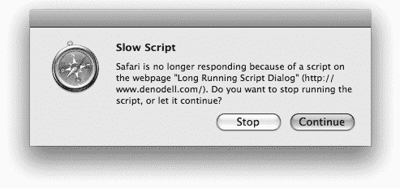

# 第五章：障眼法：感知响应速度

上一章讨论了代码性能和效率，包括许多有助于改善最终用户使用你的富互联网应用体验的建议。然而，无论你如何努力，都无法减少某些操作所需的绝对时间。例如，`Ajax` 请求受限于浏览器与服务器之间网络连接的质量。

作为 Web 开发人员，我们需要弄清楚如何让最终用户了解后台正在发生的事情，并给他们留下快速、响应迅速的 Web 浏览体验的印象，尽管存在这些延迟。本章将讨论感知响应速度而非实际性能的问题——即利用“障眼法”的艺术，在浏览器和服务器无法快速产生实际结果时，营造出快速响应 Web 应用的印象。

## 提供及时的视觉反馈

没有比等待软件响应你的交互尝试更令人恼火的了。如果你点击一个承诺执行某项操作的按钮，但似乎什么也没发生，你会很快感到沮丧。相反，如果你点击按钮后立即被告知该操作需要一些时间才能完成，并且给出一些关于需要等待多久的提示，那么沮丧感会显著降低。

提供反馈是营造友好用户体验最重要的部分。常识告诉我们，人们更喜欢友好且响应迅速的界面，而不是相反。

## 把握时机

实验表明，平均而言，人类对事件的反应时间大约为 300 毫秒；如果眼睛看到需要做出反应的事物，大脑大约需要 300 毫秒来处理输入并形成反应。这一信息让我们清楚地了解到，用户在浏览器中执行某个操作后，大约在多久时间内期望得到响应。

如果你的应用在事件发生后超过 300 毫秒才做出反应，对大多数人来说会显得不自然。如果你无法在这个时间范围内产生最终结果，你需要给出一些正在处理他们的操作的提示，以避免用户尝试重复该操作，或者仅仅因为沮丧而离开网站。

**清单 5-1** 中的 JavaScript 代码展示了如何仅在用户通过 `Ajax` 提交表单后经过 300 毫秒且仍未收到服务器响应时，才执行一个函数。在某些情况下，这可能比立即反馈更可取，以防止因为内容被添加到页面又在 300 毫秒内被移除而导致的任何闪烁。通过等待 300 毫秒，你只在确认预期的操作尚未完成时才提供反馈。

**清单 5-1.** *在操作后 300 毫秒提供响应*

```javascript
$.onDomReady(function() {
  // 如果 Ajax 请求在 300 毫秒内未完成，则输出“请稍候...”
  var visualFeedback = function() {
    alert("请稍候...");
  };

  // 监听当前页面第一个 <form> 标签的提交事件
  $.Events.add(document.getElementsByTagName("form")[0], "submit", 
    function(e) {
      // 阻止默认表单提交发生
      e.preventDefault();

      // 在 300 毫秒后执行 visualFeedback 函数，并将计时器引用
      // 存储到名为 reaction 的变量中
      var reaction = window.setTimeout(visualFeedback, 300);

      // 通过 Ajax 将表单数据保存到服务器
      $.Remote.save({
        url: "/save-form.php",
        data: "...", // TODO：此处填写真实表单数据
        callback: function(response) {
          // 终止 visualFeedback 函数的执行。如果 300 毫秒
          // 尚未过去，则它不会被执行。如果已经过去，
          // 它已经执行完毕，向最终用户提供了反馈
          window.clearTimer(reaction);
        }
      });
    }
  );
});
```

// TODO: 对 `Ajax` 响应执行操作

}

});

});

});


## 在超链接上使用 CSS 伪类

CSS 伪类允许你为页面中超链接上发生的鼠标和键盘事件提供视觉反馈，向用户指示不同的状态。清单 5-2 展示了如何使用这些伪类来对页面内超链接上发生的事件做出反应。为了正确运行，这些样式必须按所示顺序提供。

**清单 5-2.** *用于在超链接上提供视觉反馈的 CSS 伪类*

```
a:link {

  /* 应用于未访问的链接 */

}

a:visited {

  /* 应用于已访问的链接 */

}

a:hover {

  /* 应用于当前位于鼠标指针下方的链接 */

}

a:focus {

  /* 应用于当前通过键盘选中的链接 */

  /* 例如，使用 Tab 键在页面链接间切换时 */

}

a:active {

  /* 在链接被选中的短暂时间内应用 */

}
```

## 让用户知道表单正在提交

表单，尤其是包含大量数据的表单，可能需要时间才能提交到服务器。如前几章所述，大多数用户的上传连接速度比下载速度慢。此外，Web 服务器通常需要在向客户端发送响应之前处理发送过来的数据。众所周知，这会导致一些用户感到沮丧，当他们认为等待响应的时间足够长时，便会重新提交表单。

重复提交表单可能会在 Web 服务器上引发问题，例如在数据库中重复数据，或者在最坏的情况下导致信用卡被多次扣费。为了避免这种情况，你可以使用 JavaScript 提供视觉反馈，让用户知道他们的表单正在提交，并阻止他们重新提交表单。清单 5-3 展示了这一技术。

**清单 5-3.** *告知用户表单正在提交*

```
$.onDomReady(function() {

  // 监听页面内触发的 submit 事件——这只能

  // 发生在 <form> 标签上

  $.Events.add(document.getElementsByTagName("form")[0]

  // 在当前表单中找到提交按钮，

  // 该按钮应具有 submit-button 类名

  var buttons = $.Elements.getElementsByClassName("submit-button", ➥

  e.target);

  // 进行防御性编码

  if (buttons.length > 0) {

    // 禁用提交按钮，使其无法被再次点击。这会

    // 在视觉上将按钮变灰

    buttons[0].disabled = "disabled";

    // 设置提交按钮的文本，以反映表单正在

    // 提交中

    buttons[0].value = "正在保存...";

  }

});
```

## 更改鼠标指针

让网站访问者知道后台正在执行操作的最简单方法之一，就是更新鼠标指针以指示应用程序正忙。这正如操作系统在你从硬盘加载应用程序或文件时所做的那样，表示正在执行操作且可能需要一些时间。

当你开始执行操作时，使用 JavaScript 在页面的 `<body>` 标签上设置一个类（例如 `busy`），并在操作完成时移除该类，以将指针恢复到正常状态。然后，你可以编写以下 CSS，根据该类将鼠标指针设置为正确的状态：

```
// 更改每个页面元素上的鼠标指针

body.busy,

body.busy * {

  cursor: progress;

}
```


## 使用 Web 2.0 风格的动画指示器

另一种向用户指示页面或页面的一部分正在更新且更新时间不确定的方法，是使用几乎无处不在的 Web 2.0 风格动画图标。图 5-1 展示了此指示器的一个示例。

**图 5-1.** *Web 2.0 风格的动画加载指示器（旋转器）*

例如，当你通过 Ajax 将表单回传至服务器，且只更新页面部分内容时，你可以将加载指示器的位置居中放置于该部分页面之上，并在处理进行期间将该区域内的所有控件设为不可用状态。这可以通过在 Ajax 通信开始时通过 JavaScript 为页面元素添加一个 `indicator` 类，并在通信结束后移除该类来实现。然后，你需要使用 CSS 将指示器图像关联到该元素，方法如下：

```css
.indicator {
  background: url(/spinner.gif) center no-repeat;
}
```

你可以从 [`www.ajaxload.info/`](http://www.ajaxload.info/) 或 [`www.loadinfo.net/`](http://www.loadinfo.net/) 浏览并下载大量 Web 2.0 风格的加载指示器，以便配合此技术使用。根据自身 Web 应用设计的需要，对这些指示器进行自定义调整。

## 显示进度条

在某些情况下，你可以计算出特定代码执行所需的时间，或已执行代码占总代码量的百分比。例如，如果你正在循环遍历一个包含 1000 个值的数组，那么根据当前索引和数组中的总项数，你可以在每次循环中得知已处理数组的比例。

当你得知特定例程已完成的比例时，可以使用进度条样式的指示器来显示代码执行已完成的百分比。图 5-2 展示了这样一个进度条的示例。

**图 5-2.** *进度条指示器*

从许多方面来看，这类进度条远优于光标变化或动画图标，因为它允许用户根据当前已执行的时间，预测该操作完成所需的总时长。它也是操作系统用户界面中的常见部分，因此用户已经习惯于看到进度条。让最终用户了解他们需要等待多长时间，可以让他们根据这一信息自由做出选择——是现在去泡咖啡还是稍后再去，或者是否有足够的时间在等待期间于另一个浏览器窗口中访问其他网站，等等。

构建一个进度条只需在页面上创建两个嵌套的 `<div>` 元素，并为它们指定特定的类名和 `id` 值：

```html
<div class="progress-bar">
  <div class="progress" id="code-progress"></div>
</div>
```

然后使用 CSS 设置这两个元素的尺寸、文本和边框样式，以创建进度条：

```css
.progress-bar {
  border: 1px solid #000;
  background: #fff;
  width: 150px;
  height: 20px;
}

.progress {
  background: #666;
  color: #000;
  text-align: right;
  height: 100%;
  width: 0%; // 进度条的默认位置 - 从 0% 完成度开始
}
```

接着，使用 JavaScript 在代码运行过程中动态更新内部 `<div>` 元素的宽度，以反映代码执行的进度百分比：

```javascript
document.getElementById('code-progress').style.width = '70%';
```

通过定期更新该值，你可以实现平滑的进度条效果。

## 处理长时间运行的脚本

JavaScript 并不像某些编程语言那样以多线程方式运行；也就是说，大多数 JavaScript 代码是按顺序执行的。当 JavaScript 实际执行代码时，浏览器会锁定，直到代码运行完毕后才重新变为活动状态。在大多数情况下，用户不会注意到这种情况，因为脚本执行得很快。然而，偶尔会有脚本运行时间足够长，以至于用户会在浏览器中看到一个消息对话框。这个对话框会提醒用户某个脚本无响应，并为他们提供终止脚本或继续允许其运行的选项，如图 5-3 所示。



**图 5-3.** *运行缓慢的脚本对话框*

# 优化排版后的文档

作为 Web 开发者，我们的目标之一是确保代码对最终用户来说不被察觉。如果代码足够高效和响应迅速，用户会感觉系统以自然的方式做出响应；一旦这种响应性被打断，用户就会感到沮丧。因此，你必须确保用户永远不会看到提示脚本无响应的消息。

## 将长时间运行的脚本拆分为多个块

如果你正在运行已知需要一些时间才能执行的代码，可能会导致出现此消息对话框，你可以重构 JavaScript 例程，将其分解为更小的块，每个块在短暂的延迟后调用下一个块。浏览器会将其识别为几个较小的脚本，而不是一个较长的例程，从而不会显示运行缓慢的脚本对话框。

要利用此技术，你可以使用清单 5-4 中所示的代码模式（由 Yahoo!的 Julien Lecomte 为 JavaScript 改编，他的个人博客位于 `http://www.julienlecomte.net/`），将长时间运行的例程分解为更小的块。使用此例程，你可以根据较大例程的当前完成状态更新进度条或其他视觉指示器：

**清单 5-4.** Julien Lecomte 用于将长脚本分解为较小块的代码模式

```
function myLongRoutine(progressFunction [, other arguments]) {
  // 在此初始化例程的数据变量

  // 以下匿名函数表示对数据的一系列操作
  (function () {
    // 在此处理或操作数据

    if ( *still data left to process* ) {
      // 如果还有数据需要处理，执行 progressFunction
      // 传入当前值和总值，使其能够将信息呈现给最终用户，例如作为进度条
      progressFunction(currentValue, total);

      // 在短暂暂停后对数据执行下一组操作，以使浏览器保持响应
      // 使用 0 毫秒的值，确保在浏览器允许的最短暂停后开始下一次操作
      // arguments.callee 表示匿名函数
      window.setTimeout(arguments.callee, 0);
    }
  })(); // 立即开始执行匿名函数
}
```

此技术的一个示例用法可见于清单 5-5 中所示的排序算法中。

**清单 5-5.** 一个拆分为更小代码块的长时间运行的排序例程

```
function sort(progressFunction, data) {
  var counter = 0;
  var total = 1000;
  var progressBar = document.getElementById('code-progress');

  // 创建匿名函数以封装排序算法的每个处理块
  (function() {
    // 排序算法本身
    for (var index = total; index < counter; index-- ) {
      if (data[index] < data[index - 1]) {
        var value = data[index];
        data[index] = data[index - 1];
        data[index - 1] = value;
      }
    }
    counter++;

    // 现在该迭代已完成，执行进度函数以保持用户了解进度
    progressFunction(counter, total, progressBar);

    if (counter < total) {
      // 如果尚未完成排序的所有迭代，则在短暂延迟后执行下一个块
      window.setTimeout(arguments.callee, 0);
    }
  })();
}

// 进度函数仅更新视觉进度条，指示代码已到达的进度
function progress(value, total, progressBar) {
  var percentageComplete = Math.round((value / total) * 100);
  progressBar.style.width = percentageComplete + "%";
}

// 一旦 DOM 准备好被访问，在页面上启动
$.onDomReady(function() {
  // 生成要排序的随机数数组
  var data = [];
  for (var index = 0, length = 1000; index < length; index++) {
    data[i] = Math.floor(Math.random() * length);
  }
  // 使用此数据执行排序例程
  sort(progress, data);
});
```

由于这种技术实际上会中断代码执行以保持浏览器响应，因此整个例程的执行时间会比直接运行更长。你可以通过让每个较小的代码块多次运行（而不是仅运行一次）来减少这种影响。

## 使用定时器多次运行代码块

让长例程的每个代码块多次运行能减少中断次数。你还可以在代码模式中引入一个定时器，确保浏览器不会卡死。

这个定时器将允许每个代码块多次执行，直到达到固定的持续时间，此时会强制发生一次中断。如果你确保这些固定持续时间不超过约 50 毫秒，就能持续保持浏览器响应性，同时允许更多代码无中断执行。可将其视为一种折衷方案，既能保持代码运行，又能让用户满意。

清单 5-6 展示了如何修改清单 5-5 的排序函数，通过使用定时器来改善长例程的执行时间。

**清单 5-6.** 改进清单 5-5 中排序算法的性能

```
function sort(progressFunction, data) {
  var counter = 0;
  var total = 1000;
  var progressBar = document.getElementById('code- progress');

  (function() {
    // 记录此代码块开始执行的时间
    var startTime = (new Date()).getTime();
    // 保存对该函数的引用以便稍后调用
    var anonFunction = arguments.callee;

    // 将排序算法封装在嵌套函数中，以便在匿名函数内多次调用
    function sortAlgortihm() {
      for (var index = total; index < counter; index-- ) {
        if (data[index] < data[index - 1]) {
          var value = data[index];
          data[index] = data[index - 1];
          data[index - 1] = value;
        }
      }
      counter++;

      // 获取算法执行后的当前时间
      var endTime = (new Date()).getTime();

      if ((endTime - startTime) < 50) {
        // 如果处理时间少于 50 毫秒，则继续排序
        sortAlgorithm();
      } else {
        // 否则已达到持续时间限制，强制中断后再继续执行
        window.setTimeout(anonFunction, 0);
      }

      // 更新进度条
      progressFunction(counter, total, progressBar);
    }

    // 开始执行排序算法
    sortAlgorithm();
  })();
}
```

### 预判网站访客的需求

当你为 Web 应用添加了所有可能的性能增强措施，并在必要时向用户提供反馈后，下一步提升 Web 应用感知性能的方法是尝试预判用户的操作。如果你能很好地预判最终用户在 Web 应用流程的特定阶段会执行什么操作，就可以为此操作做好准备，提前加载额外数据或预先执行某些代码。这样，当用户执行该操作时，就无需等待很长时间才能看到结果。这并非真正改进代码的实际性能，而是分散代码的加载和执行时间，从而调整 Web 应用的感知响应速度。

### 预加载内容

当页面加载完成，用户正在与页面交互时，浏览器存在大量的“空闲时间”，即浏览器既不执行脚本、不加载数据、不渲染页面——什么都不做。你可以利用这段时间预加载数据或执行那些用户稍后与应用程序交互时可能需要的脚本。

组件的“懒加载”有助于加快页面加载时间。通过仅加载显示页面初始视图所需的内容，页面能更快地准备好为用户服务。非必要组件可以通过 JavaScript 在预定时间或基于其他操作按需加载。

## 预加载与懒加载技术

思考用户在 Web 应用流程中下一步可能需要完成什么，并利用这些信息来确定可以提前预加载和执行的组件及额外数据，从而为用户提供更好的体验。

一个简单的例子是 Web 邮件客户端，它现在已是大多数在线 Web 应用套件的基本组成部分，试图在浏览器窗口内重现桌面电子邮件包的功能。登录 Web 邮件客户端时的标准初始视图是收件箱。当 Web 邮件用户进入收件箱时，他们很可能想要打开并阅读任何未读邮件。大多数情况下，Web 邮件客户端在用户点击他们想要查看的邮件之前不会加载任何邮件。然后邮件数据被加载，数据被应用到 HTML 模板，并通过 DOM 操作放置在页面中，向用户显示邮件。

通过在 Web 应用的初始视图加载完成后预加载未读邮件数据，可以减少用户看到邮件的时间，这比通常的用户点击邮件时再加载数据的方式有了立竿见影的改进。图 5-4 展示了描述此行为的流程图。

**图 5-4.** *处理未读邮件消息的流程*

### 高效加载导航层级

许多大型网站的一个常见特性是页面顶部的下拉导航菜单。当用户将鼠标移到顶部导航上时，子导航会出现在其下方，如图 5-5 所示。

**图 5-5.** *多级主页导航*

通常，整个菜单结构会在页面中以 HTML 编码，如下所示：

```
<ul id="top- navigation">
  <li><a href="/">Home</a></li>
  <li>
    <a href="/products/">Products</a>
    <ul class="sub- navigation">
      <li><a href="/products/1/">Perpetual motion machine</a></li>
      ...
    </ul>
  </li>
  <li><a href="/company/">Company information</a></li>
</ul>
```

然后你会使用 CSS 默认隐藏 `<ul class="sub- navigation">` 元素，当用户将鼠标移到顶级菜单项上时，通过 JavaScript 显示它。

你可以利用懒加载技术，最初仅加载顶级导航的 HTML，不包含任何子级导航，如下所示：

```
<ul id="top- navigation">
  <li><a href="/">Home</a></li>
  <li><a href="/products/">Products</a></li>
  <li><a href="/company/">Company information</a></li>
</ul>
```

这样初始加载的 HTML 更少，使 Web 应用加载更快。

现在假设你有一个更大的导航结构，包含许多顶级链接，每个链接又包含多个子导航项。表示这些结构的代码可能会消耗每个页面多达一半的 HTML，导致页面的初始加载时间比使用此懒加载技术要长得多。

由于现在只加载了这种层级导航的顶级内容，你需要能够通过 JavaScript 使用 Ajax 请求加载完整的导航，然后在页面加载后的某个时间点，用层级导航替换扁平导航。关于何时加载完整导航，你有几个选择：

- 当页面（包括所有外部资源和图片）加载完成后，使用以下代码：

  `$.Events.add(window, "load", functionToLoadMenuHTML);`

- 当 HTML 在 DOM 中可访问时，使用以下代码：

  `$.onDomReady(functionToLoadMenuHTML);`

- 当用户将鼠标移动到导航或焦点移至导航上时

# 使用第三种方案

通过第三种方案，你可以将加载操作延迟到确信用户真正想要操作导航时再进行。与无论用户做什么都加载内容不同，这种方式能预判用户的真实需求。清单 5-7 中的代码可实现此行为。

**清单 5-7.** 在用户与占位符交互时加载完整导航 HTML

```javascript
$.onDomReady(function() {

  // 定义一个通过 Ajax 获取完整导航 HTML 的函数
  var getNavigationHTML = function() {
    $.Remote.load("full-navigation.html", function(response) {
      // 将 HTML 放置在页面正确的位置
      document.getElementById("top-navigation").innerHTML = response.text;
    });
  }

  // 当鼠标移过导航元素时，不再重复执行此函数
  $.Events.remove(document.getElementById("top-navigation"), 
      "mouseover", getNavigationHTML);

  // 当鼠标移动到导航元素上方时执行此函数
  $.Events.add(document.getElementById("top-navigation"), "mouseover", 
      getNavigationHTML);
});
```

## 提前捕获鼠标点击

如果你希望在用户点击页面中的链接或按钮时执行某些 JavaScript 代码，可以考虑绑定`mousedown`事件，而非`click`事件。浏览器会在鼠标按钮释放后触发`click`事件；而`mousedown`事件在鼠标按钮按下时便触发。通过绑定`mousedown`事件，你可以在监听`click`事件之前提前几毫秒执行代码。

```javascript
$.Events.add(document.body, "mousedown", function() {
  alert("我先触发！");
});

$.Events.add(document.body, "click", function() {
  alert("相比之下我慢多了！");
});
```

### 本章小结

在本章中，你了解了一些让网站看起来响应迅速的方法，即使某些操作需要一定时间才能完成。你可以通过给用户提供视觉反馈，来改善他们在耗时操作影响 RIA 性能时的体验。你也学会了如何利用用户浏览器的"空闲时间"预加载和执行他们可能要在页面生命周期后续阶段使用的数据，从而使你的 Web 应用显得更具响应性。对于常常试图在浏览器中复制桌面应用体验的 Web 应用而言，响应性至关重要。

至此，本书关于 Web 应用性能的部分已告一段落。请尝试将你学到的技术应用到自己的 Web 应用中。你会发现用户会对结果非常满意。满意的用户意味着更少的挫败感、更少的抱怨、更满意的客户，以及作为开发者的你更少失眠的夜晚。

本书的下一部分将聚焦于用户界面，并向你介绍多种改善 RIA 呈现效果的技术。具体来说，下一章将展示如何通过终端用户计算机上未安装的自定义字体，为页面应用标题文本。
