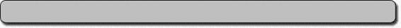
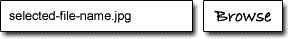
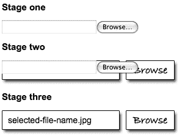
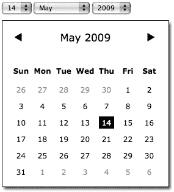
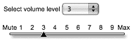
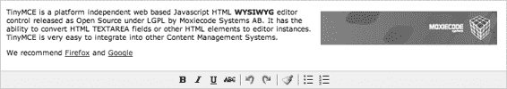

# 第 8 章：表单控件

表单通常构成任何 Web 应用程序的主要部分。表单可以鼓励用户提交反馈、提供搜索功能、让用户向在线数据库添加信息等等。通过表单，你邀请最终用户向你提供某些信息，以便他们自己获得一些回报。表单是网站交互性最强的部分之一，也是经常让用户感到沮丧的部分。正确构建和布局表单及表单字段对你的应用程序至关重要。

本章将指导你自定义现有的 HTML 表单字段，并向你展示如何添加新类型的控件。你将看到如何构建对最终用户来说更易于理解、视觉上更令人愉悦的表单。

## 自定义现有表单控件

# 表单字段的丰富多样性

HTML 中提供的表单字段种类繁多，几乎可以收集你在网站上执行某些流程或提供特定功能时所需的全部用户信息。你可能习惯用 CSS 来美化表单字段，并且可能注意到某些表单控件对特定样式没有响应。例如，尝试修改 `<select>` 下拉元素的边框样式，在不同的浏览器中会得到不同的效果——有些浏览器会应用样式，而另一些则会忽略。

样式方面存在一些问题，因为浏览器中使用的表单字段通常直接取自操作系统本身提供的等效表单字段。这类控件通常只能通过修改操作系统的主题或样式来改变。

随着时间的推移，浏览器厂商迫于压力，尝试让开发者对这类控件的样式拥有更多控制权。但遗憾的是，浏览器之间的支持程度参差不齐，因此对诸如 `<select>` 框这类控件进行样式修改，在每种浏览器中可能不会产生相同的效果。

简而言之，在美化某些控件时，一些棘手的问题依然存在。在这里，我们将正面应对这些问题，并探讨一些解决方案——使用 CSS 并偶尔结合 JavaScript——这些方案能在尽可能多的浏览器中生效。让我们从表单按钮开始。

## 按钮

你在浏览网页时可能每天都会用到按钮，点击它们来保存你在表单中输入的数据、从数据库中删除条目、通过网络邮件客户端发送电子邮件等等。

**249**




**250**

第 8 章 ■ 表单控件

按钮通常通过标签 `<input type="submit">`、`<input type="reset">`、`<input type="button">` 和 `<input type="image">` 渲染到页面上。前三种按钮类型使用操作系统或浏览器的默认样式进行渲染。这样做的目的是在页面与操作系统或浏览器的用户界面之间提供一定的设计一致性。`<input type="image">` 按钮类型会渲染位于指定 URL 的图片，并在用户点击该图片时提交其所在的表单。

## 按钮样式自定义

过去，浏览器对提交、重置和按钮输入类型的 CSS 支持有些参差不齐。例如，早期版本的 Safari 完全不支持修改默认样式。但之后情况有所稳定，如今几乎所有浏览器都完全支持 CSS 样式。然而，即使在今天，要精确匹配所有不同浏览器中按钮内文本的位置仍然很棘手。

许多富互联网应用中常见的按钮设计会使用圆角和阴影，如图 8-1 所示。假设你想调整这种按钮，使其大小取决于其所含文本的大小。这样一来，如果用户在浏览器中调整文本大小，自定义按钮内的文本也会随之调整大小，而不会丢失应用到其背景上的样式，这对于可访问性非常有利。

**图 8-1.** *自定义提交按钮*

为了以能够根据按钮内含文本量水平调整每个按钮大小的方式构建此控件，你需要在 `<input>` 元素周围添加一个额外元素：

```html
<div class="button">
  <input type="submit" value="保存为草稿" />
</div>
```

然后，你可以结合使用 CSS 的 `background-position` 属性与一张非常宽的图片（如图 8-2 所示），作为两个元素的背景。你将显示图片左半部分的一部分作为外层元素的背景，并将图片的右半部分作为 `<input>` 元素本身的背景。

**图 8-2.** *用于提交按钮背景的宽图*

使用上述 HTML 和宽图生成此自定义提交按钮的 CSS 如下所示：

```css
.button {
  /* 将背景固定在外层元素的左上角 */
  background: url(button-bg.png) 左上不重复;
  /* 强制在背景左侧显示 14 像素 */
  padding-left: 14px;
  /* 强制元素仅根据内容调整宽度 */
  float: left;
  /* 背景图片的高度 */
  height: 50px;
}
.button input {
  /* 将背景固定到输入元素的右上角 */
  background: url(button-bg.png) top right no-repeat;
  /* 右侧圆角及阴影占 23 像素 */
  /* 底部阴影高度占 9 像素 */
  padding: 0 23px 9px 0;
  font-size: 1.7em; /* em 单位允许用户调整文本大小 */
  height: 50px; /* 背景图片的高度 */
  overflow: visible; /* 修复 IE 浏览器中的奇怪渲染错误 */
  border: 0; /* 移除输入元素周围的默认边框 */
  margin: 0; /* 移除输入元素周围的默认外边距 */
}
```

你可以看到，能够移除按钮元素的默认样式，并按照自己页面的设计和布局进行修改，同时仍使用浏览器自带的按钮文本。

## 图片型表单按钮的替代方案

你知道 `<input type="image">` 元素允许你指定一个图片 URL，并将该图片作为表单按钮使用。假设你的网站中用了多个这样的图片。这种情况下，使用第 4 章介绍的 CSS 精灵技术会更高效。你可以将这些独立的图片合并成一个文件，然后通过 CSS 类名来选择精灵图中正确的部分显示在页面元素中。

图 8-3 展示了一个包含四个自定义按钮（确定、取消、后退、前进）的精灵图示例。

**图 8-3.** *包含四个用作按钮的图片的 CSS 精灵*

另一个改进是使用 `<input type="submit">` 标签，而非 `<input type="image">`。这样，如果用户的浏览器不支持 CSS，或由于某种原因手动禁用了 CSS，页面上仍会显示一个标准的提交按钮——这是渐进增强原则的实际应用。

**252**

第 8 章 ■ 表单控件

下面我们逐步讲解如何使用这项技术。每个按钮需要两个 HTML 元素：`<input>` 标签本身和一个包装器标签（理论上可以是任意块级元素）。本例中，我们将使用 `<div>` 标签。HTML 代码如下：

```html
<div class="sprite ok">
  <input type="submit" value="确定" />
</div>
<div class="sprite cancel">
  <input type="submit" value="取消" />
</div>
<div class="sprite back">
  <input type="submit" value="后退" />
</div>
<div class="sprite forward">
  <input type="submit" value="前进" />
</div>
```

注意，每个按钮在外层元素上使用了不同的 CSS 类名，并且按钮的 `value` 属性已正确设置。这样，不支持 CSS 的浏览器用户也能访问到标准的提交按钮。

接下来，你需要编写 CSS 来实现期望的效果。先从应用于每个包装器元素的 `.sprite` 类开始：

```css
.sprite {
  background-image: url(button-sprite.png);
  background-repeat: no-repeat;
  width: 85px;
  height: 39px;
  overflow: hidden;
}
```

这里，我们将背景图片设置为精灵图，并禁止其重复。同时强制宽高与精灵图中单个按钮图片的尺寸一致，而非整个精灵图的尺寸。

最后，将 `overflow` 属性设置为 `hidden`，这意味着任何超出该元素宽高边界的内容都将被裁剪掉且不显示。设置这个属性的原因稍后就会明了。

接下来，为每个按钮设置背景位置，使其在各自元素中显示正确的按钮图片，如下所示：

```css
.sprite.ok {
  background-position: 0 0;
}
.sprite.cancel {
  background-position: -85px 0;
}
.sprite.back {
  background-position: 0 -39px;
}
.sprite.forward {
  background-position: -85px -39px;
}
```

**253**

最后，既然你已经解决了正确按钮的显示问题，现在需要对 `<input>` 标签应用一些 CSS 处理，以隐藏其文本内容，同时仍然允许它被选中：

```css
.sprite input {
  padding: 0;
  margin: 0;
  border: 0;
  background: transparent;
  display: block;
  height: 39px;
  font-size: 0;
  text-align: right;
  width: 500px;
}
```

# 第 8 章：表单控件

## 样式重置与文本隐藏

这段样式首先重置了`margin`、`padding`和`border`属性。这些属性的值确保背景是透明的，以便透出下方按钮的图像，并强制元素的高度与图像匹配，从而使整个区域可被选中。

样式的最后三行用于确保元素的默认文本不会显示在按钮图像上方。你可以利用这样一个事实：任何超出周围元素范围的元素部分都会被裁剪掉并不显示——这要归功于外部元素上的`overflow: hidden`样式属性。你只需让`<input>`元素比包装元素宽得多，并将文本（尽量缩小以占用更少空间）对齐到元素右侧即可。

这意味着文本位于元素隐藏的部分中，从而在所有浏览器中保持按钮按你预期的方式显示。

## 文本字段

普通文本字段接受多种不同格式的数据。它是 HTML 中最常见的表单字段。由于这种类型的字段非常灵活，一个关注点是如何对用户输入的内容进行一定控制。在某些情况下，你应该运用一点智慧，配合一点 JavaScript，来确保输入了正确的数据。例如，你可能希望限制字段只接受数字，或只接受电子邮件地址中允许的字符。我们将研究如何实施这两种限制。

### 纯数字文本字段

本示例演示如何样式化一个文本字段，在 JavaScript 可用的情况下，该字段将只接受数字输入。让我们先创建一个新的`<input type="text">`元素，并为其分配一个`numerical`类：

```html
<form action="get" action="/" id="form">
  <input type="text" class="numerical" />
  <input type="submit" value="save" />
</form>
```

现在，你可以编写 JavaScript，使其仅应用于具有此特定类的元素：

```javascript
$.onDomReady(function() {
  // 监听表单内的按键事件
  $.Events.add(document.getElementById("form"), "keypress",
    function(e) {
      // 按键是否发生在类名为 numerical 的字段内
      if (e.target.className == "numerical") {
        // 以下正则表达式匹配所有非数字字符
        if (e.key.match(/[⁰-9]/g)) {
          // 如果按下的不是数字键，则取消按键事件
          e.preventDefault();
        }
      }
    }
  );
});
```

这段 JavaScript 代码会等待 DOM 准备好被访问，然后开始监听页面上`<form>`标签范围内发生的按键事件。如果这些事件之一发生在类名为`numerical`的元素上（在此例中即文本字段），则使用正则表达式检查按下的键是否为数字。如果不是数字，则通过有效阻止浏览器事件来防止其被写入字段。

如果按下的键对应的是数字，则没有问题；事件将被允许继续执行，字符被写入字段。

通过更改此例程中使用的正则表达式，你可以限制字段中允许的字符。让我们看看这如何与另一种文本字段配合使用。

### 电子邮件地址字段

假设你有一个类设置为`email`的字段，并且你想限制可以输入到此字段的字符仅为电子邮件地址中允许的字符。HTML 如下所示：

```html
<input type="text" class="email" />
```

你可以简单地修改上一节中所示的代码来处理这种情况。

```javascript
$.onDomReady(function() {
  $.Events.add(document.getElementById("form"), "keypress",
    function(e) {
      switch(e.target.className) {
        case "numerical":
          if (e.key.match(/[⁰- 9]/g)) {
            e.preventDefault();
          }
          break;
        case "email":
          // 以下正则表达式匹配电子邮件地址中不允许的所有字符
          if (e.key.match(/[^a-zA-Z0-9@!#$%&'*+- \/=?^_{}~.]+/g)) {
            e.preventDefault();
          }
          break;
      }
    }
  );
});
```

如你所见，这段代码与上一节中的 JavaScript 几乎相同，只是使用了不同的正则表达式。现在，对于电子邮件地址允许的字符列表之外的每个字符，你都取消 `keypress` 事件。你可以使用这种方法来添加新的限制。只需使用适当的正则表达式来匹配你想要施加的限制类型即可。

不要忘记，有些用户的浏览器可能未启用 JavaScript。对于这些用户，你必须添加适当的服务器端验证，这样如果发送回服务器的值包含原本会通过 JavaScript 限制的字符，就不会被保存。

## 文件上传控件

文件上传控件在 HTML 中是相当独特的，因为它通常会在页面上添加两个关联的表单控件：一个文本字段和一个按钮。但 Safari 浏览器是个例外，其中文本字段被替换为文本标签；在这种情况下，文件名是不可编辑的。

因此，文件上传控件通常由两个截然不同的表单元素组成，它们通过一个标签添加，并且无法分离。使用 CSS 对此控件进行设计尤其困难，因为相同的样式会同时应用于这两个元素。例如，仅使用 CSS 为按钮设置自定义图像样式并不直接。

值得庆幸的是，有一种技术可以让你对文件上传控件应用自定义样式。其缺点是该控件的文本字段部分实际上被移除了——它被替换为一个文本标签，就像在 Safari 中一样。就个人而言，我认为这是一个完全可以接受的限制，因为实际上没有多少用户会直接在字段中键入文件位置。大多数人更倾向于浏览到合适的文件位置。

这里，我将向你展示如何使用这种技术，基于图 8-4 所示的设计来构建你自己的文件上传控件。



**图 8-4.** *一个自定义的文件上传控件*

在控件的 HTML 中，你将文件上传字段包裹在一个 `<div>` 标签中，并在上传字段旁边添加另一个 `<div>` 元素，你将使用 JavaScript 用这个元素来表示所选文件的文件名。实际上，由于你需要使用 JavaScript 来动态显示文本标签中的值，因此整个自定义控件仅在启用 JavaScript 时应用才有意义。其他用户应该看到默认浏览器样式的上传字段。以下是实现此设计的 HTML：

```html
<form method="post" action="/" id="form" enctype="multipart/form-data">
  <div class="file" id="uploader">
    <input type="file" id="file-upload" />
    <div class="file-label"></div>
  </div>
  <input type="submit" value="保存" />
</form>
```

为了确保此控件的 CSS 仅在启用 JavaScript 时应用，你将使用 JavaScript 动态地向 `<div class="file" id="uploader">` 元素添加一个新的 `active` 类：

```javascript
$.CSS.addClass(document.getElementById("uploader"), "active");
```

然后，你将所有 CSS 编写为继承自这个新的类名：

```css
div.file.active {
  position: relative;
  background: url(file-upload.png) top left no-repeat;
  /* 背景图片的尺寸 */
  width: 288px;
  height: 39px;
}

div.file.active .file-label {
  /* 定位在背景之上 */
  position: absolute;
  top: 0;
  left: 10px;
  /* 只占用图片文本标签部分的宽度 */
  width: 175px;
  height: 100%;
  overflow: hidden;
  z-index: 1;
  font-size: 1.4em;
  /* 确保文本精确定位，垂直居中 */
  line-height: 31px;
}
```



```css
div.file.active input {
  position: absolute;
  /* 在 Firefox 中使文件输入控件透明 */
  -moz-opacity: 0;
  /* 在 IE 8 中应用透明度 */
}
```

```markdown
-ms-filter:"progid:DXImageTransform.Microsoft.Alpha(Opacity=0)";

/* 在 IE 7 及以下版本中应用透明度 */

filter: alpha(opacity=0);

/* 在其他支持透明度的浏览器中应用透明度，例如 Safari、Opera */

opacity: 0;

/* 将透明文件输入控件定位在背景和文件标签之上 */

z-index: 2;

/* 如果未设置此边框，Opera 将不会应用透明度 */

border: 0;

/* 填满外部包装元素标记的可用空间 */

width: 100%;

height: 100%;

}

```

图 8-5 展示了这些样式规则如何分三个阶段应用于元素，从原生文件上传控件开始，以最终的自定义控件结束：

- 首先，你将代表整个文件上传控件的图片设置为包装元素的背景图片，并将其大小设置为与图片尺寸相匹配。
- 然后，你将文件标签定位在背景上方的一个图层中，并设置其文本样式（图 8-5 的第二阶段）。
- 最后，你对原生文件上传控件应用一些样式规则，使其透明，这样用户可以直接看到下面的背景图片和文件标签，但仍然允许元素本身可点击（图 8-5 的第三阶段）。

`图 8-5. 自定义文件上传控件的三个阶段`

这是一个相当惊人的现象，它在所有现代浏览器中都能正常工作。由于目前无法在所有浏览器中使用 CSS 3 的 `opacity` 属性来设置透明度，你必须采用每个浏览器自己的实现方式，使用一组规则来针对每个现代浏览器的透明度设置能力。在控件现在不可见的情况下，你将其定位在背景和文件标签之上，并确保它占据包装元素的完整宽度和高度。

剩下的就是编写 JavaScript 代码，将 CSS 类 `active` 应用到包装元素，并确保当用户使用该控件选择文件时，文本标签得到更新。

**258** 第 8 章 ■ 表单控件

```javascript
$.onDomReady(function() {
    // 在 id 为 form 的 <form> 标签内查找所有 class 为 file 的字段
    var fileUploadFields = $.Elements.getElementsByClassName("file", ➥
        document.getElementById("form"));

    for (var index, length = fileUploadFields.length; index < length; index++) {
        var fileUpload = fileUploadFields[index];
        // 向文件上传字段添加 active 类
        $.CSS.addClass(fileUpload, "active");
    }

    // 当某些浏览器事件触发时，我们将调用 setFileLabel 函数
    var setFileLabel = function(e) {
        if (e.target.type == "file") {
            // 找到最近的文本标签以在其中显示文件名
            var fileLabel = $.Elements.getElementsByClassName( ➥
                "file-label", e.target.parentNode)[0];

            // 从上传字段获取文件名
            var file = e.target.value;

            // 在文件名标签中仅显示 19 个字符的文本
            var numberOfChars = 19;
            if (file.length > numberOfChars) {
                // 如果文件名超过 19 个字符，则截断它
                file = file.substr(0, 4) + " ... " + ➥
                    file.substr(file.length - numberOfChars + 4, file.length)
            }

            // 将文件名写入标签元素
            fileLabel.innerHTML = file;
        }
    }

    // 监听控件上的 change 事件并设置标签文本
    $.Events.add(document.getElementById("file-upload"), "change", ➥
        setFileLabel);

    // 监听控件上的 mouseout 事件并设置标签文本 - 用于
    // Internet Explorer，它不会在应该触发时触发 change 事件
    $.Events.add(document.getElementById("file-upload"), "mouseout", ➥
        setFileLabel);
});
```

该脚本分为两部分。第一部分会查找表单中所有 `<div class="file">` 元素，并为它们应用 CSS 类 `active`。这使你之前编写的 CSS 规则能够应用到这些元素上。代码的第二部分监听上传字段内发生的 `change` 和 `mouseout` 事件，并在这些事件触发时调用一个方法。该方法从上传字段获取文件名，并将其值填入文本标签中，如果文件名过长无法在可用空间中完整显示，则进行截断处理。

# 第 8 章：表单控件

监听 `change` 事件对你来说可能并不意外，因为你希望知道上传字段中的值何时发生变化。然而，使用 `mouseout` 事件可能显得有些奇怪。问题在于，某些旧版浏览器在选择文件时不会触发 `change` 事件，而是触发 `mouseout` 事件。因此，你需要同时监听这两个事件，以确保实现正确的跨浏览器兼容性。

## 添加新型表单控件

标准的 HTML 表单控件通常足以处理将用户数据传入应用程序的需求。但在某些情况下，你可能希望使用一些更直观的控件，或者操作系统中有但 HTML 并未暴露出来的控件。好消息是，借助少量 JavaScript 和偶尔使用的 Flash，你几乎可以为表单构建任何类型的自定义用户界面。

实现这一惊人壮举的方法是隐藏表单中已存在的字段，然后提供一个用于修改这些字段值的新界面。当用户与你提供的新控件交互时，你在幕后更新隐藏字段。这确保了所有数据都能像往常一样通过 HTML 表单字段发送到服务器，从而降低了出错或丢失数据的风险。

在本节中，你将看到如何运用此技术来构建两种 HTML 本身不原生支持的表单控件。在本章稍后部分，我将介绍一些第三方可重用的表单控件组件。

### 用于日期选择的日历小部件

标准的 HTML 表单可能通过文本框来允许日期选择，其输入内容会根据特定的日期格式（例如 `DD-MM-YY` 格式）进行验证。或者，表单可能提供一组三个选择框——分别对应日、月、年——并要求用户从每个选择框中选取合适的值来组成所需日期。

为用户提供一个熟悉的日历界面来选择日期，难道不是更直观吗？如今，许多酒店和航班预订网站都可以找到此类小部件。有些实现得很好，但有些则远不尽如人意。

例如，许多现有的日历小部件要求用户点击日历图标才能弹出日历，或者当用户点击页面上的常规日期选择字段时会直接显示日历。虽然这种机制节省了网站布局中的页面空间，但可能会让最终用户感到沮丧。一些日历小部件要求用户点击某个特定按钮才能关闭它，而不是在用户与其他字段交互时自动关闭。还有一些日历小部件会不恰当地弹在其他页面控件之上，导致这些控件无法使用。

稍微思考并考虑一下你的用户可能如何与控件交互，会带来巨大的回报。请记住，你的目标是提供一种愉悦的、几乎不易察觉的用户体验。必须避免任何可能导致最终用户受挫的因素。考虑到这一点，让我们看看如何构建一个更直观的控件：一个包含所有必要逻辑和 HTML 的可重用日历小部件。

示例日历控件将连接到三个 `<select>` 标签，但其界面外观如图 8-6 所示。在查看此控件的代码之前，我们先定义它的行为方式：



**图 8-6.** 连接到三个 `<select>` 框的自定义日历表单控件

- 页面开发者可以根据其网站的设计需要，对日历进行样式设置和定位。
- 控件可以在页面开发者选择的时间进行实例化。
- 同一页面上可以存在多个实例，且它们之间不会相互干扰。
- 月份和日期名称应可本地化，但默认使用英文。
- 页面开发者可以钩入日历小部件内发生的事件，并从中提取有用信息。例如，开发者可能希望知道何时选中了新的日期，以及该新日期是什么。

为了创建可实例化的小部件对象，你需要使用一个构造函数类。如第 2 章所述，在面向对象编程中，类就像是代码行为方式的定义。对象是该类的一个特定实例，每个创建的对象相互独立，但它们都共享实例化它们的类的所有能力。

在内部，我们的部件将包含与它在浏览器中的呈现相关的代码：HTML 渲染和用户事件（如鼠标点击）的关联。部件中还包含与维护日历当前状态以及涉及日期和月份的计算相关的代码。你希望保持数据和显示代码的这种逻辑分离，确保两者之间没有交叉。

观察者模式（在第 2 章中介绍）提供了一种保持这种区分的实用方法。你有一部分代码与数据存储和操作相关。当这部分代码执行了显示部分可能希望了解的操作时，它会触发一个预定名称的事件。

你告诉你的显示相关代码监听某些事件何时被触发。当它们被触发时，可以在显示部分内执行代码，获取传递给事件的任何相关数据，并使用它来改变显示。同样的技术也适用于相反的情况。

例如，当用户点击更改选中的日期时，数据存储代码需要知道这一点。数据存储代码监听由此点击触发的事件。新日期的值可以随事件一起传递，并且数据存储代码可以根据需要进行更新。

这种模式允许两个或多个不同的代码块在同一系统内共存，而不会在两者之间产生混乱的交叉引用。单个方法充当调解器，定义允许的事件列表，并允许每个代码块在系统中触发或监听这些事件中的任何一个。

## 创建日期的实用方法

为了操作和格式化原生 JavaScript 的 `Date` 对象，使其显示对用户更友好，你需要一些新的实用方法。让我们通过将这些方法添加到你在第 2 章开始编写的 `$` JavaScript 库中，使其可重用。清单 8-1 展示了你将用来使日历小部件更易于使用的实用方法。在库的最后一行将其作为单例实例化之前，将此代码添加到库中。

**清单 8-1.** 使用日期实用方法扩展 `$` JavaScript 库

```javascript
// 将 padZero 方法添加到 Utils 命名空间。该方法返回传入数字的字符串
// 形式。如果数字小于 10，则会在结果字符串的开头额外添加一个 0
$.prototype.Utils.padZero = function(number) {
  return (number < 10 ? "0" : "") + number.toString();
}

// 创建一个名为 Date 的新命名空间，用于存放所有与日期相关的实用方法
$.prototype.Date = {
  // copy 方法复制一个 Date 对象并返回副本。通常，
  // 在 JavaScript 中，Date 作为对单个对象的引用传递，因此
  // 无法进行普通变量复制——每个副本始终指向
  // 同一个对象。此方法创建一个新的 Date 对象，
  // 并从现有对象获取精确的日期和时间
  copy: function(date) {
    var newDate = new Date();
    newDate.setTime(date.valueOf());
    return newDate;
  },

  // add 方法接受一个现有的 Date 对象，并为其添加指定数量的天数、
  // 月数和年数，返回结果 Date 对象
  add: function(date, options) {
    // options 对象字面量包含三个属性——day、month 和
    // year——分别表示要添加到输入 Date 对象中的数量
    var daysToAdd = options.day || 0;
    var monthsToAdd = options.month || 0;
    var yearsToAdd = options.year || 0;

    // 创建一个新的 Date 对象，并向其添加指定的天数、月数和年数
    var date = this.copy(date);
    var initialDay = date.getDate();
    var initialMonth = date.getMonth();
    var initialYear = date.getFullYear();

    date.setFullYear(initialYear + yearsToAdd);
    date.setMonth(initialMonth + monthsToAdd);
    date.setDate(initialDay + daysToAdd);

    // 返回结果 Date 对象
    return date;
  },

  // matchDay 方法用于判断传入的两个 Date 对象是否具有相同的日期数——例如，
  // 传入 5 月 28 日和 6 月 28 日将返回 true，因为两者的日期数相同
  matchDay: function(date1, date2) {
    return date1.getDate() == date2.getDate();
  },

  // matchMonth 方法用于判断传入的两个 Date 对象是否发生在同一个月和同一年
  matchMonth: function(date1, date2) {
    return ((date1.getMonth() == date2.getMonth()) && (date1.getFullYear() == date2.getFullYear()));
  },
}
```

# 构建日历

清单 8-2 展示了如何使用观察者模式、清单 8-1 中的工具方法以及两个完全独立的代码块来构建日历控件：一个用于数据操作和存储，另一个用于用户界面和交互代码。将此代码保存到名为 `calendar.js` 的文件中。

## 清单 8-2. 日历自定义表单控件

```javascript
// match 方法根据输入的两个 Date 对象是否代表完全相同的日期返回 true 或 false
match: function(date1, date2) {
    return this.matchDay(date1, date2) && this.matchMonth(date1, date2);
},

// format 方法将日期返回为用户友好的格式化字符串
format: function(date, formatDefinition, dayName, monthName) {
    var d = date.getDate();                // 一位或两位数字的日
    var dd = $.Utils.padZero(d);           // 两位数字的日
    var dddd = dayName;                    // 星期几的全称
    var ddd = dddd.substr(0, 3);           // 星期几的简称
    var m = date.getMonth();               // 一位或两位数字的月
    var mm = $.Utils.padZero(m);           // 两位数字的月
    var mmmm = monthName;                  // 月份的全称
    var mmm = mmmm.substr(0, 3);           // 月份的简称
    var yy = $.Utils.padZero(date.getYear());   // 两位数字的年份
    var yyyy = date.getFullYear();             // 四位数字的年份
    var tttt = date.getTime();                 // 以时间表示的日期
    return $.Utils.replaceText(formatDefinition, {
        d: d,
        dd: dd,
        ddd: ddd,
        dddd: dddd,
        m: m,
        mm: mm,
        mmm: mmm,
        mmmm: mmmm,
        yy: yy,
        yyyy: yyyy,
        tttt: tttt
    })
},

// getStartOfFirstWeekInMonthSquare 方法返回表示月份网格第一天的 Date 对象。
// 这通常是该月第一天之前的一天，在 JavaScript 中这一天的星期是星期日，从而
// 使日历能够显示适合整齐月份网格的日期，包括发生在上个月的日期
getStartOfFirstWeekInMonthSquare: function(date) {
    date = this.copy(date);
    date.setDate(1);                         // 月份的第一天
    date.setDate(1 - date.getDay());         // 回溯到本周开始的星期日
    return date;
},

// getEndOfWeekInMonthSquare 方法返回能适应输入日期参数所代表的月份周围
// 整齐月份网格的最后日期
getEndOfWeekInMonthSquare: function(date, weeksInSquare) {
    var DAYS_IN_WEEK = 7;
    date = this.copy(date);
    date.setDate(1);
    date = this.add(date, {
        month: 1
    });
    // 回溯到该月的最后一天
    date.setDate(date.getDate() - 1);
    // 向前查找到月份网格的最后一天
    var numberOfDaysToEndOfWeek = (DAYS_IN_WEEK - 1) - date.getDay();
    date = this.add(date, {
        day: numberOfDaysToEndOfWeek
    });
    return date;
}
}
```

```javascript
// 创建代表日历表单控件的构造函数。输入内容包含在选项对象字面量中，
// 该对象应包含三个属性：
// - destinationElement：页面中用于插入日历表单控件的 DOM 元素
// - selectedDate：一个 JavaScript Date 对象，代表日历上默认选中的日期
// - strings：一个对象字面量，包含允许日历表单控件本地化的文本字符串，
//   包括月份和日期的名称，以及用于更改当前显示月份的“上一月”和“下一月”
//   按钮标签的文本
var Calendar = function(options) {
    // 根据观察者模式，存储日历支持的事件列表
    this.eventType = {
        // 日历实例化后将触发 INITIALIZE 事件
        INITIALIZE: 0,
        // 实例化后，当前选中日期确定后将触发 READY 事件
        READY: 1,
        // 日历控件渲染到页面后立即触发 HTML_RENDERED 事件
        HTML_RENDERED: 2,
        // 当用户希望向前显示当前显示月份的下一个月时，
        // 触发 INCREMENT_DISPLAY_MONTH 事件
        INCREMENT_DISPLAY_MONTH: 3,
        // 当用户希望向后显示当前显示月份的上一个月时，
        // 触发 DECREMENT_DISPLAY_MONTH 事件
        DECREMENT_DISPLAY_MONTH: 4,
        // 当前显示月份值改变后触发 MONTH_CHANGED 事件，
        // 以便更新用户界面以反映新月份
        MONTH_CHANGED: 5,
        // 当用户希望从日历控件中选择新日期时触发 DATE_SELECTED 事件。
        // 新的日期值会随事件一起传递
        DATE_SELECTED: 6
    }

    // 自实例化函数 initialize 会创建系统中两个代码块的实例，
    // 并触发系统的第一个事件 INITIALIZE 事件以启动后续流程
    var initialize = function(options) {
        // 数据存储和操作代码将由稍后定义的 Data 代码块表示。
        // 我们实例化该代码块，但无需将其赋值给这里的变量，
        // 因为它完全独立自包含。
        new this.Data(options, this);

        // 用户界面和交互代码将包含在同样稍后定义的 UI 代码块中
        new this.UI(options, this);

        // 现在代码块和事件列表已初始化，触发 INITIALIZE 事件。
        // Data 和 UI 代码块可以监听此事件并采取适当行动来初始化自身代码
        this.fire(this.eventType.INITIALIZE);
    }.call(this, options);
}

// 为日历添加对观察者模式中 listen 和 fire 事件的支持
Calendar.prototype = new $.Observer;

// Data 代码块是一个构造函数，包含用于存储和操作日历内部数据的代码，
// 主要代表当前选中的日期和日历控件上当前显示的月份。
// 实例化时，日历的对象字面量输入会与父对象 Calendar 类的引用一起传入，
// 代码块可以通过该引用使用事件列表和 Observer 方法 listen 与 fire。
Calendar.prototype.Data = function(options, thisCalendar) {
```

// 存储三个属性：实例化 Data 的主 Calendar 实例、当前选中的日期以及当前显示的月份
this.thisCalendar = this;
this.selectedDate = null;
this.displayMonth = null;

// 我们创建 getter 和 setter 方法来保护这些属性，确保写入合理的数据
// `getDisplayMonth` 方法返回控件内当前显示月份的 JavaScript Date 对象的副本
this.getDisplayMonth = function() {
    return $.Date.copy(this.displayMonth);
};

```javascript
// `setDisplayMonth` 方法用于将当前显示月份设置为传入的月份（如果存在），
// 如果未提供参数，则将其设置为当前日期
this.setDisplayMonth = function(date) {
    this.displayMonth = $.Date.copy(date) || new Date();
    // 对于此变量，我们只关心月份，而不关心具体日期。
    // 将日期设置为当月 1 日，以避免在月份切换时出现问题
    this.displayMonth.setDate(1);
    // 通过返回 this 支持方法链式调用
    return this;
};
```

```javascript
// `getSelectedDate` 方法返回 JavaScript Date 对象的副本，
// 该副本表示日历上当前选中的日期
this.getSelectedDate = function() {
    return $.Date.copy(this.selectedDate);
};
```

```javascript
// `setSelectedDate` 方法将当前选中日期设置为传入方法的值（如果提供了参数）。
// 如果未提供，则改用当前日期
this.setSelectedDate = function(date) {
    this.selectedDate = $.Date.copy(date) || new Date();
    return this;
};
```

```javascript
// `getCalendarInstance` 方法返回对实例化 Data 代码块的主 Calendar 实例的引用。
// 我们需要此引用才能访问整个系统中使用的观察者模式方法和事件列表
this.getCalendarInstance = function() {
    return this.thisCalendar;
};
```

```javascript
// `setCalendarInstance` 方法将当前 Calendar 对象实例设置为传入方法的值。
// 如果未传入值，则改用当前对象作用域
this.setCalendarInstance = function(thisCalendar) {
    this.thisCalendar = thisCalendar || this;
    return this;
};
```

```javascript
// getter 和 setter 方法完成后，我们定义系统所需的方法来操作日期
// `incrementDisplayMonth` 方法为 `displayMonth` 属性增加一个月，
// 然后触发 `MONTH_CHANGED` 事件，通知整个日历控件该值已更改，
// 以便代码在需要时对该事件做出响应
this.incrementDisplayMonth = function() {
    this.setDisplayMonth($.Date.add(this.getDisplayMonth(), {
        month: 1
    }));
    var thisCalendar = this.getCalendarInstance();
    var eventType = thisCalendar.eventType;
    // 将新的显示月份和当前选中日期传递给日历控件中
    // 监听 `MONTH_CHANGED` 事件的任何代码块
    thisCalendar.fire(eventType.MONTH_CHANGED, {
        displayMonth: this.getDisplayMonth(),
        selectedDate: this.getSelectedDate()
    });
};
```

```javascript
// `decrementDisplayMonth` 方法从 `displayMonth` 属性中减去一个月，
// 然后触发 `MONTH_CHANGED` 事件，通知其他代码块显示月份已更改
this.decrementDisplayMonth = function() {
    this.setDisplayMonth($.Date.add(this.getDisplayMonth(), {
        month: -1
    }));
    var thisCalendar = this.getCalendarInstance();
    var eventType = thisCalendar.eventType;
    thisCalendar.fire(eventType.MONTH_CHANGED, {
        displayMonth: this.getDisplayMonth(),
        selectedDate: this.getSelectedDate()
    });
};
```

```javascript
// `addObservers` 方法在日历控件中触发某些事件时（无论是当前代码块触发
// 还是其他代码块触发），分配要执行的函数
this.addObservers = function() {
    var self = this;
    var thisCalendar = this.getCalendarInstance();
    var eventType = thisCalendar.eventType;
    // 监听 `INITIALIZE` 事件被触发，然后立即触发 `READY` 事件，
    // 并将当前要显示的月份和当前选中日期传递给它。
    // 主 Calendar 实例在实例化此代码块后，将触发 `INITIALIZE` 事件
    thisCalendar.listen(eventType.INITIALIZE, function() {
        thisCalendar.fire(eventType.READY, {
            displayMonth: self.getDisplayMonth(),
            selectedDate: self.getSelectedDate()
        });
    });
    // 监听 `INCREMENT_DISPLAY_MONTH` 事件被触发，并在触发时相应地
    // 增加 `displayMonth` 属性中存储的日期
    thisCalendar.listen(eventType.INCREMENT_DISPLAY_MONTH, function() {
        self.incrementDisplayMonth();
    });
    // 监听 `DECREMENT_DISPLAY_MONTH` 事件被触发，并进行相应递减
    thisCalendar.listen(eventType.DECREMENT_DISPLAY_MONTH, function() {
        self.decrementDisplayMonth();
    });
    // 监听 `DATE_SELECTED` 事件，并将传入的 JavaScript
    // Date 对象存储为新选中的日期，并根据新选中日期的月份更新 `displayMonth`
    // 属性
    thisCalendar.listen(eventType.DATE_SELECTED, function(selectedDate) {
        self.setSelectedDate(selectedDate);
        self.setDisplayMonth(selectedDate);
    });
    return this;
};
```

### 第 8 章 ■ 表单控件

**269**

# 第 8 章 ■ 表单控件

// 初始化 Data 代码块，存储传入的属性并开始监听系统中触发的事件

```javascript
var initialize = function(options, thisCalendar) {
    this
        .setCalendarInstance(thisCalendar)
        .setSelectedDate(options.selectedDate)
        .setDisplayMonth(options.selectedDate)
        .addObservers();
}.call(this, options, thisCalendar);
```

// UI 代码块是一个构造函数，包含用于显示页面可视日历控件并允许与其交互的代码。
// 该代码块与先前定义的 Data 代码块完全分离，但根据观察者模式，
// 它依赖于控件内触发的同一组事件

```javascript
Calendar.prototype.UI = function(options, thisCalendar) {
    // 为该代码块定义三个属性：对主 Calendar 实例的引用（该实例将实例化此代码块）、
    // 用于放置日历控件的目标 DOM 元素，以及一个包含日期和月份名称文本字符串、
    // 以及“上一个”和“下一个”按钮文本的对象字面量
    this.thisCalendar = this;
    this.destinationElement = $.Elements.create("div");
    this.strings = {
        days: ["星期日", "星期一", "星期二", "星期三", "星期四", "星期五", "星期六"],
        months: ["一月", "二月", "三月", "四月", "五月", "六月", "七月", "八月", "九月", "十月", "十一月", "十二月"],
        previous: '上一个',
        next: '下一个'
    };

    // 我们现在声明一系列 getter 和 setter 方法来保护对这些属性的访问，
    // 确保它们始终包含真实的值
    this.getCalendarInstance = function() {
        return this.thisCalendar;
    };
    this.setCalendarInstance = function(thisCalendar) {
        this.thisCalendar = thisCalendar || this;
        return this;
    };

    // getDestinationElement 方法返回 destinationElement 属性
    this.getDestinationElement = function() {
        return this.destinationElement;
    };
    // setDestinationElement 方法将 destinationElement 属性设置为传入的值，
    // 如果没有提供则从头创建一个新元素
    this.setDestinationElement = function(element) {
        this.destinationElement = element || $.Elements.create("div");
        return this;
    };

    // getLanguageStrings 方法返回 strings 属性，供日历内部使用
    this.getLanguageStrings = function() {
        return this.strings;
    };
    // setLanguageStrings 方法将提供的对象字面量与当前的 strings 对象字面量属性合并，
    // 使用相同属性名的传入值覆盖现有的值
    this.setLanguageStrings = function(languageStrings) {
        this.strings = $.Utils.mergeObjects(this.strings, languageStrings);
        return this;
    };

    // getDayNameByDay 方法期望接收一个代表星期几的数字（0 = 星期日，6 = 星期六），
    // 并从 strings 对象字面量中返回与该星期几对应的名称
    this.getDayNameByDay = function(day) {
        return this.getLanguageStrings().days[day];
    };
    // getDayName 方法为提供的 JavaScript Date 对象返回星期几的名称，
    // 使用 strings 对象字面量属性
    this.getDayName = function(date) {
        return this.getDayNameByDay(date.getDay());
    };

    // getMonthNameByMonth 方法期望接收一个代表月份的数字（0 = 一月，11 = 十二月），
    // 并从 strings 对象字面量属性中返回与该月份对应的名称
    this.getMonthNameByMonth = function(month) {
        return this.getLanguageStrings().months[month];
    };
    // getMonthName 方法根据传入的 JavaScript Date 对象，返回对应的月份名称，
    // 使用的名称存储在字符串对象字面量属性中
    this.getMonthName = function(date) {
        return this.getMonthNameByMonth(date.getMonth());
    };

    // applyStyle 方法为目标元素设置一个类名，使我们能够使用 CSS 正确设置日历控件的样式
    this.applyStyle = function() {
        $.CSS.addClass(this.getDestinationElement(), "cal-container");
        return this;
    };

    // getHeadingElement 方法返回一个 DOM 元素，该元素显示当前显示月份的月份和年份，用于包含在日历控件的顶部
    this.getHeadingElement = function(displayMonth) {
        // 创建一个段落标签，并按照完整的月份名称和年份格式化当前显示的月份
        var p = $.Elements.create("p");
        p.innerHTML = $.Date.format(displayMonth, "{mmmm} {yyyy}", "",
            this.getMonthName(displayMonth));
        // 返回这个新的段落标签。它将在后续阶段被添加到控件中
        return p;
    };

    // getMonthNavigatorElement 方法创建并返回 DOM 元素，这些元素将允许用户向前和向后浏览月份，以选择不同的日期
    this.getMonthNavigatorElement = function() {
        // 创建一个有序列表元素，用于包含两个列表项中的上一个和下一个按钮
        var ul = $.Elements.create("ul");
        // 创建列表项和链接，它将作为“上一个”按钮，将用户的日历视图向后移动一个月，而不在日历本身上选择新日期
        var liPrevious = $.Elements.create("li");
        liPrevious.className = "cal-previous";
        var aPrevious = $.Elements.create("a");
        aPrevious.className = "cal-btn-previous";
        aPrevious.title = this.getLanguageStrings().previous;
        aPrevious.innerHTML = this.getLanguageStrings().previous;
    };
};
```

```markdown
liPrevious.appendChild(aPrevious);

```

**272**

```

// 创建列表项和链接，它将作为“下一个”按钮，将用户视图向前移动一个月

var liNext = $.Elements.create("li");

liNext.className = "cal- next";

var aNext = $.Elements.create("a");

aNext.className = "cal-btn- next";

aNext.title = this.getLanguageStrings().next;

aNext.innerHTML = this.getLanguageStrings().next;

liNext.appendChild(aNext);

ul.appendChild(liPrevious);

ul.appendChild(liNext);

// 返回代表此月份导航器的列表项。它将在后续阶段被添加到日历控件中

return ul;

}

```

`// getCalendarElement 方法将实际的日历元素创建为 <table> 标签`

```

this.getCalendarElement = function(displayMonth, selectedDate) {

var DAYS_IN_WEEK = 7;

// 没有月份会跨越超过 6 周，因此我们将所有月份渲染为 6 周。我们将使用不同的样式显示当前日期之外的日期，以与当前月份区分，但仍然允许它们可选，从而让用户能够选择不在当前月份但前后几天的日期

var WEEKS_TO_SHOW = 6;

// 获取在这个 6 周月份块中要显示的第一天

var dateDisplay = $.Date.getStartOfFirstWeekInMonthSquare(displayMonth);

// 创建一个 `<table>` 元素来容纳日历

var table = $.Elements.create("table");

table.cellpadding = "0";

// 创建表格的标题行，用于显示每周每一天的名称

var thead = $.Elements.create("thead");

var tr = $.Elements.create("tr");

for (var day = 0, totalDays = DAYS_IN_WEEK; day < totalDays; day++) {

var th = $.Elements.create("th");

// 将 `title` 属性格式化为星期几的完整名称

th.title = $.Date.format(new Date(), "{dddd}",

this.getDayNameByDay(day), "");

```

**273**

```

// 格式化显示文本为星期名称的缩写形式，以节省空间

th.innerHTML = $.Date.format(new Date(), "{ddd}",

this.getDayNameByDay(day), "");

tr.appendChild(th);

}

thead.appendChild(tr);

```

```javascript

// 创建代表 6 周公历块中每一天的单元格

var tbody = $.Elements.create("tbody");

// 遍历显示的周数

for (var week = 0, totalWeeks = WEEKS_TO_SHOW; week < totalWeeks; week++) {

// 每周对应表格中的一行

var tr = $.Elements.create("tr");

// 遍历每周中的每一天

for (var day = 0, totalDays = DAYS_IN_WEEK; day < totalDays; day++) {

// 判断当前循环中的日期是否存在于当前显示的月份中

var isCurrentDisplayedMonth = $.Date.matchMonth(displayMonth, dateDisplay);

// 判断当前循环中的日期是否与当前选中的日期匹配

var isSelectedDate = $.Date.match(selectedDate, dateDisplay);

// 将当前循环中的日期表示为一个包含链接的表格单元格

var td = $.Elements.create("td");

// 表格单元格的标题属性包含完整日期，例如：2009 年 5 月 14 日星期四

td.title = $.Date.format(dateDisplay, "{dddd} {d} {mmmm} {yyyy}",

this.getDayName(dateDisplay), this.getMonthName(dateDisplay));

// 正确设置表格单元格的类名，标明当前日期是否被选中，以及它属于当前月份还是相邻月份

td.className = isSelectedDate

? (isCurrentDisplayedMonth

? "cal-selected-date"

: "cal-different-month cal-selected-date")

: (isCurrentDisplayedMonth

? "cal-current-month"

: "cal-different-month");

// 创建一个链接元素用于显示日期

var a = $.Elements.create("a");

// 设置链接元素的类名

a.className = $.Date.format(dateDisplay, "cal-btn-day day-{d}",

this.getDayName(dateDisplay), this.getMonthName(dateDisplay));

// 创建一个新的自定义属性，将当前日期存储为表示 JavaScript Date 对象的字符串

// 这样便于后续重新获取该日期

a.setAttribute("datetime", $.Date.format(dateDisplay, "{tttt}",

this.getDayName(dateDisplay), this.getMonthName(dateDisplay)));

// 设置链接内的文本，显示当前日期的数字

a.innerHTML = $.Date.format(dateDisplay, "{d}",

this.getDayName(dateDisplay), this.getMonthName(dateDisplay));

// 将链接添加到表格单元格，再将表格单元格添加到表格行

td.appendChild(a);

tr.appendChild(td);

// 将循环中的日期递增一天，准备下一次迭代

dateDisplay = $.Date.add(dateDisplay, { day: 1 });

}

// 将表格行添加到 `<tbody>` 标签中

tbody.appendChild(tr);

}

// 将表格的页眉和主体添加到 `<table>` 元素本身

table.appendChild(thead);

table.appendChild(tbody);

// 返回已完全填充的 `<table>` 元素，以便添加到日历控件中

return table;

```

`render` 方法利用当前显示的月份和当前选定的日期来构建日历控件，然后将其添加到页面中指定的 DOM 元素内。

```javascript

this.render = function(dates) {

var displayMonth = dates.displayMonth;

var selectedDate = dates.selectedDate;

// 为了提高性能，使用 DocumentFragment 对象（如第 4 章所述）

var miniDOM = document.createDocumentFragment();

miniDOM.appendChild(this.getHeadingElement(displayMonth));

miniDOM.appendChild(this.getMonthNavigatorElement());
```

## 测试日历控件

现在让我们创建一个简单的 HTML 页面来测试你的新日历控件。清单 8-3 中的代码定义了一个 HTML 页面，其中包含三个 `<select>` 框，分别代表 `<form>` 中的日、月、年输入。你将把日历控件连接到这三个控件上，如图 8-6 之前所示。

### 清单 8-3. 包含自定义日历控件的 HTML 页面

```html
<!DOCTYPE html PUBLIC "-//W3C//DTD XHTML 1.0 Strict//EN" ➥
```

```html
["http://www.w3.org/TR/xhtml1/DTD/xhtml1- strict.dtd">](http://www.w3.org/TR/xhtml1/DTD/xhtml1-�strict.dtd)
[<html lang="en" xml:lang="en">](http://www.w3.org/1999/xhtml)
<head>
<meta http-equiv="Content- Type" content="text/html; charset=utf- 8" />
<title>日历示例</title>
<!- - 在此处定义并引用你自己的样式表文件 -- >
<link rel="stylesheet" href="calendar.css" type="text/css" />
</head>
```

**第 278 页**

第 8 章 ■ 表单控件

```html
<body>
<form method="post" action="/">
<div id="select- boxes">
<select name="day" id="day">
<option value="1">1</option>
<!- - 在此处填写缺失的选项值 -- >
<option value="31">31</option>
</select>
```

# 表单控件与日历集成

## HTML 表单结构

```html
<select name="month" id="month">
<option value="0">一月</option>
<!- - 在此处填写缺失的选项值 -- >
<option value="11">十二月</option>
</select>

<select name="year" id="year">
<option value="2000">2000</option>
<!- - 在此处填写缺失的选项值 -- >
<option value="2009">2009</option>
</select>
</div>

<div id="calendar"></div>

<div>
<input type="submit" value="保存" />
</div>
</form>
```

## JavaScript 初始化与连接

引用 `$` JavaScript 库，并包含我们之前所做的补充。

```html
<script type="text/javascript" src="$.js"></script>
```

引用包含日历控件构造函数的文件。

```html
<script type="text/javascript" src="calendar.js"></script>
```

将日历放置到页面中，并将其与现有 HTML 控件连接的代码。在实际的 Web 应用程序中，你应该将其放在外部文件中，而不是页面内部。

```javascript
$.onDomReady(function() {
  // 获取代表所选日期的三个 <select> 框的引用
  var dayField = document.getElementById('day');
  var monthField = document.getElementById('month');
  var yearField = document.getElementById('year');

  // 实例化一个日历控件，将其放置在页面上的
  // <div id="calendar"> 标签中，并
  // 使用 <select> 框中当前选中的日期。
  // 为了有趣，我们将日历控件本地化为西班牙语，
  // 因此我们通过字符串对象字面量属性
  // 传递文本
  var calendar = new Calendar({
    destinationElement: document.getElementById('calendar'),
    strings: {
      days: ["domingo", "lunes", "martes", "miércoles", "jueves", "viernes", "sábado"],
      months: ["enero", "febrero", "marzo", "abril", "mayo", "junio", "julio", "agosto", "septiembre", "octubre", "noviembre", "diciembre"],
      previous: "anterior",
      next: "siguiente"
    },
    selectedDate: (function() {
      // 从 <select> 框中获取当前选中的日期
      // 并将其作为 JavaScript Date 对象
      // 传递给日历控件
      var day = dayField.options[dayField.options.selectedIndex].value;
      var month = monthField.options[monthField.options.selectedIndex].value;
      var year = yearField.options[yearField.options.selectedIndex].value;
      return new Date(year, month, day);
    }())
  });

  // 使用日历控件的观察者模式特性来监听
  // 日历控件内部触发的 DATE_SELECTED 事件。
  // 当在日历上选中一个新日期时，该事件会触发，
  // 并将新选中的日期作为 JavaScript Date 对象
  // 传递给任何监听函数
  calendar.listen(calendar.eventType.DATE_SELECTED, function(selectedDate) {
    // 根据新选中的日期确定日、月、年
    // 并在页面上的每个 <select> 框中选择相应的选项。
    // 当 HTML 表单保存时，所选日期将因此被保存，
    // 因为它现在存在于现有的 HTML 表单控件中
    var day = selectedDate.getDate();
    var month = selectedDate.getMonth();
    var year = selectedDate.getFullYear();

    for (var index = 0, length = dayField.options.length; index < length; index++) {
      if (dayField.options[index].value == day) {
        dayField.options[index].selected = "selected";
      }
    }

    for (var index = 0, length = monthField.options.length; index < length; index++) {
      if (monthField.options[index].value == month) {
        monthField.options[index].selected = "selected";
      }
    }

    for (var index = 0, length = yearField.options.length; index < length; index++) {
      if (yearField.options[index].value == year) {
        yearField.options[index].selected = "selected";
      }
    }
  });
```

## 事件处理

当用户更改 `<select>` 下拉框中的选项时，我们希望将更改反映到日历控件上。为此，我们首先基于新选择的表单字段值创建一个 JavaScript Date 对象，然后在日历中触发 `DATE_SELECTED` 事件，将新创建的 Date 对象传给控件。监听该事件的控件内部代码将更新显示内容。

```javascript
function selectDateOnCalendar(e) {
  var day = dayField.options[dayField.options.selectedIndex].value;
  var month = monthField.options[monthField.options.selectedIndex].value;
  var year = yearField.options[yearField.options.selectedIndex].value;
  calendar.fire(calendar.eventType.DATE_SELECTED, new Date(year, month, day));
}

$.Events.add(dayField, "change", selectDateOnCalendar);
$.Events.add(monthField, "change", selectDateOnCalendar);
$.Events.add(yearField, "change", selectDateOnCalendar);
```

```html
</script>
</body>
</html>
```

# 第 8 章 ■ 表单控件



作为这个例子的扩展，你可以在一个页面上放置两个日历小部件，并编写代码实现：选中其中一个的日期会强制改变另一个。为此，你需要监听第一个日历实例触发的某个事件，并利用该事件在第二个日历上触发相应事件。

观察者模式非常灵活，足以支持在单个页面上放置数量近乎无限的日历小部件，且所有小部件都可以相互关联。请随意进行实验。

拆解代码，看看它是如何运作的。尝试监听和触发你自己的事件，并观察结果。

## 滑块控件

你可能想添加到表单中的另一个有用控件是滑块。与列表相比，这类控件能为选择数值提供一种更具视觉描述性的方法。它适用于数值以等量递增且位于固定范围内的场景。

为了演示如何为表单构建滑块控件，我们将逐步创建图 8-7 所示的滑块。该滑块上方是一个 `<select>` 下拉框，作为多媒体播放页面的音量选择器。该列表包含 11 个选项，代表从 0 到 100、步进为 10 的数值，其中 0 由“静音”选项表示，100 由“最大”选项表示。

**图 8-7.** *一个滑块和与其连接的 `<select>` 下拉框，共同表示音量控件*

`<select>` 下拉框下方的滑块控件提供了另一种设置音量的方式。用户可以沿着控件左右点击并拖动三角形手柄元素，手柄会吸附到控件顶部显示数值正下方的位置。当用户释放鼠标按钮时，程序会获取选中的数值并更新 `<select>` 下拉框以与之匹配。反之，如果用户从下拉框中选择了一个数值，滑块应更新到正确的位置。

### 构建滑块

与上一节构建日历小部件的方式类似，你将使用观察者模式来构建滑块控件。你将创建两个完全独立的代码块：一个用于管理和操作数据，另一个用于管理页面上显示的小部件。两者仅通过发布的事件相互连接，这些事件由主滑块控件构造函数管理。清单 8-4 展示了该滑块控件的代码。将此代码保存到名为 `slider.js` 的文件中。

**清单 8-4.** *一个自定义的滑块表单控件*

```javascript
// 首先声明 Slider 类，它代表滑块控件，就像我们之前对 Calendar 控件所做的那样
var Slider = function(options) {
  // 声明定义滑杆行为的事件类型
  this.eventType = {
    // INITIALIZE 事件启动所有流程，在所有代码块实例化后触发
    INITIALIZE: 0,
    // 当数据已初始化并准备渲染到页面时，触发 READY 事件
    READY: 1,
    // 当控件已渲染到页面时，触发 HTML_RENDERED 事件
    HTML_RENDERED: 2,
    // 当用户拖动控件手柄时，触发 HANDLE_MOVED 事件
    HANDLE_MOVED: 3,
    // 当滑块的值发生改变时，触发 VALUE_CHANGED 事件
    VALUE_CHANGED: 4,
    // 当代码希望更新滑块位置以表示新值时，触发 MOVE 事件
    MOVE: 5
  }

  // 自实例化函数 initialize 负责实例化两个代码块：
  // Data（数据存储与操作代码）和 UI（页面上的控件及其与用户的交互）
  var initialize = function(options) {
    new this.Data(options, this);
    new this.UI(options, this);
    // 一旦代码块实例化完成，便触发 INITIALIZE 事件
    this.fire(this.eventType.INITIALIZE);
    return this;
  }.call(this, options);
}

// 继承 Observer 模式的监听与触发事件能力
Slider.prototype = new $.Observer;

// Data 代码块代表滑块控件代码库中数据存储与操作的部分
Slider.prototype.Data = function(options, thisSlider) {
  // 存储对主滑块对象实例的引用，以便访问其事件列表；
  // 同时声明一个属性来存储滑块上可能取值的数组，
  // 以及另一个属性来存储该数组中当前选中项的索引
  this.thisSlider = this;
  this.values = [];
  this.selectedIndex = 0;

  // 一系列 getter 和 setter 方法为其余代码提供了安全访问存储数据属性的途径
  this.getSliderInstance = function() {
    return this.thisSlider;
  }
  this.setSliderInstance = function(thisSlider) {
    this.thisSlider = thisSlider || this;
    return this;
  }
  this.getValues = function() {
    return this.values;
  }
  this.setValues = function(values) {
    this.values = values || this.getValues();
    return this;
  }
  this.getSelectedIndex = function() {
    return this.selectedIndex;
  }
  this.setSelectedIndex = function(newIndex) {
    this.selectedIndex = newIndex || this.getSelectedIndex();
    return this;
  }

  // getIndexByPercentage 方法提供了一种有效方式，
  // 用于根据滑块手柄在控件内被拖动的百分比位置，
  // 确定滑块取值数组中对应的索引值。
  // 若手柄拖到最左侧，则返回数组的第一个索引；
  // 若拖到最右侧，则返回数组的最后一个索引。
  this.getIndexByPercentage = function(percentage) {
    var values = this.getValues();
    var index = Math.round((percentage / 100) * (values.length - 1));
    return index;
  }

  // getPercentageByIndex 方法根据取值数组中的某个特定索引，
  // 返回滑块手柄应处的百分比位置。
  // 索引为 0 则返回 0% 的位置。
  // 数组的最后一个索引则代表 100% 的位置。
  this.getPercentageByIndex = function(index) {
    var values = this.getValues();
    var percentage = ((index / (values.length - 1)) * 100);
    return percentage;
  }

  // getValueByPercentage 方法用于根据滑块手柄在控件中的百分比位置，
  // 在取值数组中找到对应的值。
  this.getValueByPercentage = function(percentage) {
    var values = this.getValues();
    var index = this.getIndexByPercentage(percentage);
    return values[index];
  }

  // addObservers 方法监听滑块控件内触发的事件并作出相应响应
  this.addObservers = function() {
    var self = this;
    var thisSlider = this.getSliderInstance();
    var eventType = thisSlider.eventType;
    // 监听 INITIALIZE 事件，并立即触发 READY 事件，
```

// 同时向其传递要在控件上表示的取值数组以及该数组中当前选中项的索引

```javascript
thisSlider.listen(eventType.INITIALIZE, function() {
    thisSlider.fire(eventType.READY, {
        values: self.getValues(),
        index: self.getSelectedIndex()
    });
});

// 监听 HANDLE_MOVED 事件，该事件通过控件接收滑块手柄的当前百分比位置。
// 触发 VALUE_CHANGED 事件，向其传递值数组以及该数组中应与手柄位置对应的索引。
thisSlider.listen(eventType.HANDLE_MOVED, function(percentage) {
    thisSlider.fire(eventType.VALUE_CHANGED, {
        values: self.getValues(),
        index: self.getIndexByPercentage(percentage)
    });
});

// 监听 MOVE 事件，该事件接收需要将控件移动到的新的索引位置。
// 触发 VALUE_CHANGED 事件，向其传递值数组以及该数组中的新索引，以便更新用户界面。
thisSlider.listen(eventType.MOVE, function(index) {
    thisSlider.fire(eventType.VALUE_CHANGED, {
        values: self.getValues(),
        index: index
    });
});

// 监听 VALUE_CHANGED 事件，根据传递给该事件的值设置选中的索引。
thisSlider.listen(eventType.VALUE_CHANGED, function(results) {
    self.setSelectedIndex(results.index);
});

return this;
};

// 通过设置默认值并开始监听系统中触发的事件，来初始化滑动控件内的 Data 代码块。
var initialize = function(options, thisSlider){
    this
        .setSliderInstance(thisSlider)
        .setValues(options.values)
        .setSelectedIndex(options.selectedIndex)
        .addObservers();
    return this;
}.call(this, options, thisSlider);
}

// UI 代码块包含将滑动控件渲染到页面上以及提供用户与该控件交互所需的代码。
Slider.prototype.UI = function(options, thisSlider){
    // 定义滑动控件的 UI 相关属性，包括：
    // 对主 Slider 对象实例的引用（用于连接其事件），
    // 对页面中放置控件的 DOM 元素的引用，
    // 以及对滑块手柄元素、其容器和手柄下方显示标签的引用。
    this.thisSlider = this;
    this.destinationElement = null;
    this.handleElement = null;
    this.handleRangeElement = null;
    this.valueLabelsElement = null;

    // 创建 getter 和 setter 方法以保护属性中的值。
    this.getSliderInstance = function() {
        return this.thisSlider;
    }
    this.setSliderInstance = function(thisSlider) {
        this.thisSlider = thisSlider || this;
        return this;
    }
    this.getDestinationElement = function() {
        return this.destinationElement;
    }
    this.setDestinationElement = function(destinationElement) {
        this.destinationElement = destinationElement || $.Elements.create("div");
        return this;
    }
    this.getHandleElement = function() {
        return this.handleElement;
    }
    this.setHandleElement = function(handleElement) {
        this.handleElement = handleElement || $.Elements.create("div");
        return this;
    }
    this.getHandleRangeElement = function() {
        return this.handleRangeElement;
    }
    this.setHandleRangeElement = function(handleRangeElement) {
        this.handleRangeElement = handleRangeElement || $.Elements.create("div");
        return this;
    }
    this.getValueLabelsElement = function() {
        return this.valueLabelsElement;
    }
    this.setValueLabelsElement = function(valueLabelsElement) {
        this.valueLabelsElement = valueLabelsElement || $.Elements.create("div");
        return this;
    }

    // generateSliderElement 方法生成一个 DOM 对象，其中包含在页面上渲染滑动控件所需的元素。
    this.generateSliderElement = function(values) {
        // 创建一个单一的容器元素，用于放置所有其他元素。
        var container = $.Elements.create("div");
        // 创建一个元素，用于存储与滑动控件内表示的可能数据值数组相关联的值标签集合。
        var valueLabels = $.Elements.create("div");
        valueLabels.className = "value-labels";
        // 遍历传递给此方法的值数组，为每个值创建一个...
```

```javascript
// 为滑块控件标签行中的每个文本值创建一个对应的 DOM 元素
for (var index = 0, length = values.length; index < length; index++) {
    var valueLabel = $.Elements.create("div");
    valueLabel.className = "value-label";
    valueLabel.innerHTML = values[index];
    valueLabels.appendChild(valueLabel);
}

// 将包含所有值标签的 valueLabels 元素添加到容器 DOM 元素中
container.appendChild(valueLabels);

// 创建一个 DOM 元素作为手柄，供用户沿滑块控件拖拽选择数值
var handle = $.Elements.create("div");
handle.className = "handle";

// 创建一个 DOM 元素作为手柄的容器，以便后续使用 CSS 限制手柄在滑块内的移动范围
var handleRange = $.Elements.create("div");
```

## 第 8 章 ■ 表单控件

`handleRange.className = "handle-range";`

// 将手柄添加到其容器元素中

`handleRange.appendChild(handle);`

// 将手柄容器添加到整个滑块控件的外层容器元素中

`container.appendChild(handleRange);`

// 返回包含滑块 HTML 元素的单个 DOM 元素

`return container;`

// render 方法将滑块组件绘制到页面中指定的页面元素内

`this.render = function(values) {`

`var thisSlider = this.getSliderInstance();`

`var eventType = thisSlider.eventType;`

// 获取滑块控件的 DOM 元素并将其添加到页面中

`var documentFragment = document.createDocumentFragment();`

`documentFragment.appendChild(this.generateSliderElement(values));`

`this.getDestinationElement().appendChild(documentFragment.cloneNode(true));`

// 控件渲染到页面后触发 HTML_RENDERED 事件

`thisSlider.fire(eventType.HTML_RENDERED);`

`return this;`

`};`

// applyStyle 方法为页面元素添加类名，以便对滑块控件应用适当的样式

`this.applyStyle = function() {`

`$.CSS.addClass(this.getDestinationElement(), "slider");`

// 为确保手柄始终显示在手柄范围容器内，我们指定手柄相对于其容器使用绝对定位。

// 这样即使在相关 CSS 样式规则缺失的情况下，滑块也能正常工作

`this.getHandleRangeElement().style.position = "relative";`

`this.getHandleElement().style.position = "absolute";`

`return this;`

`};`

// positionLabels 方法沿滑块控件宽度从左到右设置值标签元素的位置，填充所有可用空间

`this.positionLabels = function() {`

// 获取容器元素的宽度，该容器包含所有单个标签

`var labelContainerWidth = parseInt($.CSS.getAppliedStyle(`

`this.getValueLabelsElement(), "width"));`

// 获取滑块控件中所有值标签元素的数组

`var labels = $.Elements.getElementsByClassName("value-label",`

`this.getDestinationElement());`

// 对每个值元素的宽度进行相当准确的估算

`var defaultWidth = Math.round(labelContainerWidth / labels.length);`

// 遍历每个标签元素

`for (var index = 0, length = labels.length; index < length; index++) {`

// 确保每个标签使用绝对定位，否则无法正确显示

`labels[index].style.position = "absolute";`

// 尝试根据标签内的文本获取每个标签元素的实际宽度

`var width = parseInt($.CSS.getAppliedStyle(labels[` `labelIndex], "width"));`

// 有时 Internet Explorer 无法通过此方式返回宽度值。

// 若未返回值，则改用之前计算的估算宽度

`if (isNaN(width)) {`

`width = defaultWidth;`

`}`

// 我们希望将标签文本居中显示在目标位置附近，因此需要计算标签宽度的一半，

// 以便将其从中心点向左偏移该距离，从而使文本呈现居中效果

`var halfWidth = Math.round(width / 2);`

`}`

`};`

```javascript
var proportionThroughSlider = labelIndex / (labels.length - 1);
var position = (Math.round(proportionThroughSlider * labelContainerWidth) - halfWidth);
// 使用 CSS 正确定位此标签元素
labels[labelIndex].style.width = width + "px";
labels[labelIndex].style.left = position + "px";
}
// 我们需要将标签包装器元素的 CSS 定位设置为相对定位，
// 以便标签元素在其中正确显示
this.getValueLabelsElement().style.position = "relative";
return this;
```

```javascript
// setHandlePositionByPercentage 方法根据提供的百分比值
// 在其容器元素中定位手柄
this.setHandlePositionByPercentage = function(percentage) {
  this.getHandleElement().style.left = percentage + "%";
  return this;
}

// setHandlePosition 方法将手柄元素移动到由
// 传递给它的所选索引和数据值数组所表示的位置。如果所选索引
// 为 0，则手柄一直向左移动。如果所选索引是
// 数组中的最后一个，则手柄一直向右移动
this.setHandlePosition = function(data) {
  var percentage = (data.index / (data.values.length - 1)) * 100;
  this.setHandlePositionByPercentage(percentage);
  return this;
};

// wireUpUserEvents 方法为滑块控件提供用户交互，
// 允许将手柄拖到新位置
this.wireUpUserEvents = function() {
  var self = this;
  // 当鼠标在手柄上按下，以及在页面上任何地方释放和移动时执行方法
  $.Events.add(this.getHandleElement(), "mousedown", function(e) {
    self.onMouseDown(e);
  });
  $.Events.add(document.body, "mouseup", function(e) {
    self.onMouseUp(e);
  });
  $.Events.add(document.body, "mousemove", function(e) {
    self.onMouseMove(e);
  });
}

// 定义一个值来存储鼠标按钮当前是否
// 被按下——仅当初始按钮按下发生在手柄元素上方时才设置
this.mouseButtonHeldDown = false;

// 当鼠标在手柄元素上按下时执行
this.onMouseDown = function(e) {
  // 阻止手柄元素上的默认鼠标按下操作
  e.preventDefault();
  // 表示鼠标按钮现在在手柄上被按住
  this.mouseButtonHeldDown = true;
}

// 当鼠标按钮在页面任何位置抬起时执行
this.onMouseUp = function(e) {
  // 表示鼠标按钮不再被按住
  this.mouseButtonHeldDown = false;
}

// 当鼠标在页面任何位置移动时执行
this.onMouseMove = function(e) {
  // 如果鼠标按钮仍然在手柄上按住，并且鼠标
  // 正在移动，这可以被视为手柄的拖动，因此执行
  // 一个新的 onDrag 方法
  if (this.mouseButtonHeldDown) {
    this.onDrag(e);
  }
}
```

# onDrag 方法

`this.onDrag` 方法允许滑块手柄在其容器内水平移动，并在移动到新位置时更新控件内的选中值。

```javascript
this.onDrag = function(e) {
  var thisSlider = this.getSliderInstance();
  var eventType = thisSlider.eventType;
  // 获取手柄容器元素的宽度
  var handleHolderWidth = parseInt($.CSS.getAppliedStyle(this.getHandleRangeElement(), "width"));
  // 获取鼠标当前的 x 位置
  var mouseX = e.pageX;
  // 获取手柄容器元素的当前 x 位置
  var elementWrapperX = parseInt($.CSS.getPosition(this.getHandleRangeElement()).x);
  // 计算这两个值之间的差值，表示
  // 当前手柄位置距容器元素最左点的距离（以像素为单位）
  var distanceFromLeft = mouseX - elementWrapperX;
  // 将手柄的拖动限制在容器元素范围内
  if (distanceFromLeft >= 0 && distanceFromLeft <= handleHolderWidth) {
    // 计算手柄在其容器内所处的百分比位置
    var percentage = Math.round((distanceFromLeft / handleHolderWidth) * 100);
  }
}
```

```javascript
thisSlider.fire(eventType.HANDLE_MOVED, percentage);
```

# addObservers 方法

`this.addObservers` 方法会监听滑块控件内部触发的事件，并根据这些事件更新控件的用户界面。

```javascript
this.addObservers = function() {
    var self = this;
    var thisSlider = this.getSliderInstance();
    var eventType = thisSlider.eventType;
    // 监听到 READY 事件触发时，会传递数据值和选中索引，
    // 并利用这些信息来渲染控件并设置滑块的初始位置
    thisSlider.listen(eventType.READY, function(data) {
        self.render(data.values);
        self.setHandlePosition(data);
    });
    // 监听到 HTML_RENDERED 事件触发时，用于定位并存储新添加控件的引用。
    // 在控件内部定位标签，并在浏览器中设置用户交互控件
    thisSlider.listen(eventType.HTML_RENDERED, function() {
        var destinationElement = self.getDestinationElement();
        self
            .setHandleElement($.Elements.getElementsByClassName("handle", self.getDestinationElement())[0])
            .setHandleRangeElement($.Elements.getElementsByClassName("handle-range", self.getDestinationElement())[0])
            .setValueLabelsElement($.Elements.getElementsByClassName("value-labels", self.getDestinationElement())[0])
            .applyStyle()
            .positionLabels()
            .wireUpUserEvents();
    });
    // 监听到 VALUE_CHANGED 事件触发时，更新滑块位置，
    // 使其根据新选中的数据值吸附到相应位置
    thisSlider.listen(eventType.VALUE_CHANGED, function(data) {
        self.setHandlePosition(data);
    });
    return this;
};
```

# 初始化

初始化 UI 数据块，设置默认属性并开始监听事件。

```javascript
var initialize = function() {
    this
        .setSliderInstance(thisSlider)
        .setDestinationElement(options.destinationElement)
        .addObservers();
}.call(this, options, thisSlider);
```

## 测试滑块控件

现在，你可以将滑块控件应用到真实的 HTML 表单中。清单 8-5 中的代码显示了一个 HTML 页面，其中包含一个 `<select>` 框，其固定值集表示音量控件，如图 8-7 所示。

**清单 8-5.** *包含一个滑块控件的 HTML 页面*

```html
<!DOCTYPE html PUBLIC "-//W3C//DTD XHTML 1.0 Strict//EN" "http://www.w3.org/TR/xhtml1/DTD/xhtml1-strict.dtd">
<html lang="en" xml:lang="en" xmlns="http://www.w3.org/1999/xhtml">
<head>
    <meta http-equiv="Content-Type" content="text/html; charset=utf-8" />
    <title>滑块示例</title>
    <!-- 引用你自己的滑块控件样式规则 -->
    <link rel="stylesheet" href="slider.css" type="text/css" />
</head>
<body>
    <h1>滑块示例</h1>
    <form method="post" action="/">
        <div id="volume-control">
            <label for="volume">选择音量级别</label>
            <!-- 创建要与滑块控件关联的元素 -->
            <select name="volume" id="volume">
                <option value="0">静音</option>
                <option value="10">1</option>
                <option value="20">2</option>
                <option value="30" selected="selected">3</option>
                <option value="40">4</option>
                <option value="50">5</option>
                <option value="60">6</option>
                <option value="70">7</option>
                <option value="80">8</option>
                <option value="90">9</option>
                <option value="100">最大</option>
            </select>
        </div>
        <!-- 创建一个用于放置滑块控件的元素 -->
        <div id="volume-slider"></div>
        <div>
            <input type="submit" value="保存" />
        </div>
    </form>
    <!-- 包含对 $ JavaScript 库的引用 -->
```

<script type="text/javascript" src="$.js"></script>

<!-- 包含对滑块组件类的引用 -->

<script type="text/javascript" src="slider.js"></script>

<!-- 以下脚本将滑块控件添加到页面，并将其与页面上的 `<select>` 框关联起来。

在真实的 Web 应用中，此代码应放置在外部文件中，并在此处引用。

此处为了简单起见将其直接包含在内 -->

</body>

</html>

```html
<script type="text/javascript">
$.onDomReady(function() {
    // 获取我们想要用作滑块控件基础的 `<select>` 框的引用
    var volumeSelectBox = document.getElementById("volume");

    // 创建一个新的滑块控件实例，将该元素放置在页面上相应的标签内，
    // 并使用 `<select>` 元素中的选项值作为滑块的数据值，
    // 将滑块的默认位置设置为 `<select>` 框中当前选中的值
    var slider = new Slider({
        destinationElement: document.getElementById("volume-slider"),
        values: (function() {
            // 创建并返回一个数据值数组，这些值取自我们正在表示为滑块的
            // `<select>` 框中的选项
            var values = [];
            for (var index = 0, length = volumeSelectBox.options.length; index < length; index++) {
                values.push(volumeSelectBox.options[index].text);
            }
            return values;
        })(),
        selectedIndex: volumeSelectBox.options.selectedIndex
    });

    // 监听滑块实例中触发的 `VALUE_CHANGED` 事件，
    // 将 `<select>` 框列表中的选中选项设置为与滑块控件上新选中的值匹配。
    // 这样，该值就可以与 HTML 表单的其余部分一起保存，
    // 因为滑块值在真实的 HTML 表单字段元素中表示
    slider.listen(slider.eventType.VALUE_CHANGED, function(result) {
        volumeSelectBox.options[result.index].selected = true;
    });

    // 监听 `<select>` 框内选中选项的变化，
    // 当用户通过下拉列表而非滑块控件选择新值时，更新滑块位置。
    // 这可使两个控件保持同步
    $.Events.add(volumeSelectBox, "change", function() {
        slider.fire(slider.eventType.MOVE, volumeSelectBox.options.selectedIndex);
    });
});
</script>
```

大功告成！你已经构建了一个滑块控件，并将其连接到一个表单控件上，为最终用户提供了一种更直观的方式来与表单交互，同时确保数据以正确的格式发送回服务器。

这个滑块控件的一个缺点是，没有鼠标的用户无法与滑块手柄交互，他们必须使用滑块上方的 `<select>` 框来更改音量值。

在第 12 章（专门讨论 RIA 可访问性的主题）中，你将学习如何通过允许用户使用键盘与此类控件交互来解决这类问题。

你可以运用构建示例日历和滑块控件时使用的相同技术，来构建自己的自定义表单控件，为最终用户提供更直观的体验。尽量坚持构建简单易用的控件。你可以设计那些模仿人们已从操作系统中熟悉的控件，但这些控件并不是 HTML 的一部分。你还可以借鉴现实世界中能够良好适用于网络的想法。请记住，这是一项改善用户体验的任务，而非展示你的 JavaScript 技能。话虽如此，如果你认为自己有一个绝妙的想法，即使实现起来不容易，也请毫不犹豫地去尝试。如果成功了，请与网络开发社区的其他人分享，以推广可重用代码的原则。别忘了为你的代码编写文档和单元测试，以确保未来的更新不会意外破坏你的代码。

### 使用可重用表单组件

与网络开发的其他领域一样，一些开发者已经完成了创建自定义表单控件的艰巨工作，并将其成果作为可重用组件提供。在这里，我们将介绍两个这样的组件，它们提供了 HTML 默认不具备的功能（尽管大多数网络开发者可能希望它们具备）：用于多文件上传的 SWFUpload 和用于富文本编辑的 Tiny MCE。

#### SWFUpload：带进度条的多文件上传

# HTML 文件上传控制

`HTML`文件上传控件适用于上传小型的单个文件。正如您所料，选中的文件直到表单提交时才会与表单中的其他数据一起发送到服务器。如果用户选择了一个大文件，而服务器可能因文件过大或文件格式不符合预期而拒绝该文件，这可能会成为一个问题。此外，对于较大的文件，表单提交时没有进度指示器——无法让用户知道他们需要等待多长时间才能发现表单提交是否成功。一个更优的解决方案应具备以下功能：

- 允许用户选择一个或多个文件
- 如果页面开发者指定，这些文件应在表单其余部分完成之前就开始发送到服务器
- 显示进度指示器，让用户了解上传文件需要等待多长时间

幸运的是，这样的解决方案是存在的。

`Adobe`的`Flash Player`是一个功能极其丰富的浏览器插件，在网络上拥有非常强大的存在，拥有庞大的安装基础。除了本书这一部分讨论的许多其他`Flash Player`用途外，该插件还支持将文件上传到服务器的方法。不仅如此，它还能报告上传进度，并将多个文件排队，一次性发送。

许多聪明的`Flash`开发者编写了可重用的组件，供`JavaScript`开发者在他们的页面上使用这些功能。快速搜索`Google`将会发现针对几种流行的`JavaScript`库编码的版本，例如`jQuery`（`jQuery Transmit`，位于`http://code.google.com/p/jquery-transmit/`）和`MooTools`（`FancyUpload`，位于`http://digitarald.de/project/fancyupload/`）。这些组件中的大多数具有几乎相同的`JavaScript API`，这使得它们之间的迁移成为一项相当简单的任务。

■ 警告 您应确保您选择的任何文件上传组件已更新，以适用于`Flash Player`版本 10。此版本的`Flash`引入了一项重要的安全更改。该版本要求“浏览”文件选择按钮必须包含在`Flash`影片中，而不能在页面本身中。

在本节中，我们将研究一个可以独立运行的文件上传组件，无需依赖其他`JavaScript`库。该组件名为`SWFUpload`，您可以找到该项目的首页，地址为`http://www.swfupload.org/`。下载最新版本，让我们开始构建一个简单的示例表单来演示其功能。

## `SWFUpload`示例用法

清单 8-6 展示了一个简单的`HTML`页面，其中包含支持`SWFUpload`组件所需的所有表单字段和元素。

**清单 8-6.** 演示`SWFUpload`组件的`HTML`页面

```
<!DOCTYPE html PUBLIC "- //W3C//DTD XHTML 1.0 Strict//EN" ➥
"http://www.w3.org/TR/xhtml1/DTD/xhtml1- strict.dtd">
<html lang="en" xml:lang="en">
<head>
<meta http-equiv="Content- Type" content="text/html; charset=utf- 8" />
<title>多文件上传示例</title>
<link rel="stylesheet" href="upload.css" type="text/css" />
</head>
<body>
<h1>多文件上传示例</h1>
<!- - 带有文件上传字段的表单在将数据发送到服务器进行处理时，必须使用 multipart/form-data 编码类型 -- >
<form method="post" action="/" id="form" enctype="multipart/form- data">
<fieldset>
<legend>要上传的文件</legend>
<label for="make- multiple">选择文件</label>
<!- - 包含一个真正的文件上传控件，以防 JavaScript 被禁用 -- >
<input type="file" id="make- multiple" />
<!- - 创建一个元素来容纳 Flash 组件中的“浏览”按钮。用于启动文件选择对话框的按钮本身必须位于 Flash 中。否则 Adobe 会认为其存在安全风险 -- >
```

# 298

## 第 8 章 ■ 表单控件

```html
<!-- 创建一个元素，用于向用户反映当前的上传进度 -->
<div id="upload-progress"></div>
```

```html
</fieldset>
</form>
```

```html
<!-- 引用 $ JavaScript 库 -->
<script type="text/javascript" src="$.js"></script>
```

```html
<!-- 加载 SWFObject API -->
<script type="text/javascript" src="swfupload.js"></script>
```

```html
<!-- 配置我们的页面。在实际的 Web 应用程序中，此代码块应包含在外部文件中。此处为了简单起见，直接提供 -->
<script type="text/javascript">
// 定义用于初始化 SWFObject 组件的设置
var settings = {
    // 定位提供上传功能的 Flash 文件
    flash_url : "swfupload.swf",
    // 指定文件上传到服务器的 URL — 相对于 Flash 文件的位置
    upload_url: "upload.php",
    // 在浏览器中显示调试信息 — 对开发有用
    debug: true,
    // 用于浏览按钮的图片文件 — 相对于 Flash 文件的位置
    button_image_url: "browse.png",
    // 浏览按钮的尺寸
    button_width: "85",
    button_height: "39",
    // 组件初始化时，用于填充浏览按钮的 DOM 元素 ID
    button_placeholder_id: "browse-button",
    // 如果提供了 swfupload_loaded_handler 方法，则在组件初始化完成时调用该方法
    swfupload_loaded_handler: function() {
        // 给现有的文件上传控件添加一个 hide 类。使用 CSS 使控件不可见。
        // 由于 SWFUpload 组件已成功初始化，我们不再需要此控件
        $.CSS.addClass(document.getElementById("make-multiple"), "hide");
    }
};

// 当用户在文件选择对话框中选择了文件后，SWFUpload 组件会调用 file_queued_handler 方法，
// 并传入一个包含该文件详细信息（包括文件名、文件大小等）的对象字面量。
// 如果用户在对话框中选择多个文件，则会为每个文件多次调用此方法。
// 在此，我们创建一个文件数组作为后续上传的文件队列
var queue = [];
settings.file_queued_handler = function(file) {
    queue.push(file);
}

// 由 SWFUpload 组件按固定时间间隔定期触发 upload_progress_handler 事件，
// 每次都会执行以下方法。该方法指定当前正在上传的文件、已发送到服务器的数据字节数，以及文件的总数据字节数。
// 我们利用这些信息来计算文件上传的完成百分比，并在文件上传期间将其反映在 HTML 页面中，
// 从而为最终用户提供上传进度的反馈
settings.upload_progress_handler = function(file, bytesSent, bytesTotal) {
    var percentComplete = (bytesSent / bytesTotal) * 100;
    var text = "{fileName} ({percentComplete}% 完成)";
    document.getElementById("upload-progress").innerHTML = $.Utils.replaceText(text, {
        fileName: file.name,
        percentComplete: percentComplete
    });
}

// 当文件上传完成时，会触发 upload_complete_handler 事件。
// 我们利用此事件自动开始上传队列中的下一个文件。
// 当最后一个文件上传完成后，我们提交页面上的表单
var filesCompleted = 0;
settings.upload_complete_handler = function() {
    filesCompleted++;
    if (filesCompleted < queue.length) {
        this.startUpload(); // 处理队列中的下一个文件
    } else if (filesCompleted == queue.length) {
        document.getElementById("form").submit()
    }
}

// 现在，SWFUpload 控件的设置已配置完成，
// 接下来，当 DOM 准备好被访问时，让我们将其应用于页面
$.onDomReady(function() {
    // 将设置应用于 SWFUpload 控件，即可在页面上使用
    var uploader = new SWFUpload(settings);
    // 监听页面的表单提交事件
    $.Events.add(document.getElementById("form"), "submit", 
}
</script>
```

## 第 8 章 ■ 表单控件

```javascript
function(e) {
  // 当用户尝试提交表单时，如果有文件
  // 在队列中等待上传，取消表单
  // 提交并上传这些文件。SWFUpload 的 startUpload() 方法
  // 正是执行此操作。它开始上传队列中的第一个
  // 文件。然后文件逐个上传，直到
  // 最后一个文件被发送完毕，此时
  // upload_complete_handler 事件触发，我们先前指定
  // 的方法将表单提交到服务器。如果没有
  // 需要上传的文件，表单将在此处正常提交
  if (queue.length > 0) {
    e.preventDefault();
    uploader.startUpload();
  }
});
```

</body>

</html>

此示例演示了 `SWFUpload` 组件的使用。该页面能够通过单个文件选择对话框提交多个文件进行上传，并向用户显示进度指示器，让他们推断还需要等待多久才能提交表单。



## 第 8 章 ■ 表单控件

### SWFUpload 评估

`SWFUpload` 组件允许您上传多个文件（尽管一次只能上传一个）到服务器端脚本，并支持随时取消上传，且无需刷新页面。它可以限制文件类型和大小。通过组件下载包中提供的一个插件，该组件能够测量文件当前的以及平均的上传速度，并允许您将这些信息传递给页面，以便让用户随时了解情况。正如您所预期的，`SWFUpload` 不提供自己的用户界面，而是要求您（页面开发者）自行构建，并通过组件触发的 JavaScript 事件连接到该组件。简而言之，与 HTML 提供的默认文件上传控件相比，`SWFUpload` 组件为上传多个文件或单个大文件提供了更优雅、更友好的解决方案。

该组件要求最终用户的浏览器安装 Flash Player 9 或更高版本，并且启用了 JavaScript。在尝试将组件包含到页面之前，您可能希望使用第 7 章介绍的 `SWFObject` 组件，通过 JavaScript 检测是否安装了正确版本的 Flash Player。

必须包含在页面中的 JavaScript 文件在压缩后大小为 19KB。向页面暴露其功能的 Flash 文件大小为 12KB。这两个文件大小对于在 Web 应用程序中使用都是非常可接受的，并且在服务器上使用 gzip 压缩将进一步减小这些文件的大小。

#### TinyMCE：富文本编辑

HTML 自带的 `<textarea>` 元素允许用户以比标准文本输入框更自由的方式输入文本，但它只允许输入纯文本。您可能希望为用户提供一种输入带样式和格式的文本，甚至是图片的方法。例如，大多数博客发布者希望编写可以使用粗体、斜体和下划线样式强调的文本，并且能够将图像放到他们博客文章中的特定位置。幸运的是，我们可以利用第三方组件将标准的 `<textarea>` 转换为一个完全可编辑的富文本区域，其中的内容被转换为标准 XHTML，并以这种格式保存回 HTML 表单中。当稍后重新加载页面时，内容会从 XHTML 中读取并转换回富文本显示。

# 第 8 章：表单控件

该领域的领先组件是 `TinyMCE`，您可以在 [`tinymce.moxiecode.com/`](http://tinymce.moxiecode.com/) 找到它。图 8-8 显示了该组件在页面上的一个示例。

图 8-8. 使用“简单”按钮主题显示的 TinyMCE 富文本控件

## TinyMCE 使用示例

在页面中实现 `TinyMCE` 组件非常简单。请看清单 8-7 中的 HTML 代码，其中包含一个可以用富文本组件替换的 `<textarea>` 元素。

清单 8-7. 在 HTML 页面上使用 TinyMCE 富文本编辑器

```
<!DOCTYPE html PUBLIC "-//W3C//DTD XHTML 1.0 Strict//EN"
"http://www.w3.org/TR/xhtml1/DTD/xhtml1-strict.dtd">
<html lang="en" xml:lang="en">
<head>
<meta http-equiv="Content-Type" content="text/html; charset=utf-8" />
<title>富文本示例</title>
</head>
<body>
<h1>富文本示例</h1>
<form method="post" action="/" id="form">
<div>
<!-- 创建一个 <textarea> 字段，稍后我们将通过 JavaScript 用富文本编辑器替换它 -->
<textarea id="freetext" name="freetext"></textarea>
<input type="submit" value="保存" />
</div>
</form>
<!-- 将 TinyMCE 控件的 JavaScript 文件包含在其默认安装路径下 -->
<script type="text/javascript"
src="tinymce/jscripts/tiny_mce/tiny_mce.js"></script>
<!-- 以下脚本在实际的 Web 应用程序中理想情况下应放在外部文件中。为了简单起见，包含在页面中 -->
<script type="text/javascript">
// 指示 TinyMCE 替换页面上所有的 <textarea> 标签为
// 富文本编辑器控件，使用默认的高级主题按钮
// 集合，其中包含组件提供的几乎所有功能的按钮。
// 这些功能包括粗体、斜体、下划线和删除线文本样式；图像、超链接、表格和列表支持；
// 以及支持多级撤销和重做，以防
// 用户犯错
tinyMCE.init({
mode : "textareas",
theme : "advanced"
});
```

```
// 如果您只想替换页面上的单个 <textarea> 实例，
// 而不是全部，以下代码允许您通过元素的 id 属性选择要替换的具体元素。简单按钮集合
// 主题包含简单文本编辑和多级
// 撤销的控件，而不是高级主题中令人眼花缭乱的按钮选择
//
// tinyMCE.init({
// mode : "exact",
// elements: "freetext",
// theme : "simple"
// });
</script>
</body>
</html>
```

## TinyMCE 功能特性

`TinyMCE` 组件的完整功能列表非常庞大。它包括插入表格、拼写检查以及从调色板中选择颜色的支持。您还可以自定义控件中按钮的显示顺序。

`TinyMCE` 具有插件架构，允许开发者为编辑器添加自己的按钮以提供特定行为，或自定义现有按钮的行为方式。项目主页上直接提供两个此类插件（均需支付许可费用）：

- **MCImageManager**：此插件提供了一个丰富的图形用户界面，用于通过与 PHP 或 ASP.NET 后端集成来选择和处理图像。它支持预览缩略图；上传新图像；删除现有图像；以及裁剪、调整大小和旋转图像。

- **MCFileManager**：此插件提供了一个用户界面，用于管理服务器上的文件，通过 PHP 或 ASP.NET 后端托管。它允许用户添加、删除和重命名文件。

这两个插件可以集成在一起，提供一整套图像和文件操作工具，以视觉上令人愉悦的方式向最终用户开放——非常适合内容管理系统或博客工具。

## TinyMCE 评估

`TinyMCE` 提供了一种干净、不引人注目的方法，可以将 HTML 中的标准 `<textarea>` 表单标签替换为能够进行富文本编辑的自定义控件。富文本字段的内容被转换为 HTML 标签，这些标签存储在 `<textarea>` 本身中，以便与表单的其他部分一起提交。当稍后重新打开表单进行编辑时，这些 HTML 标签会在编辑器控件内重新转换为富文本。

`TinyMCE` 组件很大——其所有部分加起来占用 2MB 的磁盘空间。幸运的是，并非所有内容都需要同时加载。简单主题的初始加载大小为 170KB，高级主题则为 218KB。同一页面上的编辑器多实例无需额外下载。

显然，这些数据量很大，远远超过本书讨论的其他第三方组件的体积。开发者已意识到这一点，并为 PHP、ASP.NET、JSP 和 ColdFusion 提供了部分服务器端脚本。这些是 gzip 风格的压缩脚本，用于缩减尚未采用此压缩方式的服务器上的下载时间。

总而言之，TinyMCE 富文本编辑器无疑是该领域的最佳选择；但这需要付出代价：下载体积。我的建议是谨慎使用该控件，并确保服务器启用 gzip 压缩以帮助缩短加载时间。

## 表单验证

任何关于 HTML 表单的章节如果不提及表单验证都是不完整的。所有表单验证都必须由表单提交后运行的服务器端脚本处理。然而，为了获得更好的用户体验，你应该在表单提交前通过 JavaScript 复制后端应用的相同验证规则，这样用户无需等待服务器处理脚本后再刷新页面来显示验证结果。

当用户尝试提交表单时，应通过 JavaScript 进行表单验证。逐个字段的验证可在每个字段失去焦点时执行。

通过挂钩页面 `<form>` 标签的 `submit` 事件，你可以指定验证代码，检查必填字段、特定格式字段等，并在验证失败时阻止事件完成。如果验证成功，则应允许事件继续执行，并将表单提交给服务器。

> **注意**：务必使用表单的 `submit` 事件，而不是连接到表单提交按钮的 `click` 事件。这是因为有多种方式可以提交表单，包括按回车键。此类情况不会被 `click` 事件捕获，因此坚持使用表单的 `submit` 事件，这样会更安全。

如果表单包含必填和非必填字段的混合，请务必标记所有必填字段。如果表单上的所有字段都是必填的，则有理由不明确指出这一点。在许多情况下，在字段名称旁边加一个星号（`*`），并在表单上方用一行文字说明标记此方式的字段为必填，就足以标识必填字段了。

最后，如果表单验证失败，你应该决定验证错误消息在页面上的显示方式：要么在一个地方（表单顶部或底部）列出所有错误，要么在表单上每个验证失败的字段旁边显示。无论哪种情况，在构建这些消息的 HTML 代码时，你应该为每条消息使用 `<label>` 标签，并使用其 `for` 属性将该消息关联到相关的表单字段。

这不仅有利于可访问性，还意味着用户可以简单地点击错误消息，直接跳转到与之相关的字段，这是 `<label>` 标签常见的浏览器行为。

## 总结

本章首先演示了自定义现有 HTML 表单控件以适配你自己 Web 应用程序设计和布局的创新方法。然后深入探讨了构建新的用户界面来替换现有 HTML 表单字段，以提供更好的用户体验。接着，介绍了一系列基于 JavaScript 和 Flash 的第三方插件，这些插件提供了 HTML 默认不支持的额外功能。现在，你应该能够按照自己的意愿设计 Web 应用程序中的表单，并在现有控件无法为你希望收集的数据类型提供合适用户体验时替换它们。

不要害怕为最终用户更乐意使用的表单控件提出新想法。如果你编写了任何代码，请尝试将其打包为可重用的代码，并提供给 Web 开发社区的其他成员，这样我们都可以从彼此的灵感和创造力中受益。

在下一章中，我们将探讨如何为 Web 应用程序编写额外代码，以应对浏览器与 Web 服务器之间的连接中断或电源故障。你将学习如何在将数据发送到服务器之前，在用户本地机器上存储数据。

---
