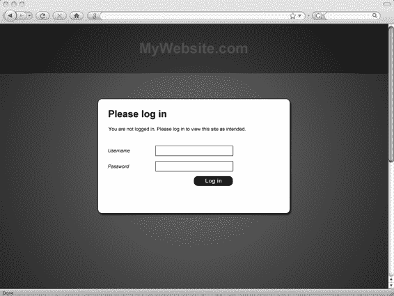
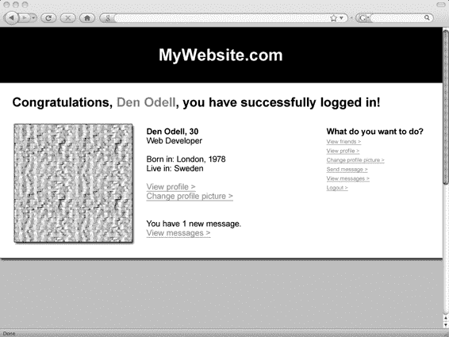
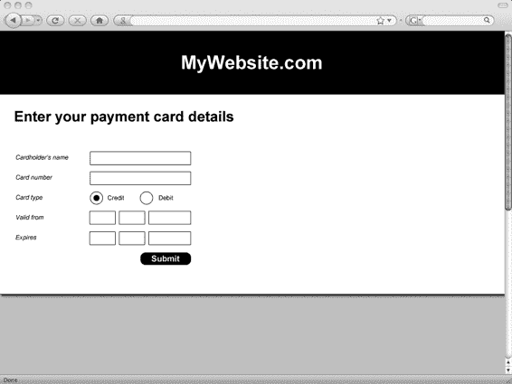
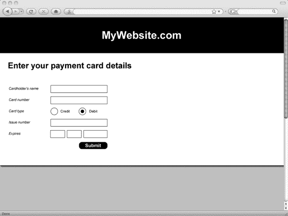

# 打好坚实基础

那么，我们如何从一开始就确保做对呢？以下七条经验法则似乎可以简洁地概括：

- 始终遵循成熟、开放且支持良好的网络标准。
- 了解 HTML、CSS 和 JavaScript 实现之间的跨浏览器差异，并学习如何处理它们。
- 假定浏览器支持 HTML，但无论浏览器中是否存在其他技术（如 CSS、JavaScript 或任何插件），都应确保你的网站可正常使用。
- 一致地命名你的文件夹和文件，并考虑根据用途、网站结构和/或语言将文件分组。
- 定期清除冗余代码、文件和文件夹，以保持代码库干净整洁。
- 为性能而设计代码。
- 不要为了使用技术而过度使用技术。

让我们逐一审视这些基本规则。

## 遵循成熟、开放且支持良好的网络标准

早在 20 世纪 90 年代初，一位在技术研究组织 CERN（欧洲核子研究组织，[`www.cern.ch/`](http://www.cern.ch/)）工作的非常聪明的人——蒂姆·伯纳斯-李，发明了我们今天所知的万维网。他提出了主页、超文本标记语言（HTML）以及互联超链接的概念，这些构成了网页浏览的基础。他还创建了世界上第一个网页浏览器来展示他的发明。

这个项目变得非常庞大，最终占用了 CERN 的大量资源。当决定将资金和人才转向建设最近完成的大型强子对撞机项目时，蒂姆·伯纳斯-李决定创建一个独立的组织来管理 HTML 及其相关技术标准的持续发展。这个新组织——万维网联盟（W3C，[`www.w3.org/`](http://www.w3.org/)）——于 1994 年 10 月成立。

自成立以来，W3C 组织已记录了超过 110 项与网络相关的推荐标准与实践。其中对本书读者最有用的是与 HTML（包括 XHTML）、层叠样式表（CSS）和使用 JavaScript（也称为 ECMAScript，因为 JavaScript 名称由 Sun Microsystems 公司注册商标）进行的文档对象模型（DOM）脚本编写相关的标准。

在互联网早期，出现了两款流行的浏览器：1994 年 12 月发布的 Netscape Navigator 和 1995 年 8 月发布的微软 Internet Explorer（IE）。这两款浏览器基于相似的基础源代码，并以类似的方式渲染网页。当然，当时的网页在视觉上与今天我们所见的截然不同，因此两者要实现这一点并非特别困难。

时间快进到 1996 年，情况变得有趣起来。微软在 IE 3 中引入了对 W3C 新推荐标准——CSS 第 1 级——的基本支持。该推荐标准定义了一种方式，让网页开发者能够对大多数页面元素应用字体和颜色格式、文本对齐、边距、边框和内边距。Netscape 很快跟进，两家浏览器制造商之间的竞争开始加剧。它们都试图实施新的、即将推出的 W3C 推荐标准，往往在这些标准尚未为大众应用做好准备之前就开始了。

自然，浏览器对标准支持的这种差异给网页开发者带来了困惑，他们常常倾向于为“非此即彼”的场景进行设计。这导致最终用户看到的网站显示着“此网站仅适用于 Internet Explorer。请升级您的浏览器。”这样的信息。

当然，W3C 的推荐标准仅仅是推荐而已：供浏览器制造商和开发者遵循。作为开发者，我们必须认识到，这些标准只有在其在通用网络浏览器中的实际实现才具有价值。随着时间的推移，浏览器在趋同于这些网络标准的实现方面确实取得了长足进步。不幸的是，那些在渲染网页时标准采纳质量较差的旧版本浏览器仍然存在，网页开发者必须将这些情况考虑在内。

此处原则是确保你了解浏览器中通用的标准支持情况，而不仅仅是关注 W3C 发布的最新推荐标准。如果该标准得到了良好支持，你就应该使用它。如果没有，则最好避免使用。

## 处理跨浏览器问题

网络浏览器会定期更新，并且通常对现有的 W3C 推荐标准提供更好的支持，同时也会对即将推出的推荐标准进行初步实现尝试。

从历史上看，不同浏览器对现有推荐标准的实现存在差异。对于较新推荐标准的浏览器支持也是如此。这意味着开发者必须随时了解浏览器软件的变化，并知晓不同浏览器的特性和限制。

另一方面，大多数浏览器用户并不像开发者期望的那样及时更新到新的浏览器版本。即使是能够自动更新到最新版本的浏览器，也通常需要用户先授权升级。许多用户实际上觉得这些通知会干扰他们当时试图在浏览器中完成的任务，因此他们往往会推迟升级。

作为开发者，我们必须意识到并承认，世界上存在许多不同的网络浏览器及其版本（总计约一万种不同的版本，并且还在增加）。我们无法控制最终用户使用哪个特定的软件来浏览我们的页面，也不应该去控制。

从浏览器统计数据网站（例如 Net Applications 的市场份额报告 [`marketshare.hitslink.com/`](http://marketshare.hitslink.com/)）中，我们可以了解到，当今世界上的五款主要网络浏览器是微软的 IE、Mozilla 的 Firefox、苹果的 Safari、Opera 软件公司的 Opera 以及谷歌的 Chrome。这五款浏览器占据了桌面端网页访问量的大约 99%。

然而，仅依赖在这些浏览器中进行测试，会忽略掉例如移动网页浏览这一蓬勃发展的市场，因此随时了解浏览器市场的最新进展是值得的。

在多种浏览器和操作系统上测试你的页面，可以让你定位到那些导致不同浏览器以不同方式解释你代码的部分。最大限度地减少这些差异是任何网页开发者面临的最艰巨任务之一，这也将这个角色与大多数其他软件相关职业区分开来。这项任务需要从一个新项目一开始就着手处理，因为如果拖得太晚，可能会导致深夜疯狂编码和错过截止日期——这绝非乐事！

最明智的方法是，在编写任何特定于页面的代码之前，先构建构成网站基本模板或轮廓的 HTML、CSS 和 JavaScript 代码。然后，在尽可能多的不同操作系统上的各种浏览器中，以及尽可能多样化的显示器和窗口尺寸下，测试这个基本框架。在添加任何页面特定的代码或内容之前，调整代码以确保模板正确显示。

一个特别的差异来源是浏览器中对颜色的不同解释。有些浏览器支持从图像文件中读取颜色配置文件信息；有些则不支持。有些应用伽马校正值；有些则不应用。因此，同一张图片或同一种颜色在不同浏览器中可能会略有不同，因此值得检查你的设计是否会导致页面上的对象之间出现颜色不匹配。

你应该在尽可能多的浏览器中逐个构建和测试各个页面组件。

尽可能在开发过程中进行测试。同样，通过将大部分测试提前到开发阶段，你将在后期遇到更少的问题，并减少需要修复的 bug。

到了项目末尾，开发者通常会感受到客户最后时刻索求变更的压力，因此在项目进行到这一阶段时最小化 bug 是一个明智的想法。

### 假设只支持 HTML

你的 HTML 标记必须在任何可用的浏览器、设备或用户代理中可见且功能正常运行，无需依赖 CSS、JavaScript 或插件。当 CSS、JavaScript 或插件提供了 HTML 之外的附加内容、布局或功能时，最终用户应能够以一种合理的方式访问这些内容以及行为的等效功能，而无需依赖这些技术。例如，如果你使用 Flash 电影为你的网站提供动画导航菜单，你需要确保通过 HTML 也能获得相同的导航；否则，你将阻止一整群用户访问你的网站。

显然，这对你开发网页的方式有着巨大的影响。你将**从 HTML 基础开始向上构建**，确保当某些浏览器功能被关闭或不存在时，没有功能会丢失。每一层代码都应该是“无侵入的”；也就是说，在 HTML 标记中不应该存在 CSS 样式规则或 JavaScript 代码——每一层都应该位于独立的文件中，并且自成一体。

在如今现代 Web 应用的背景下（这些应用通常以浏览器和服务器之间的通信通过`JavaScript`来处理的方式编写），这意味着当浏览器中的`JavaScript`被关闭时，这些通信点必须存在。例如，现代的`JavaScript`允许数据发送到 Web 服务器或从 Web 服务器接收，而无需在发送表单时刷新页面。在这种情况下，你必须确保表单可以在没有`JavaScript`的情况下提交——将其视为一个可选的附加功能，而不是一个必要条件。

你可能会听到这个原则被称为**渐进增强**，指的是在 HTML 之上添加或分层额外功能，或者**优雅降级**，指的是从浏览器中移除功能总能得到一个正常工作的网页这一事实。它是所谓的**无障碍性**的核心原则，指的是无论使用何种浏览器或设备，都能提供对网页的访问。

通过现实生活中的例子最能理解这一原则，那么我们现在来看两个例子。

首先，假设在你的 Web 应用中，有一个按钮，单击它会**在页面内启动一个登录模式对话框**，如图 1-1 所示。用户填写表单并点击提交按钮后，`JavaScript`被用来将提供的登录凭据发送到服务器，然后根据用户的登录状态，对某些页面元素（而不是整个页面）进行刷新，如图 1-2 所示。

**10**

第 1 章 ■ 构建坚实基础

**图 1-1.** *模式风格的登录框*

**图 1-2.** *登录成功，如果启用了 JavaScript 则无需刷新页面*

第 1 章 ■ 构建坚实基础

**11**

但如果`JavaScript`被禁用了呢？你需要确保你的 HTML 代码结构能使用户被带到一个包含登录表单的独立页面。提交这个表单会将数据回发到服务器，导致页面刷新，而服务器端代码会根据用户状态（成功登录或未登录）来决定发送哪个页面。通过这种方式，两种场景在功能上是等效的，尽管它们的用户流程和创意处理可能不同。

再举一个例子，假设你有一个页面，其中包含一个用于收集在线预订系统付款信息的表单。在这个表单中，根据所选信用卡的类型，你可能希望某些字段仅在用户选择信用卡（如图 1-3 所示）时显示，而不是借记卡（如图 1-4 所示）。例如，“发卡行号”字段仅适用于借记卡，也许你还想仅对某些发卡机构的卡片显示“有效起始日期”字段。你可能还希望让用户无法提交不正确的日期，例如 2 月 30 日。

作为 Web 开发者，我们使用`JavaScript`来实现这一点。当用户在浏览器中执行某些操作时，`JavaScript`会触发事件，我们能够分配代码在这些事件触发时执行。我们甚至有能力取消事件，这意味着，例如，如果用户试图提交一个表单，如果我们认为该表单因未通过某些验证测试而不适合提交，我们可以取消该提交。

我们使用`JavaScript`来“监听”卡类型字段的变化。当用户选择一个不同的单选按钮选项时，此事件被触发。当此事件被触发时，我们可以执行一段代码，根据所选的卡类型显示或隐藏所需的字段。

**图 1-3.** *显示信用卡字段的支付卡表单*

**12**

第 1 章 ■ 构建坚实基础

**图 1-4.** *显示借记卡字段的支付卡表单*

我们还会监听表单的`submit`事件，当它触发时，我们会运行一个小型的`JavaScript`程序来检查日期字段是否包含有效值。如果我们认为输入的值不合格，我们可以强制表单提交失败。

现在，如果有人使用不支持`JavaScript`的浏览器访问你的网页会发生什么？她使用单选按钮选择了卡类型，但页面没有任何变化。实际上，为了实现对页面外观的改变，表单必须提交到服务器，以让服务器执行你之前使用`JavaScript`进行的那种处理。

在可用性方面，你可能会觉得要求用户在选择了卡类型后立即提交表单很奇怪，因为字段已经显示在下方了。在这种情况下，组织页面的理想方式可能是让所有字段都存在于页面的 HTML 中，并简单地允许用户填写其卡上可用的信息。当他们最终提交表单时，服务器上的处理程序可以验证他们的卡数据，检查他们是否输入了有效日期，如果存在错误，则重新加载页面并显示错误消息。

### 一致地命名和组织文件夹与文件

通过建立关于文件夹、文件及其内容命名的规则和约定，你为自己和其他开发者查找文件和代码简化了任务。一致的命名约定使维护和添加新功能的工作更加简单，确保开发者始终知道如何命名他们的资产。请参阅本章后面的“结构化你的文件夹、文件和资产”一节，了解一些你可能采用的目录结构示例。

### 维护整洁的代码库

你应该确保与项目关联的文件和代码恰好是网站工作所需的——不多不少。随着时间的推移，某些文件可能被其他文件取代，某些 CSS 样式规则或`JavaScript`文件也可能被其他规则或文件取代。

我建议你在开发过程中定期从代码库中清除所有冗余的文件、文件夹和代码。这可以减小项目规模，有助于其他开发者理解代码，并确保你网站的最终用户不会下载从未使用过的文件，从而消耗他们可能需要付费的带宽。

好的，作为一名高级文档工程师和翻译员，我将严格遵循您提供的注意事项和示例，将给定的英文文本翻译成中文。

