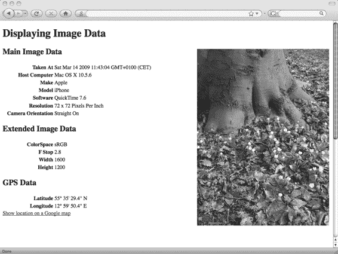

# 第 10 章：二进制 Ajax

到目前为止，你应该已经熟悉了使用 Ajax 技术在浏览器和 Web 服务器之间检索和发送基于文本的数据。本章将解释如何通过 JavaScript 动态检索存储在其他类型文件（如图像、音频和视频）中的数据。这允许你提取这些文件中存储的信息，以供 Web 应用程序使用。

## 纯文本文件 vs. 二进制文件

所有文件——无论是文本、图像、音频还是其他类型的数据——都按照指定的格式以数据的形式存储在计算机的文件系统中。计算机软件程序，如 Microsoft Word 或 Apple iTunes，只加载符合它们预期特定格式的文件，并将它们转换为对该软件用户更有用的内容。

计算机文件数据存储为 8 位十六进制字节的长序列，每个字节可以表示从 0 到 255 的值（以 16 进制表示），通常以常见的十六进制表示法表示为 `0x00` 到 `0xFF`。文本字符在文件中存储为 `0x20` 到 `0x7E` 范围内的十六进制字节，而仅包含该范围内数据字节的计算机文件被称为*纯文本文件*。HTML、样式表和 JavaScript 文件都是纯文本文件。包含该范围之外数据字节的文件被称为*二进制文件*。图像和 Flash 组件就是二进制文件的例子。

为了区分一种二进制文件类型与另一种，并确保该文件的格式符合预期类型，每种文件类型都有自己的规范，由负责创建该数据文件格式的个人或组织编写。该规范描述了数据在文件中的存储和格式化方式。

通常，二进制文件会有一个头部（header）部分，其中包含描述文件主体部分中实际数据的信息。在图像文件中，这个头部信息可能包含图像的宽度、高度和分辨率。在 MP3 音乐文件中，这可能包含存储在文件中的艺术家、曲目和音乐流派名称。

## 使用 Ajax 读取二进制文件

第 2 章展示了在 Web 应用程序中为托管在 Web 服务器上的纯文本文件发起 Ajax 请求所需的代码。为了演示如何检索二进制文件，让我们扩展该代码以发起对二进制文件的请求。

> **注意：** 与对纯文本文件的 Ajax 请求一样，你无法请求托管在非当前运行 JavaScript 代码的服务器上的文件。

二进制文件通常比纯文本文件大得多，因此你需要告知服务器仅返回所请求文件中的特定部分数据。你很可能需要读取存储在文件开头的标头数据。因此，仅接收文件的第一部分比接收整个文件更有意义。幸运的是，你可以利用 `Range` HTTP 请求标头来指定要接收的文件大小。例如，以下 `Range` 标头指示服务器仅返回所请求文件的前 1,024 字节：

```
Range: bytes=0-1024
```

并非所有 Web 服务器都支持 `Range` 标头，因此在使用它之前，你必须检查其是否受支持。这可以通过对要读取内容的文件发起 `HEAD` 请求来实现。`HEAD` 请求仅返回当请求文件内容时通常会随附的 HTTP 响应标头，而不返回实际文件内容。然后你检查 `Accept-Ranges` HTTP 响应标头是否存在且其值为 `bytes`，这表明 Web 服务器支持此功能。一旦确认支持此功能，你可以发送实际的 `GET` 请求来获取二进制文件，并提供 `Range` 请求标头。

清单 10-1 展示了需要添加到 `$` JavaScript 库中现有 Ajax 方法中的代码（该库从第 2 章开始构建），以支持使用跨浏览器 Ajax 连接器对象进行连接和数据检索。注意请求二进制文件与请求纯文本文件之间的相似之处。

### 清单 10-1. 配置二进制连接器

// The method `configureBinaryConnector` takes three input parameters:
// - A cross-browser Ajax connector object
// - An optional length to specify how much data the server should
//   return, in bytes
// - A callback function to pass the downloaded binary data to

`$.prototype.Remote.configureBinaryConnector = function(input) {`
    // Create fallback values for each of the inputs in case they are not specified
    `var connector = input.connector || this.getConnector();`
    `var length = input.length || -1;`
    `var callback = input.callback || function() {};`

    // By default, Firefox will attempt to convert the binary data received into a
    // different format if it is of a known type. We will force Firefox to believe
    // the data is of an unknown type, so it does not perform any conversion on the
    // raw binary data returned by the server

    `if (connector.overrideMimeType) {`
        `connector.overrideMimeType("text/plain; charset=x-user-defined");`
    `}`

    // If a length has been specified, set the HTTP Range request header to return
    // only the specified amount of data from the start of the file - otherwise we
    // would have to download the entire file, which would slow down any
    // processing we wish to perform upon it
    `if (length > -1) {`
        `connector.setRequestHeader("Range", "bytes=0-" + length);`
    `}`

    // Internet Explorer returns the binary data in the `connector.responseBody`
    // property. Other browsers return it in the `connector.responseText` property
    `if (typeof connector.onload != "undefined") {`
        // The `connector.onload` event handler exists within the W3C `XmlHttpRequest`
        // object but not Microsoft's `XMLHTTP` ActiveX object.
        `connector.onload = function(){`
            // HTTP status 200 means the file downloaded successfully in its
            // entirety, and 206 means that the portion of the file specified with
            // the HTTP Range request header was returned successfully
            `if (connector.status == 200 || connector.status == 206) {`
                // In those browsers that support `connector.onload`, the binary data
                // from the file is returned in `connector.responseText`
                `var binaryData = connector.responseText;`

                // Wrap the data in a `BinaryReader` object, which we will define
                // later, which will expose methods and properties for interacting
                // with the data within the binary file.
                // The `this` keyword refers to `$.Remote`
                `var binaryReader = new this.BinaryReader(binaryData);`

                // Execute the callback function passed into this routine, passing the new `binaryReader` object as an argument to it
                `callback(binaryReader);`
            `}`
        `}`
    `} else {`
        // The `connector.onload` event handler does not exist, so this must be Internet Explorer -- in this case, we will use the cross-browser Ajax `onreadystatechange` event handler instead
        `connector.onreadystatechange = function() {`
            `if (connector.readyState == 4) {`
                `if (connector.status == 200 || connector.status == 206) {`
                    // The requested file or file portion has been returned successfully. In Internet Explorer, the binary data is returned via the `connector.responseBody` property
                    `var binaryData = connector.responseBody;`

                    // Create a new instance of the `BinaryReader` constructor (defined later), which allows seeking through data blocks in the entire binary file.
                    // The `this` keyword refers to `$.Remote`
                    `var binaryReader = new this.BinaryReader(binaryData);`

                    // Execute the callback function passed into the routine, passing the `binaryReader` object instance, to allow the callback to access the data in the file
                    `callback(binaryData);`
                `}`
            `}`
        `}`
    `}`
`}`

现在你可以配置跨浏览器连接对象，使其能够接收二进制数据。清单 10-2 展示了如何通过 JavaScript 请求一个二进制文件或文件的一部分。将此代码添加到你的 `$` JavaScript 库中。

**注意：** 遗憾的是，在撰写本文时，Opera 浏览器无法从此例程可用的形式返回 Ajax 请求中的二进制数据。在围绕此代码构建 Web 应用程序时，请牢记这一点。所有其他现代浏览器，包括 IE 6，都将以可用形式返回数据。

**清单 10-2.** 使用 Ajax 加载完整的或部分二进制文件

// The `loadBinary` method loads a binary file from a specified URL and executes a callback function, passing the raw binary data returned to it. If the optional `length` parameter is specified, only a portion of the file is downloaded, up to the number of bytes specified by that parameter.

`$.prototype.Remote.loadBinary = function(request) {`
    `var url = request.url || "";`
    `var length = request.length || -1;`
    `var callback = request.callback || function() {};`

    // The `this` keyword here refers to the `$.Remote` namespace
    `var connector = this.getConnector();`
    `this.configureBinaryConnector({`
        `connector: connector,`
        `length: length,`
        `callback: function(binaryReader) {`
            `callback(binaryReader);`
        `}`
    `});`
    `connector.open("GET", url, true);`
    `connector.send(null);`
`}`

`var self = this;`

`if (length > -1) {`

// 如果指定了数据长度，意味着只应下载文件的一部分，则执行一个 HTTP HEAD 请求，该请求仅返回 HTTP 响应头

`self.load({`

`url: url,`

`type: "HEAD",`

`callback: function() {`

// 创建一个新的 Ajax 连接器对象并打开连接

`var connector = self.getConnector();`

`connector.open("GET", url, true);`

// 通过测试 HTTP `Accept-Ranges` 响应头的值，判断 Web 服务器是否支持 HTTP Range 头

`if (this.getResponseHeader("Accept-Ranges") == "bytes") {`

// 如果 Web 服务器支持数据范围选择，则检查指定的长度是否超过文件中所有数据的长度

`var fileLength = this.getResponseHeader("Content-Length");`

`if (length > parseInt(fileLength, 10)) {`

`length = parseInt(fileLength, 10);`

`}`

// 配置新的连接器，使其指定要从文件中检索的数据长度。然后将此数据传递给回调函数

`self.configureBinaryConnector({`

`connector: connector,`

`length: length,`

`callback: callback`

`});`

`} else {`

`第 10 章 ■ 二进制 Ajax 336`

// Web 服务器不支持数据范围选择，因此在配置新连接器时，我们将省略指定长度，以便文件中的所有数据都传递给回调函数

`self.configureBinaryConnector({`

`connector: connector,`

`callback: callback`

`});`

`}`

// 使用新连接器对象中配置的设置，发起对二进制文件的请求

`connector.send("");`

`}`

`});`

`} else {`

// 如果没有指定长度，则加载整个二进制文件并将其传递给回调函数

```javascript
var connector = this.getConnector();
connector.open("GET", url, true);
this.configureBinaryConnector({
  connector: connector,
  callback: callback
});
connector.send("");
```

现在，你可以请求二进制文件并返回文件中的原始数据。接下来，你需要能够读取文件中你感兴趣的具体部分。清单 10-3 展示了一个新的构造函数，你可以用它来读取和提取返回的二进制文件中的特定数据。请将此代码添加到你的 JavaScript 库中。

**清单 10-3.** 二进制文件读取器

```javascript
// Internet Explorer 不允许我们返回二进制数据中的某些信息。
// 为了解决这个问题，我们必须在页面中编写两个 VBScript
//（微软自己的脚本格式）函数：IEgetByte 和 IEgetLength，
// 当需要时，我们将从 JavaScript 代码中调用它们。
// 这些函数通过 document.writeln 添加到页面中，并包裹在 Internet Explorer
// 的条件注释中，这样其他浏览器就不会读取它们。

document.writeln(
  '<!-- [if IE]>' +
  '<script type="text/vbscript">\r\n' +
  '  Function IEgetByte(data, position)\r\n' +
  '    IEgetByte = AscB(MidB(data,position + 1, 1))\r\n' +
  '  End Function\r\n' +
  '  Function IEgetLength(data)\r\n' +
  '    IEgetLength = LenB(data)\r\n' +
  '  End Function\r\n' +
  '</script>' +
  '<![endif]-->'
);
```

`BinaryReader` 构造函数接收原始二进制数据作为输入，并包含帮助从原始数据中以不同格式提取数据的方法。

```markdown
## 从照片文件中提取图像数据

所以，现在你已经拥有了从服务器请求二进制文件所需的代码，并且根据你所读取的特定类型二进制文件的规范，你能够从这些文件中提取感兴趣的数据。接下来，让我们看一下如何针对一种特定类型的二进制文件（包含照片的文件）执行此操作。

假设作为 web 应用程序的一部分，你希望从数码相机拍摄的照片图像文件中提取信息，例如照片的拍摄时间和尺寸。大多数用数码相机拍摄的照片都将此信息存储在拍摄时生成的 JPEG 图像文件的头部部分。只要你知道描述数据如何存储在文件中的规范，你就可以使用你的二进制 Ajax 文件读取器（清单 10-3）来提取这些信息。对于照片文件，此数据以可交换图像文件（EXIF）格式存储。

在提取图像文件中存储的数据之前，你需要了解数据在文件中的结构。这始终遵循非常严格的格式规范，因此数据被错误表示或与不同文件格式混淆的可能性为零。

### 理解 EXIF 格式

EXIF 格式描述了额外信息如何存储在 JPEG 图像文件中。有关此规范的有用描述可以在网上找到，网址为 `http://park2.wakwak.com/~tsuruzoh/Computer/Digicams/exif-e.html`。

### JPEG 和 EXIF 头部

一个 JPEG 文件在其中的 EXIF 数据开始之前可能包含任意数据量。EXIF 数据的开始由以下十六进制表示的数据标记（为清晰起见添加了额外空格）：

```
FFE1 ssss 4578 6966 0000
```

其中 `ssss` 表示文件中 EXIF 数据块的大小（十六进制数）。序列 `4578 6966` 表示字符串 `"Exif"`。

文件中的下一个点标志着 EXIF 数据本身的开始。文件中的以下 2 字节数据要么是 `4949`（字符串 `II`），要么是 `4D4D`（字符串 `MM`）。这表示剩余 EXIF 数据中十六进制字节的对齐方式。如果此格式指定为 `MM`，则其余数据采用标准的十六进制表示法；例如，数字 8 在 2 字节的十六进制代码中表示为 `0008`。如果此格式为 `II`，则每个字节顺序相反；例如，数字 8 将表示为 `0800`。

紧随该字节对齐指示符之后的是数据 `002A`（若使用反向格式则为 `2A00`），这是数字 `42` 的十六进制表示，但实际上并未用于任何特定用途。（有趣的是，数字 `42` 之所以被选中，是因为据作家道格拉斯·亚当斯所说，它代表了“生命、宇宙和一切”这个问题的答案）。接下来的 4 字节数字表示从 EXIF 数据起始位置到你想提取的实际图像信息数据之间的字节数。

### 图像文件目录与标签

EXIF 图像信息存储在称为图像文件目录（IFD）的数据块中。每个目录包含一个或多个标签，这些标签代表了图像信息数据本身，其数据结构与表 10-1 所示一致。

**表 10-1.** *图像文件目录结构*

| **数据长度** | **数据类型** | **含义** |
|----------------|---------------|----------------|
| 2 字节 | 数字 | 该目录中包含的标签数量 |
| 12 字节 ✕ 标签数量 | 标签 | 图像信息数据 |
| 4 字节 | 数字 | 从 EXIF 数据起始位置到序列中下一个 IFD 的距离 |

存储在 IFD 中的每个标签都具有相同的数据结构，与表 10-2 所示一致。

**表 10-2.** *图像文件目录标签结构*

| **数据长度** | **数据类型** | **含义** |
|----------------|---------------|----------------|
```

| 2 字节 | 十六进制 | 指示存储在此标签中的图像数据的代码 |
| --- | --- | --- |
| 2 字节 | 数字 | 存储在此标签中的图像数据的格式 |
| 4 字节 | 数字 | 存储在此标签中的图像数据的长度 |
| 4 字节 | 混合类型 | 如果数据长度不超过 4 字节，则为图像数据本身；如果数据长度超过 4 字节，则为一个指向文件其他位置图像数据的查找数字 |

以下是一个标签的示例，采用标准（MM）十六进制格式（为清晰起见，添加了空格）：

```
A002 0004 00000001 00000640
```

标签 `A002` 表示当前文件中图像的宽度。格式 `0004` 表示数据以 4 字节数字形式存储。图像数据的长度为 `00000001`，这表示仅有一个 4 字节数字需要表示。由于数据长度不超过 4 字节，该数据本身存储在最后的 4 字节序列 `00000640` 中。这代表以十六进制格式存储的数字 `1,600`。通过此标签，你可以了解到当前文件中存储的图像宽度为 `1,600` 像素。你可以在线查找 EXIF 标签的完整列表：[`www.sno.phy.queensu.ca/~phil/exiftool/TagNames/EXIF.html。`](http://www.sno.phy.queensu.ca/~phil/exiftool/TagNames/EXIF.html)

### 使用 JavaScript 读取 EXIF 数据

现在你已经了解了 JPEG 图像文件内 EXIF 格式数据的存储方式，可以编写自己的构造函数了。清单 10-4 展示了一个 EXIF 数据读取器，它将二进制数据转换成一个包含该数据所表示的图像信息的对象。将此代码保存为单独的文件，命名为 `exif-reader.js`。

**清单 10-4.** *EXIF 数据读取器*

```javascript
// ExifData 构造函数仅接收一个 BinaryReader 对象作为输入，并
// 返回一个包含其二进制数据中存储的图像信息的对象

var ExifReader = function(data) {
    // 创建一个对象字面量，其中包含存储在主图像数据 IFD 中的
    // 一系列标签 ID
    var MainImageTags = {
        // 公司名称。例如：尼康、摩托罗拉、苹果等
        "010F": "Make",
        // 相机型号。例如：D80、iPhone 等
        "0110": "Model",
        // 拍摄图像时相机的角度，精确到 90°
        "0112": "Orientation",
        // 图像的 X 轴分辨率。例如：72
        "011A": "XResolution",
        // 图像的 Y 轴分辨率。例如：72
        "011B": "YResolution",
        // 一个表示分辨率数据存储单位的数值
        "0128": "ResolutionUnit",
        // 用于在拍摄后处理图像的软件包名称。例如：Adobe Photoshop
        "0131": "Software",
        // 拍摄图像的日期和时间
        "0132": "DateTime",
        // 用于在拍摄后处理图像的计算操作系统。例如：Mac OS X
        "013C": "主机计算机",
        // 表示进一步图像数据位置的值
        "8769": "Exif 偏移量",
        // 表示经纬度数据位置的值，该数据标记了图像拍摄地点
        "8825": "GPS 偏移量"
        // 为简洁起见，省略了大量其他标签
    };

    // 创建一个对象字面量，包含一组表示图像附加信息数据的标签 ID
    var 扩展数据标签 = {
        // 拍摄照片时相机的 F 档位
        // 例如：F2.8
        "829D": "光圈值",
        // 表示图像数据色彩配置的值
        "A001": "色彩空间",
        // 图像的宽度，例如：800
        "A002": "图像宽度",
        // 图像的高度，例如：600
        "A003": "图像高度"
        // 为简洁起见，省略了大量其他标签
    };

    // 创建一个对象字面量，包含一组表示图像拍摄经纬度的标签 ID
    var 全球定位系统标签 = {
        // 相对于赤道的位置
        // 例如："N"代表北纬，"S"代表南纬
        "0001": "纬度参考",
        // 以度、分、秒表示的纬度
        "0002": "纬度",
        // 相对于穿过伦敦格林尼治的本初子午线的位置
        // 例如："E"代表东经，"W"代表西经
        "0003": "经度参考",
        // 以度、分、秒表示的经度
        "0004": "经度"
        // 为简洁起见，省略了大量其他标签
    };

    // 创建一个对象字面量，为那些参考数值提供用户友好的文本
    // 每个对象的键对应上述列表中定义的标签名称
    var 查找值 = {
        // 方向标签数据表示 1 到 8 之间的单个数字
        "方向": {
            1: "正放",
            2: "正放-镜像翻转",
            3: "旋转 180°",
            4: "旋转 180°-镜像翻转",
            5: "逆时针旋转 90°-镜像翻转",
            6: "顺时针旋转 90°",
            7: "顺时针旋转 90°-镜像翻转",
            8: "逆时针旋转 90°"
        },
        // 分辨率单位标签数据表示 1 到 3 之间的单个数字
        "分辨率单位": {
            1: "无单位",
            2: "每英寸像素数",
            3: "每厘米像素数"
        },
        // 色彩空间标签数据的值为 1 或 65535
        "色彩空间": {
            1: "sRGB",
            65535: "未经校准"
        }
    };

    // exifPosition 属性存储 EXIF 数据在文件中的起始位置
    // 注意：我们使用匿名函数来执行定位例程
    this.exifPosition = function() {
        var 指针 = 0;
        var 长度 = data.getLength();

        // 遍历二进制文件数据，查找表示 EXIF 数据段起始位置的 FFE1 十六进制值
        while (指针 <= 长度) {
            if (data.getHex(指针, 2) == "FFE1") {
                return 指针;
            }
            指针++;
        }
    }();

    // isExif 属性表示在 exifPosition 属性标识的位置是否存储了 EXIF 数据
    this.isExif = function(位置) {
        // 位置表示 EXIF 数据段的起始。该段的前 4 字节为 FFE1ssss，其中 ssss 表示 EXIF 数据段的总大小
        // 接下来的 4 字节应为字符串"Exif"，再后面 2 字节代表数字 0
        // 如果符合此条件，则确认该数据确实是 EXIF 数据
        var exif 字符串 = data.getString(位置 + 4, 4);
        var 数据值 = data.getNumber(位置 + 8, 2);
        return (exif 字符串 == "Exif") && (数据值 == 0);
    }(this.exifPosition);

    if (this.isExif) {
        // 如果确认正在读取的数据是 EXIF 格式，则继续执行例程
        // dataStartPosition 属性表示测量其余 EXIF 数据的基准点
        // 任何数据偏移值都从该点开始计算
        // 该点位于之前定位到的"Exif"字符串和 2 字节数字 0 之后
        this.dataStartPosition = this.exifPosition + 10;

        // 该段的前 2 字节数据表示其余数据的对齐方式
        // 该数据是一个字符串，有两个可能的值：
    }
};
```

```markdown
```javascript
// `MM` 表示使用标准的大端序数据格式，而
// `II` 表示使用反转的小端序格式。我们
// 使用此值来设置 `data` 对象所引用的 `BinaryReader` 对象
// 实例的 `isBigEndian` 属性

var byteAlign = data.getString(this.dataStartPosition, 2);
data.setIsBigEndian((byteAlign == "MM"));

// 接下来的 2 字节数据表示 IFD 标签数据即将出现
var tagMark = data.getHex(this.dataStartPosition + 2, 2);

// 接下来的 4 字节数据代表一个数字，指向此 EXIF 数据中第一个 IFD 的
// 起始偏移位置
var offsetToFirstIFD = data.getNumber(this.dataStartPosition + 4, 4);

// 创建一个可重用的函数，用于定位特定 IFD 内的标签
// 并计算它们的值。`readIFD` 函数接受四个参数：
// - `data`: 用于读取二进制数据的 `BinaryReader` 对象实例
// - `start`: EXIF 数据的起始位置
//   （我们将传入 `dataStartPosition`）
// - `offset`: 从 EXIF 数据起始位置到要读取的 IFD 起始位置的字节距离
// - `tagSet`: 一个对象字面量，用于将标签 ID 交叉引用为可读的
//   标签名称

var readIFD = function(data, start, offset, tagSet) {
    // 任何 IFD 的前 2 个字节表示该 IFD 中的标签数量。
    // 每个标签的长度为 12 字节
    var numberOfTags = data.getNumber(start + offset, 2);

    // 任何 IFD 的最后 4 个字节表示下一个
    // 相连 IFD 的偏移量
    var nextOffset = data.getNumber(start + offset + 2 +
        (numberOfTags * 12), 4);

    // 创建一个对象字面量，用于存储要返回的标签名称和
    // 值
    var tags = {};

    // 将下一个 IFD 数据的位置添加到输出对象字面量中
    tags.NextOffset = nextOffset;

    // 逐一处理目录中的每个标签
    for (var index = 0; index < numberOfTags; index++) {
        // 计算标签的起始位置。我们需要考虑 IFD 中的前
        // 2 个字节，它们表示标签的数量
        var tagStartPosition = start + offset + 2 + (index * 12);

        // 此标签的前 2 个字节表示一个 ID，代表此标签内存储的数据
        // 的实际含义
        var id = data.getHex(tagStartPosition, 2);

        // 从 `tagSet` 对象字面量中查找与标签 ID 相关的名称
        var tagName = tagSet[id];

        if (tagName) {
            // 标签 ID 之后的 2 个字节表示此标签内存储的信息的数据格式
            var format = data.getNumber(tagStartPosition + 2, 2);

            // 接下来的 4 个字节表示标签数据的长度
            var tagDataLength = data.getNumber(tagStartPosition + 4, 4);

            // 12 字节标签的最后 4 个字节包含：如果数据长度不超过 4 字节，则直接包含标签数据本身；
            // 否则包含一个字节偏移距离，指向文件中存储标签数据的位置
            var value = data.getNumber(tagStartPosition + 8, 4);

            // 创建一个临时变量来存储标签数据
            var tagData = "";

            // 根据数据格式计算标签数据值
            switch (format) {
                // 格式值为 2 表示标签数据存储为字符串
                case 2:
                    // 定位二进制数据文件中标签数据的位置。如果标签数据长度
                    // 超过 4 字节，则位于从 EXIF 数据起始位置偏移 `value` 变量
                    // 所存距离处。如果标签数据长度为 4 字节或更短，则数据
                    // 位于标签本身的最后 4 个字节内
                    var dataPosition = (tagDataLength > 4) ?
                        start + value : tagStartPosition + 8;

                    // 定位表示标签数据的字符串。
                    // 根据 EXIF 格式，字符串数据的最后一个字节始终为 "00"，
                    // 因此我们可以忽略这个最后一个字节
                    tagData = data.getString(dataPosition,
                        tagDataLength - 1);
                    break;

                // 格式值为 3 表示标签数据存储为数字，长度为 2 字节
                case 3:
                    // 找到从标签起始位置偏移 8 字节处存储的 2 字节数字
                    tagData = data.getNumber(tagStartPosition + 8, 2);
                    break;

                // 格式值为 4 表示标签数据是一个 4 字节数字
                case 4:
```
```

```javascript
// 在此场景中，我们只需返回之前提取的
// `value` 变量中存储的数字
`tagData` = `value`;
`break`;

// 格式值 5 表示标签数据以有理数的形式存储，
// 即一个数除以另一个数的结果。在 8 字节序列中，
// 前 4 字节为分子，后 4 字节为分母
case 5:
    // 定义一个数组用于存储标签数据
    var `tagDataArray` = [];
    
    // 只要有待处理的数据，就持续计算有理数
    for (var `rIndex` = 0; `rIndex` < `tagDataLength`; `rIndex`++) {
        // 定位表示此有理数的 8 字节序列的起始位置
        var `rationalStartPosition` = `value` + `start` + (8 * `rIndex`);
        
        // 分子是 8 字节数据序列中的前 4 个字节
        var `numerator` = `data.getNumber`(`rationalStartPosition`, 4);
        
        // 分母是 8 字节数据序列中的后 4 个字节
        var `denominator` = `data.getNumber`(`rationalStartPosition` + 4, 4);
        
        // 将得到的理数添加到 `tagDataArray` 中
        `tagDataArray.push`(`numerator` / `denominator`);
    }
    
    // 返回有理数数组
    `tagData` = `tagDataArray`;
    `break`;

// 格式值 7 表示标签数据为未定义类型或特定于案例的自定义类型
case 7:
    // 定位二进制数据文件中标签数据所在的位置
    var `dataPosition` = `tagDataLength` > 4 ? `start` + `value` : `tagStartPosition` + 8;
    
    // 返回此标签中存储的数据的字符串表示形式
    `tagData` = `data.getString`(`dataPosition`, `tagDataLength`);
    `break`;

default:
    `break`;
}

// 某些标签数据值（如 Orientation 和 ResolutionUnit）
// 以数字形式存储，这些数字代表等效的文本值。
// 这些文本值存储在 `LookupValues` 对象字面量中。
// 如果在对象字面量中找到了当前标签的名称，
// 则用当前数据值对应的用户友好型文本表示替换 `tagData`
if (`LookupValues`[`tagName`]) {
    `tagData` = `LookupValues`[`tagName`][`tagData`];
}

// 某些标签数据（如 DateTime 和 GPS 纬度/经度）
// 并非以用户或代码友好的格式存储。后面定义的 `reformat`
// 方法会将需要重新格式化的标签数据转换为更好的格式
`tags`[`tagName`] = `reformat`(`tagName`, `tagData`);

// 返回 `tags` 对象字面量，其中包含标签名称及其关联数据，
// 采用用户友好的格式
return `tags`;

// `reformat` 方法将某些 IFD 标签数据转换为
// 对代码或用户更友好的格式
var `reformat` = function(`tagName`, `tagData`) {
    switch (`tagName`) {
        case "DateTime":
            // DateTime 标签中的标签数据以字符串形式存储，
            // 格式为 `YYYY:MM:DD HH:MM:SS`。让我们将该字符串
            // 转换为原生的 JavaScript Date 对象
            var `datePart` = `value.split`(" ")[0].split(":");
            var `timePart` = `value.split`(" ")[1].split(":");
            var `year` = `datePart`[0];
            // JavaScript 中的月份范围为 0 - 11
            var `month` = `datePart`[1] - 1;
            var `day` = `datePart`[2];
            var `hour` = `timePart`[0];
            var `minute` = `timePart`[1];
            var `second` = `timePart`[2];
            
            // 用表示基于字符串的日期的 JavaScript Date 对象
            // 替换 `tagData`
            `tagData` = new Date(`year`, `month`, `day`, `hour`, `minute`, `second`);
            `break`;
            
        case "Latitude":
        case "Longitude":
            // 纬度和经度数据以三个值的数组形式存储：
            // 度、分、秒，它们共同指向地球上的一个点。
            // 让我们采用此格式并将其转换为另外两种格式：
            // 表示地理位置数据的标准格式（度° 分' 秒"）
            // 以及 Google 地图等偏爱的十进制格式
            var `degrees` = parseFloat(`value`[0]);
            var `minutes` = parseFloat(`value`[1]);
            var `seconds` = parseFloat(`value`[2]);
            
            // 十进制格式的计算方法：将分和秒从 60 进制值
            // 转换为 100 进制值，然后加到度上
            var `decimalFormat` = (`degrees` + (`minutes` / 60) + ((`seconds` / 60) / 100));
            `break`;
    }
};
```

## 从文件中显示 EXIF 数据

接下来，我们通过一个实际示例，演示如何从通过二进制 Ajax 技术加载的图像文件中提取 EXIF 数据。图 10-1 显示了一个 HTML 页面，该页面展示了从页面中通过``标签包含的图像文件里提取的图像信息数据。



**图 10-1.** *展示从图像文件中提取数据的示例页面*

该页面的 HTML 代码如列表 10-5 所示。

### 列表 10-5. *通过 Ajax 显示图像数据的 HTML 页面*

```html
<!DOCTYPE html PUBLIC "-//W3C//DTD XHTML 1.0 Strict//EN" "http://www.w3.org/TR/xhtml1/DTD/xhtml1-strict.dtd">
<html xmlns="http://www.w3.org/1999/xhtml" xml:lang="en" lang="en">
<head>
<meta http-equiv="Content-Type" content="text/html; charset=utf-8" />
<title>显示图像数据</title>
<!-- 可自行添加样式表 -->
</head>
<body>
<h1>显示图像数据</h1>
<!-- 在以下标签中引用你想要提取信息的 JPG 照片图像文件 -->

<div id="output">
<!-- 我们将使用 JavaScript 在此标签内放置图像信息 -->
</div>
<!-- 加载$库 -->
<script type="text/javascript" src="$.js"></script>
<!-- 加载 EXIF 数据读取器构造函数 -->
<script type="text/javascript" src="exif-reader.js"></script>
<!-- 加载本页面的 JavaScript 文件（稍后定义） -->
<script type="text/javascript" src="my-page.js"></script>
</body>
</html>
```

列表 10-6 中的代码应添加到名为`my-page.js`的文件中。该文件被 HTML 页面（列表 10-5）引用，并将在该页面上显示 EXIF 图像信息数据。

### 列表 10-6. *在 HTML 页面上显示 EXIF 图像数据*

```javascript
$.onDomReady(function() {
    // 等待 DOM 就绪，然后加载图像文件，提取其
    // 信息并在页面上显示
    $.Remote.loadBinary({
        // 加载 HTML 页面上标签中引用的二进制文件
        url: document.getElementById("image").src,
        // 仅从文件中加载前 2KB 的数据（2048 字节 = 2KB），因为
        // 文件头信息存储在文件开头。加载
        // 过多数据会导致整个数据提取例程的
        // 运行速度显著变慢 - 尤其是在 IE 浏览器中
        length: 2048,
        // 指定一个回调函数，在图像文件的前 2KB 加载完成后
        // 立即执行，并将 BinaryReader 对象的实例传递给它
        callback: function(data) {
            // 从二进制文件中读取 EXIF 数据
            var exifData = new ExifReader(data);
            // 将主图像信息存储到局部变量中
            var mainImageData = exifData.MainImage;
            // 将扩展图像信息存储到局部变量中
            var extendedData = exifData.ExtendedData;
            // 将 GPS 位置信息存储到局部变量中
            var gpsData = exifData.GPSData;
            // 定义 renderTable 函数，该函数将向提供的 DOM 元素中
            // 追加一个标题（作为 `<h2>` 标签）和一组名称/值对（作为 `<table>` 标签内的行）
            var renderTable = function(dom, headingText, fields) {
                // 创建一个新的 `<h2>` 标签，将其文本设置为提供的 headingText，
                // 并将该元素添加到传入的 DOM 对象中
                var heading = $.Elements.create("h2");
                heading.innerHTML = headingText;
                dom.appendChild(heading);
                // 创建新的 `<table>` 和 `<tbody>` 标签。Internet Explorer 不允许
                // 直接将 `<tr>` 表格行添加到 `<table>` 标签中，它只能
                // 将行添加到 `<tbody>` 标签中
                var table = $.Elements.create("table");
                var tbody = $.Elements.create("tbody");
                // 遍历以对象字面量形式传入的名称/值对
                for (var field in fields) {
                    if (fields[field]) {
                        // 创建一个新的表头 `<th>` 标签，并将其文本设置为
                        // 此名称/值对中的名称部分
                        var th = $.Elements.create("th");
                        th.innerHTML = field;
                        // 创建一个新的表格单元格 `<td>` 标签，并将其文本设置为
                        // 此名称/值对中的值部分
                        var td = $.Elements.create("td");
                        td.innerHTML = fields[field];
                    }
                }
            };
        }
    });
});
```

// 创建一个新的表格行 `<tr>` 标签，并添加上面创建的
// 表头和单元格标签，最后将行本身追加到之前创建的
// `<tbody>` 标签中

```javascript
var tr = $.Elements.create("tr");
tr.appendChild(th);
tr.appendChild(td);
tbody.appendChild(tr);
}
}
```

// 将 `<tbody>` 标签追加到 `<table>` 标签，再将 `<table>` 标签追加到
// 传入的 DOM 对象，并返回最终的 DOM 对象

```javascript
table.appendChild(tbody);
dom.appendChild(table);
return dom;
}
```

// 创建一个新的 DocumentFragment（如第 4 章所述），用于
// 更快的 DOM 操作

```javascript
var miniDOM = document.createDocumentFragment();
if (mainImageData) {
  // 如果主图像信息数据存在，则渲染一个“主图像
  // 数据”标题以及关联的 `<table>` 标签，其中包含
  // 存储在对象字面量中的指定名称/值数据对
  miniDOM = renderTable(miniDOM, "主图像数据", {
    "拍摄时间": mainImageData.DateTime,
    "主机": mainImageData.HostComputer,
    "制造商": mainImageData.Make,
    "型号": mainImageData.Model,
    "软件": mainImageData.Software,
    "分辨率": mainImageData.XResolution + " x " + mainImageData.YResolution + " " + mainImageData.ResolutionUnit,
    "相机方向": mainImageData.Orientation
  })
}
if (extendedData) {
  // 如果扩展图像信息数据存在，则将
  // 这些数据渲染到页面上
  miniDOM = renderTable(miniDOM, "扩展图像数据", {
    "色彩空间": extendedData.ColorSpace,
    "光圈值": extendedData.FNumber,
    "宽度": extendedData.ImageWidth,
    "高度": extendedData.ImageHeight
  })
}
if (gpsData) {
  // 如果图像文件的 EXIF 数据中存在 GPS 位置信息数据，
  // 则将其显示在页面上
  miniDOM = renderTable(miniDOM, "GPS 数据", {
    "纬度": gpsData.Latitude.standard + " " + gpsData.LatitudeRef,
    "经度": gpsData.Longitude.standard + " " + gpsData.LongitudeRef
  })
  // 此外，创建一个指向谷歌地图的链接，将十进制格式的
  // 纬度和经度传递到 URL 的查询字符串中
  var link = $.Elements.create("a");
  var href = [];
  href.push("http://maps.google.com/maps?z=12&q=");
}
}
```

# 第 10 章 ■ 二进制 Ajax

```javascript
// 在十进制格式中，负数表示南半球赤道以下的点
href.push(gpsData.LatitudeRef == "S" ? "- " : "");
href.push(gpsData.Latitude.decimal);
href.push(",");

// 在十进制格式中，负数表示伦敦格林威治以西的点
href.push(gpsData.LongitudeRef == "W" ? "- " : "");
href.push(gpsData.Longitude.decimal);

link.href = href.join("");
link.innerHTML = "在谷歌地图上显示位置";

// 将此新链接添加到 DocumentFragment 对象中
miniDOM.appendChild(link);
}

// 获取 DocumentFragment 的内容，并将其添加到 HTML 页面上的 <div id="output"> 元素中。
// 在此代码中，我们只与实时 DOM 交互一次。
// 与每次添加元素时都交互实时 DOM 相比，这提供了良好的性能提升。
document.getElementById("output").appendChild( ➥
miniDOM.cloneNode(true));
}
});
```

从 Web 服务器运行`清单 10-5`的 HTML 页面以查看最终结果。图像数据从二进制图像文件中提取，并以表格形式显示在页面上，如`图 10-1`所示。

恭喜！你现在能够使用 Ajax 读取二进制文件数据，这应该会为你的 Web 应用程序打开一个充满更多可能性的全新世界。

### 总结

本章解释了如何使用 Ajax 技术加载二进制文件。你已经了解了如何根据已知的数据格式规范从这些文件中定位和提取信息。你将这一原理应用于数码相机拍摄的照片，从而能够从文件本身提取有关这些图像的信息，例如照片的拍摄时间和地点。现在，你应该能够应用本章所学的技术，从任何其他类型的二进制文件（包括音乐和电影文件）中提取存储的信息，以帮助你构建自己的富互联网应用程序 (RIA)。

在下一章中，你将学习如何根据页面上的数据，在浏览器中动态绘制图形，而无需使用``标签。
