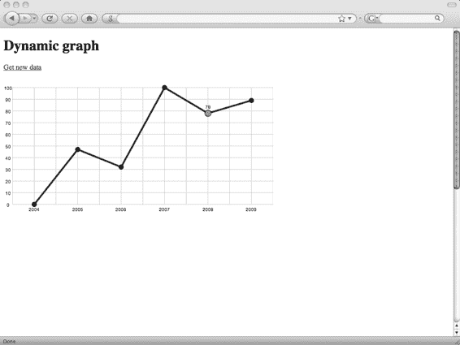

# 第 11 章 ■ 在浏览器中绘图

作为 Web 应用程序的一部分，你可能希望动态渲染图表、图形或实时数据的其他可视化表示。当然，你可以将数据发送到服务器并由其生成所需的图像，但当浏览器本身就能完成绘图工作时，何必费此周折？现有方法允许你完全使用前端代码在当前的浏览器中渲染图形元素。

本章介绍当今浏览器中可用的两种独立技术，它们让你能够在浏览器中绘制矢量图形：可缩放矢量图形 (`SVG`) 和矢量标记语言 (`VML`)。我们还将研究一个第三方跨浏览器组件，它允许你在自己的 `RIA` 中，酌情使用其中任一技术来绘制图表、图形和其他图形。最后，你将学习用于在页面上渲染图形的 `HTML 5` 新标签。

### 创建可缩放矢量图形

如前一章所述，`GIF`、`JPG` 和 `PNG` 格式的标准图像图形文件以二进制数据存储。它们被设计为以不大于原始版本的尺寸显示。这类图像在放大或调整大小时会损失图像质量。

相比之下，矢量图形是可以缩放和调整大小而不会损失图像质量的图像。这是通过描述图像的组成部分来实现的：线条、形状、颜色、渐变以及其他元素，它们共同构成最终的图形。字体文件是矢量图形的一个例子。字体可以调整到任意大小而不会损失质量。每次调整字体大小时，其外观都会根据构成每个字符的一系列线条和形状重新计算。

可缩放矢量图形 (`SVG`) 是 `W3C` 的推荐标准 (`http://www.w3.org/Graphics/SVG/`)。

`SVG` 是一种特定的 `XML` 格式，可用于描述在浏览器中显示的二维矢量图形。`SVG` 对于图形内容，就像 `XHTML` 对于文本内容一样。

事实上，与 `XHTML` 类似，`SVG` 与其他浏览器技术（如 `CSS` 和 `JavaScript` 的 `DOM`）协同工作，使开发者能够创建动态且交互式的图形。

`SVG` 的诞生是为了让浏览器和开发者能够原生支持创建那些以前只能用 `Adobe` 的 `Flash Player` 插件才能实现的图形内容。目前，`Firefox 1.5` 及以上版本、`Safari 3` 及以上版本、`Opera 9.5` 及以上版本以及 `Google Chrome` 浏览器都内置了 `SVG` 支持。`SVG` 在 `Web` 上的使用相当有限，主要是因为在 `IE` 浏览器中缺乏支持，以及 `Flash Player` 等插件的普及。

`SVG` 数据可以直接内联放置在 `XHTML` 页面中，或者作为具有 `.svg` 扩展名的图像文件，通过页面上的 `` 标签进行引用，就像其他图像一样。`<svg>` 标签包围着描述图像的内容，并像一个画布一样来容纳绘图。

在这个画布内部，你可以利用大量的标签来定义你想要显示的图像。除了绘制简单的形状和线条，你还可以加载外部图像文件、渲染文本，以及为 `SVG` 画布内的任何元素应用渐变。

#### 创建 SVG 图像文件

首先，让我们看一个简单的独立 `SVG` 图像文件。清单 11-1 展示了一个 `SVG` 图像文件的 `XML` 风格内容，它创建了一个渐变、一些形状、一条线以及一些文本。将此代码保存到名为 `my-vector.svg` 的文件中，并在支持 `SVG` 渲染的浏览器中打开它。

你应该会看到如图 11-1 所示的页面。

**清单 11-1.** 一个简单的 SVG 图像文件

```xml
<?xml version="1.0" standalone="no"?>
<!DOCTYPE svg PUBLIC "-//W3C//DTD SVG 1.1//EN" ➥
"http://www.w3.org/Graphics/SVG/1.1/DTD/svg11.dtd">
<!-- 我们指定了此处所示的自定义 SVG DOCTYPE，以增加标签支持 -->
<!-- 首先，我们使用 <svg> 标签定义一个用于绘图的画布 -->
<svg width="1024" height="768" version="1.1" ➥
xmlns="http://www.w3.org/2000/svg">
    <!-- 定义一个渐变。此渐变仅被定义，暂时不会显示。x1 和 y1
    表示渐变的起始位置，x2 和 y2 表示渐变的结束位置。在
    <linearGradient> 标签内的 <stop> 标签指明了使用的颜色
    以及它们在渐变路径上发生变化的点 -->
    <linearGradient id="gradient" gradientUnits="userSpaceOnUse" ➥
    x1="0" y1="0" x2="200" y2="0">
        <stop offset="0" stop-color="#000000" />
        <stop offset="1" stop-color="#cccccc" />
    </linearGradient>
    <!-- 绘制一个正方形，起始位置由 x 和 y 表示。用之前通过 id 引用的
    渐变来填充其内容 -->
    <rect x="20" y="20" width="200" height="200" fill="url(#gradient)" />
    <!-- 在位置 x, y 处绘制一个带圆角的矩形，圆角半径由 rx 和 ry 属性
    表示。注意使用了 style 属性，该属性对元素应用样式，就像在 XHTML 中一样 -->
    <rect x="220" y="220" rx="20" ry="20" width="250" height="100" ➥
    style="fill:#330000;"/>
    <!-- 绘制一个圆，半径由 r 属性表示。我们使用 stroke 和 stroke-width
    属性定义圆形周围的边框 -->
    <circle cx="350" cy="120" r="50" stroke="#336699" ➥
    stroke-width="25" fill="#003300" />
    <!-- 从位置 x1, y1 到位置 x2, y2 绘制一条线。直到你为其应用一个
    stroke-width 边框之后，你才能真正看到该线条，这里我们通过在
    <line> 标签上使用 style 属性来实现 -->
    <line x1="20" y1="20" x2="320" y2="320" ➥
    style="stroke:#cccccc;stroke-width:3"/>
    <!-- 在画布上以固定大小和颜色书写文本 -->
    <g font-size="50" font-weight="bold" fill="#333333">
        <text x="200" y="460">文本示例</text>
    </g>
</svg>
```

# 图 11-1. 一个简单的 SVG 图像文件

## 在 HTML 中指定 SVG

使用 SVG 创建独立的图像文件是可行的，但这种方法无法提供动态渲染功能。通过直接在 HTML 页面中定义图像，你可以利用 DOM 与画布中的各个元素进行动态交互。

`清单 11-2` 展示了如何使用 XHTML 描述图 11-1 的图像，无需任何外部图像文件引用。

你必须以 `.xhtml` 扩展名保存`清单 11-2` 中所示的文件，这样才能强制浏览器同时使用其 XML 和 HTML 解析器来渲染页面，而不仅仅是使用其 HTML 解析器。XML 解析器包含渲染 SVG 所需的代码，并且浏览器只有在绝对确定页面内容是 XML 时，才会使用其 XML 解析器。这可以通过指定文件扩展名为 `.xhtml`，或确保 Web 服务器发送 MIME 类型为 `application/xhtml+xml` 来描述文件内容来实现。实际上，应该使用这种 MIME 类型来发送所有 XHTML 文件内容，而不是像普通 HTML 文档那样使用常见的 `text/html` MIME 类型。不使用它的唯一原因是 IE 不识别此 MIME 类型，并拒绝渲染页面。

**清单 11-2.** *在 XHTML 页面中描述的简单 SVG 图像*

```
<!DOCTYPE html PUBLIC "-//W3C//DTD XHTML 1.0 Strict//EN"
["http://www.w3.org/TR/xhtml1/DTD/xhtml1-strict.dtd">](http://www.w3.org/TR/xhtml1/DTD/xhtml1-strict.dtd)
[<html lang="en" xml:lang="en">](http://www.w3.org/1999/xhtml)
<head>
<title>SVG Demo</title>
</head>
<body>
<h1>SVG Demo</h1>
<svg width="1024" height="768" version="1.1"
[>](http://www.w3.org/2000/svg)
<linearGradient id="gradient" gradientUnits="userSpaceOnUse"
x1="0" y1="0" x2="200" y2="0">
<stop offset="0" stop-color="#000000" />
<stop offset="1" stop-color="#cccccc" />
</linearGradient>
<rect x="20" y="20" width="200" height="200" fill="url(#gradient)" />
<rect x="220" y="220" rx="20" ry="20" width="250" height="100"
style="fill**:**#330000**;** "/>
<circle cx="350" cy="120" r="50" stroke="#336699"
stroke-width="25" fill="#003300" />
<line x1="20" y1="20" x2="320" y2="320"
style="stroke**:**#cccccc**;** stroke-width**:**3"/>
<g font-size="50" font-weight="bold" fill="#333333">
<text x="200" y="460">Text Example</text>
</g>
</svg>
</body>
</html>
```

这种方法并不是特别跨浏览器友好。IE 不识别 `.xhtml` 文件扩展名或 `application/xhtml+xml` MIME 类型。尽管 IE 不支持 SVG，你仍然希望你的 XHTML 页面能在该浏览器中加载。因此需要另一种解决方案。

## 通过 JavaScript 指定 SVG

值得庆幸的是，有一种解决方案允许你编写标准的 HTML 页面，同时仍然在你的 Web 应用程序中创建 SVG 图像，那就是使用 JavaScript 动态地将 SVG 元素添加到页面中，确保使用浏览器的 XML 解析器来创建这些元素。`清单 11-3` 展示了使用 JavaScript 动态创建 SVG 元素来呈现图 11-1 图像的初步实现。

**清单 11-3.** *通过 JavaScript 描述的简单 SVG 图像*

```
<!DOCTYPE html PUBLIC "-//W3C//DTD XHTML 1.0 Strict//EN"
["http://www.w3.org/TR/xhtml1/DTD/xhtml1-strict.dtd">](http://www.w3.org/TR/xhtml1/DTD/xhtml1-strict.dtd)
[<html lang="en" xml:lang="en">](http://www.w3.org/1999/xhtml)
<head>
<title>SVG Demo</title>
</head>
<body>
<h1>SVG Demo</h1>
<!-- 在页面上包含脚本块用于演示 -
这通常存在于一个单独的 JavaScript 文件中 -->
<script type="text/javascript">
// document.createElementNS 使用定义的命名空间创建一个新元素
// - 这里使用 URL 引用的 SVG 命名空间。
// 根据第二个参数，创建的标签是 <svg>。由于命名空间是 XHTML 和 XML 的一部分，
// 该元素将使用浏览器的 XML 解析器进行渲染——这正是我们在页面上表示 SVG 所需要的
var svg = document.createElementNS(
['http://www.w3.org/2000/svg', 'svg');](http://www.w3.org/2000/svg)
svg.setAttribute('width', '1024');
svg.setAttribute('height', '768');
// 动态创建 <circle> 元素并将其添加到之前创建的 <svg> 画布中
var circle = document.createElementNS(
['http://www.w3.org/2000/svg', 'circle');](http://www.w3.org/2000/svg)
circle.setAttribute('cx', '350');
circle.setAttribute('cy', '120');
circle.setAttribute('r', '50');
circle.setAttribute('stroke', '#336699');
circle.setAttribute('stroke-width', '25');
circle.setAttribute('fill', '#003300');
svg.appendChild(circle);
// TODO: 在此处以类似方式表示所有其他矢量元素
// 将 <svg> 标签添加到页面中，从而渲染图像
document.body.appendChild(svg);
</script>
</body>
</html>
```

## 使用向量标记语言绘图

早在 1998 年，微软向 W3C 提交了自己的基于 XML 的矢量图形格式提案，称为向量标记语言（VML），以供考虑作为推荐标准。由于 Adobe、Sun 和其他公司也在提交他们自己的类似格式，W3C 决定开发一种统一的格式供所有人使用，这最终在 2002 年成为了 SVG 推荐标准，正如前一节所讨论的那样。不幸的是，对于 Web 开发者来说，微软的开发者选择不采用 SVG——并且在 IE 8 中仍然没有采用——而是继续开发和完善他们的 VML 格式。

从版本 5 开始，所有 IE 版本都支持 VML，但其他任何浏览器都不支持。一个跨浏览器的矢量图形库需要同时支持 SVG 和 VML，才能成为开发者的可行解决方案。

VML 与 SVG 有着显著的相似之处，并且支持几乎相同的功能。然而，VML 更简洁的格式使其文件大小比使用 SVG 表示相同图像的等效文件更小。有趣的是，VML 元素使用 CSS 进行定位，并且不需要一个单一的元素作为画布来包围它们。标签可以直接添加到页面的任何位置。`清单 11-4` 展示了在图 11-1 中的图像如何在 HTML 页面中使用 VML 表示。

**清单 11-4.** *在 HTML 页面中描述的简单 VML 图像*

```
<!DOCTYPE html PUBLIC "-//W3C//DTD XHTML 1.0 Strict//EN"
["http://www.w3.org/TR/xhtml1/DTD/xhtml1-strict.dtd">](http://www.w3.org/TR/xhtml1/DTD/xhtml1-strict.dtd)
[<html lang="en" xml:lang="en">](http://www.w3.org/1999/xhtml)
<head>
<title>SVG Demo</title>
<!-- 要在页面中使用 VML，请使用 <style> 元素来启用其行为 -->
<style>v\: * {behavior:url(#default#VML); display: inline-block;}</style>
<!-- 接下来，声明 VML 命名空间以匹配该行为 -->
<xml:namespace ns="urn:schemas-microsoft-com:vml" prefix="v" />
</head>
<body>
<h1>SVG Demo</h1>
<v:rect style='position: absolute; top: 20px; left: 20px; width: 200px;
height: 200px' fillcolor="#000000">
<v:fill method="linear sigma" color2="#cccccc" angle="90"
type="gradient" />
</v:rect>
<v:oval style="top: 120px; left: 350px; width: 50px; height: 50px;"
fillcolor="#003300" strokecolor="#336699" strokeweight="25px" />
<v:line from="20px,20px" to="320px,320px" strokecolor="#cccccc"
strokewidth="3px" />
<!-- VML 文本不能直接写入页面；它必须被另一个形状包围。这里，我们创建一个矩形来容纳文本 -->
<v:rect style="top=460px; left=200px; width=500; height=100">
<v:textbox ><span style="font-size: 50px; font-weight: bold;
color: #333333;">Text Example</span></v:textbox>
</v:rect>
</body>
</html>
```

### 使用可重用绘图库构建动态图形

到目前为止，你已经了解了现代浏览器如何支持基于 XML 的矢量图形，但这

# 第 11 章 ■ 在浏览器中绘图

## IE 浏览器使用的语法与其他浏览器不同。为了在网页应用中使用矢量图形，你需要一种简单的方法来指定能被两种不同模型支持的矢量图形。我们通常需要使用 JavaScript 库来消除跨浏览器的不一致性，如第 2 章所述。在这种情况下，我们可以使用由开发者 `Dmitry Baranovskiy` 构建的可重用 JavaScript 库 `Raphaël`。

`Raphaël` 通过一个简单统一的 JavaScript API，简化了以跨浏览器方式创建自定义矢量图形的过程。该库会根据浏览器选择合适的矢量图形绘制技术：SVG 或 VML。你可以从项目主页 [`raphaeljs.com/`](http://raphaeljs.com/) 下载该库，该网站还提供了许多组件的运行示例。该库组件压缩后的代码体积为 53KB。

正如你所见，使用 SVG 和 VML 创建的每个图形对象也都是 DOM 对象，这意味着你可以像处理任何其他页面元素一样，为它们添加事件处理器或动态修改现有的图形元素。

举个例子，假设你想用折线图向网页应用的最终用户展示一组数据。这些数据是不断变化的——也许你正使用 Ajax 每 30 秒从服务器获取一次新数据。你希望在数据到达时，图表能反映出这些变化。图 11-2 展示了用户可能看到的界面。点击“获取新数据”链接，模拟从服务器接收新数据并更新图表的过程。将鼠标悬停在图表上的每个点时，该点会高亮显示并显示其精确数值。



**图 11-2.** *动态更新图表*

`清单 11-5` 展示了如何使用 `Raphaël` JavaScript 库在 HTML 页面中动态构建图 11-2 所示的图表，以确保跨浏览器兼容性。

首先，创建一个空白画布，然后绘制网格并添加正确的 x 轴和 y 轴标签。接着，标记数据点并在点之间绘制线条。当点击“获取新数据”链接时，会随机生成新数据，现有线条和点将从画布上移除，并在其位置添加新的数据点和线条。

**清单 11-5.** *使用 Raphaël JavaScript 库绘制动态图表*

```html
<!DOCTYPE html PUBLIC "-//W3C//DTD XHTML 1.0 Strict//EN"
    "http://www.w3.org/TR/xhtml1/DTD/xhtml1-strict.dtd">
<html lang="en" xml:lang="en" xmlns="http://www.w3.org/1999/xhtml">
<head>
  <title>动态图表</title>
  <meta http-equiv="content-type" content="text/html;charset=utf-8" />
</head>
<body>
  <h1>动态图表</h1>

  <!-- 稍后我们将通过 JavaScript 在该元素中填充一个按钮 -->
  <p id="button"></p>

  <!-- 稍后我们将使用 JavaScript 在该元素中填充图表 -->
  <div id="canvas"></div>

  <!-- 引用 $ JavaScript 库 -->
  <script type="text/javascript" src="$.js"></script>

  <!-- 引用 Raphaël JavaScript 库 -->
  <script type="text/javascript" src="raphael.js"></script>

  <!-- 为简单起见，我将生成图表的 JavaScript 代码包含在页面内。
       在你的网页应用中，你应该从外部文件引用它 -->
  <script type="text/javascript">
    // 声明一个新的构造函数，它将绘制并代表我们的图表
    var Graph = function(input) {
        // 期望的输入包括：x 轴数据标签（数组形式）、数据值本身（数组形式）、
        // 画布的宽度和高度，以及用于填充画布的元素本身
        this.labels = input.labels || [];
        this.data = input.data || [];
        this.width = input.width || 600;
        this.height = input.height || 300;
        this.element = input.element || $.Elements.create("div");

        // 使用 Raphaël 创建一个新的跨浏览器画布。这个 paper
        // `property` 表示一个对象，我们后续可以对其执行方法来修改和影响新画布
        this.paper = Raphael(this.element, this.width, this.height);

        // 确定数据数组中的最大值，并四舍五入到最近的 100。该值将作为
        // 图表 y 轴上的最大值
        this.maximumDataValue = Math.ceil(Math.max.apply(Math, this.data) / 100) * 100;

        // `buildGrid` 方法在画布上绘制网格，包括
        // 坐标轴标签，并返回实际网格位置的 `x` 和 `y` 坐标
        // （假设为标签预留了空间），以及网格本身的宽度和高度（不含标签）
        this.buildGrid = function() {
          // 定义分配给坐标轴标签的高度和宽度
          var xLabelHeight = 20, yLabelWidth = 20;

          // 确定网格本身的 x 和 y 坐标，以及
          // 网格的宽度和高度（不含坐标轴标签）
          var x = yLabelWidth, y = 20;
          var width = this.width - yLabelWidth;
          var height = this.height - xLabelHeight - y;

          // 计算网格每个方向上要绘制多少条线
          var horizLines = this.data.length * 2;
          var vertLines = (this.maximumDataValue / 10);

          // 使用 Raphaël 以浅灰色（十六进制颜色 #ccc）绘制网格
          this.paper.drawGrid(x, y, width, height, horizLines, vertLines, "#ccc");

          // `drawXLabels` 函数创建并定位图表 x 轴上的标签
          var drawXLabels = function() {
            for (var index = 0, length = this.data.length; index < length; index++) {
              var x = yLabelWidth + ((index / this.data.length) * width) + (width/(2 * this.data.length));
              var y = this.height - (xLabelHeight/2);
              // 使用 Raphaël 将标签文本绘制到画布上
              this.paper.text(x, y, this.labels[index]).attr({
                "font": '10px "Arial"',
                stroke: "none",
                fill: "#000"
              });
            }
          }.call(this);

          // `drawYLabels` 函数基于我们之前计算并四舍五入到最近 100 的
          // 最大数据值，创建并定位 y 轴上的标签。这使我们能够
          // 使用整数作为坐标轴标签
          var drawYLabels = function() {
            for (var index = 0, length = vertLines; index <= length; index++) {
              var labelText = (index * this.maximumDataValue) / vertLines;
              var labelPosition = height - (vertLines * index * height / this.maximumDataValue) + y;
              // 使用 Raphaël 将标签文本绘制到画布上
              this.paper.text(x - 10, labelPosition, labelText).attr({
                "font": '10px "Arial"',
                stroke: "none",
                fill: "#000",
                "text-anchor": "end"
              });
            }
          }.call(this);
        };
    };
  </script>
</body>
</html>
```

```markdown
`this.paper.text(yLabelWidth / 2, labelPosition, labelText).attr({`
`"font": '10px "Arial"',`
`stroke: "none",`
`fill: "#000"`
`});`
`}`
`}.call(this);`

// 现在返回画布中网格起始点的 x 和 y 坐标，
// 以及网格的宽度和高度
`return {`
`x: x,`
`y: y,`
`width: width,`
`height: height`
`}`
`}`

// 执行 `buildGrid` 方法，将返回的值存储到
// `grid` 属性中
`this.grid = this.buildGrid();`

// `drawPath` 方法绘制数据点并在
// 现有网格上绘制连线
`this.drawPath = function() {`
// 要使用 Raphaël 绘制一条线，需要创建一个路径，并为其
// 设置一个 `stroke-width` 值，该值等于该线的宽度
`var pathAttributes = {`
`stroke: "#333",`
`"stroke-width": 4,`
`"stroke-linejoin": "round"`
`};`
`this.path = this.paper.path(pathAttributes);`

// 创建数组，用于存储对将要绘制到网格上的数据点、文本和
// 形状的引用
`this.points = [];`
`this.text = [];`
`this.rects = [];`

// 遍历数据数组中的每一项
`for (var index = 0, length = this.data.length; index < length; index++) {`
// 计算网格上数据点的 x 和 y 坐标位置，
// 该点将代表当前数据项
`var x = this.grid.x + (index * (this.grid.width / this.data.length)) + (this.grid.width / (2 * this.data.length));`
`var y = this.grid.y + this.grid.height - (this.data[index] * this.grid.height / this.maximumDataValue);`

// 第一个数据项将由一个点表示，并且
// 不会绘制连线到其位置。所有其他
// 数据项将通过线条连接到它们
`if (index == 0) {`
`this.path.moveTo(x, y, 10);`
`} else {`
`this.path.lineTo(x, y, 10);`
`}`

// `drawPoints` 函数负责在网格上渲染数据点，
// 并在每个数据点上方显示一个文本标签，该标签默认隐藏，
// 只有当用户将鼠标悬停在一个覆盖了该点和其周围大范围区域的
// 不可见矩形上时，文本标签才会显示。
// 这为鼠标交互提供了更大的操作区域，
// 无需用户精确定位网格上较小的数据点即可查看与之关联的文本标签
`var drawPoints = function() {`
// 绘制一个从网格顶部到底部的不可见矩形，该矩形覆盖代表数据值的数据点。
// 透明度为 0 使矩形不可见，但仍存在于网格上
`var rect = this.paper.rect(this.grid.x + (this.grid.width * index / this.data.length), this.grid.y, (this.grid.width * (index + 1) / this.data.length), this.grid.height).attr({ stroke: "none", fill: "#fff", opacity: 0 });`

// 将代表该矩形的对象添加到一个数组中
`this.rects.push(rect);`

// 在网格上绘制一个代表数据值的数据点，并将其添加到所有数据点的数组中
`var point = this.paper.circle(x, y, 5).attr({`
`'fill': "#333"`
`});`
`this.points.push(point);`

// 在数据点上方绘制一个文本标签，并将其添加到标签数组中
`var text = this.paper.text(x, y - 15, this.data[index]).attr({`
`"font": '10px "Arial"',`
`stroke: "none",`
`fill: "#000"`
`});`
`this.text.push(text);`

// 由于代表画布中每个形状或对象的 XML 元素可以使用标准 DOM 进行操作，
// 因此我们可以像使用 HTML 元素一样，使用诸如 `insertAfter` 之类的 DOM 方法
`text.insertAfter(dot);`

// 默认情况下隐藏文本标签
`text.hide();`

// 由于画布上创建的元素的行为与标准 HTML 元素类似，
// 我们可以为它们添加事件。
// 此处，我们使用 Raphaël 在用户将鼠标悬停在数据点周围的不可见矩形元素上时，
// 动态改变先前创建的数据点的颜色和大小，并显示文本标签
`rect.mouseover(function() {`
`point.attr({`
`"fill": "#999",`
`"r": 7`
`});`
`text.show();`
`});`

// 当用户将鼠标移出数据点周围的矩形时，
// 文本标签再次隐藏，数据点恢复为其原始大小和颜色
`rect.mouseout(function() {`
`point.attr({`
`"fill": "#333",`
`"r": 5`
`});`
`text.hide();`
`});`

`}.call(this)`
`}`

// 现在执行刚刚描述的 `drawPath` 方法
`this.drawPath();`

// `replaceData` 方法用于移除网格上的矢量图形，但保持网格本身不变，
// 以便绘制新的数据
`this.replaceData = function(data) {`
// 新数据作为方法的输入参数传入，并用新数据替换现有数据
`this.data = data;`

// 从网格上移除线条
`this.path.remove();`

// 逐个从网格上移除数据点
`for (var index = 0, length = this.points.length; index < length; index++) {`
`this.points[index].remove();`
`}`

// 从网格上移除文本标签
`for (var index = 0, length = this.text.length; index < length; index++) {`
`this.text[index].remove();`
`}`

// 从网格上移除不可见的矩形形状
`for (var index = 0, length = this.rects.length; index < length; index++) {`
`this.rects[index].remove();`
`}`

// 执行 `drawPath` 方法，该方法将在网格上绘制线条、数据点和文本标签
// 本次将使用新数据
`this.drawPath();`
`}`

// 实例化 `Graph` 构造函数，传入数据、标签以及用于放置新图表的 DOM 元素
`var myGraph = new Graph({`
`labels: [2004, 2005, 2006, 2007, 2008, 2009],`
`data: [0, 47, 32, 100, 78, 89],`
`element: document.getElementById("canvas")`
`});`

// 在页面上放置一个'获取新数据'按钮，点击该按钮将随机生成一组新的数据值。
// 此操作旨在模拟......
```

# 在真实的 RIA 中，这可以是一个 Ajax 调用，用于从服务器获取新的未知数据

```javascript
var getNewData = $.Elements.create("a");
getNewData.innerHTML = "获取新数据";
document.getElementById("button").appendChild(getNewData);

$.Events.add(getNewData, "click", function(e) {
    e.preventDefault();
    // 随机生成一组新数据，每个值在
    // 0 到 100 的范围内
    var data = [];
    for (var index = 0, length = 5; index < length; index++) {
        data.push(Math.round(Math.random() * 100));
    }
    // 执行 Graph 实例的 replaceData 方法，将
    // 新数据集渲染到网格上
    myGraph.replaceData(data);
});
```

你应该熟悉这个强大的 JavaScript 库所支持的全部功能。当你需要在你的富互联网应用程序（RIA）中动态显示矢量图形时，都可以使用它。

## 使用 HTML 5 的 `<canvas>` 标签

Mac OS X Dashboard 功能使用 HTML、CSS 和 JavaScript 来生成小工具，例如时钟、日历、天气和股票报告。在构建此功能时，Apple 开发人员引入了一个新的 HTML 标签，以支持在这些小工具中动态创建图形组件。该标签 `<canvas>` 被 WHATWG 推荐，并且 Safari 2、Firefox 1.5、Google Chrome 和 Opera 9.5 都增加了对该标签的支持。IE 在直到第 8 版的任何版本中都不支持此标签（但人们一直期望开发人员会在下一版本中包含它）。如本节末尾所述，已经有一些工作利用 Flash Player 插件在 IE 中提供了 `<canvas>` 标签的实现。

与 SVG 不同，在页面的 `<canvas>` 标签内不会创建任何标签；相反，图形完全通过使用原生的 JavaScript API 生成。因此，标签内的图形组件无法使用 CSS 设置样式，也无法通过 DOM 进行操作或绑定事件。如果你希望将 DOM 事件连接到图形以提供用户交互，请改用 SVG。

### 在浏览器中绘图

该标签内只允许使用两种基本形状：矩形和线条，这两种形状可以通过弯曲和操作来创建所有其他所需的形状。图形本身不是基于矢量的，因此如果你需要对标签内的图形组件进行任何大小调整，你必须根据添加到标签中的图形，自己编写代码来执行此操作。

`<canvas>` 标签的一个优点是它很好地支持嵌入和操作图像文件中的图片，这是使用 SVG 难以实现的。`<canvas>` 标签的性能优于 SVG，尤其是在处理大型复杂图形时。这很可能是因为 SVG 必须将对每个图形组件的引用作为 DOM 元素来维护；而 `<canvas>` 没有这个要求。

清单 11-6 展示了如何在 HTML 页面中使用 `<canvas>` 标签和 JavaScript 绘制一个带有渐变填充背景的矩形。

清单 11-6. 一个简单的 Canvas 标签图像

```html
<!DOCTYPE html PUBLIC "-//W3C//DTD XHTML 1.0 Strict//EN"
    "http://www.w3.org/TR/xhtml1/DTD/xhtml1-strict.dtd">
<html xml:lang="en" lang="en" xmlns="http://www.w3.org/1999/xhtml">
<head>
    <title>Canvas 演示</title>
</head>
<body>
    <h1>Canvas 演示</h1>
    <!-- <canvas> 标签采用可选的 width 和 height 属性。如果省略这些属性，画布通常是 300 像素宽，150 像素高 -->
    <canvas id="canvas" width="300" height="300"></canvas>
    <!-- 以下脚本为简单起见包含在此处。理想情况下，你应该
    从单独的文件中引用代码 -->
    <script type="text/javascript">
        // 获取 <canvas> 标签的 DOM 引用
        var canvas = document.getElementById("canvas");
        // <canvas> 标签内实际的绘图表面称为
        // *渲染上下文*。绘图方法与上下文相关联，
        // 因此我们必须首先获取对此上下文的引用。目前，
        // <canvas> 标签仅支持 2D 形状渲染上下文。在
        // 未来，预计将能够进行 3D 形状渲染
        var context = canvas.getContext("2d");
        // 定义一个渐变，从 #000000 到 #cccccc 在 200 像素的
        // 水平空间上渐变
        var gradient = context.createLinearGradient(0, 0, 200, 0);
        gradient.addColorStop(0, "#000000");
        gradient.addColorStop(1, "#cccccc");
        // 要在矩形中使用渐变，我们将渐变色定义为当前
        // 填充样式，然后执行 fillRect 方法
        context.fillStyle = gradient;
        // 从位置 (20, 20) 开始绘制渐变填充矩形，从该点开始
        // 延伸 200 像素宽和高
        context.fillRect(20, 20, 200, 200);
    </script>
</body>
</html>
```

Mozilla 在 `https://developer.mozilla.org/en/Canvas_tutorial/` 上提供了一个关于 `<canvas>` 标签及其相关 API 的有用教程。你还可以在 Canvas Demos 网站（`http://www.canvasdemos.com/`）上看到其他开发人员使用 `<canvas>` 标签的演示。

为了解决 IE 不支持 `<canvas>` 标签的问题，开发人员 Grant Jones 尝试构建一个可重用的 Flash 组件，以提供对此标签的实现。他的代码通过在 IE 中的 JavaScript 中复制 `<canvas>` 标签 API，并将代码发送到此浏览器中的 Flash 组件来代替。他的任务是确定这种方法是否能够在不使用其他库（如 Raphaël）中基于 VML 的渲染的情况下，在 IE 中构建响应更快的图形绘制引擎。他在 `http://www.azarask.in/blog/post/flash-canvas/` 的一篇博客文章中相当详细地描述了他的经验。他的结论表明，这种方法并不能比任何原生实现提供更快合适的图形渲染能力。JavaScript 到 Flash 的通信相当慢，而且跨通信越多，整体结果就越慢。在一个特定的测试中，他注意到使用 Flash 技术比在其他浏览器中使用原生 `<canvas>` 渲染慢 40 倍。目前，建议你使用 Raphaël，而不是依赖不能带来性能提升的第三方插件。

### 总结

在本章中，你了解了在现代浏览器中实现矢量图形绘制的不同技术。你了解了一个第三方 JavaScript 库，它允许你在自己的 Web 应用程序中轻松创建自定义的动态矢量图形。你还了解了 HTML 5 中一个用于在页面上动态渲染图形的新标签。在本书的最后一章中，我将回到可访问性的主题，揭示如何使用当前技术和新兴的浏览器标准使你的 RIA 尽可能易于访问。
