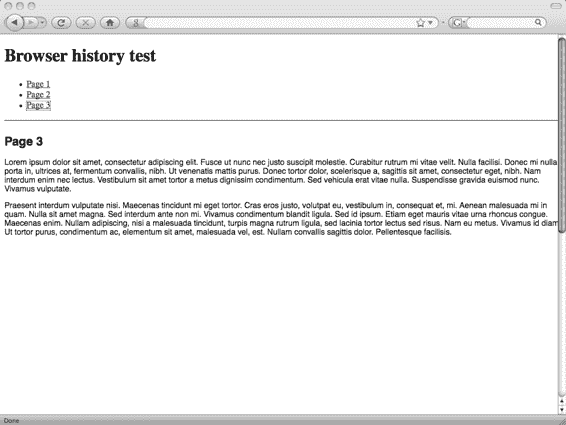
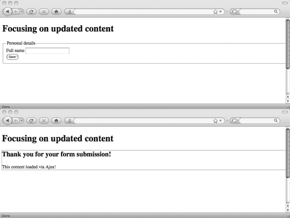
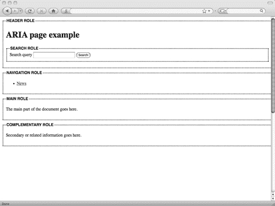

# 第 12 章：富互联网应用程序中的可访问性

正如我从本书一开始就强调的那样，可访问性是 Web 开发的基础之一。作为 Web 开发人员，我们需要确保我们的 Web 应用程序能够覆盖并让尽可能广泛的受众使用。我们的最终用户应该能够使用他们可用的任何浏览技术来访问我们提供的信息和界面，以满足他们自己的需求和偏好。本书的最后一章重点介绍如何为你的 RIA 设计最大程度的可访问性。

## 我们在满足谁的需求？

网页和应用程序通常易于导航和交互，前提是你是一个身体健全的用户，在屏幕尺寸和分辨率合适的电脑上使用鼠标。大多数网站的设计都考虑到了这类用户。然而，其他用户群体并不符合这一描述，但他们却依赖我们为他们提供可用且可交互的体验。

### 使用辅助技术的用户

`辅助技术`是一个通用术语，指用于帮助有身体损伤、学习困难或残障的人士完成他们原本无法或难以完成任务的软件或硬件。许多软件开发者已经构建了相关工具，让这类用户能够访问信息并与网站进行互动。例如 [JAWS（http://www.freedomscientific.com/）](http://www.freedomscientific.com/)，这是一种屏幕阅读器，能将页面内容朗读出来；以及 [ZoomText（http://www.aisquared.com/）](http://www.aisquared.com/)，这是一种屏幕放大器，帮助用户更轻松地阅读页面内容。

我们需要确保我们的网络应用程序对于使用辅助技术的用户也是可用的。

## 移动设备上的用户

仅在过去几年中，移动设备上的网页浏览呈现出爆发式增长。最初只是以默认样式渲染的纯 HTML 标签，后来迅速适应了基本的 CSS 和 JavaScript。如今，我们已经达到了这样的阶段：移动设备上运行的浏览器，其渲染引擎和 JavaScript 引擎与桌面版的 Opera、Firefox、Safari 和 IE 是相同的。

移动设备的屏幕尺寸通常非常受限。在撰写本文时，一些最大的移动设备的最大屏幕分辨率为宽 480 像素、高 320 像素。相比之下，近年来台式电脑上最低的屏幕分辨率为宽 1024 像素、高 768 像素。我们需要确保我们的网络应用程序对于使用小屏幕浏览设备的用户也是可用的。图 12-1 比较了 Google 和 Yahoo! 在苹果 iPhone 上的搜索结果页面。请注意，Yahoo! 的结果在默认屏幕尺寸下即可阅读，而 Google 的结果页面则需要用户放大页面才能阅读其文本。

**图 12-1.** *小屏幕上 Google 和 Yahoo! 的搜索结果*

## 不使用鼠标的用户

用鼠标指向并点击已成为计算机体验中根深蒂固的一部分，许多用户能够以惊人的精确度和速度在屏幕上移动指针。然而，有些人仍然出于必要或选择而不使用鼠标。

网页浏览中第二常见的输入方式是键盘。大多数浏览器允许用户使用 Tab 键在页面中导航，在超链接和表单元素（即可交互的元素类型）之间跳转。这样使用键盘导航消除了使用鼠标时所需的精确度。

> **注意** 许多开发者在浏览时结合鼠标和键盘与页面元素交互。他们发现有时使用键盘来定位元素更快。

近年来，一种日益流行的浏览器和计算机交互方式是触摸屏——用户通过用手指实际触摸屏幕来选择并与页面元素交互。在许多方面，这是终极的指向设备。未来，触摸屏可能会提供更高级的计算机交互方式，甚至可能完全取代鼠标。

我们需要确保我们的网络应用程序对于使用除鼠标以外的输入设备与页面交互的用户也是可用的。

## 面向所有人的可访问性

显然，随着网络浏览器在以往未曾见过的情况下支持 JavaScript，我们作为网络开发者的角色变得更加困难。我们必须确保使用所有浏览器、辅助技术、设备和输入方法的用户都能直观且毫无困难地使用我们的网络应用程序。

当然，你使用语义化的 HTML 构建网络应用程序，确保那些没有 JavaScript 的用户也能毫无困难地使用你的 RIA。但现在既然 JavaScript 在大多数浏览器和大多数设备上都得到支持，是时候将可访问性提升到下一个层次了。

## 使用后退和前进按钮正确导航

作为网络应用程序开发者，我们必须满足用户的需求和期望。网络应用程序中最基本且最明显的问题之一是，当页面内容通过 Ajax 而非完整的页面刷新来更新时，浏览器工具栏上的“后退”和“前进”按钮（通常用于在浏览器的页面历史记录中前后移动）会完全失效。用户可能会在网络应用程序（例如网络邮件客户端）中花费数小时——导航到不同的页面和应用程序状态，阅读、撰写和删除邮件——但当他们点击浏览器工具栏上的“后退”按钮时，他们会被带回到加载该网络邮件应用程序之前浏览的页面。用户期望浏览器以某种方式运行，当它没有时，他们就会感到沮丧。我们必须修复网络应用程序中的这个问题，以避免让最终用户感到失望。

当加载新的 URL 时，页面会被添加到浏览器历史记录中，这通常发生在用户选择超链接或提交表单时。开发者也可以通过 JavaScript 动态修改代表 URL 的 `location` 对象。对 URL 的大多数更改都会导致页面刷新，但对*哈希值*（URL 中 `#` 字符之后的任何部分）的更改除外。

URL 哈希值用于导航到同一页面内的其他内容，这意味着不需要页面刷新，但新的 URL 仍然会被添加到浏览器的历史记录中。你可以通过你的网络应用程序利用这一现象，在相关节点（例如通过 Ajax 加载新内容时）更新 URL 的哈希值。当哈希值发生变化时（这将在用户使用浏览器工具栏上的“后退”和“前进”按钮导航浏览器历史记录时发生），你可以在代码中执行必要的操作，将应用程序恢复到该哈希值被添加时的状态。通过这种技术，你能够为用户提供他们所期望的浏览器历史记录导航行为。

`清单 12-1` 展示了如何编写一个例程来通过更新 URL 的哈希部分来添加浏览器历史记录项，以及另一个例程来在用户通过浏览器历史记录前后导航时，从哈希值中读回之前存储的值。将此代码添加到你的 `$` JavaScript 库中，位于文件最后一行（即实例化该库的那一行）之前。

**清单 12-1.** *通过 JavaScript 添加和检索浏览器历史记录项*

```javascript
// 创建一个 History 命名空间，用于在我们的 RIA 中管理浏览器历史记录项
$.prototype.History = {

    // currentValue 属性保存当前 URL 的哈希值，
    // 该值通过全局的 location.hash 属性获取。该属性值包含 # 字符，
    // 因此我们将其移除，因为不需要它
    currentValue: location.hash.replace(/#/g, ""),

    // 为了克服 Internet Explorer 在历史记录处理方面的问题，我们需要
    // 在该浏览器中通过页面上的一个 <iframe> 标签来添加和读回我们的历史记录项。
    // 这里，我们维护一个指向该元素的引用，稍后我们会定义它
    iframe: null,

    // 当用户点击浏览器中的后退和前进按钮，并且当前历史记录项
    // 发生变化时，我们希望执行某些操作。onChange 方法将在这种变化发生时被调用
    onChange: function() {},

    // enable 方法开始监听 URL 哈希部分的当前变化，进而监听浏览器历史记录列表本身
    enable: function() {
        // Internet Explorer 的行为与其他浏览器不同，因此我们需要创建一个 <iframe> 来包含哈希的变化
        if (window.ActiveXObject) {
            // 创建一个隐藏的 <iframe> 并将其添加到页面中
            this.iframe = $.Elements.create("iframe");
            this.iframe.style.display = "none";
            this.iframe.src = "javascript:false;";
            document.body.appendChild(this.iframe);
            // 用一个历史记录项初始化 <iframe>。add 方法将在后面定义
            this.add(this.currentValue);
        }
        var self = this;
        // detectHistoryChange 函数检测当前哈希值是否与上一次不同，并在不同时执行 onChange 方法
        var detectHistoryChange = function() {
            // 获取上次保存的哈希值和最新的哈希值
            var lastValue = self.currentValue;
            var latestValue = location.hash.replace(/#/g, "");
            // 在 Internet Explorer 中获取哈希值的方式略有不同
            if (self.iframe) {
```

# 第 12 章 ■ 富 Internet 应用程序中的无障碍功能

## 设备无关的 JavaScript

为了支持所有可能使用您 Web 应用程序的用户需求，您需要更新 JavaScript 代码，消除对基于鼠标的交互的依赖。对于以线性方式浏览（例如使用键盘或朗读页面内容的软件）的用户，您还需要改进 RIA 的流程。您可以通过在 JavaScript 代码中使用设备无关的事件来提供这种支持。

### 设备无关的事件

在本书中，您已经看到了如何将 JavaScript 函数分配给当前页面内 DOM 元素上触发的事件的示例。在大多数情况下，您使用了从第 2 章开始使用的`$` JavaScript 库中的`$.Events.add()`方法。使用此方法可以监听的部分事件类型是鼠标特定的，部分则是设备无关的。

表 12-1 展示了页面内 DOM 元素上触发的最常见事件类型，并明确了它们是鼠标依赖型、键盘依赖型还是设备无关型。

**表 12-1.** *常见 JavaScript 事件的设备依赖性*

| 事件类型 | 输入设备 | 事件触发时机 |
|------------|--------------|-------------|
| `mouseover` | 鼠标 | 当鼠标指针移动到某个元素上方时。 |
| `mouseout` | 鼠标 | 当鼠标指针从某个元素上移开时。 |
| `mousedown` | 鼠标 | 当鼠标按钮被按下时。 |
| `mouseup` | 鼠标 | 当鼠标按钮被释放时。 |
| `click` | 超链接和表单元素为设备无关型；其他元素为鼠标依赖型 | 当通过按下并释放鼠标按钮、按下 Enter 键、手指点击或其他任何特定于设备的选中机制来选择一个元素时。 |
| `focus` | | |

要了解代码清单 12-1 中的代码如何在 Web 应用程序中使用，请查看代码清单 12-2 中的简单示例，该示例使用 Ajax 将其他链接页面的内容加载到同一页面的页面元素中，如图 12-2 所示。每次 Ajax 请求都会向浏览器历史记录列表中添加项目，允许用户使用浏览器工具栏上的“后退”和“前进”按钮在 Ajax 请求加载的内容之间来回导航。

**图 12-2.** *通过 Ajax 加载内容，添加到浏览器的页面访问历史记录中*

**代码清单 12-2.** *使用 Ajax 添加和导航页面访问历史记录项*

```html
<!DOCTYPE html PUBLIC "-//W3C//DTD XHTML 1.0 Strict//EN" "http://www.w3.org/TR/xhtml1/DTD/xhtml1-strict.dtd">
<html lang="en" xml:lang="en" xmlns="http://www.w3.org/1999/xhtml">
<head>
<meta http-equiv="Content-Type" content="text/html; charset=utf-8">
<title>浏览器历史记录测试</title>
</head>
<body>
<h1>浏览器历史记录测试</h1>
<!-- 创建指向其他页面的导航链接列表 -->
<ul>
<li><a href="page1.html">页面 1</a></li>
<li><a href="page2.html">页面 2</a></li>
<li><a href="page3.html">页面 3</a></li>
</ul>
<!-- 创建一个空页面元素来存储我们的 Ajax 响应 -->
<div id="content"></div>
<!-- 引用$ JavaScript 库 -->
<script type="text/javascript" src="$.js"></script>
<!-- 在实际的 Web 应用程序中，你应该从外部文件引用以下代码。为简单起见，此处内联包含 -->
<script type="text/javascript">
$.onDomReady(function() {
// 启用浏览器历史记录监听器，以便我们可以手动添加
```

```javascript
$.History.enable();

$.History.onChange = function(currentItem, previousItem) {
  if (currentItem != "") {
    $.Remote.load({
      url: currentItem,
      callback: function(response){
        document.getElementById("content").innerHTML = response.text;
      }
    });
  } else {
    document.getElementById("content").innerHTML = "";
  }
};

$.Events.add(document.body, "click", function(e) {
  if (e.target.tagName.toLowerCase() == "a") {
    e.preventDefault();
    $.History.add(e.target.href);
  }
});
```

除了通过更新 URL 哈希值将地址添加到浏览器历史记录外，您还可以添加任何您喜欢的文本值。您甚至可以考虑使用分隔符（例如`|`）来分隔要存储的多个文本值。以网页邮件应用程序为例，您可能希望将`folder|inbox`值添加到历史列表中，以通知应用程序加载收件箱文件夹；或者使用`message|display|123`来指示应用程序显示第 123 条消息。通过使用`onChange`事件构建页面变更事件，您可以让最终用户能够按照他们的预期，利用浏览器工具栏上的“后退”和“前进”按钮在您的 Web 应用程序中导航。

### 代码清单 12-1

```javascript
var latestValue = self.iframe.contentWindow.document.location.hash.replace(/#/g, "");

}

// 如果最新哈希值与上次不同，则保存新值并调用`onChange`属性，传入最新哈希值和先前哈希值

if (latestValue != lastValue) {

self.currentValue = latestValue;

self.onChange(latestValue, lastValue);

}

}

// 每 300 毫秒执行一次`detectHistoryChange`函数——参见第 5 章了解这个数字的重要性——然后开始监听哈希值的变化

window.setInterval(detectHistoryChange, 300);

},

// `add`方法接受指定的文本字符串值，并将其添加到 URL 哈希中，从而创建一个带有该值的浏览器历史记录项

add: function(newValue) {

if (this.iframe) {



// 将哈希添加到 Internet Explorer 的`<iframe>`标签中

var iframeDocument = this.iframe.contentWindow.document;

iframeDocument.open();

iframeDocument.close();

iframeDocument.location.hash = newValue;

} else {

// 所有其他浏览器均可访问当前页面的哈希属性

location.hash = newValue;

}

}

}
```

# 设备无关事件

## `focus`
当元素获得焦点时触发。用户通过鼠标点击超链接或表单元素、使用键盘（通常使用 `Tab` 键）在页面所有超链接和表单元素间循环切换，或通过其他设备特有的焦点机制时触发。

## `blur`
当焦点从元素上移开时触发。与 `focus` 事件相反。

## `change`
当表单字段中的值被用户更改时触发。

## `select`
当在表单字段中选择文本时触发。

## `submit`
当提交表单时触发。

## `keydown`
当按下或按住键盘按键时触发。

## `keypress`
当按下键盘按键，导致文本被写入页面（例如在文本字段中）时触发。

从表 12-1 可以看出，`click`（仅适用于超链接和表单元素）、`focus`、`blur`、`change`、`select` 和 `submit` 事件是与输入设备无关的。因此，在可能的情况下，您应该将 JavaScript 事件处理程序分配给这些事件类型，以构建无障碍性最佳的用户体验。

如果代码中仍需使用设备相关的事件处理程序，请确保通过等效的事件类型提供替代方法来执行该功能。表 12-2 显示了哪些分配给鼠标特定事件的代码也应分配给其他事件，以便为最终用户提供更好的无障碍体验。

**表 12-2.** *鼠标相关事件及相关事件*

| **鼠标特定事件** | **相关事件**    |
|------------------|----------------|
| `mouseover`      | `focus`        |
| `mouseout`       | `blur`         |
| `mousedown`      | `keydown` 和/或 `keypress` |
| `mouseup`        | `keyup`        |

例如，假设您的 RIA 在用户使用 `mouseover` 事件将鼠标悬停在单个菜单项上时，会显示一个展开的导航菜单。您可以将相同的代码例程分配给 `focus` 事件，这样当依赖键盘的用户通过浏览器中的 `Tab` 键聚焦到同一个菜单项时（该事件正好在此刻触发），就能显示相同的展开导航菜单。

在第 5 章中，我建议捕获 `mousedown` 事件来执行代码例程，因为该事件在 `click` 事件之前触发。根据您在本节学到的知识，可以看出这种方法不符合高无障碍性 RIA 的标准。为了提高此技术的无障碍性，可以将相同的代码例程应用于 `keydown` 事件，如表 12-2 所示。您可能还希望将相同的代码例程应用于设备无关的 `click` 事件，并且仅当 `mousedown` 或 `keydown` 事件尚未触发时才执行该例程中的代码。这样既能提供感知上的性能提升，又能为所有用户提供最大限度的无障碍性改进。

# 设备无关的事件委托

在 JavaScript 中，当用户与特定元素交互时会触发事件，这些事件会沿着 DOM 节点树*冒泡*，依次在每个元素上触发，直到到达树的顶层节点——HTML 文档本身。正如我在第 4 章中解释的那样，您可以利用这种行为，通过在 DOM 树顶层附近的单个元素（例如 `<body>` 标签）上监听页面各处发生的事件。由于事件会冒泡，您可以直接在该元素上捕获它们，而无需将代码附加到每个需要响应事件的元素上，从而提高 Web 应用程序的性能。例如，要监听 Web 应用程序中触发的所有 `click` 事件，可以将以下代码添加到页面中：

```javascript
$.Events.add(document.body, "click", function(e) {
    // 当页面内发生点击事件时要执行的代码放在这里
});
```

不幸的是，某些事件不会从它们发生的元素向上冒泡。这些事件包括设备无关的 `focus`、`blur`、`change` 和 `submit` 事件。人们怀疑这些特定事件类型不冒泡是因为它们并非对所有元素都有意义，不过没有人真正知道它们缺乏这一行为的确切原因。存在一种变通方法可以实现对 `focus` 和 `blur` 事件的委托，如下所述；但是，`change` 和 `submit` 事件则无法实现此类委托。

您可以通过在 `focus` 事件处理程序中将字段的值与 `blur` 事件处理程序中同一字段的值进行比较，来模拟 `change` 事件。如果值发生了变化，您就知道应该触发 `change` 事件，并可以相应地执行代码。不幸的是，`submit` 事件可能通过多种方式触发，因此，在这种情况下，最好直接将此事件处理程序与 `<form>` 元素关联，而不是使用事件委托。值得庆幸的是，在 Web 应用程序的一个页面中，任何时候通常都不会有太多 HTML 表单，因此这对代码性能的影响应该很小。

为了实现对 `focus` 和 `blur` 事件类型的事件委托，在 IE 中，您可以使用专有的 `focusin` 和 `focusout` 事件，它们分别与 `focus` 和 `blur` 同时触发。这些专有事件类型像普通事件一样冒泡，因此您只需将代码与这些事件处理程序关联即可，问题便迎刃而解。

对于其他使用 W3C 标准 `addEventListener()` 方法的浏览器，您需要转而采用与事件冒泡相反的方式，即*事件捕获*，来实现对 `focus` 和 `blur` 事件的委托。使用事件捕获时，事件从 DOM 节点树的顶层开始触发，逐渐向下传递到目标元素，这与您习惯的事件冒泡方向相反。与事件冒泡不同，事件捕获会在 DOM 树中的所有元素上触发事件，无论该事件在特定元素上触发是否有意义。要通过事件捕获阶段（而非冒泡阶段）监听事件，只需将 `addEventListener()` 方法的最后一个参数设置为 `true`（在迄今为止的示例中，该参数均设置为 `false`）：

```javascript
document.body.addEventListener("focus", function(e) {
    // 当页面触发焦点事件时要执行的代码放在这里
}, true);
```

为了将所有这些整合成一个可重用的例程来简化您的代码，让我们修改一下我们一直在使用的 `$` JavaScript 库中的事件添加代码，以处理这种事件异常情况。清单 12-3 显示了应替换 `$` JavaScript 库中当前 `$.Events.add()` 例程的代码。

**清单 12-3.** *改进 $ JavaScript 库中的事件处理*

```javascript
$.prototype.Events.add = function(element, eventType, callback) {
    var self = this;
    eventType = eventType.toLowerCase();
    if (element.addEventListener) {
        // 如果支持 W3C 标准的 addEventListener 方法，则正常关联事件。
        // 如果事件类型是 focus 或 blur，则方法的最后一个参数设置为 true
        element.addEventListener(eventType, function(e){
            callback(self.standardize(e));
        }, (eventType == "focus" || eventType == "blur"));
    } else if (element.attachEvent) {
        // 检测事件类型，并为 focus 和 blur 事件类型切换行为，
        // 改用 IE 专有的 focusin 和 focusout 事件类型
        switch (eventType) {
            case "focus":
                element.onfocusin = function(){
                    callback(self.standardize(window.event));
                }
                break;
            case "blur":
                element.onfocusout = function(){
                    callback(self.standardize(window.event));
                }
                break;
            default:
                element.attachEvent("on" + eventType, function(){
                    callback(self.standardize(window.event));
                });
                break;
        }
    }
}
```

# 更新后的内容提醒和焦点

大多数用户能够通过视觉轻松注意到网页中通过 Ajax 或 DOM 操作动态更新的部分。这类更新通常源于用户与超链接或表单元素的交互，或基于固定时间间隔发生。然而，视力受损的用户以及借助辅助技术朗读页面的用户，可能无法察觉当前页面交互区域之外的其他部分发生的动态更新。我们需要一种方法，在适当时帮助这些用户定位更新后的内容。此外，使用键盘浏览的用户不希望疯狂地按 Tab 键在页面中导航以到达更新后的内容，因此我们还需要在适当时将键盘焦点移至更新后的内容。幸运的是，我们可以通过同一种技术满足这两类需求：DOM 元素的 `focus()` 方法。

如你在表 12-1 中所见，`focus` 事件处理程序以设备无关的方式作用于超链接和表单元素。`focus()` 方法也是如此，它允许你将当前焦点强制更改为你指定的元素。焦点也可以移至设置了 `tabindex` 属性值的元素，且这一行为在所有现代浏览器和辅助技术中均受到支持。

在第 1 章中，我曾建议不要在标记中使用 `tabindex` 属性，因为这会破坏页面的自然流程。更好的做法是按照你希望页面被访问的顺序来组织源代码。这一规则仍然适用，但如果你在通过 JavaScript 将元素置于焦点之前立即设置该属性，然后立即移除该属性，就可以在不扰乱页面 Tab 键顺序的情况下，将焦点留在所需元素上。



大多数情况下，你应确保更新后的内容紧随触发更新的内容之后出现，以便为屏幕阅读器和键盘用户保持更自然的页面流程，减少混淆。

> **警告** 在强制用户焦点移至页面其他部分时需极其谨慎和讲究技巧。这可能会迷惑那些期望页面按特定方式流畅呈现的用户，因为您将打断这一流程。仅应在用户预期有变化发生时使用此技术，例如点击链接或提交表单之后。切勿将此技术用于基于固定时间间隔更新的内容，否则将不断强制用户焦点从正在阅读的内容上移开，导致极大困扰。

列表 12-4 展示了一种将此技术应用于通过 Ajax 提交的 HTML 表单的方法。服务器响应被放置在页面上取代表单，焦点被移至返回的内容，以便用户定位并阅读表单提交的响应，并从此处继续浏览。这一行为如图 12-3 所示。图的上半部分显示表单提交前的页面，下半部分显示表单提交后的页面。通常，当某个元素获得焦点时，其周围会出现轮廓线，以指示这是当前元素。在图 12-3 中，返回内容周围的轮廓线清晰可见，表明该元素确实拥有用户当前的焦点。

**图 12-3.** 将焦点移至返回内容的 Ajax 表单提交

**列表 12-4.** 向用户提示页面内容已更新

```html
<!DOCTYPE html PUBLIC "-//W3C//DTD XHTML 1.0 Strict//EN" 
    "http://www.w3.org/TR/xhtml1/DTD/xhtml1-strict.dtd">
<html lang="en" xml:lang="en" xmlns="http://www.w3.org/1999/xhtml">
<head>
<meta http-equiv="Content-Type" content="text/html; charset=utf-8" />
<title>Focusing on updated content</title>
</head>
```

# 聚焦于更新的内容

创建一个表单，通过 Ajax 提交到服务器：

```
<form id="form" method="post" action="/form-result.html">
  <fieldset>
    <legend>个人信息</legend>
    <div class="field">
      <label for="full-name">全名</label>
      <input type="text" name="full-name" id="full-name" />
    </div>
    <input type="submit" value="保存" />
  </fieldset>
</form>
```

创建一个空元素，用于填充服务器返回的表单提交响应：

```
<div id="result"></div>
```

引入 `$` JavaScript 库：

```
<script type="text/javascript" src="$.js"></script>
```

在你的 Web 应用程序中外部引用以下代码（为简洁起见，此处直接包含在页面中）：

```
<script type="text/javascript">
  $.onDomReady(function() {
    // 存储对表单和结果元素的引用，以便后续使用
    var result = document.getElementById("result");
    var form = document.getElementById("form");

    // 当表单提交时，通过 Ajax 发送数据，将响应放入 <div id="result"> 元素中，并将焦点移至该元素
    $.Events.add(form, "submit", function(e) {
      e.preventDefault();

      // 通过 Ajax 将表单数据发送到服务器
      $.Remote.save({
        url: document.getElementById("form").action,
        data: "full-name=" + document.getElementById("full-name").value,
        callback: function(response) {
          // 将服务器返回的 HTML 响应放入 <div id="result"> 页面元素中
          result.innerHTML = response.text;

          // 设置 tabIndex 属性，使该元素可获得焦点
          result.setAttribute("tabIndex", 0);

          // 聚焦到 <div id="result"> 页面元素，该元素现在包含服务器响应
          result.focus();

          // 移除 tabIndex 属性，避免对页面自然焦点顺序造成进一步干扰
          result.removeAttribute("tabIndex");

          // 从页面中移除 <form> 元素，因为结果已返回
          form.parentNode.removeChild(form);
        }
      });
    });
  });
</script>
```

## Web 无障碍倡议：可访问的富互联网应用程序 (WAI-ARIA)

W3C 的 Web 无障碍倡议（WAI）小组旨在让 Web 更具可访问性。他们通过为浏览器和辅助技术制造商以及 Web 开发者提供新的建议，来解决 RIA 中的可访问性问题。这些建议统称为可访问的富互联网应用程序（简称 WAI-ARIA 或 ARIA），涉及以下方面：向用户提醒内容更新；允许对小部件、表单控件以及可拖放元素进行通用访问（无论浏览器、设备或输入方式如何）；以及许多其他主题。你可以在 [`www.w3.org/TR/wai-aria/`](http://www.w3.org/TR/wai-aria/) 阅读这些建议。

截至撰写本文时，对 ARIA 建议的部分或全部支持已内置于 Firefox 3 及以上版本、Opera 9.5 及以上版本、IE 8 及以上版本、Safari 4 及以上版本以及 Google Chrome 2 及以上版本中。此外，JAWS 10 版、Window-Eyes 和 ZoomText 等辅助功能软件也支持 ARIA 建议。

在本节中，我将介绍 ARIA 建议的要点，并展示如何向你自己的 Web 应用程序添加 ARIA 支持，从而为最终用户提供最易访问的 RIA。你应该尽快在自己的 Web 应用程序中采用 ARIA 建议。

### 角色

ARIA 角色是一种为页面元素分配额外语义含义的手段，这使浏览器或辅助技术能更好地理解你为该页面元素及其内容所设计的功能类型。这可以改变该元素内容向浏览器用户呈现的方式，从而让用户更容易理解。

角色不会为元素添加行为；它们只是让浏览器和最终用户知晓相关信息。

你期望的行为表现。你仍需通过 JavaScript 自行实现该行为。

角色（`role`）通过页面元素上的 `role` 属性分配给元素，如下例所示，该例中一个用于网站导航的无序列表被标记为 `role="navigation"`：

```html
<ul id="navigation" role="navigation">
  <li> ... </li>
</ul>
```

`role` 属性的概念最初由 W3C 作为 XHTML 扩展的一部分引入，该扩展称为角色属性模块（Role Attribute Module，你可在此处阅读：<http://www.w3.org/TR/xhtml-role/>）。ARIA 推荐标准增加了具体的属性值及其含义。ARIA 推荐标准中定义了五个角色类别：

*   **用户输入控件（User input widget）**：标记有这些类型角色的元素的行为类似于用于收集用户输入的表单控件，例如滑块（slider）和自定义文本框。

*   **用户界面元素（User interface element）**：这些元素的行为类似于图形用户界面的组成部分，例如按钮、菜单、选项卡和工具提示。

*   **文档结构（Document structure）**：标记有这些角色的元素描述了组织页面内内容的结构。此类别包括用于标记网格、标题和图像的角色。

*   **应用程序结构（Application structure）**：这些元素标记了代表应用程序用户界面的独立区域，例如对话框、进度条和计时器。

*   **地标（Landmark）**：这些元素将页面中旨在作为导航参考点的区域进行标记，例如页眉、导航和主要内容。浏览器应提供一种方式，让用户能够使用键盘或其他适当的机制在这些地标点之间轻松跳转。

完整的角色列表可在 ARIA 推荐标准中找到。表 12-3 展示了该列表的一个小子集。

表 12-3. ARIA 角色属性值精选

| 角色 | 类别 | 含义 |
| :--- | :--- | :--- |
| `button` | 用户界面 | 一种输入控件，允许在按下时触发用户操作。 |
| `combobox` | 用户输入控件 | 一个可选项的下拉列表，同时包含一个文本框，允许用户输入列表中不存在的值。 |
| `dialog` | 应用程序结构 | 一个页面内模态窗口，旨在中断应用程序以提示用户输入某些信息或需要确认。 |
| `grid` | 文档结构 | 表示像表格一样按行和列排列的数据。 |
| `heading` | 文档结构 | 表示页面某个部分的标题。 |
| `main` | 地标 | 表示文档的主要内容。 |
| `navigation` | 地标 | 一组用于在页面内导航或跳转到其他页面的链接。 |
| `progressbar` | 应用程序结构 | 一个显示长时间任务完成进度的元素（如第 5 章中介绍的进度条）。 |
| `slider` | 用户输入控件 | 一种表单控件，允许用户从范围中选择一个值（如第 8 章中介绍的滑块控件）。 |
| `toolbar` | 用户界面 | 表示一组功能性的小型按钮。 |

你可以直接在标记中向元素应用 `role` 属性，或者通过 JavaScript 使用 `setAttribute()` DOM 方法动态设置它：

```javascript
var list = $.Elements.create("ul");
list.setAttribute("role", "navigation");
```

### 状态和属性

# ARIA状态与属性

角色向浏览器提供关于页面中特定元素所包含内容类型的一般信息，而**状态**和**属性**则向浏览器提供具体的详细信息。**状态**指的是其值在 Web 应用程序使用期间可能发生变化的元素，而**属性**则不太可能发生变化。与角色一样，这些属性值不会添加行为。它们仅向用户呈现信息。你必须使用 JavaScript 自行实现该行为。

状态和属性分为四个不同的类别：

*   **控件属性（Widget attributes）**：这些值特定于接收用户输入并处理操作的用户界面元素。它们支持用户输入控件和用户界面角色类别。

### 实时区域属性

*实时区域*（live region）是页面中通过 JavaScript 动态更新的元素，例如通过 Ajax 按固定时间间隔从服务器加载的新闻文章订阅源。实时区域属性的值向浏览器指示：当用户未聚焦于该元素时，该页面元素内部可能发生内容更新。

### 拖放属性

这些值指示了可拖拽元素及其相关放置目标的特定信息。额外的信息使浏览器或屏幕阅读器能够开发合适的方法，来呈现可拖拽和可放置元素的相关信息。

### 关系属性

这些值描述了无法通过正常页面结构确定的、不同页面元素之间的关系。

所有状态和属性名称均以`aria-`前缀开头。表 12-4 展示了部分状态与属性及其含义。完整的状态、属性及其允许值列表可在 ARIA 文档中获取。

**表 12-4.** *ARIA 状态与属性精选*

| **状态或属性** | **类别** | **含义** |
| :--- | :--- | :--- |
| `aria-activedescendant` | 关系 | 当用户与组件交互时，指示组件内当前激活的项目 |
| `aria-atomic` | 实时区域 | 指示当发生更新时，浏览器是否应呈现元素的全部内容，或仅呈现所发生的更改 |
| `aria-autocomplete` | 组件 | 指示与此属性关联的字段在用户输入时是否包含自动补全建议 |
| `aria-busy` | 实时区域 | 指示指定的实时区域当前是否正在更新 |
| `aria-checked` | 组件 | 指示复选框、单选按钮或其他模拟类似开/关状态的元素的当前状态 |
| `aria-controls` | 关系 | 标识其内容受当前元素控制的元素，例如更改当前显示页签的选项卡控件 |
| `aria-dropeffect` | 拖放 | 指示将拖拽元素放置到目标元素上时执行的功能，例如复制或移动操作 |
| `aria-grabbed` | 拖放 | 指示一个元素当前是否处于“被抓住”状态，准备拖拽到放置目标元素 |
| `aria-labelledby` | 关系 | 标识为当前元素提供标签的元素，例如为表单字段提供标签的元素 |
| `aria-live` | 实时区域 | 指示元素将被动态更新 |

`aria-live`属性的值决定了浏览器应如何处理更新：

*   值为`off`时，不会向用户发出更新通知。
*   值为`polite`（应为常规行为）时，将在用户完成当前操作后，在下一个可用的机会通知用户更新。
*   值为`assertive`时，将立即中断用户，通知他们内容已更新。

#### 焦点管理

您已经了解到元素焦点对于富互联网应用（RIA）的可访问性是多么重要。屏幕阅读器用户、键盘用户等需要聚焦到元素上才能与之交互。

在本章前面的内容中，您看到了如何通过分配`tabindex`属性值，使得元素可以使用 DOM 元素的`focus()`方法被选中。

WAI-ARIA 建议定义了如何扩展`tabindex`属性的行为以使其更易用，从而允许对页面元素进行不同类型的导航，如表 12-5 所示。

**表 12-5.** *基于`tabindex`值的键盘焦点行为*

| **`tabindex`属性** | **行为** |
| :--- | :--- |
| 无`tabindex`属性 | 只有超链接和表单元素可聚焦。键盘焦点遵循源代码顺序。 |
| `tabindex="0"` (零) | 允许任何类型的元素成为可聚焦元素。键盘焦点遵循源代码顺序。 |
| `tabindex="1"` (正数) | 允许任何类型的元素成为可聚焦元素。键盘焦点遵循源代码顺序。 |

# 焦点跟随 tabindex 值从 1 开始的顺序

`tabindex="-1"`（负值）允许元素通过 JavaScript 获得焦点，但不能使用默认的键盘按键来改变焦点。开发者应该根据箭头键的按键事件，通过 JavaScript 为元素分配焦点。

如之前所建议，在可能的情况下，你应该尽量避免使用 `tabindex` 属性的正数值，而应依赖文档源代码来提供正确的焦点行为。

## ARIA 微件的键盘交互

到目前为止，Web 开发者在开发响应键盘交互的微件和表单组件时，都只能依靠自己——关于哪些键用于何种行为，没有设定过指南。ARIA 建议书包含了关于在页面微件和组件内导航时应使用哪些键的明确建议，从而为 Web 开发者、浏览器制造商和最终用户提供了清晰性。

页面微件之间的导航应通过使用 `Tab` 键来实现，这与目前的情况一致。当用户聚焦于某个特定的微件时，应使用箭头键、空格键和 `Enter` 键进行导航，并允许用户与该微件交互。

建议书建议在访问的微件获得焦点时，将其 `tabindex` 属性值设置为 `0`。当用户在微件内使用箭头键导航时，应在当前选中或聚焦的元素上设置 `aria-activedescendant` 属性。这个属性让浏览器非常清楚地知道用户当前选中了哪个元素。

### WAI-ARIA 示例

W3C 文档《WAI-ARIA 最佳实践》（[`www.w3.org/TR/wai-aria-practices/`](http://www.w3.org/TR/wai-aria-practices/)）非常有用、实用，并且强烈推荐所有 Web 开发者阅读。该文档详细描述了如何向你的 Web 应用程序添加 ARIA 支持。这里，我将展示几个简单的示例来演示如何向你自己的 Web 应用程序添加 ARIA 支持。我强烈建议你彻底阅读 W3C 文档，以便更好地理解这些内容以及如何将其应用到自己的 Web 应用程序中。

## 使用角色、状态和属性标记页面结构

如前所述，地标角色允许你向在页面中或作为整个 Web 应用程序一部分执行特定功能的页面元素添加额外的语义信息。

清单 12-5 展示了一个使用 ARIA 地标角色进行标记的 HTML 页面，以便向浏览器、屏幕阅读器和其他辅助技术提供这种额外的含义，使它们能够将这些额外信息传递给其软件的用户。图 12-4 展示了这在 HTML 页面中的结构，每个地标角色区域周围用虚线标记。



**图 12-4.** *HTML 页面内 ARIA 地标角色的描绘*

**清单 12-5.** *使用 ARIA 地标角色标记 HTML 页面*

```html
<!DOCTYPE html PUBLIC "-//W3C//DTD XHTML 1.0 Strict//EN"
    "http://www.w3.org/TR/xhtml1/DTD/xhtml1-strict.dtd">
<html xmlns="http://www.w3.org/1999/xhtml" lang="en" xml:lang="en">
<head>
<meta http-equiv="Content-Type" content="text/html; charset=utf-8" />
<title>ARIA page example</title>
</head>

<!-- The application role denotes a part of the page which acts as a standalone
RIA - in this case, the entire page is going to represent an RIA so we
place the role on the <body> tag -->
<body role="application">

<!-- The header element of the page, containing page title, logos, and any
other general site information, is marked with the banner role to
denote this function -->
<div id="header" role="banner">
<h1>ARIA page example</h1>

<!-- A site-wide search functionality should be marked up with the search landmark role -->

<form method="post" action="/search/" role="search">
  <label for="query">搜索查询</label>
  <input type="text" name="query" id="query" />
  <input type="submit" value="搜索" />
</form>

<!-- 导航列表使用导航角色进行标记 -->
<ul id="navigation" role="navigation">
  <li><a href="/news/">新闻</a></li>
  <!-- 其他导航链接在此处 -->
</ul>

<!-- 页面的主要部分使用主角色进行标识 -->
<div id="main" role="main">
  <p>文档的主要内容在此处。</p>
</div>

<!-- 次要侧边栏或补充内容（当脱离页面其余部分的上下文阅读时仍然有意义）使用补充角色进行标记 -->
<div id="aside" role="complementary">
  <p>次要或相关信息在此处。</p>
</div>
```

## 通过 Ajax 动态加载内容

几乎所有 Web 应用都通过 Ajax 技术加载或保存数据。在本章前面部分，你已了解一旦 Ajax 通信完成，需要编写一些额外代码来将焦点移至更新后的内容。通过 ARIA 及其“活动区域”概念，这一过程可显著简化——活动区域是页面中浏览器知道可能在应用使用过程中某个时刻被更新的部分。代码清单 12-6 展示了一个简单的 Web 应用，其中包含一个活动区域，该区域根据页面上选定的一系列链接更新其内容，如图 12-2 所示。

### 代码清单 12-6：通过 Ajax 和 ARIA 以无障碍方式动态加载内容

```html
<!DOCTYPE html PUBLIC "-//W3C//DTD XHTML 1.0 Strict//EN"
  "http://www.w3.org/TR/xhtml1/DTD/xhtml1-strict.dtd">
<html lang="en" xml:lang="en" xmlns="http://www.w3.org/1999/xhtml">
<head>
  <meta http-equiv="Content-Type" content="text/html; charset=utf-8" />
  <title>ARIA Ajax 示例</title>
</head>
<body role="application">
  <div id="header" role="banner">
    <h1>ARIA Ajax 示例</h1>
  </div>

  <ul id="navigation" role="navigation">
    <li><a href="/page1.html">页面 1</a></li>
    <li><a href="/page2.html">页面 2</a></li>
    <li><a href="/page3.html">页面 3</a></li>
  </ul>

  <!-- 使用 aria-live 属性将以下元素标记为活动区域。
       polite 值意味着用户在完成当前操作后才会收到内容已更新的通知。
       aria-atomic 属性值为 true 时，用户将收到整个活动区域内容更新的通知，而不仅仅是区域内发生变化的特定部分。
       aria-busy 属性在活动区域更新时设置为 true，当没有更新时重置为 false -->
  <div id="live-region" aria-live="polite" aria-atomic="true" aria-busy="false">
    <h2>默认页面内容</h2>
    <p>如果启用了 JavaScript，点击导航链接将导致此内容动态变化。ARIA 属性确保屏幕阅读器和其他辅助技术能获知这些变化。</p>
  </div>

  <!-- 引入 $ JavaScript 库 -->
  <script type="text/javascript" src="$.js"></script>

  <!-- 在实际的 Web 应用中，您应将以下脚本移至外部文件。
       此处为了简洁而包含在页面中 -->
  <script type="text/javascript">
    $.onDomReady(function() {
      // 定位活动区域页面元素并存储引用
      var liveRegion = document.getElementById("live-region");

      // 监听导航列表中触发的点击事件
      $.Events.add(document.getElementById("navigation"), "click", function(e) {
        if (e.target.tagName.toLowerCase() == "a") {
          // 如果用户选择了导航链接，取消其默认动作
          e.preventDefault();

          // 通知浏览器或正在使用的任何辅助技术
          // 活动区域正在更新
          liveRegion.setAttribute("aria-busy", "true");
        }
      });
    });
  </script>
</body>
</html>
```

```javascript
// Begin loading the contents of the page specified by the
// link URL
$.Remote.load({
  url: e.target.href,
  callback: function(response) {
    // When the content has loaded, replace the HTML
    // within the live region with the new HTML content
    // loaded from the server
    liveRegion.innerHTML = response.text;
    // Inform the browser that the live region has
    // finished being updated
    liveRegion.setAttribute("aria-busy", "false");
    // Users of assistive technology will be informed of
    // the content update at the next opportunity
    // after they have completed their current action
  }
});
});
});
</script>
</body>
</html>
```

# 第 12 章：富互联网应用中的无障碍性

## 让进度条更具无障碍性

回顾第 5 章，你已经学习了如何用两个页面元素、一些 CSS 和少量 JavaScript 来构建一个进度条。你可以采用 ARIA 推荐标准，以可用且无障碍的方式为所有用户提供这些信息，从而相当简单地对其进行更新，如下所示：

```html
<!--  polite 属性的 aria-live 值仅会在用户未在页面其他位置进行操作时，告知用户元素内发生的动态更新 -->
<div class="progress-bar" aria-live="polite">
<!-- aria-valuemin 属性表示范围的最小值，aria-valuemax 属性表示该范围的最大值，aria-valuenow 属性表示该范围内的当前值，而 aria-valuetext 属性表示与数值相关的当前文本值 -->
<div class="progress" id="code-progress" role="progressbar" 
aria-valuemin="0" aria-valuemax="100" aria-valuenow="25" 
aria-valuetext="25%">25%</div>
</div>
```

接着，你必须通过 JavaScript，在更新进度条元素宽度的同时，更新 `aria-valuenow` 属性的值，如下列代码行所示，该行表示当前进度位置为 25%：

```javascript
document.getElementById("code-progress").setAttribute("aria-valuenow", "25"); 
document.getElementById("code-progress").setAttribute("aria-valuetext", "25%");
```

### 验证

在任何浏览器中，为 HTML 元素添加 ARIA 属性都不会产生不良影响，无论该浏览器是否支持 ARIA。不过，你可能会注意到，如果直接将 ARIA 属性添加到标记中，尝试使用[在线 W3C 验证器 http://validator.w3.org/](http://validator.w3.org/) 验证页面时，会显示一系列错误。这是因为验证器不将 ARIA 属性识别为有效的 XHTML——这确实是正确的，因为 ARIA 属性是 XHTML 的扩展，尚未成为 XHTML 规范本身的一部分。在 ARIA 推荐标准最终确定并得到 W3C 验证器支持之前，我建议你确保页面其余部分验证通过，并直接忽略与 ARIA 相关的错误。这些属性不会在任何浏览器中引起渲染问题。

确保标记仍能通过验证的方法是，使用 JavaScript 通过 `setAttribute()` DOM 方法以编程方式设置 ARIA 特定属性及其值：`document.getElementById("live-region").setAttribute("aria-live", "polite");` 由于 ARIA 仅在 JavaScript 启用时才有意义，因此以这种方式在 Web 应用程序中启用这些属性不会带来无障碍性问题。

### 测试

如果你本人并非屏幕阅读器用户，那么针对屏幕阅读器用户所受到的 Web 应用程序影响进行测试会非常困难。仅通过下载屏幕阅读器软件并听取其输出来测试，并不能准确反映日常使用该软件的用户是如何与 Web 应用程序交互的。在这种情况下，你能进行的最佳测试是用户测试。请认真对待此类测试的结果，并考虑每一条有助于为辅助技术用户改进 Web 应用程序的建议。

# 排版后内容

为了进行更简单的测试并确保你已正确设置 ARIA 属性，请尝试下载并使用 [Juicy Studio Firefox 无障碍工具栏](https://addons.mozilla.org/en-US/firefox/addon/9108/)。这个插件使开发者能够检查活动区域、角色、状态和属性。它还提供了其他有用的无障碍检查，例如颜色对比度级别。图 12-5 展示了该插件在 HTML 页面上揭示隐藏的 ARIA 角色和属性。

`图 12-5. Juicy Studio 无障碍工具栏在页面上揭示 ARIA 角色和属性`

尝试断开鼠标连接，仅使用键盘导航你的 Web 应用程序。这是一种非常有效的方式，可以揭示如何改进你的 RIA，以支持那些偏好或需要这种输入方式的用户。

**401**

### 总结

在本章中，你已经了解了如何提高 RIA 对最终用户的可访问性，无论他们使用何种浏览器、设备或输入方式。这结束了本书的最后一部分，在这部分中，你已经了解了如何改进 Web 应用程序的呈现方面：用户界面。

在本书中，我介绍了许多技巧、技术和工具，当它们结合使用时，你可以使用 JavaScript 构建稳定、可访问、高性能且设计良好的 RIA。我鼓励你随时了解不断演变的 Web 标准、浏览器更新以及 Web 开发技术的进步。我将通过我的网站 [`www.denodell.com/`](http://www.denodell.com/) 维护一个更新的新闻、链接和有用建议列表，以尽可能反映这些进步，让你保持信息灵通。

继续实验、重用、发明、再发明，并将浏览器推向极限。从他人的错误中学习。在可能的情况下，将你的劳动成果回馈给更广泛的 Web 开发社区。最后，不断努力成为你能成为的最优秀、最体贴的 Web 开发者，永远不要忘记任何 Web 应用程序的两个最重要的方面：可维护性和可访问性。

祝你好运！
