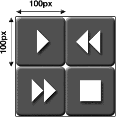

# 无序列表样式组合

为简洁起见，无序列表的样式也可以组合成单个样式规则。以下三个独立的样式属性可以合并：

- `list-style-type`：指定用于标记列表项的项目符号类型。
- `list-style-position`：指定项目符号相对于列表的位置，可以位于文本流中，或使用间距分隔成单独的列。
- `list-style-image`：指定一个可选的图像文件，用于表示项目符号。如果该图像不存在或未指定，则改用 `list-style-type` 属性中的项目符号类型。

以下展示了如何将这些样式组合成单个样式规则，用于自定义无序列表。

```css
li {
  /*
    使用以下格式作为列表样式的简写形式。
    list-style: type position image;
  */
  list-style: circle inside url(mybullet.gif);
}
```

## 使用 CSS Sprite 技术

现在，你将学习一项称为`CSS Sprite`的技术，它能够减少富互联网应用中图像文件的数量和大小。这将减少 HTTP 请求的数量和大小（如你所知，这是大多数网站最大的性能瓶颈之一），并且通常也会减少页面上表示这些图像所需的样式规则数量。

CSS Sprite 技术涉及将视觉上相关的图像文件合并到一个文件中。它借鉴了早期电子游戏图形中使用的精灵技术，并且近年来在一些计算机操作系统中被用于将一组图标图像存储在一个文件中。

假设你使用四个大小相同的独立图像文件来表示控制网站多媒体播放的四个按钮：播放、快退、快进和停止。以下是你通常如何使用 CSS 引用这些文件，并将它们与页面元素关联起来的方法：

```css
/* 每个按钮元素有两个类：control 和一个特定按钮的样式 */
.control {
  /* 每个图标是 100 像素见方 */
  width: 100px;
  height: 100px;
  /* 如果按钮通过 CSS 显示为图标，则应隐藏按钮元素内的任何文本 */
  text-indent: -10000px;
}
.play {
  background-image: url(play.png);
}
.rewind {
  background-image: url(rewind.png);
}
.forward {
  background-image: url(forward.png);
}
.stop {
  background-image: url(stop.png);
}
```

图 4-1 展示了如何使用标准图形软件包将这四张独立的图像合并成一个图像文件。每张单独的图像尺寸为 100 像素宽、100 像素高，生成的图像尺寸为 200 像素宽、200 像素高。

CSS Sprite 技术涉及指定较大图像文件中 100 像素见方的部分，该部分包含你希望在元素中显示的特定按钮图标。以下示例演示了如何使用 CSS 样式规则实现这一点，通过在元素尺寸内移动背景图像来显示所需的图像部分。



`图 4-1.` `四张相关图像合并成一个图像文件`

```css
.control {
  /* 每个按钮控制元素的尺寸固定为 100 像素见方 */
  width: 100px;
  height: 100px;
  text-indent: -10000px;
  /* 引用单个合并图像文件 */
  background-image: url(combined-image.png);
}
.play {
  /* 显示 100 像素见方区域，从背景的左上角开始。
     这对应于图 4-1 图像中的“播放”图标 */
  background-position: 0 0;
}
.rewind {
  /* 将背景图像向左移动 100 像素，使“快退”图像
     位于元素的左上角位置，正好适合 100 像素的显示方块。 */
  background-position: -100px 0;
}
.forward {
  /* 将背景图像向上移动 100 像素，使“快进”图像
     位于元素左上角的 100 像素方块内 */
  background-position: 0 -100px;
}
.stop {
  /* 将背景图像向左移动 100 像素并向上移动 100 像素，
     使“停止”图像在 100 像素的显示方块内可见 */
  background-position: -100px -100px;
}
```

通过在元素内移动背景图像，你能够精确显示希望呈现的图像部分。你将四个独立的图像减少为一个，并且只向 CSS 样式规则中添加了一行代码。由于单个合并图像通常比几个独立图像更小，并且导致更少的 HTTP 请求，因此这项技术通常能为最终用户带来显著的性能提升。

> **注意** 在开始将整个图像库合并成一个文件以使用此技术之前，请停下来思考一下你所合并图像文件的上下文。为了可维护性，建议只合并相关的图像，例如视觉尺寸相似的图标。为了进一步简化维护，请使用支持图层的图形软件包（如 Adobe Photoshop），如果你需要对其中某个独立图像进行更改，可以利用图层重新导出你的 sprite 图像文件。

所以，CSS Sprite 技术是一个极好的性能助推器。通过减少 HTTP 请求的数量，你对服务器连接速度和浏览器内并行连接限制的依赖减少了。然而，合并图像的方式会影响性能。因此，你需要确保以最佳方式做到这一点。

以下是一些优化 CSS Sprite 图像的方法：

- `避免使用单个庞大的 Sprite 图像文件`：由于你将较小的图像合并到单个较大的图像中，结果文件大小通常虽然小于各部件总和，但无疑会比它所替代的任何单个文件都大。较大的文件下载时间更长，因此用户需要等待才能在浏览器中看到任何图像。目标是让最终用户能够以创纪录的速度加载和显示网页，因此请仔细考虑你的 CSS Sprite 图像。你需要将它们分割成几个经过精心构建的图像文件，而不是一个包罗万象的庞然大物。

- `明智且高效地使用空间`：Sprite 图像中各个图像之间的巨大空白区域，其效率不如空白较少的图像。与其他类型的文件一样，你不希望存储永远不会使用的额外图像数据。请尽可能紧密地打包组成主 Sprite 图像的各个图像，以最大限度地减少浪费的空间。选择尺寸相似的组件图像，以获得最佳的贴合度并减少 Sprite 图像中的空白区域。你可以将各个图像排列成正方形网格，或使用水平或垂直对齐的图像序列。你可能会认为图像的对齐方式对文件大小没有影响，但实际上，当图像在单个水平行中对齐时，可能实现更小的文件大小。

- `考虑维护任务`：存储在单个文件中的单个图像，比存储在单个文件中的一组图像更容易更新和维护。在编辑大型 Sprite 图像时，必须注意不要更改正在编辑的单个图像周围的图像，因为此类更改可能会被忽视。如果你使用允许保存带有单独图层和分隔网格线的图像的图形软件（如 Adobe Photoshop），则应将每个独立的图像放置在不同的图层中，并与这些固定的网格线对齐。请将此主文件与你的图像一起保留备份，并在进行任何更改时以 PNG 格式（本章稍后讨论）导出你的 Sprite 图像。

## 避免低效的 CSS 选择器