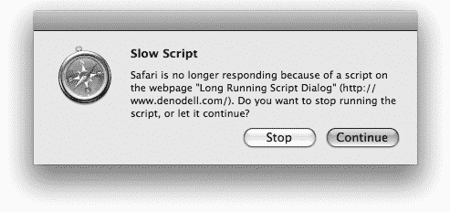

# 第 5 章 障眼法：感知响应性

### 在超链接上使用 CSS 伪类

CSS 伪类允许你为页面中超链接上发生的鼠标和键盘事件提供视觉反馈，向用户指示不同的状态。清单 5-2 展示了如何使用这些伪类来对页面内超链接上发生的事件做出反应。为了正确运行，这些样式必须按所示顺序提供。

**清单 5-2.** *用于在超链接上提供视觉反馈的 CSS 伪类*

```
a:link {

  /* 应用于未访问的链接 */

}

a:visited {

  /* 应用于已访问的链接 */

}

a:hover {

  /* 应用于当前位于鼠标指针下方的链接 */

}

a:focus {

  /* 应用于当前通过键盘选中的链接 */

  /* 例如，使用 Tab 键在页面链接间切换时 */

}

a:active {

  /* 在链接被选中的短暂时间内应用 */

}
```

### 让用户知道表单正在提交

表单，尤其是包含大量数据的表单，可能需要时间才能提交到服务器。如前几章所述，大多数用户的上传连接速度比下载速度慢。此外，Web 服务器通常需要在向客户端发送响应之前处理发送过来的数据。众所周知，这会导致一些用户感到沮丧，当他们认为等待响应的时间足够长时，便会重新提交表单。

重复提交表单可能会在 Web 服务器上引发问题，例如在数据库中重复数据，或者在最坏的情况下导致信用卡被多次扣费。为了避免这种情况，你可以使用 JavaScript 提供视觉反馈，让用户知道他们的表单正在提交，并阻止他们重新提交表单。清单 5-3 展示了这一技术。

**清单 5-3.** *告知用户表单正在提交*

```
$.onDomReady(function() {

  // 监听页面内触发的 submit 事件——这只能

  // 发生在 <form> 标签上

  $.Events.add(document.getElementsByTagName("form")[0]

  // 在当前表单中找到提交按钮，

  // 该按钮应具有 submit-button 类名

  var buttons = $.Elements.getElementsByClassName("submit-button", ➥

  e.target);

  // 进行防御性编码

  if (buttons.length > 0) {

    // 禁用提交按钮，使其无法被再次点击。这会

    // 在视觉上将按钮变灰

    buttons[0].disabled = "disabled";

    // 设置提交按钮的文本，以反映表单正在

    // 提交中

    buttons[0].value = "正在保存...";

  }

});
```

### 更改鼠标指针

让网站访问者知道后台正在执行操作的最简单方法之一，就是更新鼠标指针以指示应用程序正忙。这正如操作系统在你从硬盘加载应用程序或文件时所做的那样，表示正在执行操作且可能需要一些时间。

当你开始执行操作时，使用 JavaScript 在页面的 `<body>` 标签上设置一个类（例如 `busy`），并在操作完成时移除该类，以将指针恢复到正常状态。然后，你可以编写以下 CSS，根据该类将鼠标指针设置为正确的状态：

```
// 更改每个页面元素上的鼠标指针

body.busy,

body.busy * {

  cursor: progress;

}
```


### 使用 Web 2.0 风格的动画指示器

另一种向用户指示页面或页面的一部分正在更新且更新时间不确定的方法，是使用几乎无处不在的 Web 2.0 风格动画图标。图 5-1 展示了此指示器的一个示例。

**图 5-1.** *Web 2.0 风格的动画加载指示器（旋转器）*


例如，当你通过 Ajax 将表单回传至服务器，且只更新页面部分内容时，你可以将加载指示器的位置居中放置于该部分页面之上，并在处理进行期间将该区域内的所有控件设为不可用状态。这可以通过在 Ajax 通信开始时通过 JavaScript 为页面元素添加一个 `indicator` 类，并在通信结束后移除该类来实现。然后，你需要使用 CSS 将指示器图像关联到该元素，方法如下：

```css
.indicator {
  background: url(/spinner.gif) center no-repeat;
}
```

你可以从 [`www.ajaxload.info/`](http://www.ajaxload.info/) 或 [`www.loadinfo.net/`](http://www.loadinfo.net/) 浏览并下载大量 Web 2.0 风格的加载指示器，以便配合此技术使用。根据自身 Web 应用设计的需要，对这些指示器进行自定义调整。

### 显示进度条

在某些情况下，你可以计算出特定代码执行所需的时间，或已执行代码占总代码量的百分比。例如，如果你正在循环遍历一个包含 1000 个值的数组，那么根据当前索引和数组中的总项数，你可以在每次循环中得知已处理数组的比例。

当你得知特定例程已完成的比例时，可以使用进度条样式的指示器来显示代码执行已完成的百分比。图 5-2 展示了这样一个进度条的示例。

**图 5-2.** *进度条指示器*

从许多方面来看，这类进度条远优于光标变化或动画图标，因为它允许用户根据当前已执行的时间，预测该操作完成所需的总时长。它也是操作系统用户界面中的常见部分，因此用户已经习惯于看到进度条。让最终用户了解他们需要等待多长时间，可以让他们根据这一信息自由做出选择——是现在去泡咖啡还是稍后再去，或者是否有足够的时间在等待期间于另一个浏览器窗口中访问其他网站，等等。

构建一个进度条只需在页面上创建两个嵌套的 `<div>` 元素，并为它们指定特定的类名和 `id` 值：

```html
<div class="progress-bar">
  <div class="progress" id="code-progress"></div>
</div>
```

然后使用 CSS 设置这两个元素的尺寸、文本和边框样式，以创建进度条：

```css
.progress-bar {
  border: 1px solid #000;
  background: #fff;
  width: 150px;
  height: 20px;
}

.progress {
  background: #666;
  color: #000;
  text-align: right;
  height: 100%;
  width: 0%; // 进度条的默认位置 - 从 0% 完成度开始
}
```

接着，使用 JavaScript 在代码运行过程中动态更新内部 `<div>` 元素的宽度，以反映代码执行的进度百分比：

```javascript
document.getElementById('code-progress').style.width = '70%';
```

通过定期更新该值，你可以实现平滑的进度条效果。

### 处理长时间运行的脚本

JavaScript 并不像某些编程语言那样以多线程方式运行；也就是说，大多数 JavaScript 代码是按顺序执行的。当 JavaScript 实际执行代码时，浏览器会锁定，直到代码运行完毕后才重新变为活动状态。在大多数情况下，用户不会注意到这种情况，因为脚本执行得很快。然而，偶尔会有脚本运行时间足够长，以至于用户会在浏览器中看到一个消息对话框。这个对话框会提醒用户某个脚本无响应，并为他们提供终止脚本或继续允许其运行的选项，如图 5-3 所示。



**图 5-3.** *运行缓慢的脚本对话框*


