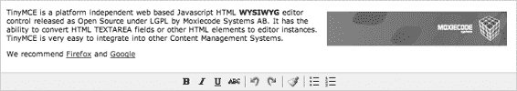

# 298

## 第 8 章 ■ 表单控件

```html
<!-- 创建一个元素，用于向用户反映当前的上传进度 -->
<div id="upload-progress"></div>
```

```html
</fieldset>
</form>
```

```html
<!-- 引用 $ JavaScript 库 -->
<script type="text/javascript" src="$.js"></script>
```

```html
<!-- 加载 SWFObject API -->
<script type="text/javascript" src="swfupload.js"></script>
```

```html
<!-- 配置我们的页面。在实际的 Web 应用程序中，此代码块应包含在外部文件中。此处为了简单起见，直接提供 -->
<script type="text/javascript">
// 定义用于初始化 SWFObject 组件的设置
var settings = {
    // 定位提供上传功能的 Flash 文件
    flash_url : "swfupload.swf",
    // 指定文件上传到服务器的 URL — 相对于 Flash 文件的位置
    upload_url: "upload.php",
    // 在浏览器中显示调试信息 — 对开发有用
    debug: true,
    // 用于浏览按钮的图片文件 — 相对于 Flash 文件的位置
    button_image_url: "browse.png",
    // 浏览按钮的尺寸
    button_width: "85",
    button_height: "39",
    // 组件初始化时，用于填充浏览按钮的 DOM 元素 ID
    button_placeholder_id: "browse-button",
    // 如果提供了 swfupload_loaded_handler 方法，则在组件初始化完成时调用该方法
    swfupload_loaded_handler: function() {
        // 给现有的文件上传控件添加一个 hide 类。使用 CSS 使控件不可见。
        // 由于 SWFUpload 组件已成功初始化，我们不再需要此控件
        $.CSS.addClass(document.getElementById("make-multiple"), "hide");
    }
};

// 当用户在文件选择对话框中选择了文件后，SWFUpload 组件会调用 file_queued_handler 方法，
// 并传入一个包含该文件详细信息（包括文件名、文件大小等）的对象字面量。
// 如果用户在对话框中选择多个文件，则会为每个文件多次调用此方法。
// 在此，我们创建一个文件数组作为后续上传的文件队列
var queue = [];
settings.file_queued_handler = function(file) {
    queue.push(file);
}

// 由 SWFUpload 组件按固定时间间隔定期触发 upload_progress_handler 事件，
// 每次都会执行以下方法。该方法指定当前正在上传的文件、已发送到服务器的数据字节数，以及文件的总数据字节数。
// 我们利用这些信息来计算文件上传的完成百分比，并在文件上传期间将其反映在 HTML 页面中，
// 从而为最终用户提供上传进度的反馈
settings.upload_progress_handler = function(file, bytesSent, bytesTotal) {
    var percentComplete = (bytesSent / bytesTotal) * 100;
    var text = "{fileName} ({percentComplete}% 完成)";
    document.getElementById("upload-progress").innerHTML = $.Utils.replaceText(text, {
        fileName: file.name,
        percentComplete: percentComplete
    });
}

// 当文件上传完成时，会触发 upload_complete_handler 事件。
// 我们利用此事件自动开始上传队列中的下一个文件。
// 当最后一个文件上传完成后，我们提交页面上的表单
var filesCompleted = 0;
settings.upload_complete_handler = function() {
    filesCompleted++;
    if (filesCompleted < queue.length) {
        this.startUpload(); // 处理队列中的下一个文件
    } else if (filesCompleted == queue.length) {
        document.getElementById("form").submit()
    }
}

// 现在，SWFUpload 控件的设置已配置完成，
// 接下来，当 DOM 准备好被访问时，让我们将其应用于页面
$.onDomReady(function() {
    // 将设置应用于 SWFUpload 控件，即可在页面上使用
    var uploader = new SWFUpload(settings);
    // 监听页面的表单提交事件
    $.Events.add(document.getElementById("form"), "submit", 
}
</script>
```

## 第 8 章 ■ 表单控件

```javascript
function(e) {
  // 当用户尝试提交表单时，如果有文件
  // 在队列中等待上传，取消表单
  // 提交并上传这些文件。SWFUpload 的 startUpload() 方法
  // 正是执行此操作。它开始上传队列中的第一个
  // 文件。然后文件逐个上传，直到
  // 最后一个文件被发送完毕，此时
  // upload_complete_handler 事件触发，我们先前指定
  // 的方法将表单提交到服务器。如果没有
  // 需要上传的文件，表单将在此处正常提交
  if (queue.length > 0) {
    e.preventDefault();
    uploader.startUpload();
  }
});
```

</body>

</html>

此示例演示了 `SWFUpload` 组件的使用。该页面能够通过单个文件选择对话框提交多个文件进行上传，并向用户显示进度指示器，让他们推断还需要等待多久才能提交表单。



## 第 8 章 ■ 表单控件

### SWFUpload 评估

`SWFUpload` 组件允许您上传多个文件（尽管一次只能上传一个）到服务器端脚本，并支持随时取消上传，且无需刷新页面。它可以限制文件类型和大小。通过组件下载包中提供的一个插件，该组件能够测量文件当前的以及平均的上传速度，并允许您将这些信息传递给页面，以便让用户随时了解情况。正如您所预期的，`SWFUpload` 不提供自己的用户界面，而是要求您（页面开发者）自行构建，并通过组件触发的 JavaScript 事件连接到该组件。简而言之，与 HTML 提供的默认文件上传控件相比，`SWFUpload` 组件为上传多个文件或单个大文件提供了更优雅、更友好的解决方案。

该组件要求最终用户的浏览器安装 Flash Player 9 或更高版本，并且启用了 JavaScript。在尝试将组件包含到页面之前，您可能希望使用第 7 章介绍的 `SWFObject` 组件，通过 JavaScript 检测是否安装了正确版本的 Flash Player。

必须包含在页面中的 JavaScript 文件在压缩后大小为 19KB。向页面暴露其功能的 Flash 文件大小为 12KB。这两个文件大小对于在 Web 应用程序中使用都是非常可接受的，并且在服务器上使用 gzip 压缩将进一步减小这些文件的大小。

#### TinyMCE：富文本编辑

HTML 自带的 `<textarea>` 元素允许用户以比标准文本输入框更自由的方式输入文本，但它只允许输入纯文本。您可能希望为用户提供一种输入带样式和格式的文本，甚至是图片的方法。例如，大多数博客发布者希望编写可以使用粗体、斜体和下划线样式强调的文本，并且能够将图像放到他们博客文章中的特定位置。幸运的是，我们可以利用第三方组件将标准的 `<textarea>` 转换为一个完全可编辑的富文本区域，其中的内容被转换为标准 XHTML，并以这种格式保存回 HTML 表单中。当稍后重新加载页面时，内容会从 XHTML 中读取并转换回富文本显示。

# 第 8 章：表单控件

该领域的领先组件是 `TinyMCE`，您可以在 [`tinymce.moxiecode.com/`](http://tinymce.moxiecode.com/) 找到它。图 8-8 显示了该组件在页面上的一个示例。

图 8-8. 使用“简单”按钮主题显示的 TinyMCE 富文本控件

## TinyMCE 使用示例

在页面中实现 `TinyMCE` 组件非常简单。请看清单 8-7 中的 HTML 代码，其中包含一个可以用富文本组件替换的 `<textarea>` 元素。

清单 8-7. 在 HTML 页面上使用 TinyMCE 富文本编辑器

```
<!DOCTYPE html PUBLIC "-//W3C//DTD XHTML 1.0 Strict//EN"
"http://www.w3.org/TR/xhtml1/DTD/xhtml1-strict.dtd">
<html lang="en" xml:lang="en">
<head>
<meta http-equiv="Content-Type" content="text/html; charset=utf-8" />
<title>富文本示例</title>
</head>
<body>
<h1>富文本示例</h1>
<form method="post" action="/" id="form">
<div>
<!-- 创建一个 <textarea> 字段，稍后我们将通过 JavaScript 用富文本编辑器替换它 -->
<textarea id="freetext" name="freetext"></textarea>
<input type="submit" value="保存" />
</div>
</form>
<!-- 将 TinyMCE 控件的 JavaScript 文件包含在其默认安装路径下 -->
<script type="text/javascript"
src="tinymce/jscripts/tiny_mce/tiny_mce.js"></script>
<!-- 以下脚本在实际的 Web 应用程序中理想情况下应放在外部文件中。为了简单起见，包含在页面中 -->
<script type="text/javascript">
// 指示 TinyMCE 替换页面上所有的 <textarea> 标签为
// 富文本编辑器控件，使用默认的高级主题按钮
// 集合，其中包含组件提供的几乎所有功能的按钮。
// 这些功能包括粗体、斜体、下划线和删除线文本样式；图像、超链接、表格和列表支持；
// 以及支持多级撤销和重做，以防
// 用户犯错
tinyMCE.init({
mode : "textareas",
theme : "advanced"
});
```

```
// 如果您只想替换页面上的单个 <textarea> 实例，
// 而不是全部，以下代码允许您通过元素的 id 属性选择要替换的具体元素。简单按钮集合
// 主题包含简单文本编辑和多级
// 撤销的控件，而不是高级主题中令人眼花缭乱的按钮选择
//
// tinyMCE.init({
// mode : "exact",
// elements: "freetext",
// theme : "simple"
// });
</script>
</body>
</html>
```

## TinyMCE 功能特性

`TinyMCE` 组件的完整功能列表非常庞大。它包括插入表格、拼写检查以及从调色板中选择颜色的支持。您还可以自定义控件中按钮的显示顺序。

`TinyMCE` 具有插件架构，允许开发者为编辑器添加自己的按钮以提供特定行为，或自定义现有按钮的行为方式。项目主页上直接提供两个此类插件（均需支付许可费用）：

- **MCImageManager**：此插件提供了一个丰富的图形用户界面，用于通过与 PHP 或 ASP.NET 后端集成来选择和处理图像。它支持预览缩略图；上传新图像；删除现有图像；以及裁剪、调整大小和旋转图像。

- **MCFileManager**：此插件提供了一个用户界面，用于管理服务器上的文件，通过 PHP 或 ASP.NET 后端托管。它允许用户添加、删除和重命名文件。

这两个插件可以集成在一起，提供一整套图像和文件操作工具，以视觉上令人愉悦的方式向最终用户开放——非常适合内容管理系统或博客工具。

## TinyMCE 评估

`TinyMCE` 提供了一种干净、不引人注目的方法，可以将 HTML 中的标准 `<textarea>` 表单标签替换为能够进行富文本编辑的自定义控件。富文本字段的内容被转换为 HTML 标签，这些标签存储在 `<textarea>` 本身中，以便与表单的其他部分一起提交。当稍后重新打开表单进行编辑时，这些 HTML 标签会在编辑器控件内重新转换为富文本。

`TinyMCE` 组件很大——其所有部分加起来占用 2MB 的磁盘空间。幸运的是，并非所有内容都需要同时加载。简单主题的初始加载大小为 170KB，高级主题则为 218KB。同一页面上的编辑器多实例无需额外下载。

显然，这些数据量很大，远远超过本书讨论的其他第三方组件的体积。开发者已意识到这一点，并为 PHP、ASP.NET、JSP 和 ColdFusion 提供了部分服务器端脚本。这些是 gzip 风格的压缩脚本，用于缩减尚未采用此压缩方式的服务器上的下载时间。

总而言之，TinyMCE 富文本编辑器无疑是该领域的最佳选择；但这需要付出代价：下载体积。我的建议是谨慎使用该控件，并确保服务器启用 gzip 压缩以帮助缩短加载时间。

## 表单验证

任何关于 HTML 表单的章节如果不提及表单验证都是不完整的。所有表单验证都必须由表单提交后运行的服务器端脚本处理。然而，为了获得更好的用户体验，你应该在表单提交前通过 JavaScript 复制后端应用的相同验证规则，这样用户无需等待服务器处理脚本后再刷新页面来显示验证结果。

当用户尝试提交表单时，应通过 JavaScript 进行表单验证。逐个字段的验证可在每个字段失去焦点时执行。

通过挂钩页面 `<form>` 标签的 `submit` 事件，你可以指定验证代码，检查必填字段、特定格式字段等，并在验证失败时阻止事件完成。如果验证成功，则应允许事件继续执行，并将表单提交给服务器。

> **注意**：务必使用表单的 `submit` 事件，而不是连接到表单提交按钮的 `click` 事件。这是因为有多种方式可以提交表单，包括按回车键。此类情况不会被 `click` 事件捕获，因此坚持使用表单的 `submit` 事件，这样会更安全。

如果表单包含必填和非必填字段的混合，请务必标记所有必填字段。如果表单上的所有字段都是必填的，则有理由不明确指出这一点。在许多情况下，在字段名称旁边加一个星号（`*`），并在表单上方用一行文字说明标记此方式的字段为必填，就足以标识必填字段了。

最后，如果表单验证失败，你应该决定验证错误消息在页面上的显示方式：要么在一个地方（表单顶部或底部）列出所有错误，要么在表单上每个验证失败的字段旁边显示。无论哪种情况，在构建这些消息的 HTML 代码时，你应该为每条消息使用 `<label>` 标签，并使用其 `for` 属性将该消息关联到相关的表单字段。

这不仅有利于可访问性，还意味着用户可以简单地点击错误消息，直接跳转到与之相关的字段，这是 `<label>` 标签常见的浏览器行为。

## 总结

本章首先演示了自定义现有 HTML 表单控件以适配你自己 Web 应用程序设计和布局的创新方法。然后深入探讨了构建新的用户界面来替换现有 HTML 表单字段，以提供更好的用户体验。接着，介绍了一系列基于 JavaScript 和 Flash 的第三方插件，这些插件提供了 HTML 默认不支持的额外功能。现在，你应该能够按照自己的意愿设计 Web 应用程序中的表单，并在现有控件无法为你希望收集的数据类型提供合适用户体验时替换它们。

不要害怕为最终用户更乐意使用的表单控件提出新想法。如果你编写了任何代码，请尝试将其打包为可重用的代码，并提供给 Web 开发社区的其他成员，这样我们都可以从彼此的灵感和创造力中受益。

在下一章中，我们将探讨如何为 Web 应用程序编写额外代码，以应对浏览器与 Web 服务器之间的连接中断或电源故障。你将学习如何在将数据发送到服务器之前，在用户本地机器上存储数据。

---

# 第 9 章：离线存储——当网络中断时

我们都经历过这种情况。你花了 20 分钟在 Web 邮件客户端中完善一封重要的电子邮件，终于准备发送了——然后砰的一声！——它发送不出去了。你再试一次，仍然不行。然后你意识到网络连接已断开，无法再访问互联网。你该怎么办？此时，我们中的许多人会尝试将文本复制粘贴到计算机本地存储的文档中，这样相对安全。如果必须重启浏览器，或者更糟的是系统崩溃，你应该能够找回它。

这是大多数 RIA 的问题所在：它们的可靠性完全取决于其所运行环境的网络连接和浏览器的可靠性。如果由于某种原因，浏览器和服务器之间的网络连接不可用，我们需要某种方式将重要信息存储在用户计算机或设备上。

# 本地存储方法

在本章中，我们将研究在不同浏览器中可用于本地存储内容的方法。你将看到如何在自己的 RIA 中有效组合使用这些方法来保存数据、回读数据和删除数据，并确保跨浏览器支持。

### 使用 Cookie 存储数据

实际上，自 Web 浏览器早期以来，开发人员就可以通过 cookie 的形式进行本地数据存储。cookie 是存储在用户计算机上并与特定网站域名相关联的小型文本文件，大小上限为 4KB。这增加了一层安全性，因为一个站点只能访问与其域名关联的 cookie。

在大多数 Web 浏览器中，cookie 可以由 Web 服务器设置，也可以通过 JavaScript 设置。它们通常用于存储小量数据，例如用户登录某个网站的 ID 或用户名，以便用户自动登录。

浏览器内部管理 cookie，并且通常通过其设置或偏好窗口提供方法来让用户查看和删除 cookie。用户也可以完全禁用 cookie。然而，实际上，由于如此多的网站依赖 cookie，包括所有需要用户登录的网站，完全禁用 cookie 的情况很少发生。

### 创建 Cookie

每个 cookie 在创建时都会被赋予一个名称，并且任何必要的文本值都存储在其中。当需要该 cookie 时，会根据其名称进行查找并返回值，前提是与该 cookie 关联的域名与执行脚本的网站域名匹配。

每个 cookie 都有一个`expiry`（过期）日期属性，用于定义 cookie 应存储多长时间。

在浏览器自动清除之前，该数据被允许存在。对于许多应用程序，Cookie 的过期时间会被设置为创建时间之后的很多年，这样数据就能保留在用户的机器上，而无需重新创建。

对于某些应用程序，可能需要将值设置为仅在用户访问网站期间有效。这种类型的 Cookie 被称为会话 Cookie，因为一旦浏览器会话结束，该 Cookie 就会被删除。如果没有为 Cookie 分配过期日期，则会创建一个会话 Cookie，这意味着它只会在当前浏览会话期间存在。将 Cookie 的过期日期设置为一个已经过去的日期，将会从浏览器中永久删除该 Cookie。

正如我之前提到的，你必须指定与 Cookie 关联的域名，以提供一定的安全性。托管在其他域名上的网站都不应该能够访问该 Cookie。除此之外，你还可以指定一个`path`值，那么该 Cookie 将仅在你的网站结构中该目录内有效。通常，这个值被设置为指向网站的根目录，以便所有页面都能访问该 Cookie。但是，你可能决定你的 Cookie 仅在你网站的某个特定部分相关；在这种情况下，你需要更改`path`值以指向该目录。

清单 9-1 展示了如何通过 JavaScript 设置 Cookie、读回其值以及删除它。

将代码添加到你的`$`JavaScript 库中（从第 2 章开始），放在实例化该库的文件的最后一行之前。

**清单 9-1.** 设置和读取 Cookie 值

```javascript
// 在 $ 库中为存储相关代码创建一个新的命名空间
$.prototype.Storage = {}

// 创建一个 Cookies 命名空间，用于存储与 Cookie 相关的存储方法
$.prototype.Storage.Cookies = {

  // set 方法在本地机器上设置一个具有给定名称和值的 Cookie
  set: function(input) {
    // 期望输入一个对象字面量，包含 name、value、expiry 和 path 属性
    var name = input.name || "";
    var value = input.value || "";

    // 如果提供了过期日期，则获取其字符串值用于设置 Cookie。
    // 如果没有提供过期日期，则默认设置为 10 年后
    var tenYearsAhead = new Date();
    tenYearsAhead.setFullYear(tenYearsAhead.getFullYear() + 10);

    // 使用输入的过期日期，或默认设置为未来 10 年的日期
    var expiry = (input.expiry ? input.expiry.toUTCString() :
      tenYearsAhead.toUTCString());

    // 如果没有给出路径，则默认设置为站点根目录
    var path = input.path || "/";

    // Cookie 以特殊格式的字符串进行设置。域名将自动分配给正在访问的站点的当前域名
    var cookieFormat = "{name}={value}; expires={expiry}; path={path}";

    // 通过将格式化字符串赋值给 document.cookie 来创建新 Cookie
    document.cookie = $.Utils.replaceText(cookieFormat, {
      // 使用 escape 方法确保非字母数字字符被编码，并且不会破坏生成的格式化 Cookie 字符串
      name: escape(name),
      value: escape(value),
      expiry: expiryDate,
      path: path
    });
  },

  // get 方法通过名称检索之前存储的 Cookie 值
  get: function(name) {
    // document.cookie 是一个字符串，自动包含当前正在访问的站点域和路径下所有有效的 Cookie
    // 使用针对 document.cookie 运行的正则表达式定位 Cookie
    var cookieFinder = new RegExp("(^|;) ?" + name + "=([^;]*)(;|$)");
    var cookie = document.cookie.match(cookieFinder);
    var value = "";

    if (cookie) {
      // 如果找到了 Cookie，则使用正则表达式找到的值
      value = unescape(cookie[2]);
    }

    return value;
  },

  // remove 方法通过名称删除现有的 Cookie
  remove: function(name) {
    // 通过将过期日期重置为当前时间之前的任何时间来删除 Cookie
    var expiryDate = new Date();
    // 将时钟回拨
    expiryDate.setTime(expiryDate.getTime() - 1);

    // 让先前定义的 set 方法重置 cookie 的过期时间，
    // 从而删除该 cookie
    this.set({
      name: escape(name),
      expiry: expiryDate
    });
  }
};
```

清单 9-2 演示了如何在页面自定义的 JavaScript 代码中使用清单 9-1 创建的方法，来创建、查找和删除 cookie。

**清单 9-2.** 使用`$`库创建、查找和删除 Cookie

```javascript
// 创建一个默认将在 10 年后过期的新 cookie
$.Storage.Cookies.set({
  name: "email",
  value: "me@denodell.com"
});

// 输出我们刚才创建的名为 "email" 的 cookie 的值。
// 即使浏览器重启，数据仍会保留
alert($.Storage.Cookies.get("email"));

// 删除 "email" cookie
$.Storage.Cookies.remove("email");

// 输出空字符串，因为该 cookie 已不存在
alert($.Storage.Cookies.get("email"));
```

### Cookie 的缺点

Cookie 提供了一种简单、跨浏览器的方式，可在浏览器中存储少量基于文本的数据以供后续检索。不过，它们也有缺点。

当浏览器请求位于特定域名下的页面或文件时，它也会将与该域名关联的完整 cookie 内容随请求一并发送。

这是设计使然，它允许网页服务器读取用户机器上存储的 cookie，并根据其值个性化响应内容。你在 cookie 中存储的数据越多，这些请求的体积就越大，直到达到 4KB 的最大限制。这可能听起来不多，但请记住，无论所请求文件的类型是什么，cookie 都会被发送。例如，如果你的页面由一个 HTML 文件、两个 CSS 文件、两个 JavaScript 文件和二十张图片组成，那么每个文件请求都会将 cookie 数据发送到服务器，这意味着额外发送给服务器的数据量最多可达 100KB（25 个请求 × 4KB cookie 大小）。

你可能会想，为什么这种机制会存在，因为它可能会导致大量数据无缘无故地被发送到服务器。不幸的是，它是目前唯一有保证的方法，以确保当服务器希望利用这些 cookie 数据来修改图片、脚本、HTML 页面或其他文件时，服务器能够获取到该 cookie。这绝非什么优雅的解决方案，但却是最简便的方法，也是 HTTP 规范在加入 cookie 支持时所采用的方式。

还要记住，许多用户使用的是异步连接，这意味着他们从浏览器到服务器的上传速度远低于从服务器到浏览器的下载速度。因此，传输这些额外 cookie 数据所花费的时间可能会对性能产生重大影响。在第 4 章中，我解释了一种解决此问题的变通方案，即将你的图片和外部资源托管在与 HTML 文件所在域名不同的第二个域名下。尽管如此，当你考虑到这里的主要目标是本地存储数据，以防不可预见的网络连接中断和不幸的浏览器崩溃时，每次 HTML 请求都发送 cookie 数据似乎还是有些多此一举。

### 使用 Internet Explorer 的数据存储

微软在其 IE 浏览器中（从版本 5 开始）引入了自己的方法，允许通过 JavaScript Web 应用将内容存储在用户机器上，这种方式使用了所谓的 `userData` 数据存储。此实现涉及在特定类型的 DOM 元素上使用属性节点来存储数据，通过添加和移除属性来添加和移除数据。数据通过在 DOM 元素上调用 `save()` 方法来持久化，并通过 `load()` 方法进行回读。这些元素是通过 DOM 元素关联的、IE 特有的 `userData` 行为添加的。数据存储本身在 IE 内部实际上是以 XML 为基础结构表示的。

微软对您站点中每个页面施加了 64KB 的基本存储限制，且每个域最多可存储 640KB 数据。其安全限制与 Cookie 存储类似：任何域都无法访问其他域的数据，并且可以通过在数据存储中添加可选的过期时间来在指定时间后移除数据。然而，与 Cookie 不同，过期时间适用于整个数据存储，而非单条数据。此外，不存在仅持续当前会话时长的数据存储概念。依我之见，应忽略过期时间选项，让浏览器或用户手动删除数据。

清单 9-3 展示了如何在 IE 中使用 `userData` 机制来获取、设置和删除数据。

请将此代码添加到您的 `$` JavaScript 库中，位于文件末尾库被实例化之前的位置。

**清单 9-3.** *使用 Internet Explorer 的 `userData` 机制设置、获取和删除数据*

```javascript
// 添加一个 UserData 命名空间，用于存放微软 userData 特有的方法

$.prototype.Storage.UserData = {

    // 引用一个用于存储数据的元素

    storageElement:null,

    // 通过使用不同的名称，数据可以存储在不同的数据存储中。我们
    // 希望所有数据都在同一个地方，因此选择一个名称并固定使用它
    dataStore: "data- store",

    // 在使用任何数据之前，我们需要初始化 DOM 元素
    initialize: function() {
        // 数据存储在 DOM 元素内，因此我们来创建一个以供使用
        this.storageElement = $.Elements.create("span");

        // behavior 属性使 DOM 元素能够加载
        // 数据并将其保存到数据存储中
        this.storageElement.addBehavior('#default#userdata');

        // 我们不希望此元素在页面上可见，因此将其隐藏
        this.storageElement.style.display = 'none';

        // 将新的 DOM 元素添加到页面末尾
        document.body.appendChild(this.storageElement);

        // 从数据存储中加载任何先前存储的数据，将数据填充到
        // 元素的属性中
        this.storageElement.load(this.dataStore);
    },

    // set 方法将给定名称的数据值保存到数据存储中
    set: function(input) {
        // 期望输入为一个对象字面量，包含 name 和 value
        var name = input.name || "";
        var value = input.value || "";

        // 将数据名称和值保存到 DOM 元素
        this.storageElement.setAttribute(name, value);

        // 将 DOM 元素中的当前数据提交到数据存储中
        this.storageElement.save(this.dataStore);
    },

    // get 方法从数据存储中返回给定属性名称的先前存储的值
    get: function(name) {
        // 返回给定名称的属性值，如果不存在则返回空字符串
        return this.storageElement.getAttribute(name) || "";
    },

    // remove 方法从数据存储中永久删除数据名称及其关联值
    remove: function(name) {
        // 从用于存储数据的 DOM 元素中移除给定名称的属性
        this.storageElement.removeAttribute(name);

        // 提交对数据存储所做的更改，以便指定数据被
        // 永久删除
        this.storageElement.save(this.dataStore);
    }
}
```

清单 9-4 展示了如何使用 JavaScript 以及在清单 9-3 中创建的方法在您自己的页面中创建、查找和删除数据。

**清单 9-4.** *在 Internet Explorer 中创建、查找和删除 `userData`*

```javascript
// 初始化 userData 存储
$.Storage.UserData.initialize();

// 将电子邮件地址保存到数据存储中
$.Storage.UserData.set({
    name: "email",
    value: "me@denodell.com"
});

// 输出我们之前创建的 "email" 值。
// 浏览器重启后，数据仍会存在
alert($.Storage.UserData.get("email"));

// 从数据存储中永久删除 "email" 数据值
$.Storage.UserData.remove("email");

// 由于数据已不存在，因此输出空字符串
alert($.Storage.UserData.get("email"));
```