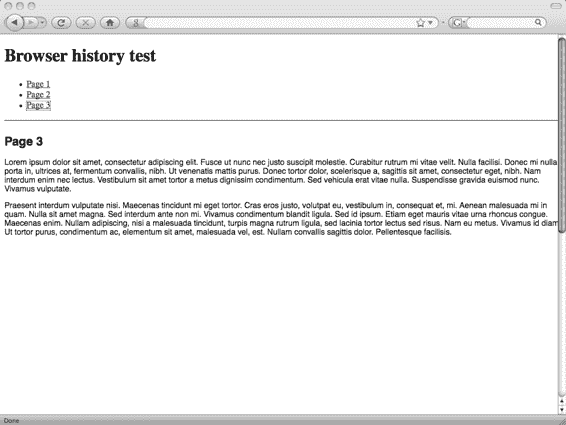

# 第 12 章：富互联网应用程序中的可访问性

正如我从本书一开始就强调的那样，可访问性是 Web 开发的基础之一。作为 Web 开发人员，我们需要确保我们的 Web 应用程序能够覆盖并让尽可能广泛的受众使用。我们的最终用户应该能够使用他们可用的任何浏览技术来访问我们提供的信息和界面，以满足他们自己的需求和偏好。本书的最后一章重点介绍如何为你的 RIA 设计最大程度的可访问性。

## 我们在满足谁的需求？


网页和应用程序通常易于导航和交互，前提是你是一个身体健全的用户，在屏幕尺寸和分辨率合适的电脑上使用鼠标。大多数网站的设计都考虑到了这类用户。然而，其他用户群体并不符合这一描述，但他们却依赖我们为他们提供可用且可交互的体验。

#### 使用辅助技术的用户

`辅助技术`是一个通用术语，指用于帮助有身体损伤、学习困难或残障的人士完成他们原本无法或难以完成任务的软件或硬件。许多软件开发者已经构建了相关工具，让这类用户能够访问信息并与网站进行互动。例如 [JAWS（http://www.freedomscientific.com/）](http://www.freedomscientific.com/)，这是一种屏幕阅读器，能将页面内容朗读出来；以及 [ZoomText（http://www.aisquared.com/）](http://www.aisquared.com/)，这是一种屏幕放大器，帮助用户更轻松地阅读页面内容。

我们需要确保我们的网络应用程序对于使用辅助技术的用户也是可用的。

## 移动设备上的用户

仅在过去几年中，移动设备上的网页浏览呈现出爆发式增长。最初只是以默认样式渲染的纯 HTML 标签，后来迅速适应了基本的 CSS 和 JavaScript。如今，我们已经达到了这样的阶段：移动设备上运行的浏览器，其渲染引擎和 JavaScript 引擎与桌面版的 Opera、Firefox、Safari 和 IE 是相同的。

移动设备的屏幕尺寸通常非常受限。在撰写本文时，一些最大的移动设备的最大屏幕分辨率为宽 480 像素、高 320 像素。相比之下，近年来台式电脑上最低的屏幕分辨率为宽 1024 像素、高 768 像素。我们需要确保我们的网络应用程序对于使用小屏幕浏览设备的用户也是可用的。图 12-1 比较了 Google 和 Yahoo! 在苹果 iPhone 上的搜索结果页面。请注意，Yahoo! 的结果在默认屏幕尺寸下即可阅读，而 Google 的结果页面则需要用户放大页面才能阅读其文本。

**图 12-1.** *小屏幕上 Google 和 Yahoo! 的搜索结果*

## 不使用鼠标的用户

用鼠标指向并点击已成为计算机体验中根深蒂固的一部分，许多用户能够以惊人的精确度和速度在屏幕上移动指针。然而，有些人仍然出于必要或选择而不使用鼠标。

网页浏览中第二常见的输入方式是键盘。大多数浏览器允许用户使用 Tab 键在页面中导航，在超链接和表单元素（即可交互的元素类型）之间跳转。这样使用键盘导航消除了使用鼠标时所需的精确度。

> **注意** 许多开发者在浏览时结合鼠标和键盘与页面元素交互。他们发现有时使用键盘来定位元素更快。

近年来，一种日益流行的浏览器和计算机交互方式是触摸屏——用户通过用手指实际触摸屏幕来选择并与页面元素交互。在许多方面，这是终极的指向设备。未来，触摸屏可能会提供更高级的计算机交互方式，甚至可能完全取代鼠标。

我们需要确保我们的网络应用程序对于使用除鼠标以外的输入设备与页面交互的用户也是可用的。

## 面向所有人的可访问性

显然，随着网络浏览器在以往未曾见过的情况下支持 JavaScript，我们作为网络开发者的角色变得更加困难。我们必须确保使用所有浏览器、辅助技术、设备和输入方法的用户都能直观且毫无困难地使用我们的网络应用程序。

当然，你使用语义化的 HTML 构建网络应用程序，确保那些没有 JavaScript 的用户也能毫无困难地使用你的 RIA。但现在既然 JavaScript 在大多数浏览器和大多数设备上都得到支持，是时候将可访问性提升到下一个层次了。

## 使用后退和前进按钮正确导航

作为网络应用程序开发者，我们必须满足用户的需求和期望。网络应用程序中最基本且最明显的问题之一是，当页面内容通过 Ajax 而非完整的页面刷新来更新时，浏览器工具栏上的“后退”和“前进”按钮（通常用于在浏览器的页面历史记录中前后移动）会完全失效。用户可能会在网络应用程序（例如网络邮件客户端）中花费数小时——导航到不同的页面和应用程序状态，阅读、撰写和删除邮件——但当他们点击浏览器工具栏上的“后退”按钮时，他们会被带回到加载该网络邮件应用程序之前浏览的页面。用户期望浏览器以某种方式运行，当它没有时，他们就会感到沮丧。我们必须修复网络应用程序中的这个问题，以避免让最终用户感到失望。

当加载新的 URL 时，页面会被添加到浏览器历史记录中，这通常发生在用户选择超链接或提交表单时。开发者也可以通过 JavaScript 动态修改代表 URL 的 `location` 对象。对 URL 的大多数更改都会导致页面刷新，但对*哈希值*（URL 中 `#` 字符之后的任何部分）的更改除外。

URL 哈希值用于导航到同一页面内的其他内容，这意味着不需要页面刷新，但新的 URL 仍然会被添加到浏览器的历史记录中。你可以通过你的网络应用程序利用这一现象，在相关节点（例如通过 Ajax 加载新内容时）更新 URL 的哈希值。当哈希值发生变化时（这将在用户使用浏览器工具栏上的“后退”和“前进”按钮导航浏览器历史记录时发生），你可以在代码中执行必要的操作，将应用程序恢复到该哈希值被添加时的状态。通过这种技术，你能够为用户提供他们所期望的浏览器历史记录导航行为。

`清单 12-1` 展示了如何编写一个例程来通过更新 URL 的哈希部分来添加浏览器历史记录项，以及另一个例程来在用户通过浏览器历史记录前后导航时，从哈希值中读回之前存储的值。将此代码添加到你的 `$` JavaScript 库中，位于文件最后一行（即实例化该库的那一行）之前。

**清单 12-1.** *通过 JavaScript 添加和检索浏览器历史记录项*

```javascript
// 创建一个 History 命名空间，用于在我们的 RIA 中管理浏览器历史记录项
$.prototype.History = {

    // currentValue 属性保存当前 URL 的哈希值，
    // 该值通过全局的 location.hash 属性获取。该属性值包含 # 字符，
    // 因此我们将其移除，因为不需要它
    currentValue: location.hash.replace(/#/g, ""),

    // 为了克服 Internet Explorer 在历史记录处理方面的问题，我们需要
    // 在该浏览器中通过页面上的一个 <iframe> 标签来添加和读回我们的历史记录项。
    // 这里，我们维护一个指向该元素的引用，稍后我们会定义它
    iframe: null,

    // 当用户点击浏览器中的后退和前进按钮，并且当前历史记录项
    // 发生变化时，我们希望执行某些操作。onChange 方法将在这种变化发生时被调用
```


`onChange: function() {}`,

// enable 方法开始监听 URL 哈希部分的当前变化，进而监听浏览器历史记录列表本身
`enable: function() {`

// Internet Explorer 的行为与其他浏览器不同，因此我们需要创建一个`<iframe>`来包含哈希的变化
`if (window.ActiveXObject) {`

**第 12 章 ■ 富 Internet 应用程序中的无障碍功能**
**379**

// 创建一个隐藏的`<iframe>`并将其添加到页面中
`this.iframe = $.Elements.create("iframe");`
`this.iframe.style.display = "none";`
`this.iframe.src = "javascript:false;";`
`document.body.appendChild(this.iframe);`

// 用一个历史记录项初始化`<iframe>`。`add`方法将在后面定义
`this.add(this.currentValue);`
`}`

`var self = this;`

// `detectHistoryChange`函数检测当前哈希值是否与上一次不同，并在不同时执行`onChange`方法
`var detectHistoryChange = function() {`

// 获取上次保存的哈希值和最新的哈希值
`var lastValue = self.currentValue;`
`var latestValue = location.hash.replace(/#/g, "");`

// 在 Internet Explorer 中获取哈希值的方式略有不同
`if (self.iframe) {`
`var latestValue = self.iframe.contentWindow.document.location.hash.replace(/#/g, "");`
`}`

// 如果最新哈希值与上次不同，则保存新值并调用`onChange`属性，传入最新哈希值和先前哈希值
`if (latestValue != lastValue) {`
`self.currentValue = latestValue;`
`self.onChange(latestValue, lastValue);`
`}`
`}`

// 每 300 毫秒执行一次`detectHistoryChange`函数——参见第 5 章了解这个数字的重要性——然后开始监听哈希值的变化
`window.setInterval(detectHistoryChange, 300);`
`},`

// `add`方法接受指定的文本字符串值，并将其添加到 URL 哈希中，从而创建一个带有该值的浏览器历史记录项
`add: function(newValue) {`
`if (this.iframe) {`


**380**

**第 12 章 ■ 富 Internet 应用程序中的无障碍功能**

// 将哈希添加到 Internet Explorer 的`<iframe>`标签中
`var iframeDocument = this.iframe.contentWindow.document;`
`iframeDocument.open();`
`iframeDocument.close();`
`iframeDocument.location.hash = newValue;`
`} else {`

// 所有其他浏览器均可访问当前页面的哈希属性
`location.hash = newValue;`
`}`
`}`
`}`

要了解**代码清单 12-1**中的代码如何在 Web 应用程序中使用，请查看**代码清单 12-2**中的简单示例，该示例使用 Ajax 将其他链接页面的内容加载到同一页面的页面元素中，如**图 12-2**所示。每次 Ajax 请求都会向浏览器历史记录列表中添加项目，允许用户使用浏览器工具栏上的“后退”和“前进”按钮在 Ajax 请求加载的内容之间来回导航。

**图 12-2.** *通过 Ajax 加载内容，添加到浏览器的页面访问历史记录中*

**第 12 章 ■ 富 Internet 应用程序中的无障碍功能**
**381**

**代码清单 12-2.** *使用 Ajax 添加和导航页面访问历史记录项*

```
<!DOCTYPE html PUBLIC "-//W3C//DTD XHTML 1.0 Strict//EN" "http://www.w3.org/TR/xhtml1/DTD/xhtml1-strict.dtd">
<html lang="en" xml:lang="en" xmlns="http://www.w3.org/1999/xhtml">
<head>
<meta http-equiv="Content-Type" content="text/html; charset=utf-8">
<title>浏览器历史记录测试</title>
</head>
<body>
<h1>浏览器历史记录测试</h1>
<!-- 创建指向其他页面的导航链接列表 -->
<ul>
<li><a href="page1.html">页面 1</a></li>
<li><a href="page2.html">页面 2</a></li>
<li><a href="page3.html">页面 3</a></li>
</ul>
<!-- 创建一个空页面元素来存储我们的 Ajax 响应 -->
<div id="content"></div>
<!-- 引用$ JavaScript 库 -->
<script type="text/javascript" src="$.js"></script>
<!-- 在实际的 Web 应用程序中，你应该从外部文件引用以下代码。为简单起见，此处内联包含 -->
<script type="text/javascript">
$.onDomReady(function() {
// 启用浏览器历史记录监听器，以便我们可以手动添加
```


```javascript
$.History.enable();

$.History.onChange = function(currentItem, previousItem) {
  if (currentItem != "") {
    $.Remote.load({
      url: currentItem,
      callback: function(response){
        document.getElementById("content").innerHTML = response.text;
      }
    });
  } else {
    document.getElementById("content").innerHTML = "";
  }
};

$.Events.add(document.body, "click", function(e) {
  if (e.target.tagName.toLowerCase() == "a") {
    e.preventDefault();
    $.History.add(e.target.href);
  }
});
```

除了通过更新 URL 哈希值将地址添加到浏览器历史记录外，您还可以添加任何您喜欢的文本值。您甚至可以考虑使用分隔符（例如`|`）来分隔要存储的多个文本值。以网页邮件应用程序为例，您可能希望将`folder|inbox`值添加到历史列表中，以通知应用程序加载收件箱文件夹；或者使用`message|display|123`来指示应用程序显示第 123 条消息。通过使用`onChange`事件构建页面变更事件，您可以让最终用户能够按照他们的预期，利用浏览器工具栏上的“后退”和“前进”按钮在您的 Web 应用程序中导航。

## 设备无关的 JavaScript

为了支持所有可能使用您 Web 应用程序的用户需求，您需要更新 JavaScript 代码，消除对基于鼠标的交互的依赖。对于以线性方式浏览（例如使用键盘或朗读页面内容的软件）的用户，您还需要改进 RIA 的流程。您可以通过在 JavaScript 代码中使用设备无关的事件来提供这种支持。

### 设备无关的事件

在本书中，您已经看到了如何将 JavaScript 函数分配给当前页面内 DOM 元素上触发的事件的示例。在大多数情况下，您使用了从第 2 章开始使用的`$` JavaScript 库中的`$.Events.add()`方法。使用此方法可以监听的部分事件类型是鼠标特定的，部分则是设备无关的。

表 12-1 展示了页面内 DOM 元素上触发的最常见事件类型，并明确了它们是鼠标依赖型、键盘依赖型还是设备无关型。

**表 12-1.** *常见 JavaScript 事件的设备依赖性*

| 事件类型 | 输入设备 | 事件触发时机 |
|------------|--------------|-------------|
| `mouseover` | 鼠标 | 当鼠标指针移动到某个元素上方时。 |
| `mouseout` | 鼠标 | 当鼠标指针从某个元素上移开时。 |
| `mousedown` | 鼠标 | 当鼠标按钮被按下时。 |
| `mouseup` | 鼠标 | 当鼠标按钮被释放时。 |
| `click` | 超链接和表单元素为设备无关型；其他元素为鼠标依赖型 | 当通过按下并释放鼠标按钮、按下 Enter 键、手指点击或其他任何特定于设备的选中机制来选择一个元素时。 |
| `focus` | | |


