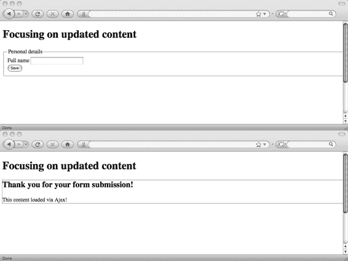

# 更新后的内容提醒和焦点


大多数用户能够通过视觉轻松注意到网页中通过 Ajax 或 DOM 操作动态更新的部分。这类更新通常源于用户与超链接或表单元素的交互，或基于固定时间间隔发生。然而，视力受损的用户以及借助辅助技术朗读页面的用户，可能无法察觉当前页面交互区域之外的其他部分发生的动态更新。我们需要一种方法，在适当时帮助这些用户定位更新后的内容。此外，使用键盘浏览的用户不希望疯狂地按 Tab 键在页面中导航以到达更新后的内容，因此我们还需要在适当时将键盘焦点移至更新后的内容。幸运的是，我们可以通过同一种技术满足这两类需求：DOM 元素的 `focus()` 方法。

如你在表 12-1 中所见，`focus` 事件处理程序以设备无关的方式作用于超链接和表单元素。`focus()` 方法也是如此，它允许你将当前焦点强制更改为你指定的元素。焦点也可以移至设置了 `tabindex` 属性值的元素，且这一行为在所有现代浏览器和辅助技术中均受到支持。

在第 1 章中，我曾建议不要在标记中使用 `tabindex` 属性，因为这会破坏页面的自然流程。更好的做法是按照你希望页面被访问的顺序来组织源代码。这一规则仍然适用，但如果你在通过 JavaScript 将元素置于焦点之前立即设置该属性，然后立即移除该属性，就可以在不扰乱页面 Tab 键顺序的情况下，将焦点留在所需元素上。



第 12 章 ■ 富互联网应用程序中的无障碍性  
387

大多数情况下，你应确保更新后的内容紧随触发更新的内容之后出现，以便为屏幕阅读器和键盘用户保持更自然的页面流程，减少混淆。

■**警告** 在强制用户焦点移至页面其他部分时需极其谨慎和讲究技巧。这可能会迷惑那些期望页面按特定方式流畅呈现的用户，因为您将打断这一流程。仅应在用户预期有变化发生时使用此技术，例如点击链接或提交表单之后。切勿将此技术用于基于固定时间间隔更新的内容，否则将不断强制用户焦点从正在阅读的内容上移开，导致极大困扰。

列表 12-4 展示了一种将此技术应用于通过 Ajax 提交的 HTML 表单的方法。服务器响应被放置在页面上取代表单，焦点被移至返回的内容，以便用户定位并阅读表单提交的响应，并从此处继续浏览。这一行为如图 12-3 所示。图的上半部分显示表单提交前的页面，下半部分显示表单提交后的页面。通常，当某个元素获得焦点时，其周围会出现轮廓线，以指示这是当前元素。在图 12-3 中，返回内容周围的轮廓线清晰可见，表明该元素确实拥有用户当前的焦点。

**图 12-3.** 将焦点移至返回内容的 Ajax 表单提交

388

第 12 章 ■ 富互联网应用程序中的无障碍性

**列表 12-4.** 向用户提示页面内容已更新

```
<!DOCTYPE html PUBLIC "-//W3C//DTD XHTML 1.0 Strict//EN" 
    "http://www.w3.org/TR/xhtml1/DTD/xhtml1-strict.dtd">
<html lang="en" xml:lang="en" xmlns="http://www.w3.org/1999/xhtml">
<head>
<meta http-equiv="Content-Type" content="text/html; charset=utf-8" />
<title>Focusing on updated content</title>
</head>
```


