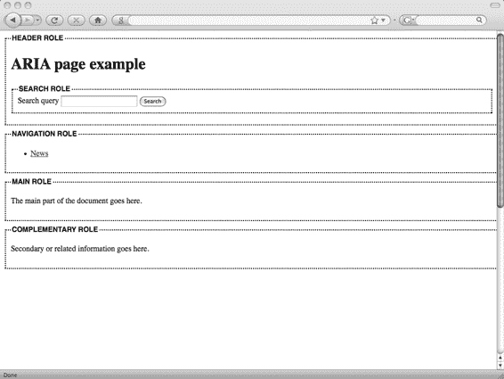

# 焦点跟随 tabindex 值从 1 开始的顺序

`tabindex="-1"`（负值）

允许元素通过 JavaScript 获得焦点，但不能使用默认的键盘按键来改变焦点。开发者应该根据箭头键的按键事件，通过 JavaScript 为元素分配焦点。

如之前所建议，在可能的情况下，你应该尽量避免使用 `tabindex` 属性的正数值，而应依赖文档源代码来提供正确的焦点行为。

## ARIA 微件的键盘交互

到目前为止，Web 开发者在开发响应键盘交互的微件和表单组件时，都只能依靠自己——关于哪些键用于何种行为，没有设定过指南。ARIA 建议书包含了关于在页面微件和组件内导航时应使用哪些键的明确建议，从而为 Web 开发者、浏览器制造商和最终用户提供了清晰性。

页面微件之间的导航应通过使用 `Tab` 键来实现，这与目前的情况一致。当用户聚焦于某个特定的微件时，应使用箭头键、空格键和 `Enter` 键进行导航，并允许用户与该微件交互。

建议书建议在访问的微件获得焦点时，将其 `tabindex` 属性值设置为 `0`。当用户在微件内使用箭头键导航时，应在当前选中或聚焦的元素上设置 `aria-activedescendant` 属性。这个属性让浏览器非常清楚地知道用户当前选中了哪个元素。

#### WAI-ARIA 示例

W3C 文档《WAI-ARIA 最佳实践》（[`www.w3.org/TR/wai-aria-practices/`](http://www.w3.org/TR/wai-aria-practices/)）非常有用、实用，并且强烈推荐所有 Web 开发者阅读。该文档详细描述了如何向你的 Web 应用程序添加 ARIA 支持。这里，我将展示几个简单的示例来演示如何向你自己的 Web 应用程序添加 ARIA 支持。我强烈建议你彻底阅读 W3C 文档，以便更好地理解这些内容以及如何将其应用到自己的 Web 应用程序中。

## 使用角色、状态和属性标记页面结构

如前所述，地标角色允许你向在页面中或作为整个 Web 应用程序一部分执行特定功能的页面元素添加额外的语义信息。

清单 12-5 展示了一个使用 ARIA 地标角色进行标记的 HTML 页面，以便向浏览器、屏幕阅读器和其他辅助技术提供这种额外的含义，使它们能够将这些额外信息传递给其软件的用户。图 12-4 展示了这在 HTML 页面中的结构，每个地标角色区域周围用虚线标记。



**图 12-4.** *HTML 页面内 ARIA 地标角色的描绘*

**清单 12-5.** *使用 ARIA 地标角色标记 HTML 页面*

```html
<!DOCTYPE html PUBLIC "-//W3C//DTD XHTML 1.0 Strict//EN"
    "http://www.w3.org/TR/xhtml1/DTD/xhtml1-strict.dtd">
<html xmlns="http://www.w3.org/1999/xhtml" lang="en" xml:lang="en">
<head>
<meta http-equiv="Content-Type" content="text/html; charset=utf-8" />
<title>ARIA page example</title>
</head>

<!-- The application role denotes a part of the page which acts as a standalone
RIA - in this case, the entire page is going to represent an RIA so we
place the role on the <body> tag -->
<body role="application">

<!-- The header element of the page, containing page title, logos, and any
other general site information, is marked with the banner role to
denote this function -->
<div id="header" role="banner">
<h1>ARIA page example</h1>

<!-- A site-wide search functionality should be marked up with the -->


```html
<!-- 搜索地标角色 -->
<form method="post" action="/search/" role="search">
  <label for="query">搜索查询</label>
  <input type="text" name="query" id="query" />
  <input type="submit" value="搜索" />
</form>

<!-- 导航列表使用导航角色进行标记 -->
<ul id="navigation" role="navigation">
  <li><a href="/news/">新闻</a></li>
  <!-- 其他导航链接在此处 -->
</ul>

<!-- 页面的主要部分使用主角色进行标识 -->
<div id="main" role="main">
  <p>文档的主要内容在此处。</p>
</div>

<!-- 次要侧边栏或补充内容（当脱离页面其余部分的上下文阅读时仍然有意义）使用补充角色进行标记 -->
<div id="aside" role="complementary">
  <p>次要或相关信息在此处。</p>
</div>

## 通过 Ajax 动态加载内容

几乎所有 Web 应用都通过 Ajax 技术加载或保存数据。在本章前面部分，你已了解一旦 Ajax 通信完成，需要编写一些额外代码来将焦点移至更新后的内容。通过 ARIA 及其“活动区域”概念，这一过程可显著简化——活动区域是页面中浏览器知道可能在应用使用过程中某个时刻被更新的部分。代码清单 12-6 展示了一个简单的 Web 应用，其中包含一个活动区域，该区域根据页面上选定的一系列链接更新其内容，如图 12-2 所示。

### 代码清单 12-6：通过 Ajax 和 ARIA 以无障碍方式动态加载内容

```html
<!DOCTYPE html PUBLIC "-//W3C//DTD XHTML 1.0 Strict//EN"
  "http://www.w3.org/TR/xhtml1/DTD/xhtml1-strict.dtd">
<html lang="en" xml:lang="en" xmlns="http://www.w3.org/1999/xhtml">
<head>
  <meta http-equiv="Content-Type" content="text/html; charset=utf-8" />
  <title>ARIA Ajax 示例</title>
</head>
<body role="application">
  <div id="header" role="banner">
    <h1>ARIA Ajax 示例</h1>
  </div>

  <ul id="navigation" role="navigation">
    <li><a href="/page1.html">页面 1</a></li>
    <li><a href="/page2.html">页面 2</a></li>
    <li><a href="/page3.html">页面 3</a></li>
  </ul>

  <!-- 使用 aria-live 属性将以下元素标记为活动区域。
       polite 值意味着用户在完成当前操作后才会收到内容已更新的通知。
       aria-atomic 属性值为 true 时，用户将收到整个活动区域内容更新的通知，而不仅仅是区域内发生变化的特定部分。
       aria-busy 属性在活动区域更新时设置为 true，当没有更新时重置为 false -->
  <div id="live-region" aria-live="polite" aria-atomic="true" aria-busy="false">
    <h2>默认页面内容</h2>
    <p>如果启用了 JavaScript，点击导航链接将导致此内容动态变化。ARIA 属性确保屏幕阅读器和其他辅助技术能获知这些变化。</p>
  </div>

  <!-- 引入 $ JavaScript 库 -->
  <script type="text/javascript" src="$.js"></script>

  <!-- 在实际的 Web 应用中，您应将以下脚本移至外部文件。
       此处为了简洁而包含在页面中 -->
  <script type="text/javascript">
    $.onDomReady(function() {
      // 定位活动区域页面元素并存储引用
      var liveRegion = document.getElementById("live-region");

      // 监听导航列表中触发的点击事件
      $.Events.add(document.getElementById("navigation"), "click", function(e) {
        if (e.target.tagName.toLowerCase() == "a") {
          // 如果用户选择了导航链接，取消其默认动作
          e.preventDefault();

          // 通知浏览器或正在使用的任何辅助技术
          // 活动区域正在更新
          liveRegion.setAttribute("aria-busy", "true");
        }
      });
    });
  </script>
</body>
</html>
```


```javascript
// Begin loading the contents of the page specified by the
// link URL
$.Remote.load({
url: e.target.href,
callback: function(response) {
// When the content has loaded, replace the HTML
// within the live region with the new HTML content
// loaded from the server
liveRegion.innerHTML = response.text;
// Inform the browser that the live region has
// finished being updated
liveRegion.setAttribute("aria-busy", "false");
// Users of assistive technology will be informed of
// the content update at the next opportunity
// after they have completed their current action
}
});
});
});
</script>
</body>
</html>
```

