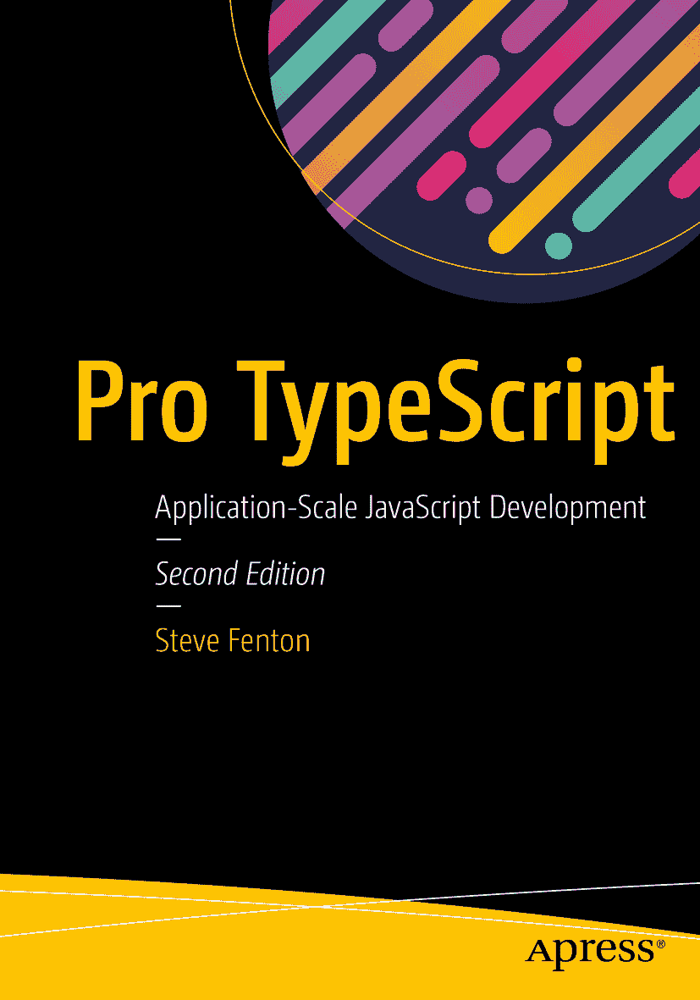
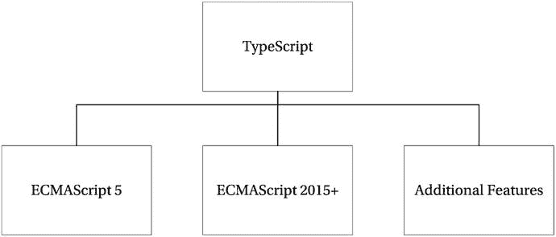
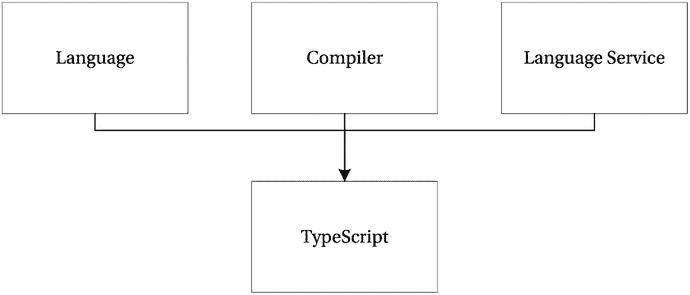

 Steve Fenton *精通 TypeScript：JavaScript 应用级开发* 第 2 版


作者在本书中引用的任何源代码或其他补充材料，读者均可通过 GitHub 在本书的产品页面获取，网址为 [`www.apress.com/9781484232484`](http://www.apress.com/9781484232484)。如需了解更多详细信息，请访问 [`http://www.apress.com/source-code`](http://www.apress.com/source-code)。ISBN 978-1-4842-3248-4 电子书 ISBN 978-1-4842-3249-1 [`doi.org/10.1007/978-1-4842-3249-1`](https://doi.org/10.1007/978-1-4842-3249-1) 美国国会图书馆控制号：2017961729 © Steve Fenton 2018 本作品受版权保护。所有权利均由出版商独家许可，涉及材料的全部或部分内容，具体包括翻译、重印、插图复用、朗诵、广播、微缩胶片复制或其他任何物理形式的复制、信息存储与检索的传输与电子适配、计算机软件，或当前已知及未来开发的类似或不同方法。本书中可能出现的商标名称、标识和图片。为免于在每个商标名称、标识或图片出现时使用商标符号，我们仅在编辑风格中且为了商标所有者的利益使用这些名称、标识和图片，无意侵犯商标权。本书中使用的商品名称、商标、服务标志及类似术语，即使未予标识，也不应被视为对其是否受专有权利保护的看法。尽管本书中的建议和信息在出版时被认为是真实准确的，但作者、编辑和出版商对可能出现的任何错误或遗漏不承担法律责任。出版商对本书所含材料不作任何明示或暗示的保证。本书采用无酸纸印刷 由 Springer Science+Business Media New York 在全球图书贸易中发行，地址：233 Spring Street, 6th Floor, New York, NY 10013。电话：1-800-SPRINGER，传真：(201) 348-4505，电子邮件：`orders-ny@springer-sbm.com`，或访问 `www.springeronline.com`。Apress Media, LLC 是一家加州有限责任公司，其唯一成员（所有者）是 Springer Science + Business Media Finance Inc (SSBM Finance Inc)。SSBM Finance Inc 是一家特拉华州公司。

献给 Rebecca、Lily、Deborah、Victoria 和妈妈

## 引言

> 阿特伍德定律：任何能用 JavaScript 编写的应用程序，最终都会用 JavaScript 编写。 — Jeff Atwood

TypeScript 是由微软创建和维护的一种语言，并根据开源 Apache 2.0 许可（2004 年）发布。该语言专注于使 JavaScript 程序的开发能够扩展到成千上万行代码。事实上，微软已使用 TypeScript 编写了 Azure 管理门户（120 万行代码）和 Visual Studio Code 编辑器（30 万行代码）。该语言通过提供更好的设计时工具、编译时检查以及运行时动态模块加载，来解决大规模 JavaScript 编程问题。

正如你对微软创建的语言所期望的那样，Visual Studio 对 TypeScript 提供了极佳的支持，但许多其他开发工具也添加了对该语言的支持，包括 VS Code、WebStorm、Eclipse、Sublime Text、Vi、Atom、IntelliJ 和 Emacs 等。这些工具的广泛支持以及宽松的开源许可，使得 TypeScript 在传统的微软生态系统之外也成为可行的选择。

TypeScript 语言是 JavaScript 的类型化超集，可编译为你选择的风格的纯 JavaScript。这使得用 TypeScript 编写的程序具有高度可移植性，因为它们几乎可以在任何机器上运行——在 Web 浏览器中、在 Web 服务器上，甚至在暴露 JavaScript API（如 WinJS）的操作系统的原生应用程序中。

TypeScript 中的语言特性可根据它们与 JavaScript 的关系分为三类（见图 1）。前两类与 ECMA-262 ECMAScript 语言规范（JavaScript 的官方规范）的版本相关。ECMAScript 5 规范构成了 TypeScript 的基础，并提供了该语言中数量最多的特性。后续版本的 ECMAScript 规范会逐步纳入 TypeScript 版本中，通常作为早期预览版，并具有向下编译到旧版本规范的功能。第三类，也是最后一类语言特性，包括不计划成为 ECMAScript 标准一部分的项目，例如泛型和类型注解。TypeScript 的所有附加特性都可以输出为多种广泛支持的 JavaScript 版本。

TypeScript 拥有多个原生框架，包括 Angular、Ionic、RxJs 5 和 Dojo 2。此外，由于 TypeScript 与 JavaScript 关系密切，你可以使用数以千计的现有用 JavaScript 编写的库和框架：Aurelia、Backbone、Bootstrap、Durandal、jQuery、Knockout、Modernizr、PhoneGap、Prototype、Raphael、React、Underscore、Vue 以及更多框架都可在 TypeScript 程序中使用。相应地，一旦你的 TypeScript 程序编译完成，它也可以被任何 JavaScript 程序使用。

如果你已经具备 JavaScript 或其他类 C 语言的经验，TypeScript 与 JavaScript 的相似性会带来好处。这种相似性也有助于调试过程，因为生成的 JavaScript 与原始的 TypeScript 代码紧密相关。还可以生成源映射以辅助调试，在浏览器开发者工具进行浏览器内调试时显示你的 TypeScript 代码。



**图 1.** TypeScript 语言特性来源

如果你仍然需要被说服使用 TypeScript，或需要帮助说服他人，我将在以下章节中总结该语言的优势以及它能解决的问题。我还将介绍 TypeScript 的组成部分以及一些替代方案。如果你想立即开始学习这门语言，可以直接跳到第 1 章。

### 本书面向的读者

本书面向从事大规模 JavaScript 程序开发（无论是运行在浏览器、服务器还是暴露 JavaScript API 的操作系统上）的程序员和架构师。阅读本书时，如果你具备 JavaScript 或其他类 C 语言的经验，以及面向对象和设计模式的工作知识会很有帮助，不过我将在后面详细涵盖其中的一些方面。

## 结构

本书共分为十章和四个附录。

*   第 1 章：TypeScript 语言特性：详细描述语言特性，从简单的类型注解到重要的结构元素，并附带每个特性的独立使用示例。
*   第 2 章：代码组织：阐明如何组织、加载和打包代码，以便将程序扩展到数百万行代码。
*   第 3 章：类型系统：解释在 TypeScript 结构化类型系统中工作的细节，并描述类型擦除、类型推断和环境声明的详细信息。
*   第 4 章：TypeScript 中的面向对象：介绍面向对象的重要元素，并包含 TypeScript 中设计模式和 SOLID 原则的示例。本章还通过实际示例介绍了混入的概念。
*   第 5 章：理解运行时：描述作用域、回调、事件和扩展对程序的影响。
*   第 6 章：在浏览器中运行 TypeScript：全面讲解，包括处理文档对象模型、AJAX、会话和本地存储、IndexedDB、地理定位、硬件传感器和 Web Worker，以及为 Web 打包程序的相关信息。
*   第 7 章：在服务器上运行 TypeScript：解释如何在 JavaScript 服务器上运行程序，包含 Node 示例以及使用 Express 和 Mongoose 编写的基本端到端示例应用程序。
*   第 8 章：异常、内存和性能：描述异常和异常处理，并提供内存管理和垃圾回收的信息。它包含一个简单的性能测试工具，用于执行和测量程序。

*   第 9 章：使用 JavaScript 库：解释如何从 TypeScript 程序中使用数百万个 JavaScript 库中的任何一个，包括如何创建自己的类型定义以及如何将 JavaScript 程序迁移到 TypeScript 的信息。
*   第 10 章：自动化测试：使用 Jest 框架编写的示例，对你的 TypeScript 程序进行自动化测试的全面讲解。
*   附录 1：JavaScript 快速参考：为需要在深入学习 TypeScript 之前复习 JavaScript 知识的人，介绍 JavaScript 的基本特性。
*   附录 2：TypeScript 编译器：解释如何在命令行中使用编译器，并描述许多可用于自定义构建的标志。
*   附录 3：位标志：深入探讨位标志的细节，包括其底层工作原理以及使用 TypeScript 枚举的示例。
*   附录 4：编码练习：介绍编码练习的概念，并提供一个示例供你尝试，同时也给出了一些使练习更有效的方法。

## TypeScript 的组成部分

TypeScript 由三个不同但互补的部分组成，如图 2 所示。



图 2. TypeScript 的组成部分

语言部分包括新的语法、关键字和类型注解。作为程序员，这部分将是你最熟悉的组件。理解如何提供类型信息是其他组件的重要基础，因为当编译器与语言服务理解了你程序中使用的复杂结构时，它们的工作效率最高。

编译器执行类型擦除和代码转换，将 TypeScript 代码转换为 JavaScript。如果检测到问题，它会发出警告和错误，并且可以执行其他任务，例如将输出合并到单个文件、生成源码映射等。

语言服务提供类型信息，开发工具可以利用这些信息提供自动补全、类型提示、重构选项以及其他基于从你程序收集的类型信息的创造性功能。

### 编译还是转译？

“转译”一词从上个世纪就已存在，但对其含义仍存在一些混淆。特别是，“编译”和“转译”这两个术语之间有些混淆。编译描述的是将一种语言编写的源代码转换为另一种语言的过程。转译是编译的一种特定形式，描述的是将一种语言编写的源代码转换为另一种抽象层次相似的语言的过程。因此，你可能会将高级语言编译为汇编语言，但你会将 TypeScript 转译为 JavaScript，因为它们的抽象层次相似。

其他常见的转译示例包括 C++ 到 C、CoffeeScript 到 JavaScript、Dart 到 JavaScript 以及 PHP 到 C++。

## TypeScript 解决了哪些问题？

自 1995 年首次发布测试版以来，JavaScript（发布时被称为 LiveScript）如同野火般迅速蔓延。世界上几乎每台电脑都安装了 JavaScript 解释器。尽管它被视为一种基于浏览器的脚本语言，但 JavaScript 从诞生之初就已在 Web 服务器上运行，受 Netscape Enterprise Server、IIS（自 1996 年起）以及自 2011 年起的 Node 支持。JavaScript 甚至可以用来在 Windows 等操作系统上编写原生应用程序。

尽管它很流行，但并未得到开发者的足够尊重——可能是因为它包含许多陷阱，这些陷阱可能会缠住大型程序，就像 Fred Brooks（1975）所描述的沥青坑将猛犸象拉向死亡一样。如果你是一名专业程序员，处理用 JavaScript 编写的大型应用程序，那么一旦你的程序达到几千行，你几乎肯定会遇到问题。你可能遇到过命名冲突、低劣的编程工具、复杂的模块化、不熟悉的原型继承导致难以轻松重用常见设计模式，以及难以维护可读和可维护的代码库。TypeScript 解决了诸如此类的问题。

由于 JavaScript 拥有类似 C 的语法，大多数程序员对它感到熟悉。这是 JavaScript 的关键优势之一，但也是许多意外的根源，尤其是在以下领域：

*   原型继承
*   相等性与类型转换
*   模块管理
*   作用域
*   缺少类型

TypeScript 以多种方式解决或缓解了这些问题。本引言中将讨论这些主题中的每一个。

### 原型继承

基于原型的编程是一种面向对象编程风格，主要出现在解释型动态语言中。它最早由大卫·安格尔和兰德尔·史密斯于 1986 年在名为 `Self` 的语言中使用，此后也出现在一些其他语言中。在这些原型语言中，JavaScript 是迄今为止最广为人知的，尽管这并未使原型继承成为主流。尽管有其合理性，但基于原型的编程仍有些晦涩难懂；基于类的面向对象编程要普遍得多，大多数程序员对其更为熟悉。

TypeScript 通过添加类、命名空间、模块和接口解决了这一问题。这使得程序员能够将他们在其他语言中积累的关于对象和代码结构的既有知识（包括实现接口、继承和代码组织）迁移过来。类和模块是 JavaScript 提案的早期预览版，由于 TypeScript 可以编译成早期版本的 JavaScript，因此它允许你独立于新版 ECMAScript 规范的支持来使用这些特性。所有这些特性都在第 1 章 中有详细描述。

### 相等性与类型转换

JavaScript 一直支持动态类型变量，因此它在运行时需要花力气来推断类型，并动态地将它们强制转换为其他类型，以使某些语句能够正常运行，而这些语句在静态类型语言中本会导致错误。

最常见的类型转换涉及字符串、数字和布尔目标类型。每当你尝试将一个值与字符串拼接时，该值会被转换为字符串；如果执行数学运算，则会尝试将该值转换为数字；如果在逻辑操作中使用任何值，则会有特殊规则来确定结果是 `true` 还是 `false`。当自动类型转换发生时，通常被称为“类型转换”。

在某些情况下，类型转换可能是一个有用的特性，尤其是在创建简写的逻辑表达式时。而在其他情况下，类型转换隐藏了不经意间使用了不同类型的问题，并导致意外行为，这一点在第 1 章 中进行了讨论。一个常见的 JavaScript 示例如清单 1 所示。

```
const num = 1;
const str = '0';
// 结果是 '10'，而不是 1
const strTen = num + str;
// 结果是 20
const result = strTen * 2;
清单 1.
类型转换
```

TypeScript 通过引入类型检查优雅地解决了这个问题，它可以在设计和编译时提供警告，以发现潜在的无意中的类型转换。即使在允许隐式类型转换的情况下，结果也会被赋予正确的类型。这可以防止危险的假设被忽视。该特性在第 3 章 中有详细说明。

TypeScript 中类型的引入并不排斥动态类型的使用。你可以选择何时使用类型，何时不使用。TypeScript 不会强迫你做任何事，它只是来提供帮助。

### 模块管理

如果你使用过 JavaScript，你很可能会遇到过依赖问题。一些常见问题包括：

- 忘记在网页中添加 `<script>` 标签
- 以错误的顺序在网页中添加脚本
- 发现添加了未被使用的脚本

此外，如果你使用工具将所有脚本合并到一个文件中以减少网络请求，或者对脚本进行压缩以降低带宽占用，还可能会遇到一系列问题：

- 以错误的顺序将脚本合并为一个脚本
- 发现选择的压缩工具不理解单行注释
- 尝试调试合并并压缩后的脚本

你可能已经通过模块加载解决了其中一些问题，因为这种模式在 JavaScript 社区中越来越受欢迎。然而，TypeScript 将模块加载器作为默认工作方式，并允许你的模块被编译成最流行的模块加载风格，而无需更改你的代码。有关在 Web 浏览器中进行模块加载的详细信息，请参阅第 6 章，在服务器端进行模块加载的详细信息请参阅第 7 章。

## 作用域

在大多数现代的类 C 语言中，花括号会为作用域创建一个新的上下文。在一组花括号内声明的变量，在该代码块外部是无法看见的。传统上，JavaScript 通过采用函数作用域打破了这一趋势，这意味着由花括号定义的块对作用域没有影响。相反，变量的作用域是声明它们的函数，如果变量不是在函数内声明的，则其作用域是全局作用域。在函数内意外省略 `var` 关键字还会带来进一步的复杂性，从而将变量提升到全局作用域。变量提升则会导致更多的复杂情况，使得函数内所有变量的行为都如同在函数顶部声明的一样。

`const` 和 `let` 变量声明的引入在某种程度上解决了这个问题，如果你从头开始，可以完全避免使用较旧的 `var` 变量声明。

尽管作用域存在一些棘手的意外情况，但 JavaScript 确实提供了一种强大的机制，它将当前的词法作用域包装在函数声明周围，以便在函数稍后执行时保留这些值以便使用。这些闭包是 JavaScript 中最强大的特性之一。

TypeScript 通过警告你隐式全局变量（前提是你避免向全局作用域添加变量）来缓解作用域问题。这个安全网在清单 2 中得到了演示。

```
function process() {
// 错误！找不到 'accidentalGlobal' 这个名称
accidentalGlobal = 5;
}
清单 2.
意外的全局作用域错误
```

### 缺乏类型

JavaScript 的问题不在于它没有类型，因为每个变量确实有类型；而在于每次赋值都可以改变变量的类型。一个变量可能一开始是字符串类型，但一次赋值就能将其变为数字、对象，甚至是函数。这里真正的问题是，开发工具无法超越合理的猜测来推断变量的类型。如果开发工具不知道变量的类型，那么自动补全和类型提示通常就过于笼统，没什么用处。

通过形式化类型信息，`TypeScript` 使开发工具能够提供具体的情境帮助，否则这是不可能的。

### 哪些问题未得到解决？

> `TypeScript` 并非拐杖，正如 `JSLint` 也不是拐杖一样。它不会隐藏 `JavaScript`（就像 `CoffeeScript` 倾向于做的那样）。——沃德·贝尔

`TypeScript` 在很大程度上忠于 `JavaScript`。`TypeScript` 规范添加了许多语言特性，但它并没有试图改变 `JavaScript` 语言的最终风格和行为。对于 `TypeScript` 程序员来说，理解运行时的特性与 `JavaScript` 程序员一样重要。`TypeScript` 语言的目标是使大规模的 `JavaScript` 程序更易于管理和维护。它并未试图将 `JavaScript` 开发扭曲成 `C#`、`Java`、`Ruby`、`Python` 或任何其他语言的风格（尽管它从许多语言中汲取了灵感）。

## 先决条件

要充分利用 `TypeScript` 的特性，你需要使用一个支持其语法和编译器的集成开发环境。本书中的示例均使用 `Visual Studio 2017` 编写，但你也可以使用 `VS Code`、`WebStorm/PHPStorm`、`Eclipse`、`Sublime Text`、`Vi`、`Emacs` 或任何其他支持该语言的开发工具；你甚至可以在微软提供的 `TypeScript Playground` 上尝试许多简单的示例。我在回答关于该语言的问题时经常使用 `TypeScript Playground`。

从 `Visual Studio 2013 Spring Update`（Update 2）开始，`TypeScript` 成为 `Visual Studio` 中的一等公民语言。在此之前，需要安装额外的扩展。虽然本书中的示例在 `Visual Studio` 中展示，但你可以使用上面列出的任何开发工具。特别地，`Visual Studio Code` 是一款免费的跨平台编辑器，原生支持 `TypeScript`——因此你可以使用手头的任何机器编写 `TypeScript` 代码，无论其操作系统是什么。

下载并安装 `Node`（许多示例需要它）也是值得的，因为它允许你访问 `Node Package Manager`，以及通过它可用的数千个模块和实用程序。例如，如果你的开发工具没有自动编译功能，你可以使用 `Grunt` 和 `Gulp` 等任务运行器来监视你的 `TypeScript` 文件，并在每次更改时自动编译它们。

`Node` 是免费的，可以从官方 `Node` 网站为多个平台下载。

[`https://nodejs.org/`](https://nodejs.org/)

为了避免偏离主题，我避免在 `Visual Studio` 之外使用任何任务运行器来执行额外操作，但一旦你掌握了 `TypeScript`，你几乎肯定希望将任务运行器（如 `Gulp` 或 `Grunt`）添加到你的开发工作流中。我在本书的示例中引用了 `node_modules` 文件夹中的一些 Web 依赖项；但在实际项目中，我会使用任务运行器将网站依赖项移动到一个单独的文件夹中，以便于部署到 Web 服务器。`node_modules` 文件夹通常包含大量我不希望部署到 Web 服务器的文件。

## `TypeScript` 替代方案

`TypeScript` 并非编写纯 `JavaScript` 的唯一替代方案。

`TypeScript` 最强大的替代方案是 `Babel`，它是一个编译器，可公开最新的 `ECMAScript` 特性，并配备用于低级编译的插件和 polyfill，使你的程序能在当前浏览器中运行。`Babel` 项目的目标是让最新特性比以往更早可用，但 `Babel` 不会引入编译时类型检查。`Babel` 也出现在许多 `TypeScript` 工作流中，在这些工作流中，`Babel` 在 `TypeScript` 编译器之后执行，而不是使用 `TypeScript` 来执行低级编译。你可以在官方网站上了解 `Babel`：

[`https://babeljs.io/`](https://babeljs.io/)

多年来，`CoffeeScript` 一直是一种流行的替代方案，它具有简洁的语法，可以编译成合理的 `JavaScript` 代码。`CoffeeScript` 没有提供 `TypeScript` 提供的许多附加功能，例如静态类型检查。它也是一种与 `JavaScript` 截然不同的语言，这意味着你需要将你在网上找到的代码片段转换成 `CoffeeScript` 才能使用。然而，在 2017 年，`CoffeeScript` 在 `Stack Overflow` 开发者调查中跻身“最令人畏惧语言”前三名（仅次于 `VBA` 和 `Visual Basic 6`）。在同一调查中，`TypeScript` 则位列最受喜爱语言前三名。你可以在官方网站上找到更多关于 `CoffeeScript` 的信息：

[`http://coffeescript.org/`](http://coffeescript.org/)

另一个替代方案是谷歌的 `Dart` 语言。`Dart` 与 `TypeScript` 有很多共同之处。它是基于类的、面向对象的，并提供可由静态检查器检查的可选类型。`Dart` 最初被设想为 `JavaScript` 的替代品，并且只打算在短期内编译为 `JavaScript` 以提供广泛支持，同时将 `Dart` 的原生支持添加到浏览器中。

在现阶段，`Dart` 似乎不太可能获得 `JavaScript` 所赢得的浏览器支持，因此编译到 `JavaScript` 的机制很可能仍然是 `Dart` 在 Web 浏览器中未来的核心。谷歌决定在 `Angular` 项目中采用 `TypeScript`，这可能表明他们对 `Dart` 的承诺，不过它仍被描述为一个长期项目。你可以在该语言的官方网站上了解 `Dart`：

[`https://www.dartlang.org/`](https://www.dartlang.org/)

还有一些转换器可以将大多数语言编译成 `JavaScript`，包括 `C#`、`Ruby`、`Java` 和 `Haskell`。这些可能对不习惯使用其主要编程语言之外的程序员有吸引力。

同样值得记住的是，对于小型应用和网页小部件，你可以推迟决定，直接用纯 `JavaScript` 编写代码。特别是对于 `TypeScript`，从 `JavaScript` 开始没有任何损失，因为你只需稍后将你的 `JavaScript` 代码粘贴到 `TypeScript` 文件中即可完成切换。同样，使用 `TypeScript` 编写小程序也几乎没有损失，尤其是在你已经建立了工作流，可以在每次保存应用程序时生成合并或压缩文件的情况下。

## 总结

`TypeScript` 是一种应用级编程语言，它提供了对拟议的新 `JavaScript` 特性的早期访问，以及静态类型检查等强大的附加功能。你可以编写 `TypeScript` 程序在 Web 浏览器或服务器上运行，并且可以在浏览器和服务器应用程序之间重用代码。

`TypeScript` 解决了 `JavaScript` 中的许多问题，但它尊重底层 `JavaScript` 语言的模式和实现，例如，拥有动态类型的能力。

你可以在许多集成开发环境中使用 `TypeScript`，其中一些提供了包括类型检查和自动补全在内的一流支持，这将提高你的工作效率，并帮助在设计时消除错误。

## 关键点

- `TypeScript` 是一种语言、一个编译器，也是一项语言服务。

- 你可以将现有的 `JavaScript` 粘贴到你的 `TypeScript` 程序中。

- 从 `TypeScript` 编译到 `JavaScript` 的过程特称为转译。

`TypeScript` 并非编写 `JavaScript` 的唯一替代方式，但它在最初的五年里获得了令人难以置信的发展。

## 致谢

当你与合适的人一起工作时，写书是一种享受，这些人包括 Apress 出版社的 Gwenan Spearing 以及我睿智的技术审校者 Rich O’Kelly、Martin Milsom、Dan Horrocks-Burgess 和 Jamie Wright。我无比感谢 Nancy Chen 对我零散的写作习惯、最后一刻的修改和模糊的时间预估所表现出的极大耐心。

如果没有所有帮助编写第一本书的聪明人的贡献，这第二版是不可能完成的：Mark Jones、Mark Rendle、Basarat Ali Syed、Christine Ricketts、Boris Yankov、Diullei Gomes、Masahiro Wakame、Jason Jarrett、Bart van der Schoor、John Reilly、Igor Oleinikov、Luke Hoban、Jonathan Turner，当然还有 Ryan Cavanaugh。

我还要感谢我所有杰出的同事们，无论是过去的还是现在的，是你们激励我不断学习和成长。