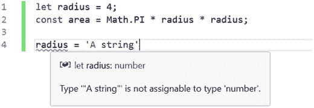
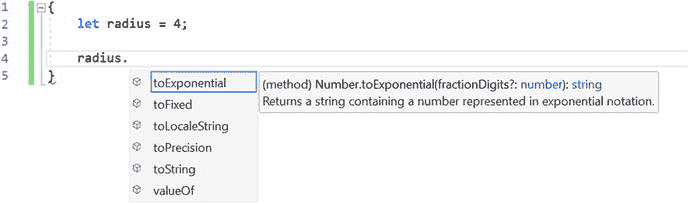
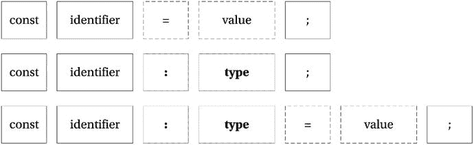
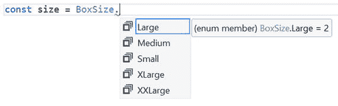
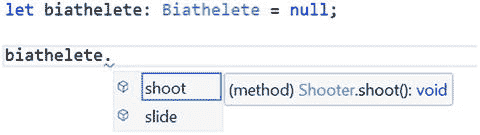
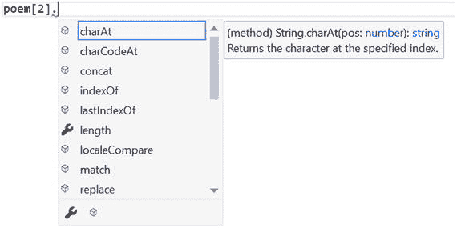
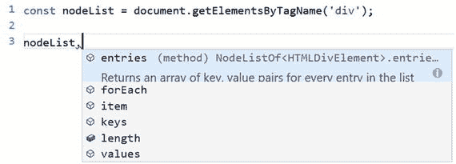

# 1. TypeScript 语言特性

> 如果我们能用大型应用开发所缺失的元素（如静态类型、类和模块）来增强 JavaScript，会怎么样？这正是 TypeScript 的使命。 ——安德斯·海尔斯伯格

TypeScript 是 JavaScript 的超集。这意味着 TypeScript 语言包含了整个 JavaScript 语言，外加一系列有用的额外特性。这与各种 JavaScript 子集以及各种 linting 工具形成了对比，那些工具试图减少可用特性，以创建一个更小、意外更少的语言。本章将向你介绍这些额外的语言特性，从简单的类型注解开始，逐步深入到更高级的特性以及 TypeScript 的结构化元素。本章并未涵盖 ECMAScript 语言规范中的每一个特性，因此如果你需要重温 JavaScript，请参考附录 1。

需要记住的一个重要点是，JavaScript 中所有标准的控制结构在 TypeScript 程序中都可以直接使用。这包括以下内容：

* 控制流

* 数据类型

* 运算符

* 子程序

程序的基本构建块将来自 JavaScript，包括 `if` 语句、`switch` 语句、循环、算术运算、逻辑测试和函数。这是 TypeScript 的关键优势之一——它基于一门（及一系列）已经为大量不同背景的程序员所熟悉的语言。JavaScript 不仅在 ECMA-262 规范中有详尽的文档，还在书籍、开发者网络门户、论坛和问答网站上记录完备。当新特性被添加到 JavaScript 时，它们也会出现在 TypeScript 中。

TypeScript 编译器通常会在此类新特性处于规范早期阶段时便进行更新。大多数特性在浏览器支持之前就已经可用。在许多情况下，你可以在 TypeScript 程序中使用这些特性，因为编译器会将它们转换成针对旧版 ECMAScript 标准的代码。

本章讨论的每个语言特性都配有简短且独立的代码示例，将特性置于具体情境中。为了介绍和解释这些特性，示例都简短而切题；这使得本章可以通读到底。然而，这也意味着你可以稍后将本章作为参考进行查阅。读完本章后，你应该掌握了理解本书后续更复杂示例所需的一切知识。

## JavaScript 即是有效的 TypeScript

在进一步了解 TypeScript 语法之前，有必要强调一个重要事实：所有 JavaScript 都是有效的 TypeScript。你无需丢弃任何 JavaScript 知识，因为它们都可以直接迁移到你的 TypeScript 代码中。你可以将现有的 JavaScript 代码放到一个 TypeScript 文件中，所有语句都是有效的。在 TypeScript 中，有效代码和无错误代码之间存在细微差别；因为尽管你的代码可能运行正常，但 TypeScript 编译器会就任何检测到的潜在问题向你发出警告。发现那些细微且之前未被检测到的错误，是许多转向使用 TypeScript 的程序员共有的经历。

如果你将一个 JavaScript 列表迁移到 TypeScript 文件中，即使代码被认为是有效的，你也可能会收到错误或警告。一个常见的例子来自 JavaScript 的动态类型系统，在该系统中，在变量的生命周期内为其赋予不同类型的值是完全可以接受的。TypeScript 会检测到这些赋值并生成错误，以警告你变量的类型已被赋值改变。由于这是程序中错误的常见原因，你可以通过创建单独的变量、执行类型断言或使变量变为动态类型来修正错误。本章稍后会有更多关于类型注解的信息，并且第 3 章会详细讨论类型系统。

与某些只会在未检测到编译错误时才生成输出的编译器不同，TypeScript 编译器仍然会尝试生成合理的 JavaScript 代码。清单 1-1 中显示的 TypeScript 代码会生成一个错误，但 JavaScript 输出仍然会生成。这是一个值得称赞的特性，但和往常处理编译器警告和错误一样，你应该修正源代码中的问题，以获得一次干净的编译。如果你习惯性地忽略这些消息，你的程序最终会出现意外行为。在某些情况下，你的列表中可能包含一些非常严重的错误，以至于 TypeScript 编译器无法生成 JavaScript 输出。

### 注意

“所有 JavaScript 都是有效的 TypeScript”这条规则的唯一例外是 `with` 语句和特定供应商的扩展，直到它们被正式添加到 ECMAScript 规范中。从技术上讲，你仍然可以使用 `with` 语句，但该语句块内的所有语句将不会被检查。

清单 1-1 中的 JavaScript `with` 语句展示了同一例程的两个示例。虽然第一个示例显式调用了 `Math.PI`，但第二个示例使用了 `with` 语句，该语句会将 `Math` 的属性和函数添加到当前作用域中。嵌套在 `with` 语句中的语句可以省略 `Math` 前缀并直接调用属性和函数，例如 `PI` 属性或 `floor` 函数。

在 `with` 语句结束时，原始词法作用域会被恢复，因此 `with` 块外部的后续调用必须使用 `Math` 前缀。

```
// 不使用 with
const radius1 = 4;
const area1 = Math.PI * radius1 * radius1;
// 使用 with
const radius2 = 4;
with (Math) {
const area2 = PI * radius2 * radius2;
}
清单 1-1.
使用 JavaScript 的 “with” 语句
```

`with` 语句在 ECMAScript 5 及更高版本的严格模式中是不允许的，而 ECMAScript 默认对类和模块使用严格模式。TypeScript 将 `with` 语句视为错误，并将 `with` 语句中的所有类型视为动态类型。这是由于以下几点原因：

* 严格模式下不允许使用该语句的事实。

* 普遍认为 `with` 语句是危险的。

* 在编译时确定作用域内标识符的实际问题。

## TypeScript 基础

因此，考虑到这些规则中的少量例外，你可以将任何有效的 JavaScript 代码放入 TypeScript 文件中，它仍然是有效的 TypeScript。以下是一个示例，展示了将面积计算脚本转移到 TypeScript 文件中的情况。

**注意**

ECMAScript 6 规范（也称为“ES6 Harmony”）代表了 JavaScript 语言的一次重大变革。该规范已被划分为年度更新版本，分别发布为 ECMAScript 2015、ECMAScript 2016 等。

```javascript
const radius = 4;
const area = Math.PI * radius * radius;
```

*清单 1-2. 将 JavaScript 转移到 TypeScript 文件中*

在清单 1-2 中，这些语句只是普通的 JavaScript，但在 TypeScript 中，变量 `radius` 和 `area` 都将受益于类型推断。由于 `radius` 被初始化为值 `4`，可以推断出 `radius` 的类型是 `number`。只需稍微努力，将已知为 `number` 的 `Math.PI` 与已被推断为 `number` 的 `radius` 变量相乘，就可以推断出 `area` 的类型也是 `number`。

借助类型推断，可以对赋值进行类型安全检查。图 1-1 展示了当将一个字符串赋值给 `radius` 变量时，如何检测到不安全的赋值。关于类型推断的更详细说明，请参见第 3 章。现在，请放心，类型推断是一件好事，它将为你节省大量精力。



*图 1-1. 静态类型检查*

## 变量

TypeScript 变量必须遵循 JavaScript 的命名规则。用于命名变量的标识符必须满足以下条件：

第一个字符必须是以下之一：

*   一个大写字母

*   一个小写字母

*   一个下划线

*   一个美元符号

*   一个 Unicode 字符，类别为：大写字母（Lu）、小写字母（Ll）、首字母大写字母（Lt）、修饰字母（Lm）、其他字母（Lo）或字母数字（Nl）

后续字符遵循相同的规则，此外还允许以下字符：

*   数字

*   一个 Unicode 字符，类别为：非间距标记（Mn）、间距组合标记（Mc）、十进制数字（Nd）或连接符标点（Pc）

*   Unicode 字符 U+200C（零宽度非连接符）和 U+200D（零宽度连接符）

你可以使用 Mathias Bynens 提供的 JavaScript 变量名验证器来测试变量标识符是否符合命名规则。

[`http://mothereff.in/js-variables`](http://mothereff.in/js-variables)

**注意**

一些较为罕见的字符的存在可能会产生一些有趣的标识符。你应该考虑这种变量名是否弊大于利。例如，以下代码是有效的 JavaScript：`const`  `= 'Dignified';`

使用 `const` 或 `let` 声明的变量是块级作用域的，而使用旧的 `var` 关键字声明的变量则是函数级作用域的。如果省略这些关键字，你就是在隐式地（可能也是意外地）在全局作用域中声明变量。建议减少添加到全局作用域的变量数量，因为它们存在名称冲突的风险。你可以通过将变量声明为局部变量来避免全局作用域，例如在函数、模块、命名空间、类中，或者在使用块级作用域关键字时，也可以在一组简单的花括号中声明。

当你限制变量的作用域时，意味着它无法在创建它的作用域之外被操作。作用域遵循嵌套规则，允许变量在当前作用域以及内部嵌套的作用域中使用，但不能在外部使用。换句话说，你可以使用在当前作用域声明的变量，以及来自更宽作用域的变量。参见清单 1-3。

```javascript
let globalScope = 1;
{
    let blockScope = 2;
    // 正确。这来自更宽的作用域
    globalScope = 100;
    // 错误！这位于变量声明的作用域之外
    nestedBlockScope = 300;
    {
        let nestedBlockScope = 3;
        // 正确。这来自更宽的作用域
        globalScope = 1000;
        // 正确。这来自更宽的作用域
        blockScope = 2000;
    }
}
```

*清单 1-3. 块级作用域*

TypeScript 会捕获作用域违规行为，并在你试图访问在更窄作用域中声明的变量时发出警告。你可以通过避免一种有效但通常是偶然的编码风格（即在不同的作用域中重复使用变量名）来帮助编译器更好地工作。在清单 1-4 中，日志语句能够正确工作，两个 `firstName` 变量被分别保留。这意味着原始变量不会被同名的嵌套变量覆盖。

```javascript
let firstName = 'Chris';
{
    let firstName = 'Tudor';
    console.log('Name 1: ' + firstName);
}
console.log('Name 2: ' + firstName);
// 输出：
// Name 1: Tudor
// Name 2: Chris
```

*清单 1-4. 使用 `let` 重复使用名称*

如果使用的是 `var` 关键字而不是 `let` 关键字，那么两个日志语句都会显示名称“Tudor”，如清单 1-5 所示。尽管两个变量看起来是独立的声明，但实际上只存在一个名为 `firstName` 的变量，并且它被嵌套作用域覆盖了。

```javascript
var firstName = 'Chris';
{
    var firstName = 'Tudor';
    console.log('Name 1: ' + firstName);
}
console.log('Name 2: ' + firstName);
// 输出：
// Name 1: Tudor
// Name 2: Tudor
```

*清单 1-5. 使用 `var` 重复使用名称*

基于这个示例，你可以决定对于要重复使用的变量名，是想要 `let` 风格的作用域，还是 `var` 风格的作用域；或者你可以使用更好的变量名，以避免依赖任何一种行为。

## 常量

常量是遵循 `let` 关键字作用域规则、但无法重新赋值的变量。当你使用 `const` 关键字声明一个变量时，之后就不能再给该变量赋新值了。需要注意的是，这并不会使变量不可变，如清单 1-6 所示。常量声明后不允许直接赋值，但常量内部的值可以被改变，例如，通过对已赋值的值调用方法，或者在数组的情况下添加元素。

```javascript
const name = 'Lily';
// 错误！不能对 name 赋值，因为它是一个常量
name = 'Princess Sparkles';
const digits = [1, 2, 3];
// 可变的 - 这会改变 digits 的值，但并未使用赋值操作
digits.push(4, 5, 6);
```

*清单 1-6. 常量*

推荐的编码风格是：首先对所有变量使用 `const` 关键字，如果你决定允许重新赋值，再使用 `let` 关键字打开变量的重新赋值权限。常量通过遵循最小权限原则来降低代码复杂度，因为你无需继续扫描程序以查看后面的赋值是否会改变该值；但要注意，变量并非不可变，可以通过其他方式改变。

## 类型

TypeScript 是可选静态类型的语言；这意味着类型会被自动检查，以防止意外赋值无效值。你也可以通过声明动态变量来选择退出此机制。静态类型检查可以减少由意外类型误用导致的错误。你还可以创建自定义类型来替代原始类型，从而防止参数顺序错误，如第 3 章所述。最重要的是，静态类型允许开发工具提供智能自动补全功能。

图 1-2 展示了能够识别变量类型并给出相关选项列表的自动补全功能。它还显示了自动补全列表中属性和方法的相关扩展信息。上下文相关的自动补全对于原始类型已经足够有用——但大多数合理的集成开发环境即使在 JavaScript 文件中也能实现简单的类型推断。然而，在包含大量自定义类型、模块和类的程序中，TypeScript 语言服务的深层类型认知意味着你将在整个程序中获得合理的自动补全体验。



图 1-2. TypeScript 自动补全

### 类型注解

尽管 TypeScript 语言服务擅长自动推断类型，但有时它无法理解你的意图。有时为了安全性或收窄类型范围，你也会希望明确指定类型。在这些情况下，你可以使用类型注解来指定类型。

对于变量，类型注解位于标识符之后，并由冒号前置。图 1-3 展示了生成带类型变量的几种组合方式。这些组合按推荐程度排列，最优先的排列在最前面。最不推荐的是最冗长的风格，即同时添加类型注解并赋值。尽管本章许多示例都采用这种风格，但在实际中，你使用它的频率最低。



图 1-3. 带类型变量的组合方式

为了演示代码中的类型注解，清单 1-7 展示了一个变量示例，该变量带有显式类型注解，将其标记为字符串类型。原始类型是最简单的类型注解形式，但你并不局限于如此简单的类型。

```javascript
const name: string = 'Steve';
```

*清单 1-7. 显式类型注解*

用来指定注解的类型可以是原始类型、数组类型、函数签名、类型别名，或任何你想要表示的复杂结构，包括你创建的类和接口的名称。你也可以通过允许多种类型之一（联合类型）来放宽限制，或者通过限制允许值的范围（字面量类型）来加强限制。如果你想退出静态类型检查，可以使用特殊的 `any` 类型，它将变量类型标记为动态类型。动态类型不会进行任何检查。清单 1-8 展示了一系列涵盖这些不同场景的类型注解。

```javascript
// 原始类型注解
const name: string = 'Steve';
const heightInCentimeters: number = 182.88;
const isActive: boolean = true;
// 数组类型注解
const names: string[] = ['James', 'Nick', 'Rebecca', 'Lily'];
// 函数注解（含参数类型注解和返回类型注解）
let sayHello: (name: string) => string;
// sayHello 函数的实现
sayHello = function (name) {
    return 'Hello ' + name;
};
// 对象类型注解
let person: { name: string; heightInCentimeters: number; };
// person 对象的实现
person = {
    name: 'Mark',
    heightInCentimeters: 183
};
```

*清单 1-8. 类型注解*

**注意**

尽管许多语言将类型指定在标识符之前，但 TypeScript 将类型注解置于标识符之后，这有助于强调类型注解是可选的。同时，这也允许你使用完整的变量声明语句，包括 `const` 和 `let`。这种类型注解的风格也受到了类型理论的启发。

如果类型注解变得过于复杂，你可以创建接口或类型别名来表示该类型，从而简化注解。清单 1-9 演示了如何简化上一个示例（清单 1-8）末尾展示的 `person` 对象的类型注解。如果你打算重用该类型，这项技术尤为有用，因为它提供了可重用的定义。接口和类型别名不限于描述对象类型；它们足够灵活，可以描述你可能遇到的任何结构。接口将在本章后面详细讨论。

# 接口与类型别名

在选择使用接口还是类型别名时，有必要了解接口能做而类型别名不能做的事情。接口可以在 `extends` 或 `implements` 子句中使用，这意味着你可以在定义其他接口和类时显式地使用它们。接口还可以接受类型参数，使其成为泛型接口。类型别名无法做到这两点。

```typescript
// 接口
interface PersonInterface {
    name: string;
    heightInCentimeters: number;
}
const sherlock: PersonInterface = {
    name: 'Bendict',
    heightInCentimeters: 183
}
// 类型别名
type PersonType = {
    name: string;
    heightInCentimeters: number;
};
const john: PersonType = {
    name: 'Martin',
    heightInCentimeters: 169
}
// 清单 1-9. 接口和类型别名
```

## 原始类型

TypeScript 中的原始类型极其基础，但通过类型系统的工具，你可以组合、拓宽和收窄它们，以表示程序中的概念。这些类型直接对应底层的 JavaScript 类型，并遵循这些类型设定的标准：

- `string` – 一系列 UTF-16 编码单元
- `boolean` – `true` 或 `false`
- `number` – 双精度 64 位浮点数值
- `symbol` – 一个唯一的、不可变的符号，可作为对象键替代字符串

没有特殊类型来表示整数或数字类型的其他特定变体，因为进行静态分析以确保所有可能赋值的值都有效并不实际。

类型系统还包含几种表示特殊值的类型：

- `undefined` 类型是尚未赋值的变量的值。
- `null` 类型可用于表示对象值的故意缺失。例如，如果你有一个在对象数组中搜索匹配项的方法，它可以返回 `null` 来表示未找到匹配项。
- `void` 类型用于表示没有值的情况，例如，表示函数不返回任何内容。
- `never` 类型表示不可达的代码段，例如，一个抛出异常的函数，其返回类型为 `never`。

## 对象类型与动态类型

在 TypeScript 中，所有非原始类型的值都是 `object` 类型的子类。程序中大部分类型可能都属于这个范畴。

类型体系的最后一项是动态的 `any` 类型，它可以用来表示任意类型。使用动态类型时，编译器不会对该类型进行类型检查。

当编译器无法自动推断类型时，它也会使用 `any` 类型，不过你可以通过编译器标志来禁止这些隐式的 `any` 类型（关于编译时可指定的完整选项列表，请参考附录 2）。在你不想让编译器检查类型的场景下，也可以使用 `any` 类型，这样就能使用 JavaScript 语言的所有动态特性。

现在我们已经介绍了所有基本类型，下一节将介绍一些特殊的机制，用于组合类型，从而缩小或扩大允许值的范围。

## 枚举

枚举是最简单的缩小类型之一。枚举表示一组具名元素的集合，你可以使用它们来避免在程序中散落硬编码的值。默认情况下，枚举是基于零的，不过你可以通过指定第一个值来改变这一点，这样后续的数字将从你设置的值开始递增。如果你愿意，也可以为所有标识符指定具体的值。

在清单 1-10 中，`VehicleType` 枚举可用于在程序各处使用含义清晰的标识符来描述车辆类型。当指定标识符名称时，传递的值是代表该标识符的数字，例如在清单 1-10 中，使用 `VehicleType.Lorry` 标识符会将数字 5 存储在 `type` 变量中。也可以像操作数组一样，从枚举中获取标识符的名称。

```typescript
enum VehicleType {
    PedalCycle,
    MotorCycle,
    Car,
    Van,
    Bus,
    Lorry
}
const type = VehicleType.Lorry;
const typeName = VehicleType[type]; // 'Lorry'
// Listing 1-10. Enumerations
```

在 TypeScript 中，枚举是开放式的。这意味着，在同一个公共根目录下，所有同名的声明都会合并成一个单一的类型。当跨多个代码块定义枚举时，第一个声明之后的后续块必须指定用于延续序列的数值，如清单 1-11 所示。这是一种有用的技术，用于扩展现有代码（例如第三方代码、环境声明以及标准库）。

```typescript
enum BoxSize {
    Small,
    Medium
}
//...
enum BoxSize {
    Large = 2,
    XLarge,
    XXLarge
}
// Listing 1-11. Enumeration split across multiple blocks
```

使用声明在多个代码块中的枚举的消费者，无法察觉其与声明在单个代码块中的枚举有任何区别，如图 1-4 所示。



**图 1-4. 使用多块枚举**

> **注意**
> “公共根目录”这个术语源于图论。在 TypeScript 中，该术语指的是程序中模块树中的特定位置。每当考虑合并声明时，它们必须具有相同的完全限定名称，即在树中相同层次上具有相同的名称。

### 位标志

你可以使用枚举来定义位标志。位标志允许通过打开或关闭序列中的单个位来选择或取消选择一系列项目。为了确保枚举中的每个值都对应一个单独的位，编号必须遵循二进制序列，其中每个值都是 2 的幂，例如：

```
1, 2, 4, 8, 16, 32, 64, 128, 256, 512, 1024, 2048, 4096，以此类推
```

清单 1-12 展示了一个使用枚举作为位标志的例子。默认情况下，当你创建一个用于存储状态的变量时，所有项目都是关闭的。要打开一个选项，只需将其赋值给该变量即可。要打开多个项目，可以使用按位或运算符（`|`）将它们组合起来。如果你使用按位或运算符多次包含某个项目，该项目会保持打开状态。位标志的详细解释请参考附录 3。

```typescript
enum DiscFlags {
    None = 0,
    Drive = 1,
    Influence = 2,
    Steadiness = 4,
    Conscientiousness = 8
}
// 使用标志
var personality = DiscFlags.Drive | DiscFlags.Conscientiousness;
// 测试标志
// true
var hasD = (personality & DiscFlags.Drive) == DiscFlags.Drive;
// false
var hasI = (personality & DiscFlags.Influence) == DiscFlags.Influence;
// false
var hasS = (personality & DiscFlags.Steadiness) == DiscFlags.Steadiness;
// true
var hasC = (personality & DiscFlags.Conscientiousness) == DiscFlags.Conscientiousness;
// Listing 1-12. Flags
```

枚举中每个项目分配的值可以是常量，也可以是计算值。常量值是任何可以被类型系统解释的表达式，例如字面量值、计算和二元运算符。计算值是指编译器无法高效解释的表达式，例如获取字符串长度或调用方法。这里的术语存在危险的过载情况；在“常量 vs 计算值”的上下文中，术语“常量”不应与 `const` 关键字混淆，`const` 关键字可用于变量以及一种特殊的枚举，即常量枚举。

### 常量枚举

可以使用 `const` 关键字创建常量枚举，如清单 1-13 所示。与普通枚举不同，常量枚举在编译期间会被删除，所有引用它的代码都会被替换为硬编码的值。

```typescript
const enum VehicleType {
    PedalCycle,
    MotorCycle,
    Car,
    Van,
    Bus,
    Lorry
}
const type = VehicleType.Lorry;
// Listing 1-13. Constant enumeration
```

此示例编译后的 JavaScript 输出如清单 1-14 所示。整个枚举消失了，引用卡车车辆类型的代码被替换为值 5。为了帮助理解，插入了注释来描述字面量值。

```javascript
var type = 5 /* Lorry */;
// Listing 1-14. JavaScript output of a constant enumeration
```

为了实现值的内联，常量枚举不允许拥有计算成员。

## 联合类型

联合类型通过指定值可以是多种类型中的一种来扩大允许值的范围。例如，jQuery 等库通常公开一些函数，允许你传入一个 jQuery 对象或一个字符串选择器；联合类型允许你将可能的值限制为这两种类型（而不是求助于完全动态的类型）。

## TypeScript 类型

如清单 1-15 所示，可以创建一个类型，它要么是 `Boolean`，要么是 `number`。联合类型使用竖线分隔符来分隔每种可能的类型，你可以将其理解为“或”。尝试提供一个与联合类型中的任何类型都不匹配的值会导致错误。

```typescript
// 联合类型的类型注解
let union: boolean | number;
// 正确: number
union = 5;
// 正确: boolean
union = true;
// 错误: 类型 "string" 不能赋值给类型 'number | boolean'
union = 'string';
// 联合类型的类型别名
type StringOrError = string | Error;
// 多种类型的联合类型别名
type SeriesOfTypes = string | number | boolean | Error;
```

清单 1-15. 联合类型

创建联合类型时，考虑使用类型别名来减少程序中定义的重写次数，并赋予该概念一个名称。联合类型可以使用程序中可用的任何类型来创建，而不仅仅是原始类型。

#### 字面量类型

字面量类型可用于将允许的值的范围缩小为类型的子集，例如将 `string` 缩小为一组特定值。清单 1-16 展示了一个 `Kingdom` 类型，它包含了生物分类的六个界作为可能的值。具有 `Kingdom` 类型的变量只能使用该字面量类型中包含的特定值。

```typescript
type Kingdom = 'Bacteria' | 'Protozoa' | 'Chromista' | 'Plantae' | 'Fungi' | 'Animalia';
let kingdom: Kingdom;
// 正确
kingdom = 'Bacteria';
// 错误：类型 'Protista' 不能赋值给类型 'Kingdom'
kingdom = 'Protista';
```

清单 1-16. 字符串字面量类型

字面量类型实际上就是由特定值组成的联合类型，因此你也可以创建数字字面量类型，或者使用相同的语法创建联合/字面量混合类型。

```typescript
// 数字字面量类型
type Fibonacci = 1 | 2 | 3 | 5 | 8 | 13;
let num: Fibonacci;
// 正确
num = 8;
// 错误：类型 '9' 不能赋值给类型 'Fibonacci'
num = 9;
// 混合联合/字面量类型
type Randoms = 'Text' | 10 | false;
let random: Randoms;
// 正确
random = 'Text';
random = 10;
random = false;
// 错误：类型不兼容
random = 'Other String';
random = 12;
random = true;
```

清单 1-17. 数字字面量类型与混合联合/字面量类型

字面量类型的行为与枚举类似，因此，如果你的字面量类型中只使用数字，请考虑在你的程序中枚举是否更具表现力。

#### 交叉类型

交叉类型将几种不同的类型组合成一个单一的超级类型，该超级类型包含所有参与类型的成员。联合类型是“要么类型 A，要么类型 B”，而交叉类型是“既是类型 A，又是类型 B”。清单 1-18 展示了 `Skier` 和 `Shooter` 两个接口，它们被组合成了 `Biathelete` 交叉类型。交叉类型使用 `&` 符号，你可以将其理解为“且”。

```typescript
interface Skier {
  slide(): void;
}
interface Shooter {
  shoot(): void;
}
type Biathelete = Skier & Shooter;
```

清单 1-18. 交叉类型

要查看交叉类型的结果，图 1-5 展示了 `Biathelete` 类型显示的自动补全，其中 `shoot` 和 `slide` 方法都存在。自动补全还显示了这些成员的原始类型。



图 1-5. 交叉类型成员

交叉类型对于使用混合（mixin）非常有用，你将在第 4 章中了解到这一点。

#### 数组

TypeScript 数组对其内容有精确的类型定义。要指定一个数组类型，你只需在类型名称后添加方括号。这适用于所有类型，无论是原始类型还是自定义类型。当你向数组添加一个项时，其类型将被检查以确保兼容。当你访问数组中的元素时，你将获得高质量的自动补全，因为每个项的类型都是已知的。清单 1-19 演示了这些类型检查。

在清单 1-19 中可以观察到一些有趣的点。当声明 `monuments` 变量时，`Monument` 对象数组的类型注解可以是简写形式：`Monument[]` 或长写形式：`Array<Monument>`——这两种形式在含义上没有区别。因此，你应该选择你认为更易读的一种。请注意，数组在等号后面使用空数组字面量（`[]`）进行实例化。你也可以通过在括号内添加由逗号分隔的值来实例化它。

使用 `monuments.push(...)` 添加到数组的对象并不明确是 `Monument` 对象。这是允许的，因为它们与 `Monument` 接口兼容。如果你遗漏了一个属性，你将收到类型不兼容的警告；如果你添加了额外的成员，你也会收到警告，这有助于捕获拼写错误的成员名。

该数组使用 `monuments.sort(...)` 进行排序，该函数接收一个用于比较值的函数。当比较是数字类型时，比较函数可以简单地返回 `a - b`；在其他情况下，你可以编写自定义代码来执行比较并返回一个正数或负数（如果值相同则返回零）用于排序。

```typescript
interface Monument {
  name: string;
  heightInMeters: number;
}
// 数组使用 Monument 接口进行类型定义
const monuments: Monument[] = [];
// 添加到数组的每个项都会进行类型兼容性检查
monuments.push({
  name: 'Statue of Liberty',
  heightInMeters: 46
});
monuments.push({
  name: 'Peter the Great',
  heightInMeters: 96
});
monuments.push({
  name: 'Angel of the North',
  heightInMeters: 20
});
function compareMonumentHeights(a: Monument, b: Monument) {
  if (a.heightInMeters > b.heightInMeters) {
    return -1;
  }
  if (a.heightInMeters < b.heightInMeters) {
    return 1;
  }
  return 0;
}
// array.sort 方法期望一个接受两个 Monument 参数的比较函数
const monumentsOrderedByHeight = monuments.sort(compareMonumentHeights);
// 从数组中获取第一个元素，即最高的那个
const tallestMonument = monumentsOrderedByHeight[0];
// Peter the Great
console.log(tallestMonument.name);
```

清单 1-19. 类型化数组

数组中的元素通过索引访问。索引从零开始，因此 `monumentsOrderedByHeight` 数组中的第一个元素是 `monumentsOrderedByHeight[0]`。当从数组中访问一个元素时，会为 `name` 和 `heightInMeters` 属性提供自动补全。

要了解更多关于使用数组和循环的信息，请参考附录 1。

#### 元组类型

元组类型使用数组，并根据元素的位置指定元素的类型。清单 1-20 展示了一个元组类型，其中数组中的三个项都被定义了类型。

```typescript
let poem: [number, boolean, string];
// 正确
poem = [1, true, 'love'];
// 错误：类型 'string' 不能赋值给类型 'number'
poem = ['my', true, 'love'];
```

清单 1-20. 元组类型

当通过索引访问类型时，类型是已知的，并且会被编译器检查。自动补全列表也将特定于类型，如图 1-6 所示，其中第三项（索引为 2）已知是 `string` 类型。



图 1-6. 元组类型的自动补全成员

元组以其定义的项目数量命名（超过七个项目的元组称为 n 元组）。

*   二元组：2 项
*   三元组：3 项
*   四元组：4 项
*   五元组：5 项
*   六元组：6 项
*   七元组：7 项

元组的常见用例是能够从方法返回多个值，而无需定义更复杂的结构。从概念上讲，只要数据是相关的并且其生命周期较短，元组就很有用。

## 字典类型

你可以使用索引类型在 TypeScript 中表示字典，如清单 1-21 所示。索引类型在方括号中指定键及其类型，并在其后以类型注解的形式指定值的类型。`cephalopod` 字典是一个具有动态键的对象，但 TypeScript 会确保键和值的类型正确。

```
interface Cephalopod {
  hasInk: boolean;
  arms: number;
  tentacles: number;
}

interface CephalopodDictionary {
  [index: string]: Cephalopod;
}

let dictionary: CephalopodDictionary = {};
dictionary['octopus vulgaris'] = { hasInk: true, arms: 8, tentacles: 0 };
dictionary['loligo vulgaris'] = { hasInk: true, arms: 8, tentacles: 2 };
// 错误。不能分配给类型 'Cephalopod'
dictionary[0] = { hasInk: true };
const octopus = dictionary['octopus vulgaris'];
// 0 （普通章鱼没有触腕）
console.log(octopus.tentacles);
// 删除条目
delete dictionary['octopus vulgaris'];
清单 1-21. 索引类型
```

字典可用于映射语言翻译，或用于任何需要根据唯一键查找条目的场景。

## 映射类型

为了减少创建仅在可选性或可读性上有所不同的相似类型所需的工作量，映射类型允许你通过单个表达式创建现有类型的变体。映射类型使用 `keyof` 关键字，这是一种索引类型查询，用于收集程序中某个类型的允许属性名称列表。

在清单 1-22 中，`Options` 类型被手动复制到 `Readonly` 类型、`Optional` 类型和 `Nullable` 类型。`Options` 接口上只有两个成员，但代码已经显得冗长。

```
interface Options {
  material: string;
  backlight: boolean;
}

// 手动创建的只读接口
interface ManualReadonlyOptions {
  readonly material: string;
  readonly backlight: boolean;
}

// 手动创建的可选接口
interface ManualOptionalOptions {
  material?: string;
  backlight?: string;
}

// 手动创建的可空接口
interface ManualNullableOptions {
  material: string | null;
  backlight: string | null;
}
清单 1-22. 手动类型变体
```

替代这种重复操作的方案如清单 1-23 所示。创建了三个可重用的类型，可以用一行代码生成只读、可选或可空的类型变体。这三个命名类型创建了 `Options` 接口的这些变体。

```
interface Options {
  material: string;
  backlight: boolean;
}

// 映射类型
type ReadOnly = { readonly [k in keyof T]: T[k]; }
type Optional = { [k in keyof T]?: T[k]; }
type Nullable = { [k in keyof T]: T[k] | null; }

// 从映射类型创建新的类型
type ReadonlyOptions = Readonly<Options>;
type OptionalOptions = Optional<Options>;
type NullableOptions = Nullable<Options>;
清单 1-23. 映射类型
```

你使用映射类型创建的类型可以在类型注解中替代原始接口，如清单 1-24 所示，其中每个类型的行为都会相应更新。

```
// 只读类型
const options1: ReadonlyOptions = {
  backlight: true,
  material: 'plastic'
};
// 错误。属性是只读的
options1.backlight = false;

// 可选类型
const options2: OptionalOptions = {
  // 所有成员都是可选的
};

// 可空类型
const options3: NullableOptions = {
  backlight: null,
  material: null
};
清单 1-24. 使用映射类型
```

清单 1-23 中的三个映射类型可以直接转移到你的程序中，以便你在需要时快速创建自己的类型变体。

## 类型断言

在某些情况下，TypeScript 认定某个赋值无效，但你知道自己正在处理一个特殊情况，此时你可以使用类型断言来覆盖该类型。当你使用类型断言时，你将从编译器那里接管责任，并且必须确保该赋值是有效的。如果你犯了错误，程序可能无法正常工作。类型断言位于语句之前，如清单 1-25 所示。`property` 变量可能是 `House` 或 `Mansion`，因此后续将其赋值给声明为 `Mansion` 的变量将会失败。因为我们知道该变量与 `Mansion` 接口兼容（它具有满足该接口所需的所有三个属性），所以类型断言 `<Mansion>` 向编译器确认了这一点。

```
interface House {
  bedrooms: number;
  bathrooms: number;
}

interface Mansion {
  bedrooms: number;
  bathrooms: number;
  butlers: number;
}

function getProperty(): House | Mansion {
  // ...
}

const property = getProperty();
// 可以，因为该属性在 House 和 Mansion 上都存在
const bedroomCount = property.bedrooms;
// 错误：类型 'House | Mansion' 上不存在属性 'butlers'
const butlerCount = property.butlers;
// 使用类型断言，可以
const workingButlerCount = (<Mansion>property).butlers;
清单 1-25. 类型断言
```

尽管在编译器看来，类型断言覆盖了类型，但在你断言类型时仍会执行一些检查。可以强制执行类型断言，如清单 1-26 所示，通过在你要使用的实际类型和变量标识符之间添加一个额外的 `<any>` 类型断言。当你强制执行类型断言时，你承担了额外的责任，因为编译器认为你的代码无法工作。

```
const name: string = 'Avenue Road';
// 错误：类型 'string' 无法转换为类型 'number'
const bedroomCount: number = <number>name;
// 可以
const workingBedroomCount: number = <number><any>name;
清单 1-26. 强制执行类型断言
```

## 类型守卫

当处理宽类型定义时，你可能需要缩小类型范围以使用原本不可用的成员。清单 1-27 展示了一个函数，其参数类型为`string`或`number`。除非使用类型守卫，否则尝试访问`string`类型的`length`成员或`number`类型的`toFixed`方法都会导致错误。类型守卫是一种使类型变窄的语句，例如示例中的`if`语句检查变量类型是否为`string`，这意味着编译器在`if`分支和`else`分支中都知道类型（因为如果不是`string`，则一定是`number`）。

## 类型守卫

```typescript
function typeGuardExample(stringNumber: string | number) {
    // Error: Property does not exist
    const a = stringNumber.length;
    const b = stringNumber.toFixed();
    // Type guard
    if (typeof stringNumber === 'string') {
        // OK
        return stringNumber.length;
    } else {
        // OK
        return stringNumber.toFixed();
    }
}
```
清单 1-27. 类型守卫

标准的类型守卫包括`typeof`和`instanceof`；但如果这些不适用于你的场景，你可以编写自定义类型守卫。清单 1-28 展示了一个自定义类型守卫，用于判断传入的对象是否满足`SpeedControllable`接口的要求。自定义类型守卫函数使用了特殊的类型注解`treadmill is SpeedControllable`，这告诉编译器该函数可以作为类型守卫的一部分来缩小类型。自定义类型守卫函数返回一个布尔值，指示类型是否为`SpeedControllable`。

```typescript
interface SpeedControllable {
    increaseSpeed(): void;
    decreaseSpeed(): void;
    stop(): void;
}
interface InclineControllable {
    lift(): void;
    drop(): void;
}
function isSpeedControllable(treadmill: SpeedControllable | any)
    : treadmill is SpeedControllable {
    if (treadmill.increaseSpeed
        && treadmill.decreaseSpeed
        && treadmill.stop) {
        return true;
    }
    return false;
}
function customTypeGuardExample(treadmill: SpeedControllable | InclineControllable) {
    // Error: Property does not exist
    const a = treadmill.increaseSpeed();
    const b = treadmill.lift();
    // Type guard
    if (isSpeedControllable(treadmill)) {
        // OK
        treadmill.increaseSpeed();
    } else {
        // OK
        treadmill.lift();
    }
}
```
清单 1-28. 自定义类型守卫

结果与标准类型守卫相同，`treadmill`参数的类型在`if`分支和`else`分支中都是已知的。当你对多个类型的联合（而非仅两个）使用类型守卫时，可能需要额外的类型守卫来进一步缩小剩余类型。

### 可辨识联合

可辨识联合（Discriminated Union），或称为标签联合（Tagged Union），允许你将联合类型、类型别名和类型守卫结合起来，从而为具有公共字符串字面量属性的类型提供完整的自动补全和检查。构成可辨识联合的组件如下：

1.  多个具有公共字符串字面量属性（称为判别属性）的类型。
2.  这些类型的联合类型别名（称为联合）。
3.  检查判别属性的类型守卫。

在清单 1-29 中，`cube`和`cuboid`类型共享判别属性`kind`。这些类型被添加到`Prism`联合中，从而在`volume`函数的`switch`语句中实现完整的自动补全。`switch`语句充当类型守卫，意味着每个`case`中的`prism`类型都是正确的窄化类型。

`default`分支作为安全网，确保不会遗漏可辨识联合中的任何类型。例如，如果你向可辨识联合添加一个`TriangularPrism`，你会收到警告“Argument of type 'TriangularPrism' is not assignable to parameter of type 'never'”，这告诉你该类型未被`volume`方法处理。

```typescript
interface Cube {
    kind: 'cube'; // 判别属性
    size: number;
}
interface Cuboid {
    kind: 'cuboid'; // 判别属性
    width: number;
    depth: number;
    height: number;
}
// 联合
type Prism = Cube | Cuboid;
function volume(prism: Prism): number {
    // 类型守卫
    switch (prism.kind) {
        case 'cube':
            return prism.size * prism.size * prism.size;
        case 'cuboid':
            return prism.width * prism.depth * prism.height;
        default:
            assertNever(prism);
            break;
    }
}
function assertNever(arg: never): never {
    throw new Error("可能出现了新的标签类型: " + arg);
}
```
清单 1-29. 可辨识联合

如果你采用面向对象的方法，可能不会从这个特性中获得太多好处，但它是函数式编程的常见用例。

## 运算符

所有标准的 JavaScript 运算符都可以在你的 TypeScript 程序中使用。JavaScript 运算符在附录 1 中描述。本节介绍由于类型限制或对类型产生影响而在 TypeScript 中具有特殊意义的运算符。

### 递增与递减

递增（`++`）和递减（`--`）运算符只能应用于`any`、`number`或`enum`类型的变量。这主要用于循环中增加索引变量或更新程序中的计数变量，如清单 1-30 所示。在这些情况下，你通常处理的是`number`类型。该运算符适用于`any`类型的变量，因为对这些变量不执行类型检查。

```typescript
let counter = 0;
do {
    ++counter;
} while (counter < 10);
// 10
alert(counter);
```
清单 1-30. 递增与递减

当递增或递减枚举时，其数值表示会被更新。清单 1-31 展示了递增`size`变量如何得到枚举中的下一个元素，递减`size`变量如何得到枚举中的前一个元素。使用此方法时需谨慎，因为你可以将值增加到超出枚举边界或减少到低于枚举边界。

```typescript
enum Size {
    S,
    M,
    L,
    XL
}
var size = Size.S;
++size;
console.log(Size[size]); // M
var size = Size.XL;
--size;
console.log(Size[size]); // L
var size = Size.XL;
++size;
console.log(Size[size]); // undefined
```
清单 1-31. 枚举的递增与递减

### 二元运算符

下列列表中的运算符用于处理两个数字。在 TypeScript 中，对类型为 `number` 或 `any` 的变量使用这些运算符是合法的。如果你使用的变量类型为 `any`，则应确保它包含一个数字。此列表中的运算结果总是一个数字。

二元运算符：`- * / % << >> >>> & ^ |`

加号（`+`）运算符未出现在此列表中，因为它是一个特例：它既是数学加法运算符，也是字符串连接运算符。选择加法还是连接取决于运算符两侧变量的类型。如清单 1-32 所示，这是 JavaScript 程序中的一个常见问题：本意是进行加法运算，结果却将两个值连接在一起，从而产生意外值。在 TypeScript 程序中，如果你试图将一个字符串赋值给 `number` 类型的变量，或者试图为标注为返回 `number` 的函数返回一个字符串，这种情况就会被捕获。

决定加法运算结果类型的规则如下：

*   如果任一参数的类型是 `string`，结果总是 `string`。

*   如果两个参数的类型都是 `number` 或 `enum`，结果是 `number`。
*   如果任一参数的类型是 `any`，并且另一个参数不是 `string`，结果是 `any`。
*   在其他任何情况下，不允许使用该运算符。

```
// 6: number
const num = 5 + 1;
// '51': string
const str = 5 + '1';
清单 1-32.
二元加号运算符
```

当加号运算符仅用于单个参数时，它充当转换为数字的简写。这种一元加号运算符的用法在清单 1-33 中进行了说明。一元减号运算符也会将类型转换为 `number` 并改变其符号。

```
const str: string = '5';
// 5: number
const num = +str;
// -5: number
const negative = -str;
清单 1-33.
一元加号和减号运算符
```

### 按位运算符

TypeScript 中的按位运算符接受所有类型的值。该运算符将表达式中的每个值视为一个 32 位序列，并返回一个数字。按位运算符对于处理标志非常有用，如前面关于枚举的章节和附录 3 所述。

完整的按位运算符列表如表 1-1 所示。

| 运算符 | 名称 | 描述 |
| --- | --- | --- |
| `&` | 按位与 | 返回一个结果，在两个输入都为 1 的每个位置上都为 1。 |
| `&#124;` | 按位或 | 返回一个结果，在任一输入为 1 的每个位置上都为 1。 |
| `^` | 按位异或 | 返回一个结果，在恰好一个输入为 1 的每个位置上都为 1。 |
| `<<` | 左移 | 将左侧参数中的位向左移动右侧参数指定的位数。移出左侧的位被丢弃，并在右侧添加 0。 |
| `>>` | 右移 | 将左侧参数中的位向右移动右侧参数指定的位数。移出右侧的位被丢弃，并在左侧添加与最左侧位相同的数字。 |
| `>>>` | 无符号右移 | 将左侧参数中的位向右移动右侧参数指定的位数。移出右侧的位被丢弃，并在左侧添加 0。 |
| `∼` | 按位非 | 接受单个参数并对每个位取反。 |

### 逻辑运算符

逻辑运算符通常用于测试布尔变量或将表达式转换为布尔值。本节解释 TypeScript 中逻辑运算符如何用于此目的，以及逻辑与和逻辑或运算符如何在布尔类型之外使用。

#### 非运算符

非 (`!`) 运算符的常见用法是对布尔值取反：例如，`if (!isValid)` 在 `isValid` 变量为 `false` 时有条件地执行代码。以这种方式使用运算符不会影响类型系统。

非运算符可以在 TypeScript 中以影响类型的方式使用。就像一元加号运算符可以作为将任何类型变量转换为数字的简写方法一样，非运算符可以将任何变量转换为 `Boolean` 类型。这可以通过使用两个连续的一元非运算符 (`!!`) 来实现，而无需对变量的真值进行取反。两者都在清单 1-34 中进行了说明。传统上，单个 `!` 用于对语句取反以减少代码嵌套，而双 `!!` 则将类型转换为布尔值。

```
const truthyString = 'Truthy string';
let falseyString: string;
// False，它检查字符串但反转了真值
const invertedTest = !truthyString;
// True，该字符串不是 undefined 或空
const truthyTest = !!truthyString;
// False，该字符串是空
const falseyTest = !!falseyString;
清单 1-34.
非运算符
```

使用这种技术转换为布尔值时，适用 JavaScript 的类型转换规则。因此，有必要熟悉适用于此操作的“真值”和“假值”概念。术语“假值”适用于某些在逻辑运算中等价于 `false` 的值。其他所有值都是“真值”，等价于 `true`。以下值是“假值”，并被求值为 `false`：
*   `undefined`
*   `null`
*   `false: boolean`
*   `'': string`（空字符串）
*   `0: number`
*   `NaN`（JavaScript 中的非数字值）

所有其他值都被求值为 `true`。令人惊讶的例子包括：
*   `'0': string`
*   `'False': string`

这种检查风格与其他语言不同，但允许用一种相当强大的简写方式测试变量，如清单 1-35 所示。鉴于变量可能为 `undefined` 或 `null`，而你很可能不想同时检查两者，这是一个有用的特性。如果你想执行类型安全的检查而不进行类型转换，可以使用三个字符的运算符 `===` 或 `!==`；例如，`if (myProperty === false)` 测试比较两侧的类型相同且它们的值也相同。

```
var myProperty;
if (myProperty) {
// 到达此位置意味着...
// myProperty 不是 null
// myProperty 不是 undefined
// myProperty 不是布尔值 false
// myProperty 不是空字符串
// myProperty 不是数字 0
// myProperty 不是 NaN
}
清单 1-35.
简写布尔测试
```

#### 与运算符

逻辑与运算符 (`&&`) 的常见用法是断言逻辑表达式两侧都为真，例如，`if (isValid && isRequired)`。如果表达式的左侧是 `false`（或者是假值，意味着它可以转换为 `false`），则求值结束。否则，将对表达式的右侧进行求值。

与运算符也可以在逻辑上下文之外使用，因为仅当左侧为真值时才会对右侧表达式求值。在清单 1-36 中，仅当 `console` 对象已定义时，才会调用 `console.log` 函数。在第二个例子中，仅当已有 `player1` 值时，才会设置 `player2` 变量。当表达式的结果赋值给变量时，该变量将始终具有右侧表达式的类型。

```
// 长写法
if (console) {
console.log('Console Available');
}
// 简写法
console && console.log('Console Available');
const player1 = 'Martin';
// 仅当 player1 已定义时，才定义 player2
const player2 = player1 && 'Dan';
// 'Dan'
alert(player2);
清单 1-36.
与运算符
```

#### OR 运算符

逻辑 OR（`||`）运算符的常见用途是测试表达式两侧是否有一侧为真。首先计算左侧表达式，如果左侧为真则停止计算。如果左侧不为真，则计算表达式右侧。

OR 运算符的一个不太常见的用途是合并两个值，在左侧值为假值的情况下，用右侧的值替换左侧的值。列表 1-37 演示了这种用法。结果具有表达式两种类型之间的最佳公共类型。最佳公共类型将在第 3 章中详细说明。

```js
// 空字符串是假值
let errorMessages = '';
// 结果为 'Saved OK'
let result = errorMessages || 'Saved OK';
// 非空字符串是真值
errorMessages = 'Error Detected';
// 结果为 'Error Detected'
result = errorMessages || 'Saved OK';
let undefinedLogger;
// 如果记录器未初始化，用右侧表达式的结果替代它
const logger = undefinedLogger || { log: function (msg: string) { alert(msg); } };
// 弹出 'Message'
logger.log('Message');
列表 1-37. OR 运算符
```

### 短路求值

逻辑 AND 运算符和逻辑 OR 运算符都受益于短路求值。这意味着一旦语句能够从逻辑上得出答案，求值就会停止。虽然这节省了对第二个语句的处理，但真正的好处在于它可以确保在使用某个值之前该值已被定义。

在列表 1-38 中，如果语言不支持短路求值，`if` 语句会失败，因为正在访问 `caravan` 变量的属性，而该变量是 `undefined`。由于 `undefined` 变量是假值，只需要计算表达式的左侧就能知道整个表达式为假，因此 `caravan.rooms` 属性永远不会被访问。

```ts
interface Caravan {
  rooms: number;
}
let caravan: Caravan;
if (caravan && caravan.rooms > 5) {
  // ...
}
列表 1-38. 短路求值
```

### 条件运算符

当你编写一个 `if-else` 语句，导致不同的值被赋给同一个变量时（如列表 1-39 所示），你可以使用条件运算符来简化代码，尽管一致使用对称的 `if-else` 语句也有一些好处；其中之一是更容易发现代码重复。

```ts
const isValid = true;
let message: string;
// 长形式的等价写法
if (isValid) {
  message = 'Okay';
} else {
  message = 'Failed';
}
```
列表 1-39. If 语句

条件运算符是一种简写方式，用于基于逻辑测试来赋值两个值之一，如列表 1-40 所示。在 TypeScript 中使用条件运算符时，结果具有两种可能值之间的最佳公共类型。最佳公共类型在第 3 章中有描述。

```ts
const isValid = true;
// 条件运算符
const message = isValid ? 'Okay' : 'Failed';
```
列表 1-40. 条件运算符

### 类型运算符

有一组可用的运算符，可以帮助你在 JavaScript 中处理对象。诸如 `typeof`、`instanceof`、`in` 和 `delete` 这样的运算符与类的处理特别相关；你将在本章后面的专门介绍类的部分中找到关于这些运算符的更多信息。

## 解构

解构允许你将数组或对象解包为具名变量。列表 1-41 展示了一个三角形数数组被解包为两个变量，这两个变量捕获了数组中的第一个和第二个元素。一旦数组被解构，具名变量就包含了这些值。原始数组不受解构影响。

```js
const triangles = [1, 3, 6, 10, 15, 21];
// 解构
const [first, second] = triangles;
// 1
console.log(first);
// 3
console.log(second);
```
列表 1-41. 数组解构

你也可以在解构时使用剩余参数。剩余参数以三点（`...`）前缀开头，并在其他场合也会出现，例如函数中。剩余参数必须出现在列表的最后，并且它将接收在具名参数被解包后剩余的所有值。列表 1-42 在三角形数示例中添加了一个剩余参数。

```js
const triangles = [1, 3, 6, 10, 15, 21];
// 使用剩余参数的解构
const [first, second, ...remaining] = triangles;
// 1
console.log(first);
// 3
console.log(second);
// [6, 10, 15, 21]
console.log(remaining);
```
列表 1-42. 使用剩余参数的数组解构

你可以通过在逗号之间留空来跳过数组中的元素，如列表 1-43 所示，其中跳过了第三个元素。你可以简单地不指定变量名来跳过任意数量的元素。

```js
const triangles = [1, 3, 6, 10, 15, 21];
// 跳过第三个元素
const [first, second, , fourth] = triangles;
// 1
console.log(first);
// 3
console.log(second);
// [10]
console.log(fourth);
```
列表 1-43. 跳过元素

解构的一个创造性用途是在不引入中间变量的情况下交换变量的值。列表 1-44 使用解构赋值一次性转移了值。

```js
let a = 3;
let b = 5;
// 交换
[a, b] = [b, a];
// 5
console.log(a);
// 3
console.log(b);
```
列表 1-44. 变量交换

你也可以使用解构来解包对象。对象解构的语法略有不同，如列表 1-45 所示。表达式的左侧看起来像一个对象字面量，但其中的值实际上是新变量，这些变量将被赋予其左侧出现的值。你可以将解构理解为提取数据的数组字面量和提取数据的对象字面量。

```js
const highSchool = { school: 'Central High', team: 'Centaurs' };
// 对象解构
const { school: s, team: t } = highSchool;
// 'Central High'
console.log(s);
// 'Centaurs'
console.log(t);
```
列表 1-45. 对象解构

如果你使用的变量名与属性名匹配，你还可以自动解包对象。在列表 1-46 中，变量使用了与 `highSchool` 对象成员相同的名称：`school` 和 `team`。

```js
const highSchool = { school: 'Central High', team: 'Centaurs' };
// 自动解包
const { school, team } = highSchool;
// 'Central High'
console.log(school);
// 'Centaurs'
console.log(team);
```
列表 1-46. 自动解包

当你在对象解构中使用剩余参数时，它会生成一个包含所有未显式解包属性的对象。列表 1-47 演示了对象解构的剩余参数。

```js
const pets = { cat: 'Pickle', dog: 'Berkeley', hamster: 'Hammy'}
// 对象解构
const { dog, ...others } = pets;
// 'Berkeley'
console.log(dog);
//  Object { cat: 'Pickle', hamster: 'Hammy'}
console.log(others);
```
列表 1-47. 使用剩余参数的对象解构

如果你解构的值超出了可用值的范围，结果将是`undefined`，如清单 1-48 所示，其中第四个变量的值将是`undefined`，因为数组只有三个元素。

```js
const triangles = [1, 3, 6];
// 解构超出可用值的范围
const [first, second, third, fourth] = triangles;
// undefined
console.log(fourth);
```
Listing 1-48. 结果未定义

为了应对`undefined`值，你可以在解构表达式中提供默认值。清单 1-49 展示了第三个和第四个变量的默认值。由于数组中有三个元素，第三个变量的值为`6`，但第四个变量的值为默认值`-1`，而不是`undefined`。

```js
const triangles = [1, 3, 6];
// 解构超出可用值的范围
const [first, second, third = -1, fourth = -1] = triangles;
// 6
console.log(third);
// -1
console.log(fourth);
```
Listing 1-49. 默认值

元组和解构是一种强大的组合。如果你有一个返回元组的方法，可以立即将其解构为具名变量。这可以尽可能缩短元组类型的生命周期，并通过使每个变量显式化来更好地表达返回值。清单 1-50 展示了元组/解构组合的实际应用。

```ts
// 返回一个元组
function getThreeLandmarks(): [string, string, string] {
  return ['Golden Gate Bridge', 'Palace of Westminster', 'Colosseum '];
}
// 将元组解构为具名变量
const [sanFrancisco, london, rome] = getThreeLandmarks();
```
Listing 1-50. 元组与解构

当解构能让你的代码更具可读性时，它是有价值的。尽管你可以用解构做一些巧妙的事情，但明智的做法是判断它是否能使代码更好地表达意图，或者是否只会使代码变得混乱。本节中的示例都对该特性进行了非常保守的使用，简洁且可读。

### 展开运算符

展开运算符与解构的作用相反，可用于通过浅拷贝打包数组和对象。展开运算符适用于属性，但遗憾的是不适用于方法。清单 1-51 展示了数组展开，结果是将值打包到新数组中。展开运算符再次复用了剩余参数语法（`...`）。

```js
const squares = [1, 4, 9, 16, 25];
const powers = [2, 4, 8, 16, 32];
// 数组展开
const squaresAndPowers = [...squares, ...powers];
// [1, 4, 9, 16, 25, 2, 4, 8, 16, 32]
console.log(squaresAndPowers);
```
Listing 1-51. 数组展开

# 对象展开

对象展开的语法几乎相同，如清单 1-52 所示，结果是一个包含两个输入对象所有成员的对象。如果两个对象上出现相同的成员，则最后一次赋值会覆盖之前的任何值。

```javascript
const emergencyService = {
  police: 'Chase',
  fire: 'Marshall',
};
const utilityService = {
  recycling: 'Rocky',
  construction: 'Rubble'
};
// 对象展开
const patrol = { ...emergencyService, ...utilityService };
// { police: 'Chase', fire: 'Marshall', recycling: 'Rocky', construction: 'Rubble' }
console.log(patrol);
// Listing 1-52.
// 对象展开
```

你甚至可以对函数参数使用展开运算符；清单 1-53 中的代码使函数被调用时传入`hexagon`数组中的各个数字。

```javascript
function add(a: number, b: number, c: number) {
  return a + b + c;
}
const hexagons = [1, 6, 15];
// 函数调用中的展开运算符
const result = add(...hexagons);
// 22
console.log(result);
// Listing 1-53.
// 函数调用中的展开运算符
```

展开运算符的主要好处之一是在许多场景下消除了对循环语法的需求，这使你的代码更具可读性和表现力。

## 函数

现在你已经了解了关于类型的详细细节，可以准备将这些知识应用到 TypeScript 程序的核心主题：函数。尽管有一些有趣的代码组织方式，如类、命名空间和模块，但函数是可读、可维护和可重用代码的构建块。

在 TypeScript 中，你可能会发现大多数函数都是作为属于某个类的方法来编写的。使用模块和类将代码组织成逻辑单元是合理的。无论你是否选择使用这些结构元素，函数都通过几个 TypeScript 语言特性得到了改进。

对于变量，类型注解只有一个位置，即标识符之后。对于函数，有多个地方可以使用类型信息进行注解。在清单 1-54 中，你会看到每个参数都可以赋予一个类型注解。在清单 1-54 的示例中，`getAverage`函数接受三个参数，每个参数都可以有不同的类型。当函数被调用时，传递给函数的每个参数的类型都会被检查。这些类型在函数内部也是已知的，从而可以在函数体内提供合理的自动补全建议和类型检查。

在括号之外还有一个额外的类型注解，用于指示返回类型。在清单 1-54 中，该函数返回一个字符串。每个`return`语句都会根据此注解进行检查，以确保返回值与返回类型兼容。你可以使用`void`类型来指示函数不返回值。这将阻止函数内部的代码返回值，并阻止调用代码将函数的结果赋值给变量。

```typescript
function getAverage(a: number, b: number, c: number): string {
  const total = a + b + c;
  const average = total / 3;
  return 'The average is ' + average;
}
const result = getAverage(4, 3, 8); // 'The average is 5'
// Listing 1-54.
// 函数类型注解
```

函数上的类型注解是少数显式添加注解能带来显著收益的地方之一。如果你不注解返回类型，当不同的分支返回不同的类型时，TypeScript 可能会推断出一个联合类型。参数的注解使调用代码保持规范，并确保在函数内部强制执行类型。

### 可选参数

在 JavaScript 中，即使函数定义了参数，也可以不提供任何参数来调用函数。JavaScript 甚至允许传递比函数所需更多的参数。在 TypeScript 中，编译器会检查每次调用，并在参数数量或类型与要求不匹配时发出警告。

由于参数会被彻底检查，你需要用注解来标记**可选参数**，以告知编译器调用代码省略参数是可以接受的。要使参数变为可选，在标识符后添加问号，如清单 1-55 所示，这是 `getAverage` 函数的更新版本，它接受两个或三个参数。

可选参数必须位于参数列表中所有必需参数之后。例如，如果第三个参数是必需的，那么第二个参数就不能是可选的。

```typescript
function getAverage(a: number, b: number, c?: number): string {
  let total = a;
  let count = 1;
  total += b;
  count++;
  if (typeof c !== 'undefined') {
    total += c;
    count++;
  }
  const average = total / count;
  return 'The average is ' + average;
}
// 'The average is 5'
const result = getAverage(4, 6);
// Listing 1-55.
// 可选参数
```

当你使用可选参数时，必须检查该值是否已被初始化。`typeof` 检查是实现此检查的常见模式。如果你使用简写检查`if (b)`，你会发现空字符串和数值零会被当作未定义的变量来处理。较长的表达式`if (typeof b === 'undefined')`通过彻底检查类型和值来避免这种情况。

### 默认参数

**默认参数**是可选参数的补充。无论何时考虑使用可选参数，都应该同时考虑使用默认参数作为替代设计。当你指定默认参数时，允许调用代码省略该参数，并且在未传递参数的情况下，将使用默认值。

要为参数提供默认值，在函数声明中为参数赋值，如清单 1-56 所示。

```typescript
function concatenate(items: string[], separator = ',', beginAt = 0, endAt = items.length) {
  let result = '';
  for (let i = beginAt; i < endAt; i++) {
    result += items[i];
    if (i < (endAt - 1)) {
      result += separator;
    }
  }
  return result;
}
const items = ['A', 'B', 'C'];
// 'A,B,C'
const result = concatenate(items);
// 'B-C'
const partialResult = concatenate(items, '-', 1);
// Listing 1-56.
// 默认参数
```

由默认参数生成的 JavaScript 代码包含一个 `typeof` 检查，就像在清单 1-55 中为可选参数手动编写的那样。这意味着默认参数会在函数体内生成一个检查，如果没有传递参数，则分配默认值。不过，对于默认参数来说，这些检查只出现在输出中，这使得 TypeScript 代码列表保持简短和简洁。由于检查被移到了函数体内部，你可以使用多种运行时值作为默认值——不像在其他语言中那样被限制为编译时常量。默认值可以是计算出来的，甚至可以从其中一个参数中获取（如清单 1-56 中的参数 `endAt` 所示），或者引用任何可以从函数体内部访问的属性、变量、常量或其他值。

### 剩余参数

**剩余参数**允许调用代码指定指定类型的零个或多个参数。为了正确传递参数，剩余参数必须遵循以下规则：

*   只允许一个剩余参数。
*   剩余参数必须出现在参数列表的最后。
*   剩余参数的类型必须是数组类型。

要声明一个剩余参数，在标识符前加上三个点，并确保类型注解是数组类型，如清单 1-57 所示。

```typescript
function getAverage(...a: number[]): string {
  let total = 0;
  let count = 0;
  for (let i = 0; i < a.length; i++) {
    total += a[i];
    count++;
  }
  const average = total / count;
  return 'The average is ' + average;
}
// 'The average is 6'
const result = getAverage(2, 4, 6, 8, 10);
// Listing 1-57.
// 剩余参数
```

你的函数应该期望接收任意数量的参数，包括零个。在编译后的 JavaScript 代码中，你会看到编译器添加了代码，将参数列表映射到方法体内的数组变量中。

**注意**

如果你要求至少传递一个参数，则需要在剩余参数之前添加一个必需参数来强制执行这个最低要求。这将是清单 1-57 中 `getAverage` 函数的正确签名，以避免潜在的除零错误。

好的，作为高级文档工程师和翻译员，我将严格按照您提供的注意事项和示例格式，将给定的英文文本翻译成中文。

### 重载

在介绍函数重载之前，我有意先介绍了联合类型、可选参数、默认参数和剩余参数；在大多数情况下，你可以使用这些语言特性来编写方法，从而避免编写重载。如果无法避免，则应该考虑编写独立的、命名良好的函数，以明确表达它们不同的意图。这并不是说函数重载没有有效的用途，而是说如果你已经考虑过其他可选方案并选择使用重载，那也是一个完全合理的选择。

在许多语言中，每个重载都有自己的实现，但在 TypeScript 中，所有重载都修饰同一个实现，如清单 1-58 所示。函数的实际签名出现在最后，并被重载所隐藏。这最后一个签名被称为**实现签名**。实现签名必须定义与所有前置签名都兼容的参数和返回值。这意味着，每个重载的返回类型可以不同，参数列表不仅在类型上，在参数数量上也可以不同。如果一个重载指定的参数比实现签名少，那么实现签名就必须将额外的参数设置为可选参数、默认参数或剩余参数。

当你调用一个定义了重载的函数时，编译器会构建一个签名列表，并尝试确定与函数调用匹配的签名。如果没有匹配的签名，调用将导致错误。如果有一个或多个签名匹配，则会根据匹配的签名中最早的那个（按它们在文件中出现的顺序）来确定返回类型。

```
function getAverage(a: string, b: string, c: string): string;
function getAverage(a: number, b: number, c: number): string;
// 实现签名
function getAverage(a: any, b: any, c: any): string {
const total = parseInt(a, 10) + parseInt(b, 10) + parseInt(c, 10);
const average = total / 3;
return 'The average is ' + average;
}
// 结果是 5
const result = getAverage(4, 3, 8);
清单 1-58.
重载
```

重载会给函数带来负担，因为可能需要测试或转换类型，这可能导致函数内部出现多个逻辑分支。在类型兼容且无需在函数内编写额外代码的情况下，重载允许一个函数在多种情况下使用。

对于清单 1-58，一个更简单的解决方案是使用 `string | number` 的联合类型并配合单个函数签名。联合类型可能可以消除大多数函数重载的情况，而剩余的情况通常可以用可选参数或默认参数替代。如果你的程序中有超过几个重载，那么你可能错失了使用这些语言特性的机会。

**注意**

当你使用重载时，实现签名不能被直接调用，因此所有调用必须与其中一个重载兼容。

### 特化重载签名

特化重载签名指的是 TypeScript 中基于字符串常量创建重载的能力。这些重载不是基于不同的参数，而是基于参数的字符串值，如清单 1-59 所示。这使得函数的单个实现可以在许多情况下被重用，而无需调用代码转换类型。

使用特化重载签名时需要遵循一些规则：

-   必须至少有一个非特化签名。

-   每个特化签名的返回值必须是某个非特化签名返回类型的子类型。

-   实现签名必须与所有签名兼容。

```
class HandlerFactory {
getHandler(type: 'Random'): RandomHandler;
getHandler(type: 'Reversed'): ReversedHandler;
getHandler(type: string): Handler; // 非特化签名
getHandler(type: string): Handler { // 实现签名
switch (type) {
case 'Random':
return new RandomHandler();
case 'Reversed':
return new ReversedHandler();
default:
return new Handler();
}
}
}
清单 1-59.
特化重载签名
```

特化签名最常见的用例是，非特化签名返回一个超类，而每个重载返回一个继承（或在结构上兼容）该超类的更特化的子类。这也是文档对象模型（DOM）方法 `getElementsByTagName` 在早期版本的 TypeScript 标准库中声明其经典定义的方式，这意味着你会根据传递给函数的 HTML 标签名称，得到一个类型正确的 `NodeList`。该方法签名的摘录如清单 1-60 所示（当前版本的标准库使用了略有不同的机制）。

当你编写满足这些规则的签名时，你可能会发现你的实现签名与非特化签名相同。请记住，实现签名对调用代码是隐藏的，所以尽管看起来像是重复，但它是必要的。清单 1-59 对此进行了说明，展示了当在类型参数中传入特定值时，如何将特化子类注解为返回类型。

```
// 此示例未列出所有变体...
getElementsByTagName(name: "a"): NodeListOf;
getElementsByTagName(name: "blockquote"): NodeListOf;
getElementsByTagName(name: "body"): NodeListOf;
getElementsByTagName(name: "button"): NodeListOf;
getElementsByTagName(name: "form"): NodeListOf;
getElementsByTagName(name: "h1"): NodeListOf;
getElementsByTagName(name: string): NodeList; // 非特化签名
getElementsByTagName(name: string): NodeList { // 实现签名
return document.getElementsByTagName(name);
}
清单 1-60.
getElementsByTagName
```

这是一种不同寻常的技术，但对于定义你期望从 Web 浏览器获得的行为来说是必要的。特化重载会检查传入的值，并根据该值选择重载，例如，如果你传入一个值为 `"blockquote"` 的 `name` 参数，则会匹配清单 1-60 中的第二个签名，返回类型为 `NodeListOf<HTMLQuoteElement>`。

### 箭头函数

TypeScript 提供了一种定义函数的简写语法。箭头函数的灵感源于对 ECMAScript 标准的拟议补充。箭头函数允许你省略 `function` 关键字，并以一种极其紧凑的方式定义函数。当你的编译目标为 ECMAScript 3 或 5 时，清单 1-61 中的所有函数都会在输出中产生相同的 JavaScript 函数。

**注意：**

TypeScript 编译器有面向 ECMAScript 规范第 3 版和第 5 版的编译选项，并支持从 ECMA2015 开始的新年度版本。ECMAScript 规范的第 4 版已被废弃，因此技术上它并不存在。

```
const shortAddNumbers = (a: number, b: number) => a + b;
const mediumAddNumbers = (a: number, b: number) => {
return a + b;
}
const longAddNumbers = function (a: number, b: number) {
return a + b;
}
清单 1-61.
箭头函数
```

清单 1-61 中的每个函数变体都定义了一个接受两个数字并返回这两个数字之和的函数。在最简短的那个示例中，虽然缺少了 `return` 关键字，但编译器会返回该单个表达式的结果。如果你想编写多个表达式，则需要用花括号将函数体包裹起来，并使用 `return` 关键字。

有时，箭头函数要返回的单个表达式可能是一个对象，例如 `{ firstName: 'Mark', lastName: 'Rendle' }`。对象声明周围的花括号会混淆 TypeScript 编译器，因此你需要通过用圆括号将其括起来的方式将其标记为表达式，如清单 1-62 所示。

```
const makeName = (f: string, l: string) => ({ first: f, last: l });
清单 1-62.
用圆括号包裹对象
```

你还可以使用箭头语法来保留 `this` 关键字的词法作用域。这在处理回调、Promise 或事件时特别有用，因为这些场景代表了你可能丢失当前作用域的情况。本章稍后关于类的部分会更详细地讨论这一点，但它在类之外也同样有用，如清单 1-63 所示。

`ScopeLosingExample` 对象使用标准语法创建了定时器到期时调用的函数。当该函数被定时器调用时，`this` 的作用域丢失了，因此 `this.text` 的值是 `undefined`，因为我们不再处于该对象上下文中。在 `ScopePreservingExample` 中，唯一的改变是使用了箭头语法，这修复了作用域问题，并允许获取正确的值。

```
const scopeLosingExample = {
text: "来自词法作用域的属性",
run: function () {
setTimeout(function () {
alert(this.text);
}, 1000);
}
};
// 弹出 undefined
scopeLosingExample.run();
const scopePreservingExample = {
text: "来自词法作用域的属性",
run: function () {
setTimeout(() => {
alert(this.text);
}, 1000);
}
};
// 弹出 "来自词法作用域的属性"
scopePreservingExample.run();
清单 1-63.
使用箭头语法保留作用域
```

在后台，TypeScript 编译器会在定义箭头函数之前创建一个名为 `_this` 的变量，并将其值设置为 `this` 的当前值。它还会将函数内所有 `this` 的使用替换为新引入的 `_this` 变量，因此在 JavaScript 输出中，该语句现在变成了 `_this.text`。在函数内部使用 `_this` 变量会围绕该变量形成一个闭包，从而将它的上下文与函数一起保留下来。你也可以遵循这种模式，当你同时需要 `this` 的原始含义和函数作用域内的 `this` 含义时（例如在处理事件时），这会很有用。

## 函数柯里化

柯里化是一个过程，通过它，一个具有多个参数的函数被分解成多个每个只接受一个参数的函数。最终得到的函数链可以分阶段调用，部分应用的阶段成为组合函数和值的可重用实现。

你可以使用箭头函数进行函数柯里化，如清单 1-64 所示。第一个函数接受一个名为 `a` 的参数，并返回另一个捕获了原始参数值的函数。返回的函数接受一个名为 `b` 的参数，并在调用时返回 `a` 和 `b` 的乘积。你可以保留第一次函数调用的结果并多次使用它，这是柯里化的关键点之一。

```
// 柯里化
const multiply = (a: number) => (b: number) => a * b;
// 按顺序传递两个参数：30
const numA = multiply(5)(6);
// 只传递第一个参数并重用
const orderOfMagnitude = multiply(10);
// 10
const deca = orderOfMagnitude(1);
// 100
const hecta = orderOfMagnitude(deca);
// 1,000
const kilo = orderOfMagnitude(hecta);
清单 1-64.
使用箭头函数进行柯里化
```

如果你觉得第一个函数调用链很奇怪，你可以实现一个可以用一个或两个参数调用的函数，如清单 1-65 所示。这个示例使用重载来允许单参数或双参数变体——以及一个保护子句，它将代码分支为返回一个函数或一个数字。这既支持了带有两个参数的“正常”调用 `multiply`，也支持了函数柯里化。

```
function multiply(a: number): (b: number) => number;
function multiply(a: number, b: number): number;
function multiply(a: number, b: number = null) {
if (b === null) {
return (b: number) => a * b;
}
return a * b;
}
// "正常地"传递两个参数：30
const numA = multiply(5, 6);
// 只传递第一个参数并重用
const orderOfMagnitude = multiply(10);
// 10
const deca = orderOfMagnitude(1);
// 100
const hecta = orderOfMagnitude(deca);
// 1,000
const kilo = orderOfMagnitude(hecta);
清单 1-65.
使用函数重载进行柯里化
```

如果你觉得很难想到这个特性的实际应用，清单 1-66 展示了一个实际示例：在这个例子中，无需重复日志记录函数的第一个参数，而是在第一次指定该参数，然后在每次调用日志记录函数时应用它。这减少了重复并提高了可读性。

```
const log = (source: string) => (message: string) => console.log(source, message);
const customLog = log('自定义日志:');
// 自定义日志: Message One
customLog('Message One');
// 自定义日志: Message Two
customLog('Message Two');
清单 1-66.
实际的柯里化应用
```

如果你发现自己多次使用相似参数调用某个函数，那么你可能可以应用柯里化来精简这些函数调用。

## 接口

TypeScript 接口可用于多种目的。正如你所料，接口可以作为抽象类型，由具体类实现，但它们也可以用来定义 TypeScript 程序中的任何结构。接口也是为并非用 TypeScript 编写的第三方库和框架定义可用契约的构建块。有关编写环境声明以定义外部代码的更多细节，请参见第 9 章。

接口使用 `interface` 关键字声明，并包含一系列注解来描述它们所代表的契约。这些注解描述了属性和函数（正如你所料），以及构造函数和索引器（这在其他语言中并不常见）。当你编写接口来描述打算在程序中实现的类时，不需要定义构造函数或索引器。包含这些特性是为了帮助你描述具有可能不同于类的结构的外部代码。这将在第 4 章中讨论。

代码清单 1-67 展示了一组描述车辆、乘客、位置和目的地的接口。属性和方法是使用本章中一直使用的熟悉类型注解声明的。构造函数使用 `new` 关键字声明。

```
interface Point {
// 属性
x: number;
y: number;
}
interface Passenger {
// 属性
name: string;
}
interface Vehicle {
// 构造函数
new(): Vehicle;
// 属性
currentLocation: Point;
// 方法
travelTo(point: Point): void;
addPassenger(passenger: Passenger): void;
removePassenger(passenger: Passenger): void;
}
代码清单 1-67.
接口
```

接口不会生成任何编译后的 JavaScript 代码；这是由于类型擦除，这在第 3 章中有所描述。接口在设计时用于提供自动补全，在编译时用于提供类型检查。

就像枚举一样，接口保持开放，所有具有共同根的声明都会合并到单个结构中。这意味着你必须确保合并后的接口是有效的；你无法在同一个接口的多个块中声明相同的属性（否则会收到“重复标识符”错误），也不能定义相同的方法（不过你可以为现有方法添加重载）。



图 1-7.

原生 `NodeList`

在你编写自己的程序时，将接口声明在多个块中并不是一个特别有价值的功能，但当涉及到扩展现有定义或外部代码时，这个功能是无价的。例如，图 1-7 显示了 `NodeList` 上的可用项：`item` 方法和 `length` 属性。`NodeList` 的内置接口定义如代码清单 1-68 所示；其中包含了 `length` 属性、`item` 方法和索引器。

```
interface NodeList {
readonly length: number;
item(index: number): Node;
[index: number]: Node;
}
代码清单 1-68.
内置的 NodeListOf 接口
```

如果接口是封闭的，你将受限于 TypeScript 附带的标准库中定义的契约，但在代码清单 1-69 中，一个额外的接口块扩展了内置的 `NodeList` 接口，添加了一个并非原生可用的 `onclick` 属性。这个示例中不包含实现——它可能是一个尚未被纳入 TypeScript 标准库的新 Web 标准，或者是一个添加了额外功能的 JavaScript 库。就编译器而言，标准库中定义的接口和你的 TypeScript 文件中定义的接口是同一个接口。你可以在第 5 章中了解更多关于扩展现有对象的内容，并在第 6 章中了解关于专门扩展原生浏览器功能的内容。

```
interface NodeList {
onclick: (event: MouseEvent) => any;
}
const nodeList = document.getElementsByTagName('div');
nodeList.onclick = function (event: MouseEvent) {
alert('已点击'
};
代码清单 1-69.
扩展 NodeList 接口
```

你还可以用接口描述混合类型，例如函数/对象混合类型。代码清单 1-70 展示了一个非常简短的混合类型，它可能是早期虚构版本的 `jQuery`，这大概是世界上最著名的混合类型实现。

```
// 混合类型
interface SimpleDocument {
(selector: string): HTMLElement;
notify(message: string): void;
}
// 实现
const prepareDocument = function (): SimpleDocument {
let doc = function (selector: string) {
return document.getElementById(selector);
};
doc.notify = function (message: string) {
alert(message);
}
return doc;
}
const $ = prepareDocument();
// 将 $ 作为函数调用
const elem = $('myId');
// 将 $ 作为对象使用
$.notify(elem.id);
代码清单 1-70.
混合类型
```

值得重申的是，接口不仅用于描述你打算在类中实现的契约，它们还可以用来描述你能在程序中想到的任何结构，无论是函数、变量、对象，还是它们的组合。当一个方法接受一个选项对象作为参数时（这在诸如 `jQuery` 这样的 JavaScript 框架中很常见），接口可用于为这个复杂对象参数提供自动补全。

还有一个与 TypeScript 中接口相关的稍微晦涩的特性值得记住。接口可以像子类继承超类那样从类继承。当你这样做时，接口会继承该类的所有成员，但没有任何实现。任何添加到该类的内容也会添加到接口中。你会发现这个特性在与泛型（本章稍后会解释）结合使用时特别有用。

## 类

前面关于 TypeScript 语言的大部分信息都涉及用类型信息注释代码的各种方法。正如你将在第 3 章中读到的，虽然理解各种类型注解很重要，但 TypeScript 拥有强大的类型推断，可以为你完成大量工作。另一方面，结构性元素将成为你熟悉的、得心应手的工具。在组织程序时，类是最基础的结构性元素。

使用类时有很多方面需要学习，但如果你之前有基于类的面向对象编程经验，即使细节或语法是新的，许多特性也会是熟悉的。

### 构造器

TypeScript 中的所有类都有一个构造器，无论你是否显式指定。如果你省略构造器，编译器会自动添加一个。对于不继承其他类的类，自动构造器将是无参数的，并会初始化所有类属性。当类继承自另一个类时，自动构造器将匹配超类的签名，并在初始化自身任何属性之前将参数传递给超类。

清单 1-71 展示了两个包含手动编写构造器的类。这个示例比本章中的其他许多代码清单稍长，但值得在解释每个方面之前通读一遍。

```
class Song {
constructor(private artist: string, private title: string) {
}
play() {
console.log('Playing ' + this.title + ' by ' + this.artist);
}
}
class Jukebox {
constructor(private songs: Song[]) {
}
play() {
const song = this.getRandomSong();
song.play();
}
private getRandomSong() {
const songCount = this.songs.length;
const songIndex = Math.floor(Math.random() * songCount);
return this.songs[songIndex];
}
}
const songs = [
new Song('Bushbaby', 'Megaphone'),
new Song('Delays', 'One More Lie In'),
new Song('Goober Gun', 'Stereo'),
new Song('Sohnee', 'Shatter'),
new Song('Get Amped', 'Celebrity')
];
const jukebox = new Jukebox(songs);
jukebox.play();
清单 1-71.
构造器
```

这个示例可能首先让你注意到的一点是，构造器参数没有映射到成员变量。如果你在构造器参数前添加访问修饰符（例如 `private`），它会自动为你完成映射。你可以像引用类上声明的属性一样引用这些构造器参数；例如，`this.title` 可以在 `Song` 类中的任何位置使用，以获取该实例的歌曲标题。清单 1-72 展示了手动映射参数的等效代码，但这只是为了说明这种做法会产生大量冗余代码，你应该避免这种方法。

```
class Song {
private artist: string;
private title: string;
constructor(artist: string, title: string) {
// 不要这样做！
this.artist = artist;
this.title = title;
}
play() {
console.log('Playing ' + this.title + ' by ' + this.artist);
}
}
清单 1-72.
手动映射的构造器参数
```

### 访问修饰符

访问修饰符改变类成员的可见性。TypeScript 中有三种可用的访问修饰符：

*   `private`

*   `protected`

*   `public`

`private` 修饰符将可见性限制为仅限同一类。当你在成员上使用 `private` 修饰符时，它不会出现在自动补全中（这是一个强烈的提示，表明你不能使用它），并且从类外部访问该成员将导致编译器错误。你甚至无法从子类访问该成员。

`protected` 修饰符允许成员在同一类以及子类中使用。不允许从任何其他位置访问。

`public` 修饰符是类成员的默认修饰符，允许从所有位置访问。除非你想明确指定，否则在属性或方法上不需要使用 `public` 关键字——但你需要将其添加到构造器参数中，以便它们自动映射到属性。

在考虑类成员的可见性时，值得从可见性最低的访问修饰符 `private` 开始。当一个成员是 `private` 时，你可以在知道自己只在当前修改的类中才使用它的前提下进行更改。随着你提高成员的可见性，修改的复杂性也会增加，你在尝试重构代码时血压也会升高。访问修饰符是封装的关键组成部分。当你即将把一个 `private` 成员改为 `public` 时，请考虑该代码是否实际上应该被移入类中。

访问修饰符在编译期间会被移除，因此访问权限在运行时不受控制，而是在编译期间执行逻辑上的强制。

### 属性和方法

实例属性通常在 TypeScript 类中的构造器之前声明。一个属性定义包含三部分：可选的访问修饰符、标识符和类型注解。例如：`public name: string;`。你也可以用一个值来初始化属性：`public name = 'Jane';`。当你的程序被编译时，属性初始化器会被移到构造器的顶部，因此它们在你放置在构造器中的任何代码之前运行。实例属性可以在类内部使用 `this` 关键字访问。如果属性是 public 的，则可以使用实例名称访问。

你也可以向类添加静态属性，其定义方式与实例属性相同，但在访问修饰符（如果指定了的话）和标识符之间添加了 `static` 关键字。静态属性通过类名访问，如清单 1-73 所示，其中静态属性 `maxSongCount` 通过 `Playlist.maxSongCount` 访问——即使在类的方法内部也是如此；这是因为该属性并未在每个实例上定义。

你可以将静态属性和实例属性都设置为只读，以防止值被覆盖。`maxSongCount` 静态属性已被标记为 `readonly`，以防止其值从 30 被更改。

```
class Playlist {
private songs: Song[] = [];
static readonly maxSongCount = 30;
constructor(public name: string) {
}
addSong(song: Song) {
if (this.songs.length >= Playlist.maxSongCount) {
throw new Error('Playlist is full');
}
this.songs.push(song);
}
}
// 创建一个新实例
const playlist = new Playlist('My Playlist');
// 访问一个公共实例属性
const name = playlist.name;
// 调用一个公共实例方法
playlist.addSong(new Song('Therapy?', 'Crooked Timber'));
// 访问一个公共静态属性
const maxSongs = Playlist.maxSongCount;
// 错误：不能分配给一个只读属性
Playlist.maxSongCount = 20;
清单 1-73. 属性和方法
```

清单 1-73 也展示了一个典型的方法定义。方法的定义与函数非常相似，但它们省略了 `function` 关键字。你可以使用前面在函数部分讨论过的所有参数和返回值类型注解来注解方法。你可以通过在方法名前添加访问修饰符来控制其可见性，默认为 `public`。与实例属性一样，方法可以在类内部使用 `this` 关键字访问；如果它们是 `public` 的，则可以在类外部使用实例名称访问。

你可以通过在方法名前添加 `static` 关键字来创建静态方法。即使尚未创建类的任何实例，也可以调用静态成员，并且程序中每个静态成员只存在一个实例。所有静态成员通过类名而不是实例名访问，并且静态成员无法访问非静态属性或方法。

如果你的目标环境是 ECMAScript 5 或更高版本，TypeScript 支持属性的 `getter` 和 `setter`。这些方法的语法与下面描述的方法签名相同，只是它们以 `get` 或 `set` 关键字为前缀。如清单 1-74 所示，属性 `getter` 和 `setter` 允许你用一个方法包装属性访问，同时对调用代码保持简单属性的外观。

```typescript
interface StockItem {
  description: string;
  asin: string;
}

class WarehouseLocation {
  private _stockItem: StockItem;

  constructor(public aisle: number, public slot: string) {}

  get stockItem() {
    return this._stockItem;
  }

  set stockItem(item: StockItem) {
    this._stockItem = item;
  }
}

const figure = { asin: 'B001TEQ2PI', description: 'Figure' };
const warehouseSlot = new WarehouseLocation(15, 'A6');
warehouseSlot.stockItem = figure;

清单 1-74. 属性 getter 和 setter
```

### 类的继承

TypeScript 中有两种类的继承方式。一个类可以通过 `implements` 关键字实现接口，也可以通过 `extends` 关键字继承自另一个类。

当你实现一个接口时，由于 TypeScript 的结构类型特性，`implements` 声明完全是可选的。如果你确实使用 `implements` 关键字指定了接口，那么你的类将被检查以确保它符合接口所承诺的契约。清单 1-75 展示了 `Song` 类如何实现 `Audio` 接口。`play` 方法必须在 `Song` 类中实现，并且其签名必须与 `Audio` 接口声明兼容。一个类可以实现多个接口，每个接口之间用逗号分隔，例如：`implements Audio, Video`。

```typescript
interface Audio {
  play(): any;
}

class Song implements Audio {
  constructor(private artist: string, private title: string) {}

  play(): void {
    console.log('Playing ' + this.title + ' by ' + this.artist);
  }

  static Comparer(a: Song, b: Song) {
    if (a.title === b.title) {
      return 0;
    }
    return a.title > b.title ? 1 : -1;
  }
}

class Playlist {
  constructor(public songs: Audio[]) {}

  play() {
    var song = this.songs.pop();
    song.play();
  }

  sort() {
    this.songs.sort(Song.Comparer);
  }
}

class RepeatingPlaylist extends Playlist {
  private songIndex = 0;

  constructor(songs: Song[]) {
    super(songs);
  }

  play() {
    this.songs[this.songIndex].play;
    this.songIndex++;
    if (this.songIndex >= this.songs.length) {
      this.songIndex = 0;
    }
  }
}

清单 1-75. 类的继承
```

> **注意**：类中的方法参数可以少于接口指定的参数。这允许类忽略执行该方法时不需要的参数。任何指定的参数都必须与接口中的参数匹配。

使用 `extends` 关键字从另一个类继承，如清单 1-75 所示。`extends` 子句使你的类成为派生类，它将获得其所继承的基类的所有属性和方法。你可以通过添加与基类成员同名的成员来覆盖基类的公有成员。`RepeatingPlaylist` 继承自 `Playlist` 类，并使用 `this.songs` 访问基类中的 `songs` 属性，但通过一个专门的实现覆盖了 `play` 方法，该实现会在循环中播放下一个歌曲。

清单 1-75 中 `RepeatingPlaylist` 类的 `constructor` 可以省略，因为自动生成的构造函数将与其完全匹配。

如果子类接受额外的参数，你需要遵循一些规则。对基类的 `super` 调用必须是子类构造函数中的第一个语句，并且你不能为子类中的参数指定比基类中更严格的访问修饰符。

继承必须遵循一些规则：

*   一个类只能继承自一个超类。

*   一个类不能直接或通过继承链间接继承自自身。

可以创建一个既继承自另一个类又实现多个接口的类。在这种情况下，该类必须是基类以及每个接口的子类型。

### 抽象类

抽象类可以用作基类，但不能直接实例化。抽象类可以包含已实现的方法以及抽象方法，抽象方法没有实现，必须由任何子类实现。

清单 1-76 包含一个抽象日志类，它有一个抽象的 `notify` 方法，以及一个已实现的受保护的 `getMessage` 方法。每个子类都必须实现 `notify` 方法，但可以共享基类的 `getMessage` 实现。

```markdown
# 抽象类

```typescript
// 抽象类
abstract class Logger {
  abstract notify(message: string): void;

  protected getMessage(message: string): string {
    return `Information: ${new Date().toUTCString()} ${message}`;
  }
}

class ConsoleLogger extends Logger {
  notify(message) {
    console.log(this.getMessage(message));
  }
}

class InvasiveLogger extends Logger {
  notify(message) {
    alert(this.getMessage(message));
  }
}

let logger: Logger;
// 错误：无法创建抽象类的实例
logger = new Logger();
// 创建子类的实例
logger = new InvasiveLogger();
logger.notify('Hello World');
```

`清单 1-76. 抽象类`

抽象类类似于接口，因为它们都包含一个可能没有实现的契约。它们可以通过实现代码对此进行补充，并且可以针对成员指定访问修饰符：这两件事是接口无法做到的。

## 作用域

如果你从事件中调用类的方法，或者将其用作回调，则方法的原始上下文可能会丢失，从而导致使用实例方法和实例属性时出现问题。当上下文改变时，`this` 关键字的值会被替换。

`清单 1-77` 展示了一个典型的上下文丢失示例。如果 `registerClick` 方法直接对 `clickCounter` 实例调用，它将按预期工作。当 `registerClick` 方法被赋值给 `onclick` 事件时，上下文会丢失，并且在新上下文中 `this.count` 是 `undefined`。

```typescript
class ClickCounter {
  private count = 0;

  registerClick() {
    this.count++;
    alert(this.count);
  }
}

const clickCounter = new ClickCounter();
document.getElementById('target').onclick = clickCounter.registerClick;
```

`清单 1-77. 上下文丢失`

有几种技术可以用来保留上下文以实现正常工作，你可以选择在不同场景中使用不同方法。

### 属性和箭头函数

你可以将方法替换为属性，并使用箭头函数初始化该属性，如 `清单 1-78` 所示。如果你知道该类将被用于事件或回调，这是一个合理的技术，但如果你的类不知道何时何地可能被调用，则不太适合选择它。

```typescript
class ClickCounter {
  private count = 0;

  registerClick = () => {
    this.count++;
    alert(this.count);
  }
}
```

`清单 1-78. 使用属性和箭头函数保留上下文`

### 在调用点进行函数包装

如果你希望保持类不变，你可以将对实例方法的调用包装在一个函数中，以创建一个闭包，将上下文与函数保持在一起。`清单 1-79` 演示了这一点，它允许在 `registerClick` 方法中使用 `this`，而无需将该方法转换为属性。这比修改类更可取。

```javascript
document.getElementById('target').onclick = function () {
  clickCounter.registerClick();
};
```

`清单 1-79. 使用闭包保留上下文`

### ECMAScript 5 `bind` 函数

另一种保持原始类不变的技术是使用 JavaScript 的 `bind` 函数，该函数在 ECMAScript 5 及更高版本中可用。`bind` 函数用于设置方法的上下文。它可以更普遍地用于永久替换上下文，但在 `清单 1-80` 中，它用于将 `registerClick` 方法的上下文固定为 `clickCounter` 实例。

```javascript
const clickHandler = clickCounter.registerClick.bind(clickCounter);
document.getElementById('target').onclick = clickHandler;
```

`清单 1-80. 使用 bind 保留上下文`

### 事件捕获

如果需要捕获事件参数，最简单的方法是使用箭头函数，如 `清单 1-81` 所示。`registerClick` 方法已更新为接受一个标识符，该标识符通过事件目标（或在旧版 Internet Explorer 中为源元素）获取。这以一条简洁的语句保留了上下文并捕获了事件信息。

```typescript
class ClickCounter {
  private count = 0;

  registerClick(id: string) {
    this.count++;
    alert(this.count);
  }
}

const clickCounter = new ClickCounter();
document.getElementById('target').onclick = (e) => {
  const target = e.target || e.srcElement;
  clickCounter.registerClick(target.id);
};
```

`清单 1-81. 保留上下文并捕获事件`

### 选择解决方案

有几种技术可用于确保在将类实例方法用于回调和事件时保留上下文。关于哪一种是正确的使用方法，并没有固定的规则；这取决于具体的用途和您自己的设计偏好。

如果您的目标浏览器是稍旧版本，`bind` 函数可能不是一个选择，但如果旧版本浏览器不成问题，您可能会发现它比闭包更优雅，而且它无疑能让您的意图更清晰。属性和箭头函数技术是一种巧妙的技巧，但可能让方法被调用的位置泄露到类中的信息过多。

在设计程序时需要考虑的一点是，运行时每个类会创建多少个实例。如果您要创建成百上千个实例，那么将这些方法设置为普通实例方法（而不是分配给属性的箭头函数）会更高效。这是因为普通实例方法只定义一次，并由所有实例共享。如果您使用属性和箭头函数，它将在每个实例上被复制。当创建大量实例时，这种复制可能会成为一个巨大的开销。

如果您想保持职责的清晰划分，请遵循以下指南：当需要保留回调的作用域时，更倾向于在设置回调时保留它，而不是通过调整类本身来实现。

## 类型信息

在运行时获取类型是一个需要谨慎对待的话题。如果您的程序通过测试类型来控制程序流程，那么您应该拉响头脑中的警报。根据类型进行类型检查并分支到不同方向，是封装被破坏的强烈信号。考虑到这一点，下一节将描述如何在运行时检查类型和获取类型名称。

要测试类实例的类型，可以使用 `instanceof` 运算符。该运算符放在要测试的实例和类型之间，如 `清单 1-82` 所示。如果您拥有指定类的实例，或者指定类出现在继承链中的任何位置，则测试返回 `true`。在其他所有情况下，它返回 `false`。

```typescript
class Display {
  name: string = '';
}

class Television extends Display {
}

class HiFi {
}

const display = new Display();
const television = new Television();
const hiFi = new HiFi();

let isDisplay;
// true
isDisplay = display instanceof Display;
// true（继承自 Display）
isDisplay = television instanceof Display;
// false
isDisplay = hiFi instanceof Display;
```

`清单 1-82. 使用 instanceof 运算符`

您还可以使用 `in` 关键字测试特定属性是否存在。扩展 `清单 1-82` 中的先前示例，我们可以测试 `name` 属性是否存在，如 `清单 1-83` 所示。如果类具有该属性，或者该类继承自具有该属性的类，`in` 运算符将返回 `true`。

```typescript
let hasName;
// true
hasName = 'name' in display;
// true
hasName = 'name' in television;
// false
hasName = 'name' in hiFi;
```

`清单 1-83. in 属性`
```

需要注意的是，由于 TypeScript 编译器中的代码生成方式，未初始化的属性将无法被检测到，因为除非属性有值，否则它不会出现在编译后的 JavaScript 代码中。在清单 1-84 中，`hasName` 属性将为 `false`，因为尽管声明了 `name` 属性，但 `name` 属性从未被初始化。如果 `name` 属性被赋了值，`hasName` 将为 `true`。

```
class Display {
    name: string;
}
const display = new Display();
// false
const hasName = 'name' in display;
```

**清单 1-84.** 未初始化的属性

> **注意**
>
> 使用 `in` 关键字时，不要忘记属性名周围的引号，因为您需要传递一个字符串。如果没有引号，您将测试的是一个变量的值，该变量甚至可能未定义。

如果您想在运行时获取类型名称，可能会倾向于使用 `typeof` 运算符。不幸的是，对于所有类，它都会返回类型名称 `'object'`。这意味着您需要检查实例的构造函数以查找类型名称。可以按清单 1-85 所示进行操作。

```
const tv = new Television();
const radio = new HiFi();
// Television
const tvType = tv.constructor.name;
// HiFi
const radioType = radio.constructor.name;
```

**清单 1-85.** 获取运行时类型

如果您使用代码压缩工具来压缩编译后的 JavaScript 文件，这些工具通常会更改类的名称，例如，`Television` 类可能会被压缩为简单的 `'x'`。如果您打算检查构造函数名称，则需要禁用压缩工具中对函数名称的压缩功能。

## 泛型

泛型编程允许以一种将类型留待后续指定的方式来编写算法。这使得类型可以相同地处理，而不会牺牲类型安全性，也不需要为每种类型创建单独的算法实例。通过指定类型约束，可以限制算法可能使用的类型。

在 TypeScript 中，可以创建泛型函数，包括泛型方法、泛型接口和泛型类。

### 泛型函数

要使函数具有泛型能力，可以在函数名后立即添加一对尖括号（`< >`）括起来的类型参数。然后，该类型参数可用于注解函数参数、返回类型或函数内部使用的类型（或它们的任意组合）。清单 1-86 对此进行了说明。

调用泛型函数时，可以通过在函数名后的尖括号中指定类型实参来指明类型。如果类型可以被推断出来（例如，通过检查传递给函数的参数类型），则类型实参是可选的。

```typescript
function reverse<T>(list: T[]) : T[] {
    const reversedList: T[] = [];
    for (let i = (list.length - 1); i >= 0; i--) {
        reversedList.push(list[i]);
    }
    return reversedList;
}

const letters = ['a', 'b', 'c', 'd'];
// d, c, b, a
const reversedLetters = reverse<string>(letters);

const numbers = [1, 2, 3, 4];
// 4, 3, 2, 1
const reversedNumbers = reverse<number>(numbers);
```

**清单 1-86.** 泛型函数

> **提示：** 在清单 1-86 的两个示例中，类型实参都可以省略，因为编译器能够根据传递给函数的参数推断出类型。

### 泛型接口

要使接口具有泛型能力，可以将类型参数直接放在接口名之后。清单 1-87 展示了一个泛型接口 `Repository<T, TId>`，它有两个类型参数，分别代表领域对象的类型和该领域对象 ID 的类型。这些类型参数可以在接口声明中的任何位置用作注解。

当 `CustomerRepository` 类实现该泛型接口时，它会提供具体的 `Customer` 和 `CustomerId` 类型作为类型实参。编译器会检查 `CustomerRepository` 类的主体，以确保它基于这些类型正确地实现了接口。

```typescript
class CustomerId {
    constructor(private customerIdValue: number) {
    }
    get value() {
        return this.customerIdValue;
    }
}

class Customer {
    constructor(public id: CustomerId, public name: string) {
    }
}

interface Repository<T, TId> {
    getById(id: TId): T;
    persist(model: T): TId;
}

class CustomerRepository implements Repository<Customer, CustomerId> {
    constructor(private customers: Customer[]) {
    }
    getById(id: CustomerId) {
        return this.customers[id.value];
    }
    persist(customer: Customer) {
        this.customers[customer.id.value] = customer;
        return customer.id;
    }
}
```

**清单 1-87.** 泛型接口

### 泛型类

如果说泛型接口可以减少代码中的一些重复，那么泛型类则能更进一步，通过提供单一实现来服务于多种不同的类型场景。类型参数紧跟类名，并用尖括号括起来。类型参数可用于注解类中的方法参数、属性、返回类型和局部变量。

清单 1-88 使用泛型类为领域模型中的所有具名 ID 类型提供了单一实现。这使得所有 ID 都能被命名，而不需要为每个具名类型单独实现。这是 P. J. Plauger（《编程有方》，Prentice Hall，1993）描述的一种常见模式，用于防止意外的值替换。这种技术在 TypeScript 中可以实现，但在实施时需要注意一些细节；这些将在第 3 章讨论。

```typescript
class DomainId<T> {
    constructor(private id: T) {
    }
    get value(): T {
        return this.id;
    }
}

class OrderId extends DomainId<number> {
    constructor(orderIdValue: number) {
        super(orderIdValue);
    }
}

class AccountId extends DomainId<string> {
    constructor(accountIdValue: string) {
        super(accountIdValue);
    }
}

// 兼容性示例
function onlyAcceptsOrderId(orderId: OrderId) {
    // ...
}

function acceptsAnyDomainId(id: DomainId<any>) {
    // ...
}

const accountId = new AccountId('GUID-1');
const orderId = new OrderId(5);

// 错误：类型 'AccountId' 的参数不能赋值给类型 'OrderId' 的参数
onlyAcceptsOrderId(accountId);

// 正确
onlyAcceptsOrderId(orderId);

// 正确
acceptsAnyDomainId(accountId);
```

**清单 1-88.** 泛型类

### 类型约束

类型约束可用于限制泛型函数、接口或类能够操作的类型范围。清单 1-89 展示了如何通过接口规定一个契约，所有用作类型实参的类型都必须满足该契约。类型约束使用 `extends` 关键字指定，无论约束是一个接口、一个类还是一个描述约束的类型注解。

如果指定的类型实参不满足约束，编译器会报告错误。该约束还允许 TypeScript 语言服务为泛型化成员提供自动补全建议。

```typescript
interface HasName {
    name: string;
}

class Personalization {
    static greet<T extends HasName>(obj: T) {
        return 'Hello ' + obj.name;
    }
}
```

**清单 1-89.** 类型约束

在类型约束中只能指定单个类。虽然不能在类型约束中指定多个类，但可以创建一个继承多个类的接口，并将该接口用作约束，这样也能达到同样的效果。任何与约束一起使用的类型都必须满足已合并到该单一接口中的所有类签名。

## `TypeScript` 的未来

计划为 `TypeScript` 语言添加更多功能。短期内，大多数语言变更将使 `TypeScript` 与 `ECMAScript` 规范的发展保持同步。然而，这门语言不会局限于 `ECMAScript` 的发展；当前的路线图包含了一系列正在考虑实现的功能，以支持更丰富的类型系统和改进的工具。

## 总结

本章介绍了使用 `TypeScript` 编写大型应用程序所需的所有语言特性。如果你需要查阅这些特性的任何内容，可以重新阅读本章。现在，你应该已经牢固掌握了类型注解，能够使用运算符进行简写类型转换，在类内部创建方法，并利用泛型来避免近乎重复的实现。

下一章将提供关于组织程序的更多信息，第 3 章将深入探讨类型系统，如果你的背景是名义类型语言，这一点尤其重要。

## 要点

*   所有 `JavaScript` 代码都是合法的 `TypeScript` 代码。

*   原始类型与 `JavaScript` 原始类型紧密相关。

*   `TypeScript` 会进行类型推断，但你可以提供注解来显式指明类型或处理编译器无法处理的情况。

*   接口可用于描述复杂结构，使类型注解更简洁。

*   所有 `TypeScript` 数组都是泛型的。

*   你可以将枚举用作位标志。

*   存在类型强制转换的特殊情况，但在大多数情况下，类型检查会对无效的类型使用生成错误。

*   你可以为函数和方法添加可选参数、默认参数和剩余参数。

*   箭头函数为声明函数提供了简洁的语法，也可用于保留词法作用域。

*   枚举、接口和模块是开放的，因此在同一公共根目录下的多个同名声明将合并为一个定义。

*   类为 `TypeScript` 程序带来了结构，并使得使用常见设计模式成为可能。

*   你可以在运行时获取类型信息，但应负责任地使用。
```