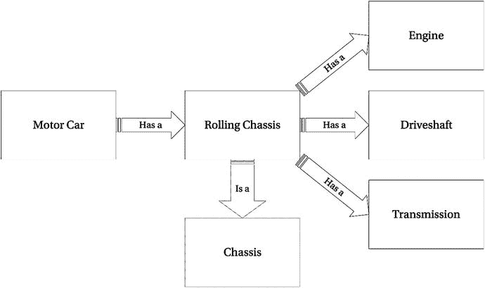
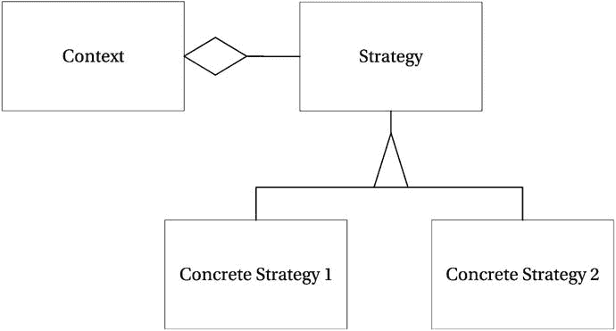
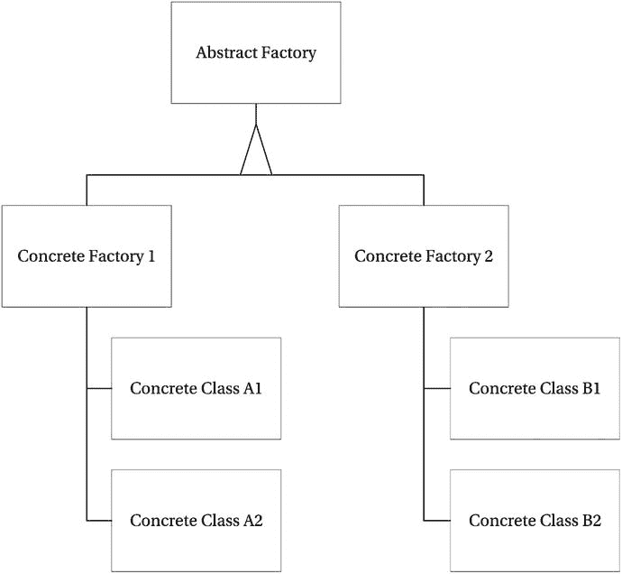

# 4. TypeScript 中的面向对象编程

> 构建软件设计有两种方式：一种方式是使其简单到明显没有缺陷，另一种方式是使其复杂到没有明显缺陷。第一种方法要困难得多。它需要同样的技巧、投入、洞察力，甚至灵感，就像发现那些构成复杂自然现象基础的简单物理定律一样。 —— 托尼·霍尔

面向对象编程允许用包含数据和相关行为的代码来表示现实世界中的概念。这些概念通常被建模为类，数据对应属性，行为对应方法，而这些类的具体实例被称为对象。

多年来，关于面向对象编程一直有许多讨论，而且我确信这场辩论在未来许多年仍将足够活跃。因为编程是一个启发式过程，你很少能找到一个绝对的答案。这就是为什么你会在软件开发中经常听到“视情况而定”这句话。没有一种编程范式适合所有情况，因此，任何告诉你函数式编程、面向对象编程或其他编程风格能解决所有问题的人，只是还没有接触到足够多样化的复杂问题。正因如此，编程语言正变得越来越多元化。

面向对象编程是计算机编程早期出现的许多良好实践的正式化。它提供了使这些良好实践更易于应用的概念。通过使用代码中的对象来对问题域中的真实世界对象进行建模，程序可以使用与其所服务的领域相同的语言。对象还允许封装或信息隐藏，这可以防止程序的不同部分修改另一部分所依赖的数据。

支持诸如面向对象等编程概念的最简单解释并非来自软件世界，而是来自心理学。G. A. 米勒发表了他著名的论文《神奇的数字七，加减二》（《心理学评论》，1956 年），描述了我们在任一时刻能在短期记忆中保留的信息数量的限制。我们的信息处理能力受限于这个介于五到九项信息之间的数字。这是任何代码组织技术的关键原因，在面向对象编程中，它应引导你走向抽象层，使得你首先能浏览高级概念，并在需要时再深入到细节层面。如果组织得当，维护代码的程序员在尝试理解你的程序时，需要同时处理的信息量会更少。

罗伯特·C·马丁（鲍勃大叔）在一次集体重构会议中以一种略有不同的方式提出了这个想法，他说编写良好的、“礼貌的”代码就像阅读报纸。你可以扫描程序中的高层级代码，就像它们是标题一样。维护代码的程序员会浏览这些标题，找到代码中的相关区域，然后再深入挖掘实现细节。这个想法的价值来自于包含相似抽象层级代码的小型、可读性强的函数。报纸的比喻为整洁代码的样子提供了清晰的愿景，但减少认知开销的原则仍然存在。

# TypeScript 中的面向对象

TypeScript 提供了在程序中使用面向对象所需的所有关键工具。

-   类

-   类的实例

-   方法

-   继承

-   开放递归

-   封装

-   委托

-   多态

类、类的实例、方法和继承已在第 1 章详细讨论过。它们是面向对象程序的构建块，而语言本身以简单的方式使这些成为可能。对于这些概念中的每一个，你只需要一两个语言关键字。

列表中的其他术语值得进一步解释，特别是关于它们如何在 TypeScript 类型系统中工作。以下各节将结合演示每个概念的代码示例，对开放递归、封装、委托和多态的概念进行扩展说明。

> **注意**
> 尽管本章详细讨论了面向对象，但请勿忘记 JavaScript（以及 TypeScript）是一种多范式语言。特别是，其中有一些优秀的函数式编程特性，即使你在编写面向对象代码时，也不应忽视它们。

## 开放递归

开放递归是递归和后期绑定的组合。当一个类中的方法调用自身时，该调用可以被转发到子类中定义的替代方法。清单 4-1 是一个读取目录内容的类的示例。`FileReader` 类根据提供的路径读取内容。任何文件都会被添加到文件树中，但当找到目录时，会递归调用 `this.getFiles`。这些调用将持续到整个路径（包括所有子文件夹）都被添加到文件树中。`fs.readdirSync` 和 `fs.statSync` 方法属于 NodeJS，在第 7 章中有更详细的介绍。

> **注意**
> 我使用了 NodeJS 文件系统调用的同步版本 `readdirSync` 和 `statSync`，因为它们使示例更简单。在实际程序中，你应该考虑使用标准等效方法 `readdir` 和 `stat`，它们是异步的并接受回调函数。

`LimitedFileReader` 是 `FileReader` 类的子类。当你创建 `LimitedFileReader` 类的实例时，必须指定一个数字来限制该类所表示的文件树的深度。此示例展示了 `this.getFiles` 的调用如何使用开放递归。如果你创建了一个 `FileReader` 实例，对 `this.getFiles` 的调用是一个简单的递归调用。如果你创建了一个 `LimitedFileReader` 实例，那么在 `FileReader.getFiles` 方法内对 `this.getFiles` 的相同调用实际上会被分派到 `LimitedFileReader.getFiles` 方法。

```typescript
import * as fs from 'fs';
interface FileItem {
path: string;
contents: string[];
}
class SyncFileReader {
getFiles(path: string, depth: number = 0) {
const fileTree = [];
const files = fs.readdirSync(path);
for (let file of files) {
const stats = fs.statSync(file);
let fileItem: FileItem;
if (stats.isDirectory()) {
// 添加目录及其内容
fileItem = {
path: file,
contents: this.getFiles(file, (depth + 1))
};
} else {
// 添加文件
fileItem = {
path: file,
contents: []
};
}
fileTree.push(fileItem);
}
return fileTree;
}
}
class LimitedFileReader extends SyncFileReader {
constructor(public maxDepth: number) {
super();
}
getFiles(path: string, depth = 0) {
if (depth > this.maxDepth) {
return [];
}
return super.getFiles(path, depth);
}
}
// 实例化 LimitedFileReader 的一个实例
const fileReader = new LimitedFileReader(1);
// 结果只读取了顶层和一个额外层级
const files = fileReader.getFiles('path');
```

*清单 4-1. 开放递归*

这个开放递归的例子可以总结如下：

-   当你创建一个新的 `SyncFileReader` 时：

    -   `fileReader.getFiles` 是对 `SyncFileReader.getFiles` 的调用

    -   `SyncFileReader` 内部的 `this.getFiles` 是对 `SyncFileReader.getFiles` 的调用

-   当你创建一个新的 `LimitedFileReader` 时：

    -   `fileReader.getFiles` 是对 `LimitedFileReader.getFiles` 的调用

    -   `super.getFiles` 是对 `SyncFileReader.getFiles` 的调用

    -   `SyncFileReader` 内部的 `this.getFiles` 是对 `LimitedFileReader.getFiles` 的调用

开放递归的妙处在于原始类保持不变，并且无需了解子类提供的特化功能。子类可以重用超类中的代码，从而避免了重复。

## 封装

TypeScript 完全支持封装。类实例可以包含属性以及对这些属性进行操作的方法；这就是数据和行为的封装。属性也可以使用 `private` 访问修饰符隐藏，从而对类实例外部的代码隐藏数据。

封装的一个常见用途是数据隐藏：防止从类外部访问数据，除非通过显式操作。清单 4-2 中的示例展示了一个 `Totalizer` 类，它有一个 `private total` 属性，该属性不能被 `Totalizer` 类外部的代码修改。当外部代码调用该类上定义的方法时，该属性可以发生变化。这消除了以下风险：

-   外部代码添加捐款而未添加税收返还；

-   外部代码未能验证金额是否为正数；

-   税收返还计算出现在调用代码的多个地方；

-   税率出现在外部代码的多个地方。

```typescript
class Totalizer {
private total = 0;
private taxRateFactor = 0.2;
addDonation(amount: number) {
if (amount <= 0) {
throw new Error('捐款金额异常');
}
const taxRebate = amount * this.taxRateFactor;
const totalDonation = amount + taxRebate;
this.total += totalDonation;
}
getAmountRaised() {
return this.total;
}
}
const totalizer = new Totalizer();
totalizer.addDonation(100.00);
const fundsRaised = totalizer.getAmountRaised();
// 120
console.log(fundsRaised);
```

*清单 4-2. 封装*

封装是帮助你在程序中防止大量重复代码的工具，但它并非神奇地实现这一点。你应该使用 `private` 关键字隐藏属性，以防止外部代码更改值或使用该值控制程序流程。最常见的重复形式之一是逻辑分支，例如 `if` 和 `switch` 语句，它们基于本应使用 `private` 关键字隐藏的属性来控制程序。当你更改属性时，你需要查找所有这些逻辑分支，这会在你的代码中产生令人担忧的连锁变更。

封装的最大好处在于，它极大地简化了理解代码的任务。类上的私有成员允许你在不查看该类之外的任何代码的情况下，准确理解该成员的用途。你可以保证该成员的每次使用都在你眼前，如果没有使用该成员，你可以安全地删除它，因为知道没有其他代码依赖于它。

一旦你提高了成员的可见性，如果不查看更广泛的代码集合，就无法再了解它是如何被使用的。如果你正在编写一个被其他程序使用的包，你不可能了解该成员的所有用途，因此事情会比私有成员复杂得多。

### 委托

在程序复用方面，最重要的概念之一就是委托。委托描述的是程序中一个部分将任务移交给另一个部分的情况。在真正的委托中，包装器会将自身的引用传递给委托对象，这使得委托对象能够回调原始包装器。例如，包装器类会调用委托类，并将关键字 `this` 传递给委托，允许委托调用包装器类中的公有方法。这使得包装器类与委托类能够像子类与超类一样运作。

当包装器不传递自身引用时，这种操作在技术上被称为转发，而非委托。在委托和转发中，你可能会调用一个类的方法，但该类会将处理过程移交给另一个类，如代码清单 4-3 所示。如果两个类之间的关系不符合“是一个”原则，那么委托和转发通常是继承的良好替代方案。

**注意**

面向对象中的“是一个”原则涉及描述对象之间的关系，以验证子类确实是超类的一个特化版本。例如，“猫是一种哺乳动物”和“储蓄账户是一种银行账户”。当关系不成立时，通常也很明显，例如，“汽车是一种底盘”不成立，但“汽车有一个底盘”则成立。“有一个”关系需要委托（或转发），而不是继承。

```
interface ControlPanel {
    startAlarm(message: string): any;
}
interface Sensor {
    check(): any;
}
class MasterControlPanel {
    private sensors: Sensor[] = [];
    constructor() {
        // 实例化委托对象 HeatSensor
        this.sensors.push(new HeatSensor(this));
    }
    start() {
        for (let sensor of this.sensors) {
            sensor.check();
        }
        window.setTimeout(() => this.start(), 1000);
    }
    startAlarm(message: string) {
        console.log('Alarm! ' + message);
    }
}
class HeatSensor {
    private upperLimit = 38;
    private sensor = {
        read: function() { return Math.floor(Math.random() * 100); }
    };
    constructor(private controlPanel: ControlPanel) {
    }
    check() {
        if (this.sensor.read() > this.upperLimit) {
            // 回调包装器
            this.controlPanel.startAlarm('Overheating!');
        }
    }
}
const controlPanel = new MasterControlPanel();
controlPanel.start();
```

代码清单 4-3. 委托

代码清单 4-3 是一个简单的委托示例。`ControlPanel` 类将自身传递给 `HeatSensor` 构造函数，这使得 `HeatSensor` 类能够在需要时调用 `ControlPanel` 的 `startAlarm` 方法。`ControlPanel` 可以协调任意数量的传感器，并且每个传感器在检测到问题时都可以回调 `ControlPanel` 来触发警报。

我们可以在此基础上进一步扩展，演示可以选择继承或委托的各种决策点。图 4-1 描述了各种汽车组件之间的关系。底盘是构建汽车的基本骨架，是汽车的基础框架。当引擎、传动轴和变速箱安装到底盘上时，这种组合被称为滚动底盘。



图 4-1. 封装与继承

对于图中的每个关系，尝试阅读“是一个”和“有一个”这两种替代描述，看看你是否同意图中所示的关系。在进行面向对象编程的这些检查时，我们暂时搁置语法问题，因此你永远不需要使用“是一个”或“有一个”的变体。

### 多态性

在编程中，多态性指的是能够定义一个契约，并让多种不同类型来实现该契约的能力。使用某个实现契约的类的代码，不需要了解具体实现的细节。在 TypeScript 中，可以通过多种不同形式来实现多态性：

*   由多个类实现的接口；
*   由多个对象实现的接口；
*   由多个函数实现的接口；
*   带有多个特化子类的超类；
*   任何具有多个相似结构的结构体。

最后一点，“任何具有多个相似结构的结构体”，指的是 TypeScript 的结构类型系统，该系统会接受与所需类型兼容的结构体。这意味着，即使两个函数（或两个具有兼容结构的类，或两个具有相似结构的对象）没有显式实现某个命名类型，只要它们具有相同的签名和返回类型，你就能实现多态性，如代码清单 4-4 所示。

```
interface Vehicle {
    moveTo(x: number, y: number);
}
// 显式实现接口
class Car implements Vehicle {
    moveTo(x: number, y: number) {
        console.log('Driving to ' + x + ' ' + y);
    }
}
class SportsCar extends Car {
}
// 未显式实现 Vehicle 接口
class Airplane {
    moveTo(x: number, y: number) {
        console.log('Flying to ' + x + ' ' + y);
    }
}
class Satellite {
    moveTo(x: number) {
        console.log('Targeting ' + x);
    }
}
function navigate(vehicle: Vehicle) {
    vehicle.moveTo(59.9436499, 10.7167959);
}
const car = new SportsCar();
navigate(car);
const airplane = new Airplane();
navigate(airplane);
const satellite = new Satellite();
navigate(satellite);
```

代码清单 4-4. 多态性

代码清单 4-4 说明了 TypeScript 中的多态性。`navigate` 函数接受任何与 `Vehicle` 接口兼容的类型。具体来说，这意味着任何拥有名为 `moveTo`、且接受最多两个 `number` 类型参数的方法的类或对象。

**注意**

重要的是要记住，如果一个方法接受的参数更少，那么它在结构上就与另一个方法兼容。在许多语言中，即使参数在方法体中未使用，你也必须指定冗余的参数，但在 TypeScript 中，你可以省略它。如果契约指定了该参数，调用代码仍然可以传递它，这保证了多态性。

代码清单 4-4 中的 `navigate` 函数将指定的 `Vehicle` 发送到位于奥斯陆的挪威计算中心——多态性正是由奥利-约翰·达尔和克利斯登·奈加特在此创造。

该示例中定义的所有类型都与 `Vehicle` 定义兼容；`Car` 显式实现了该接口，`SportsCar` 继承自 `Car`，因此它也实现了 `Vehicle` 接口。`Airplane` 并未显式实现 `Vehicle` 接口，但它拥有一个兼容的 `moveTo` 方法，因此会被 `navigate` 函数接受。`Satellite` 类代表一个具有固定“y”坐标的交通工具，这意味着只能控制“x”坐标。这种类型仍然是兼容的，因为 TypeScript 允许接受参数更少的类型。根据结构接受兼容类型是 TypeScript 结构类型系统的一个特性，这在第 3 章中有描述。

## SOLID 原则

面向对象编程与其他编程范式一样，并不能避免程序变得混乱或难以维护。这正是五项启发式设计准则——通常被称为 SOLID 原则——存在的原因。

SOLID 原则由罗伯特·C·马丁（Robert C. Martin）整理归纳，并在一系列在线文章和几本书籍中进行了描述（`http://www.objectmentor.com/resources/articles/Principles_and_Patterns.pdf`，2000 年；《敏捷原则、模式与实践（C#版）》，Prentice Hall，2006 年）。后来，迈克尔·费瑟斯（Michael Feathers）发现了“SOLID”这个缩写词。幸运的是，原则的顺序并不重要，因此可以重新排列以形成这个更易记的形式。这些原则旨在成为支撑面向对象编程与设计的基本信条。总体而言，这些原则为创建可读性强且可维护的代码提供了指导。

重要的是要记住，软件设计是一个启发式过程。不可能创建像清单一样可以简单遵循的规则。SOLID 原则是帮助您从面向对象的角度思考程序设计的指南，并能帮助您在特定情境下做出明智的设计决策。这些原则还提供了一种通用语言，可用于与其他程序员讨论设计方案。

五项 SOLID 原则如下：

*   **单一职责原则** —— 一个类的变更原因应该只有一个，且只能有一个。
*   **开闭原则** —— 应该可以在不修改一个类的情况下扩展其行为。
*   **里氏替换原则** —— 子类应该能够替换其父类。
*   **接口隔离原则** —— 多个特定于客户端的专用接口优于一个通用接口。
*   **依赖反转原则** —— 依赖抽象，而非具体实现。

以下各部分将分别讨论这五项 SOLID 原则。

### 单一职责原则（SRP）

## 单一职责原则（SRP）

SRP 要求一个类只能有一个变更原因。在设计类时，您应该致力于将相关功能放在一起，确保它们因相同原因而变更，并将可能因不同原因而变更的功能分开。遵循此原则的程序所拥有的类仅执行少数几项相关的任务。这样的程序很可能具有高内聚性。

术语“内聚性”指的是类或模块内部功能相关性的度量。如果功能不相关，则该类的内聚性低，并且可能因多种不同原因而变更。正确应用 SRP 会带来高内聚性。

当您向程序添加代码时，需要有意识地决定其归属。此原则的大多数违反并非来自那些方法明显与其所属类不匹配的明显情况。更常见的情况是，一个类在一段时间内，在众多不同程序员的维护下，逐渐越过了其最初的设计目的。

在考虑 SRP 时，您不必将思维局限于类，因为该原则具有分形性。您可以将此原则应用于方法，确保每个方法只做一件事，因此只有一个变更原因。您也可以将此原则应用于模块，确保在宏观层面上，模块只有一个责任领域。

清单 4-5 展示了一个典型的违反 SRP 的例子。乍一看，所有的方法似乎都属于 `Movie` 类，因为它们都使用电影属性执行操作。然而，持久化逻辑的出现模糊了将 `Movie` 类作为对象使用与将其作为数据结构使用的界限。

```
class Movie {
private db: DataBase;
constructor(private title: string, private year: number) {
this.db = DataBase.connect('user:pw@mydb', ['movies']);
}
getTitle() {
return this.title + ' (' + this.year + ')';
}
save() {
this.db.movies.save({ title: this.title, year: this.year });
}
}
// 电影
const movie = new Movie('实习大叔', 2013);
movie.save();
清单 4-5.
单一职责原则（SRP）违反示例
```

为了防止这个类演变成更大的问题，我们可以将这两个关注点分开：`Movie` 类负责与电影相关的行为，而 `MovieRepository` 则负责存储数据，如清单 4-6 所示。如果为 `Movie` 类添加新功能，`MovieRepository` 无需任何更改。如果您要更换数据存储设备，`Movie` 类也无需更改。

```
class Movie {
constructor(private title: string, private year: number) {
}
getTitle() {
return this.title + ' (' + this.year + ')';
}
}
class MovieRepository {
private db: DataBase;
constructor() {
this.db = DataBase.connect('user:pw@mydb', ['movies']);
}
save(movie: Movie) {
this.db.movies.save(JSON.stringify(movie));
}
}
// 电影
const movie = new Movie('实习大叔', 2013);
// MovieRepository
const movieRepository = new MovieRepository();
movieRepository.save(movie);
清单 4-6.
分离变更原因
```

如果你牢记单一职责原则，在类级别上关注其责任通常很直接，但在方法级别上可能更为重要，要确保每个方法只执行一项任务，并且其命名方式能揭示该方法预期的行为。“鲍勃大叔”创造了“提取到不能提取为止”这个短语，指的是持续重构方法，直到每个方法的行数都少到只能做一件事。这种广泛重构方法的实践所付出的努力远远值得，因为它能带来设计上的改进。

## 开闭原则（OCP）

OCP 通常被概括为：软件实体应对扩展开放，对修改关闭。从务实的角度来看，无论你在前期对程序做了多少设计，几乎都无法完全避免后续的修改。然而，修改现有类的风险在于，你可能会无意中引入行为变化，这种变化会波及依赖该类的代码。自动化测试（在第 10 章中介绍）可以在一定程度上（但并非完全）缓解这个问题。

要遵循 OCP，你需要考虑程序中可能发生变化的部分。例如，尝试识别任何包含你未来可能希望替换或扩展的行为的类。这其中的一个小问题是，通常我们无法预测未来，而且如果你引入了意在后期才发挥作用的代码，往往风险很大。试图猜测可能发生的事情可能会很麻烦，因为要么这些代码最终从未被使用，要么真正的未来走向与你的预测不符。因此，你需要在应用这个原则时保持务实，这有时意味着只有在实际中第一次遇到问题时才引入相应的代码来解决问题。

牢记这些提醒，遵循 OCP 的一种常见做法是，允许用一个类替换另一个类，从而获得不同的行为。在大多数面向对象语言中，这是一件相当简单的事情，TypeScript 也不例外。清单 4-7 展示了一个名为 `RewardPointsCalculator` 的积分卡点数计算类。标准的奖励点数是“在商店每消费一美元，获得四个积分”。当决定为某些 VIP 客户提供双倍积分时，不是直接在原有的 `RewardPointsCalculator` 类中添加条件分支，而是创建一个名为 `DoublePointsCalculator` 的子类来处理新的行为。在这个例子中，子类调用了父类中原有的 `getPoints` 方法，但它也可以完全忽略原始类，以任何它想要的方式计算点数。

如果决定只对某些符合条件的购买行为给予奖励积分，那么可以创建一个类，在调用原始的 `RewardPointsCalculator` 之前，根据交易类型进行过滤——这同样是扩展应用程序的行为，而不是修改现有的 `RewardPointsCalculator` 类。

```
class RewardPointsCalculator {
getPoints(transactionValue: number) {
// 每消费一美元获得 4 个积分
return Math.floor(transactionValue) * 4;
}
}
class DoublePointsCalculator extends RewardPointsCalculator {
getPoints(transactionValue: number) {
const standardPoints = super.getPoints(transactionValue);
return standardPoints * 2;
}
}
const pointsCalculator = new DoublePointsCalculator();
// 800
alert(pointsCalculator.getPoints(100.99));
清单 4-7.
开闭原则（OCP）
```

通过遵循 OCP，程序更有可能包含可维护和可重用的代码。通过避免在现有类中进行返工，你也可以避免更改后可能在整个程序中引起连锁反应的冲击波。已知可正常工作的代码保持原样不动，而新代码则用于处理新的需求。

## 里氏替换原则（LSP）

在《数据抽象与层次结构》一书中，Barbara Liskov（ [`http://www.sr.ifes.edu.br/∼mcosta/disciplinas/20091/tpa/recursos/p17-liskov.pdf`](http://www.sr.ifes.edu.br/%E2%88%BCmcosta/disciplinas/20091/tpa/recursos/p17-liskov.pdf) ，1988）写道：

> 这里所需的是如下替换特性：如果对于类型 S 的每个对象 o1，都存在一个类型 T 的对象 o2，使得在所有以 T 方式定义的程序 P 中，当 o1 替换 o2 时，程序 P 的行为保持不变，那么 S 是 T 的子类型。——Barbara Liskov

其核心思想是，如果你用一个子类替换一个父类，那么使用该类的代码不应该需要知道替换已经发生。如果你发现自己在程序中测试对象的类型，那么你很可能是违反了 LSP。该原则的具体要求将在后面描述，以父类 `Animal` 和继承自 `Animal` 的子类 `Cat` 为例进行说明。

-   子类型中方法参数的**逆变**：如果父类有一个方法接受 `Cat` 类型参数，那么子类方法应接受 `Cat` 或其父类 `Animal` 类型的参数。

-   子类型中返回类型的**协变**：如果父类有一个方法返回 `Animal` 类型，那么子类方法应返回 `Animal` 类型，或 `Animal` 的子类型（例如 `Cat`）。

-   子类型应抛出与父类型相同的异常，或父类型异常的子类型异常：在 TypeScript 中，你不限于使用异常类；你可以直接指定一个字符串来抛出异常。可以在 TypeScript 中创建错误类，如清单 4-8 所示。关键在于，如果调用代码有一个异常处理块，它不应该被子类抛出的异常所惊到。关于异常处理的更多信息，请参见第 8 章。

```
class ApplicationError implements Error {
constructor(public name: string, public message: string) {
}
}
throw new ApplicationError('示例错误', '发生了一个错误');
```
清单 4-8. 错误类

LSP 通过确保在程序中添加新行为时，新代码可以替代旧代码，从而支持了 OCP。如果一个子类不能直接替换其父类，那么添加一个新的子类将导致整个代码中发生更改，甚至可能导致程序流程被基于对象类型进行分支的条件判断所控制。

### 接口隔离原则（ISP）

我们经常发现一个接口本质上只是对整个类的描述。这种情况通常发生在接口是在类之后编写的情况下。清单 4-9 展示了一个打印机接口的简单示例，该打印机可以复印、打印和装订文档。由于该接口只是描述打印机所有行为的一种方式，随着新功能的增加（例如，折叠、装入信封、传真、扫描和电子邮件功能最终可能都会出现在`Printer`接口中），它也会随之膨胀。

```
interface Printer {
copyDocument();
printDocument(document: Document);
stapleDocument(document: Document, tray: number);
}
```
清单 4-9. 打印机接口

ISP 指出，我们不应创建这些庞大的接口，而应编写一系列更小、更具体的接口，并由类来实现它们。每个接口描述一组独立的行为，使得代码可以依赖于一个只提供所需行为的小接口。不同的类可以提供这些小接口的实现，而无需实现额外的不相关功能。

清单 4-9 中的 `Printer` 接口使得实现一台只能打印和复印但不能装订的打印机变得不可能——更糟糕的是，必须实现 `staple` 方法来抛出一个错误，表明操作无法完成。随着接口不断变大，一台打印机满足 `Printer` 接口的可能性会随着时间的推移而降低，并且向接口添加新方法变得困难，因为它会影响多个实现。清单 4-10 展示了一种替代方法，它将方法分组到更具体的接口中，这些接口描述了多个契约，可以由简单的打印机或简单的复印机单独实现，也可以由全能的高级打印机实现。

```
interface Printer {
printDocument(document: Document);
}
interface Stapler {
stapleDocument(document: Document, tray: number);
}
interface Copier {
copyDocument();
}
class SimplePrinter implements Printer {
printDocument(document: Document) {
//...
}
}
class SuperPrinter implements Printer, Stapler, Copier {
printDocument(document: Document) {
//...
}
copyDocument() {
//...
}
stapleDocument(document: Document, tray: number) {
//...
}
}
```
清单 4-10. 分离后的接口

遵循 ISP 时，客户端代码不会被强制依赖于它不打算使用的方法。大型接口往往会鼓励以类似大型块的方式组织调用代码，而一系列小型接口则允许客户端实现小型可维护的适配器来与接口通信。

### 依赖倒置原则（DIP）

在传统的面向对象程序中，高层组件依赖低层组件，形成层级结构。组件之间的耦合导致系统僵化，难以修改，并且在引入更改时容易失败。模块也难以复用，因为将其移入新程序时必须同时引入一系列依赖项。

清单 4-11 展示了一个传统依赖关系的简单示例。高层 `LightSwitch` 类依赖于低层 `Light` 类。

```
class Light {
switchOn() {
//...
}
switchOff() {
//...
}
}
class LightSwitch {
private isOn = false;
constructor(private light: Light) {
}
onPress() {
if (this.isOn) {
this.light.switchOff();
this.isOn = false;
} else {
this.light.switchOn();
this.isOn = true;
}
}
}
```
清单 4-11. 高层类对低层类的依赖

DIP 明确指出，高层模块不应依赖低层组件，而应依赖抽象。反过来，抽象不应依赖细节，而应依赖更高级的抽象。简单来说，你可以通过依赖接口而不是类来满足 DIP。

清单 4-12 演示了 DIP 实践中的第一步，即添加一个 `LightSource` 接口来打破 `LightSwitch` 和 `Light` 类之间的依赖关系。我们可以通过将 `LightSwitch` 抽象化为一个 `Switch` 接口来继续此设计；`Switch` 接口将依赖 `LightSource` 接口，而不是低层的 `Light` 类。

```
interface LightSource {
switchOn();
switchOff();
}
class Light implements LightSource {
switchOn() {
//...
}
switchOff() {
//...
}
}
class LightSwitch {
private isOn = false;
constructor(private light: LightSource) {
}
onPress() {
if (this.isOn) {
this.light.switchOff();
this.isOn = false;
} else {
this.light.switchOn();
this.isOn = true;
}
}
}
```
清单 4-12. 实现依赖倒置原则（DIP）

DIP 扩展了 OCP 和 LSP 的概念。通过依赖抽象，代码与类的特定实现细节耦合度更低。这个原则影响巨大，但遵循起来相对简单，因为你需要做的只是提供一个抽象类或一个（或多个接口，同时牢记接口隔离原则）来依赖，而不是依赖一个具体类。

## 设计模式

在软件领域，设计模式提供了已知问题的目录以及针对每个问题的设计方案。这些模式并非过于刻板；相反，它们提供了一套工具集，你可以在每次使用时以不同的方式排列组合。最常用设计模式的权威来源是原始的“四人帮”著作《设计模式：可复用面向对象软件的基础》（Gamma, Helm, Johnson, & Vlissides, Addison Wesley, 1995）。

正如 Diaz 和 Harmes 所展示的那样（《Pro JavaScript 设计模式》，Apress，2007），可以将这些设计模式迁移到 JavaScript 中。如果能在普通 JavaScript 中实现，那么在 TypeScript 中也能实现。由于 TypeScript 提供了基于类的面向对象特性，在许多情况下，从传统设计模式示例到 TypeScript 的转换会更加自然。

TypeScript 非常适合设计模式，因为它提供了使用原始目录中所有创建型、结构型和行为型模式以及此后记录的大量其他模式所需的所有语言结构。下一节将通过 TypeScript 代码示例描述一小部分设计模式。

以下示例演示了策略模式和抽象工厂模式。这只是四人帮原著中描述的 24 种模式中的 2 种。下面将对这些模式进行总体描述，然后用于改进一个小程序的设计。

注意

尽管你可能事先对哪些设计模式能改进程序的设计有想法，但更常见且通常更可取的做法是让模式随着程序的增长而自然显现。如果你预测可能需要的模式，可能会猜错。如果你在扩展代码时让代码暴露问题，就不太可能创建大量不必要的类，也不太可能因遵循错误的设计而迷失方向。

### 策略模式

策略模式允许你封装不同的算法，使它们可以相互替换。在图 4-2 中，`Context` 类将依赖 `Strategy`，后者为具体实现提供了接口。任何实现该接口的类都可以在运行时传递给 `Context` 类。

策略模式的一个示例将在本节后面的实际示例中展示。



图 4-2. 策略模式

### 抽象工厂模式

抽象工厂模式是一种创建型设计模式。它允许你为相关对象的创建指定一个接口，而无需指定它们的具体类。该模式的目标是让一个类依赖于抽象工厂的行为，而抽象工厂将由不同的具体类实现，这些具体类可以在编译时或运行时进行更改。

图 4-3 所示的实际示例以及下文展示了抽象工厂模式的一个例子。



图 4-3. 抽象工厂模式

### 实际示例

为了说明策略模式和抽象工厂模式的使用，我们将使用一个洗车示例。洗车服务可以根据司机的消费金额运行不同等级的洗车服务。代码清单 4-13 展示了车轮清洁策略，其中包括一个车轮清洁类的接口，以及两个提供基础清洁或高级清洁的策略。

```
interface WheelCleaning {
cleanWheels(): void;
}
class BasicWheelCleaning implements WheelCleaning {
cleanWheels() {
console.log('Soaping Wheel');
console.log('Brushing wheel');
}
}
class ExecutiveWheelCleaning extends BasicWheelCleaning {
cleanWheels() {
super.cleanWheels();
console.log('Waxing Wheel');
console.log('Rinsing Wheel');
}
}
代码清单 4-13. 车轮清洁
```

代码清单 4-14 展示了清洁车身的策略。这与代码清单 4-13 中的 `WheelCleaning` 示例类似，但并非必须如此。当我们稍后将该示例转换为使用抽象工厂模式时，`WheelCleaning` 和 `BodyCleaning` 的代码都不会改变。

```
interface BodyCleaning {
cleanBody(): void;
}
class BasicBodyCleaning implements BodyCleaning {
cleanBody() {
console.log('Soaping car');
console.log('Rinsing Car');
}
}
class ExecutiveBodyCleaning extends BasicBodyCleaning {
cleanBody() {
super.cleanBody();
console.log('Waxing car');
console.log('Blow drying car');
}
}
代码清单 4-14. 车身清洁
```

代码清单 4-15 展示了更新为使用抽象工厂模式之前的 `CarWashProgram` 类。这是一个典型的“知道太多”的类示例。它与具体的清洁类紧密耦合，并负责根据所选程序创建相关类。

```
class CarWashProgram {
constructor(private washLevel: number) {
}
runWash() {
let wheelWash: WheelCleaning;
let bodyWash: BodyCleaning;
switch (this.washLevel) {
case 1:
wheelWash = new BasicWheelCleaning();
wheelWash.cleanWheels();
bodyWash = new BasicBodyCleaning();
bodyWash.cleanBody();
break;
case 2:
wheelWash = new BasicWheelCleaning();
wheelWash.cleanWheels();
bodyWash = new ExecutiveBodyCleaning();
bodyWash.cleanBody();
break;
case 3:
wheelWash = new ExecutiveWheelCleaning();
wheelWash.cleanWheels();
bodyWash = new ExecutiveBodyCleaning();
bodyWash.cleanBody();
break;
}
}
}
代码清单 4-15. 使用抽象工厂模式前的 CarWashProgram 类
```

抽象工厂本身是一个接口，它描述了每个具体工厂可以执行的操作。在代码清单 4-16 中，`ValetFactory` 接口提供了用于获取提供车轮清洁功能的类和提供车身清洁功能的类的方法签名。需要车轮清洁和车身清洁的类可以依赖于这个接口，并与指定实际清洁操作的类保持解耦。

```
interface ValetFactory {
getWheelCleaning() : WheelCleaning;
getBodyCleaning() : BodyCleaning;
}
代码清单 4-16. 抽象工厂
```

在代码清单 4-17 中，声明了三个具体工厂，它们分别提供青铜级、白银级或黄金级的洗车服务。每个工厂都提供与所需清洗级别相匹配的适当清洁类。

```
class BronzeWashFactory implements ValetFactory {
getWheelCleaning() {
return new BasicWheelCleaning();
}
getBodyCleaning() {
return new BasicBodyCleaning();
}
}
class SilverWashFactory implements ValetFactory {
getWheelCleaning() {
return new BasicWheelCleaning();
}
getBodyCleaning() {
return new ExecutiveBodyCleaning();
}
}
class GoldWashFactory implements ValetFactory {
getWheelCleaning() {
return new ExecutiveWheelCleaning();
}
getBodyCleaning() {
return new ExecutiveBodyCleaning();
}
}
代码清单 4-17. 具体工厂
```

代码清单 4-18 展示了应用抽象工厂模式后的更新类。`CarWashProgram` 类不再了解任何将执行洗车操作的具体类。`CarWashProgram` 现在通过构造函数接收合适的工厂，该工厂将提供执行清洁操作的类。这可以通过编译时机制或动态运行时机制来实现。

```
class CarWashProgram {
constructor(private cleaningFactory: ValetFactory) {
}
runWash() {
const wheelWash = this.cleaningFactory.getWheelCleaning();
wheelWash.cleanWheels();
const bodyWash = this.cleaningFactory.getBodyCleaning();
bodyWash.cleanBody();
}
}
代码清单 4-18. 使用中的抽象工厂模式
```

## 混入（Mixins）

混入提供了一种组合应用程序的替代方式，这种方式在设计模式书籍中没有明确涉及。

混入（Mixins）这个名字源自一种可定制的冰淇淋甜点，该甜点最初出现在马萨诸塞州萨默维尔的 Steve's Ice Cream 店铺。这种混入式甜点的理念是，你选择一种冰淇淋，然后添加另一种产品（例如一块糖果棒）来调味。自 1973 年出现在 Steve Herrell 的菜单上以来，这种混入（或压入）冰淇淋的概念已风靡全球。

在编程中，混入基于非常相似的概念。通过将多个混入类组合在一起，可以创建增强类，每个混入类都提供一种小的、可复用的行为。这些混入类既部分地作为接口，也部分地作为实现。

### TypeScript 混入

TypeScript 提供了两种混入风格：原始的简单混入和更新的真正混入。简单混入借助一个额外的函数来实现连接。应用混入的函数如列表 4-19 所示。该函数遍历 `baseCtors` 数组中每个混入类的实例成员，并将它们添加到 `derivedCtor` 类中。每次需要将混入应用到某个类时，都会使用此函数，并且在本节的示例中都会看到它的使用。

```typescript
function applyMixins(derivedCtor: any, baseCtors: any[]) {
    baseCtors.forEach(baseCtor => {
        Object.getOwnPropertyNames(baseCtor.prototype).forEach(name => {
            derivedCtor.prototype[name] = baseCtor.prototype[name];
        });
    });
}
// 列表 4-19. 混入启用函数
```

在程序中的某个位置添加此函数后，就可以开始使用混入了。在列表 4-20 中定义了一系列可复用的混入小类。这些类没有特定的语法。在本示例中，我们定义了一系列可能的行为：`Sings`、`Dances` 和 `Acts`。这些类作为行为菜单，可以混合搭配以创建由不同组合构成的不同风格。

# TypeScript 中的混入

```typescript
class Sings {
    sing() {
        console.log('Singing');
    }
}
class Dances {
    dance() {
        console.log('Dancing');
    }
}
class Acts {
    act() {
        console.log('Acting');
    }
}
// 列表 4-20. 可复用类
```

单独来看，这些类太小而无法发挥作用，但它们非常紧密地遵循了单一职责原则。虽然不限于单个方法，但核心思想是每个类代表一种可以通过类名概括的行为。为了使这些混入有用，需要将它们组合成可用的增强类。

在 TypeScript 中，使用 `implements` 关键字，后跟逗号分隔的混入列表来组成混入类。`implements` 关键字旨在表明混入类似于带有实现的接口。你还需要提供与所组合的所有混入相匹配的临时属性，如列表 4-21 所示。这些属性将在类声明之后直接调用 `applyMixins` 函数时被替换。

没有任何机制能确保你调用 `applyMixins` 函数时传入的类集合与在 `implements` 语句中列出的集合一致。你需要负责保持这两个列表同步。

```typescript
class Actor implements Acts {
    act: () => void;
}
applyMixins(Actor, [Acts]);

class AllRounder implements Acts, Dances, Sings {
    act: () => void;
    dance: () => void;
    sing: () => void;
}
applyMixins(AllRounder, [Acts, Dances, Sings]);
// 列表 4-21. 组合类
```

`Actor` 和 `AllRounder` 类没有真正的实现，只有由混入提供的实现的占位符。这意味着对于任何给定的行为，程序中只需要更改一个地方。使用增强类与使用程序中的任何其他类没有区别，如列表 4-22 所示。

```typescript
const actor = new Actor();
actor.act();

const allRounder = new AllRounder();
allRounder.act();
allRounder.dance();
allRounder.sing();
// 列表 4-22. 使用类
```

**注意**

你可能已经注意到，混入看起来有点像多重继承。TypeScript 中不允许多重继承。混入的关键在于使用 `implements` 关键字而不是 `extends` 关键字，这使得它们更像接口而不是超类。

### 何时使用混入

混入已经在 TypeScript 中得到一定支持——那么使用它们时应该注意什么呢？首先也是最重要的，为增强类添加实现的机制未经检查，因此必须非常小心地使用正确的类名列表调用 `applyMixins` 函数。这是一个需要充分测试的领域，以避免出现任何令人不快的意外。

决定使用混入还是经典继承通常取决于类之间的关系。在决定继承和委托时，通常使用“是（is a）”与“有（has a）”的测试，如前文所述。

*   汽车有一个底盘（A car has a chassis）。

*   滚动底盘是一个底盘（A rolling chassis is a chassis）。

继承仅用于在句子中“是（is a）”关系成立的情况，而委托则用于“有（has a）”更有意义的情况。对于混入，关系最好用“能做（can do）”来形容，例如：

*   演员能做表演（An actor can do acting）。或者

*   演员表演（An actor acts）。

你可以通过使用诸如 `Acting` 或 `Acts` 这样的名称来命名混入，从而强化这种关系。这会使你的类读起来像一个句子，例如 `Actor implements Acting`。

混入旨在允许将小单元组合成大单元，因此以下场景是使用混入的良好候选：

*   用可选特性组合类，混入即选项。

*   在许多类上复用相同的行为。

*   基于相似的特征列表创建许多变体。

### 限制

不能将混入与私有成员一起使用，因为如果这些成员未在增强类中实现，编译器将报错。如果混入和增强类都定义了同名的私有成员，编译器也会报错。

混入的另一个限制是，尽管方法实现会被映射到增强类，但属性值不会被映射；这一点在列表 4-23 中得到了演示。当从混入实现属性时，需要在增强类中对其进行初始化。为避免混淆，最佳做法是在混入中定义所需属性，但不提供默认值。

```typescript
class Acts {
    public message = 'Acting';
    act() {
        console.log(this.message);
    }
}

class Actor implements Acts {
    public message: string;
    act: () => void;
}
applyMixins(Actor, [Acts]);

const actor = new Actor();
// 记录'undefined'，而非'Acting'
actor.act();
// 列表 4-23. 属性未映射
```

如果属性不需要绑定到实例，可以使用静态属性，因为这些属性在从混入映射到增强类的方法中仍然可用。列表 4-24 是列表 4-23 的更新版本，通过使用静态属性解决了该问题。如果每个实例确实需要不同的值，则应在增强类中初始化实例属性。

```typescript
class Acts {
    public static message = 'Acting';
    act() {
        alert(Acts.message);
    }
}

class Actor implements Acts {
    act: () => void;
}
applyMixins(Actor, [Acts]);

const actor = new Actor();
// 记录'Acting'
actor.act();
// 列表 4-24. 静态属性可用
```

## 真正的混入

真正的混入提供了一种更可靠的机制来支持基于混入的组合。创建演员的等效混入如清单 4-25 所示。`Constructor` 类型是一个通用类型，用于描述带有构造函数且可接受零个或多个参数的对象。该混入在 `Acts` 函数中定义，该函数为任何传入的类扩展一个 `message` 属性和一个 `act` 方法。

要将混入应用于某个类，只需调用 `Acts` 函数并传入目标类即可。当你调用生成的混合类时，该类将拥有其原始成员以及混入的附加成员。

```typescript
type Constructor<T = {}> = new (...args: any[]) => T;
function Acts<TBase extends Constructor>(Base: TBase) {
    return class extends Base {
        message: string = 'Acting';
        act() {
            alert(this.message);
        }
    };
}
class Person {
    constructor(private name: string) {
    }
}
const Actor = Acts(Person);
const actor = new Actor('Alan');
// Acting
actor.act();
// 清单 4-25.
// 真正的混入。
```

为了展示使用多个混入创建混合类的对比案例，清单 4-26 展示了完整且真正的混入，它等效于之前关于唱歌、跳舞、表演的简单混入。

### 清单 4-26.
完整的真正混入。

```typescript
type Constructor = new (...args: any[]) => T;
function Sings(Base: TBase) {
  return class extends Base {
    sing() {
      alert('Singing');
    }
  };
}
function Dances(Base: TBase) {
  return class extends Base {
    dance() {
      alert('Dancing');
    }
  };
}
function Acts(Base: TBase) {
  return class extends Base {
    act() {
      alert('Acting');
    }
  };
}
class Person {
  constructor(private name: string) {
  }
}
const Actor = Acts(Person);
const AllRounder = Acts(Sings(Dances(Person)));
const actor = new Actor('Alan');
actor.act();
const allRounder = new AllRounder('Gene');
allRounder.act();
allRounder.dance();
allRounder.sing();
```

真正的混入带来的好处包括：消除了忘记调用`apply mixins`函数的可能性，并且支持所有成员。其语法需要一些功夫来掌握，但一旦你有了`Constructor`类型，剩下的部分就相当简单了。

## 总结
TypeScript 中包含了面向对象编程的所有基本构建块。该语言提供的工具使你能够将在其他语言中学到的所有面向对象原则和实践应用到你的程序中，利用 SOLID 原则来指导组合，并应用设计模式作为解决常见问题的成熟方案的参考。

面向对象本身并不能解决编写和维护解决复杂问题的程序时所遇到的难题。就像在任何其他编程范式中都可能写出糟糕的代码一样，使用面向对象同样可能写出差的代码；这就是模式与原则如此重要的原因。本章介绍的面向对象元素与第 10 章的测试技术相辅相成。

你可以通过编码练习（kata）来练习并提高面向对象的设计技能以及单元测试技能。附录 4 中描述了这些练习，并提供了一些示例供你尝试。

## 关键要点
- TypeScript 拥有编写面向对象程序所需的所有工具。
- SOLID 原则旨在保持代码的可塑性并防止其腐化。
- 设计模式是解决常见问题的现有且广为人知的方案。
- 你不必完全按照描述的方式来实现设计模式。
- 混入提供了一种替代的组合机制。
