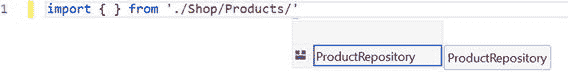
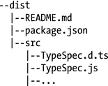

# 2. 代码组织

> 是程序员让语言显得简单，而非语言本身让程序显得简单！ — 罗伯特·C·马丁

本章讨论代码组织。主题涉及命名空间、模块、模块加载以及打包。本章首要目标是帮助你合理地将程序切分成易于查找、维护和使用的区块。

自 TypeScript 首次公开以来，部分术语已发生变化。为澄清这些术语，下文是对主要元素的描述：

*   **命名空间**（原称内部模块）为标识符创建上下文，减少程序中的命名冲突，并提供一种将代码组织成逻辑方案的机制。命名空间仅向全局作用域添加一个条目；该条目提供了一种层级机制，用于访问命名空间内所有公开的内容。
*   **模块**（原称外部模块）是一个完全隔离的上下文，不向全局作用域添加任何条目。模块可以导入其他模块，并导出可在模块外部使用的成员。模块由模块加载器支持，有多种选项可用于在浏览器中加载模块，以及使用在运行 Node 的 Web 服务器上常见的 CommonJS 加载器。
*   **包**是一种将多个代码文件交付给其他程序使用的机制。大多数包管理器采用一种格式，包含一个带有代码和元数据的结构化归档文件夹。该包可以发布在公共仓库（如许多开源项目所做的那样），也可以发布在私有仓库，例如公司范围内的包仓库。

一个命名空间可以分散在多个文件中，每个文件都为该命名空间贡献额外的成员。一个模块则完全等同于一个文件。我在本章中的一个目标是说服你优先使用模块而非命名空间，因为无论是当下还是当程序规模增长时，模块都能带来若干好处。

命名空间是一种与打包配合良好的简单机制。例如，当你使用 `--outFile` 编译器标志编译 TypeScript 代码，将输出合并到单个文件时。随着你引入更多命名空间，全局作用域中的条目数量会增加。当程序增长到一定规模，跟踪组件间的依赖关系会变得困难，输出文件也可能变得臃肿难用。虽然可以异步加载这个庞大的单个文件，但整个程序必须在运行前全部加载。命名空间可能是一个危险的陷阱，因为在你刚开始编写 TypeScript 程序时，它可能感觉毫无阻力；但从长远来看，这将成为一个让你后悔的决定。

尽管提出了警告，我仍将在本章中解释如何使用命名空间，但这并非对该特性的认可。任何关于 TypeScript 的书籍如果缺少对命名空间的解释都是不完整的，而且即使我成功说服你避免使用它们，你几乎肯定会在其他代码库中遇到，届时你会需要了解它们的工作原理。

## 命名空间

命名空间可用于将相关功能分组在一起。每个命名空间是一个单例实例，其所有内容都封装在命名空间的作用域内。通过将变量、函数、对象、类和接口分组到命名空间中，可以将它们置于全局作用域之外并避免命名冲突，尽管每个命名空间的根节点会被添加到全局作用域中。

命名空间是开放的，并且所有在同一根节点下具有相同名称的声明都会共同贡献给同一个命名空间。这使得命名空间可以在多个文件中描述，并允许你将每个文件保持在易于维护的大小。

示例 2-1 展示了两个命名空间，每个都包含一个名为 `Example` 的类。每个命名空间创建了独立的上下文，使得这两个类可以具有相同的名称。每个类都作为命名空间的成员被访问，从而明确了意图使用的类。

```
namespace First {
export class Example {
log() {
console.log('Logging from First.Example.log()');
}
}
}
namespace Second {
export class Example {
log() {
console.log('Logging from Second.Example.log()');
}
}
}
const first = new First.Example();
// Logging from First.Example.log()
first.log();
const second = new Second.Example();
// Logging from Second.Example.log()
second.log();
示例 2-1.
命名空间
```

命名空间可以组织成层级结构：要么通过相互嵌套，要么在提供命名空间标识符时使用点语法。这两种方式如示例 2-2 所示，层级的第一层和第二层通过嵌套实现，第三层则使用点分表示法添加。在实际应用中，如调用代码所示，所有这些声明都添加到了同一个层级结构中。

```
namespace FirstLevel {
export namespace SecondLevel {
export class Example {
}
}
}
namespace FirstLevel.SecondLevel.ThirdLevel {
export class Example {
}
}
const nested = new FirstLevel.SecondLevel.Example();
const dotted = new FirstLevel.SecondLevel.ThirdLevel.Example();
示例 2-2.
嵌套与点分层级结构
```

如果你在使用命名空间时，混合使用层级组织风格，并在多个文件中追加内容到命名空间，那么在修复 Bug 或添加新行为时，这会增加程序的心理复杂度。创建层级的主要驱动力应该是借助自动补全功能轻松定位功能。一个好的层级结构能使你的代码更易于查找，并减少交叉查阅文档的需求。

你可能已经注意到，示例 2-2 中的嵌套模块使用了 `export` 关键字。该关键字将命名空间成员标记为公开。如果没有 `export` 关键字，该命名空间成员只能在命名空间内部访问（包括对同一命名空间的后续追加）。这与类不同，类中成员默认是公开的。示例 2-3 是应用这些不同可见性级别的一个现实示例，导出的公开成员出现在前面，随后是仅供命名空间内部使用的变量和类。

```
namespace Shipping {
// 可作为 Shipping.Ship 访问
export interface Ship {
name: string;
port: string;
displacement: number;
}
// 可作为 Shipping.Ferry 访问
export class Ferry implements Ship {
constructor(
public name: string,
public port: string,
public displacement: number) {
}
}
// 仅在 Shipping 模块内部可用
const defaultDisplacement = 4000;
class PrivateShip implements Ship {
constructor(
public name: string,
public port: string,
public displacement: number = defaultDisplacement) {
}
}
}
const ferry = new Shipping.Ferry('Assurance', 'London', 3220);
示例 2-3.
公开与私有成员
```


`export`关键字的反义词是`import`。你可以使用`import`语句为另一个命名空间中的项创建别名，如清单 2-4 所示。`import`语句引用了`Shipping.Ship`类，并为其赋予别名“`Ship`”。此后，该别名可在`Docking`命名空间中作为简短名称使用，因此无论在命名空间中何处出现`Ship`，它都指向`Shipping.Ship`。当程序中包含长名称或深层嵌套时，这特别有用，因为它可以缩短注解的长度，从而减少因重复命名空间而造成的代码噪音。你可以在`import`别名中使用任何名称，但使用与导入成员相似的名称将有助于提高代码的可读性。

```
namespace Docking {
import Ship = Shipping.Ship;
export class Dock {
private dockedShips: Ship[] = [];
arrival(ship: Ship) {
this.dockedShips.push(ship);
}
}
}
const dock = new Docking.Dock();
Listing 2-4.
Import alias
```

`import`别名也可以在模块外部使用，以提供简短名称。

在引用其他文件中的命名空间时，代码编辑器与集成开发环境之间存在一些差异。Visual Studio 会自动将项目中的所有 TypeScript 文件纳入编译过程，这意味着你无需在引用它们时特别指定。其他代码编辑器则需要一些提示来帮助其发现所依赖代码的源文件。这些提示的格式就是引用注释，如清单 2-5 所示。无论你是否需要使用这些提示，你都需要负责让代码在运行时可用。

```
///
Listing 2-5.
Reference comments
```

如果你正在使用 TypeScript 编译器将项目编译为单个文件，那么根据依赖关系，引用注释还有助于编译器正确地对输出进行排序。由于代码通常需要在其被引用之前定义，因此这种排序对于程序在运行时的正常工作至关重要。你可以在附录 2 中阅读更多关于使用 TypeScript 编译器生成合并的单个输出文件的信息。

命名空间还有一个最终特性需要介绍，即声明合并。简单来说，任何跨越多个代码块的声明都属于声明合并的情况，例如两个同名的`interface`块会被合并为一个接口。命名空间超越了这种简单的合并，它允许与类、函数和枚举进行合并。这些混合体可能看起来有些奇怪，但它们代表了一种极为常见的 JavaScript 模式。

清单 2-6 演示了命名空间与类之间的声明合并。类和命名空间具有相同的名称，从而触发了合并。这使得代码既可以实例化该类的新实例，也可以实例化来自该命名空间的成员。

```
// Class/Namespace Merging
class Car {
}
namespace Car {
export class Engine {
}
export class GloveBox {
}
}
const car = new Car();
const engine = new Car.Engine();
const gloveBox = new Car.GloveBox();
Listing 2-6.
Namespace/class merging
```

现在你了解了命名空间，但请先克制住实现它们的冲动，因为有更好的方式来组织你的代码。命名空间限制了全局作用域中项的数量，而模块则更进一步，完全不会向全局作用域添加任何内容。模块还提供了解决命名冲突的方案，因为每个文件都为标识符提供了新的上下文。模块还有一个杀手级特性：你可以按需异步加载它们。因此，让我们现在来看看模块。

## 模块

模块是组织代码的优越方式。它们是服务端 TypeScript 的标准机制，并且作为 ECMAScript 规范的一部分，正在被浏览器采用。在接下来的部分中，我希望能够说服你选择模块而非命名空间。模块在各个方面都优于命名空间。命名空间减少了添加到全局作用域的项的数量，但模块完全自包含，不会在全局作用域中放置任何东西。命名空间在设计时组织你的代码，而模块则在设计时和运行时都进行组织。命名空间可以将你的程序扩展到数千行代码，而模块则能带你跨越百万行代码的门槛。模块是扩展真正大型程序的关键。尽管你可以合并并压缩所有 JavaScript 文件来缩小程序体积，但这终非长久之计。

为了进一步组织你的程序，你可以使用文件夹结构来管理你的模块。你只需在`import`语句中指明这个完整路径即可，因此路径长度不应该是问题。所有其他引用外部模块的代码都将通过`import`语句中指定的别名来引用它。

*   `./Transport/Maritime/Shipping`
*   `./Transport/Maritime/Docking`
*   `./Transport/Railways/Ticketing`

除了所有这些好处之外，模块还非常易于使用。一旦你在 TypeScript 文件中添加了`import`或`export`语句，它就变成了一个模块。清单 2-7 展示了一个简单的 shipping 模块示例。模块内部的所有内容都属于模块的作用域，除非它们被导出，否则在模块外部是不可见的。`Ship`接口和`Ferry`类通过`export`关键字被公开为可用成员。导出的成员可以是变量、函数、类、接口或任何你可以命名的其他东西。

```
export interface Ship {
name: string;
port: string;
displacement: number;
}
export class Ferry implements Ship {
constructor(
public name: string,
public port: string,
public displacement: number) {
}
}
const defaultDisplacement = 4000;
class PrivateShip implements Ship {
constructor(
public name: string,
public port: string,
public displacement: number = defaultDisplacement) {
}
}
Listing 2-7.
Modules
```

要使用一个模块，你可以通过多种导入样式之一来导入它。清单 2-8 中的`import`语句导入了整个模块，并为其赋予别名“`Shipping`”。模块成员可以通过`Shipping`变量进行访问。

```
// Import entire module
import * as Shipping from './Listing-2-007';
export class Dock {
private dockedShips: Shipping.Ship[] = [];
arrival(ship: Shipping.Ship) {
this.dockedShips.push(ship);
}
}
Listing 2-8.
Importing modules
```

你也可以选择性地导入模块成员，如清单 2-9 所示。通过在花括号内列出成员名称（如果有多个则用逗号分隔），你可以使用成员的简短名称。这消除了每次访问成员时都需要指定模块别名的需要。

```
// Import a single export from a module
import { Ship } from './Listing-2-007';
export class Dock {
private dockedShips: Ship[] = [];
arrival(ship: Ship) {
this.dockedShips.push(ship);
}
}
Listing 2-9.
Importing named module members
```

如果导入单个成员会导致命名冲突，你可以使用`as`关键字为该成员指定一个别名，如清单 2-10 所示。在`import`语句之后的其余代码中，你可以通过该别名来引用这个成员。

```
// Import using an alias
import { Ship as Boat } from './Listing-2-007';
export class Dock {
private dockedShips: Boat[] = [];
arrival(ship: Boat) {
this.dockedShips.push(ship);
}
}
Listing 2-10.
Imported members with an alias
```

当你在 TypeScript 中使用模块导入时，你可以使用`--module`编译器标志来针对不同的模块加载器。有选项可以针对 CommonJS (Node 环境)、AMD (RequireJS)、ESNext (原生浏览器模块) 以及其他几种模块风格。关于 TypeScript 编译器的更多详细信息，请参阅附录 2。


### 模块重导出

重导出允许你重新公开另一个模块，或另一个模块的一部分，而无需在本地使用它。清单 2-11 展示了如何导出另一个模块的一部分、如何为导出的成员引入别名，以及如何导出整个模块。

```
// 带别名的重导出
export { Ship as Boat } from './Listing-2-007';
// 导出整个模块
export * from './Listing-2-008';
清单 2-11.
重导出
```

你可以使用模块重导出将多个模块组合成一个单一的包装模块。

### 默认导出

每个模块可以标记一个成员为默认导出。默认导出可以是任何成员，例如类、函数或值。清单 2-12 展示了一个默认导出；它也可以用 `export default Yacht` 在单独一行表达。

```
export default class Yacht {
constructor(
public name: string,
public port: string,
public displacement: number) {
}
}
清单 2-12.
默认导出
```

当你导入默认导出时，可以使用清单 2-13 中所示的简写语句。如果模块没有默认导出，编译器会对此类导入风格发出警告。你可以在 import 语句中使用任何名称，无需与原始名称一致。

```
// 导入默认导出
import Yacht from './Listing-2-012';
// 错误：模块没有默认导出
import Ship from './Listing-2-007';
const yacht = new Yacht('The Sea Princess', 'Tadley', 150);
清单 2-13.
导入默认导出
```

如果你没有充分的理由使用默认导出，最好避免使用它们。需要为某个模块决定使用哪种导入语句，是一种不必要的认知负担。在导入过程中对默认导出的隐式重命名会增加额外的复杂性，尤其是在重命名重构时，导入名称并不会随之更改。

### 导出对象

某些模块类型支持导出对象，该对象封装了所有要导出的成员。这种模式是默认导出的前身，在 CommonJS 和 AMD 模块系统中很常见。你可以使用清单 2-14 所示的语法，通过 `export =` 语句来使用此模式。

```
class Ferry {
constructor(
public name: string,
public port: string,
public displacement: number) {
}
}
export = Ferry;
清单 2-14.
导出对象
```

使用这种风格的模块时，应使用清单 2-15 中所示的 `import/require` 风格的导入。

```
import Ferry = require('./Listing-2-014');
const ferry = new Ferry('Dartmouth Ferry', 'Dartmouth', 580)
清单 2-15.
导入导出对象
```

TypeScript 会根据编译时指定的模块类型，为这些语句生成不同的输出。你可以在附录 2 中阅读更多关于 TypeScript 编译器的内容。

### 模块加载

尽管有多种模块加载器，但它们都负责获取你所依赖的模块，并在加载完成后执行你的代码。由于 TypeScript 了解所有主要的模块风格，你可以编写标准的 import 和 export 语句，让编译器来处理差异。这也意味着你可以编译同一份 TypeScript 代码以针对不同的模块系统。

以下介绍最流行的模块类型：

- **原生 ECMAScript 模块**。这些在语法上与 TypeScript 格式相同，并在所有主流浏览器的最新版本中得到实验性支持。在获得广泛的工作支持之前，可以使用 RequireJS 或 SystemJS 在浏览器中加载模块。
- **AMD 模块**。除了管理模块加载，异步模块定义风格还允许同时加载多个模块，即使它们互相依赖。RequireJS 是 AMD 最常见的实现。
- **CommonJS 模块**。这是 NodeJS 主要的模块加载风格，并且是默认支持的。
- **UMD 模块**。通用模块定义是一种同时适用于 AMD 和 CommonJS 模块的标准。这允许相同的输出无需重新编译即可用于 RequireJS 和 NodeJS。
- **System 模块**。这种模块风格可用于浏览器和 NodeJS，并且对循环依赖有标准化的处理方式。

如果你是第一次选择模块系统，最灵活的两种选择是 UMD 或 System，因为它们既可以在浏览器中使用，也可以在服务器上使用。

#### 动态模块加载

在许多情况下，你只希望在特定情况下加载模块。使用动态模块加载可以避免不必要的网络调用和文件系统访问。要按需加载模块，你需要编写一个普通的 import 语句，但添加一个额外的条件语句，以便在满足条件时实际加载模块。

清单 2-16 包含获取模块的 import 语句，但这不会产生任何代码。`if` 语句中的 `require` 调用会导致模块被加载，并且仅在条件为真时执行。为了获得所有正常的类型检查和自动补全，一个 `typeof` 注解设置了 `ferry` 变量的类型。正是这个额外的变量包含了类型信息，而不是 import 语句中的 `Ferry` 别名。

```
// 为 require 函数声明 (Node)
declare function require(moduleName: string): any;
// 导入 - 实际上不生成代码
import { Ferry } from './Listing-2-007';
const condition = true;
if (condition) {
// 仅在条件为真时导入
const ferry: typeof Ferry = require("./Listing-2-007");
const myFerry = new ferry('', '', 0);
}
清单 2-16.
动态模块加载
```

动态模块加载迫使你的代码比普通导入更了解模块，因此执行动态加载的代码会根据你的模块类型而变化。清单 2-18 展示了与清单 2-17 等效的动态加载代码，但这次是针对 System 模块。由于你可以在浏览器和服务器上使用 SystemJS，如果你计划跨平台运行代码，这可能是最佳选择。

```
// 为 require 函数声明 (System JS)
declare const System: { import(module: string): Promise<any>; };
// 导入 - 实际上不生成代码
import { Ferry } from './Listing-2-007';
const condition = true;
if (condition) {
// 仅在条件为真时导入
System.import('./Listing-2-007').then((ferry: typeof Ferry) => {
const myFerry = new ferry('', '', 0);
});
}
清单 2-17.
动态模块加载 System 模块
```

第 6 章会进一步详细介绍使用 AMD 在 Web 浏览器中加载模块，第 7 章会介绍使用 CommonJS 在服务器上加载模块。


## 混用命名空间与模块

我将本节纳入文中，是因为过去五年里收到了大量关于该主题的询问。由于众多程序员具有 C# 或 Java 背景，这个疑问完全合情合理。在这类语言中，你按物理文件组织代码，却按命名空间进行逻辑导航；文件结构本身除了帮助程序员在项目中定位代码外，并无特殊意义。某些语言建议保持文件结构与命名空间相近，但文件层级与命名空间层级并不构成单一的组织要素。

若你使用 TypeScript 模块，文件系统便成为命名空间，你可以通过文件系统的自动补全功能来导航命名空间，如图 2-1 所示。大多数支持 TypeScript 的开发工具会在每个导航层级提供提示，协助你找到所需模块，不过这些提示的有效性直接取决于你对文件层次结构的组织与命名方式。



图 2-1. TypeScript 模块导航

将命名空间与模块混用毫无益处。模块所能提供的所有好处远超命名空间。命名空间的主要目的是提供作用域、命名上下文和可发现性，而这些功能模块已然具备：

- **作用域**。模块未向全局作用域添加任何内容，因此添加命名空间无法改善作用域管理。
- **命名冲突**。模块已为每个模块的名称提供独立上下文，命名空间在此方面同样无法做出改进。
- **可发现性**。模块已提供可发现性，在其基础上添加命名空间反而会削弱成员的可发现性。

尽管将另一种语言中行之有效的实践移植过来颇具诱惑力，但不应盲目为之。TypeScript 的早期目标之一，是让具有基于类语言经验的程序员更易上手 JavaScript 的面向对象编程；但如今 TypeScript 已是一门拥有自身惯用法的成熟语言，因此在考虑从其他语言借鉴思路时，值得权衡其利弊。混用命名空间与模块毫无益处，且弊端诸多，请务必避免。

## 打包

无论是为了复用而划分自有代码库，还是为他人提供使用，代码打包如今已是 TypeScript 的基本技能。在本节中，我将展示创建包含代码的 NPM 软件包所需的所有要素。NPM（Node 包管理器）是全球最大的软件注册表，也是 JavaScript（进而也是 TypeScript）的事实标准包管理方式。示例取自真实的 TypeSpec 项目，这是一个适用于 TypeScript 的行为驱动开发工具，可解析纯文本业务语言（采用 Gherkin 语法）并执行测试步骤以验证程序。

完整项目可在 GitHub 上查看：[`https://github.com/Steve-Fenton/TypeSpec`](https://github.com/Steve-Fenton/TypeSpec)

**注意**

包管理替代了传统工作流：在线搜索库、下载源码、解压内容、手动将源文件添加至项目。包不仅能一步获取并添加至项目，还能显式声明依赖关系，使其他项目无需先获取代码运行所需的众多库即可使用你的代码。你还可以管理依赖的版本，例如将依赖项升级至最新的稳定版。

要完成本节所有步骤，需安装 NodeJS（其中包含 NPM）。NodeJS 是服务器端 JavaScript 平台，但可在本地用于执行许多提升效率的任务。你可以从 [`https://nodejs.org/`](https://nodejs.org/) 下载 NodeJS。

创建 NPM 包需要三个要素：

- **`README.md`** – 以 Markdown 格式撰写的项目描述文件。
- **`package.json`** – 以 JSON 结构描述软件包的文件。
- **源代码** – 包内需包含的、供其他程序使用的文件。

编写包含 TypeScript 代码的软件包时，最好不要包含 TypeScript 源文件。而应将编译后的 JavaScript 代码连同自动生成的类型定义一起打包。这样，JavaScript 程序也能使用你的包，同时意味着你的 TypeScript 源代码无需被任何使用者重新编译。

生成包的最简单方法是将编译输出复制到独立的目录结构中，以便轻松打包而不包含不必要的文件（否则，你将花费更多时间指定哪些文件应包含或排除）。典型目录结构如图 2-2 所示，`dist` 文件夹中放置 `README.md` 和 `package.json` 文件，`.js` 和 `.d.ts` 文件则复制到 `src` 文件夹中。



图 2-2. 打包的目录结构

清单 2-18 展示了一个简化版的 `README.md` 文件，包含简洁的标题、描述以及安装指南。通常，该文件应包含基本使用说明和更详细文档的链接。此文件的目标应是消除摩擦，为初次使用你软件包的用户可能遇到的问题提供解答。

```
## TypeSpec
一个 TypeScript BDD 框架。
npm install typespec-bdd
其目标是将业务规范与代码合理分离，
但不同于（Java 或 C# 的 BDD 工具）生成代码的方式，
测试将在运行时动态加载并执行，
而无需将文本转换为中间语言或框架。
这使得测试可以使用任何单元测试框架编写——
甚至可以不使用框架。
```

清单 2-18. `README.md`


`package.json` 文件结构更清晰，其中许多字段是必填的。清单 2-19 展示了一个完整的包描述，包含了关于包、作者、文档以及问题日志位置的信息。许可协议应以软件包数据交换（SPDX）格式指定。

```
{
"author": "Steve Fenton",
"name": "typespec-bdd",
"description": "BDD framework for TypeScript.",
"keywords": [
"typespec",
"typescript",
"bdd",
"behaviour",
"driven"
],
"version": "0.0.1",
"homepage": "https://github.com/Steve-Fenton/TypeSpec",
"bugs": "https://github.com/Steve-Fenton/TypeSpec/issues",
"license": "(Apache-2.0)",
"files": [
"src/"
],
"repository": {
"url": "https://github.com/Steve-Fenton/TypeSpec"
},
"main": "src/TypeSpec.js",
"types":  "src/TypeSpec.d.ts",
"dependencies": { },
"devDependencies": { },
"optionalDependencies": { },
"engines": {
"node": "*"
}
}
清单 2-19.
package.json
```

包的内容通过 `"files"` 元素描述，该元素可以包含文件夹和单个文件，并通过 `"main"` 元素描述应用程序的入口点。当使用 TypeScript 时，你可以使用 `"types"` 元素为入口点提供类型定义。

要准备打包的文件，你只需将它们复制到分发文件夹中。这可以通过 Visual Studio 中的生成后事件（如清单 2-20 所示）或由任务运行器（如 Gulp）执行的任务来完成。

```
XCOPY $(ProjectDir)Scripts\TypeSpec\*.d.ts $(ProjectDir)dist\src\ /y
XCOPY $(ProjectDir)Scripts\TypeSpec\*.js $(ProjectDir)dist\src\ /y
XCOPY $(SolutionDir)README.md $(ProjectDir)dist\ /y
XCOPY $(ProjectDir)package.json $(ProjectDir)dist\ /y
清单 2-20.
复制包内容
```

一旦文件准备好打包，你只需运行清单 2-21 中的打包命令。这将生成一个包含你包的归档文件。你可以使用归档阅读器检查文件的内容，确保所有内容都如预期存在。

```
npm package
清单 2-21.
打包命令
```

你可以私下或公开使用该包。这意味着你可以使用相同的机制为全世界打包你的开源项目，或者将包添加到你的私有仓库。发布 NPM 包的命令如清单 2-22 所示。当你首次运行此命令时，系统会提示你通过命令行添加凭据，因为你只能发布你拥有适当权限的包。

```
npm publish
清单 2-22.
发布命令
```

尽管打包代码似乎有几个步骤，但一旦你完成了设置，发布新版本就变得简单，只需更新版本号并重新运行发布命令。

## 装饰器

在组织代码方面，大多数组织技术要么是水平对齐，要么是垂直对齐。一种常见的水平组织技术是 N 层架构，其中程序被拆分为处理用户界面、业务逻辑和数据访问的层。一种快速增长的垂直组织技术是微服务，其中每个垂直切片代表一个限界上下文，例如“支付”、“客户”或“用户”。

装饰器与水平架构和垂直架构都相关，但在垂直架构的上下文中尤其有价值。装饰器可用于处理横切关注点，例如日志记录、授权或验证。如果使用得当，这种面向切面的编程风格可以最大限度地减少满足这些共享职责所需的代码。

TypeScript 装饰器可用于面向切面编程（AOP）和元编程，但我们将从 AOP 开始，因为它提供了一个装饰器实际应用的可靠示例。

注意

TypeScript 装饰器仍处于实验阶段，在成为稳定特性之前可能会发生变化。根据你的 TypeScript 版本，你可能需要传递 `experimentalDecorators` 编译器标志以启用此特性。

装饰器的语法很直接。清单 2-23 展示了一个装饰器函数，以及针对 `square` 方法使用装饰器的示例，装饰器通过 `@` 符号应用。

```
// 装饰器函数
function log(target: any, key: string, descriptor: any) {
// square
console.log(key);
}
class Calculator {
// 使用装饰器
@log
square(n: number) {
return n * n;
}
}
清单 2-23.
装饰器
```

装饰器可以应用于以下任何一项：

*   类
*   访问器
*   属性
*   方法
*   参数

每种装饰器都需要不同的函数签名，因为根据装饰器的用途，装饰器会获得不同的参数。本节将提供几个实用的示例，可以作为你自定义装饰器的起点。

清单 2-24 展示了一个更完整的属性装饰器示例。除了在 `key` 参数中传递方法名称之外，属性描述符也会在 `descriptor` 参数中传递。属性描述符是一个对象，包含原始方法和一些元数据。该方法本身位于描述符的 `value` 属性中。当方法装饰器返回一个值时，该值将被用作描述符。这意味着你可以选择观察、修改或替换原始方法。

在日志记录方法装饰器的情况下，描述符中的原始方法被包装在一个日志记录函数中，该函数记录方法被调用的事实以及传递的参数和返回的值。每次调用该方法时，都会记录这些信息。

```
function log(target: any, key: string, descriptor: any) {
const original = descriptor.value;
descriptor.value = function (...args: any[]) {
// 调用原始方法
const result = original.apply(this, args);
// 记录调用及结果
console.log(`${key} with args ${JSON.stringify(args)} returned ${JSON.stringify(result)}`);
// 返回结果
return result;
}
return descriptor;
}
class Calculator {
// 使用装饰器
@log
square(num: number) {
return num * num;
}
}
const calculator = new Calculator();
// square with args [2] returned 4
calculator.square(2);
// square with args [3] returned 9
calculator.square(3);
清单 2-24.
日志记录方法装饰器
```

这个基础的日志记录示例意味着 `Calculator` 类中的代码无需了解程序中的日志记录逻辑。日志记录逻辑可以与程序中的其余代码完全分离，并且日志代码将完全负责何时何地记录信息。


### 可配置装饰器

通过将装饰器函数转换为装饰器工厂，可以使装饰器变得可配置。装饰器工厂是一个返回装饰器函数的函数，它可包含任意数量的参数，这些参数可用于装饰器的创建过程。

在代码清单 2-25 中，`log` 装饰器已被转换为装饰器工厂。该工厂接受一个 `title` 参数，该参数会被添加到日志消息的开头。

```
function log(title: string) {
return (target: any, key: string, descriptor: any) => {
const original = descriptor.value;
descriptor.value = function (...args: any[]) {
// 调用原始方法
const result = original.apply(this, args);
// 记录调用信息及返回值
console.log(`${title}.${key}
with args ${JSON.stringify(args)}
returned ${JSON.stringify(result)}`);
// 返回结果
return result;
}
return descriptor;
};
}
class Calculator {
// 使用可配置装饰器
@log('Calculator')
square(num: number) {
return num * num;
}
}
const calculator = new Calculator();
// Calculator.square with args [2] returned 4
calculator.square(2);
// Calculator.square with args [3] returned 9
calculator.square(3);
代码清单 2-25.
可配置装饰器
```

使用可配置装饰器时，参数会像函数调用一样传递。

### 类装饰器

为了使日志装饰器适用于类，必须用日志构造函数来包装原始构造函数。这比方法装饰器稍微复杂一些，但代码清单 2-26 中的示例可以快速从日志功能改编为其他用途。

类装饰器只接收一个参数，该参数代表被装饰类的构造函数。

```
function log(target: any) {
const original = target;
// 用日志构造函数包装原始构造函数
const constr: any = (...args) => {
console.log(`Creating new ${original.name}`);
const c: any = () => {
return original.apply(null, args);
}
c.prototype = original.prototype;
return new c();
}
constr.prototype = original.prototype;
return constr;
}
@log
class Calculator {
square(n: number) {
return n * n;
}
}
// Creating new Calculator
var calc1 = new Calculator();
// Creating new Calculator
var calc2 = new Calculator();
代码清单 2-26.
类装饰器
```

与方法装饰器一样，你可以选择修改、包装或替换类装饰器中传入的构造函数。替换构造函数时，必须保留原始原型，因为这一操作不会自动完成。

### 属性装饰器

属性装饰器可以分成几个部分。在代码清单 2-27 中，getter 和 setter 都被替换为了日志实现。为此，需要先删除原始属性，然后再添加同名的替代属性。

```
function log(target: any, key: string) {
let value = target[key];
// 替代 getter
const getter = function () {
console.log(`Getter for ${key} returned ${value}`);
return value;
};
// 替代 setter
const setter = function (newVal) {
console.log(`Set ${key} to ${newVal}`);
value = newVal;
};
// 替换属性
if (delete this[key]) {
Object.defineProperty(target, key, {
get: getter,
set: setter,
enumerable: true,
configurable: true
});
}
}
class Calculator {
@log
public num: number;
square() {
return this.num * this.num;
}
}
const calc = new Calculator();
// Set num to 4
calc.num = 4;
// Getter for num returned 4
// Getter for num returned 4
calc.square();
代码清单 2-27.
属性装饰器
```

每次调用属性的 getter 或 setter 时，访问操作都会被记录。如果你只关心装饰 getter 或 setter，可以单独将访问器装饰器应用于 getter 或 setter。

## 总结

如果你对 TypeScript 中众多选项感到困惑，可以通过坚持使用以下推荐的标准化设置来减轻负担。除非你有充分的理由不这样做，否则请使用模块而非命名空间；并且永远不要混合使用两者。使用一致的导入风格来简化依赖管理，并避免使用默认导出。

通过将文件系统作为一种命名空间形式，你的模块将更易于查找和使用；因此请关注文件和文件夹的命名。

打包应用程序时，自动化生成一个分发文件夹，其中包含编译后的 JavaScript 和 TypeScript 类型定义。这使你能够轻松地从分发文件夹发布，而无需过滤包内容。

装饰器允许你实现面向切面编程，并提供了一种元编程机制。

## 关键要点

- 内部模块现在称为“命名空间”。
- 外部模块现在简称为“模块”。
- 不要混合使用模块和命名空间。
- 有多种模块加载器，它们的语法略有不同；如果你尚未选择，可以考虑使用 SystemJS，因为它适用于所有环境。UMD 是一个不错的选择，因为它兼容 AMD 和 CommonJS 模块系统。
- 你可以打包代码，以便在其他程序中更轻松地重用。

